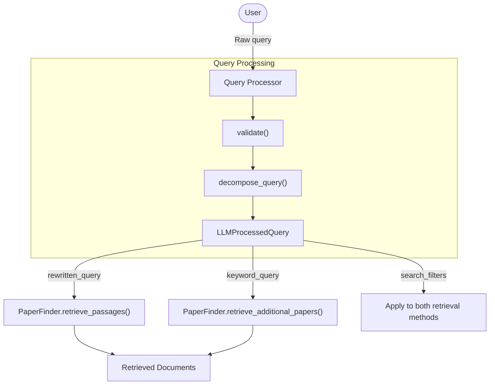
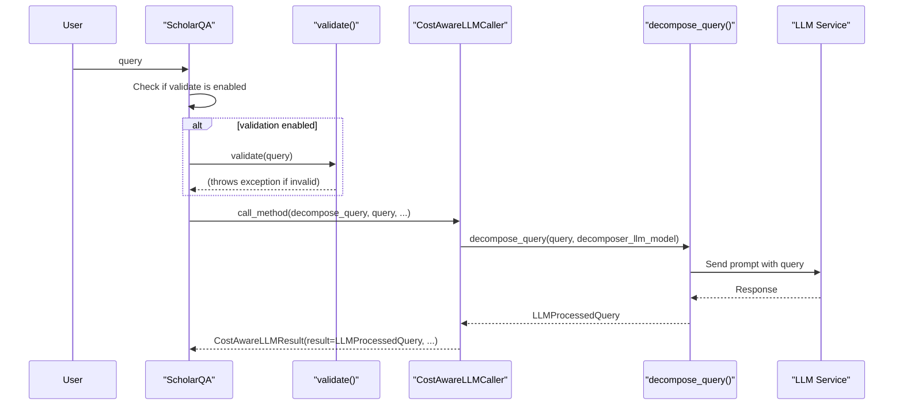

<!-- source: DeepWiki mcp.deepwiki.com · repo allenai/ai2-scholarqa-lib · page 3.1 Query Processing · fetched 2026-10-26 -->

# Query Processing

<details>
<summary>Relevant source files</summary>

The following files were used as context for generating this wiki page:

- [api/scholarqa/llms/constants.py](api/scholarqa/llms/constants.py)
- [api/scholarqa/scholar_qa.py](api/scholarqa/scholar_qa.py)
- [api/scholarqa/state_mgmt/local_state_mgr.py](api/scholarqa/state_mgmt/local_state_mgr.py)

</details>


## Overview

This document covers the query processing component of the ScholarQA system, which transforms raw user questions into optimized formats for scientific literature retrieval. Query processing is the critical first step in the retrieval-augmented generation (RAG) pipeline, occurring immediately after user input and before document retrieval.

For details about subsequent steps in the pipeline, see [Document Retrieval System](#3.2) and [Multi-Step QA Pipeline](#3.4).

## Query Processing Architecture

The query processing subsystem performs three main functions:
1. **Query validation**: Screens out harmful or unanswerable queries
2. **Query decomposition**: Extracts search parameters and filters
3. **Query transformation**: Generates optimized versions of the query for different retrieval approaches



Sources: [scholarqa/scholar_qa.py:84-93](), [scholarqa/scholar_qa.py:96-125]()

## LLM-Based Query Processing

ScholarQA leverages large language models (LLMs) to process user queries. The query processing is handled by the `preprocess_query` method in the `ScholarQA` class, which:

1. Optionally validates the query for harmful content
2. Uses an LLM to decompose and transform the query
3. Tracks the cost of these operations



Sources: [scholarqa/scholar_qa.py:84-93](), [scholarqa/llms/constants.py:11-16]()

## Key Data Structures

### LLMProcessedQuery

The output of query processing is an `LLMProcessedQuery` object with the following key components:

| Component | Purpose | Usage |
|-----------|---------|-------|
| `rewritten_query` | LLM-enhanced version optimized for relevance | Used for primary passage retrieval |
| `keyword_query` | Simplified version for broader coverage | Used for supplementary API-based retrieval |
| `search_filters` | Extracted search parameters | Applied to both retrieval methods |

### CostAwareLLMResult

All LLM operations are wrapped in cost-tracking structures to monitor usage:

```python
CostAwareLLMResult = namedtuple("CostAwareLLMResult", ["result", "tot_cost", "models"])
```

Sources: [scholarqa/llms/constants.py:16]()

## Implementation Details

### Query Validation

When enabled (via the `validate` flag), the system checks whether a query is appropriate for answering with scientific literature. This helps filter out:

- Harmful content
- Questions unrelated to scientific domains
- Queries that cannot be meaningfully answered with available literature

### Query Decomposition

The `decompose_query` function analyzes the query to:

1. Extract search filters like publication year, venue, field of study, or citation count
2. Generate a rewritten version optimized for retrieval
3. Create a keyword-based version for broader search coverage

### Integration with the Retrieval System

After processing, the query components are used in different retrieval approaches:

1. The `rewritten_query` is used with the Semantic Scholar index to retrieve relevant passages:
```python
snippet_results = self.paper_finder.retrieve_passages(
    query=rewritten_query,
    **llm_processed_query.search_filters,
    **kwargs
)
```

2. The `keyword_query` (if available) is used to find additional papers via keyword search:
```python
search_api_results = self.paper_finder.retrieve_additional_papers(
    keyword_query,
    **llm_processed_query.search_filters
)
```

Sources: [scholarqa/scholar_qa.py:96-125]()

## Tracing and Monitoring

Query processing is monitored using a tracing decorator:

```python
@traceable(name="Preprocessing: Validate and decompose user query")
def preprocess_query(self, query: str, cost_args: CostReportingArgs, ) -> CostAwareLLMResult:
    # Implementation...
```

This helps with debugging, performance monitoring, and cost tracking throughout the system.

Sources: [scholarqa/scholar_qa.py:83-93]()

## Pipeline Integration

Query processing is explicitly identified as "Step 0" in the ScholarQA pipeline. The system updates its state during processing to inform users about progress:

```python
self.update_task_state("Processing user query", task_estimated_time="~3 minutes", step_estimated_time=5)
```

The result of query processing is then traced through an event system:

```python
event_trace.trace_decomposition_event(llm_processed_query)
```

Sources: [scholarqa/scholar_qa.py:260-284]()

---

