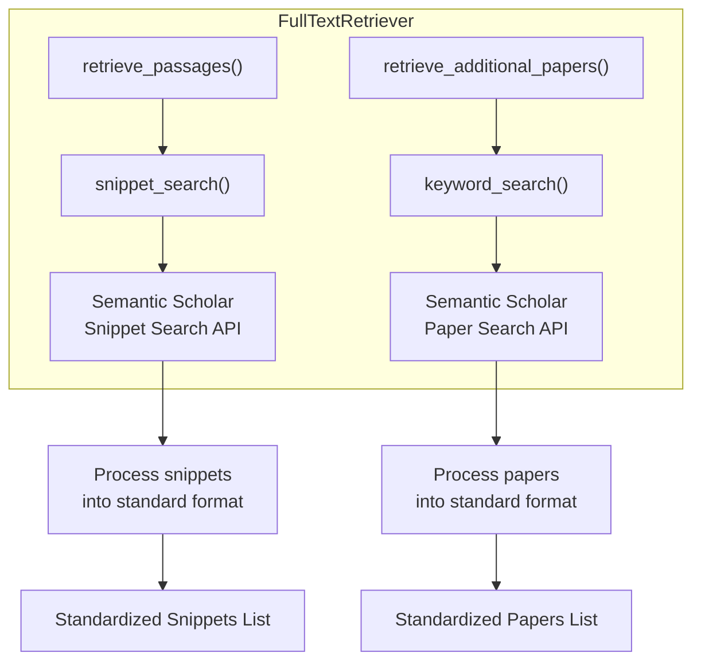
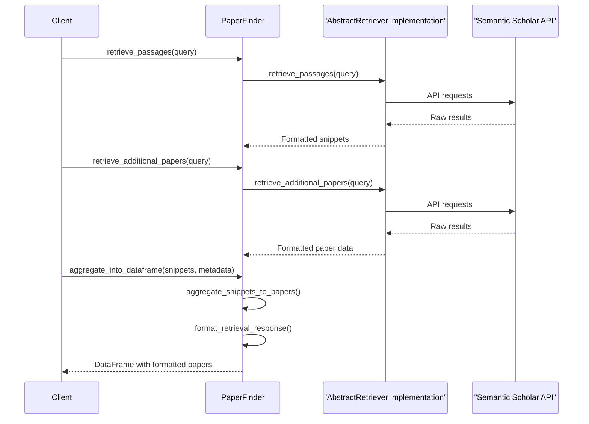
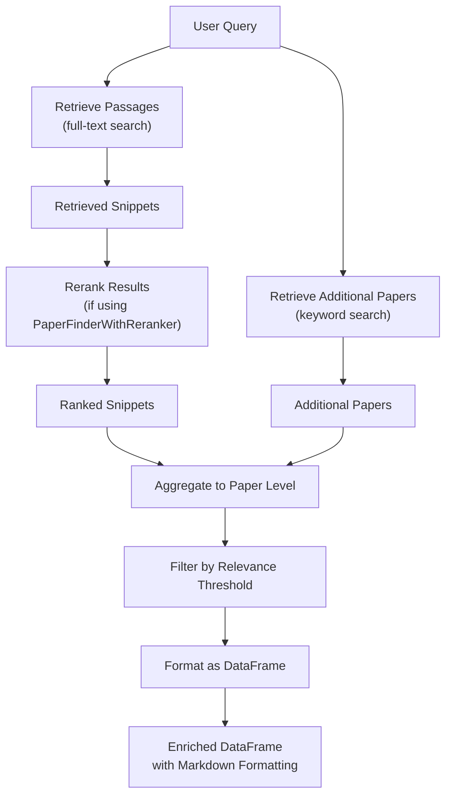
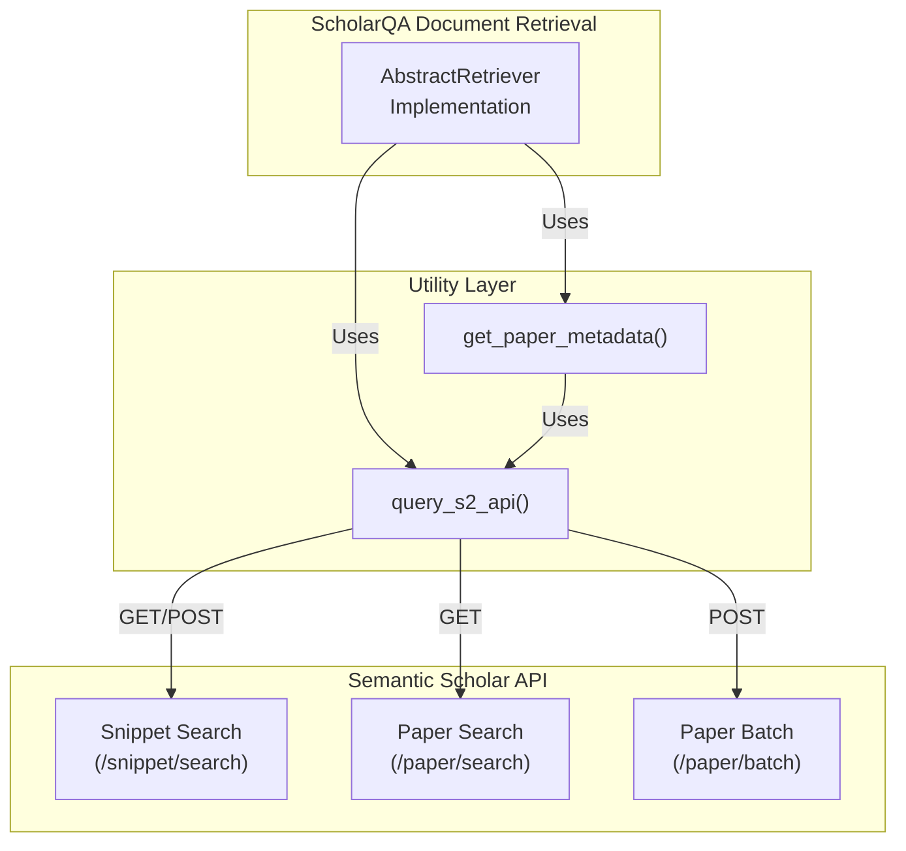

<!-- source: DeepWiki mcp.deepwiki.com · repo allenai/ai2-scholarqa-lib · page 3.2 Document Retrieval System · fetched 2026-10-26 -->

# Document Retrieval System

<details>
<summary>Relevant source files</summary>

The following files were used as context for generating this wiki page:

- [api/scholarqa/glog.py](api/scholarqa/glog.py)
- [api/scholarqa/rag/retrieval.py](api/scholarqa/rag/retrieval.py)
- [api/scholarqa/rag/retriever_base.py](api/scholarqa/rag/retriever_base.py)
- [api/scholarqa/utils.py](api/scholarqa/utils.py)

</details>


The Document Retrieval System is a core component of the AI2 ScholarQA framework that handles finding and retrieving relevant scientific papers and passages from external sources. This system forms the foundation of the Retrieval-Augmented Generation (RAG) pipeline, providing the raw textual content that later components will process, rerank, and synthesize to generate answers.

This document covers the architecture, components, and workflow of the document retrieval system. For information about how documents are reranked after retrieval, see [Document Reranking](#3.3). For details on how retrieved documents are processed in the QA pipeline, see [Multi-Step QA Pipeline](#3.4).

## System Architecture

The Document Retrieval System employs a modular architecture organized around several key classes that handle different aspects of the retrieval process.

```mermaid
classDiagram
    class "AbstractRetriever" {
        <<abstract>>
        +retrieve_passages(query, **filter_kwargs)
        +retrieve_additional_papers(query, **filter_kwargs)
    }
    
    class "FullTextRetriever" {
        +n_retrieval: int
        +n_keyword_srch: int
        +retrieve_passages(query, **filter_kwargs)
        +retrieve_additional_papers(query, **filter_kwargs)
        -snippet_search(query, **filter_kwargs)
        -keyword_search(kquery, **filter_kwargs)
    }
    
    class "AbsPaperFinder" {
        <<abstract>>
        +rerank(query, retrieved_ctxs)
    }
    
    class "PaperFinder" {
        +retriever: AbstractRetriever
        +context_threshold: float
        +n_rerank: int
        +retrieve_passages(query, **filter_kwargs)
        +retrieve_additional_papers(query, **filter_kwargs)
        +rerank(query, retrieved_ctxs)
        +aggregate_into_dataframe(snippets_list, paper_metadata)
        -aggregate_snippets_to_papers(snippets_list, paper_metadata)
        -format_retrieval_response(agg_reranked_candidates)
    }
    
    class "PaperFinderWithReranker" {
        +reranker_engine: AbstractReranker
        +rerank(query, retrieved_ctxs)
    }
    
    class "AbstractReranker" {
        <<abstract>>
    }
    
    AbstractRetriever <|-- FullTextRetriever
    AbstractRetriever <|-- AbsPaperFinder
    AbsPaperFinder <|-- PaperFinder
    PaperFinder <|-- PaperFinderWithReranker
    PaperFinderWithReranker --> AbstractReranker
    PaperFinder --> AbstractRetriever
```

Sources: [scholarqa/rag/retrieval.py:15-176](), [scholarqa/rag/retriever_base.py:10-112]()

## Core Components

### Abstract Base Classes

The retrieval system is built on a foundation of abstract base classes that define the core interfaces:

1. **AbstractRetriever**: Defines the interface for retrieving passages and additional papers.
2. **AbsPaperFinder**: Extends AbstractRetriever and adds reranking functionality.

These abstract base classes establish a contract that concrete implementations must follow, allowing for flexibility and interchangeability of retrieval methods.

Sources: [scholarqa/rag/retriever_base.py:10-18](), [scholarqa/rag/retrieval.py:15-19]()

### FullTextRetriever

The `FullTextRetriever` is a concrete implementation of `AbstractRetriever` that interfaces with the Semantic Scholar API to retrieve paper passages and metadata.

Key features:
- Performs full-text search via Semantic Scholar API's snippet search endpoint
- Performs keyword search to find additional papers
- Filters results based on quality criteria (e.g., text length)
- Transforms API responses into a consistent internal format



Sources: [scholarqa/rag/retriever_base.py:20-111]()

### PaperFinder

The `PaperFinder` class serves as the main coordinator for document retrieval. It wraps an underlying retriever and handles the aggregation and processing of retrieved passages.

Key responsibilities:
- Delegates retrieval to the underlying retriever implementation
- Aggregates passage-level results into paper-level results
- Formats papers into a consistent pandas DataFrame structure
- Applies relevance thresholds to filter results



Sources: [scholarqa/rag/retrieval.py:22-147]()

### PaperFinderWithReranker

The `PaperFinderWithReranker` extends `PaperFinder` by adding reranking capabilities using a reranker model (typically a cross-encoder). This allows the system to improve the relevance of retrieved passages by applying a more sophisticated scoring approach.

Key features:
- Uses a provided reranker implementation to score passages
- Reorders passages based on their reranker scores
- Limits the number of results based on configuration

Sources: [scholarqa/rag/retrieval.py:150-176]()

## Retrieval Process Flow

The document retrieval process flows through several stages:



Sources: [scholarqa/rag/retrieval.py:28-147]()

### Document Retrieval

The system retrieves documents using two primary methods:

1. **Full-text search**: Uses the Semantic Scholar API's snippet search endpoint to find passage-level matches to the query.
2. **Keyword search**: Uses the Semantic Scholar API's paper search endpoint to find additional papers that might be relevant.

Both methods accept filtering parameters to narrow down results (e.g., by year, venue, etc.).

Sources: [scholarqa/rag/retriever_base.py:25-111]()

### Document Aggregation

After retrieval, the system aggregates passage-level results to paper-level. This involves:

1. Grouping snippets by their paper ID (`corpus_id`)
2. Combining paper metadata with the retrieved snippets
3. Calculating a relevance score for each paper based on the scores of its snippets
4. Sorting papers by their relevance score

Sources: [scholarqa/rag/retrieval.py:38-72]()

### Data Formatting

The final step in the retrieval process is formatting the results into a pandas DataFrame with additional information that will be useful downstream:

1. Converting paper sections to markdown format
2. Adding formatted citation strings
3. Combining title, author, venue, and abstract information
4. Creating a comprehensive "relevance_judgment_input_expanded" field containing the paper content in markdown format

The final DataFrame contains standardized paper information that can be easily consumed by downstream components in the RAG pipeline.

Sources: [scholarqa/rag/retrieval.py:74-147]()

## Integration with Semantic Scholar API

The retrieval system relies heavily on the Semantic Scholar API to access scientific paper content and metadata. This integration is handled through utility functions in `scholarqa/utils.py`.



Key API endpoints used:
- `/snippet/search`: Retrieves text passages from papers matching a query
- `/paper/search`: Performs keyword search to find papers
- `/paper/batch`: Fetches metadata for multiple papers by ID

Sources: [scholarqa/utils.py:17-19](), [scholarqa/utils.py:102-133]()

## Document Data Structure

The retrieval system standardizes document data into a consistent format. The following table shows the key fields in the standardized document structure:

| Field | Description | Source |
|-------|-------------|--------|
| `corpus_id` | Unique identifier for a paper in Semantic Scholar | S2 API |
| `title` | Paper title | S2 API |
| `abstract` | Paper abstract | S2 API |
| `text` | Content of a retrieved snippet or passage | S2 API |
| `section_title` | Section name for the passage | S2 API |
| `score` | Initial relevance score | S2 API |
| `rerank_score` | Score from reranker (if used) | Reranker |
| `char_start_offset` | Character offset of snippet in original paper | S2 API |
| `sentence_offsets` | Sentence boundary information | S2 API |
| `ref_mentions` | References mentioned in the text | S2 API |
| `stype` | Source type (e.g., "vespa" or "public_api") | Internal |
| `relevance_judgment_input_expanded` | Formatted paper content for downstream processing | PaperFinder |
| `reference_string` | Formatted citation string | PaperFinder |

Sources: [scholarqa/rag/retriever_base.py:47-75](), [scholarqa/rag/retrieval.py:132-146]()

## Configuration Options

The Document Retrieval System can be configured through various parameters:

| Parameter | Class | Description | Default |
|-----------|-------|-------------|---------|
| `n_retrieval` | FullTextRetriever | Maximum number of passages to retrieve | 256 |
| `n_keyword_srch` | FullTextRetriever | Maximum number of papers to retrieve via keyword search | 20 |
| `context_threshold` | PaperFinder | Minimum relevance score threshold for papers | 0.0 |
| `n_rerank` | PaperFinder | Number of passages to keep after reranking (-1 means keep all) | -1 |

Sources: [scholarqa/rag/retriever_base.py:21-23](), [scholarqa/rag/retrieval.py:23-26](), [scholarqa/rag/retrieval.py:151-153]()

---

