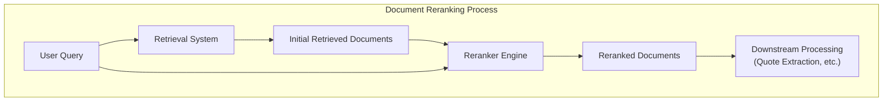
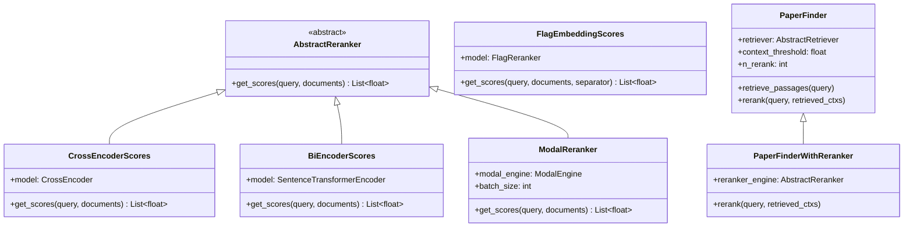
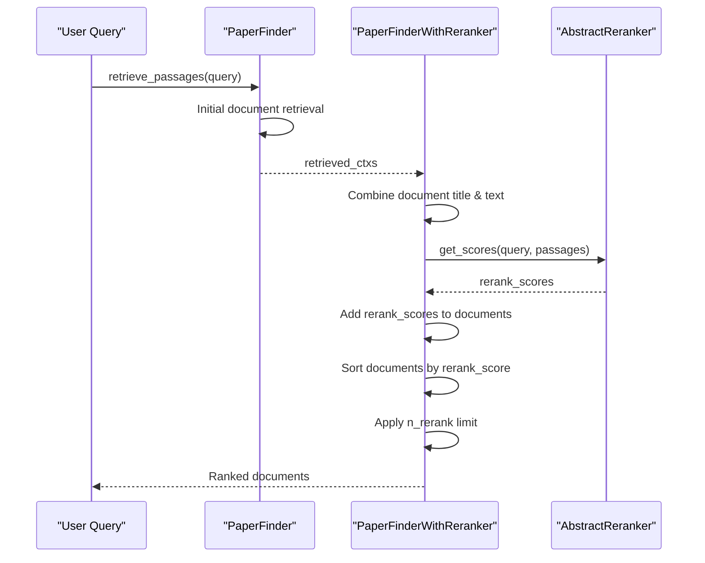
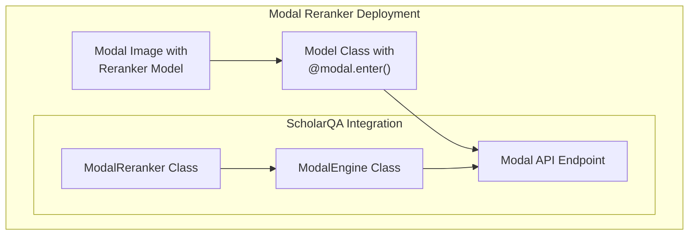

<!-- source: DeepWiki mcp.deepwiki.com · repo allenai/ai2-scholarqa-lib · page 3.3 Document Reranking · fetched 2026-10-26 -->

# Document Reranking

<details>
<summary>Relevant source files</summary>

The following files were used as context for generating this wiki page:

- [api/scholarqa/rag/reranker/modal_deploy/ai2-scholar-qa-reranker.py](api/scholarqa/rag/reranker/modal_deploy/ai2-scholar-qa-reranker.py)
- [api/scholarqa/rag/reranker/modal_deploy/custom_cross_encoder.py](api/scholarqa/rag/reranker/modal_deploy/custom_cross_encoder.py)
- [api/scholarqa/rag/reranker/modal_engine.py](api/scholarqa/rag/reranker/modal_engine.py)
- [api/scholarqa/rag/reranker/reranker_base.py](api/scholarqa/rag/reranker/reranker_base.py)
- [api/scholarqa/rag/retrieval.py](api/scholarqa/rag/retrieval.py)
- [api/scholarqa/rag/retriever_base.py](api/scholarqa/rag/retriever_base.py)

</details>


This document describes the document reranking system in the ScholarQA library, which is responsible for re-scoring and re-ordering initially retrieved documents to improve relevance to the user query. For information about the initial document retrieval process, see [Document Retrieval System](#3.2).

## Overview

Document reranking is a critical step in the ScholarQA retrieval-augmented generation (RAG) pipeline. After the initial retrieval stage returns a set of candidate documents, the reranking system applies more sophisticated and computationally intensive relevance scoring to ensure that the most relevant documents are prioritized for the subsequent steps in the pipeline.



Sources: [scholarqa/rag/retrieval.py:15-21, 150-176](), [scholarqa/rag/reranker/reranker_base.py:15-18]()

## Reranking Architecture

The reranking system in ScholarQA is built around a flexible architecture that allows for different reranking approaches. The main components are:



Sources: [scholarqa/rag/reranker/reranker_base.py:15-89](), [scholarqa/rag/retrieval.py:150-176](), [scholarqa/rag/reranker/modal_engine.py:12-23]()

### Core Components

1. **AbstractReranker**: The base abstract class for all rerankers, defining the core `get_scores` method that all implementations must provide.

2. **PaperFinderWithReranker**: Extension of the base `PaperFinder` class that incorporates a reranker to re-score and re-order the retrieved documents.

3. **Reranker Implementations**: Several concrete implementations of the `AbstractReranker` interface are provided:
   - `CrossEncoderScores`: Uses cross-encoder models that directly score query-document pairs
   - `BiEncoderScores`: Uses bi-encoder models with cosine similarity
   - `FlagEmbeddingScores`: Supports BAAI/bge reranker models
   - `ModalReranker`: Enables deployment of reranking models on Modal's infrastructure

Sources: [scholarqa/rag/reranker/reranker_base.py:15-89](), [scholarqa/rag/retrieval.py:150-176]()

## Reranking Process Flow

The document reranking process follows these steps:



Sources: [scholarqa/rag/retrieval.py:150-176]()

### PaperFinderWithReranker Implementation

The `PaperFinderWithReranker` class extends the base `PaperFinder` class with document reranking capabilities:

```python
def rerank(self, query: str, retrieved_ctxs: List[Dict[str, Any]]) -> List[Dict[str, Any]]:
    # Combine document title and text
    passages = [doc["title"] + " " + doc["text"] if "title" in doc else doc["text"] for doc in retrieved_ctxs]
    
    # Get rerank scores from reranker engine
    rerank_scores = self.reranker_engine.get_scores(query, passages)
    
    # Add rerank scores to documents
    for doc, rerank_score in zip(retrieved_ctxs, rerank_scores):
        doc["rerank_score"] = rerank_score
        
    # Sort documents by rerank score
    sorted_ctxs = sorted(retrieved_ctxs, key=lambda x: x["rerank_score"], reverse=True)
    
    # Apply base class reranking (if any)
    sorted_ctxs = super().rerank(query, sorted_ctxs)
    
    # Apply n_rerank limit if specified
    sorted_ctxs = sorted_ctxs[:self.n_rerank] if self.n_rerank > 0 else sorted_ctxs
    
    return sorted_ctxs
```

Sources: [scholarqa/rag/retrieval.py:159-176]()

## Reranker Implementations

ScholarQA supports several types of rerankers, each with different performance characteristics and model support:

### Cross-Encoder Rerankers

Cross-encoder models directly score query-document pairs and typically provide the highest reranking accuracy but may be more computationally intensive.

```python
class CrossEncoderScores(AbstractReranker):
    def __init__(self, model_name_or_path: str):
        from sentence_transformers import CrossEncoder
        device = "cuda" if torch.cuda.is_available() else "cpu"
        self.model = CrossEncoder(
            model_name_or_path,
            automodel_args={"torch_dtype": "float16"},
            trust_remote_code=True,
            device=device,
        )

    def get_scores(self, query: str, passages: List[str]) -> List[float]:
        sentence_pairs = [[query, passage] for passage in passages]
        scores = self.model.predict(sentence_pairs, convert_to_tensor=True, show_progress_bar=True,
                                    batch_size=128).tolist()
        return [float(s) for s in scores]
```

Sources: [scholarqa/rag/reranker/reranker_base.py:47-68]()

### Bi-Encoder Rerankers

Bi-encoder models encode queries and documents separately, then compute similarity scores. They are typically faster than cross-encoders but may be less accurate.

```python
class BiEncoderScores(AbstractReranker):
    def __init__(self, model_name_or_path: str):
        self.model = SentenceTransformerEncoder(model_name_or_path)

    def get_scores(self, query: str, passages: List[str]) -> List[float]:
        query_embedding = self.model.encode([query])[0]
        passage_embeddings = self.model.encode(passages)
        scores = F.cosine_similarity(query_embedding.unsqueeze(0), passage_embeddings).cpu().numpy()
        return [float(s) for s in scores]
```

Sources: [scholarqa/rag/reranker/reranker_base.py:36-44]()

### Flag Embedding Rerankers

Flag Embedding rerankers support BAAI/bge reranker models with specific tokenization and scoring approaches.

```python
class FlagEmbeddingScores:
    def __init__(self, model_name_or_path: str):
        from FlagEmbedding import FlagReranker
        self.model = FlagReranker(model_name_or_path, use_fp16=True)

    def get_scores(self, query: str, passages: List[str], separator: str) -> List[float]:
        sentence_pairs = [(query, passage.replace(separator, self.get_tokenizer().eos_token)) for passage in passages]
        scores = self.model.compute_score(sentence_pairs, normalize=True, batch_size=32)
        return [float(s) for s in scores]
```

Sources: [scholarqa/rag/reranker/reranker_base.py:72-83]()

### Modal-Deployed Rerankers

ScholarQA also supports deploying rerankers on Modal's infrastructure, which enables scaling and offloading of the reranking process.

```python
class ModalReranker(AbstractReranker):
    def __init__(self, app_name: str, api_name: str, batch_size=32, gen_options: Dict[str, Any] = None):
        logger.info(f"using model {app_name} on Modal for reranking")
        self.modal_engine = ModalEngine(app_name, api_name, gen_options)
        self.batch_size = batch_size

    def get_scores(self, query: str, documents: List[str]):
        logger.info("Invoking the reranker deployed on Modal")
        return self.modal_engine.generate(
            (query, documents, self.batch_size), streaming=False
        )
```

Sources: [scholarqa/rag/reranker/modal_engine.py:12-23]()

## Modal Deployment

ScholarQA supports deploying reranker models on Modal's infrastructure for improved performance and scalability. The deployment includes:

1. Packaging the reranker model into a Modal image
2. Setting up GPU-accelerated inference
3. Exposing the reranker as a Modal API endpoint



Sources: [scholarqa/rag/reranker/modal_deploy/ai2-scholar-qa-reranker.py:1-180](), [scholarqa/rag/reranker/modal_engine.py:1-66]()

## Using Rerankers in ScholarQA

To use a reranker in ScholarQA, you need to:

1. Choose a reranker implementation (CrossEncoder, BiEncoder, FlagEmbedding, Modal)
2. Initialize the reranker with an appropriate model
3. Create a `PaperFinderWithReranker` with your retriever and reranker
4. Use the `PaperFinderWithReranker` in your retrieval pipeline

```python
# Example initialization (pseudo-code)
retriever = FullTextRetriever(n_retrieval=256)
reranker = CrossEncoderScores("mixedbread-ai/mxbai-rerank-large-v1")
paper_finder = PaperFinderWithReranker(
    retriever=retriever,
    reranker=reranker,
    n_rerank=100,  # Limit to top 100 reranked documents
    context_threshold=0.5  # Minimum relevance score threshold
)

# Usage
retrieved_docs = paper_finder.retrieve_passages(query)
# Retrieved docs are already reranked
```

Sources: [scholarqa/rag/retrieval.py:150-153]()

## Reranker Selection Guide

| Reranker Type | Pros | Cons | Recommended Use Cases |
|--------------|------|------|----------------------|
| Cross-Encoder | Highest accuracy<br>Direct query-document scoring | Slower inference<br>Higher computational cost | When accuracy is critical<br>When reranking a smaller set of documents |
| Bi-Encoder | Faster inference<br>Lower computational cost | Lower accuracy than cross-encoders | When speed is important<br>When reranking many documents |
| Flag Embedding | Specialized for certain model types<br>Efficient implementation | Limited to supported models | When using BAAI/bge models |
| Modal Reranker | Scalable deployment<br>Offloads computation | External service dependency<br>Added latency | Production deployments<br>When GPU resources are limited |

Sources: [scholarqa/rag/reranker/reranker_base.py:15-89]()

## Conclusion

Document reranking plays a critical role in the ScholarQA pipeline by ensuring that the most relevant documents are prioritized for downstream processing. The flexible architecture allows for different reranking approaches to be used based on accuracy, speed, and resource constraints.

For more information about the next steps in the pipeline after reranking, see [Multi-Step QA Pipeline](#3.4).

---

