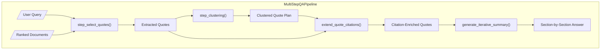
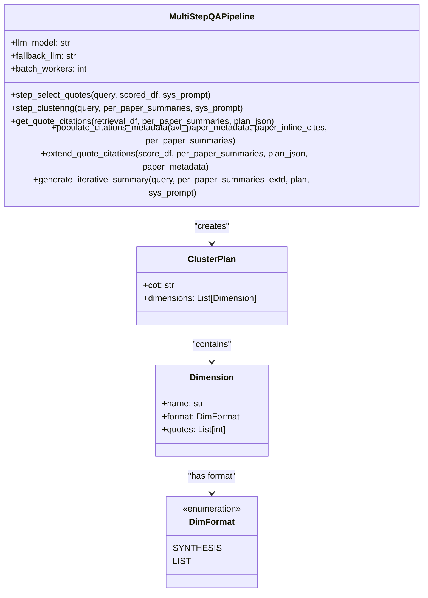
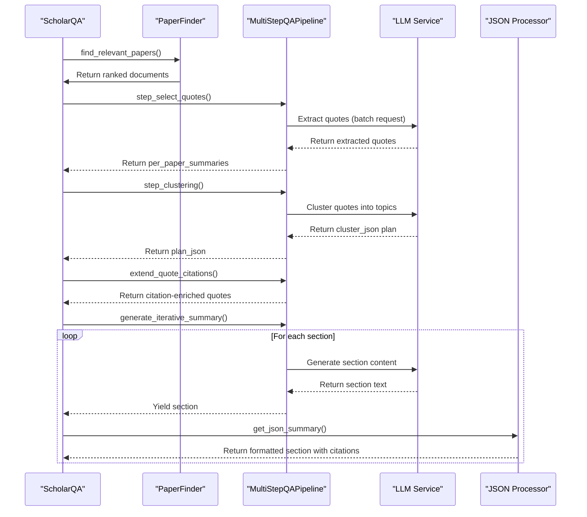
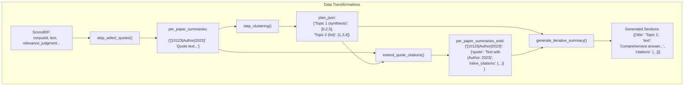

<!-- source: DeepWiki mcp.deepwiki.com · repo allenai/ai2-scholarqa-lib · page 3.4 Multi-Step QA Pipeline · fetched 2026-10-26 -->

# Multi-Step QA Pipeline

<details>
<summary>Relevant source files</summary>

The following files were used as context for generating this wiki page:

- [api/scholarqa/rag/multi_step_qa_pipeline.py](api/scholarqa/rag/multi_step_qa_pipeline.py)
- [api/scholarqa/scholar_qa.py](api/scholarqa/scholar_qa.py)

</details>


## Purpose and Scope

The Multi-Step QA Pipeline is a core component of the ScholarQA system responsible for transforming retrieved scientific papers into comprehensive, citation-rich answers. This document details the architecture and implementation of this pipeline, covering how it extracts relevant quotes, clusters them by topic, enhances them with citations, and generates structured answers.

For information about document retrieval before it reaches this pipeline, see [Document Retrieval System](#3.2). For details on how the final output is post-processed, see [Output Processing & Citation Handling](#3.5).

Sources: [scholarqa/rag/multi_step_qa_pipeline.py:51-52](), [scholarqa/scholar_qa.py:18]()

## Pipeline Overview

The Multi-Step QA Pipeline implements a sophisticated multi-stage approach to answer generation that goes beyond simple retrieve-then-generate RAG systems. It processes retrieved papers through several transformative steps to produce well-structured, factual answers with proper academic citations.



**Key Pipeline Stages:**
- **Quote Selection**: Extract the most relevant quotes from each paper
- **Quote Clustering**: Organize quotes into logical sections/topics
- **Citation Extension**: Link quotes to their source papers with proper academic citations
- **Summary Generation**: Generate a structured answer that synthesizes the information

Sources: [scholarqa/rag/multi_step_qa_pipeline.py:51-231](), [scholarqa/scholar_qa.py:148-207]()

## Pipeline Implementation

The pipeline is implemented in the `MultiStepQAPipeline` class which manages the entire process from quote extraction to final answer generation.



Sources: [scholarqa/rag/multi_step_qa_pipeline.py:25-51]()

### Step 1: Quote Selection

The first stage extracts relevant quotes from each paper that address the user's query.

```python
def step_select_quotes(self, query: str, scored_df: pd.DataFrame, sys_prompt: str) -> Tuple[Dict[str, str], List[CompletionResult]]
```

**Implementation Details:**
- Takes a dataframe of ranked papers with their text content
- Sends each paper to the LLM with the user query and a specialized prompt (`SYSTEM_PROMPT_QUOTE_PER_PAPER`)
- Uses batch processing with parallel workers for efficiency
- Returns a dictionary mapping paper reference strings to extracted quotes

**Process Flow:**
1. Formats each paper's content with the query using `USER_PROMPT_PAPER_LIST_FORMAT`
2. Sends these to LLM via batch processing
3. Filters out empty or "None" responses
4. Returns quotes dictionary and completion results

Sources: [scholarqa/rag/multi_step_qa_pipeline.py:57-72](), [scholarqa/scholar_qa.py:148-170]()

### Step 2: Quote Clustering

This stage organizes the extracted quotes into logical topics or "dimensions" to create a structured answer outline.

```python
def step_clustering(self, query: str, per_paper_summaries: Dict[str, str], sys_prompt: str) -> Tuple[Dict[str, Any], CompletionResult]
```

**Implementation Details:**
- Combines all extracted quotes into a single prompt
- Asks the LLM to cluster quotes into meaningful dimensions using `SYSTEM_PROMPT_QUOTE_CLUSTER`
- Returns a structured plan with dimensions and associated quote indices
- Includes fallback mechanism to `GPT_4o` if primary model fails

**Output Structure:**
- `ClusterPlan` object containing:
  - `cot`: Chain-of-thought justification for the clustering
  - `dimensions`: List of `Dimension` objects, each with:
    - `name`: Topic name
    - `format`: Either "synthesis" or "list"
    - `quotes`: List of indices of quotes relevant to this dimension

Sources: [scholarqa/rag/multi_step_qa_pipeline.py:74-102](), [scholarqa/scholar_qa.py:173-319]()

### Step 3: Citation Extension

This critical step enriches quotes with proper academic citations, linking statements to their source papers.

```python
def extend_quote_citations(self, score_df: pd.DataFrame, per_paper_summaries: Dict[str, str], plan_json: Dict[str, List[int]], paper_metadata: Dict[str, Any])
```

**Implementation Details:**
- Maps quotes to their original contexts to identify inline citations
- Retrieves metadata for cited papers
- Replaces raw corpus IDs with properly formatted academic citations
- Handles complex cases of nested citations and proper formatting

**Sub-processes:**
1. `get_quote_citations`: Maps quotes to their source texts and extracts citation IDs
2. `populate_citations_metadata`: Fetches and formats citation metadata
3. Transforms raw citations like "(12345678)" into "(Smith et al., 2023)"

Sources: [scholarqa/rag/multi_step_qa_pipeline.py:104-226](), [scholarqa/scholar_qa.py:322-325]()

### Step 4: Summary Generation

The final stage generates a comprehensive, section-by-section answer based on the clustered and citation-enriched quotes.

```python
def generate_iterative_summary(self, query: str, per_paper_summaries_extd: Dict[str, Dict[str, Any]], plan: Dict[str, Any], sys_prompt: str) -> Generator[CompletionResult, None, None]
```

**Implementation Details:**
- Implements a generator pattern to create answer sections one-by-one
- For each section in the plan:
  - Collects relevant quotes and citations
  - Sends to LLM with previous sections as context
  - Yields each section as it's generated
  - Handles cases with insufficient quotes using fallback prompts

**Process Flow:**
1. For each section in the plan:
   - Gather quotes assigned to that section
   - Create a prompt with the query, plan, and previous sections
   - Generate the section content
   - Yield the response for immediate consumption

Sources: [scholarqa/rag/multi_step_qa_pipeline.py:228-271](), [scholarqa/scholar_qa.py:327-384]()

## Integration with ScholarQA

The `MultiStepQAPipeline` is tightly integrated with the ScholarQA system, which orchestrates the overall question-answering process.



**Key Integration Points:**
- The `ScholarQA` class initializes and manages the `MultiStepQAPipeline` instance
- `ScholarQA.run_qa_pipeline()` calls each pipeline step in sequence
- Intermediate results are traced through the `EventTrace` system
- The pipeline uses a common `CostAwareLLMCaller` for all LLM interactions
- Final output is post-processed into a structured JSON format with proper citations

Sources: [scholarqa/scholar_qa.py:28-60](), [scholarqa/scholar_qa.py:240-387]()

## Data Structures and Flow

The pipeline transforms data through several key structures as it progresses:

| Step | Input | Output | Description |
|------|-------|--------|-------------|
| Quote Selection | Ranked `DataFrame` of papers | `Dict[str, str]` mapping paper references to quotes | Extracts relevant quotes from papers |
| Quote Clustering | Dictionary of paper quotes | `ClusterPlan` with dimensions and quote indices | Creates a structured answer outline |
| Citation Extension | Quote dictionary and plan | `Dict[str, Dict]` with quotes and their citations | Links quotes to their sources with proper citations |
| Summary Generation | Citation-enriched quotes and plan | Generator of `CompletionResult` for each section | Produces comprehensive answer sections |

**Example Data Flow:**



Sources: [scholarqa/rag/multi_step_qa_pipeline.py:57-271](), [scholarqa/scholar_qa.py:148-384]()

## Usage in ScholarQA

The `MultiStepQAPipeline` is instantiated in the `ScholarQA` constructor, and used in the `run_qa_pipeline` method to process queries:

```python
# Instantiation
self.multi_step_pipeline = MultiStepQAPipeline(self.llm_model, fallback_llm=fallback_llm)

# Usage in pipeline
per_paper_summaries = self.step_select_quotes(query, reranked_df, cost_args)
cluster_json = self.step_clustering(query, per_paper_summaries.result, cost_args)
per_paper_summaries_extd = self.multi_step_pipeline.extend_quote_citations(...)
gen_sections_iter = self.step_gen_iterative_summary(...)
```

The pipeline's modular design allows flexibility in model selection, with both primary and fallback LLM options.

Sources: [scholarqa/scholar_qa.py:56-61](), [scholarqa/scholar_qa.py:306-331]()

## Conclusion

The Multi-Step QA Pipeline represents a sophisticated approach to scientific question answering that goes beyond simple RAG patterns. By extracting quotes, clustering them thematically, enriching them with proper citations, and generating structured section-by-section answers, it creates comprehensive responses to complex scientific queries while maintaining academic rigor.

This pipeline is a key differentiator for ScholarQA, enabling it to produce answers that not only leverage relevant scientific papers but also organize information in a way that fully addresses multi-faceted research questions.

---

