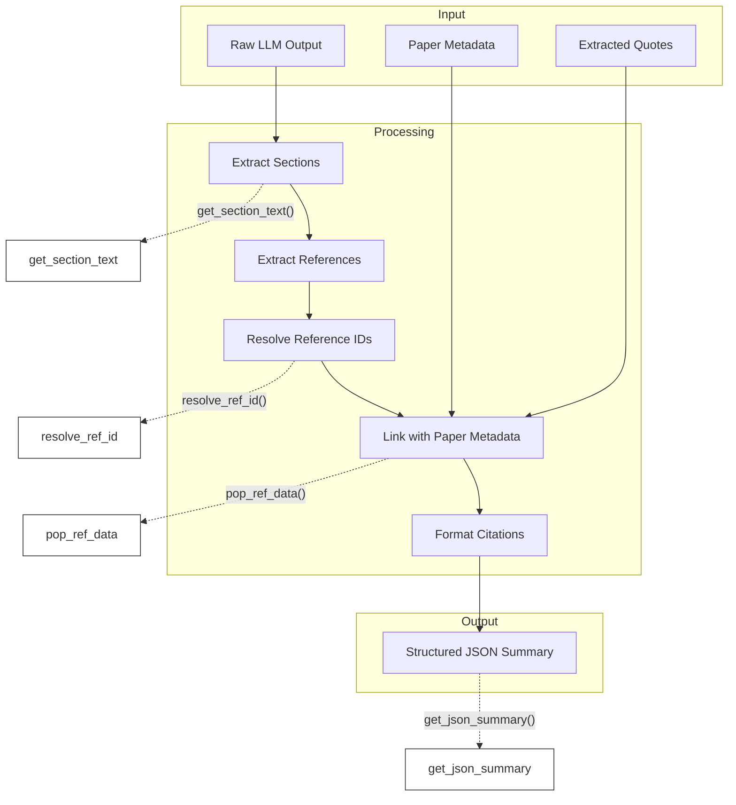
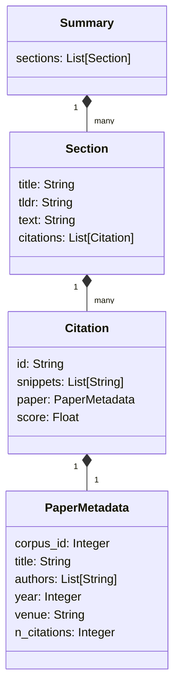
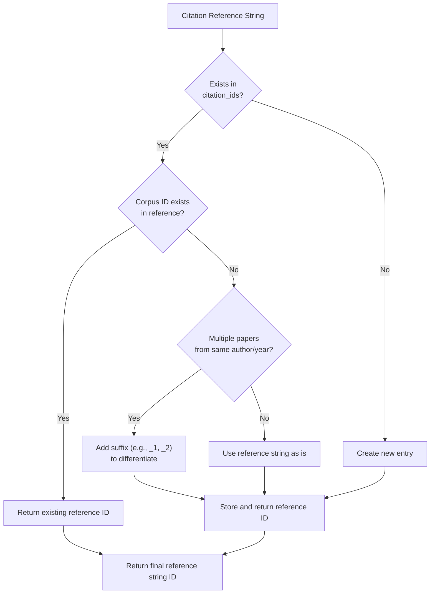
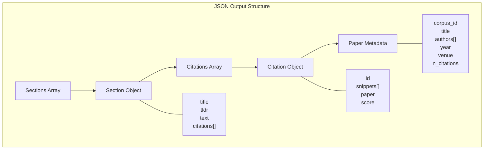
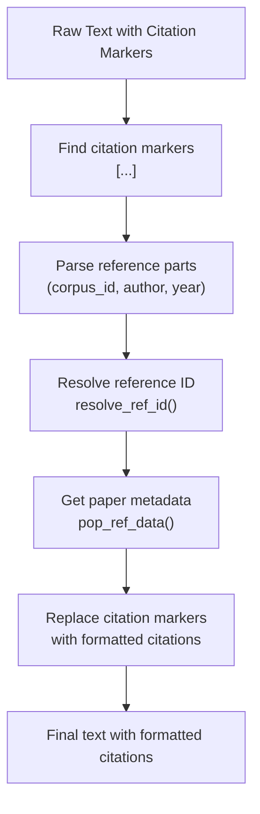

<!-- source: DeepWiki mcp.deepwiki.com · repo allenai/ai2-scholarqa-lib · page 3.5 Output Processing & Citation Handling · fetched 2026-10-26 -->

# Output Processing & Citation Handling

Relevant source files

The following files were used as context for generating this wiki page:

- [api/scholarqa/postprocess/json_output_utils.py](api/scholarqa/postprocess/json_output_utils.py)
- [api/scholarqa/rag/multi_step_qa_pipeline.py](api/scholarqa/rag/multi_step_qa_pipeline.py)

## Purpose and Scope

This document describes how the ScholarQA system processes the raw LLM-generated content and formats it into structured output with proper citations. Output processing is a critical final step in the RAG pipeline that ensures generated answers include proper attribution to scientific sources and maintain academic integrity. This page focuses specifically on how quotes and citations are processed, how reference IDs are resolved, and how the final JSON structure is assembled.

For information about the multi-step QA pipeline that generates the content before processing, see [Multi-Step QA Pipeline](#3.4).

## Citation Flow in ScholarQA

The output processing and citation handling in ScholarQA follows a systematic flow from raw LLM output to structured JSON with properly formatted citations:

Sources: [api/scholarqa/postprocess/json_output_utils.py:29-58](), [api/scholarqa/postprocess/json_output_utils.py:61-78](), [api/scholarqa/postprocess/json_output_utils.py:81-101](), [api/scholarqa/postprocess/json_output_utils.py:104-170]()

## Citation Structure and Reference Resolution

The ScholarQA system uses a structured approach to citations, linking each citation to its source paper and maintaining proper academic citation format.

Sources: [api/scholarqa/postprocess/json_output_utils.py:81-101](), [api/scholarqa/postprocess/json_output_utils.py:104-170]()

## Citation Reference ID Resolution Process

### Handling Citation Uniqueness

The system has sophisticated handling for resolving and formatting citation references, particularly when multiple papers from the same author and year are cited:

Sources: [api/scholarqa/postprocess/json_output_utils.py:61-78]()

## Output JSON Structure

The final output is a structured JSON with sections containing the answer text and associated citations. Each citation includes information about the source paper and relevant snippets.

Sources: [api/scholarqa/postprocess/json_output_utils.py:104-170]()

## Key Components and Functions

### Quote Processing and Citation Extraction

Before post-processing, quotes are extracted from papers and linked to citations. The `MultiStepQAPipeline` class handles this process:

| Function | Description |
|----------|-------------|
| `get_quote_citations()` | Maps quotes extracted from papers to their inline citations using regular expression matching |
| `populate_citations_metadata()` | Retrieves metadata for citations and updates quotes from raw strings to structured dictionaries |
| `extend_quote_citations()` | Main function that coordinates the citation extraction and enrichment process |

Sources: [api/scholarqa/rag/multi_step_qa_pipeline.py:104-226]()

### JSON Output Processing

The final step is converting the LLM-generated content with citations into a structured JSON output:

| Function | Description |
|----------|-------------|
| `get_section_text()` | Parses the LLM-generated text into a structured section with title, TLDR, and main text |
| `resolve_ref_id()` | Resolves reference IDs for citations, handling duplicate authors/years |
| `pop_ref_data()` | Populates reference data with paper metadata |
| `get_json_summary()` | Main function that converts LLM output to structured JSON with citations |

Sources: [api/scholarqa/postprocess/json_output_utils.py:29-170]()

## Citation Format Standardization

Citations are standardized to follow an academic format. The system handles:

1. Resolving corpus IDs to author-year format (e.g., "(Doe et al., 2024)")
2. Handling duplicate author-year combinations by adding suffixes (e.g., "Doe et al._1, 2024")
3. Extracting and formatting snippets from papers
4. Linking citations to their source metadata

The process uses regular expressions to find and format citations:

Sources: [api/scholarqa/postprocess/json_output_utils.py:110-159]()

## Handling Special Cases

The system handles several special cases in citation processing:

1. **Open Access Papers**: For non-open-access papers, snippet handling is modified to avoid copyright issues
2. **Inline Tag Formatting**: The system can optionally format citations as inline HTML tags
3. **LLM Attribution**: References to LLM-generated content are specially attributed
4. **Missing References**: References that can't be found in source material are removed
5. **Section Counts**: The system adds counts of cited sources to section TLDRs

Sources: [api/scholarqa/postprocess/json_output_utils.py:88-94](), [api/scholarqa/postprocess/json_output_utils.py:151-157](), [api/scholarqa/postprocess/json_output_utils.py:164-169]()

## Integration with Overall Pipeline

Output processing is the final step in the ScholarQA RAG pipeline, taking the content generated by the multi-step QA process and formatting it for presentation to the user:

```mermaid
flowchart LR
    subgraph "MultiStepQAPipeline"
        QuoteSelection["Step 1: Quote Selection"]
        Clustering["Step 2: Quote Clustering"]
        CitationExtension["Step 3: Citation Extension"]
        SummaryGeneration["Step 4: Summary Generation"]
    end
    
    subgraph "OutputProcessing"
        JSONConversion["JSON Output Conversion"]
        SectionParsing["Section Parsing"]
        CitationResolution["Citation Resolution"]
        MetadataPopulation["Metadata Population"]
    end
    
    QuoteSelection --> Clustering
    Clustering --> CitationExtension
    CitationExtension --> SummaryGeneration
    SummaryGeneration --> JSONConversion
    JSONConversion --> SectionParsing
    SectionParsing --> CitationResolution
    CitationResolution --> MetadataPopulation
    MetadataPopulation --> FinalOutput["Final Structured Output"]
```

Sources: [api/scholarqa/rag/multi_step_qa_pipeline.py:51-272](), [api/scholarqa/postprocess/json_output_utils.py:104-170]()

---

