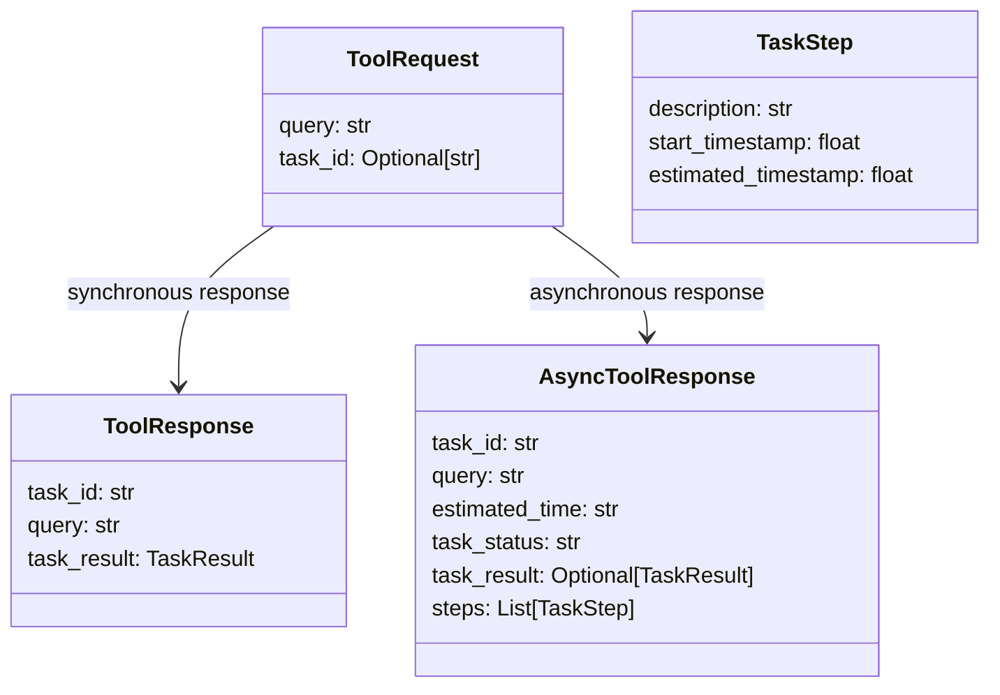
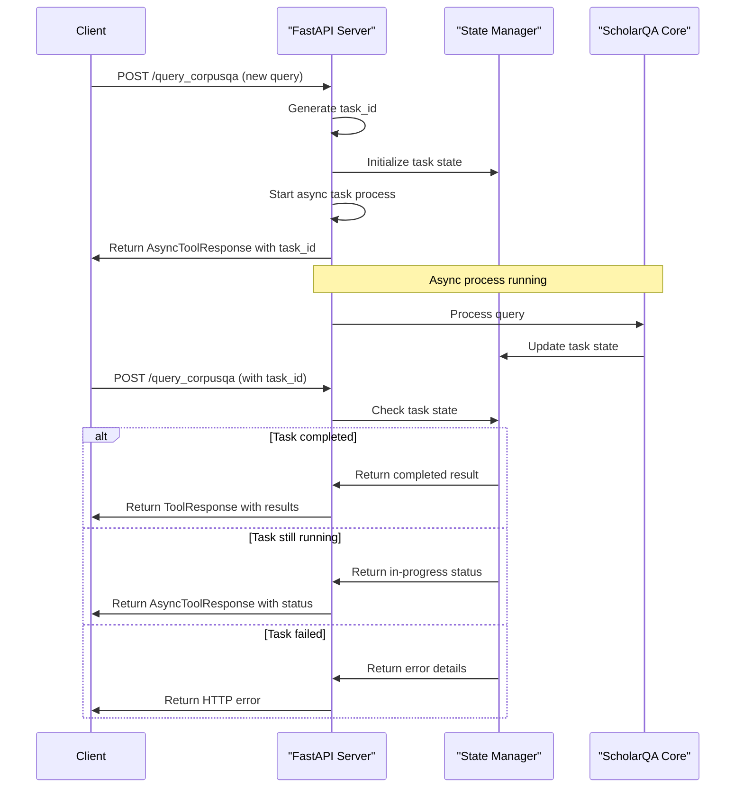
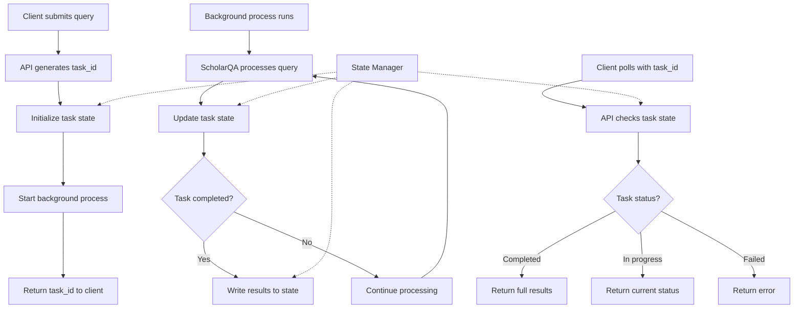
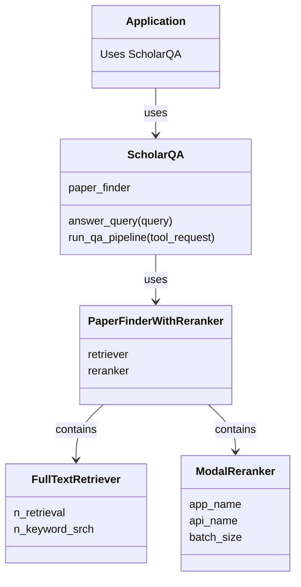
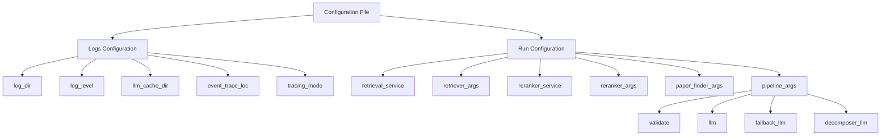

<!-- source: DeepWiki mcp.deepwiki.com · repo allenai/ai2-scholarqa-lib · page 4 API & Integration · fetched 2026-10-26 -->

# API & Integration

<details>
<summary>Relevant source files</summary>

The following files were used as context for generating this wiki page:

- [api/dev.sh](api/dev.sh)
- [api/lib_example.py](api/lib_example.py)
- [api/run_configs/default.json](api/run_configs/default.json)
- [api/scholarqa/app.py](api/scholarqa/app.py)

</details>


This document details how to use the ScholarQA API and integrate it with other systems. It covers API endpoints, request/response formats, asynchronous processing, and direct library integration. For detailed information about the system configuration options, see [Configuration Options](#4.1). For state management details, see [State Management](#4.2).

## API Endpoints

ScholarQA exposes a RESTful API via FastAPI with the following endpoints:

| Endpoint | Method | Description |
|----------|--------|-------------|
| `/` | GET | Basic health check that returns a greeting message |
| `/health` | GET | Health check endpoint (returns 204 status code) |
| `/query_corpusqa` | POST | Main endpoint to submit questions or check status of running tasks |

### Request and Response Models

The API uses structured request and response models:



Sources: [api/scholarqa/app.py:13-20]()

## API Request Flow

The ScholarQA API supports both synchronous and asynchronous processing of queries. Here's how the request flow works:



Sources: [api/scholarqa/app.py:112-135](), [api/scholarqa/app.py:184-267]()

## Using the API

### Submitting a New Query

To submit a new query to ScholarQA, send a POST request to the `/query_corpusqa` endpoint:

```
POST /query_corpusqa
Content-Type: application/json

{
  "query": "What are the recent advances in transformer architectures?"
}
```

The response will include a `task_id` that you can use to check the status of your query:

```json
{
  "task_id": "123e4567-e89b-12d3-a456-426614174000",
  "query": "What are the recent advances in transformer architectures?",
  "estimated_time": "~3 minutes",
  "task_status": "STARTED",
  "task_result": null,
  "steps": [{"description": "STARTED", "start_timestamp": 1627984000, "estimated_timestamp": 1627984240}]
}
```

### Checking Query Status

To check the status of a query, send a POST request with the `task_id`:

```
POST /query_corpusqa
Content-Type: application/json

{
  "task_id": "123e4567-e89b-12d3-a456-426614174000"
}
```

If the task is still processing, you'll receive an `AsyncToolResponse` with updated status. If the task is complete, you'll receive a `ToolResponse` with results:

```json
{
  "task_id": "123e4567-e89b-12d3-a456-426614174000",
  "query": "What are the recent advances in transformer architectures?",
  "task_result": {
    "summary": "...",
    "references": [...],
    "cost": 0.25
  }
}
```

Sources: [api/scholarqa/app.py:112-135](), [api/scholarqa/app.py:184-267]()

## Asynchronous Task Processing

The ScholarQA API processes queries asynchronously to handle potentially long-running operations. Here's how the asynchronous processing works:



The system has a built-in timeout of 240 seconds for tasks, after which they are marked as failed.

Sources: [api/scholarqa/app.py:140-181](), [api/scholarqa/app.py:31]()

## Direct Library Integration

In addition to using the HTTP API, you can integrate ScholarQA directly as a Python library in your application:



### Library Integration Example

Here's a simple example of how to use ScholarQA as a library:

```python
from scholarqa.rag.reranker.modal_engine import ModalReranker
from scholarqa.rag.retrieval import PaperFinderWithReranker
from scholarqa.rag.retriever_base import FullTextRetriever
from scholarqa import ScholarQA

# Initialize components
retriever = FullTextRetriever(n_retrieval=256, n_keyword_srch=20)
reranker = ModalReranker(app_name="modal_app_name", api_name="modal_api_name", 
                         batch_size=256, gen_options={})
paper_finder = PaperFinderWithReranker(retriever, reranker, 
                                       n_rerank=50, context_threshold=0.5)

# Create ScholarQA instance
scholar_qa = ScholarQA(paper_finder=paper_finder)

# Query the system
result = scholar_qa.answer_query("Which is the 9th planet in our solar system?")
```

Sources: [api/lib_example.py:1-11]()

## Configuration

ScholarQA uses a JSON configuration file to specify various parameters for system operation. The default configuration is located at `run_configs/default.json`, but you can specify a different location using the `CONFIG_PATH` environment variable.



### Key Configuration Sections

The configuration file has two main sections:

1. **logs**: Controls logging and tracing behavior
   - `log_dir`: Directory for log files
   - `log_level`: Logging level (INFO, DEBUG, etc.)
   - `llm_cache_dir`: Directory for caching LLM responses
   - `event_trace_loc`: Location for event trace files
   - `tracing_mode`: Mode for tracing (local, etc.)

2. **run_config**: Controls the behavior of ScholarQA components
   - `retrieval_service`: Service to use for document retrieval
   - `retriever_args`: Arguments for the retriever
   - `reranker_service`: Service to use for reranking
   - `reranker_args`: Arguments for the reranker
   - `paper_finder_args`: Arguments for the paper finder
   - `pipeline_args`: Arguments for the QA pipeline, including LLM configuration

Sources: [api/run_configs/default.json:1-33](), [api/scholarqa/app.py:57-61]()

## Running the Server

### Development Mode

For development, you can use the provided `dev.sh` script which starts a Uvicorn server with hot reloading:

```bash
#!/bin/bash
exec uvicorn \
    --workers 1 \
    --timeout-keep-alive 0 \
    --host 0.0.0.0 \
    --port 8000 \
    --reload \
    'scholarqa.app:create_app'
```

Run it with:

```bash
./dev.sh
```

This will start the API server on port 8000 with automatic reloading when code changes are detected.

Sources: [api/dev.sh:1-9]()

### Production Deployment

For production deployments, you'll likely want to:

1. Use a more robust ASGI server (like Gunicorn with Uvicorn workers)
2. Configure appropriate worker counts based on your hardware
3. Set up proper logging and monitoring
4. Consider containerization (Docker) for consistent deployment

The application is structured to work with standard ASGI servers using the `scholarqa.app:create_app` application factory.

Sources: [api/scholarqa/app.py:100-137]()

## Error Handling

The API includes robust error handling for common scenarios:

1. **Task not found**: Returns 404 if a task_id doesn't exist
2. **Task failed**: Returns 500 with error details
3. **Task timeout**: Returns 500 if task exceeds the timeout (240 seconds)
4. **Corrupted state**: Handles gracefully with informative messages

Error responses follow standard HTTP status codes and include detailed messages to help diagnose issues.

Sources: [api/scholarqa/app.py:200-221](), [api/scholarqa/app.py:248-258]()

---

