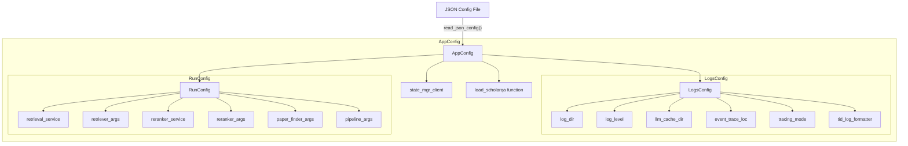
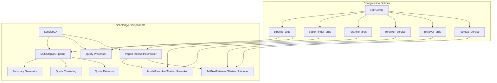
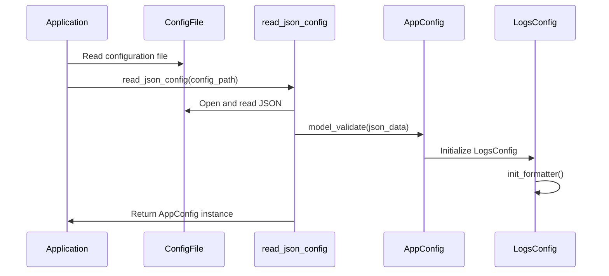

<!-- source: DeepWiki mcp.deepwiki.com · repo allenai/ai2-scholarqa-lib · page 4.1 Configuration Options · fetched 2026-10-26 -->

# Configuration Options

<details>
<summary>Relevant source files</summary>

The following files were used as context for generating this wiki page:

- [api/lib_example.py](api/lib_example.py)
- [api/run_configs/default.json](api/run_configs/default.json)
- [api/scholarqa/config/config_setup.py](api/scholarqa/config/config_setup.py)

</details>


This page provides a comprehensive reference of the ScholarQA system's configuration options. These configurations control the behavior of various components including the retrieval system, reranker, LLM integration, logging, and state management. For information about deploying ScholarQA in production environments, see [Deployment](#7).

## Configuration System Overview

ScholarQA uses a hierarchical configuration system based on Pydantic models. Configuration can be provided via JSON files or programmatically constructed at runtime. The system uses these configurations to initialize and parameterize all components of the RAG pipeline.



Sources: [api/scholarqa/config/config_setup.py:51-60](), [api/scholarqa/config/config_setup.py:13-39](), [api/scholarqa/config/config_setup.py:42-48](), [api/scholarqa/config/config_setup.py:63-70]()

## Configuration to Code Mapping

The following diagram illustrates how configuration options map to the actual code components in ScholarQA:



Sources: [api/lib_example.py:1-9](), [api/scholarqa/config/config_setup.py:42-48]()

## Core Configuration Classes

### AppConfig

The `AppConfig` class is the top-level configuration container that holds all configuration settings for the ScholarQA system.

| Field | Type | Description |
|-------|------|-------------|
| `logs` | LogsConfig | Configuration for logs and event traces |
| `run_config` | RunConfig | Configuration for components of the ScholarQA pipeline |
| `state_mgr_client` | AbsStateMgrClient | State manager client for managing async task states and cost reporting of LLM calls |
| `load_scholarqa` | Callable | Function to lazy load ScholarQA instance, should be overridden by the app using this config class |

Sources: [api/scholarqa/config/config_setup.py:51-60]()

### LogsConfig

Controls logging, tracing, and LLM caching behavior:

| Field | Type | Default | Description |
|-------|------|---------|-------------|
| `log_dir` | str | "logs" | Directory to store logs, event traces and LLM cache |
| `log_level` | enum | "INFO" | Logging level (DEBUG, INFO, WARNING, ERROR, CRITICAL) |
| `llm_cache_dir` | str | "llm_cache" | Sub directory to cache LLM calls |
| `event_trace_loc` | str | "scholarqa_traces" | Sub directory or GCS bucket for event traces |
| `extras` | dict | None | Extra arguments for the logs |
| `tracing_mode` | enum | "local" | Mode to store event traces ("local" or "gcs") |
| `tid_log_formatter` | TaskIdAwareLogFormatter | None | Task ID aware log formatter |

The `LogsConfig` class also provides:
- `task_id` property: Gets/sets the current task ID used in logging
- `init_formatter()` method: Initializes the logging formatter

Sources: [api/scholarqa/config/config_setup.py:13-39](), [api/run_configs/default.json:2-8]()

### RunConfig

Controls the behavior of the RAG pipeline components:

| Field | Type | Default | Description |
|-------|------|---------|-------------|
| `retrieval_service` | str | "public_api" | Service to use for paper retrieval |
| `retriever_args` | dict | None | Arguments for the retrieval service |
| `reranker_service` | str | "modal" | Service to use for paper reranking |
| `reranker_args` | dict | None | Arguments for the reranker service |
| `paper_finder_args` | dict | None | Arguments for the paper finder service |
| `pipeline_args` | dict | None | Arguments for the ScholarQA pipeline |

Sources: [api/scholarqa/config/config_setup.py:42-48](), [api/run_configs/default.json:9-32]()

## Detailed Configuration Options

### Retriever Configuration

The retriever component is responsible for finding relevant papers. Configuration is provided through `retriever_args`:

| Parameter | Type | Description |
|-----------|------|-------------|
| `n_retrieval` | int | Maximum number of documents to retrieve (default: 256) |
| `n_keyword_srch` | int | Number of keyword search results to consider (default: 20) |

Example:
```json
"retriever_args": {
  "n_retrieval": 256,
  "n_keyword_srch": 20
}
```

Sources: [api/run_configs/default.json:11-14](), [api/lib_example.py:6]()

### Reranker Configuration

The reranker component reorders retrieved documents by relevance. Configuration is provided through `reranker_args`:

| Parameter | Type | Description |
|-----------|------|-------------|
| `app_name` | str | Modal app name for reranker access |
| `api_name` | str | Modal API name for reranker access |
| `batch_size` | int | Number of documents to process in each batch (default: 256) |
| `gen_options` | dict | Additional generation options for the reranker |

Example:
```json
"reranker_args": {
  "app_name": "modal_app_name",
  "api_name": "modal_api_name",
  "batch_size": 256,
  "gen_options": {}
}
```

Sources: [api/run_configs/default.json:15-21](), [api/lib_example.py:7]()

### PaperFinder Configuration

The PaperFinder component combines retrieval and reranking. Configuration is provided through `paper_finder_args`:

| Parameter | Type | Description |
|-----------|------|-------------|
| `n_rerank` | int | Number of retrieved documents to pass to the reranker (default: 50) |
| `context_threshold` | float | Minimum relevance score threshold for documents (default: 0.5) |

Example:
```json
"paper_finder_args": {
  "n_rerank": 50,
  "context_threshold": 0.5
}
```

Sources: [api/run_configs/default.json:22-25](), [api/lib_example.py:8]()

### Pipeline Configuration

The pipeline component handles the multi-step QA process. Configuration is provided through `pipeline_args`:

| Parameter | Type | Description |
|-----------|------|-------------|
| `validate` | bool | Whether to perform validation of inputs/outputs |
| `llm` | str | Primary LLM model identifier |
| `fallback_llm` | str | Fallback LLM to use if primary model fails |
| `decomposer_llm` | str | LLM to use for query decomposition |

Example:
```json
"pipeline_args": {
  "validate": true,
  "llm": "anthropic/claude-3-7-sonnet-20250219",
  "fallback_llm": "openai/gpt-4o",
  "decomposer_llm": "anthropic/claude-3-7-sonnet-20250219"
}
```

Sources: [api/run_configs/default.json:26-31]()

## Configuration File Format

ScholarQA configurations can be provided in JSON format. Here is the structure of a typical configuration file:

```json
{
  "logs": {
    "log_dir": "logs",
    "log_level": "INFO",
    "llm_cache_dir": "llm_cache",
    "event_trace_loc": "scholarqa_traces",
    "tracing_mode": "local"
  },
  "run_config": {
    "retrieval_service": "public_api",
    "retriever_args": {
      "n_retrieval": 256,
      "n_keyword_srch": 20
    },
    "reranker_service": "modal",
    "reranker_args": {
      "app_name": "modal_app_name",
      "api_name": "modal_api_name",
      "batch_size": 256,
      "gen_options": {}
    },
    "paper_finder_args": {
      "n_rerank": 50,
      "context_threshold": 0.5
    },
    "pipeline_args": {
      "validate": true,
      "llm": "anthropic/claude-3-7-sonnet-20250219",
      "fallback_llm": "openai/gpt-4o",
      "decomposer_llm": "anthropic/claude-3-7-sonnet-20250219"
    }
  }
}
```

Sources: [api/run_configs/default.json:1-33]()

## Loading Configuration

ScholarQA provides a utility function `read_json_config` to load configuration from a JSON file:



Sources: [api/scholarqa/config/config_setup.py:63-70]()

## Programmatic Configuration

You can also create configuration programmatically:

```python
from scholarqa.rag.reranker.modal_engine import ModalReranker
from scholarqa.rag.retrieval import PaperFinderWithReranker
from scholarqa.rag.retriever_base import FullTextRetriever
from scholarqa import ScholarQA

# Configure components directly
retriever = FullTextRetriever(n_retrieval=256, n_keyword_srch=20)
reranker = ModalReranker(app_name="modal_app_name", api_name="modal_api_name", 
                         batch_size=256, gen_options=dict())
paper_finder = PaperFinderWithReranker(retriever, reranker, 
                                      n_rerank=50, context_threshold=0.5)
scholar_qa = ScholarQA(paper_finder=paper_finder)
```

Sources: [api/lib_example.py:1-9]()

## Best Practices

1. **Environment-specific Configurations**: Create separate configuration files for different environments (development, testing, production).

2. **LLM Configuration**: Carefully choose your LLM models based on your performance and cost requirements. The `fallback_llm` should ideally be more reliable but may be more expensive.

3. **Retrieval Tuning**: 
   - For broader coverage, increase `n_retrieval` and `n_keyword_srch`
   - For precision, adjust the `context_threshold` parameter
   - For performance/cost balance, tune `n_rerank` to limit documents sent to the reranker

4. **Logging and Tracing**: In production, consider using GCS for event traces by setting `tracing_mode` to "gcs" and providing a bucket name in `event_trace_loc`.

5. **Security**: Ensure that sensitive configuration information (API keys, etc.) is not stored directly in configuration files but instead injected at runtime.

---

