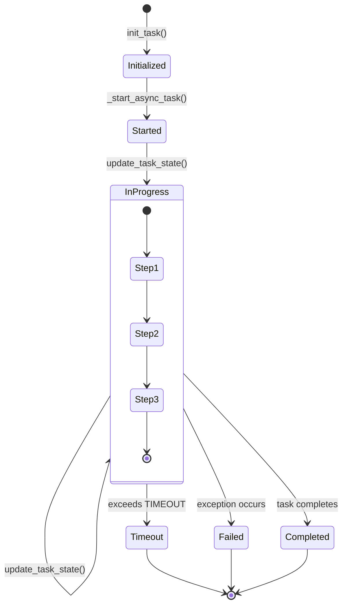
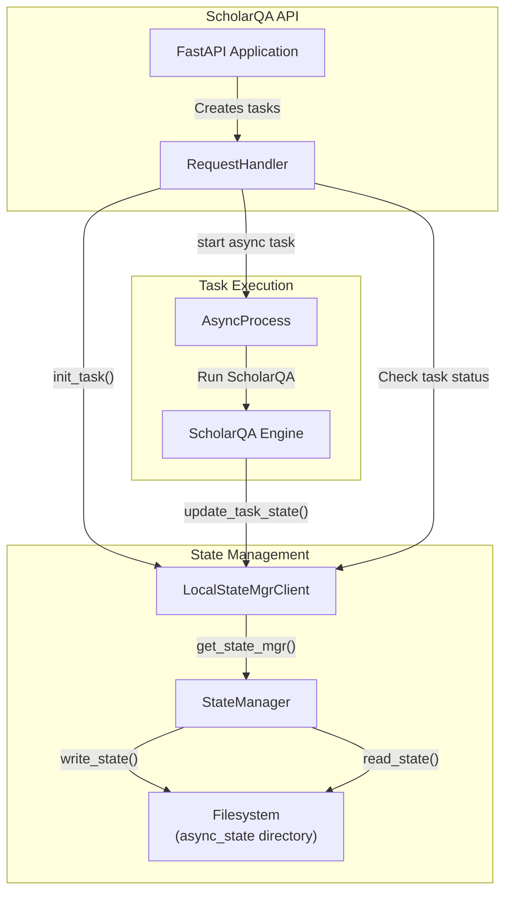

<!-- source: DeepWiki mcp.deepwiki.com · repo allenai/ai2-scholarqa-lib · page 4.2 State Management · fetched 2026-10-26 -->

# State Management

<details>
<summary>Relevant source files</summary>

The following files were used as context for generating this wiki page:

- [api/scholarqa/app.py](api/scholarqa/app.py)
- [api/scholarqa/llms/constants.py](api/scholarqa/llms/constants.py)
- [api/scholarqa/state_mgmt/local_state_mgr.py](api/scholarqa/state_mgmt/local_state_mgr.py)

</details>


## Purpose and Scope

This document describes the state management system used in ScholarQA for tracking, monitoring, and retrieving information about asynchronous tasks. The state management system is responsible for maintaining the status of long-running question-answering processes, providing status updates to users, storing intermediate and final results, and handling task failures and timeouts.

For information about how the ScholarQA API integrates with this state management system, see [API & Integration](#4), and for details on configuration options, see [Configuration Options](#4.1).

Sources: [api/scholarqa/app.py:9-12](), [api/scholarqa/app.py:26](), [api/scholarqa/state_mgmt/local_state_mgr.py:1-9]()

## State Management Architecture

ScholarQA's state management system follows a client-provider pattern where a state management client (`AbsStateMgrClient`) provides access to a state manager implementation (`IStateManager`). The architecture enables different state storage backends while maintaining a consistent interface.

```mermaid
classDiagram
    class "AbsStateMgrClient" {
        <<Abstract>>
        +get_state_mgr(tool_req)* IStateManager
        +init_task(task_id, tool_request)
        +update_task_state(task_id, tool_req, status, ...)
        +report_llm_usage(completion_costs, cost_args) float
    }
    
    class "LocalStateMgrClient" {
        -_async_state_dir: string
        -state_mgr: StateManager
        +get_state_mgr(tool_req) IStateManager
        +init_task(task_id, tool_request)
        +report_llm_usage(completion_costs, cost_args) float
    }
    
    class "IStateManager" {
        <<Interface>>
        +read_state(task_id) AsyncTaskState
        +write_state(state) void
    }
    
    class "StateManager" {
        +read_state(task_id) AsyncTaskState
        +write_state(state) void
    }
    
    class "AsyncTaskState" {
        +task_id: string
        +estimated_time: string
        +task_status: string
        +task_result: TaskResult
        +extra_state: dict
    }
    
    class "TaskStep" {
        +description: string
        +start_timestamp: float
        +estimated_timestamp: float
    }
    
    AbsStateMgrClient <|-- LocalStateMgrClient
    IStateManager <|.. StateManager
    LocalStateMgrClient --> StateManager
    StateManager --> AsyncTaskState
    AsyncTaskState --> TaskStep
```

Diagram: State Management Class Structure

Sources: [api/scholarqa/state_mgmt/local_state_mgr.py:15-59](), [api/scholarqa/app.py:9-11]()

### State Data Model

The state management system uses several key data structures:

| Data Structure | Purpose |
|----------------|---------|
| `AsyncTaskState` | Main container for task state, including status, result, and metadata |
| `TaskStep` | Represents a step in the task execution with timestamps and description |
| `TaskResult` | Contains the result of a completed task (sections, references, etc.) |
| `CompletionResult` | Tracks LLM completion information including cost and token usage |

The `AsyncTaskState` serves as the central data structure and includes:
- Task identifier
- Current status (e.g., "STARTED", "COMPLETED", "FAILED")
- Estimated completion time
- Task result (when completed)
- Extra state information, including execution steps

Sources: [api/scholarqa/state_mgmt/local_state_mgr.py:10](), [api/scholarqa/llms/constants.py:11-16]()

## Task Lifecycle Management

The state management system handles the complete lifecycle of asynchronous tasks:



Diagram: Task State Lifecycle

Sources: [api/scholarqa/app.py:140-181](), [api/scholarqa/app.py:184-267](), [api/scholarqa/state_mgmt/local_state_mgr.py:23-43]()

### Task Initialization and Tracking

When a new task is created:

1. A unique task ID is generated
2. An initial task state is created with status "STARTED"
3. The state is stored via the state manager
4. A background process is started to execute the task
5. As the task progresses, its state is updated with new steps and status information

### Task Completion and Result Retrieval

When a task completes or fails:
1. The final status is set to "COMPLETED" or "FAILED"
2. For completed tasks, the result is stored in the task state
3. For failed tasks, error information is captured
4. Users can retrieve results or error information using the task ID

Sources: [api/scholarqa/app.py:157-173](), [api/scholarqa/app.py:184-267]()

## Implementation Details

The default implementation `LocalStateMgrClient` stores state in the local filesystem:



Diagram: State Management Data Flow

Sources: [api/scholarqa/state_mgmt/local_state_mgr.py:49-66](), [api/scholarqa/app.py:125-135]()

### Local State Storage

The `LocalStateMgrClient` implementation:

1. Creates a directory for async state storage (`{logs_dir}/{async_state_dir}`)
2. Uses the `StateManager` from `nora_lib.tasks` for reading and writing state
3. Stores state as files on disk, with task IDs as filenames
4. Provides methods for tracking LLM usage and costs

Sources: [api/scholarqa/state_mgmt/local_state_mgr.py:49-66]()

## Integration with ScholarQA API

The state management system integrates directly with the ScholarQA API:

```mermaid
sequenceDiagram
    participant User
    participant API as "FastAPI API"
    participant State as "LocalStateMgrClient"
    participant SM as "StateManager"
    participant Worker as "AsyncProcess"
    participant SQA as "ScholarQA Engine"
    
    User->>+API: POST /query_corpusqa
    API->>+State: init_task(task_id, tool_request)
    State->>+SM: write_state(initial_state)
    SM-->>-State: OK
    State-->>-API: OK
    API->>Worker: start_async_task(task_id, tool_request)
    API-->>-User: AsyncToolResponse with task_id
    
    Worker->>+SQA: _do_task(tool_request, task_id)
    
    Note over SQA: Processing query...
    
    SQA->>+State: update_task_state(task_id, ...)
    State->>+SM: read_state(task_id)
    SM-->>-State: current state
    State->>+SM: write_state(updated_state)
    SM-->>-State: OK
    State-->>-SQA: OK
    
    Note over SQA: More processing...
    
    SQA-->>-Worker: TaskResult
    Worker->>+SM: read_state(task_id)
    SM-->>-Worker: current state
    Worker->>+SM: write_state(state with result)
    SM-->>-Worker: OK
    
    User->>+API: POST /query_corpusqa with task_id
    API->>+State: get_state_mgr(tool_request)
    State-->>-API: StateManager
    API->>+SM: read_state(task_id)
    SM-->>-API: AsyncTaskState with result
    
    alt Task Completed
        API-->>-User: ToolResponse with result
    else Task In Progress
        API-->>-User: AsyncToolResponse with status
    end
```

Diagram: API State Management Integration

Sources: [api/scholarqa/app.py:112-136](), [api/scholarqa/app.py:184-267]()

### Task Status Checking

The ScholarQA API allows clients to check the status of asynchronous tasks:

1. Clients make a request with the task ID
2. The API retrieves the current state using the state manager
3. If the task is complete, the full result is returned
4. If the task is still running, the current status and progress information are returned
5. If the task failed, an error response is returned

The API also handles timeouts, checking if a task has exceeded the maximum allowed time (240 seconds by default) and marking it as failed if necessary.

Sources: [api/scholarqa/app.py:184-267]()

## LLM Cost Tracking

The state management system includes functionality for tracking LLM usage and costs:

1. `report_llm_usage` method accepts:
   - List of `CompletionResult` objects containing cost information
   - `CostReportingArgs` with task metadata
2. Costs are recorded and can be retrieved as part of the task result
3. Final task results include total cost information

Sources: [api/scholarqa/state_mgmt/local_state_mgr.py:58-59](), [api/scholarqa/llms/constants.py:11-16](), [api/scholarqa/app.py:234-241]()

---

