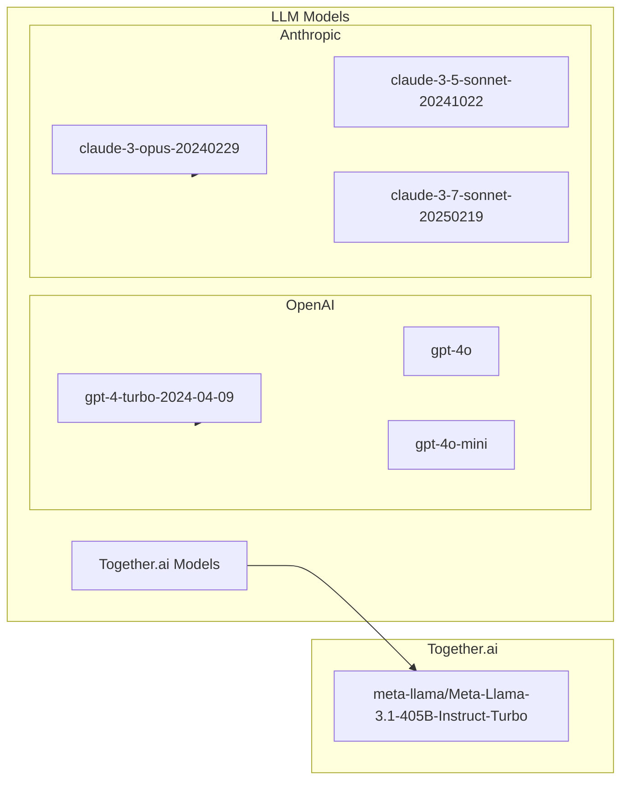
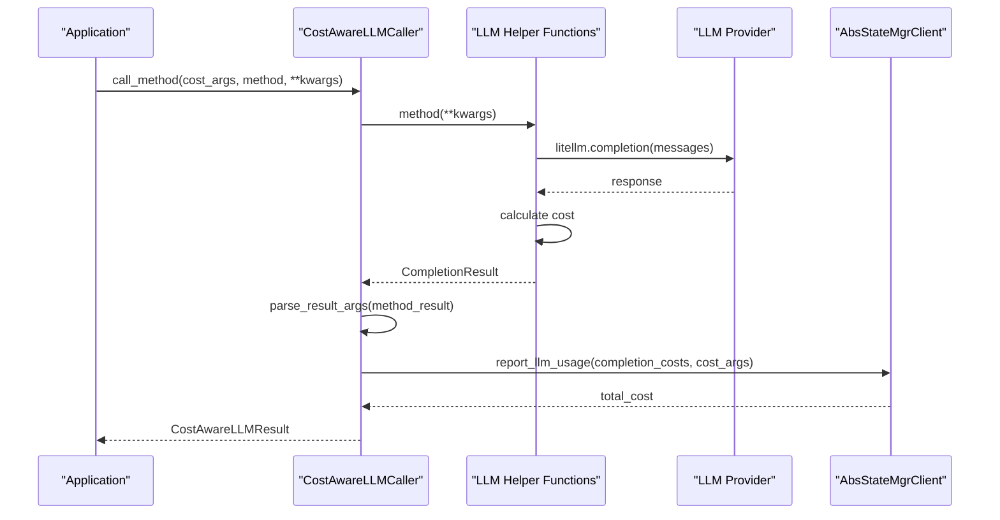
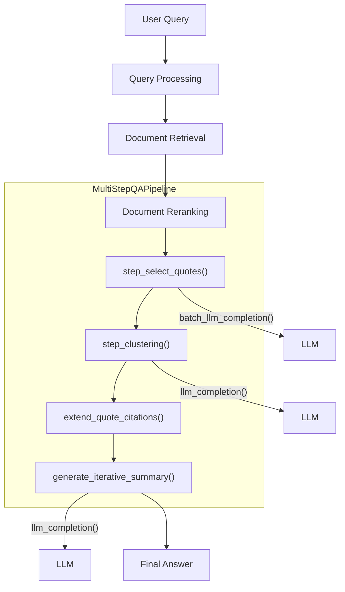
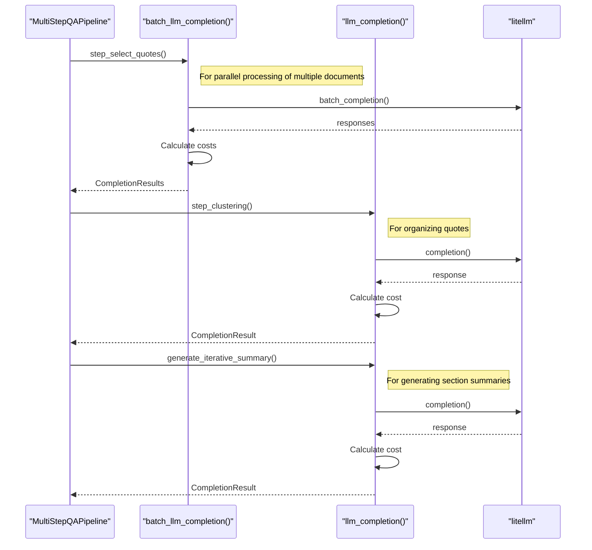
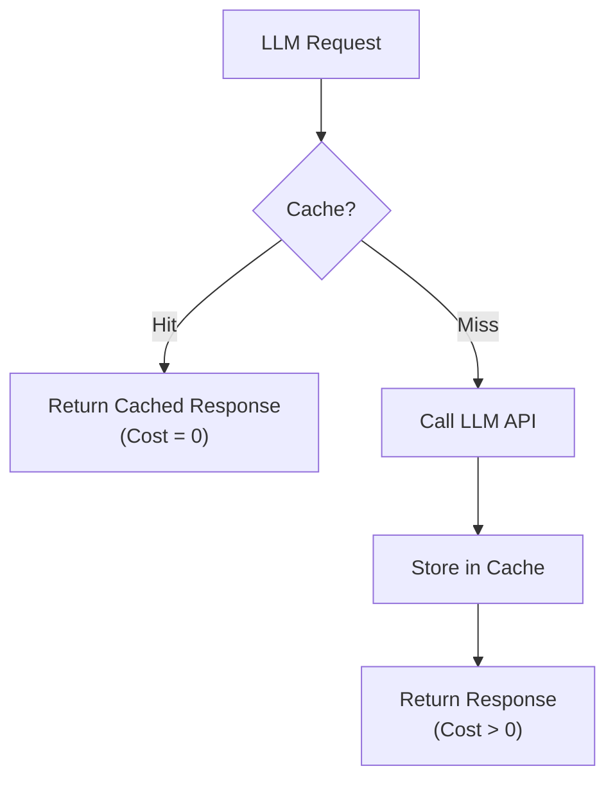
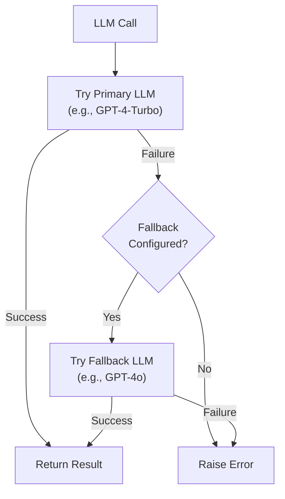

<!-- source: DeepWiki mcp.deepwiki.com · repo allenai/ai2-scholarqa-lib · page 5 LLM Integration · fetched 2026-10-26 -->

# LLM Integration

<details>
<summary>Relevant source files</summary>

The following files were used as context for generating this wiki page:

- [api/scholarqa/llms/constants.py](api/scholarqa/llms/constants.py)
- [api/scholarqa/llms/litellm_helper.py](api/scholarqa/llms/litellm_helper.py)
- [api/scholarqa/rag/multi_step_qa_pipeline.py](api/scholarqa/rag/multi_step_qa_pipeline.py)
- [api/scholarqa/state_mgmt/local_state_mgr.py](api/scholarqa/state_mgmt/local_state_mgr.py)

</details>


This document explains how the ScholarQA system integrates with Large Language Models (LLMs), including model selection, fallback mechanisms, cost tracking, and their role in the multi-step QA pipeline. It covers the technical implementation details of how ScholarQA interacts with LLMs through wrappers and helper functions.

For information about the overall QA pipeline that utilizes these LLMs, see [Multi-Step QA Pipeline](#3.4).

## Table of Contents

1. [Architecture Overview](#architecture-overview)
2. [LLM Configuration and Models](#llm-configuration-and-models)
3. [Cost-Aware LLM Calling](#cost-aware-llm-calling)
4. [LLM Integration in the QA Pipeline](#llm-integration-in-the-qa-pipeline)
5. [Caching Mechanism](#caching-mechanism)
6. [Error Handling and Fallbacks](#error-handling-and-fallbacks)

## Architecture Overview

ScholarQA's LLM integration is designed to be robust, cost-efficient, and reliable. The system uses a wrapper approach that provides consistent interfaces to various LLM providers while tracking costs and handling errors gracefully.

### Key Components

```mermaid
classDiagram
    class "CompletionResult" {
        +content: str
        +model: str
        +cost: float
        +input_tokens: int
        +output_tokens: int
        +total_tokens: int
    }
    
    class "CostAwareLLMCaller" {
        +state_mgr: AbsStateMgrClient
        +call_method()
        +call_iter_method()
        +parse_result_args()
    }
    
    class "AbsStateMgrClient" {
        +report_llm_usage()
        +get_state_mgr()
    }
    
    class "LocalStateMgrClient" {
        +report_llm_usage()
    }
    
    class "LLM Helper Functions" {
        +llm_completion()
        +batch_llm_completion()
        +setup_llm_cache()
    }
    
    class "MultiStepQAPipeline" {
        +llm_model: str
        +fallback_llm: str
        +step_select_quotes()
        +step_clustering()
        +generate_iterative_summary()
    }
    
    "CostAwareLLMCaller" -- "CompletionResult": returns
    "LLM Helper Functions" -- "CompletionResult": returns
    "CostAwareLLMCaller" --> "AbsStateMgrClient": uses
    "AbsStateMgrClient" <|-- "LocalStateMgrClient": implements
    "MultiStepQAPipeline" --> "LLM Helper Functions": calls
```

The LLM integration architecture centers around the `CostAwareLLMCaller` which acts as a middleware between the application and the actual LLM calls. The `llm_completion` and `batch_llm_completion` functions handle the direct interaction with LLM providers through the litellm library, while tracking costs and handling errors.

Sources: [scholarqa/llms/litellm_helper.py:16-47](), [scholarqa/llms/constants.py:11-16]()

## LLM Configuration and Models

ScholarQA supports multiple LLM providers and models, with constants defined for easy reference and configuration.

### Supported Models



The system uses constants for model references, making it easy to update models or switch providers:

| Constant | Model |
|-|-|
| `GPT_4_TURBO` | `openai/gpt-4-turbo-2024-04-09` |
| `GPT_4o` | `openai/gpt-4o` |
| `GPT_4o_MINI` | `openai/gpt-4o-mini` |
| `CLAUDE_3_OPUS` | `anthropic/claude-3-opus-20240229` |
| `CLAUDE_35_SONNET` | `anthropic/claude-3-5-sonnet-20241022` |
| `CLAUDE_37_SONNET` | `anthropic/claude-3-7-sonnet-20250219` |
| `LLAMA_405_TOGETHER_AI` | `together_ai/meta-llama/Meta-Llama-3.1-405B-Instruct-Turbo` |

Sources: [scholarqa/llms/constants.py:3-9]()

## Cost-Aware LLM Calling

A key feature of ScholarQA's LLM integration is its cost tracking capability. The system tracks the cost of every LLM call and aggregates them by task, user, and model.

### Cost Tracking Flow



The `CostAwareLLMCaller` class provides methods to track costs for both single LLM calls and iterative methods that make multiple calls:

- `call_method()`: For one-time LLM calls
- `call_iter_method()`: For methods that yield multiple LLM results

Each call returns a `CostAwareLLMResult` containing the result, total cost, and models used.

Sources: [scholarqa/llms/litellm_helper.py:16-47](), [scholarqa/state_mgmt/local_state_mgr.py:44-59]()

## LLM Integration in the QA Pipeline

The `MultiStepQAPipeline` class uses LLMs at multiple stages of the question-answering process.

### LLM Usage in Pipeline Steps



The pipeline integrates LLMs at three key stages:

1. **Quote Selection** (`step_select_quotes`): Uses batch LLM calls to extract relevant quotes from retrieved documents.
2. **Clustering** (`step_clustering`): Uses LLM to organize extracted quotes into thematic clusters.
3. **Summary Generation** (`generate_iterative_summary`): Uses LLM to generate section-by-section summaries based on the clustered quotes.

Each step has fallback mechanisms in case the primary LLM fails.

Sources: [scholarqa/rag/multi_step_qa_pipeline.py:51-65](), [scholarqa/rag/multi_step_qa_pipeline.py:228-271]()

### LLM Functions Flow



Each LLM function returns a `CompletionResult` object containing:
- Content (the LLM response)
- Model used
- Cost
- Token counts (input, output, total)

Sources: [scholarqa/llms/litellm_helper.py:64-115](), [scholarqa/rag/multi_step_qa_pipeline.py:57-72]()

## Caching Mechanism

ScholarQA implements LLM response caching to reduce costs and improve performance.



The caching system has these components:

1. `setup_llm_cache()`: Configures the cache backend (e.g., S3)
2. `success_callback()`: Updates response objects with cache hit/miss info
3. Cost calculation: Zero cost for cache hits, actual cost for cache misses

Caching is implemented using litellm's built-in caching functionality, supporting various backends like S3, Redis, etc.

Sources: [scholarqa/llms/litellm_helper.py:50-61](), [scholarqa/llms/litellm_helper.py:58-61]()

## Error Handling and Fallbacks

ScholarQA implements robust fallback mechanisms to handle LLM errors gracefully.

### Fallback Flow



The fallback mechanism works at multiple levels:

1. **Helper Functions Level**: Both `llm_completion` and `batch_llm_completion` accept a `fallback` parameter (default: `GPT_4o`).

2. **Pipeline Level**: The `MultiStepQAPipeline` initializes with both a primary model and a fallback model:
   ```python
   def __init__(self, llm_model: str, fallback_llm: str = GPT_4o, batch_workers: int=20):
   ```

3. **Explicit Fallbacks**: In critical functions like `step_clustering`, there's explicit error handling to try the fallback model:
   ```python
   try:
       response = llm_completion(user_prompt=user_prompt,
                                 system_prompt=sys_prompt, fallback=None, model=self.llm_model,
                                 max_tokens=4096,
                                 response_format={"response_schema": ClusterPlan.model_json_schema(
                                     ref_template="/$defs/{model}")}
                                 )
   except Exception as e:
       logger.warning(f"Error while clustering with {self.llm_model}: {e}, trying to fall back to GPT-4o.")
       response = llm_completion(user_prompt=user_prompt,
                                 system_prompt=sys_prompt, fallback=None, model=GPT_4o,
                                 max_tokens=4096,
                                 response_format=ClusterPlan
                                 )
   ```

This multi-level fallback strategy ensures high reliability of the system even when specific LLM providers have outages or rate limits.

Sources: [scholarqa/rag/multi_step_qa_pipeline.py:88-101](), [scholarqa/llms/litellm_helper.py:90-92]()

---

