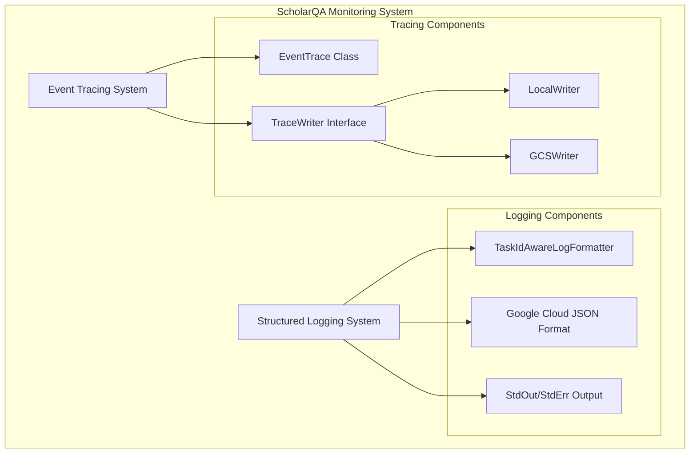
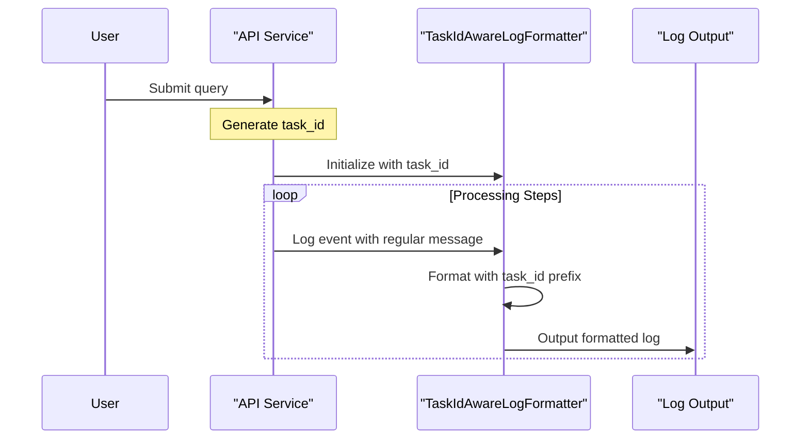
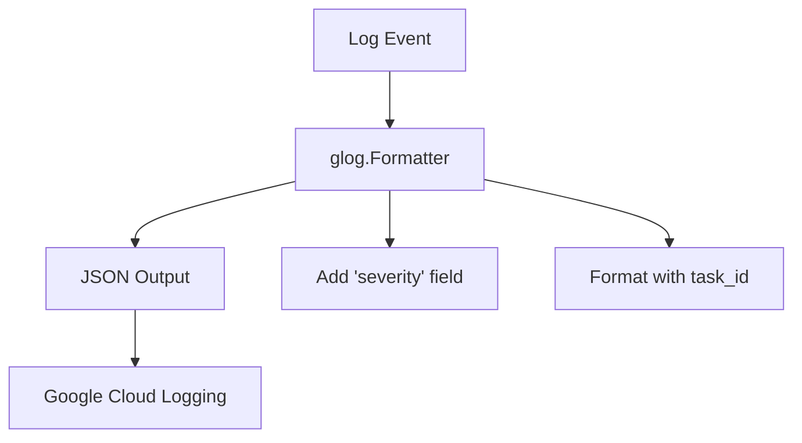
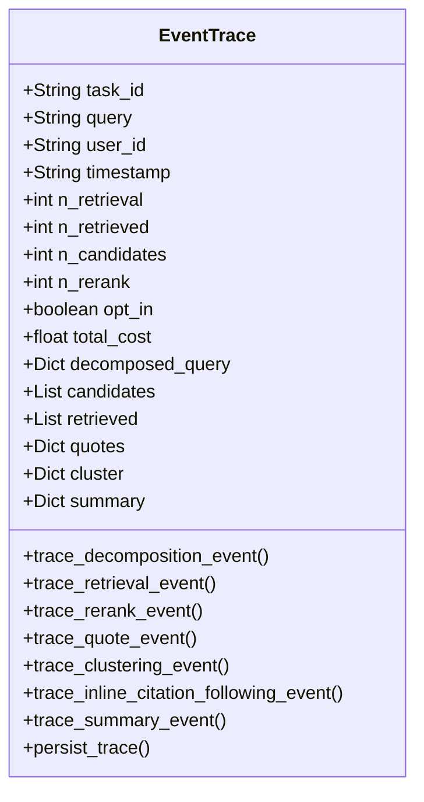
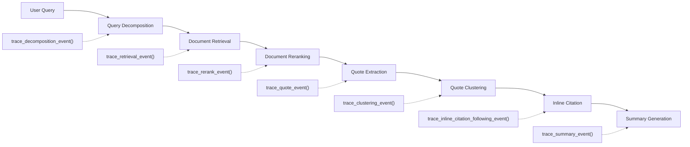
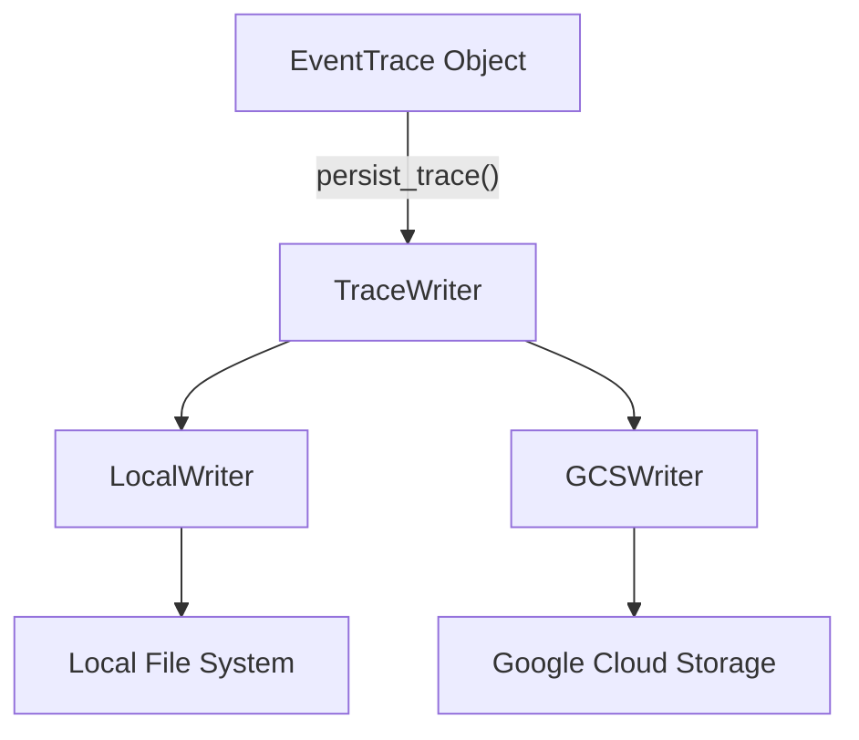
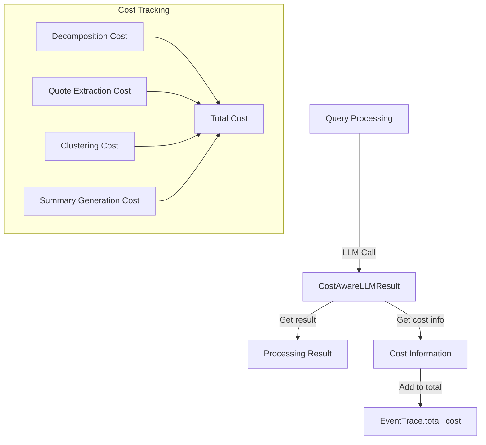
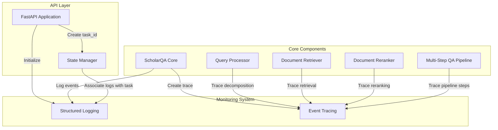

<!-- source: DeepWiki mcp.deepwiki.com · repo allenai/ai2-scholarqa-lib · page 6 Monitoring & Tracing · fetched 2026-10-26 -->

# Monitoring & Tracing

<details>
<summary>Relevant source files</summary>

The following files were used as context for generating this wiki page:

- [api/scholarqa/glog.py](api/scholarqa/glog.py)
- [api/scholarqa/trace/event_traces.py](api/scholarqa/trace/event_traces.py)
- [api/scholarqa/utils.py](api/scholarqa/utils.py)

</details>


This document describes the monitoring and tracing capabilities of the ScholarQA system. It covers how to monitor system behavior, track request processing, debug issues, and analyze performance using event traces and structured logging. For information about system deployment, see [Deployment](#7).

## Overview of Monitoring Capabilities

ScholarQA implements a comprehensive monitoring system to track the execution of query processing pipelines, capture performance metrics, and log important events. The monitoring system consists of two main components:

1. **Structured Logging** - Task ID-aware logging with support for both local and Google Cloud environments
2. **Event Tracing** - Detailed traces of each step in the query processing pipeline



Sources: [api/scholarqa/utils.py:27-35](), [api/scholarqa/glog.py:6-29](), [api/scholarqa/trace/event_traces.py:11-84]()

## Structured Logging System

The ScholarQA system uses a structured logging approach that enhances the standard Python logging capabilities with task ID awareness and Google Cloud compatibility.

### Task ID-Aware Logging

Each request in ScholarQA is assigned a unique task ID, which is included in all log messages related to that request. This enables easy correlation of logs across the entire processing pipeline.



Key components:

- **TaskIdAwareLogFormatter**: Extends the standard log formatter to include task IDs in messages
- **init_settings()**: Initializes the logging system with appropriate handlers and formatters

Sources: [api/scholarqa/utils.py:27-35](), [api/scholarqa/utils.py:38-85]()

### Logging Configuration

The logging system can be configured to output logs in different formats:

| Environment Variable | Value | Description |
|----------------------|-------|-------------|
| LOG_FORMAT | "google:json" | Outputs logs in Google Cloud JSON format |
| LOG_FORMAT | (any other or unset) | Outputs logs to stdout/stderr with standard formatting |
| LOG_LEVEL | (e.g., "INFO", "DEBUG") | Sets the logging verbosity level |

Example configuration:

```python
# Initialize logging with custom directory and debug level
log_formatter = init_settings(logs_dir="/path/to/logs", log_level="DEBUG")
```

Sources: [api/scholarqa/utils.py:38-85]()

### Google Cloud Logging

For cloud deployments, ScholarQA supports Google Cloud-compatible JSON logging format:



The `glog.py` module provides:
- `Formatter`: Extends `jsonlogger.JsonFormatter` to add Google Cloud-specific fields like "severity"
- `Handler`: Stream handler that uses the custom formatter

Sources: [api/scholarqa/glog.py:6-29]()

## Event Tracing System

The event tracing system captures detailed information about each step of query processing, enabling in-depth analysis of system behavior and performance.

### EventTrace Structure

The `EventTrace` class captures:

- **Basic request information**: Task ID, query text, timestamp, user ID
- **Metrics**: Number of retrieved documents, candidates, etc.
- **Cost tracking**: Total cost and per-step costs of LLM calls
- **Step-by-step results**: Outputs of each processing stage



Sources: [api/scholarqa/trace/event_traces.py:11-84]()

### Tracing Pipeline Events

The event tracing system records detailed information at each step of the RAG pipeline:



Each tracing method captures:
- Input and output data for the step
- LLM model used (when applicable)
- Cost information (when using LLMs)
- Processing metrics

Sources: [api/scholarqa/trace/event_traces.py:38-79]()

### Trace Persistence

Event traces can be persisted either locally or to Google Cloud Storage:



Configuration is controlled by the `LogsConfig` object which specifies:
- `tracing_mode`: "local" or "gcs"
- `event_trace_loc`: Directory or bucket name
- `log_dir`: Base directory for local logs

Sources: [api/scholarqa/trace/event_traces.py:81-84]()

## Cost Tracking

The ScholarQA system carefully tracks the cost of each LLM call throughout the processing pipeline. This information is captured in the event trace and can be used for billing, optimization, and monitoring purposes.



The cost tracking is handled by:
- `CostAwareLLMResult`: Contains both the result of an LLM call and its cost information
- Cost accumulation in the `EventTrace` object for each step and total
- Per-model tracking for multi-step processes

Sources: [api/scholarqa/trace/event_traces.py:38-79]()

## Integration with System Components

The monitoring and tracing system integrates with all major components of ScholarQA:



Sources: [api/scholarqa/utils.py:38-85](), [api/scholarqa/trace/event_traces.py:11-84]()

## Best Practices for Monitoring and Debugging

### Effective Trace Analysis

1. **Search by task ID**: When debugging an issue with a specific request, use the task ID to filter logs and access the corresponding event trace
2. **Monitor costs**: Use the cost tracking information to identify expensive operations and optimize prompts
3. **Compare traces**: Compare traces from successful and failed requests to identify differences

### Local vs. Cloud Logging

| Environment | Recommended Configuration |
|-------------|---------------------------|
| Development | Local logging with DEBUG level |
| Testing | Local event traces with INFO level |
| Production | Google Cloud JSON logging with event traces to GCS |

### Setting Up Monitoring Dashboards

For production deployments, consider setting up dashboards that visualize:
- Request volume and latency
- Error rates by component
- LLM costs over time
- Document retrieval metrics

## Troubleshooting Common Issues

| Issue | Monitoring Approach |
|-------|---------------------|
| High latency | Check event traces to identify slow steps |
| Unexpected results | Examine intermediate outputs in event trace |
| High costs | Review cost tracking information per step |
| Missing logs | Verify logging configuration and levels |

Sources: [api/scholarqa/utils.py:38-85](), [api/scholarqa/trace/event_traces.py:11-84]()

---

