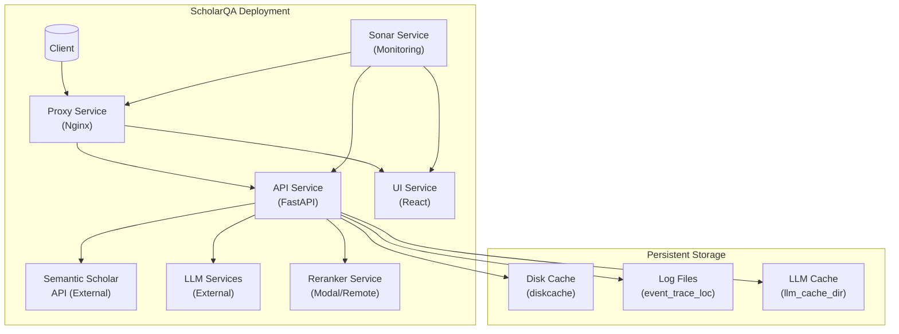
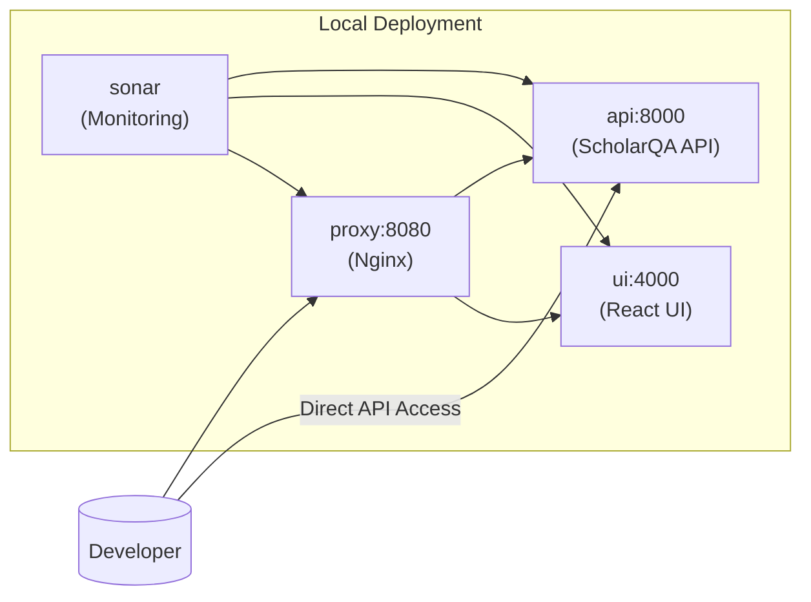
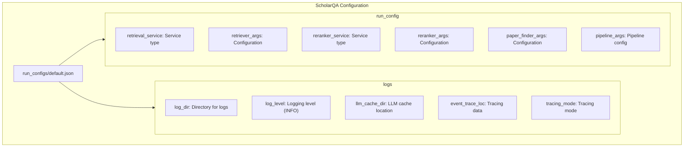
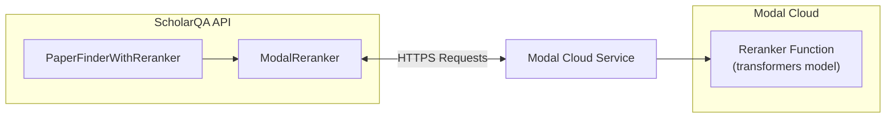
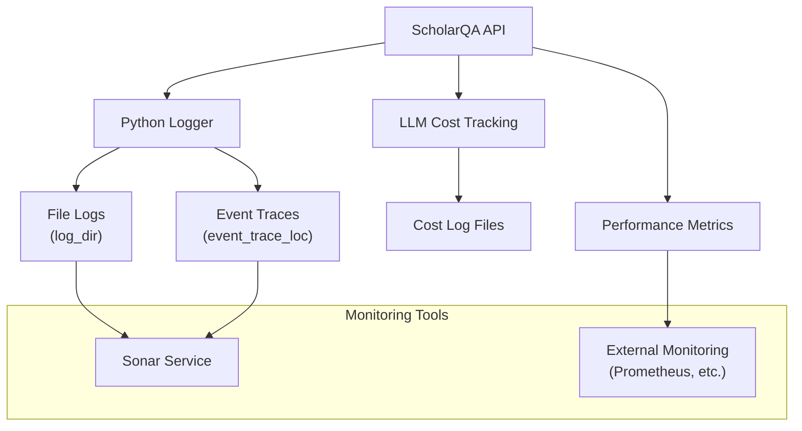
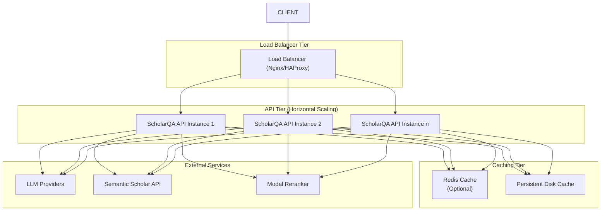

<!-- source: DeepWiki mcp.deepwiki.com · repo allenai/ai2-scholarqa-lib · page 7 Deployment · fetched 2026-10-26 -->

# Deployment

<details>
<summary>Relevant source files</summary>

The following files were used as context for generating this wiki page:

- [api/lib_example.py](api/lib_example.py)
- [api/requirements.txt](api/requirements.txt)
- [api/reranker_requirements.txt](api/reranker_requirements.txt)
- [api/run_configs/default.json](api/run_configs/default.json)
- [api/scholarqa/rag/reranker/modal_deploy/__init__.py](api/scholarqa/rag/reranker/modal_deploy/__init__.py)
- [docker-compose.yaml](docker-compose.yaml)

</details>


This document provides technical guidelines and best practices for deploying the ScholarQA system in various environments. It covers Docker-based deployments, configuration management, service dependencies, and production considerations. For information about system architecture, see [System Architecture](#1.1), and for API integration details, see [API & Integration](#4).

## Deployment Architecture

ScholarQA uses a containerized architecture with separate services for the API, UI, and supporting components. The system can be deployed using Docker Compose for development and testing, or using orchestration platforms like Kubernetes for production environments.



Sources: [docker-compose.yaml:1-45](), [api/run_configs/default.json:1-33]()

## Deployment Options

### Local Development Deployment

For local development and testing, ScholarQA can be deployed using Docker Compose. This setup includes the API, UI, and proxy services.



To deploy locally using Docker Compose:

1. Clone the repository
2. Create a `.env` file with the required environment variables (API keys, etc.)
3. Run `docker-compose up` to start all services

Sources: [docker-compose.yaml:1-45]()

### Production Deployment

For production environments, additional considerations must be addressed:

1. Secure deployment of API keys and credentials
2. Horizontally scalable API services
3. Persistent storage for caching and logs
4. Rate limiting and access control
5. Health monitoring and alerts

## Docker-based Deployment

The ScholarQA system uses Docker Compose to orchestrate multiple services:

| Service | Purpose | Port Mapping | Dependencies |
|---------|---------|--------------|--------------|
| api | ScholarQA API backend | 8000:8000 | None |
| ui | React-based frontend | 4000:3000 | None |
| proxy | Nginx reverse proxy | 8080:8080 | api, ui |
| sonar | Monitoring service | N/A | api, ui, proxy |

The API service mounts several volumes:
- `/api`: Application code
- `/secret`: Secret files (API keys, etc.)

Environment variables are managed through:
- `.env` file (referenced in docker-compose)
- Direct environment variables in the docker-compose file

Sources: [docker-compose.yaml:1-45](), [api/requirements.txt:1-30]()

## Configuration Management

ScholarQA uses a JSON-based configuration system. The configuration file path is specified using the `CONFIG_PATH` environment variable, which defaults to `run_configs/default.json`.

Key configuration sections include:



Example configuration snippet for production:

```json
{
  "logs": {
    "log_dir": "/var/log/scholarqa",
    "log_level": "INFO",
    "llm_cache_dir": "/data/llm_cache",
    "event_trace_loc": "/data/traces",
    "tracing_mode": "cloud"
  },
  "run_config": {
    "retrieval_service": "public_api",
    "reranker_service": "modal",
    ...
  }
}
```

Sources: [api/run_configs/default.json:1-33]()

## External Service Dependencies

ScholarQA depends on several external services that must be properly configured in production:

### LLM Integration

The system integrates with multiple Language Model providers, including Anthropic (Claude) and OpenAI. The configuration in `pipeline_args` specifies the primary and fallback LLMs:

```json
"pipeline_args": {
  "validate": true,
  "llm": "anthropic/claude-3-7-sonnet-20250219",
  "fallback_llm": "openai/gpt-4o",
  "decomposer_llm": "anthropic/claude-3-7-sonnet-20250219"
}
```

LLM configuration requires API keys to be set in the environment:
- `ANTHROPIC_API_KEY` - For Anthropic models
- `OPENAI_API_KEY` - For OpenAI models

The system uses `litellm` to manage LLM interactions and supports caching to minimize redundant API calls.

Sources: [api/run_configs/default.json:26-31](), [api/requirements.txt:21-25]()

### Semantic Scholar API

ScholarQA uses the Semantic Scholar API for document retrieval. For production deployments, consider:

1. Using an API key for higher rate limits
2. Implementing request caching to reduce API load
3. Setting up fallback mechanisms for API availability issues

## Modal Reranker Deployment

The reranker component can be deployed as a serverless function using Modal. This approach offers scalability and cost efficiency for the resource-intensive reranking process.



The Modal deployment requires:
1. A Modal account and properly configured API credentials
2. The reranker model deployed to Modal
3. Configuration in ScholarQA to connect to the Modal service:

```json
"reranker_service": "modal",
"reranker_args": {
  "app_name": "modal_app_name",
  "api_name": "modal_api_name",
  "batch_size": 256,
  "gen_options": {}
}
```

Sources: [api/lib_example.py:1-11](), [api/run_configs/default.json:15-21](), [api/scholarqa/rag/reranker/modal_deploy/__init__.py:1](), [api/reranker_requirements.txt:1-5]()

## Logging and Monitoring

ScholarQA uses a comprehensive logging system that should be configured for production use:



Recommended monitoring practices:
1. Centralized log collection (ELK, Loki, etc.)
2. Dashboard for system metrics (request rates, error rates, etc.)
3. Alerting for anomalies and errors
4. LLM cost tracking and optimization

Sources: [api/run_configs/default.json:2-8](), [docker-compose.yaml:3-8]()

## Environment Variables and Secrets

ScholarQA uses environment variables for configuring sensitive information and deployment-specific settings:

| Environment Variable | Purpose | Required |
|----------------------|---------|----------|
| `CONFIG_PATH` | Path to the configuration JSON file | Yes |
| `ANTHROPIC_API_KEY` | API key for Anthropic models | Yes (if using Anthropic) |
| `OPENAI_API_KEY` | API key for OpenAI models | Yes (if using OpenAI) |
| `LITELLM_LOG` | Logging level for LiteLLM | No |
| `PYTHONUNBUFFERED` | Python output buffering | No |
| `S2_API_KEY` | Semantic Scholar API key | No |

Best practices for secrets management:
1. Use environment variables for secrets, not config files
2. In Kubernetes, use Secrets or external secrets managers
3. For Docker Compose, use `.env` files (not committed to source control)
4. Rotate API keys regularly

Sources: [docker-compose.yaml:14-23]()

## Scaling Considerations

For high-throughput deployments, consider the following scaling strategies:



Key scaling strategies:
1. Horizontal scaling of the API service
2. Distributed caching for LLM responses and document retrieval
3. Rate limiting to prevent external API exhaustion
4. Asynchronous processing for long-running queries
5. Consider self-hosting critical components for high-volume usage

Sources: [api/requirements.txt:1-30](), [api/run_configs/default.json:1-33]()

## Production Checklist

Before deploying to production, ensure the following:

1. **Security**
   - All API keys and secrets managed securely
   - Network security configured (firewalls, TLS, etc.)
   - Input validation and sanitization
   
2. **Reliability**
   - Fallback mechanisms for external service failures
   - Retry logic with backoff for transient errors
   - Circuit breakers for failing dependencies
   
3. **Performance**
   - Sufficient hardware resources allocated
   - Caching configured optimally
   - Load testing completed
   
4. **Monitoring**
   - Logging configured properly
   - Alerting set up for critical issues
   - Cost tracking for LLM usage
   
5. **Backup & Recovery**
   - Cache and log backup strategy
   - Disaster recovery plan
   - Regular testing of recovery procedures

Sources: [api/run_configs/default.json:1-33](), [docker-compose.yaml:1-45](), [api/requirements.txt:1-30]()