# Page: Overview

# Overview

<details>
<summary>Relevant source files</summary>

The following files were used as context for generating this wiki page:

- [api/pyproject.toml](api/pyproject.toml)
- [api/scholarqa/__init__.py](api/scholarqa/__init__.py)
- [api/scholarqa/scholar_qa.py](api/scholarqa/scholar_qa.py)

</details>


ScholarQA is a Retrieval-Augmented Generation (RAG) system designed for answering complex scientific questions by retrieving relevant scientific papers, extracting important information, and generating comprehensive answers with proper citations. This page provides a high-level overview of the system architecture, components, and how they work together.

## Purpose and Scope

ScholarQA is designed to:
- Answer complex scientific questions with comprehensive, factually accurate responses
- Retrieve relevant information from a corpus of 8M+ scientific papers
- Generate structured answers with proper citations to original sources
- Provide both synchronous and asynchronous processing capabilities

This overview covers the high-level architecture of ScholarQA, its main components, and how they interact. For detailed information on installation and configuration, see [Installation & Setup](#2). For in-depth information about specific components, see [Core Components](#3).

## System Architecture

ScholarQA implements a sophisticated multi-step RAG pipeline that goes beyond simple "retrieve-then-generate" approaches, incorporating specialized components for query processing, document retrieval and reranking, quote extraction and clustering, and summary generation.

### High-Level Architecture Diagram

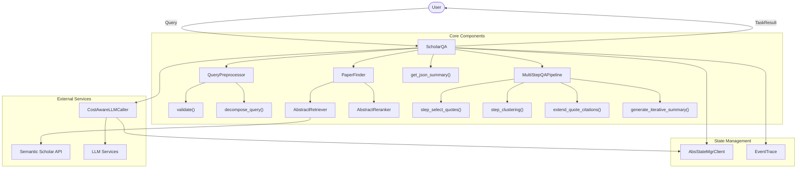

Sources: [api/scholarqa/scholar_qa.py:28-88](), [api/scholarqa/__init__.py:1-8]()

## Processing Pipeline

When a user submits a query, ScholarQA processes it through the following steps:

1. **Query Preprocessing**: Validates the query and decomposes it to extract search filters and create an optimized version for retrieval
2. **Document Retrieval**: Retrieves relevant paper passages from the Semantic Scholar index and API
3. **Document Reranking**: Reranks and aggregates the retrieved documents to focus on the most relevant papers
4. **Quote Extraction**: Extracts salient quotes from the papers that address the query
5. **Quote Clustering**: Clusters the extracted quotes to form a coherent outline for the answer
6. **Citation Addition**: Extends quotes with proper citations to their sources
7. **Summary Generation**: Generates a comprehensive, structured answer based on the clustered quotes
8. **Output Formatting**: Formats the answer with proper citations and returns it as a structured JSON object

### Request Flow Sequence

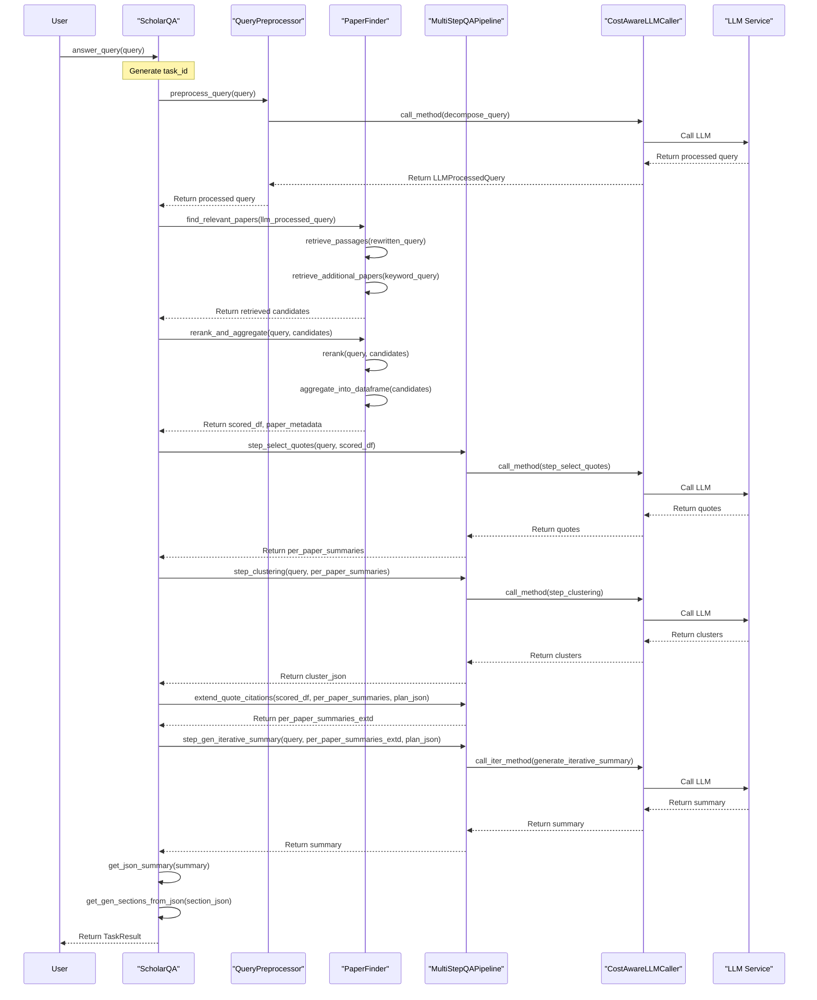

Sources: [api/scholarqa/scholar_qa.py:225-387]()

### Data Flow Through System

The following diagram illustrates how data is transformed as it flows through the ScholarQA system:

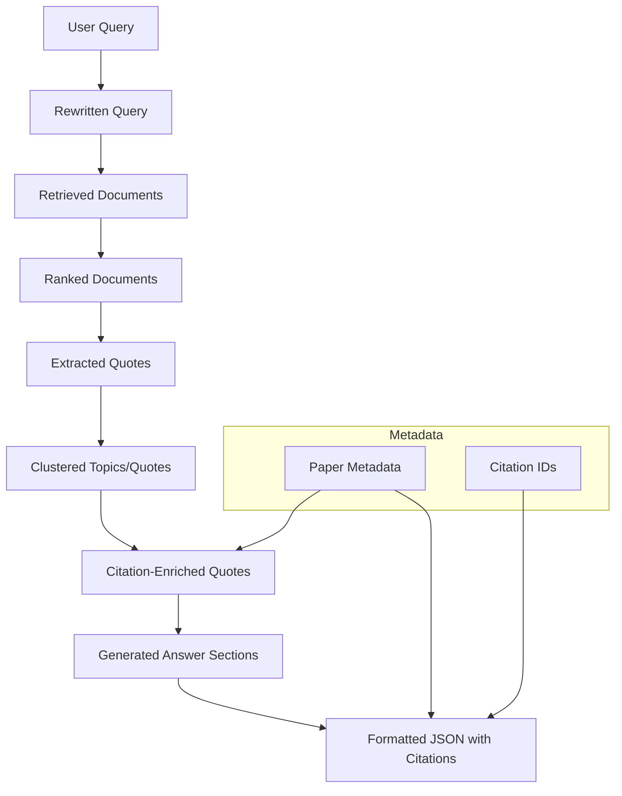

Sources: [api/scholarqa/scholar_qa.py:242-387]()

## Core Components

### ScholarQA Core

The main `ScholarQA` class (defined in [api/scholarqa/scholar_qa.py:28-387]()) orchestrates the entire question-answering process:

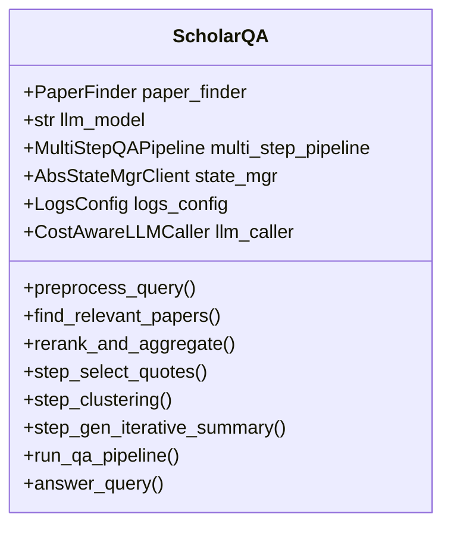

The `ScholarQA` class provides both synchronous and asynchronous interfaces for processing queries. The main method `run_qa_pipeline()` coordinates all the steps of the question-answering process, while `answer_query()` provides a simpler interface for library users.

Sources: [api/scholarqa/scholar_qa.py:28-88](), [api/scholarqa/scholar_qa.py:225-241]()

### Document Retrieval and Reranking

The document retrieval and reranking components are implemented by the `PaperFinder` class and related classes:

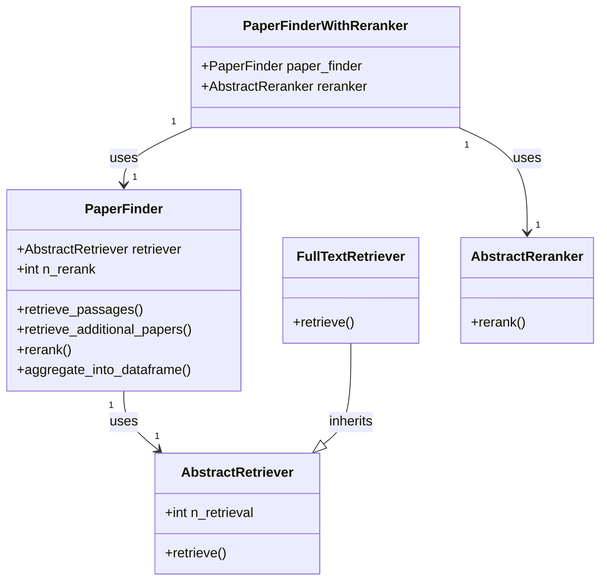

These classes handle the retrieval of relevant documents from various sources, including the Semantic Scholar API, and reranking them to improve relevance.

Sources: [api/scholarqa/__init__.py:2-4]()

### Multi-Step QA Pipeline

The `MultiStepQAPipeline` class implements the core quote extraction, clustering, and summary generation steps:

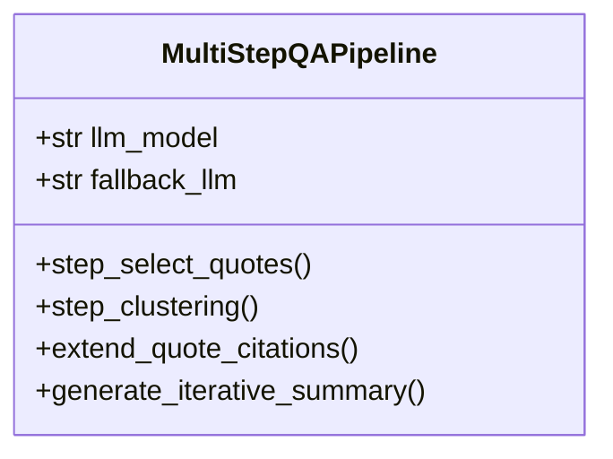

This component is responsible for extracting relevant quotes from retrieved documents, clustering them into coherent topics, enriching them with citations, and generating a comprehensive answer.

Sources: [api/scholarqa/scholar_qa.py:56-61](), [api/scholarqa/scholar_qa.py:148-207]()

### LLM Integration

The LLM integration is handled by the `CostAwareLLMCaller` class:

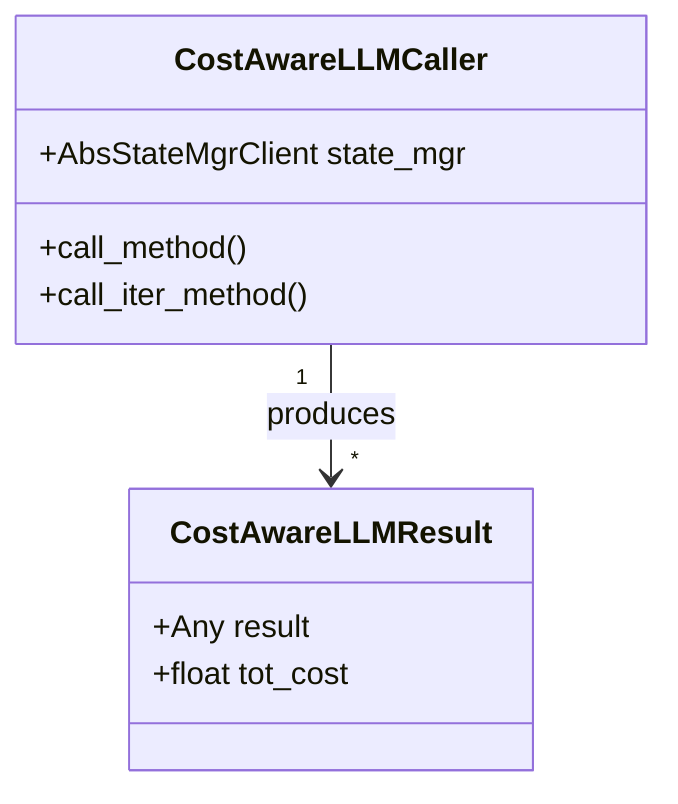

This component provides a consistent interface for calling LLMs, with built-in cost tracking and reporting.

Sources: [api/scholarqa/scholar_qa.py:56](), [api/scholarqa/llms/litellm_helper.py]() (referenced in imports)

## Key Features

ScholarQA offers several distinguishing features:

1. **Multi-Step Processing**: Rather than a simple retrieve-then-generate approach, ScholarQA implements a sophisticated pipeline that extracts relevant quotes, clusters them thematically, enriches them with citations, and then generates a structured answer.

2. **Cost-Aware LLM Integration**: The system carefully tracks costs of LLM calls and implements fallback strategies, providing transparency and control over resource usage.

3. **Flexible Retrieval System**: The `PaperFinder` classes provide abstraction over different retrieval methods, allowing the system to use various sources and retrieval strategies.

4. **Comprehensive Citation Handling**: The system maintains proper academic citation practices throughout, ensuring generated content is properly attributed.

5. **Asynchronous Processing**: The system supports both synchronous and asynchronous processing, making it suitable for handling potentially long-running scholarly queries.

6. **State Management and Tracing**: The system includes robust state management and event tracing capabilities, providing visibility into the processing pipeline and enabling detailed analysis of system behavior.

Sources: [api/scholarqa/scholar_qa.py:28-387](), [api/pyproject.toml:10-66]()

---

# Page: System Architecture

# System Architecture

<details>
<summary>Relevant source files</summary>

The following files were used as context for generating this wiki page:

- [api/scholarqa/rag/multi_step_qa_pipeline.py](api/scholarqa/rag/multi_step_qa_pipeline.py)
- [api/scholarqa/rag/retrieval.py](api/scholarqa/rag/retrieval.py)
- [api/scholarqa/rag/retriever_base.py](api/scholarqa/rag/retriever_base.py)
- [api/scholarqa/scholar_qa.py](api/scholarqa/scholar_qa.py)

</details>


This document details the technical architecture of the ScholarQA system - a Retrieval-Augmented Generation (RAG) system designed for answering questions about scientific literature. It covers the core components, their interactions, and the data flow through the system.

For a high-level overview of ScholarQA's purpose and capabilities, see [Overview](#1).

## Core Components

ScholarQA employs a multi-stage RAG architecture with specialized components handling different aspects of the question-answering process.

```mermaid
graph TD
    subgraph "ScholarQA Core Orchestrator"
        ScholarQA["ScholarQA class"]
        StateMgr["AbsStateMgrClient"]
        LLMCaller["CostAwareLLMCaller"]
    end
    
    subgraph "Query Processing"
        QueryPreprocessor["validate/decompose_query"]
    end
    
    subgraph "Document Retrieval"
        PaperFinder["PaperFinder class"]
        PaperFinderReranker["PaperFinderWithReranker class"]
        AbstractRetriever["AbstractRetriever interface"]
        FullTextRetriever["FullTextRetriever class"]
        Reranker["AbstractReranker interface"]
    end
    
    subgraph "Multi-Step QA Pipeline"
        MultiStepQA["MultiStepQAPipeline class"]
        QuoteExtractor["step_select_quotes method"]
        QuoteClustering["step_clustering method"]
        CitationExtension["extend_quote_citations method"]
        SummaryGen["generate_iterative_summary method"]
    end
    
    subgraph "Output Processing"
        JSONFormatter["get_json_summary function"]
    end
    
    ScholarQA --> QueryPreprocessor
    ScholarQA --> PaperFinder
    ScholarQA --> MultiStepQA
    ScholarQA --> JSONFormatter
    ScholarQA --> StateMgr
    ScholarQA --> LLMCaller
    
    PaperFinder --> AbstractRetriever
    PaperFinderReranker --> PaperFinder
    PaperFinderReranker --> Reranker
    FullTextRetriever --> AbstractRetriever
    
    MultiStepQA --> QuoteExtractor
    MultiStepQA --> QuoteClustering
    MultiStepQA --> CitationExtension
    MultiStepQA --> SummaryGen
    
    LLMCaller --> QueryPreprocessor
    LLMCaller --> QuoteExtractor
    LLMCaller --> QuoteClustering
    LLMCaller --> SummaryGen
```

Sources:
- [scholarqa/scholar_qa.py:28-388]()
- [scholarqa/rag/retrieval.py:15-176]()
- [scholarqa/rag/multi_step_qa_pipeline.py:51-272]()
- [scholarqa/rag/retriever_base.py:10-111]()

## Data Flow

The following diagram shows the end-to-end data flow through the ScholarQA system:

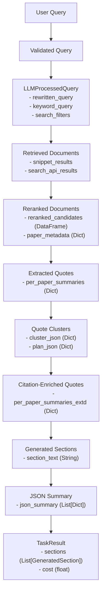

Sources:
- [scholarqa/scholar_qa.py:83-387]()

## ScholarQA Class

The `ScholarQA` class acts as the central orchestrator, coordinating all components and managing the entire pipeline execution.

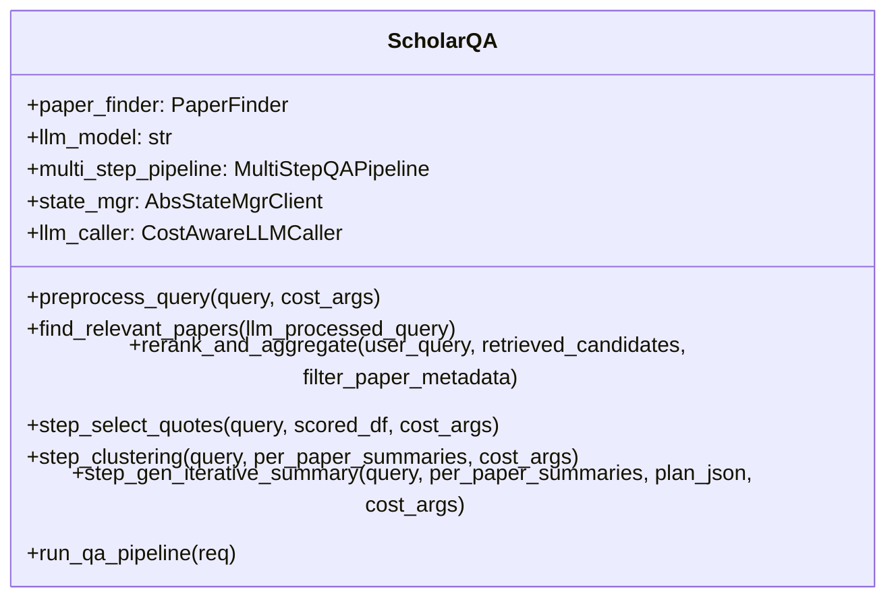

Key responsibilities:
- Initializing and coordinating all system components
- Managing task state for tracking progress of asynchronous processing
- Orchestrating the entire RAG pipeline through a series of discrete steps
- Handling errors and applying fallback strategies

Sources:
- [scholarqa/scholar_qa.py:28-62]()
- [scholarqa/scholar_qa.py:241-387]()

## Document Retrieval System

The document retrieval system finds relevant scientific papers and passages based on the user's query. It provides a layered architecture that allows different retrieval strategies.

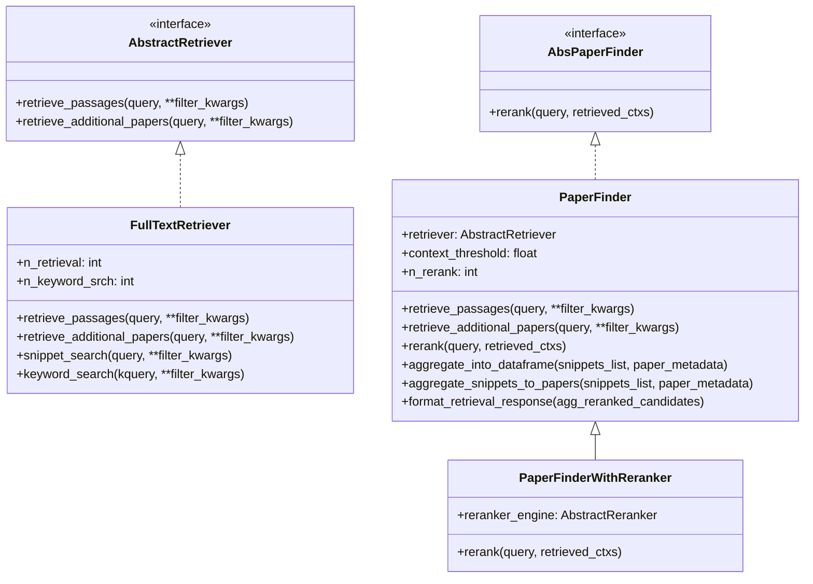

Key components:
- `AbstractRetriever`: Interface defining the retrieval API
- `FullTextRetriever`: Implementation that queries Semantic Scholar API
- `PaperFinder`: Manages retrieval process and basic reranking
- `PaperFinderWithReranker`: Extends PaperFinder with advanced reranking capabilities

Primary operations:
1. `retrieve_passages`: Gets relevant paper passages from Semantic Scholar
2. `retrieve_additional_papers`: Finds additional papers using keyword search
3. `rerank`: Reorders retrieved passages by relevance
4. `aggregate_into_dataframe`: Transforms individual passages into paper-level records

Sources:
- [scholarqa/rag/retriever_base.py:10-111]()
- [scholarqa/rag/retrieval.py:15-176]()

## Multi-Step QA Pipeline

The Multi-Step QA Pipeline processes retrieved documents through several stages to generate a comprehensive answer with proper citations.

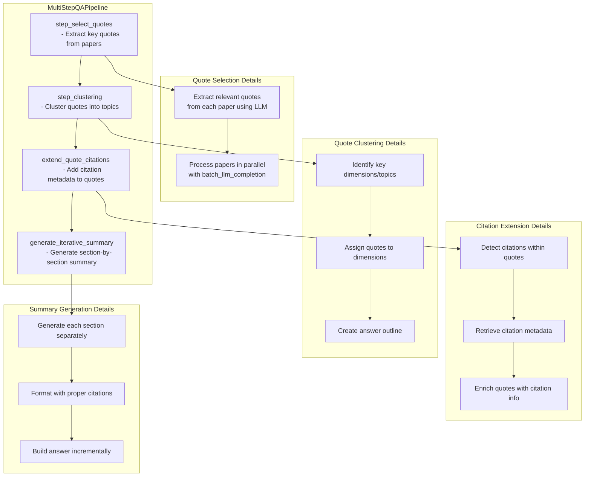

Key methods:
- `step_select_quotes`: Extracts relevant quotes from each paper using an LLM
- `step_clustering`: Organizes quotes into meaningful dimensions/topics
- `extend_quote_citations`: Enhances quotes with proper citation information
- `generate_iterative_summary`: Creates a structured, section-by-section answer

The pipeline handles:
1. Quote extraction from multiple papers in parallel
2. Semantic clustering of quotes to create a coherent structure
3. Citation resolution and linking
4. Incremental answer generation following the created outline

Sources:
- [scholarqa/rag/multi_step_qa_pipeline.py:51-272]()

## End-to-End Processing Sequence

The following sequence diagram shows the complete processing flow through ScholarQA:

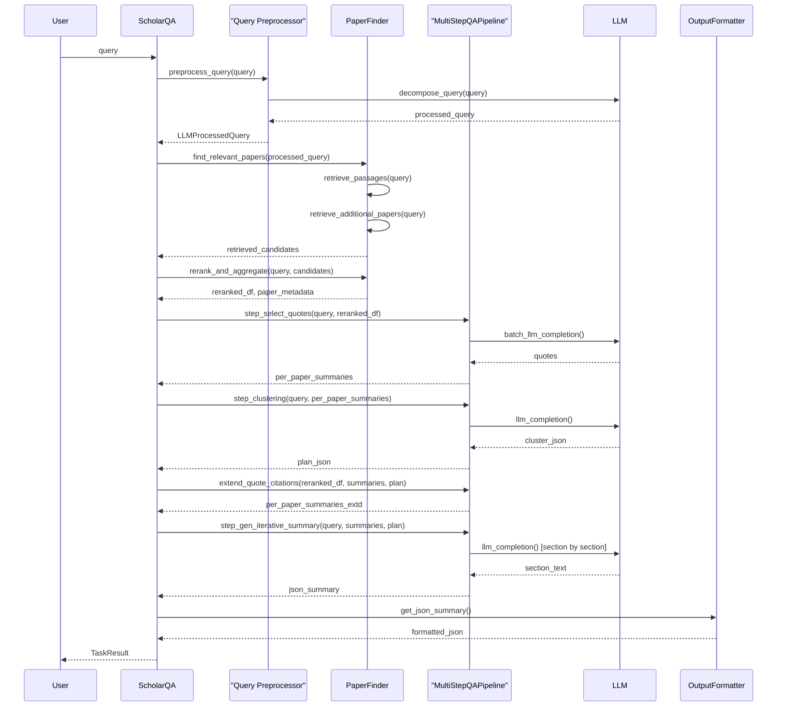

Sources:
- [scholarqa/scholar_qa.py:241-387]()

## Configurability

ScholarQA is designed for flexibility through dependency injection. The system can be customized by configuring these key components:

| Component | Description | Default | Configuration |
|-----------|-------------|---------|--------------|
| `paper_finder` | Document retrieval component | Required parameter | Constructor parameter |
| `llm_model` | LLM model to use | CLAUDE_37_SONNET | Constructor parameter |
| `multi_step_pipeline` | QA pipeline implementation | New instance created | Constructor parameter |
| `state_mgr` | State management client | LocalStateMgrClient | Constructor parameter |
| `fallback_llm` | Fallback LLM model | GPT_4o | Constructor parameter |
| `validate` | Whether to validate queries | True if OPENAI_API_KEY in env | Constructor parameter |

Sources:
- [scholarqa/scholar_qa.py:28-61]()

## External Integrations

ScholarQA integrates with several external systems:

1. **Semantic Scholar API**: For paper metadata and full text retrieval
   - Used by `FullTextRetriever` through `snippet_search` and `keyword_search` methods
   - Provides paper content, metadata, and citation information

2. **LLM Services**: For various natural language processing tasks
   - Query decomposition and validation
   - Quote extraction and selection
   - Topic clustering and organization
   - Answer generation with proper citations
   - Integrated via `CostAwareLLMCaller` which handles model selection, fallbacks, and cost tracking

3. **State Management**: For task tracking and asynchronous processing
   - Default implementation is `LocalStateMgrClient`
   - Updates task state during processing for client progress monitoring
   - Maintains cost information across LLM calls

Sources:
- [scholarqa/rag/retriever_base.py:35-111]()
- [scholarqa/scholar_qa.py:56-57]()
- [scholarqa/scholar_qa.py:65-81]()

## Summary

The ScholarQA architecture implements a sophisticated RAG system specifically designed for answering scientific questions. Its multi-step pipeline approach provides several advantages over simpler retrieve-and-generate systems:

1. Focused retrieval with query decomposition and reranking
2. Explicit extraction of key quotes from papers
3. Structured answer organization based on content clustering
4. Proper academic citation handling
5. Cost-aware LLM integration with fallback mechanisms

This architecture enables ScholarQA to generate comprehensive, well-organized answers to scholarly questions with appropriate citations to scientific literature.

Sources:
- [scholarqa/scholar_qa.py:28-388]()
- [scholarqa/rag/multi_step_qa_pipeline.py:51-272]()

---

# Page: Installation & Setup

# Installation & Setup

<details>
<summary>Relevant source files</summary>

The following files were used as context for generating this wiki page:

- [api/lib_example.py](api/lib_example.py)
- [api/pyproject.toml](api/pyproject.toml)
- [api/requirements.txt](api/requirements.txt)
- [api/reranker_requirements.txt](api/reranker_requirements.txt)
- [api/run_configs/default.json](api/run_configs/default.json)
- [docker-compose.yaml](docker-compose.yaml)

</details>


This document provides detailed instructions for installing and configuring the AI2 ScholarQA system. It covers installation methods, required dependencies, configuration options, and basic setup. For information about the overall system architecture, see [System Architecture](#1.1). For API usage and integration details, see [API & Integration](#4).

## Requirements

ScholarQA requires Python 3.11.3 or higher. The system has two tiers of dependencies:
- Core dependencies (required for basic functionality)
- Extended dependencies (required for full functionality including reranking)

### Core Dependencies

The core system relies on the following key dependencies:

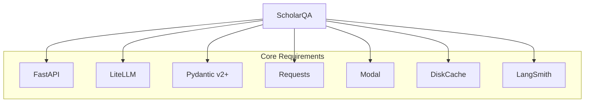

Sources: [api/pyproject.toml:19-45](), [api/requirements.txt:1-29]()

### Reranker Dependencies

If you plan to use the local reranker functionality, additional dependencies are required:

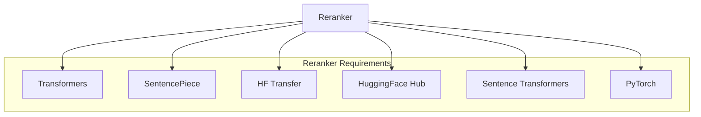

Sources: [api/reranker_requirements.txt:1-5](), [api/pyproject.toml:53-64]()

## Installation Methods

ScholarQA can be installed and run using three different methods:

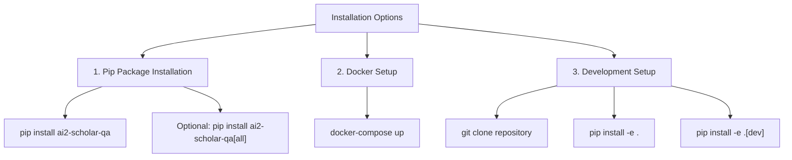

### Python Package Installation

Install the package using pip:

```
pip install ai2-scholar-qa
```

For full functionality including the reranker:

```
pip install ai2-scholar-qa[all]
```

Sources: [api/pyproject.toml:10-69]()

### Docker Setup

The repository includes a Docker Compose configuration that sets up:
1. The ScholarQA API service
2. A web UI for interacting with the API
3. A reverse proxy for handling communication between components
4. A logging component (Sonar)

To use the Docker setup:

1. Clone the repository
2. Create a `.env` file with required environment variables (see Configuration section)
3. Run Docker Compose:

```
docker-compose up
```

This will start all services, with the API accessible on port 8000 and the UI on port 4000.

Sources: [docker-compose.yaml:1-45]()

### Development Setup

For development work on ScholarQA:

1. Clone the repository
2. Install the package in development mode:
   ```
   pip install -e .
   ```
3. Install development dependencies:
   ```
   pip install -e .[dev]
   ```
4. Install reranker dependencies if needed:
   ```
   pip install -r api/reranker_requirements.txt
   ```

Sources: [api/pyproject.toml:47-64]()

## Configuration

ScholarQA uses JSON configuration files to control its behavior. The default configuration is located at `run_configs/default.json`.

### Configuration File Structure

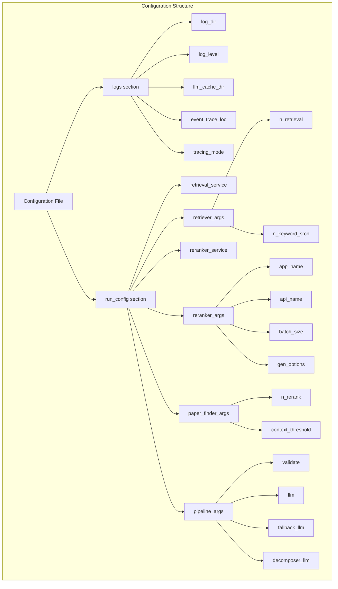

Sources: [api/run_configs/default.json:1-33]()

### Setting Up Configuration

You can specify the configuration file using the `CONFIG_PATH` environment variable:

```
export CONFIG_PATH=path/to/your/config.json
```

When using Docker, this is set in the `docker-compose.yaml` file:

Sources: [docker-compose.yaml:17-19]()

### Critical Configuration Parameters

#### LLM Configuration
- `pipeline_args.llm`: Primary LLM to use (default: "anthropic/claude-3-7-sonnet-20250219")
- `pipeline_args.fallback_llm`: Fallback LLM if primary fails (default: "openai/gpt-4o")
- `pipeline_args.decomposer_llm`: LLM for query decomposition (default: same as primary)

#### Retrieval Configuration
- `retrieval_service`: Which retrieval service to use (default: "public_api")
- `retriever_args.n_retrieval`: Number of documents to retrieve (default: 256)
- `retriever_args.n_keyword_srch`: Number of keyword search results (default: 20)

#### Reranker Configuration
- `reranker_service`: Reranker service to use (default: "modal")
- `reranker_args.app_name`: Modal app name (requires Modal setup)
- `reranker_args.api_name`: Modal API name
- `paper_finder_args.n_rerank`: Number of documents to rerank (default: 50)
- `paper_finder_args.context_threshold`: Similarity threshold for context relevance (default: 0.5)

Sources: [api/run_configs/default.json:9-32]()

## Environment Variables

ScholarQA requires several environment variables to be set:

1. **API Keys for LLMs**: Depending on your configuration, you need API keys for OpenAI, Anthropic, or other LLM providers
2. **Semantic Scholar API Key**: For accessing the paper retrieval service
3. **Configuration Path**: `CONFIG_PATH` to specify your configuration file location

When using Docker, these should be placed in a `.env` file in the root directory.

Sources: [docker-compose.yaml:22-23]()

## Basic Usage

Here's a simple example of using ScholarQA as a library:

```python
from scholarqa.rag.reranker.modal_engine import ModalReranker
from scholarqa.rag.retrieval import PaperFinderWithReranker
from scholarqa.rag.retriever_base import FullTextRetriever
from scholarqa import ScholarQA

# Initialize components
retriever = FullTextRetriever(n_retrieval=256, n_keyword_srch=20)
reranker = ModalReranker(app_name="modal_app_name", api_name="modal_api_name", batch_size=256, gen_options=dict())
paper_finder = PaperFinderWithReranker(retriever, reranker, n_rerank=50, context_threshold=0.5)

# Create ScholarQA instance
scholar_qa = ScholarQA(paper_finder=paper_finder)

# Query the system
result = scholar_qa.answer_query("Which is the 9th planet in our solar system?")
print(result)
```

Sources: [api/lib_example.py:1-11]()

## Component Initialization Flow

The following diagram shows how components are initialized and connected:

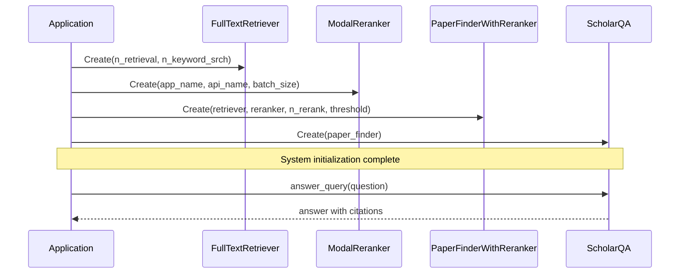

Sources: [api/lib_example.py:1-11]()

## Running the API Service

To run the ScholarQA API service directly:

1. Install the package and dependencies
2. Set required environment variables
3. Run using uvicorn:

```
uvicorn scholarqa.api:app --host 0.0.0.0 --port 8000
```

When using Docker, the API service is automatically started based on the configuration in `docker-compose.yaml`.

Sources: [docker-compose.yaml:9-23]()

## Troubleshooting

### Common Installation Issues

1. **Missing Dependencies**: If you encounter import errors, ensure you've installed the package with the correct optional dependencies using `pip install ai2-scholar-qa[all]`

2. **Modal Setup Issues**: For reranking with Modal, ensure you've configured Modal correctly and set the appropriate app and API names in your configuration

3. **API Keys**: Most failures are due to missing or invalid API keys. Check your environment variables and ensure all required API keys are properly set

4. **Configuration Path**: If the system can't find your configuration, check that `CONFIG_PATH` is correctly set and points to a valid JSON file

Sources: [api/run_configs/default.json:1-33](), [docker-compose.yaml:17-19]()

## Next Steps

After installation, refer to [API & Integration](#4) for information on using the ScholarQA API, and [Configuration Options](#4.1) for a complete reference of all configuration parameters.

---

# Page: Core Components

# Core Components

<details>
<summary>Relevant source files</summary>

The following files were used as context for generating this wiki page:

- [api/scholarqa/__init__.py](api/scholarqa/__init__.py)
- [api/scholarqa/config/config_setup.py](api/scholarqa/config/config_setup.py)
- [api/scholarqa/scholar_qa.py](api/scholarqa/scholar_qa.py)

</details>


This document provides an overview of the main components that make up the ScholarQA system, describing their functions and interactions. For information about installation and setup, see [Installation & Setup](#2). For API integration details, see [API & Integration](#4).

## Overview

ScholarQA's core components work together to process scientific questions, retrieve relevant papers, extract and organize information, and generate comprehensive answers with proper citations. The system is built around a multi-stage Retrieval-Augmented Generation (RAG) pipeline designed specifically for scientific literature.

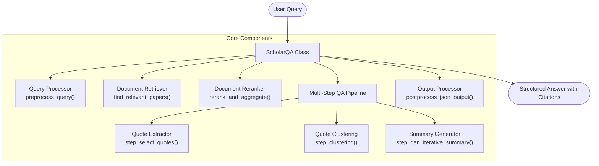

Sources: [scholarqa/scholar_qa.py:28-388]()

## ScholarQA Core Class

The `ScholarQA` class serves as the central orchestrator that initializes and coordinates all components in the pipeline. It maintains the state of the question-answering process and handles the overall task execution.

### Key Attributes

| Attribute | Type | Description |
|-----------|------|-------------|
| `paper_finder` | `PaperFinder` | Handles document retrieval and reranking |
| `multi_step_pipeline` | `MultiStepQAPipeline` | Implements the multi-step generation process |
| `llm_caller` | `CostAwareLLMCaller` | Manages LLM integration with cost tracking |
| `state_mgr` | `AbsStateMgrClient` | Manages task state for asynchronous operations |

Sources: [scholarqa/scholar_qa.py:28-62]()

### Processing Flow

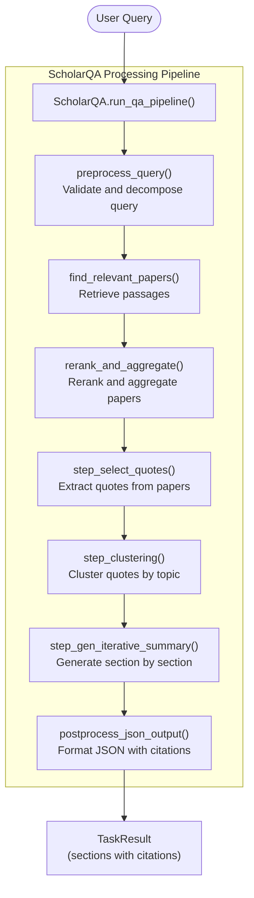

Sources: [scholarqa/scholar_qa.py:241-387]()

## Query Processor

The Query Processor handles the initial processing of user questions through two main functions:

1. **Validation**: Checks if the query is valid and answerable
2. **Decomposition**: Breaks down the query to extract search filters and reformulates it for optimal retrieval

### Implementation Details

- Implemented in the `preprocess_query()` method in `ScholarQA`
- Returns a `LLMProcessedQuery` object containing:
  - `rewritten_query`: A reformulated version of the query optimized for retrieval
  - `keyword_query`: A query suitable for keyword search
  - `search_filters`: Extracted filters like year, venue, field of study, etc.

Sources: [scholarqa/scholar_qa.py:83-93]()

## Document Retrieval System

The Document Retriever finds relevant scientific papers based on the processed query. It uses the `PaperFinder` class to retrieve content from two sources:

1. **Passage Retrieval**: Retrieves passages matching the rewritten query from the Semantic Scholar index
2. **Paper Retrieval**: Uses keyword search to find additional papers via the Semantic Scholar API

### Implementation Details

- Implemented in the `find_relevant_papers()` method in `ScholarQA`
- Uses the `PaperFinder` class to perform retrieval operations
- Returns a tuple of snippet results and search API results

Sources: [scholarqa/scholar_qa.py:96-125](), [scholarqa/__init__.py:2-3]()

## Document Reranker

The Document Reranker takes the retrieved papers and reranks them based on their relevance to the query. It also aggregates passages at the paper level to prepare them for the QA pipeline.

### Implementation Details

- Implemented in the `rerank_and_aggregate()` method in `ScholarQA`
- Uses the `rerank()` method of the `PaperFinder` instance
- Returns a pandas DataFrame of reranked papers and a dictionary of paper metadata

Sources: [scholarqa/scholar_qa.py:128-146](), [scholarqa/__init__.py:4]()

## Multi-Step QA Pipeline

The Multi-Step QA Pipeline is the core of the answer generation process. It consists of three main steps:

```mermaid
flowchart LR
    subgraph "MultiStepQAPipeline"
        Step1["Quote Extraction\nstep_select_quotes()"] --> Step2["Quote Clustering\nstep_clustering()"]
        Step2 --> Step2_1["Citation Extension\nextend_quote_citations()"]
        Step2_1 --> Step3["Summary Generation\ngenerate_iterative_summary()"]
    end
    
    Query([Query]) --> Step1
    Papers([Reranked Papers]) --> Step1
    Step3 --> Answer([Structured Answer])
```

### 1. Quote Extraction

- Implemented in the `step_select_quotes()` method
- Extracts relevant quotes from each paper that address the query
- Uses an LLM to intelligently select the most relevant parts of papers

Sources: [scholarqa/scholar_qa.py:149-170]()

### 2. Quote Clustering

- Implemented in the `step_clustering()` method
- Groups the extracted quotes into coherent topics to form an outline
- Creates a structured plan for the answer with dimensions and formats

Sources: [scholarqa/scholar_qa.py:172-184]()

### 3. Summary Generation

- Implemented in the `step_gen_iterative_summary()` method
- Generates a comprehensive answer by summarizing the quotes section by section
- Includes inline citations to source papers

Sources: [scholarqa/scholar_qa.py:186-207]()

## Output Processing

The Output Processor formats the generated answer into a structured JSON format with proper citations. It ensures that each statement in the answer is properly attributed to the source papers.

### Implementation Details

- Uses the `get_json_summary()` function from `scholarqa.postprocess.json_output_utils`
- Translates the generated sections into `GeneratedSection` objects
- Creates a final `TaskResult` with sections, citations, and cost information

Sources: [scholarqa/scholar_qa.py:209-224](), [scholarqa/scholar_qa.py:358-387]()

## Configuration System

ScholarQA uses a configuration system to manage various settings across components. The main configuration classes are:

1. **LogsConfig**: Manages logging settings, event traces, and LLM caching
2. **RunConfig**: Configures retrieval, reranking, and pipeline services
3. **AppConfig**: Top-level configuration that includes logs and run configurations

Sources: [scholarqa/config/config_setup.py:13-70]()

## Component Interactions

The following diagram illustrates how the ScholarQA components interact during the question-answering process:

```mermaid
sequenceDiagram
    participant User
    participant ScholarQA
    participant QueryProcessor
    participant PaperFinder
    participant MultiStepQA
    participant OutputProcessor
    
    User->>ScholarQA: answer_query(query)
    ScholarQA->>QueryProcessor: preprocess_query(query)
    QueryProcessor-->>ScholarQA: LLMProcessedQuery
    
    ScholarQA->>PaperFinder: retrieve_passages(rewritten_query)
    PaperFinder-->>ScholarQA: snippet_results
    
    ScholarQA->>PaperFinder: retrieve_additional_papers(keyword_query)
    PaperFinder-->>ScholarQA: search_api_results
    
    ScholarQA->>PaperFinder: rerank(query, candidates)
    PaperFinder-->>ScholarQA: reranked_candidates
    
    ScholarQA->>MultiStepQA: step_select_quotes(query, scored_df)
    MultiStepQA-->>ScholarQA: per_paper_summaries
    
    ScholarQA->>MultiStepQA: step_clustering(query, per_paper_summaries)
    MultiStepQA-->>ScholarQA: cluster_json
    
    ScholarQA->>MultiStepQA: extend_quote_citations(reranked_df, summaries, plan)
    MultiStepQA-->>ScholarQA: per_paper_summaries_extd
    
    ScholarQA->>MultiStepQA: generate_iterative_summary(query, summaries, plan)
    MultiStepQA-->>ScholarQA: section_text (iterative)
    
    ScholarQA->>OutputProcessor: get_json_summary(section_text)
    OutputProcessor-->>ScholarQA: json_summary
    
    ScholarQA->>User: TaskResult with generated sections
```

Sources: [scholarqa/scholar_qa.py:241-387]()

## Summary

The ScholarQA core components form a sophisticated RAG pipeline specifically designed for scientific literature. The system leverages multiple stages of processing to ensure high-quality answers with proper citations:

1. The **Query Processor** prepares the user query for retrieval
2. The **Document Retrieval System** finds relevant papers and passages
3. The **Document Reranker** improves relevance by reranking results
4. The **Multi-Step QA Pipeline** extracts quotes, clusters them, and generates a comprehensive answer
5. The **Output Processor** formats the answer with proper citations

These components work together seamlessly to provide accurate, comprehensive answers to scientific questions with proper attribution to the source literature.

---

# Page: Query Processing

# Query Processing

<details>
<summary>Relevant source files</summary>

The following files were used as context for generating this wiki page:

- [api/scholarqa/llms/constants.py](api/scholarqa/llms/constants.py)
- [api/scholarqa/scholar_qa.py](api/scholarqa/scholar_qa.py)
- [api/scholarqa/state_mgmt/local_state_mgr.py](api/scholarqa/state_mgmt/local_state_mgr.py)

</details>


## Overview

This document covers the query processing component of the ScholarQA system, which transforms raw user questions into optimized formats for scientific literature retrieval. Query processing is the critical first step in the retrieval-augmented generation (RAG) pipeline, occurring immediately after user input and before document retrieval.

For details about subsequent steps in the pipeline, see [Document Retrieval System](#3.2) and [Multi-Step QA Pipeline](#3.4).

## Query Processing Architecture

The query processing subsystem performs three main functions:
1. **Query validation**: Screens out harmful or unanswerable queries
2. **Query decomposition**: Extracts search parameters and filters
3. **Query transformation**: Generates optimized versions of the query for different retrieval approaches

```mermaid
flowchart TD
    User(["User"]) -->|"Raw query"| QP["Query Processor"]
    
    subgraph "Query Processing"
        QP --> Validate["validate()"]
        Validate --> Decompose["decompose_query()"]
        Decompose --> ProcessedQuery["LLMProcessedQuery"]
    end
    
    ProcessedQuery -->|"rewritten_query"| Retriever["PaperFinder.retrieve_passages()"]
    ProcessedQuery -->|"keyword_query"| KeywordSearch["PaperFinder.retrieve_additional_papers()"]
    ProcessedQuery -->|"search_filters"| Filters["Apply to both retrieval methods"]
    
    Retriever --> Results["Retrieved Documents"]
    KeywordSearch --> Results
```

Sources: [scholarqa/scholar_qa.py:84-93](), [scholarqa/scholar_qa.py:96-125]()

## LLM-Based Query Processing

ScholarQA leverages large language models (LLMs) to process user queries. The query processing is handled by the `preprocess_query` method in the `ScholarQA` class, which:

1. Optionally validates the query for harmful content
2. Uses an LLM to decompose and transform the query
3. Tracks the cost of these operations

```mermaid
sequenceDiagram
    participant User
    participant ScholarQA as "ScholarQA"
    participant Validator as "validate()"
    participant LLMCaller as "CostAwareLLMCaller"
    participant DecomposeFunc as "decompose_query()"
    participant LLM as "LLM Service"
    
    User->>ScholarQA: query
    
    ScholarQA->>ScholarQA: Check if validate is enabled
    
    alt validation enabled
        ScholarQA->>Validator: validate(query)
        Validator-->>ScholarQA: (throws exception if invalid)
    end
    
    ScholarQA->>LLMCaller: call_method(decompose_query, query, ...)
    LLMCaller->>DecomposeFunc: decompose_query(query, decomposer_llm_model)
    DecomposeFunc->>LLM: Send prompt with query
    LLM-->>DecomposeFunc: Response
    DecomposeFunc-->>LLMCaller: LLMProcessedQuery
    LLMCaller-->>ScholarQA: CostAwareLLMResult(result=LLMProcessedQuery, ...)
```

Sources: [scholarqa/scholar_qa.py:84-93](), [scholarqa/llms/constants.py:11-16]()

## Key Data Structures

### LLMProcessedQuery

The output of query processing is an `LLMProcessedQuery` object with the following key components:

| Component | Purpose | Usage |
|-----------|---------|-------|
| `rewritten_query` | LLM-enhanced version optimized for relevance | Used for primary passage retrieval |
| `keyword_query` | Simplified version for broader coverage | Used for supplementary API-based retrieval |
| `search_filters` | Extracted search parameters | Applied to both retrieval methods |

### CostAwareLLMResult

All LLM operations are wrapped in cost-tracking structures to monitor usage:

```python
CostAwareLLMResult = namedtuple("CostAwareLLMResult", ["result", "tot_cost", "models"])
```

Sources: [scholarqa/llms/constants.py:16]()

## Implementation Details

### Query Validation

When enabled (via the `validate` flag), the system checks whether a query is appropriate for answering with scientific literature. This helps filter out:

- Harmful content
- Questions unrelated to scientific domains
- Queries that cannot be meaningfully answered with available literature

### Query Decomposition

The `decompose_query` function analyzes the query to:

1. Extract search filters like publication year, venue, field of study, or citation count
2. Generate a rewritten version optimized for retrieval
3. Create a keyword-based version for broader search coverage

### Integration with the Retrieval System

After processing, the query components are used in different retrieval approaches:

1. The `rewritten_query` is used with the Semantic Scholar index to retrieve relevant passages:
```python
snippet_results = self.paper_finder.retrieve_passages(
    query=rewritten_query,
    **llm_processed_query.search_filters,
    **kwargs
)
```

2. The `keyword_query` (if available) is used to find additional papers via keyword search:
```python
search_api_results = self.paper_finder.retrieve_additional_papers(
    keyword_query,
    **llm_processed_query.search_filters
)
```

Sources: [scholarqa/scholar_qa.py:96-125]()

## Tracing and Monitoring

Query processing is monitored using a tracing decorator:

```python
@traceable(name="Preprocessing: Validate and decompose user query")
def preprocess_query(self, query: str, cost_args: CostReportingArgs, ) -> CostAwareLLMResult:
    # Implementation...
```

This helps with debugging, performance monitoring, and cost tracking throughout the system.

Sources: [scholarqa/scholar_qa.py:83-93]()

## Pipeline Integration

Query processing is explicitly identified as "Step 0" in the ScholarQA pipeline. The system updates its state during processing to inform users about progress:

```python
self.update_task_state("Processing user query", task_estimated_time="~3 minutes", step_estimated_time=5)
```

The result of query processing is then traced through an event system:

```python
event_trace.trace_decomposition_event(llm_processed_query)
```

Sources: [scholarqa/scholar_qa.py:260-284]()

---

# Page: Document Retrieval System

# Document Retrieval System

<details>
<summary>Relevant source files</summary>

The following files were used as context for generating this wiki page:

- [api/scholarqa/glog.py](api/scholarqa/glog.py)
- [api/scholarqa/rag/retrieval.py](api/scholarqa/rag/retrieval.py)
- [api/scholarqa/rag/retriever_base.py](api/scholarqa/rag/retriever_base.py)
- [api/scholarqa/utils.py](api/scholarqa/utils.py)

</details>


The Document Retrieval System is a core component of the AI2 ScholarQA framework that handles finding and retrieving relevant scientific papers and passages from external sources. This system forms the foundation of the Retrieval-Augmented Generation (RAG) pipeline, providing the raw textual content that later components will process, rerank, and synthesize to generate answers.

This document covers the architecture, components, and workflow of the document retrieval system. For information about how documents are reranked after retrieval, see [Document Reranking](#3.3). For details on how retrieved documents are processed in the QA pipeline, see [Multi-Step QA Pipeline](#3.4).

## System Architecture

The Document Retrieval System employs a modular architecture organized around several key classes that handle different aspects of the retrieval process.

```mermaid
classDiagram
    class "AbstractRetriever" {
        <<abstract>>
        +retrieve_passages(query, **filter_kwargs)
        +retrieve_additional_papers(query, **filter_kwargs)
    }
    
    class "FullTextRetriever" {
        +n_retrieval: int
        +n_keyword_srch: int
        +retrieve_passages(query, **filter_kwargs)
        +retrieve_additional_papers(query, **filter_kwargs)
        -snippet_search(query, **filter_kwargs)
        -keyword_search(kquery, **filter_kwargs)
    }
    
    class "AbsPaperFinder" {
        <<abstract>>
        +rerank(query, retrieved_ctxs)
    }
    
    class "PaperFinder" {
        +retriever: AbstractRetriever
        +context_threshold: float
        +n_rerank: int
        +retrieve_passages(query, **filter_kwargs)
        +retrieve_additional_papers(query, **filter_kwargs)
        +rerank(query, retrieved_ctxs)
        +aggregate_into_dataframe(snippets_list, paper_metadata)
        -aggregate_snippets_to_papers(snippets_list, paper_metadata)
        -format_retrieval_response(agg_reranked_candidates)
    }
    
    class "PaperFinderWithReranker" {
        +reranker_engine: AbstractReranker
        +rerank(query, retrieved_ctxs)
    }
    
    class "AbstractReranker" {
        <<abstract>>
    }
    
    AbstractRetriever <|-- FullTextRetriever
    AbstractRetriever <|-- AbsPaperFinder
    AbsPaperFinder <|-- PaperFinder
    PaperFinder <|-- PaperFinderWithReranker
    PaperFinderWithReranker --> AbstractReranker
    PaperFinder --> AbstractRetriever
```

Sources: [scholarqa/rag/retrieval.py:15-176](), [scholarqa/rag/retriever_base.py:10-112]()

## Core Components

### Abstract Base Classes

The retrieval system is built on a foundation of abstract base classes that define the core interfaces:

1. **AbstractRetriever**: Defines the interface for retrieving passages and additional papers.
2. **AbsPaperFinder**: Extends AbstractRetriever and adds reranking functionality.

These abstract base classes establish a contract that concrete implementations must follow, allowing for flexibility and interchangeability of retrieval methods.

Sources: [scholarqa/rag/retriever_base.py:10-18](), [scholarqa/rag/retrieval.py:15-19]()

### FullTextRetriever

The `FullTextRetriever` is a concrete implementation of `AbstractRetriever` that interfaces with the Semantic Scholar API to retrieve paper passages and metadata.

Key features:
- Performs full-text search via Semantic Scholar API's snippet search endpoint
- Performs keyword search to find additional papers
- Filters results based on quality criteria (e.g., text length)
- Transforms API responses into a consistent internal format

```mermaid
flowchart TD
    subgraph "FullTextRetriever"
        direction TB
        retrieve_passages["retrieve_passages()"] --> snippet_search["snippet_search()"]
        retrieve_additional_papers["retrieve_additional_papers()"] --> keyword_search["keyword_search()"]
        
        snippet_search --> S2API_snippet["Semantic Scholar\nSnippet Search API"]
        keyword_search --> S2API_paper["Semantic Scholar\nPaper Search API"]
    end
    
    S2API_snippet --> process_snippets["Process snippets\ninto standard format"]
    S2API_paper --> process_papers["Process papers\ninto standard format"]
    
    process_snippets --> snippets["Standardized Snippets List"]
    process_papers --> papers["Standardized Papers List"]
```

Sources: [scholarqa/rag/retriever_base.py:20-111]()

### PaperFinder

The `PaperFinder` class serves as the main coordinator for document retrieval. It wraps an underlying retriever and handles the aggregation and processing of retrieved passages.

Key responsibilities:
- Delegates retrieval to the underlying retriever implementation
- Aggregates passage-level results into paper-level results
- Formats papers into a consistent pandas DataFrame structure
- Applies relevance thresholds to filter results

```mermaid
sequenceDiagram
    participant Client
    participant PaperFinder
    participant Retriever as "AbstractRetriever implementation"
    participant S2API as "Semantic Scholar API"
    
    Client->>PaperFinder: retrieve_passages(query)
    PaperFinder->>Retriever: retrieve_passages(query)
    Retriever->>S2API: API requests
    S2API-->>Retriever: Raw results
    Retriever-->>PaperFinder: Formatted snippets
    
    Client->>PaperFinder: retrieve_additional_papers(query)
    PaperFinder->>Retriever: retrieve_additional_papers(query)
    Retriever->>S2API: API requests
    S2API-->>Retriever: Raw results
    Retriever-->>PaperFinder: Formatted paper data
    
    Client->>PaperFinder: aggregate_into_dataframe(snippets, metadata)
    PaperFinder->>PaperFinder: aggregate_snippets_to_papers()
    PaperFinder->>PaperFinder: format_retrieval_response()
    PaperFinder-->>Client: DataFrame with formatted papers
```

Sources: [scholarqa/rag/retrieval.py:22-147]()

### PaperFinderWithReranker

The `PaperFinderWithReranker` extends `PaperFinder` by adding reranking capabilities using a reranker model (typically a cross-encoder). This allows the system to improve the relevance of retrieved passages by applying a more sophisticated scoring approach.

Key features:
- Uses a provided reranker implementation to score passages
- Reorders passages based on their reranker scores
- Limits the number of results based on configuration

Sources: [scholarqa/rag/retrieval.py:150-176]()

## Retrieval Process Flow

The document retrieval process flows through several stages:

```mermaid
flowchart TD
    Query["User Query"] --> RetrievePassages["Retrieve Passages\n(full-text search)"]
    Query --> RetrieveAdditional["Retrieve Additional Papers\n(keyword search)"]
    
    RetrievePassages --> Snippets["Retrieved Snippets"]
    RetrieveAdditional --> AdditionalPapers["Additional Papers"]
    
    Snippets --> Rerank["Rerank Results\n(if using PaperFinderWithReranker)"]
    Rerank --> RankedSnippets["Ranked Snippets"]
    
    RankedSnippets --> Aggregate["Aggregate to Paper Level"]
    AdditionalPapers --> Aggregate
    
    Aggregate --> FilterByThreshold["Filter by Relevance Threshold"]
    FilterByThreshold --> Format["Format as DataFrame"]
    Format --> EnrichedDF["Enriched DataFrame\nwith Markdown Formatting"]
```

Sources: [scholarqa/rag/retrieval.py:28-147]()

### Document Retrieval

The system retrieves documents using two primary methods:

1. **Full-text search**: Uses the Semantic Scholar API's snippet search endpoint to find passage-level matches to the query.
2. **Keyword search**: Uses the Semantic Scholar API's paper search endpoint to find additional papers that might be relevant.

Both methods accept filtering parameters to narrow down results (e.g., by year, venue, etc.).

Sources: [scholarqa/rag/retriever_base.py:25-111]()

### Document Aggregation

After retrieval, the system aggregates passage-level results to paper-level. This involves:

1. Grouping snippets by their paper ID (`corpus_id`)
2. Combining paper metadata with the retrieved snippets
3. Calculating a relevance score for each paper based on the scores of its snippets
4. Sorting papers by their relevance score

Sources: [scholarqa/rag/retrieval.py:38-72]()

### Data Formatting

The final step in the retrieval process is formatting the results into a pandas DataFrame with additional information that will be useful downstream:

1. Converting paper sections to markdown format
2. Adding formatted citation strings
3. Combining title, author, venue, and abstract information
4. Creating a comprehensive "relevance_judgment_input_expanded" field containing the paper content in markdown format

The final DataFrame contains standardized paper information that can be easily consumed by downstream components in the RAG pipeline.

Sources: [scholarqa/rag/retrieval.py:74-147]()

## Integration with Semantic Scholar API

The retrieval system relies heavily on the Semantic Scholar API to access scientific paper content and metadata. This integration is handled through utility functions in `scholarqa/utils.py`.

```mermaid
flowchart TD
    subgraph "ScholarQA Document Retrieval"
        Retriever["AbstractRetriever\nImplementation"]
    end
    
    subgraph "Utility Layer"
        query_s2_api["query_s2_api()"]
        get_paper_metadata["get_paper_metadata()"]
    end
    
    subgraph "Semantic Scholar API"
        snippet_search["Snippet Search\n(/snippet/search)"]
        paper_search["Paper Search\n(/paper/search)"]
        paper_batch["Paper Batch\n(/paper/batch)"]
    end
    
    Retriever -->|"Uses"| query_s2_api
    Retriever -->|"Uses"| get_paper_metadata
    
    query_s2_api -->|"GET/POST"| snippet_search
    query_s2_api -->|"GET"| paper_search
    query_s2_api -->|"POST"| paper_batch
    
    get_paper_metadata -->|"Uses"| query_s2_api
```

Key API endpoints used:
- `/snippet/search`: Retrieves text passages from papers matching a query
- `/paper/search`: Performs keyword search to find papers
- `/paper/batch`: Fetches metadata for multiple papers by ID

Sources: [scholarqa/utils.py:17-19](), [scholarqa/utils.py:102-133]()

## Document Data Structure

The retrieval system standardizes document data into a consistent format. The following table shows the key fields in the standardized document structure:

| Field | Description | Source |
|-------|-------------|--------|
| `corpus_id` | Unique identifier for a paper in Semantic Scholar | S2 API |
| `title` | Paper title | S2 API |
| `abstract` | Paper abstract | S2 API |
| `text` | Content of a retrieved snippet or passage | S2 API |
| `section_title` | Section name for the passage | S2 API |
| `score` | Initial relevance score | S2 API |
| `rerank_score` | Score from reranker (if used) | Reranker |
| `char_start_offset` | Character offset of snippet in original paper | S2 API |
| `sentence_offsets` | Sentence boundary information | S2 API |
| `ref_mentions` | References mentioned in the text | S2 API |
| `stype` | Source type (e.g., "vespa" or "public_api") | Internal |
| `relevance_judgment_input_expanded` | Formatted paper content for downstream processing | PaperFinder |
| `reference_string` | Formatted citation string | PaperFinder |

Sources: [scholarqa/rag/retriever_base.py:47-75](), [scholarqa/rag/retrieval.py:132-146]()

## Configuration Options

The Document Retrieval System can be configured through various parameters:

| Parameter | Class | Description | Default |
|-----------|-------|-------------|---------|
| `n_retrieval` | FullTextRetriever | Maximum number of passages to retrieve | 256 |
| `n_keyword_srch` | FullTextRetriever | Maximum number of papers to retrieve via keyword search | 20 |
| `context_threshold` | PaperFinder | Minimum relevance score threshold for papers | 0.0 |
| `n_rerank` | PaperFinder | Number of passages to keep after reranking (-1 means keep all) | -1 |

Sources: [scholarqa/rag/retriever_base.py:21-23](), [scholarqa/rag/retrieval.py:23-26](), [scholarqa/rag/retrieval.py:151-153]()

---

# Page: Document Reranking

# Document Reranking

<details>
<summary>Relevant source files</summary>

The following files were used as context for generating this wiki page:

- [api/scholarqa/rag/reranker/modal_deploy/ai2-scholar-qa-reranker.py](api/scholarqa/rag/reranker/modal_deploy/ai2-scholar-qa-reranker.py)
- [api/scholarqa/rag/reranker/modal_deploy/custom_cross_encoder.py](api/scholarqa/rag/reranker/modal_deploy/custom_cross_encoder.py)
- [api/scholarqa/rag/reranker/modal_engine.py](api/scholarqa/rag/reranker/modal_engine.py)
- [api/scholarqa/rag/reranker/reranker_base.py](api/scholarqa/rag/reranker/reranker_base.py)
- [api/scholarqa/rag/retrieval.py](api/scholarqa/rag/retrieval.py)
- [api/scholarqa/rag/retriever_base.py](api/scholarqa/rag/retriever_base.py)

</details>


This document describes the document reranking system in the ScholarQA library, which is responsible for re-scoring and re-ordering initially retrieved documents to improve relevance to the user query. For information about the initial document retrieval process, see [Document Retrieval System](#3.2).

## Overview

Document reranking is a critical step in the ScholarQA retrieval-augmented generation (RAG) pipeline. After the initial retrieval stage returns a set of candidate documents, the reranking system applies more sophisticated and computationally intensive relevance scoring to ensure that the most relevant documents are prioritized for the subsequent steps in the pipeline.

```mermaid
flowchart TD
    subgraph "Document Reranking Process"
        Query["User Query"]
        InitialResults["Initial Retrieved Documents"]
        RankedResults["Reranked Documents"]
        
        Query --> InitialRetrieval["Retrieval System"]
        InitialRetrieval --> InitialResults
        InitialResults --> RerankerEngine["Reranker Engine"]
        Query --> RerankerEngine
        RerankerEngine --> RankedResults
        RankedResults --> DownstreamProcessing["Downstream Processing\n(Quote Extraction, etc.)"]
    end
```

Sources: [scholarqa/rag/retrieval.py:15-21, 150-176](), [scholarqa/rag/reranker/reranker_base.py:15-18]()

## Reranking Architecture

The reranking system in ScholarQA is built around a flexible architecture that allows for different reranking approaches. The main components are:

```mermaid
classDiagram
    class AbstractReranker {
        <<abstract>>
        +get_scores(query, documents) List~float~
    }

    class CrossEncoderScores {
        +model: CrossEncoder
        +get_scores(query, documents) List~float~
    }

    class BiEncoderScores {
        +model: SentenceTransformerEncoder
        +get_scores(query, documents) List~float~
    }

    class FlagEmbeddingScores {
        +model: FlagReranker
        +get_scores(query, documents, separator) List~float~
    }

    class ModalReranker {
        +modal_engine: ModalEngine
        +batch_size: int
        +get_scores(query, documents) List~float~
    }

    AbstractReranker <|-- CrossEncoderScores
    AbstractReranker <|-- BiEncoderScores
    AbstractReranker <|-- ModalReranker

    class PaperFinder {
        +retriever: AbstractRetriever
        +context_threshold: float
        +n_rerank: int
        +retrieve_passages(query)
        +rerank(query, retrieved_ctxs)
    }

    class PaperFinderWithReranker {
        +reranker_engine: AbstractReranker
        +rerank(query, retrieved_ctxs)
    }

    PaperFinder <|-- PaperFinderWithReranker
```

Sources: [scholarqa/rag/reranker/reranker_base.py:15-89](), [scholarqa/rag/retrieval.py:150-176](), [scholarqa/rag/reranker/modal_engine.py:12-23]()

### Core Components

1. **AbstractReranker**: The base abstract class for all rerankers, defining the core `get_scores` method that all implementations must provide.

2. **PaperFinderWithReranker**: Extension of the base `PaperFinder` class that incorporates a reranker to re-score and re-order the retrieved documents.

3. **Reranker Implementations**: Several concrete implementations of the `AbstractReranker` interface are provided:
   - `CrossEncoderScores`: Uses cross-encoder models that directly score query-document pairs
   - `BiEncoderScores`: Uses bi-encoder models with cosine similarity
   - `FlagEmbeddingScores`: Supports BAAI/bge reranker models
   - `ModalReranker`: Enables deployment of reranking models on Modal's infrastructure

Sources: [scholarqa/rag/reranker/reranker_base.py:15-89](), [scholarqa/rag/retrieval.py:150-176]()

## Reranking Process Flow

The document reranking process follows these steps:

```mermaid
sequenceDiagram
    participant Query as "User Query"
    participant PF as "PaperFinder"
    participant PFR as "PaperFinderWithReranker"
    participant AR as "AbstractReranker"
    
    Query->>PF: retrieve_passages(query)
    PF->>PF: Initial document retrieval
    PF-->>PFR: retrieved_ctxs
    
    PFR->>PFR: Combine document title & text
    PFR->>AR: get_scores(query, passages)
    AR-->>PFR: rerank_scores
    
    PFR->>PFR: Add rerank_scores to documents
    PFR->>PFR: Sort documents by rerank_score
    PFR->>PFR: Apply n_rerank limit
    
    PFR-->>Query: Ranked documents
```

Sources: [scholarqa/rag/retrieval.py:150-176]()

### PaperFinderWithReranker Implementation

The `PaperFinderWithReranker` class extends the base `PaperFinder` class with document reranking capabilities:

```python
def rerank(self, query: str, retrieved_ctxs: List[Dict[str, Any]]) -> List[Dict[str, Any]]:
    # Combine document title and text
    passages = [doc["title"] + " " + doc["text"] if "title" in doc else doc["text"] for doc in retrieved_ctxs]
    
    # Get rerank scores from reranker engine
    rerank_scores = self.reranker_engine.get_scores(query, passages)
    
    # Add rerank scores to documents
    for doc, rerank_score in zip(retrieved_ctxs, rerank_scores):
        doc["rerank_score"] = rerank_score
        
    # Sort documents by rerank score
    sorted_ctxs = sorted(retrieved_ctxs, key=lambda x: x["rerank_score"], reverse=True)
    
    # Apply base class reranking (if any)
    sorted_ctxs = super().rerank(query, sorted_ctxs)
    
    # Apply n_rerank limit if specified
    sorted_ctxs = sorted_ctxs[:self.n_rerank] if self.n_rerank > 0 else sorted_ctxs
    
    return sorted_ctxs
```

Sources: [scholarqa/rag/retrieval.py:159-176]()

## Reranker Implementations

ScholarQA supports several types of rerankers, each with different performance characteristics and model support:

### Cross-Encoder Rerankers

Cross-encoder models directly score query-document pairs and typically provide the highest reranking accuracy but may be more computationally intensive.

```python
class CrossEncoderScores(AbstractReranker):
    def __init__(self, model_name_or_path: str):
        from sentence_transformers import CrossEncoder
        device = "cuda" if torch.cuda.is_available() else "cpu"
        self.model = CrossEncoder(
            model_name_or_path,
            automodel_args={"torch_dtype": "float16"},
            trust_remote_code=True,
            device=device,
        )

    def get_scores(self, query: str, passages: List[str]) -> List[float]:
        sentence_pairs = [[query, passage] for passage in passages]
        scores = self.model.predict(sentence_pairs, convert_to_tensor=True, show_progress_bar=True,
                                    batch_size=128).tolist()
        return [float(s) for s in scores]
```

Sources: [scholarqa/rag/reranker/reranker_base.py:47-68]()

### Bi-Encoder Rerankers

Bi-encoder models encode queries and documents separately, then compute similarity scores. They are typically faster than cross-encoders but may be less accurate.

```python
class BiEncoderScores(AbstractReranker):
    def __init__(self, model_name_or_path: str):
        self.model = SentenceTransformerEncoder(model_name_or_path)

    def get_scores(self, query: str, passages: List[str]) -> List[float]:
        query_embedding = self.model.encode([query])[0]
        passage_embeddings = self.model.encode(passages)
        scores = F.cosine_similarity(query_embedding.unsqueeze(0), passage_embeddings).cpu().numpy()
        return [float(s) for s in scores]
```

Sources: [scholarqa/rag/reranker/reranker_base.py:36-44]()

### Flag Embedding Rerankers

Flag Embedding rerankers support BAAI/bge reranker models with specific tokenization and scoring approaches.

```python
class FlagEmbeddingScores:
    def __init__(self, model_name_or_path: str):
        from FlagEmbedding import FlagReranker
        self.model = FlagReranker(model_name_or_path, use_fp16=True)

    def get_scores(self, query: str, passages: List[str], separator: str) -> List[float]:
        sentence_pairs = [(query, passage.replace(separator, self.get_tokenizer().eos_token)) for passage in passages]
        scores = self.model.compute_score(sentence_pairs, normalize=True, batch_size=32)
        return [float(s) for s in scores]
```

Sources: [scholarqa/rag/reranker/reranker_base.py:72-83]()

### Modal-Deployed Rerankers

ScholarQA also supports deploying rerankers on Modal's infrastructure, which enables scaling and offloading of the reranking process.

```python
class ModalReranker(AbstractReranker):
    def __init__(self, app_name: str, api_name: str, batch_size=32, gen_options: Dict[str, Any] = None):
        logger.info(f"using model {app_name} on Modal for reranking")
        self.modal_engine = ModalEngine(app_name, api_name, gen_options)
        self.batch_size = batch_size

    def get_scores(self, query: str, documents: List[str]):
        logger.info("Invoking the reranker deployed on Modal")
        return self.modal_engine.generate(
            (query, documents, self.batch_size), streaming=False
        )
```

Sources: [scholarqa/rag/reranker/modal_engine.py:12-23]()

## Modal Deployment

ScholarQA supports deploying reranker models on Modal's infrastructure for improved performance and scalability. The deployment includes:

1. Packaging the reranker model into a Modal image
2. Setting up GPU-accelerated inference
3. Exposing the reranker as a Modal API endpoint

```mermaid
flowchart TD
    subgraph "Modal Reranker Deployment"
        ModelImage["Modal Image with\nReranker Model"]
        ModelClass["Model Class with\n@modal.enter()"]
        APIEndpoint["Modal API Endpoint"]
        
        ModelImage --> ModelClass
        ModelClass --> APIEndpoint
        
        subgraph "ScholarQA Integration"
            ModalReranker["ModalReranker Class"]
            ModalEngine["ModalEngine Class"]
            
            ModalReranker --> ModalEngine
            ModalEngine --> APIEndpoint
        end
    end
```

Sources: [scholarqa/rag/reranker/modal_deploy/ai2-scholar-qa-reranker.py:1-180](), [scholarqa/rag/reranker/modal_engine.py:1-66]()

## Using Rerankers in ScholarQA

To use a reranker in ScholarQA, you need to:

1. Choose a reranker implementation (CrossEncoder, BiEncoder, FlagEmbedding, Modal)
2. Initialize the reranker with an appropriate model
3. Create a `PaperFinderWithReranker` with your retriever and reranker
4. Use the `PaperFinderWithReranker` in your retrieval pipeline

```python
# Example initialization (pseudo-code)
retriever = FullTextRetriever(n_retrieval=256)
reranker = CrossEncoderScores("mixedbread-ai/mxbai-rerank-large-v1")
paper_finder = PaperFinderWithReranker(
    retriever=retriever,
    reranker=reranker,
    n_rerank=100,  # Limit to top 100 reranked documents
    context_threshold=0.5  # Minimum relevance score threshold
)

# Usage
retrieved_docs = paper_finder.retrieve_passages(query)
# Retrieved docs are already reranked
```

Sources: [scholarqa/rag/retrieval.py:150-153]()

## Reranker Selection Guide

| Reranker Type | Pros | Cons | Recommended Use Cases |
|--------------|------|------|----------------------|
| Cross-Encoder | Highest accuracy<br>Direct query-document scoring | Slower inference<br>Higher computational cost | When accuracy is critical<br>When reranking a smaller set of documents |
| Bi-Encoder | Faster inference<br>Lower computational cost | Lower accuracy than cross-encoders | When speed is important<br>When reranking many documents |
| Flag Embedding | Specialized for certain model types<br>Efficient implementation | Limited to supported models | When using BAAI/bge models |
| Modal Reranker | Scalable deployment<br>Offloads computation | External service dependency<br>Added latency | Production deployments<br>When GPU resources are limited |

Sources: [scholarqa/rag/reranker/reranker_base.py:15-89]()

## Conclusion

Document reranking plays a critical role in the ScholarQA pipeline by ensuring that the most relevant documents are prioritized for downstream processing. The flexible architecture allows for different reranking approaches to be used based on accuracy, speed, and resource constraints.

For more information about the next steps in the pipeline after reranking, see [Multi-Step QA Pipeline](#3.4).

---

# Page: Multi-Step QA Pipeline

# Multi-Step QA Pipeline

<details>
<summary>Relevant source files</summary>

The following files were used as context for generating this wiki page:

- [api/scholarqa/rag/multi_step_qa_pipeline.py](api/scholarqa/rag/multi_step_qa_pipeline.py)
- [api/scholarqa/scholar_qa.py](api/scholarqa/scholar_qa.py)

</details>


## Purpose and Scope

The Multi-Step QA Pipeline is a core component of the ScholarQA system responsible for transforming retrieved scientific papers into comprehensive, citation-rich answers. This document details the architecture and implementation of this pipeline, covering how it extracts relevant quotes, clusters them by topic, enhances them with citations, and generates structured answers.

For information about document retrieval before it reaches this pipeline, see [Document Retrieval System](#3.2). For details on how the final output is post-processed, see [Output Processing & Citation Handling](#3.5).

Sources: [scholarqa/rag/multi_step_qa_pipeline.py:51-52](), [scholarqa/scholar_qa.py:18]()

## Pipeline Overview

The Multi-Step QA Pipeline implements a sophisticated multi-stage approach to answer generation that goes beyond simple retrieve-then-generate RAG systems. It processes retrieved papers through several transformative steps to produce well-structured, factual answers with proper academic citations.

```mermaid
flowchart TD
    subgraph "MultiStepQAPipeline"
        direction LR
        Query[/"User Query"/] --> step1["step_select_quotes()"]
        Papers[/"Ranked Documents"/] --> step1
        step1 --> Quotes["Extracted Quotes"]
        Quotes --> step2["step_clustering()"]
        step2 --> TopicPlan["Clustered Quote Plan"]
        TopicPlan --> step3["extend_quote_citations()"]
        Quotes --> step3
        step3 --> EnrichedQuotes["Citation-Enriched Quotes"]
        EnrichedQuotes --> step4["generate_iterative_summary()"]
        step4 --> Answer["Section-by-Section Answer"]
    end
```

**Key Pipeline Stages:**
- **Quote Selection**: Extract the most relevant quotes from each paper
- **Quote Clustering**: Organize quotes into logical sections/topics
- **Citation Extension**: Link quotes to their source papers with proper academic citations
- **Summary Generation**: Generate a structured answer that synthesizes the information

Sources: [scholarqa/rag/multi_step_qa_pipeline.py:51-231](), [scholarqa/scholar_qa.py:148-207]()

## Pipeline Implementation

The pipeline is implemented in the `MultiStepQAPipeline` class which manages the entire process from quote extraction to final answer generation.

```mermaid
classDiagram
    class MultiStepQAPipeline {
        +llm_model: str
        +fallback_llm: str
        +batch_workers: int
        +step_select_quotes(query, scored_df, sys_prompt)
        +step_clustering(query, per_paper_summaries, sys_prompt)
        +get_quote_citations(retrieval_df, per_paper_summaries, plan_json)
        +populate_citations_metadata(avl_paper_metadata, paper_inline_cites, per_paper_summaries)
        +extend_quote_citations(score_df, per_paper_summaries, plan_json, paper_metadata)
        +generate_iterative_summary(query, per_paper_summaries_extd, plan, sys_prompt)
    }
    
    class ClusterPlan {
        +cot: str
        +dimensions: List[Dimension]
    }
    
    class Dimension {
        +name: str
        +format: DimFormat
        +quotes: List[int]
    }
    
    class DimFormat {
        <<enumeration>>
        SYNTHESIS
        LIST
    }
    
    MultiStepQAPipeline --> ClusterPlan : "creates"
    ClusterPlan --> Dimension : "contains"
    Dimension --> DimFormat : "has format"
```

Sources: [scholarqa/rag/multi_step_qa_pipeline.py:25-51]()

### Step 1: Quote Selection

The first stage extracts relevant quotes from each paper that address the user's query.

```python
def step_select_quotes(self, query: str, scored_df: pd.DataFrame, sys_prompt: str) -> Tuple[Dict[str, str], List[CompletionResult]]
```

**Implementation Details:**
- Takes a dataframe of ranked papers with their text content
- Sends each paper to the LLM with the user query and a specialized prompt (`SYSTEM_PROMPT_QUOTE_PER_PAPER`)
- Uses batch processing with parallel workers for efficiency
- Returns a dictionary mapping paper reference strings to extracted quotes

**Process Flow:**
1. Formats each paper's content with the query using `USER_PROMPT_PAPER_LIST_FORMAT`
2. Sends these to LLM via batch processing
3. Filters out empty or "None" responses
4. Returns quotes dictionary and completion results

Sources: [scholarqa/rag/multi_step_qa_pipeline.py:57-72](), [scholarqa/scholar_qa.py:148-170]()

### Step 2: Quote Clustering

This stage organizes the extracted quotes into logical topics or "dimensions" to create a structured answer outline.

```python
def step_clustering(self, query: str, per_paper_summaries: Dict[str, str], sys_prompt: str) -> Tuple[Dict[str, Any], CompletionResult]
```

**Implementation Details:**
- Combines all extracted quotes into a single prompt
- Asks the LLM to cluster quotes into meaningful dimensions using `SYSTEM_PROMPT_QUOTE_CLUSTER`
- Returns a structured plan with dimensions and associated quote indices
- Includes fallback mechanism to `GPT_4o` if primary model fails

**Output Structure:**
- `ClusterPlan` object containing:
  - `cot`: Chain-of-thought justification for the clustering
  - `dimensions`: List of `Dimension` objects, each with:
    - `name`: Topic name
    - `format`: Either "synthesis" or "list"
    - `quotes`: List of indices of quotes relevant to this dimension

Sources: [scholarqa/rag/multi_step_qa_pipeline.py:74-102](), [scholarqa/scholar_qa.py:173-319]()

### Step 3: Citation Extension

This critical step enriches quotes with proper academic citations, linking statements to their source papers.

```python
def extend_quote_citations(self, score_df: pd.DataFrame, per_paper_summaries: Dict[str, str], plan_json: Dict[str, List[int]], paper_metadata: Dict[str, Any])
```

**Implementation Details:**
- Maps quotes to their original contexts to identify inline citations
- Retrieves metadata for cited papers
- Replaces raw corpus IDs with properly formatted academic citations
- Handles complex cases of nested citations and proper formatting

**Sub-processes:**
1. `get_quote_citations`: Maps quotes to their source texts and extracts citation IDs
2. `populate_citations_metadata`: Fetches and formats citation metadata
3. Transforms raw citations like "(12345678)" into "(Smith et al., 2023)"

Sources: [scholarqa/rag/multi_step_qa_pipeline.py:104-226](), [scholarqa/scholar_qa.py:322-325]()

### Step 4: Summary Generation

The final stage generates a comprehensive, section-by-section answer based on the clustered and citation-enriched quotes.

```python
def generate_iterative_summary(self, query: str, per_paper_summaries_extd: Dict[str, Dict[str, Any]], plan: Dict[str, Any], sys_prompt: str) -> Generator[CompletionResult, None, None]
```

**Implementation Details:**
- Implements a generator pattern to create answer sections one-by-one
- For each section in the plan:
  - Collects relevant quotes and citations
  - Sends to LLM with previous sections as context
  - Yields each section as it's generated
  - Handles cases with insufficient quotes using fallback prompts

**Process Flow:**
1. For each section in the plan:
   - Gather quotes assigned to that section
   - Create a prompt with the query, plan, and previous sections
   - Generate the section content
   - Yield the response for immediate consumption

Sources: [scholarqa/rag/multi_step_qa_pipeline.py:228-271](), [scholarqa/scholar_qa.py:327-384]()

## Integration with ScholarQA

The `MultiStepQAPipeline` is tightly integrated with the ScholarQA system, which orchestrates the overall question-answering process.

```mermaid
sequenceDiagram
    participant SQA as "ScholarQA"
    participant PF as "PaperFinder"
    participant MSQAP as "MultiStepQAPipeline"
    participant LLM as "LLM Service"
    participant JSON as "JSON Processor"
    
    SQA->>PF: find_relevant_papers()
    PF->>SQA: Return ranked documents
    SQA->>MSQAP: step_select_quotes()
    MSQAP->>LLM: Extract quotes (batch request)
    LLM-->>MSQAP: Return extracted quotes
    MSQAP-->>SQA: Return per_paper_summaries
    
    SQA->>MSQAP: step_clustering()
    MSQAP->>LLM: Cluster quotes into topics
    LLM-->>MSQAP: Return cluster_json plan
    MSQAP-->>SQA: Return plan_json
    
    SQA->>MSQAP: extend_quote_citations()
    MSQAP-->>SQA: Return citation-enriched quotes
    
    SQA->>MSQAP: generate_iterative_summary()
    loop For each section
        MSQAP->>LLM: Generate section content
        LLM-->>MSQAP: Return section text
        MSQAP-->>SQA: Yield section
        SQA->>JSON: get_json_summary()
        JSON-->>SQA: Return formatted section with citations
    end
```

**Key Integration Points:**
- The `ScholarQA` class initializes and manages the `MultiStepQAPipeline` instance
- `ScholarQA.run_qa_pipeline()` calls each pipeline step in sequence
- Intermediate results are traced through the `EventTrace` system
- The pipeline uses a common `CostAwareLLMCaller` for all LLM interactions
- Final output is post-processed into a structured JSON format with proper citations

Sources: [scholarqa/scholar_qa.py:28-60](), [scholarqa/scholar_qa.py:240-387]()

## Data Structures and Flow

The pipeline transforms data through several key structures as it progresses:

| Step | Input | Output | Description |
|------|-------|--------|-------------|
| Quote Selection | Ranked `DataFrame` of papers | `Dict[str, str]` mapping paper references to quotes | Extracts relevant quotes from papers |
| Quote Clustering | Dictionary of paper quotes | `ClusterPlan` with dimensions and quote indices | Creates a structured answer outline |
| Citation Extension | Quote dictionary and plan | `Dict[str, Dict]` with quotes and their citations | Links quotes to their sources with proper citations |
| Summary Generation | Citation-enriched quotes and plan | Generator of `CompletionResult` for each section | Produces comprehensive answer sections |

**Example Data Flow:**

```mermaid
flowchart TD
    subgraph "Data Transformations"
        direction LR
        D1["ScoredDF:
        corpusId, text, relevance_judgment..."] --> P1["step_select_quotes()"]
        
        P1 --> D2["per_paper_summaries:
        {'[10123|Author|2023]': 'Quote text...'}"]
        
        D2 --> P2["step_clustering()"]
        
        P2 --> D3["plan_json:
        {'Topic 1 (synthesis)': [0,2,5],
         'Topic 2 (list)': [1,3,4]}"]
        
        D2 --> P3["extend_quote_citations()"]
        D3 --> P3
        
        P3 --> D4["per_paper_summaries_extd:
        {'[10123|Author|2023]': 
           {'quote': 'Text with (Author, 2023)',
            'inline_citations': {...}}
        }"]
        
        D3 --> P4["generate_iterative_summary()"]
        D4 --> P4
        
        P4 --> D5["Generated Sections:
        [{'title': 'Topic 1',
          'text': 'Comprehensive answer...',
          'citations': [...]}]"]
    end
```

Sources: [scholarqa/rag/multi_step_qa_pipeline.py:57-271](), [scholarqa/scholar_qa.py:148-384]()

## Usage in ScholarQA

The `MultiStepQAPipeline` is instantiated in the `ScholarQA` constructor, and used in the `run_qa_pipeline` method to process queries:

```python
# Instantiation
self.multi_step_pipeline = MultiStepQAPipeline(self.llm_model, fallback_llm=fallback_llm)

# Usage in pipeline
per_paper_summaries = self.step_select_quotes(query, reranked_df, cost_args)
cluster_json = self.step_clustering(query, per_paper_summaries.result, cost_args)
per_paper_summaries_extd = self.multi_step_pipeline.extend_quote_citations(...)
gen_sections_iter = self.step_gen_iterative_summary(...)
```

The pipeline's modular design allows flexibility in model selection, with both primary and fallback LLM options.

Sources: [scholarqa/scholar_qa.py:56-61](), [scholarqa/scholar_qa.py:306-331]()

## Conclusion

The Multi-Step QA Pipeline represents a sophisticated approach to scientific question answering that goes beyond simple RAG patterns. By extracting quotes, clustering them thematically, enriching them with proper citations, and generating structured section-by-section answers, it creates comprehensive responses to complex scientific queries while maintaining academic rigor.

This pipeline is a key differentiator for ScholarQA, enabling it to produce answers that not only leverage relevant scientific papers but also organize information in a way that fully addresses multi-faceted research questions.

---

# Page: Output Processing & Citation Handling

# Output Processing & Citation Handling

<details>
<summary>Relevant source files</summary>

The following files were used as context for generating this wiki page:

- [api/scholarqa/postprocess/json_output_utils.py](api/scholarqa/postprocess/json_output_utils.py)
- [api/scholarqa/rag/multi_step_qa_pipeline.py](api/scholarqa/rag/multi_step_qa_pipeline.py)

</details>


## Purpose and Scope

This document describes how the ScholarQA system processes the raw LLM-generated content and formats it into structured output with proper citations. Output processing is a critical final step in the RAG pipeline that ensures generated answers include proper attribution to scientific sources and maintain academic integrity. This page focuses specifically on how quotes and citations are processed, how reference IDs are resolved, and how the final JSON structure is assembled.

For information about the multi-step QA pipeline that generates the content before processing, see [Multi-Step QA Pipeline](#3.4).

## Citation Flow in ScholarQA

The output processing and citation handling in ScholarQA follows a systematic flow from raw LLM output to structured JSON with properly formatted citations:

```mermaid
flowchart TD
    subgraph "Input"
        llmOutput["Raw LLM Output"] 
        paperMetadata["Paper Metadata"]
        extractedQuotes["Extracted Quotes"]
    end

    subgraph "Processing"
        sectionExtraction["Extract Sections"]
        refExtraction["Extract References"]
        refResolution["Resolve Reference IDs"]
        metadataLinking["Link with Paper Metadata"]
        citationFormatting["Format Citations"]
    end

    subgraph "Output"
        jsonSummary["Structured JSON Summary"]
    end

    llmOutput --> sectionExtraction
    sectionExtraction --> refExtraction
    refExtraction --> refResolution
    paperMetadata --> metadataLinking
    refResolution --> metadataLinking
    extractedQuotes --> metadataLinking
    metadataLinking --> citationFormatting
    citationFormatting --> jsonSummary

    sectionExtraction -.-> |"get_section_text()"| get_section_text
    refResolution -.-> |"resolve_ref_id()"| resolve_ref_id
    metadataLinking -.-> |"pop_ref_data()"| pop_ref_data
    jsonSummary -.-> |"get_json_summary()"| get_json_summary

    classDef function fill:white,stroke:#333,stroke-width:1px;
    class get_section_text,resolve_ref_id,pop_ref_data,get_json_summary function;
```

Sources: [api/scholarqa/postprocess/json_output_utils.py:29-58](), [api/scholarqa/postprocess/json_output_utils.py:61-78](), [api/scholarqa/postprocess/json_output_utils.py:81-101](), [api/scholarqa/postprocess/json_output_utils.py:104-170]()

## Citation Structure and Reference Resolution

The ScholarQA system uses a structured approach to citations, linking each citation to its source paper and maintaining proper academic citation format.

```mermaid
classDiagram
    class Citation {
        id: String
        snippets: List[String]
        paper: PaperMetadata
        score: Float
    }
    
    class PaperMetadata {
        corpus_id: Integer
        title: String
        authors: List[String]
        year: Integer
        venue: String
        n_citations: Integer
    }
    
    class Section {
        title: String
        tldr: String
        text: String
        citations: List[Citation]
    }
    
    class Summary {
        sections: List[Section]
    }
    
    Summary "1" *-- "many" Section
    Section "1" *-- "many" Citation
    Citation "1" *-- "1" PaperMetadata
```

Sources: [api/scholarqa/postprocess/json_output_utils.py:81-101](), [api/scholarqa/postprocess/json_output_utils.py:104-170]()

## Citation Reference ID Resolution Process

### Handling Citation Uniqueness

The system has sophisticated handling for resolving and formatting citation references, particularly when multiple papers from the same author and year are cited:

```mermaid
flowchart TD
    Start["Citation Reference String"] --> ExistsCheck{"Exists in\ncitation_ids?"}
    ExistsCheck -->|No| CreateNew["Create new entry"]
    ExistsCheck -->|Yes| CorpusCheck{"Corpus ID exists\nin reference?"}
    
    CorpusCheck -->|No| DuplicateCheck{"Multiple papers\nfrom same author/year?"}
    CorpusCheck -->|Yes| ReturnExisting["Return existing reference ID"]
    
    DuplicateCheck -->|Yes| AddSuffix["Add suffix (e.g., _1, _2)\nto differentiate"]
    DuplicateCheck -->|No| UseAsIs["Use reference string as is"]
    
    AddSuffix --> StoreAndReturn["Store and return reference ID"]
    UseAsIs --> StoreAndReturn
    CreateNew --> StoreAndReturn
    ReturnExisting --> End["Return final reference string ID"]
    StoreAndReturn --> End
```

Sources: [api/scholarqa/postprocess/json_output_utils.py:61-78]()

## Output JSON Structure

The final output is a structured JSON with sections containing the answer text and associated citations. Each citation includes information about the source paper and relevant snippets.

```mermaid
flowchart TD
    subgraph "JSON Output Structure"
        Sections["Sections Array"]
        Section["Section Object"]
        Citations["Citations Array"]
        Citation["Citation Object"]
        Paper["Paper Metadata"]
        
        Sections --> Section
        Section --> Citations
        Citations --> Citation
        Citation --> Paper
        
        Section --- SectionProps["title\ntldr\ntext\ncitations[]"]
        Citation --- CitationProps["id\nsnippets[]\npaper\nscore"]
        Paper --- PaperProps["corpus_id\ntitle\nauthors[]\nyear\nvenue\nn_citations"]
    end
```

Sources: [api/scholarqa/postprocess/json_output_utils.py:104-170]()

## Key Components and Functions

### Quote Processing and Citation Extraction

Before post-processing, quotes are extracted from papers and linked to citations. The `MultiStepQAPipeline` class handles this process:

| Function | Description |
|----------|-------------|
| `get_quote_citations()` | Maps quotes extracted from papers to their inline citations using regular expression matching |
| `populate_citations_metadata()` | Retrieves metadata for citations and updates quotes from raw strings to structured dictionaries |
| `extend_quote_citations()` | Main function that coordinates the citation extraction and enrichment process |

Sources: [api/scholarqa/rag/multi_step_qa_pipeline.py:104-226]()

### JSON Output Processing

The final step is converting the LLM-generated content with citations into a structured JSON output:

| Function | Description |
|----------|-------------|
| `get_section_text()` | Parses the LLM-generated text into a structured section with title, TLDR, and main text |
| `resolve_ref_id()` | Resolves reference IDs for citations, handling duplicate authors/years |
| `pop_ref_data()` | Populates reference data with paper metadata |
| `get_json_summary()` | Main function that converts LLM output to structured JSON with citations |

Sources: [api/scholarqa/postprocess/json_output_utils.py:29-170]()

## Citation Format Standardization

Citations are standardized to follow an academic format. The system handles:

1. Resolving corpus IDs to author-year format (e.g., "(Doe et al., 2024)")
2. Handling duplicate author-year combinations by adding suffixes (e.g., "Doe et al._1, 2024")
3. Extracting and formatting snippets from papers
4. Linking citations to their source metadata

The process uses regular expressions to find and format citations:

```mermaid
flowchart TD
    RawText["Raw Text with Citation Markers"] --> FindCitations["Find citation markers\n[...]"]
    FindCitations --> ParseRefParts["Parse reference parts\n(corpus_id, author, year)"]
    ParseRefParts --> ResolveID["Resolve reference ID\nresolve_ref_id()"]
    ResolveID --> GetMetadata["Get paper metadata\npop_ref_data()"]
    GetMetadata --> ReplaceCitations["Replace citation markers\nwith formatted citations"]
    ReplaceCitations --> FinalText["Final text with formatted citations"]
```

Sources: [api/scholarqa/postprocess/json_output_utils.py:110-159]()

## Handling Special Cases

The system handles several special cases in citation processing:

1. **Open Access Papers**: For non-open-access papers, snippet handling is modified to avoid copyright issues
2. **Inline Tag Formatting**: The system can optionally format citations as inline HTML tags
3. **LLM Attribution**: References to LLM-generated content are specially attributed
4. **Missing References**: References that can't be found in source material are removed
5. **Section Counts**: The system adds counts of cited sources to section TLDRs

Sources: [api/scholarqa/postprocess/json_output_utils.py:88-94](), [api/scholarqa/postprocess/json_output_utils.py:151-157](), [api/scholarqa/postprocess/json_output_utils.py:164-169]()

## Integration with Overall Pipeline

Output processing is the final step in the ScholarQA RAG pipeline, taking the content generated by the multi-step QA process and formatting it for presentation to the user:

```mermaid
flowchart LR
    subgraph "MultiStepQAPipeline"
        QuoteSelection["Step 1: Quote Selection"]
        Clustering["Step 2: Quote Clustering"]
        CitationExtension["Step 3: Citation Extension"]
        SummaryGeneration["Step 4: Summary Generation"]
    end
    
    subgraph "OutputProcessing"
        JSONConversion["JSON Output Conversion"]
        SectionParsing["Section Parsing"]
        CitationResolution["Citation Resolution"]
        MetadataPopulation["Metadata Population"]
    end
    
    QuoteSelection --> Clustering
    Clustering --> CitationExtension
    CitationExtension --> SummaryGeneration
    SummaryGeneration --> JSONConversion
    JSONConversion --> SectionParsing
    SectionParsing --> CitationResolution
    CitationResolution --> MetadataPopulation
    MetadataPopulation --> FinalOutput["Final Structured Output"]
```

Sources: [api/scholarqa/rag/multi_step_qa_pipeline.py:51-272](), [api/scholarqa/postprocess/json_output_utils.py:104-170]()

---

# Page: API & Integration

# API & Integration

<details>
<summary>Relevant source files</summary>

The following files were used as context for generating this wiki page:

- [api/dev.sh](api/dev.sh)
- [api/lib_example.py](api/lib_example.py)
- [api/run_configs/default.json](api/run_configs/default.json)
- [api/scholarqa/app.py](api/scholarqa/app.py)

</details>


This document details how to use the ScholarQA API and integrate it with other systems. It covers API endpoints, request/response formats, asynchronous processing, and direct library integration. For detailed information about the system configuration options, see [Configuration Options](#4.1). For state management details, see [State Management](#4.2).

## API Endpoints

ScholarQA exposes a RESTful API via FastAPI with the following endpoints:

| Endpoint | Method | Description |
|----------|--------|-------------|
| `/` | GET | Basic health check that returns a greeting message |
| `/health` | GET | Health check endpoint (returns 204 status code) |
| `/query_corpusqa` | POST | Main endpoint to submit questions or check status of running tasks |

### Request and Response Models

The API uses structured request and response models:

```mermaid
classDiagram
    class ToolRequest {
        query: str
        task_id: Optional[str]
    }
    
    class ToolResponse {
        task_id: str
        query: str
        task_result: TaskResult
    }
    
    class AsyncToolResponse {
        task_id: str
        query: str
        estimated_time: str
        task_status: str
        task_result: Optional[TaskResult]
        steps: List[TaskStep]
    }
    
    class TaskStep {
        description: str
        start_timestamp: float
        estimated_timestamp: float
    }
    
    ToolRequest --> ToolResponse : synchronous response
    ToolRequest --> AsyncToolResponse : asynchronous response
```

Sources: [api/scholarqa/app.py:13-20]()

## API Request Flow

The ScholarQA API supports both synchronous and asynchronous processing of queries. Here's how the request flow works:

```mermaid
sequenceDiagram
    participant Client
    participant API as "FastAPI Server"
    participant State as "State Manager"
    participant ScholarQA as "ScholarQA Core"
    
    Client->>API: POST /query_corpusqa (new query)
    API->>API: Generate task_id
    API->>State: Initialize task state
    API->>API: Start async task process
    API->>Client: Return AsyncToolResponse with task_id
    
    Note over API,ScholarQA: Async process running
    
    API->>ScholarQA: Process query
    ScholarQA->>State: Update task state
    
    Client->>API: POST /query_corpusqa (with task_id)
    API->>State: Check task state
    
    alt Task completed
        State->>API: Return completed result
        API->>Client: Return ToolResponse with results
    else Task still running
        State->>API: Return in-progress status
        API->>Client: Return AsyncToolResponse with status
    else Task failed
        State->>API: Return error details
        API->>Client: Return HTTP error
    end
```

Sources: [api/scholarqa/app.py:112-135](), [api/scholarqa/app.py:184-267]()

## Using the API

### Submitting a New Query

To submit a new query to ScholarQA, send a POST request to the `/query_corpusqa` endpoint:

```
POST /query_corpusqa
Content-Type: application/json

{
  "query": "What are the recent advances in transformer architectures?"
}
```

The response will include a `task_id` that you can use to check the status of your query:

```json
{
  "task_id": "123e4567-e89b-12d3-a456-426614174000",
  "query": "What are the recent advances in transformer architectures?",
  "estimated_time": "~3 minutes",
  "task_status": "STARTED",
  "task_result": null,
  "steps": [{"description": "STARTED", "start_timestamp": 1627984000, "estimated_timestamp": 1627984240}]
}
```

### Checking Query Status

To check the status of a query, send a POST request with the `task_id`:

```
POST /query_corpusqa
Content-Type: application/json

{
  "task_id": "123e4567-e89b-12d3-a456-426614174000"
}
```

If the task is still processing, you'll receive an `AsyncToolResponse` with updated status. If the task is complete, you'll receive a `ToolResponse` with results:

```json
{
  "task_id": "123e4567-e89b-12d3-a456-426614174000",
  "query": "What are the recent advances in transformer architectures?",
  "task_result": {
    "summary": "...",
    "references": [...],
    "cost": 0.25
  }
}
```

Sources: [api/scholarqa/app.py:112-135](), [api/scholarqa/app.py:184-267]()

## Asynchronous Task Processing

The ScholarQA API processes queries asynchronously to handle potentially long-running operations. Here's how the asynchronous processing works:

```mermaid
flowchart TD
    A["Client submits query"] --> B["API generates task_id"]
    B --> C["Initialize task state"]
    C --> D["Start background process"]
    D --> E["Return task_id to client"]
    
    F["Background process runs"] --> G["ScholarQA processes query"]
    G --> H["Update task state"]
    H --> I{"Task completed?"}
    
    I -->|"Yes"| J["Write results to state"]
    I -->|"No"| K["Continue processing"]
    K --> G
    
    L["Client polls with task_id"] --> M["API checks task state"]
    M --> N{"Task status?"}
    
    N -->|"Completed"| O["Return full results"]
    N -->|"In progress"| P["Return current status"]
    N -->|"Failed"| Q["Return error"]
    
    R["State Manager"] -.-> C
    R -.-> H
    R -.-> J
    R -.-> M
```

The system has a built-in timeout of 240 seconds for tasks, after which they are marked as failed.

Sources: [api/scholarqa/app.py:140-181](), [api/scholarqa/app.py:31]()

## Direct Library Integration

In addition to using the HTTP API, you can integrate ScholarQA directly as a Python library in your application:

```mermaid
classDiagram
    class Application {
        Uses ScholarQA
    }
    
    class ScholarQA {
        paper_finder
        answer_query(query)
        run_qa_pipeline(tool_request)
    }
    
    class PaperFinderWithReranker {
        retriever
        reranker
    }
    
    class FullTextRetriever {
        n_retrieval
        n_keyword_srch
    }
    
    class ModalReranker {
        app_name
        api_name
        batch_size
    }
    
    Application --> ScholarQA: uses
    ScholarQA --> PaperFinderWithReranker: uses
    PaperFinderWithReranker --> FullTextRetriever: contains
    PaperFinderWithReranker --> ModalReranker: contains
```

### Library Integration Example

Here's a simple example of how to use ScholarQA as a library:

```python
from scholarqa.rag.reranker.modal_engine import ModalReranker
from scholarqa.rag.retrieval import PaperFinderWithReranker
from scholarqa.rag.retriever_base import FullTextRetriever
from scholarqa import ScholarQA

# Initialize components
retriever = FullTextRetriever(n_retrieval=256, n_keyword_srch=20)
reranker = ModalReranker(app_name="modal_app_name", api_name="modal_api_name", 
                         batch_size=256, gen_options={})
paper_finder = PaperFinderWithReranker(retriever, reranker, 
                                       n_rerank=50, context_threshold=0.5)

# Create ScholarQA instance
scholar_qa = ScholarQA(paper_finder=paper_finder)

# Query the system
result = scholar_qa.answer_query("Which is the 9th planet in our solar system?")
```

Sources: [api/lib_example.py:1-11]()

## Configuration

ScholarQA uses a JSON configuration file to specify various parameters for system operation. The default configuration is located at `run_configs/default.json`, but you can specify a different location using the `CONFIG_PATH` environment variable.

```mermaid
flowchart TD
    A["Configuration File"] --> B["Logs Configuration"]
    A --> C["Run Configuration"]
    
    B --> B1["log_dir"]
    B --> B2["log_level"]
    B --> B3["llm_cache_dir"]
    B --> B4["event_trace_loc"]
    B --> B5["tracing_mode"]
    
    C --> C1["retrieval_service"]
    C --> C2["retriever_args"]
    C --> C3["reranker_service"]
    C --> C4["reranker_args"]
    C --> C5["paper_finder_args"]
    C --> C6["pipeline_args"]
    
    C6 --> C61["validate"]
    C6 --> C62["llm"]
    C6 --> C63["fallback_llm"]
    C6 --> C64["decomposer_llm"]
```

### Key Configuration Sections

The configuration file has two main sections:

1. **logs**: Controls logging and tracing behavior
   - `log_dir`: Directory for log files
   - `log_level`: Logging level (INFO, DEBUG, etc.)
   - `llm_cache_dir`: Directory for caching LLM responses
   - `event_trace_loc`: Location for event trace files
   - `tracing_mode`: Mode for tracing (local, etc.)

2. **run_config**: Controls the behavior of ScholarQA components
   - `retrieval_service`: Service to use for document retrieval
   - `retriever_args`: Arguments for the retriever
   - `reranker_service`: Service to use for reranking
   - `reranker_args`: Arguments for the reranker
   - `paper_finder_args`: Arguments for the paper finder
   - `pipeline_args`: Arguments for the QA pipeline, including LLM configuration

Sources: [api/run_configs/default.json:1-33](), [api/scholarqa/app.py:57-61]()

## Running the Server

### Development Mode

For development, you can use the provided `dev.sh` script which starts a Uvicorn server with hot reloading:

```bash
#!/bin/bash
exec uvicorn \
    --workers 1 \
    --timeout-keep-alive 0 \
    --host 0.0.0.0 \
    --port 8000 \
    --reload \
    'scholarqa.app:create_app'
```

Run it with:

```bash
./dev.sh
```

This will start the API server on port 8000 with automatic reloading when code changes are detected.

Sources: [api/dev.sh:1-9]()

### Production Deployment

For production deployments, you'll likely want to:

1. Use a more robust ASGI server (like Gunicorn with Uvicorn workers)
2. Configure appropriate worker counts based on your hardware
3. Set up proper logging and monitoring
4. Consider containerization (Docker) for consistent deployment

The application is structured to work with standard ASGI servers using the `scholarqa.app:create_app` application factory.

Sources: [api/scholarqa/app.py:100-137]()

## Error Handling

The API includes robust error handling for common scenarios:

1. **Task not found**: Returns 404 if a task_id doesn't exist
2. **Task failed**: Returns 500 with error details
3. **Task timeout**: Returns 500 if task exceeds the timeout (240 seconds)
4. **Corrupted state**: Handles gracefully with informative messages

Error responses follow standard HTTP status codes and include detailed messages to help diagnose issues.

Sources: [api/scholarqa/app.py:200-221](), [api/scholarqa/app.py:248-258]()

---

# Page: Configuration Options

# Configuration Options

<details>
<summary>Relevant source files</summary>

The following files were used as context for generating this wiki page:

- [api/lib_example.py](api/lib_example.py)
- [api/run_configs/default.json](api/run_configs/default.json)
- [api/scholarqa/config/config_setup.py](api/scholarqa/config/config_setup.py)

</details>


This page provides a comprehensive reference of the ScholarQA system's configuration options. These configurations control the behavior of various components including the retrieval system, reranker, LLM integration, logging, and state management. For information about deploying ScholarQA in production environments, see [Deployment](#7).

## Configuration System Overview

ScholarQA uses a hierarchical configuration system based on Pydantic models. Configuration can be provided via JSON files or programmatically constructed at runtime. The system uses these configurations to initialize and parameterize all components of the RAG pipeline.

```mermaid
graph TD
    subgraph "AppConfig"
        AC["AppConfig"] --> LC["LogsConfig"]
        AC --> RC["RunConfig"]
        AC --> SMC["state_mgr_client"]
        AC --> LSQ["load_scholarqa function"]
        
        subgraph "LogsConfig"
            LC --> LD["log_dir"]
            LC --> LL["log_level"]
            LC --> LLC["llm_cache_dir"]
            LC --> ETL["event_trace_loc"]
            LC --> TM["tracing_mode"]
            LC --> TLF["tid_log_formatter"]
        end
        
        subgraph "RunConfig"
            RC --> RS["retrieval_service"]
            RC --> RA["retriever_args"]
            RC --> RES["reranker_service"]
            RC --> REA["reranker_args"]
            RC --> PFA["paper_finder_args"]
            RC --> PA["pipeline_args"]
        end
    end
    
    JSON["JSON Config File"] --> |"read_json_config()"| AC
```

Sources: [api/scholarqa/config/config_setup.py:51-60](), [api/scholarqa/config/config_setup.py:13-39](), [api/scholarqa/config/config_setup.py:42-48](), [api/scholarqa/config/config_setup.py:63-70]()

## Configuration to Code Mapping

The following diagram illustrates how configuration options map to the actual code components in ScholarQA:

```mermaid
graph TD
    subgraph "Configuration Options"
        RC["RunConfig"] --> RS["retrieval_service"]
        RC --> RA["retriever_args"]
        RC --> RES["reranker_service"] 
        RC --> REA["reranker_args"]
        RC --> PFA["paper_finder_args"]
        RC --> PA["pipeline_args"]
    end
    
    subgraph "ScholarQA Components"
        SQA["ScholarQA"] --> PF["PaperFinderWithReranker"]
        SQA --> QP["Query Processor"]
        SQA --> MSP["MultiStepQAPipeline"]
        
        PF --> RET["FullTextRetriever/AbstractRetriever"]
        PF --> RER["ModalReranker/AbstractReranker"]
        
        MSP --> QE["Quote Extractor"]
        MSP --> QC["Quote Clustering"]
        MSP --> SG["Summary Generator"]
    end
    
    RS --> RET
    RA --> RET
    RES --> RER
    REA --> RER
    PFA --> PF
    PA --> MSP
    PA --> QP
```

Sources: [api/lib_example.py:1-9](), [api/scholarqa/config/config_setup.py:42-48]()

## Core Configuration Classes

### AppConfig

The `AppConfig` class is the top-level configuration container that holds all configuration settings for the ScholarQA system.

| Field | Type | Description |
|-------|------|-------------|
| `logs` | LogsConfig | Configuration for logs and event traces |
| `run_config` | RunConfig | Configuration for components of the ScholarQA pipeline |
| `state_mgr_client` | AbsStateMgrClient | State manager client for managing async task states and cost reporting of LLM calls |
| `load_scholarqa` | Callable | Function to lazy load ScholarQA instance, should be overridden by the app using this config class |

Sources: [api/scholarqa/config/config_setup.py:51-60]()

### LogsConfig

Controls logging, tracing, and LLM caching behavior:

| Field | Type | Default | Description |
|-------|------|---------|-------------|
| `log_dir` | str | "logs" | Directory to store logs, event traces and LLM cache |
| `log_level` | enum | "INFO" | Logging level (DEBUG, INFO, WARNING, ERROR, CRITICAL) |
| `llm_cache_dir` | str | "llm_cache" | Sub directory to cache LLM calls |
| `event_trace_loc` | str | "scholarqa_traces" | Sub directory or GCS bucket for event traces |
| `extras` | dict | None | Extra arguments for the logs |
| `tracing_mode` | enum | "local" | Mode to store event traces ("local" or "gcs") |
| `tid_log_formatter` | TaskIdAwareLogFormatter | None | Task ID aware log formatter |

The `LogsConfig` class also provides:
- `task_id` property: Gets/sets the current task ID used in logging
- `init_formatter()` method: Initializes the logging formatter

Sources: [api/scholarqa/config/config_setup.py:13-39](), [api/run_configs/default.json:2-8]()

### RunConfig

Controls the behavior of the RAG pipeline components:

| Field | Type | Default | Description |
|-------|------|---------|-------------|
| `retrieval_service` | str | "public_api" | Service to use for paper retrieval |
| `retriever_args` | dict | None | Arguments for the retrieval service |
| `reranker_service` | str | "modal" | Service to use for paper reranking |
| `reranker_args` | dict | None | Arguments for the reranker service |
| `paper_finder_args` | dict | None | Arguments for the paper finder service |
| `pipeline_args` | dict | None | Arguments for the ScholarQA pipeline |

Sources: [api/scholarqa/config/config_setup.py:42-48](), [api/run_configs/default.json:9-32]()

## Detailed Configuration Options

### Retriever Configuration

The retriever component is responsible for finding relevant papers. Configuration is provided through `retriever_args`:

| Parameter | Type | Description |
|-----------|------|-------------|
| `n_retrieval` | int | Maximum number of documents to retrieve (default: 256) |
| `n_keyword_srch` | int | Number of keyword search results to consider (default: 20) |

Example:
```json
"retriever_args": {
  "n_retrieval": 256,
  "n_keyword_srch": 20
}
```

Sources: [api/run_configs/default.json:11-14](), [api/lib_example.py:6]()

### Reranker Configuration

The reranker component reorders retrieved documents by relevance. Configuration is provided through `reranker_args`:

| Parameter | Type | Description |
|-----------|------|-------------|
| `app_name` | str | Modal app name for reranker access |
| `api_name` | str | Modal API name for reranker access |
| `batch_size` | int | Number of documents to process in each batch (default: 256) |
| `gen_options` | dict | Additional generation options for the reranker |

Example:
```json
"reranker_args": {
  "app_name": "modal_app_name",
  "api_name": "modal_api_name",
  "batch_size": 256,
  "gen_options": {}
}
```

Sources: [api/run_configs/default.json:15-21](), [api/lib_example.py:7]()

### PaperFinder Configuration

The PaperFinder component combines retrieval and reranking. Configuration is provided through `paper_finder_args`:

| Parameter | Type | Description |
|-----------|------|-------------|
| `n_rerank` | int | Number of retrieved documents to pass to the reranker (default: 50) |
| `context_threshold` | float | Minimum relevance score threshold for documents (default: 0.5) |

Example:
```json
"paper_finder_args": {
  "n_rerank": 50,
  "context_threshold": 0.5
}
```

Sources: [api/run_configs/default.json:22-25](), [api/lib_example.py:8]()

### Pipeline Configuration

The pipeline component handles the multi-step QA process. Configuration is provided through `pipeline_args`:

| Parameter | Type | Description |
|-----------|------|-------------|
| `validate` | bool | Whether to perform validation of inputs/outputs |
| `llm` | str | Primary LLM model identifier |
| `fallback_llm` | str | Fallback LLM to use if primary model fails |
| `decomposer_llm` | str | LLM to use for query decomposition |

Example:
```json
"pipeline_args": {
  "validate": true,
  "llm": "anthropic/claude-3-7-sonnet-20250219",
  "fallback_llm": "openai/gpt-4o",
  "decomposer_llm": "anthropic/claude-3-7-sonnet-20250219"
}
```

Sources: [api/run_configs/default.json:26-31]()

## Configuration File Format

ScholarQA configurations can be provided in JSON format. Here is the structure of a typical configuration file:

```json
{
  "logs": {
    "log_dir": "logs",
    "log_level": "INFO",
    "llm_cache_dir": "llm_cache",
    "event_trace_loc": "scholarqa_traces",
    "tracing_mode": "local"
  },
  "run_config": {
    "retrieval_service": "public_api",
    "retriever_args": {
      "n_retrieval": 256,
      "n_keyword_srch": 20
    },
    "reranker_service": "modal",
    "reranker_args": {
      "app_name": "modal_app_name",
      "api_name": "modal_api_name",
      "batch_size": 256,
      "gen_options": {}
    },
    "paper_finder_args": {
      "n_rerank": 50,
      "context_threshold": 0.5
    },
    "pipeline_args": {
      "validate": true,
      "llm": "anthropic/claude-3-7-sonnet-20250219",
      "fallback_llm": "openai/gpt-4o",
      "decomposer_llm": "anthropic/claude-3-7-sonnet-20250219"
    }
  }
}
```

Sources: [api/run_configs/default.json:1-33]()

## Loading Configuration

ScholarQA provides a utility function `read_json_config` to load configuration from a JSON file:

```mermaid
sequenceDiagram
    participant App as Application
    participant CF as ConfigFile
    participant RC as read_json_config
    participant AC as AppConfig
    participant LC as LogsConfig
    
    App->>CF: Read configuration file
    App->>RC: read_json_config(config_path)
    RC->>CF: Open and read JSON
    RC->>AC: model_validate(json_data)
    AC->>LC: Initialize LogsConfig
    LC->>LC: init_formatter()
    RC->>App: Return AppConfig instance
```

Sources: [api/scholarqa/config/config_setup.py:63-70]()

## Programmatic Configuration

You can also create configuration programmatically:

```python
from scholarqa.rag.reranker.modal_engine import ModalReranker
from scholarqa.rag.retrieval import PaperFinderWithReranker
from scholarqa.rag.retriever_base import FullTextRetriever
from scholarqa import ScholarQA

# Configure components directly
retriever = FullTextRetriever(n_retrieval=256, n_keyword_srch=20)
reranker = ModalReranker(app_name="modal_app_name", api_name="modal_api_name", 
                         batch_size=256, gen_options=dict())
paper_finder = PaperFinderWithReranker(retriever, reranker, 
                                      n_rerank=50, context_threshold=0.5)
scholar_qa = ScholarQA(paper_finder=paper_finder)
```

Sources: [api/lib_example.py:1-9]()

## Best Practices

1. **Environment-specific Configurations**: Create separate configuration files for different environments (development, testing, production).

2. **LLM Configuration**: Carefully choose your LLM models based on your performance and cost requirements. The `fallback_llm` should ideally be more reliable but may be more expensive.

3. **Retrieval Tuning**: 
   - For broader coverage, increase `n_retrieval` and `n_keyword_srch`
   - For precision, adjust the `context_threshold` parameter
   - For performance/cost balance, tune `n_rerank` to limit documents sent to the reranker

4. **Logging and Tracing**: In production, consider using GCS for event traces by setting `tracing_mode` to "gcs" and providing a bucket name in `event_trace_loc`.

5. **Security**: Ensure that sensitive configuration information (API keys, etc.) is not stored directly in configuration files but instead injected at runtime.

---

# Page: State Management

# State Management

<details>
<summary>Relevant source files</summary>

The following files were used as context for generating this wiki page:

- [api/scholarqa/app.py](api/scholarqa/app.py)
- [api/scholarqa/llms/constants.py](api/scholarqa/llms/constants.py)
- [api/scholarqa/state_mgmt/local_state_mgr.py](api/scholarqa/state_mgmt/local_state_mgr.py)

</details>


## Purpose and Scope

This document describes the state management system used in ScholarQA for tracking, monitoring, and retrieving information about asynchronous tasks. The state management system is responsible for maintaining the status of long-running question-answering processes, providing status updates to users, storing intermediate and final results, and handling task failures and timeouts.

For information about how the ScholarQA API integrates with this state management system, see [API & Integration](#4), and for details on configuration options, see [Configuration Options](#4.1).

Sources: [api/scholarqa/app.py:9-12](), [api/scholarqa/app.py:26](), [api/scholarqa/state_mgmt/local_state_mgr.py:1-9]()

## State Management Architecture

ScholarQA's state management system follows a client-provider pattern where a state management client (`AbsStateMgrClient`) provides access to a state manager implementation (`IStateManager`). The architecture enables different state storage backends while maintaining a consistent interface.

```mermaid
classDiagram
    class "AbsStateMgrClient" {
        <<Abstract>>
        +get_state_mgr(tool_req)* IStateManager
        +init_task(task_id, tool_request)
        +update_task_state(task_id, tool_req, status, ...)
        +report_llm_usage(completion_costs, cost_args) float
    }
    
    class "LocalStateMgrClient" {
        -_async_state_dir: string
        -state_mgr: StateManager
        +get_state_mgr(tool_req) IStateManager
        +init_task(task_id, tool_request)
        +report_llm_usage(completion_costs, cost_args) float
    }
    
    class "IStateManager" {
        <<Interface>>
        +read_state(task_id) AsyncTaskState
        +write_state(state) void
    }
    
    class "StateManager" {
        +read_state(task_id) AsyncTaskState
        +write_state(state) void
    }
    
    class "AsyncTaskState" {
        +task_id: string
        +estimated_time: string
        +task_status: string
        +task_result: TaskResult
        +extra_state: dict
    }
    
    class "TaskStep" {
        +description: string
        +start_timestamp: float
        +estimated_timestamp: float
    }
    
    AbsStateMgrClient <|-- LocalStateMgrClient
    IStateManager <|.. StateManager
    LocalStateMgrClient --> StateManager
    StateManager --> AsyncTaskState
    AsyncTaskState --> TaskStep
```

Diagram: State Management Class Structure

Sources: [api/scholarqa/state_mgmt/local_state_mgr.py:15-59](), [api/scholarqa/app.py:9-11]()

### State Data Model

The state management system uses several key data structures:

| Data Structure | Purpose |
|----------------|---------|
| `AsyncTaskState` | Main container for task state, including status, result, and metadata |
| `TaskStep` | Represents a step in the task execution with timestamps and description |
| `TaskResult` | Contains the result of a completed task (sections, references, etc.) |
| `CompletionResult` | Tracks LLM completion information including cost and token usage |

The `AsyncTaskState` serves as the central data structure and includes:
- Task identifier
- Current status (e.g., "STARTED", "COMPLETED", "FAILED")
- Estimated completion time
- Task result (when completed)
- Extra state information, including execution steps

Sources: [api/scholarqa/state_mgmt/local_state_mgr.py:10](), [api/scholarqa/llms/constants.py:11-16]()

## Task Lifecycle Management

The state management system handles the complete lifecycle of asynchronous tasks:

```mermaid
stateDiagram-v2
    [*] --> Initialized : init_task()
    Initialized --> Started : _start_async_task()
    Started --> InProgress : update_task_state()
    InProgress --> InProgress : update_task_state()
    InProgress --> Completed : task completes
    InProgress --> Failed : exception occurs
    InProgress --> Timeout : exceeds TIMEOUT
    Timeout --> [*]
    Failed --> [*]
    Completed --> [*]
    
    state InProgress {
        [*] --> Step1
        Step1 --> Step2
        Step2 --> Step3
        Step3 --> [*]
    }
```

Diagram: Task State Lifecycle

Sources: [api/scholarqa/app.py:140-181](), [api/scholarqa/app.py:184-267](), [api/scholarqa/state_mgmt/local_state_mgr.py:23-43]()

### Task Initialization and Tracking

When a new task is created:

1. A unique task ID is generated
2. An initial task state is created with status "STARTED"
3. The state is stored via the state manager
4. A background process is started to execute the task
5. As the task progresses, its state is updated with new steps and status information

### Task Completion and Result Retrieval

When a task completes or fails:
1. The final status is set to "COMPLETED" or "FAILED"
2. For completed tasks, the result is stored in the task state
3. For failed tasks, error information is captured
4. Users can retrieve results or error information using the task ID

Sources: [api/scholarqa/app.py:157-173](), [api/scholarqa/app.py:184-267]()

## Implementation Details

The default implementation `LocalStateMgrClient` stores state in the local filesystem:

```mermaid
flowchart TD
    subgraph "ScholarQA API"
        A["FastAPI Application"]
        B["RequestHandler"]
    end
    
    subgraph "State Management"
        C["LocalStateMgrClient"]
        D["StateManager"]
        E["Filesystem\n(async_state directory)"]
    end
    
    subgraph "Task Execution"
        F["AsyncProcess"]
        G["ScholarQA Engine"]
    end
    
    A -->|"Creates tasks"| B
    B -->|"init_task()"| C
    B -->|"start async task"| F
    F -->|"Run ScholarQA"| G
    G -->|"update_task_state()"| C
    C -->|"get_state_mgr()"| D
    D -->|"write_state()"| E
    D -->|"read_state()"| E
    B -->|"Check task status"| C
```

Diagram: State Management Data Flow

Sources: [api/scholarqa/state_mgmt/local_state_mgr.py:49-66](), [api/scholarqa/app.py:125-135]()

### Local State Storage

The `LocalStateMgrClient` implementation:

1. Creates a directory for async state storage (`{logs_dir}/{async_state_dir}`)
2. Uses the `StateManager` from `nora_lib.tasks` for reading and writing state
3. Stores state as files on disk, with task IDs as filenames
4. Provides methods for tracking LLM usage and costs

Sources: [api/scholarqa/state_mgmt/local_state_mgr.py:49-66]()

## Integration with ScholarQA API

The state management system integrates directly with the ScholarQA API:

```mermaid
sequenceDiagram
    participant User
    participant API as "FastAPI API"
    participant State as "LocalStateMgrClient"
    participant SM as "StateManager"
    participant Worker as "AsyncProcess"
    participant SQA as "ScholarQA Engine"
    
    User->>+API: POST /query_corpusqa
    API->>+State: init_task(task_id, tool_request)
    State->>+SM: write_state(initial_state)
    SM-->>-State: OK
    State-->>-API: OK
    API->>Worker: start_async_task(task_id, tool_request)
    API-->>-User: AsyncToolResponse with task_id
    
    Worker->>+SQA: _do_task(tool_request, task_id)
    
    Note over SQA: Processing query...
    
    SQA->>+State: update_task_state(task_id, ...)
    State->>+SM: read_state(task_id)
    SM-->>-State: current state
    State->>+SM: write_state(updated_state)
    SM-->>-State: OK
    State-->>-SQA: OK
    
    Note over SQA: More processing...
    
    SQA-->>-Worker: TaskResult
    Worker->>+SM: read_state(task_id)
    SM-->>-Worker: current state
    Worker->>+SM: write_state(state with result)
    SM-->>-Worker: OK
    
    User->>+API: POST /query_corpusqa with task_id
    API->>+State: get_state_mgr(tool_request)
    State-->>-API: StateManager
    API->>+SM: read_state(task_id)
    SM-->>-API: AsyncTaskState with result
    
    alt Task Completed
        API-->>-User: ToolResponse with result
    else Task In Progress
        API-->>-User: AsyncToolResponse with status
    end
```

Diagram: API State Management Integration

Sources: [api/scholarqa/app.py:112-136](), [api/scholarqa/app.py:184-267]()

### Task Status Checking

The ScholarQA API allows clients to check the status of asynchronous tasks:

1. Clients make a request with the task ID
2. The API retrieves the current state using the state manager
3. If the task is complete, the full result is returned
4. If the task is still running, the current status and progress information are returned
5. If the task failed, an error response is returned

The API also handles timeouts, checking if a task has exceeded the maximum allowed time (240 seconds by default) and marking it as failed if necessary.

Sources: [api/scholarqa/app.py:184-267]()

## LLM Cost Tracking

The state management system includes functionality for tracking LLM usage and costs:

1. `report_llm_usage` method accepts:
   - List of `CompletionResult` objects containing cost information
   - `CostReportingArgs` with task metadata
2. Costs are recorded and can be retrieved as part of the task result
3. Final task results include total cost information

Sources: [api/scholarqa/state_mgmt/local_state_mgr.py:58-59](), [api/scholarqa/llms/constants.py:11-16](), [api/scholarqa/app.py:234-241]()

---

# Page: LLM Integration

# LLM Integration

<details>
<summary>Relevant source files</summary>

The following files were used as context for generating this wiki page:

- [api/scholarqa/llms/constants.py](api/scholarqa/llms/constants.py)
- [api/scholarqa/llms/litellm_helper.py](api/scholarqa/llms/litellm_helper.py)
- [api/scholarqa/rag/multi_step_qa_pipeline.py](api/scholarqa/rag/multi_step_qa_pipeline.py)
- [api/scholarqa/state_mgmt/local_state_mgr.py](api/scholarqa/state_mgmt/local_state_mgr.py)

</details>


This document explains how the ScholarQA system integrates with Large Language Models (LLMs), including model selection, fallback mechanisms, cost tracking, and their role in the multi-step QA pipeline. It covers the technical implementation details of how ScholarQA interacts with LLMs through wrappers and helper functions.

For information about the overall QA pipeline that utilizes these LLMs, see [Multi-Step QA Pipeline](#3.4).

## Table of Contents

1. [Architecture Overview](#architecture-overview)
2. [LLM Configuration and Models](#llm-configuration-and-models)
3. [Cost-Aware LLM Calling](#cost-aware-llm-calling)
4. [LLM Integration in the QA Pipeline](#llm-integration-in-the-qa-pipeline)
5. [Caching Mechanism](#caching-mechanism)
6. [Error Handling and Fallbacks](#error-handling-and-fallbacks)

## Architecture Overview

ScholarQA's LLM integration is designed to be robust, cost-efficient, and reliable. The system uses a wrapper approach that provides consistent interfaces to various LLM providers while tracking costs and handling errors gracefully.

### Key Components

```mermaid
classDiagram
    class "CompletionResult" {
        +content: str
        +model: str
        +cost: float
        +input_tokens: int
        +output_tokens: int
        +total_tokens: int
    }
    
    class "CostAwareLLMCaller" {
        +state_mgr: AbsStateMgrClient
        +call_method()
        +call_iter_method()
        +parse_result_args()
    }
    
    class "AbsStateMgrClient" {
        +report_llm_usage()
        +get_state_mgr()
    }
    
    class "LocalStateMgrClient" {
        +report_llm_usage()
    }
    
    class "LLM Helper Functions" {
        +llm_completion()
        +batch_llm_completion()
        +setup_llm_cache()
    }
    
    class "MultiStepQAPipeline" {
        +llm_model: str
        +fallback_llm: str
        +step_select_quotes()
        +step_clustering()
        +generate_iterative_summary()
    }
    
    "CostAwareLLMCaller" -- "CompletionResult": returns
    "LLM Helper Functions" -- "CompletionResult": returns
    "CostAwareLLMCaller" --> "AbsStateMgrClient": uses
    "AbsStateMgrClient" <|-- "LocalStateMgrClient": implements
    "MultiStepQAPipeline" --> "LLM Helper Functions": calls
```

The LLM integration architecture centers around the `CostAwareLLMCaller` which acts as a middleware between the application and the actual LLM calls. The `llm_completion` and `batch_llm_completion` functions handle the direct interaction with LLM providers through the litellm library, while tracking costs and handling errors.

Sources: [scholarqa/llms/litellm_helper.py:16-47](), [scholarqa/llms/constants.py:11-16]()

## LLM Configuration and Models

ScholarQA supports multiple LLM providers and models, with constants defined for easy reference and configuration.

### Supported Models

```mermaid
graph LR
    subgraph "LLM Models"
        direction TB
        OpenAI["OpenAI Models"]
        Anthropic["Anthropic Models"]
        Together["Together.ai Models"]
    end
    
    subgraph "OpenAI"
        GPT4T["gpt-4-turbo-2024-04-09"]
        GPT4O["gpt-4o"]
        GPT4OM["gpt-4o-mini"]
    end
    
    subgraph "Anthropic"
        OPUS["claude-3-opus-20240229"]
        SONNET35["claude-3-5-sonnet-20241022"]
        SONNET37["claude-3-7-sonnet-20250219"]
    end
    
    subgraph "Together.ai"
        LLAMA["meta-llama/Meta-Llama-3.1-405B-Instruct-Turbo"]
    end
    
    OpenAI --> GPT4T
    OpenAI --> GPT4O
    OpenAI --> GPT4OM
    Anthropic --> OPUS
    Anthropic --> SONNET35
    Anthropic --> SONNET37
    Together --> LLAMA
```

The system uses constants for model references, making it easy to update models or switch providers:

| Constant | Model |
|-|-|
| `GPT_4_TURBO` | `openai/gpt-4-turbo-2024-04-09` |
| `GPT_4o` | `openai/gpt-4o` |
| `GPT_4o_MINI` | `openai/gpt-4o-mini` |
| `CLAUDE_3_OPUS` | `anthropic/claude-3-opus-20240229` |
| `CLAUDE_35_SONNET` | `anthropic/claude-3-5-sonnet-20241022` |
| `CLAUDE_37_SONNET` | `anthropic/claude-3-7-sonnet-20250219` |
| `LLAMA_405_TOGETHER_AI` | `together_ai/meta-llama/Meta-Llama-3.1-405B-Instruct-Turbo` |

Sources: [scholarqa/llms/constants.py:3-9]()

## Cost-Aware LLM Calling

A key feature of ScholarQA's LLM integration is its cost tracking capability. The system tracks the cost of every LLM call and aggregates them by task, user, and model.

### Cost Tracking Flow

```mermaid
sequenceDiagram
    participant App as "Application"
    participant CALLM as "CostAwareLLMCaller"
    participant Helper as "LLM Helper Functions"
    participant LLM as "LLM Provider"
    participant State as "AbsStateMgrClient"
    
    App->>CALLM: call_method(cost_args, method, **kwargs)
    CALLM->>Helper: method(**kwargs)
    Helper->>LLM: litellm.completion(messages)
    LLM-->>Helper: response
    Helper->>Helper: calculate cost
    Helper-->>CALLM: CompletionResult
    CALLM->>CALLM: parse_result_args(method_result)
    CALLM->>State: report_llm_usage(completion_costs, cost_args)
    State-->>CALLM: total_cost
    CALLM-->>App: CostAwareLLMResult
```

The `CostAwareLLMCaller` class provides methods to track costs for both single LLM calls and iterative methods that make multiple calls:

- `call_method()`: For one-time LLM calls
- `call_iter_method()`: For methods that yield multiple LLM results

Each call returns a `CostAwareLLMResult` containing the result, total cost, and models used.

Sources: [scholarqa/llms/litellm_helper.py:16-47](), [scholarqa/state_mgmt/local_state_mgr.py:44-59]()

## LLM Integration in the QA Pipeline

The `MultiStepQAPipeline` class uses LLMs at multiple stages of the question-answering process.

### LLM Usage in Pipeline Steps

```mermaid
graph TD
    Query["User Query"] --> QP["Query Processing"]
    QP --> Retriever["Document Retrieval"]
    Retriever --> Reranker["Document Reranking"]
    
    subgraph "MultiStepQAPipeline"
        direction TB
        Reranker --> QuoteSelection["step_select_quotes()"]
        QuoteSelection --> Clustering["step_clustering()"]
        Clustering --> CitationExtension["extend_quote_citations()"]
        CitationExtension --> Summary["generate_iterative_summary()"]
    end
    
    QuoteSelection --> |"batch_llm_completion()"| LLM1["LLM"]
    Clustering --> |"llm_completion()"| LLM2["LLM"]
    Summary --> |"llm_completion()"| LLM3["LLM"]
    
    Summary --> Answer["Final Answer"]
```

The pipeline integrates LLMs at three key stages:

1. **Quote Selection** (`step_select_quotes`): Uses batch LLM calls to extract relevant quotes from retrieved documents.
2. **Clustering** (`step_clustering`): Uses LLM to organize extracted quotes into thematic clusters.
3. **Summary Generation** (`generate_iterative_summary`): Uses LLM to generate section-by-section summaries based on the clustered quotes.

Each step has fallback mechanisms in case the primary LLM fails.

Sources: [scholarqa/rag/multi_step_qa_pipeline.py:51-65](), [scholarqa/rag/multi_step_qa_pipeline.py:228-271]()

### LLM Functions Flow

```mermaid
sequenceDiagram
    participant Pipeline as "MultiStepQAPipeline"
    participant BatchComp as "batch_llm_completion()"
    participant Comp as "llm_completion()"
    participant LiteLLM as "litellm"
    
    Pipeline->>BatchComp: step_select_quotes()
    Note right of BatchComp: For parallel processing of multiple documents
    BatchComp->>LiteLLM: batch_completion()
    LiteLLM-->>BatchComp: responses
    BatchComp->>BatchComp: Calculate costs
    BatchComp-->>Pipeline: CompletionResults
    
    Pipeline->>Comp: step_clustering()
    Note right of Comp: For organizing quotes
    Comp->>LiteLLM: completion()
    LiteLLM-->>Comp: response
    Comp->>Comp: Calculate cost
    Comp-->>Pipeline: CompletionResult
    
    Pipeline->>Comp: generate_iterative_summary()
    Note right of Comp: For generating section summaries
    Comp->>LiteLLM: completion()
    LiteLLM-->>Comp: response
    Comp->>Comp: Calculate cost
    Comp-->>Pipeline: CompletionResult
```

Each LLM function returns a `CompletionResult` object containing:
- Content (the LLM response)
- Model used
- Cost
- Token counts (input, output, total)

Sources: [scholarqa/llms/litellm_helper.py:64-115](), [scholarqa/rag/multi_step_qa_pipeline.py:57-72]()

## Caching Mechanism

ScholarQA implements LLM response caching to reduce costs and improve performance.

```mermaid
graph TD
    Request["LLM Request"] --> Cache{"Cache?"}
    Cache -->|"Hit"| Response["Return Cached Response\n(Cost = 0)"]
    Cache -->|"Miss"| LLM["Call LLM API"]
    LLM --> CacheStore["Store in Cache"]
    CacheStore --> FinalResponse["Return Response\n(Cost > 0)"]
```

The caching system has these components:

1. `setup_llm_cache()`: Configures the cache backend (e.g., S3)
2. `success_callback()`: Updates response objects with cache hit/miss info
3. Cost calculation: Zero cost for cache hits, actual cost for cache misses

Caching is implemented using litellm's built-in caching functionality, supporting various backends like S3, Redis, etc.

Sources: [scholarqa/llms/litellm_helper.py:50-61](), [scholarqa/llms/litellm_helper.py:58-61]()

## Error Handling and Fallbacks

ScholarQA implements robust fallback mechanisms to handle LLM errors gracefully.

### Fallback Flow

```mermaid
flowchart TD
    Start["LLM Call"] --> PrimaryLLM["Try Primary LLM\n(e.g., GPT-4-Turbo)"]
    PrimaryLLM -->|"Success"| End["Return Result"]
    PrimaryLLM -->|"Failure"| CheckFallback{"Fallback\nConfigured?"}
    CheckFallback -->|"No"| ErrorEnd["Raise Error"]
    CheckFallback -->|"Yes"| FallbackLLM["Try Fallback LLM\n(e.g., GPT-4o)"]
    FallbackLLM -->|"Success"| End
    FallbackLLM -->|"Failure"| ErrorEnd
```

The fallback mechanism works at multiple levels:

1. **Helper Functions Level**: Both `llm_completion` and `batch_llm_completion` accept a `fallback` parameter (default: `GPT_4o`).

2. **Pipeline Level**: The `MultiStepQAPipeline` initializes with both a primary model and a fallback model:
   ```python
   def __init__(self, llm_model: str, fallback_llm: str = GPT_4o, batch_workers: int=20):
   ```

3. **Explicit Fallbacks**: In critical functions like `step_clustering`, there's explicit error handling to try the fallback model:
   ```python
   try:
       response = llm_completion(user_prompt=user_prompt,
                                 system_prompt=sys_prompt, fallback=None, model=self.llm_model,
                                 max_tokens=4096,
                                 response_format={"response_schema": ClusterPlan.model_json_schema(
                                     ref_template="/$defs/{model}")}
                                 )
   except Exception as e:
       logger.warning(f"Error while clustering with {self.llm_model}: {e}, trying to fall back to GPT-4o.")
       response = llm_completion(user_prompt=user_prompt,
                                 system_prompt=sys_prompt, fallback=None, model=GPT_4o,
                                 max_tokens=4096,
                                 response_format=ClusterPlan
                                 )
   ```

This multi-level fallback strategy ensures high reliability of the system even when specific LLM providers have outages or rate limits.

Sources: [scholarqa/rag/multi_step_qa_pipeline.py:88-101](), [scholarqa/llms/litellm_helper.py:90-92]()

---

# Page: Monitoring & Tracing

# Monitoring & Tracing

<details>
<summary>Relevant source files</summary>

The following files were used as context for generating this wiki page:

- [api/scholarqa/glog.py](api/scholarqa/glog.py)
- [api/scholarqa/trace/event_traces.py](api/scholarqa/trace/event_traces.py)
- [api/scholarqa/utils.py](api/scholarqa/utils.py)

</details>


This document describes the monitoring and tracing capabilities of the ScholarQA system. It covers how to monitor system behavior, track request processing, debug issues, and analyze performance using event traces and structured logging. For information about system deployment, see [Deployment](#7).

## Overview of Monitoring Capabilities

ScholarQA implements a comprehensive monitoring system to track the execution of query processing pipelines, capture performance metrics, and log important events. The monitoring system consists of two main components:

1. **Structured Logging** - Task ID-aware logging with support for both local and Google Cloud environments
2. **Event Tracing** - Detailed traces of each step in the query processing pipeline

```mermaid
flowchart TD
    subgraph "ScholarQA Monitoring System"
        Logging["Structured Logging System"]
        EventTracing["Event Tracing System"]
        
        subgraph "Logging Components"
            TaskIdFormatter["TaskIdAwareLogFormatter"]
            GCloudJson["Google Cloud JSON Format"]
            StdOutErr["StdOut/StdErr Output"]
        end
        
        subgraph "Tracing Components"
            EventTrace["EventTrace Class"]
            TraceWriter["TraceWriter Interface"]
            LocalWriter["LocalWriter"]
            GCSWriter["GCSWriter"]
        end
        
        Logging --> TaskIdFormatter
        Logging --> GCloudJson
        Logging --> StdOutErr
        
        EventTracing --> EventTrace
        EventTracing --> TraceWriter
        TraceWriter --> LocalWriter
        TraceWriter --> GCSWriter
    end
```

Sources: [api/scholarqa/utils.py:27-35](), [api/scholarqa/glog.py:6-29](), [api/scholarqa/trace/event_traces.py:11-84]()

## Structured Logging System

The ScholarQA system uses a structured logging approach that enhances the standard Python logging capabilities with task ID awareness and Google Cloud compatibility.

### Task ID-Aware Logging

Each request in ScholarQA is assigned a unique task ID, which is included in all log messages related to that request. This enables easy correlation of logs across the entire processing pipeline.

```mermaid
sequenceDiagram
    participant User
    participant API as "API Service"
    participant Logger as "TaskIdAwareLogFormatter"
    participant Output as "Log Output"
    
    User->>API: Submit query
    Note over API: Generate task_id
    API->>Logger: Initialize with task_id
    
    loop Processing Steps
        API->>Logger: Log event with regular message
        Logger->>Logger: Format with task_id prefix
        Logger->>Output: Output formatted log
    end
```

Key components:

- **TaskIdAwareLogFormatter**: Extends the standard log formatter to include task IDs in messages
- **init_settings()**: Initializes the logging system with appropriate handlers and formatters

Sources: [api/scholarqa/utils.py:27-35](), [api/scholarqa/utils.py:38-85]()

### Logging Configuration

The logging system can be configured to output logs in different formats:

| Environment Variable | Value | Description |
|----------------------|-------|-------------|
| LOG_FORMAT | "google:json" | Outputs logs in Google Cloud JSON format |
| LOG_FORMAT | (any other or unset) | Outputs logs to stdout/stderr with standard formatting |
| LOG_LEVEL | (e.g., "INFO", "DEBUG") | Sets the logging verbosity level |

Example configuration:

```python
# Initialize logging with custom directory and debug level
log_formatter = init_settings(logs_dir="/path/to/logs", log_level="DEBUG")
```

Sources: [api/scholarqa/utils.py:38-85]()

### Google Cloud Logging

For cloud deployments, ScholarQA supports Google Cloud-compatible JSON logging format:

```mermaid
flowchart TD
    LogEvent["Log Event"] --> GLogFormatter["glog.Formatter"]
    GLogFormatter --> JsonOutput["JSON Output"]
    JsonOutput --> CloudLogging["Google Cloud Logging"]
    
    GLogFormatter --> AddSeverity["Add 'severity' field"]
    GLogFormatter --> FormatMessage["Format with task_id"]
```

The `glog.py` module provides:
- `Formatter`: Extends `jsonlogger.JsonFormatter` to add Google Cloud-specific fields like "severity"
- `Handler`: Stream handler that uses the custom formatter

Sources: [api/scholarqa/glog.py:6-29]()

## Event Tracing System

The event tracing system captures detailed information about each step of query processing, enabling in-depth analysis of system behavior and performance.

### EventTrace Structure

The `EventTrace` class captures:

- **Basic request information**: Task ID, query text, timestamp, user ID
- **Metrics**: Number of retrieved documents, candidates, etc.
- **Cost tracking**: Total cost and per-step costs of LLM calls
- **Step-by-step results**: Outputs of each processing stage

```mermaid
classDiagram
    class EventTrace {
        +String task_id
        +String query
        +String user_id
        +String timestamp
        +int n_retrieval
        +int n_retrieved
        +int n_candidates
        +int n_rerank
        +boolean opt_in
        +float total_cost
        +Dict decomposed_query
        +List candidates
        +List retrieved
        +Dict quotes
        +Dict cluster
        +Dict summary
        +trace_decomposition_event()
        +trace_retrieval_event()
        +trace_rerank_event()
        +trace_quote_event()
        +trace_clustering_event()
        +trace_inline_citation_following_event()
        +trace_summary_event()
        +persist_trace()
    }
```

Sources: [api/scholarqa/trace/event_traces.py:11-84]()

### Tracing Pipeline Events

The event tracing system records detailed information at each step of the RAG pipeline:

```mermaid
flowchart LR
    Query["User Query"] --> Decomposition["Query Decomposition"]
    Decomposition --> Retrieval["Document Retrieval"]
    Retrieval --> Reranking["Document Reranking"]
    Reranking --> QuoteExtraction["Quote Extraction"]
    QuoteExtraction --> Clustering["Quote Clustering"]
    Clustering --> InlineCitation["Inline Citation"]
    InlineCitation --> Summary["Summary Generation"]
    
    DecompTrace["trace_decomposition_event()"] -.-> Decomposition
    RetrievalTrace["trace_retrieval_event()"] -.-> Retrieval
    RerankTrace["trace_rerank_event()"] -.-> Reranking
    QuoteTrace["trace_quote_event()"] -.-> QuoteExtraction
    ClusterTrace["trace_clustering_event()"] -.-> Clustering
    CitationTrace["trace_inline_citation_following_event()"] -.-> InlineCitation
    SummaryTrace["trace_summary_event()"] -.-> Summary
```

Each tracing method captures:
- Input and output data for the step
- LLM model used (when applicable)
- Cost information (when using LLMs)
- Processing metrics

Sources: [api/scholarqa/trace/event_traces.py:38-79]()

### Trace Persistence

Event traces can be persisted either locally or to Google Cloud Storage:

```mermaid
flowchart TD
    EventTrace["EventTrace Object"] -- "persist_trace()" --> Writer["TraceWriter"]
    
    Writer --> LocalWriter["LocalWriter"]
    Writer --> GCSWriter["GCSWriter"]
    
    LocalWriter --> FileSystem["Local File System"]
    GCSWriter --> GCS["Google Cloud Storage"]
```

Configuration is controlled by the `LogsConfig` object which specifies:
- `tracing_mode`: "local" or "gcs"
- `event_trace_loc`: Directory or bucket name
- `log_dir`: Base directory for local logs

Sources: [api/scholarqa/trace/event_traces.py:81-84]()

## Cost Tracking

The ScholarQA system carefully tracks the cost of each LLM call throughout the processing pipeline. This information is captured in the event trace and can be used for billing, optimization, and monitoring purposes.

```mermaid
flowchart TD
    QueryProcess["Query Processing"] --> |"LLM Call"| CostAwareLLMResult["CostAwareLLMResult"]
    CostAwareLLMResult --> |"Get result"| ActualResult["Processing Result"]
    CostAwareLLMResult --> |"Get cost info"| CostInfo["Cost Information"]
    CostInfo --> |"Add to total"| EventTrace["EventTrace.total_cost"]
    
    subgraph "Cost Tracking"
        StepCost1["Decomposition Cost"]
        StepCost2["Quote Extraction Cost"]
        StepCost3["Clustering Cost"]
        StepCost4["Summary Generation Cost"]
        TotalCost["Total Cost"]
        
        StepCost1 --> TotalCost
        StepCost2 --> TotalCost
        StepCost3 --> TotalCost
        StepCost4 --> TotalCost
    end
```

The cost tracking is handled by:
- `CostAwareLLMResult`: Contains both the result of an LLM call and its cost information
- Cost accumulation in the `EventTrace` object for each step and total
- Per-model tracking for multi-step processes

Sources: [api/scholarqa/trace/event_traces.py:38-79]()

## Integration with System Components

The monitoring and tracing system integrates with all major components of ScholarQA:

```mermaid
flowchart TD
    subgraph "API Layer"
        FastAPI["FastAPI Application"]
        StateManager["State Manager"]
    end
    
    subgraph "Core Components"
        ScholarQA["ScholarQA Core"]
        QueryProcessor["Query Processor"]
        Retriever["Document Retriever"]
        Reranker["Document Reranker"]
        Pipeline["Multi-Step QA Pipeline"]
    end
    
    subgraph "Monitoring System"
        Logging["Structured Logging"]
        EventTracing["Event Tracing"]
    end
    
    FastAPI -- "Create task_id" --> StateManager
    FastAPI -- "Initialize" --> Logging
    
    ScholarQA -- "Log events" --> Logging
    ScholarQA -- "Create trace" --> EventTracing
    
    QueryProcessor -- "Trace decomposition" --> EventTracing
    Retriever -- "Trace retrieval" --> EventTracing
    Reranker -- "Trace reranking" --> EventTracing
    Pipeline -- "Trace pipeline steps" --> EventTracing
    
    StateManager -- "Associate logs with task" --> Logging
```

Sources: [api/scholarqa/utils.py:38-85](), [api/scholarqa/trace/event_traces.py:11-84]()

## Best Practices for Monitoring and Debugging

### Effective Trace Analysis

1. **Search by task ID**: When debugging an issue with a specific request, use the task ID to filter logs and access the corresponding event trace
2. **Monitor costs**: Use the cost tracking information to identify expensive operations and optimize prompts
3. **Compare traces**: Compare traces from successful and failed requests to identify differences

### Local vs. Cloud Logging

| Environment | Recommended Configuration |
|-------------|---------------------------|
| Development | Local logging with DEBUG level |
| Testing | Local event traces with INFO level |
| Production | Google Cloud JSON logging with event traces to GCS |

### Setting Up Monitoring Dashboards

For production deployments, consider setting up dashboards that visualize:
- Request volume and latency
- Error rates by component
- LLM costs over time
- Document retrieval metrics

## Troubleshooting Common Issues

| Issue | Monitoring Approach |
|-------|---------------------|
| High latency | Check event traces to identify slow steps |
| Unexpected results | Examine intermediate outputs in event trace |
| High costs | Review cost tracking information per step |
| Missing logs | Verify logging configuration and levels |

Sources: [api/scholarqa/utils.py:38-85](), [api/scholarqa/trace/event_traces.py:11-84]()

---

# Page: Deployment

# Deployment

<details>
<summary>Relevant source files</summary>

The following files were used as context for generating this wiki page:

- [api/lib_example.py](api/lib_example.py)
- [api/requirements.txt](api/requirements.txt)
- [api/reranker_requirements.txt](api/reranker_requirements.txt)
- [api/run_configs/default.json](api/run_configs/default.json)
- [api/scholarqa/rag/reranker/modal_deploy/__init__.py](api/scholarqa/rag/reranker/modal_deploy/__init__.py)
- [docker-compose.yaml](docker-compose.yaml)

</details>


This document provides technical guidelines and best practices for deploying the ScholarQA system in various environments. It covers Docker-based deployments, configuration management, service dependencies, and production considerations. For information about system architecture, see [System Architecture](#1.1), and for API integration details, see [API & Integration](#4).

## Deployment Architecture

ScholarQA uses a containerized architecture with separate services for the API, UI, and supporting components. The system can be deployed using Docker Compose for development and testing, or using orchestration platforms like Kubernetes for production environments.

```mermaid
flowchart TD
    subgraph "ScholarQA Deployment"
        API["API Service
        (FastAPI)"]
        UI["UI Service
        (React)"]
        PROXY["Proxy Service
        (Nginx)"]
        SONAR["Sonar Service
        (Monitoring)"]
        
        CLIENT[("Client")] --> PROXY
        PROXY --> UI
        PROXY --> API
        
        API --> S2["Semantic Scholar
        API (External)"]
        API --> LLM["LLM Services
        (External)"]
        API --> RERANKER["Reranker Service
        (Modal/Remote)"]
        
        SONAR --> API
        SONAR --> UI
        SONAR --> PROXY
    end
    
    subgraph "Persistent Storage"
        CACHE["Disk Cache
        (diskcache)"]
        LOGS["Log Files
        (event_trace_loc)"]
        LLM_CACHE["LLM Cache
        (llm_cache_dir)"]
    end
    
    API --> CACHE
    API --> LOGS
    API --> LLM_CACHE
```

Sources: [docker-compose.yaml:1-45](), [api/run_configs/default.json:1-33]()

## Deployment Options

### Local Development Deployment

For local development and testing, ScholarQA can be deployed using Docker Compose. This setup includes the API, UI, and proxy services.

```mermaid
flowchart LR
    subgraph "Local Deployment"
        direction TB
        API["api:8000
        (ScholarQA API)"]
        UI["ui:4000
        (React UI)"]
        PROXY["proxy:8080
        (Nginx)"]
        SONAR["sonar
        (Monitoring)"]
        
        PROXY --> API
        PROXY --> UI
        SONAR --> API
        SONAR --> UI
        SONAR --> PROXY
    end
    
    DEV[("Developer")] --> PROXY
    DEV -- "Direct API Access" --> API
```

To deploy locally using Docker Compose:

1. Clone the repository
2. Create a `.env` file with the required environment variables (API keys, etc.)
3. Run `docker-compose up` to start all services

Sources: [docker-compose.yaml:1-45]()

### Production Deployment

For production environments, additional considerations must be addressed:

1. Secure deployment of API keys and credentials
2. Horizontally scalable API services
3. Persistent storage for caching and logs
4. Rate limiting and access control
5. Health monitoring and alerts

## Docker-based Deployment

The ScholarQA system uses Docker Compose to orchestrate multiple services:

| Service | Purpose | Port Mapping | Dependencies |
|---------|---------|--------------|--------------|
| api | ScholarQA API backend | 8000:8000 | None |
| ui | React-based frontend | 4000:3000 | None |
| proxy | Nginx reverse proxy | 8080:8080 | api, ui |
| sonar | Monitoring service | N/A | api, ui, proxy |

The API service mounts several volumes:
- `/api`: Application code
- `/secret`: Secret files (API keys, etc.)

Environment variables are managed through:
- `.env` file (referenced in docker-compose)
- Direct environment variables in the docker-compose file

Sources: [docker-compose.yaml:1-45](), [api/requirements.txt:1-30]()

## Configuration Management

ScholarQA uses a JSON-based configuration system. The configuration file path is specified using the `CONFIG_PATH` environment variable, which defaults to `run_configs/default.json`.

Key configuration sections include:

```mermaid
flowchart TB
    subgraph "ScholarQA Configuration"
        CONFIG_FILE["run_configs/default.json"]
        
        subgraph "logs"
            LOG_DIR["log_dir: Directory for logs"]
            LOG_LEVEL["log_level: Logging level (INFO)"]
            LLM_CACHE["llm_cache_dir: LLM cache location"]
            EVENT_TRACE["event_trace_loc: Tracing data"]
            TRACING_MODE["tracing_mode: Tracing mode"]
        end
        
        subgraph "run_config"
            RETRIEVAL["retrieval_service: Service type"]
            RETRIEVER_ARGS["retriever_args: Configuration"]
            RERANKER["reranker_service: Service type"]
            RERANKER_ARGS["reranker_args: Configuration"]
            PAPER_FINDER["paper_finder_args: Configuration"]
            PIPELINE_ARGS["pipeline_args: Pipeline config"]
        end
        
        CONFIG_FILE --> logs
        CONFIG_FILE --> run_config
    end
```

Example configuration snippet for production:

```json
{
  "logs": {
    "log_dir": "/var/log/scholarqa",
    "log_level": "INFO",
    "llm_cache_dir": "/data/llm_cache",
    "event_trace_loc": "/data/traces",
    "tracing_mode": "cloud"
  },
  "run_config": {
    "retrieval_service": "public_api",
    "reranker_service": "modal",
    ...
  }
}
```

Sources: [api/run_configs/default.json:1-33]()

## External Service Dependencies

ScholarQA depends on several external services that must be properly configured in production:

### LLM Integration

The system integrates with multiple Language Model providers, including Anthropic (Claude) and OpenAI. The configuration in `pipeline_args` specifies the primary and fallback LLMs:

```json
"pipeline_args": {
  "validate": true,
  "llm": "anthropic/claude-3-7-sonnet-20250219",
  "fallback_llm": "openai/gpt-4o",
  "decomposer_llm": "anthropic/claude-3-7-sonnet-20250219"
}
```

LLM configuration requires API keys to be set in the environment:
- `ANTHROPIC_API_KEY` - For Anthropic models
- `OPENAI_API_KEY` - For OpenAI models

The system uses `litellm` to manage LLM interactions and supports caching to minimize redundant API calls.

Sources: [api/run_configs/default.json:26-31](), [api/requirements.txt:21-25]()

### Semantic Scholar API

ScholarQA uses the Semantic Scholar API for document retrieval. For production deployments, consider:

1. Using an API key for higher rate limits
2. Implementing request caching to reduce API load
3. Setting up fallback mechanisms for API availability issues

## Modal Reranker Deployment

The reranker component can be deployed as a serverless function using Modal. This approach offers scalability and cost efficiency for the resource-intensive reranking process.

```mermaid
flowchart LR
    subgraph "ScholarQA API"
        PaperFinder["PaperFinderWithReranker"]
        PaperFinder --> ModalClient["ModalReranker"]
    end
    
    ModalClient <--> |"HTTPS Requests"| ModalCloud["Modal Cloud Service"]
    
    subgraph "Modal Cloud"
        ModalFunction["Reranker Function
        (transformers model)"]
    end
    
    ModalCloud --> ModalFunction
```

The Modal deployment requires:
1. A Modal account and properly configured API credentials
2. The reranker model deployed to Modal
3. Configuration in ScholarQA to connect to the Modal service:

```json
"reranker_service": "modal",
"reranker_args": {
  "app_name": "modal_app_name",
  "api_name": "modal_api_name",
  "batch_size": 256,
  "gen_options": {}
}
```

Sources: [api/lib_example.py:1-11](), [api/run_configs/default.json:15-21](), [api/scholarqa/rag/reranker/modal_deploy/__init__.py:1](), [api/reranker_requirements.txt:1-5]()

## Logging and Monitoring

ScholarQA uses a comprehensive logging system that should be configured for production use:

```mermaid
flowchart TD
    APP["ScholarQA API"] --> LOGGER["Python Logger"]
    LOGGER --> FILE_LOGS["File Logs
    (log_dir)"]
    LOGGER --> EVENT_TRACE["Event Traces
    (event_trace_loc)"]
    
    APP --> LLM_COST["LLM Cost Tracking"]
    LLM_COST --> COST_LOGS["Cost Log Files"]
    
    APP --> PERF_METRICS["Performance Metrics"]
    
    subgraph "Monitoring Tools"
        SONAR["Sonar Service"]
        EXTERNAL["External Monitoring
        (Prometheus, etc.)"]
    end
    
    FILE_LOGS --> SONAR
    EVENT_TRACE --> SONAR
    PERF_METRICS --> EXTERNAL
```

Recommended monitoring practices:
1. Centralized log collection (ELK, Loki, etc.)
2. Dashboard for system metrics (request rates, error rates, etc.)
3. Alerting for anomalies and errors
4. LLM cost tracking and optimization

Sources: [api/run_configs/default.json:2-8](), [docker-compose.yaml:3-8]()

## Environment Variables and Secrets

ScholarQA uses environment variables for configuring sensitive information and deployment-specific settings:

| Environment Variable | Purpose | Required |
|----------------------|---------|----------|
| `CONFIG_PATH` | Path to the configuration JSON file | Yes |
| `ANTHROPIC_API_KEY` | API key for Anthropic models | Yes (if using Anthropic) |
| `OPENAI_API_KEY` | API key for OpenAI models | Yes (if using OpenAI) |
| `LITELLM_LOG` | Logging level for LiteLLM | No |
| `PYTHONUNBUFFERED` | Python output buffering | No |
| `S2_API_KEY` | Semantic Scholar API key | No |

Best practices for secrets management:
1. Use environment variables for secrets, not config files
2. In Kubernetes, use Secrets or external secrets managers
3. For Docker Compose, use `.env` files (not committed to source control)
4. Rotate API keys regularly

Sources: [docker-compose.yaml:14-23]()

## Scaling Considerations

For high-throughput deployments, consider the following scaling strategies:

```mermaid
flowchart TD
    subgraph "Load Balancer Tier"
        LB["Load Balancer (Nginx/HAProxy)"]
    end
    
    subgraph "API Tier (Horizontal Scaling)"
        API1["ScholarQA API Instance 1"]
        API2["ScholarQA API Instance 2"]
        API3["ScholarQA API Instance n"]
    end
    
    subgraph "Caching Tier"
        REDIS["Redis Cache
        (Optional)"]
        DISK_CACHE["Persistent Disk Cache"]
    end
    
    subgraph "External Services"
        LLM["LLM Providers"]
        S2["Semantic Scholar API"]
        MODAL["Modal Reranker"]
    end
    
    CLIENT --> LB
    LB --> API1
    LB --> API2
    LB --> API3
    
    API1 --> REDIS
    API1 --> DISK_CACHE
    API2 --> REDIS
    API2 --> DISK_CACHE
    API3 --> REDIS
    API3 --> DISK_CACHE
    
    API1 --> LLM
    API1 --> S2
    API1 --> MODAL
    API2 --> LLM
    API2 --> S2
    API2 --> MODAL
    API3 --> LLM
    API3 --> S2
    API3 --> MODAL
```

Key scaling strategies:
1. Horizontal scaling of the API service
2. Distributed caching for LLM responses and document retrieval
3. Rate limiting to prevent external API exhaustion
4. Asynchronous processing for long-running queries
5. Consider self-hosting critical components for high-volume usage

Sources: [api/requirements.txt:1-30](), [api/run_configs/default.json:1-33]()

## Production Checklist

Before deploying to production, ensure the following:

1. **Security**
   - All API keys and secrets managed securely
   - Network security configured (firewalls, TLS, etc.)
   - Input validation and sanitization
   
2. **Reliability**
   - Fallback mechanisms for external service failures
   - Retry logic with backoff for transient errors
   - Circuit breakers for failing dependencies
   
3. **Performance**
   - Sufficient hardware resources allocated
   - Caching configured optimally
   - Load testing completed
   
4. **Monitoring**
   - Logging configured properly
   - Alerting set up for critical issues
   - Cost tracking for LLM usage
   
5. **Backup & Recovery**
   - Cache and log backup strategy
   - Disaster recovery plan
   - Regular testing of recovery procedures

Sources: [api/run_configs/default.json:1-33](), [docker-compose.yaml:1-45](), [api/requirements.txt:1-30]()