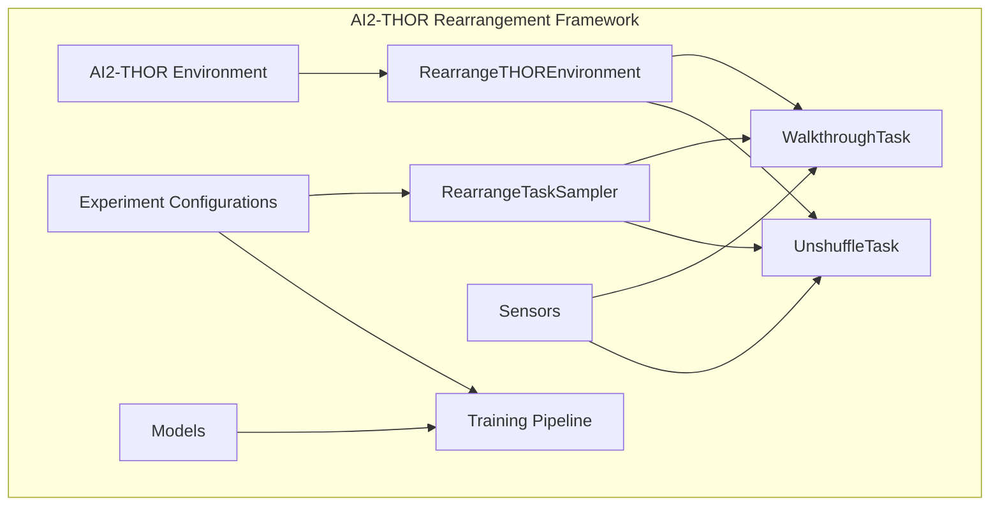
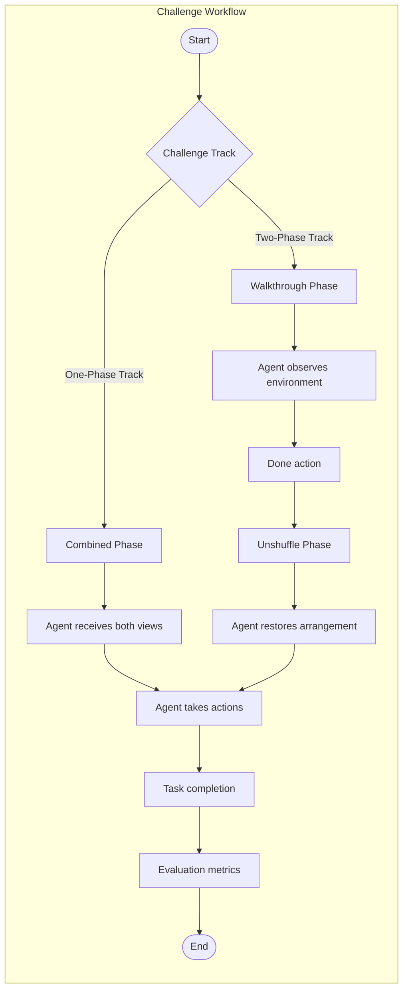
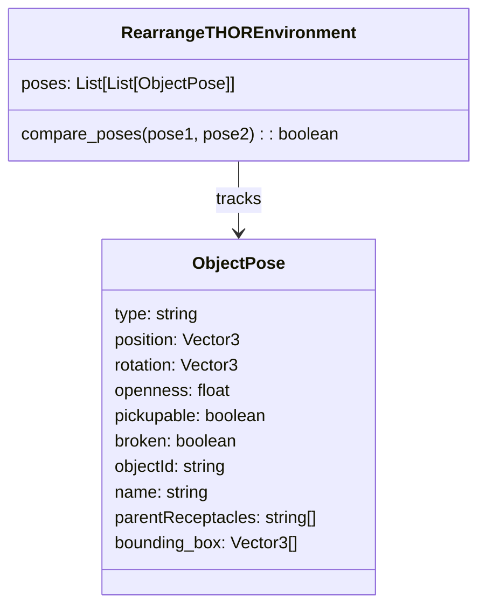
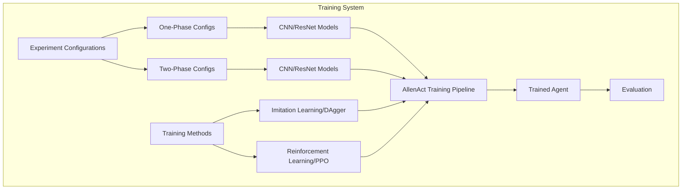

<!-- source: DeepWiki mcp.deepwiki.com · repo allenai/ai2thor-rearrangement · page 1 Overview · fetched 2026-10-26 -->

# Overview

Relevant source files

The following files were used as context for generating this wiki page:

- [README.md](README.md)

The AI2-THOR Rearrangement Challenge is a framework for training and evaluating embodied AI agents to rearrange objects in simulated environments. It provides a benchmark for object manipulation, visual memory, and scene understanding tasks within the AI2-THOR simulation platform.

This documentation covers the core components, architecture, and functionality of the rearrangement challenge framework. For installation instructions, see [Installation and Setup](#1.1), and for repository organization details, see [Repository Structure](#1.2).

## Challenge Description

The AI2-THOR Rearrangement Challenge tasks agents with restoring objects to their original configuration after they have been moved or altered. The challenge has two main phases:

1. **Walkthrough Phase**: The agent explores a room and observes objects in their goal arrangement
2. **Unshuffle Phase**: After objects have been rearranged, the agent must restore them to their original positions

The challenge offers two tracks of varying difficulty:
- **One-Phase Track**: The agent simultaneously receives observations from both goal and current states
- **Two-Phase Track**: The agent must memorize the goal state during walkthrough before attempting to restore it in the unshuffle phase

Sources: [README.md:30-36](), [README.md:302-312](), [README.md:315-325]()

## System Architecture

**System Architecture Diagram**

The system consists of several key components that work together to create and manage rearrangement tasks:

1. **RearrangeTHOREnvironment**: A wrapper around the AI2-THOR environment that provides methods for setting up scenes, tracking object poses, and evaluating agent performance.

2. **Task Types**:
   - **WalkthroughTask**: Handles the walkthrough phase where the agent observes the target arrangement
   - **UnshuffleTask**: Manages the unshuffle phase where the agent must restore objects

3. **RearrangeTaskSampler**: Creates task instances from datasets and manages transitions between phases

4. **Sensors**: Provide observations to the agent (RGB images, depth maps, etc.)

5. **Experiment Configurations**: Define training parameters and approaches

6. **Models**: Baseline neural network architectures for solving the tasks

Sources: [README.md:137-171](), [rearrange/environment.py](), [rearrange/tasks.py]()

## Challenge Workflow

**Challenge Workflow Diagram**

The workflow differs based on the selected challenge track:

- **One-Phase Track**: The agent receives both walkthrough (goal) and current views simultaneously, making it easier to identify misplaced objects
- **Two-Phase Track**: The agent must first memorize the goal state during walkthrough, then later restore it from memory in the unshuffle phase

Both tracks evaluate the agent on its ability to identify and fix misplaced objects by navigating around the environment and manipulating objects.

Sources: [README.md:302-325](), [rearrange/tasks.py]()

## Core Components Detail

### RearrangeTHOREnvironment

The `RearrangeTHOREnvironment` class serves as the primary interface to the AI2-THOR simulator. It provides:

- Scene setup and initialization
- Object pose tracking and comparison
- Action execution
- Evaluation utilities

### Tasks

Two main task classes manage the challenge phases:

1. **WalkthroughTask**: Handles the initial exploration phase where the agent observes the goal arrangement
2. **UnshuffleTask**: Manages the rearrangement phase where the agent must restore objects to their goal positions

### RearrangeTaskSampler

The `RearrangeTaskSampler` creates task instances for training and evaluation:

- Loads tasks from datasets
- Manages transitions between phases
- Configures task parameters

### Agent Actions

The agent can perform a variety of actions to navigate and manipulate objects:

| Action Type | Examples | Description |
|-------------|----------|-------------|
| Navigation | MoveAhead, RotateRight | Move the agent around the environment |
| Object Interaction | PickupObject, PlaceObject | Manipulate objects in the environment |
| State Control | Done | Signal completion of a phase |

Sources: [README.md:415-448](), [rearrange/constants.py]()

## Object Representation

**Object Representation Diagram**

Objects in the environment are represented by their poses, which include:

- **Position and Rotation**: 3D coordinates and rotation values
- **Openness**: For openable objects (cabinets, drawers, etc.)
- **Bounding Box**: 3D coordinates defining the object's boundaries
- **Metadata**: Object type, ID, whether it's pickupable, etc.

The environment tracks three sets of poses:
- **Walkthrough Start Poses**: Goal arrangement observed during walkthrough
- **Unshuffle Start Poses**: Initial arrangement at the start of unshuffle phase
- **Current Poses**: Current state of all objects in the environment

Sources: [README.md:486-544](), [rearrange/environment.py]()

## Evaluation Metrics

The challenge uses several metrics to evaluate agent performance:

| Metric | Description |
|--------|-------------|
| Success Rate | 1 if all objects are in their goal state, 0 otherwise |
| % Misplaced | Proportion of misplaced objects at the end vs. start |
| % Fixed Strict | Proportion of initially misplaced objects that were fixed |
| % Energy Remaining | Measure of how close objects are to their goal poses |

An object is considered correctly placed when:
- Its 3D bounding box has >0.5 IoU with its goal bounding box
- Its openness value is within 0.2 of the goal openness (for openable objects)
- It is not broken

Sources: [README.md:560-638](), [rearrange/utils.py]()

## Training System

The framework uses the AllenAct reinforcement learning library to provide baseline models and training pipelines:

**Training System Diagram**

The training system supports:
- Different model architectures (simple CNN, ResNet, ActiveNeuralSLAM)
- Multiple training approaches (imitation learning, reinforcement learning)
- Experiment configurations for both challenge tracks

Sources: [README.md:641-686](), [baseline_configs/](), [rearrange/baseline_models.py]()

## Data Generation and Handling

The framework includes tools for dataset generation and management:

- Pre-generated datasets for training, validation, and testing
- Dataset utilities for loading and processing task data
- Task sampling mechanisms for training

Sources: [README.md:328-349](), [data/]()

---

