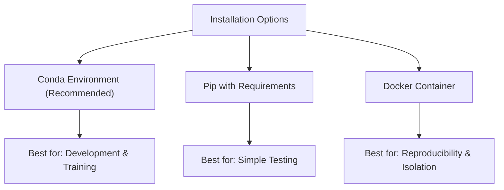
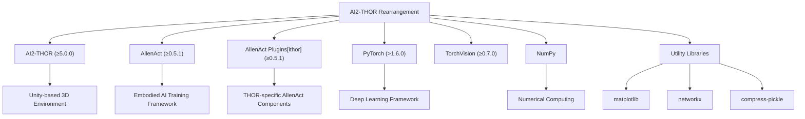

<!-- source: DeepWiki mcp.deepwiki.com · repo allenai/ai2thor-rearrangement · page 1.1 Installation and Setup · fetched 2026-10-26 -->

# Installation and Setup

<details>
<summary>Relevant source files</summary>

The following files were used as context for generating this wiki page:

- [.dockerignore](.dockerignore)
- [Dockerfile](Dockerfile)
- [environment.yml](environment.yml)
- [requirements.txt](requirements.txt)

</details>


This document provides instructions for setting up the AI2-THOR Rearrangement environment. It covers system requirements, installation methods, and verification steps to ensure your environment is correctly configured. For information about the repository structure, see [Repository Structure](#1.2).

## System Requirements

Before beginning installation, ensure your system meets the following requirements:

- **Operating System**: Linux (recommended), macOS, or Windows
- **Python**: Version 3.9
- **GPU**: NVIDIA GPU with CUDA support (recommended for training)
- **Disk Space**: At least 10GB for the environment and datasets

## Installation Methods

There are three ways to set up the AI2-THOR Rearrangement environment:



Sources: [environment.yml](), [requirements.txt](), [Dockerfile]()

### Method 1: Conda Environment (Recommended)

The recommended installation method uses Conda to manage dependencies and create an isolated environment.

1. **Install Conda** (if not already installed):
   - Download and install [Miniconda](https://docs.conda.io/en/latest/miniconda.html) or [Anaconda](https://www.anaconda.com/products/distribution)

2. **Create and activate the environment**:
   ```bash
   # Clone the repository
   git clone https://github.com/allenai/ai2thor-rearrangement.git
   cd ai2thor-rearrangement
   
   # Create conda environment from the provided file
   conda env create -f environment.yml
   
   # Activate the environment
   conda activate rearrange
   ```

Sources: [environment.yml]()

### Method 2: Python Virtual Environment with Pip

If you prefer using pip, you can create a virtual environment and install dependencies using the requirements file.

1. **Create and activate a virtual environment**:
   ```bash
   # Clone the repository
   git clone https://github.com/allenai/ai2thor-rearrangement.git
   cd ai2thor-rearrangement
   
   # Create virtual environment
   python -m venv rearrange_venv
   
   # Activate the environment
   # On Linux/macOS:
   source rearrange_venv/bin/activate
   # On Windows:
   rearrange_venv\Scripts\activate
   ```

2. **Install dependencies**:
   ```bash
   pip install -r requirements.txt
   ```

Sources: [requirements.txt]()

### Method 3: Docker Container

Using Docker ensures a consistent environment across different systems.

1. **Install Docker** (if not already installed):
   - Follow the [official Docker installation guide](https://docs.docker.com/get-docker/)

2. **Build and run the Docker container**:
   ```bash
   # Clone the repository
   git clone https://github.com/allenai/ai2thor-rearrangement.git
   cd ai2thor-rearrangement
   
   # Build the Docker image
   docker build -t ai2thor-rearrangement .
   
   # Run the container
   docker run -it --gpus all ai2thor-rearrangement
   ```

Sources: [Dockerfile](), [.dockerignore]()

## Dependency Structure

The AI2-THOR Rearrangement challenge relies on several key dependencies:



Sources: [requirements.txt](), [environment.yml]()

## Verifying Installation

After installation, verify that everything is working correctly:

1. **Verify Python environment**:
   ```bash
   # Check if AI2-THOR is installed correctly
   python -c "import ai2thor; print(ai2thor.__version__)"
   
   # Check if AllenAct is installed correctly
   python -c "import allenact; print(allenact.__version__)"
   ```

2. **Run a simple test** to verify the environment works:
   ```bash
   # Navigate to the repository directory
   cd ai2thor-rearrangement
   
   # Run a simple test (replace with appropriate test command)
   python -m tests.test_environment
   ```

## Common Installation Issues

| Issue | Possible Solution |
|-------|-------------------|
| CUDA version mismatch | Ensure your CUDA installation is compatible with the PyTorch version in requirements.txt |
| Missing system libraries | Install required system libraries (e.g., `apt-get install ffmpeg libsm6 libxext6` on Ubuntu/Debian) |
| Unity-related errors | Ensure you have the necessary graphics drivers installed |
| Memory errors during training | Reduce batch size or model complexity |
| Docker GPU access issues | Ensure NVIDIA Container Toolkit is installed correctly |

## Next Steps

Once your installation is complete, you can proceed to explore the repository structure ([Repository Structure](#1.2)) and learn about the core concepts of the challenge ([Core Concepts](#2)).

Sources: [requirements.txt](), [environment.yml](), [Dockerfile]()

---

