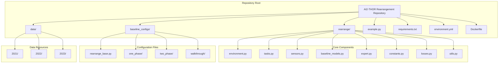
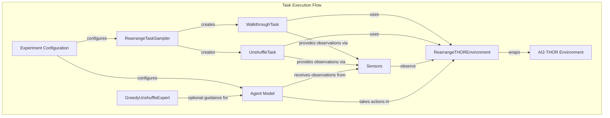
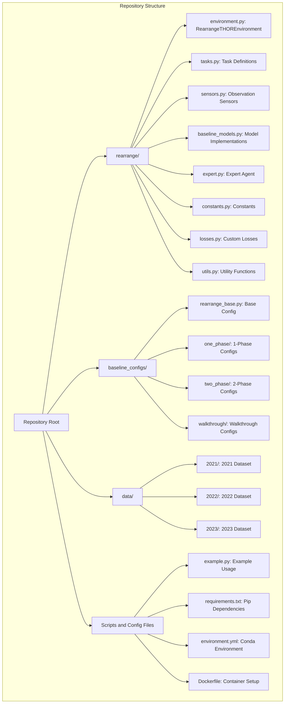
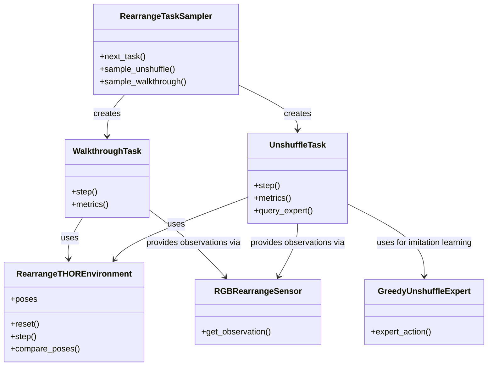
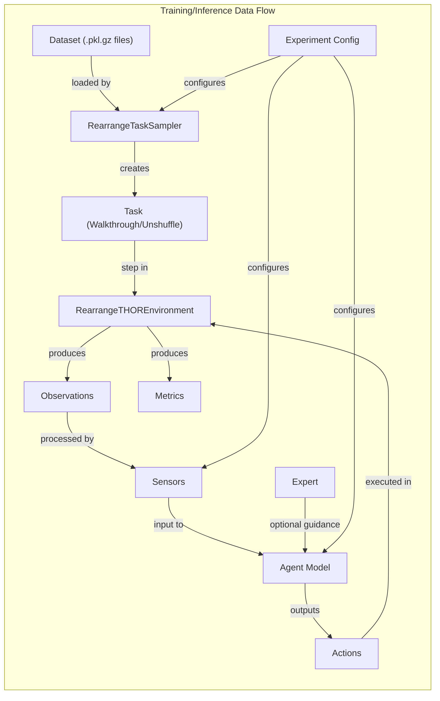

<!-- source: DeepWiki mcp.deepwiki.com · repo allenai/ai2thor-rearrangement · page 1.2 Repository Structure · fetched 2026-10-26 -->

# Repository Structure

Relevant source files

The following files were used as context for generating this wiki page:

- [.gitignore](.gitignore)
- [README.md](README.md)

This page provides an overview of the AI2-THOR Rearrangement Challenge repository structure, describing the organization of code files, directories, and their relationships. For information about the conceptual aspects of the challenge itself, see [Core Concepts](#2).

## Overview

The AI2-THOR Rearrangement Challenge repository is organized to support the development, training, and evaluation of embodied AI agents for object rearrangement tasks. The codebase is structured around core environment components, task definitions, baseline models, and configuration files.

Sources: [README.md:138-171]()

## Key Directories

### rearrange/

The `rearrange/` directory contains the core implementation files for the AI2-THOR Rearrangement Challenge:

| File | Description |
|------|-------------|
| `environment.py` | Defines the `RearrangeTHOREnvironment` class that wraps the AI2-THOR environment and provides methods for setting up scenes, managing object poses, and evaluating agent performance |
| `tasks.py` | Contains the `WalkthroughTask`, `UnshuffleTask`, and `RearrangeTaskSampler` classes that define the challenge tasks and how they are sampled |
| `sensors.py` | Implements various sensors that provide observations to agents (RGB, depth, etc.) |
| `baseline_models.py` | Provides baseline model implementations for the 1-Phase and 2-Phase challenge tracks |
| `expert.py` | Defines the `GreedyUnshuffleExpert` class, a heuristic expert that uses privileged information to solve the rearrangement task |
| `constants.py` | Contains constants used throughout the codebase, such as step sizes, object types, etc. |
| `losses.py` | Defines custom loss functions used in training baseline models |
| `utils.py` | Utility functions for tasks like computing IoU between 3D bounding boxes |

Sources: [README.md:154-171]()

### baseline_configs/

The `baseline_configs/` directory contains configuration files for various experiment setups:

| Directory/File | Description |
|----------------|-------------|
| `rearrange_base.py` | Base configuration file defining challenge parameters (screen size, allowed actions, etc.) |
| `one_phase/` | Experiment configurations for the 1-Phase challenge track |
| `two_phase/` | Experiment configurations for the 2-Phase challenge track |
| `walkthrough/` | Experiment configurations for training the walkthrough phase in isolation |

Sources: [README.md:143-150]()

### data/

The `data/` directory contains dataset files for training and evaluating models:

| Directory | Description |
|-----------|-------------|
| `2021/` | Dataset files from the 2021 challenge |
| `2022/` | Dataset files from the 2022 challenge |
| `2023/` | Dataset files from the 2023 challenge, including train, val, test, and combined datasets |

Sources: [README.md:342-349]()

## Key Files

### example.py

The `example.py` file provides a demonstration of how to instantiate and use the rearrangement tasks for both the 1-Phase and 2-Phase tracks. It serves as a practical starting point for working with the codebase.

Sources: [README.md:140-142]()

### requirements.txt and environment.yml

These files define the dependencies needed to run the codebase. The `requirements.txt` file is for pip installation, while `environment.yml` is for conda environment setup.

Sources: [README.md:179-200]()

### Dockerfile

The `Dockerfile` provides a containerized environment for running the codebase with all necessary dependencies pre-installed, particularly useful for ensuring consistent behavior across different systems.

Sources: [README.md:202-293]()

## Component Relationships

The following diagram illustrates how the main components of the system interact during task execution:

Sources: [README.md:457-463](), [README.md:467-476](), [README.md:479-484]()

## File Structure Detail

Here's a more detailed view of the repository organization:

Sources: [README.md:138-171](), [.gitignore:1-164]()

## Core Code Components and Relationships

This diagram shows the relationships between the key code entities in the rearrangement system:

Sources: [README.md:454-486]()

## Data Flow Overview

The following diagram illustrates how data flows through the system during training and inference:

Sources: [README.md:454-486](), [README.md:578-616]()

## Development and Training Workflow

The repository supports the following typical workflow:

1. **Setup**: Install dependencies using the provided requirements.txt or environment.yml
2. **Dataset Preparation**: Use the provided datasets in data/ or generate custom ones
3. **Model Development**: Create or modify models in rearrange/baseline_models.py
4. **Configuration**: Set up experiment configurations in baseline_configs/
5. **Training**: Train models using AllenAct with the provided configurations
6. **Evaluation**: Evaluate models on test datasets
7. **Submission**: Generate submission files for the leaderboard

Sources: [README.md:642-693]()

---

