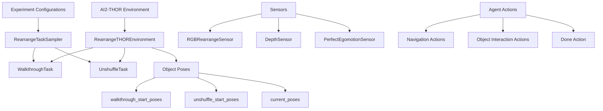
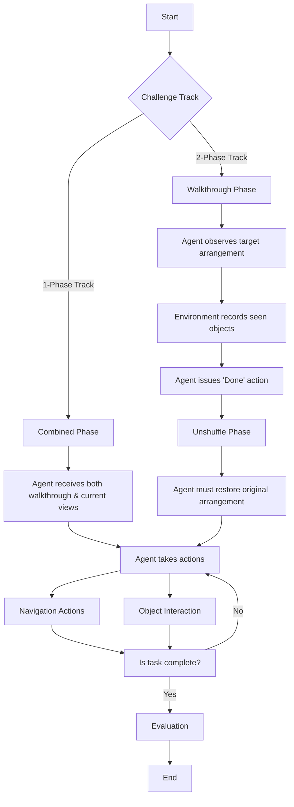
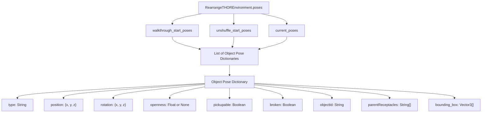
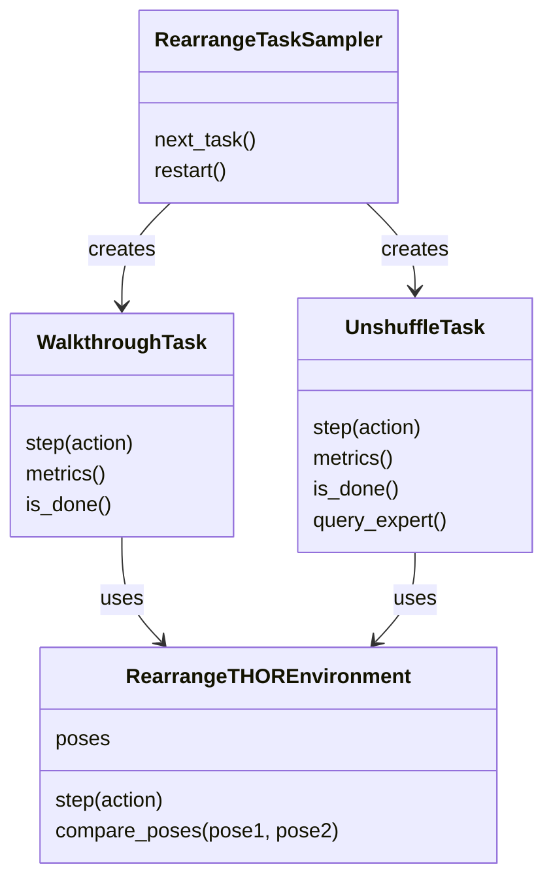

<!-- source: DeepWiki mcp.deepwiki.com · repo allenai/ai2thor-rearrangement · page 2 Core Concepts · fetched 2026-10-26 -->

# Core Concepts

<details>
<summary>Relevant source files</summary>

The following files were used as context for generating this wiki page:

- [README.md](README.md)
- [rearrange/constants.py](rearrange/constants.py)

</details>


This page explains the fundamental concepts of the AI2-THOR Rearrangement Challenge. It covers the core components that form the foundation of the challenge and how they interact, providing necessary context for understanding more specific aspects of the system. For details about specific challenge tracks, see [Challenge Tracks](#2.1), for information about task phases, see [Task Phases](#2.2), and for evaluation metrics, see [Evaluation Metrics](#2.3).

## Challenge Overview

The AI2-THOR Rearrangement Challenge is a framework for embodied AI agents to learn and be evaluated on their ability to rearrange objects in simulated room environments. The goal is to train agents to restore objects to their original positions after they have been moved or altered. This task requires perception, navigation, object manipulation, and memory capabilities.

## Core Components

The rearrangement challenge consists of several interconnected components that work together to create the simulation environment, define tasks, and evaluate agent performance.

**Core System Components and Relationships**



Sources: [README.md:400-406](), [rearrange/constants.py:4-10]()

## Task Structure

The rearrangement task is structured around two main phases: the walkthrough phase and the unshuffle phase. The challenge can be attempted in one of two tracks: the 1-Phase track where both phases are combined, or the 2-Phase track where they occur sequentially.

**Challenge Workflow**



Sources: [README.md:302-325]()

## Environment and Objects

The AI2-THOR environment provides a realistic 3D simulation of indoor spaces where agents can navigate and interact with objects. In the rearrangement challenge, objects have various properties that determine how they can be manipulated.

**Object Types and Properties**

```mermaid
classDiagram
    class Object {
        type: String
        position: {x, y, z}
        rotation: {x, y, z}
        openness: Float or None
        pickupable: Boolean
        broken: Boolean
        objectId: String
        parentReceptacles: String[]
        bounding_box: Vector3[]
    }
    
    class PickupableObject {
        Can be picked up and carried
        Examples: Apple, Book, Mug
    }
    
    class OpenableObject {
        Can be opened and closed
        Has openness value between 0-1
        Examples: Cabinet, Drawer, Fridge
    }
    
    class ReceptacleObject {
        Can contain other objects
        Examples: CounterTop, Table, Sink
    }
    
    Object <|-- PickupableObject
    Object <|-- OpenableObject
    Object <|-- ReceptacleObject
```

Sources: [rearrange/constants.py:16-59](), [rearrange/constants.py:64-183](), [README.md:488-537]()

## Object Poses

A central concept in the rearrangement challenge is the "pose" of objects, which includes their position, rotation, and state (like openness). The system tracks three sets of poses:

1. **walkthrough_start_poses**: The initial state of objects that the agent observes during the walkthrough phase.
2. **unshuffle_start_poses**: The altered state of objects at the beginning of the unshuffle phase.
3. **current_poses**: The current state of objects as the agent interacts with the environment.

The goal of the agent in the unshuffle phase is to make the current_poses match the walkthrough_start_poses as closely as possible.

**Object Pose Structure**



Sources: [README.md:488-537]()

## Agent Capabilities

Agents in the rearrangement challenge have a set of capabilities for perceiving the environment and interacting with it:

### Observations

Agents receive observations through sensors:

1. **RGB images** - 224x224x3 color images with a 90-degree FOV
2. **Depth maps** - 224x224 depth measurements with a 90-degree FOV
3. **Perfect egomotion** - Information about the agent's movements and rotations

### Actions

Agents can perform the following types of actions:

1. **Navigation**
   - `MoveAhead/Left/Right/Back` - Move 0.25m in the specified direction
   - `RotateRight/Left` - Rotate 90 degrees
   - `LookUp/Down` - Adjust camera angle by 30 degrees

2. **Object Interaction**
   - `Pickup[OBJECT_TYPE]` - Pick up a visible object of the specified type
   - `Open[OBJECT_TYPE]` - Toggle the openness of a visible object of the specified type
   - `PlaceObject` - Place a held object, preferably in its goal position

3. **Task Control**
   - `Done` - Signal the end of the current phase

Sources: [README.md:397-448]()

## Core Implementation Classes

The rearrangement challenge is implemented through several key classes:

1. **RearrangeTHOREnvironment**: A wrapper around the AI2-THOR environment that manages the simulation and provides methods for setting up scenes, tracking object poses, and evaluating performance.

2. **Task Classes**:
   - **WalkthroughTask**: Implements the walkthrough phase where the agent observes the target arrangement
   - **UnshuffleTask**: Implements the unshuffle phase where the agent must restore objects to their original positions

3. **RearrangeTaskSampler**: Creates and manages task instances, handles transitions between phases, and configures task parameters based on the selected dataset.

4. **Sensors**: Provide observations to the agent, with different implementations for the different challenge tracks (e.g., CombinedRGBSensor for the 1-Phase track).

**Core Class Relationships**



Sources: [README.md:456-484]()

## Datasets and Challenge Tracks

The challenge provides datasets split into train, validation, and test sets, each containing episodes of varying difficulty. The challenge can be attempted in two tracks:

1. **1-Phase Track (Easier)**: The agent receives observations from both the walkthrough (goal) state and the current state simultaneously, making it easier to identify misplaced objects.

2. **2-Phase Track (Harder)**: The walkthrough and unshuffle phases occur sequentially, requiring the agent to remember the goal state from the walkthrough phase.

Sources: [README.md:315-349]()

## Evaluation

Agents are evaluated on their ability to restore objects to their original positions. The main metrics include:

1. **Success rate**: Whether all objects are correctly arranged
2. **% Misplaced**: Proportion of objects that are not in their correct positions
3. **% Fixed Strict**: Proportion of initially misplaced objects that are correctly placed, only if no new objects are misplaced
4. **% Energy Remaining**: A continuous metric measuring how close objects are to their goal positions

For more detailed information about evaluation metrics, see [Evaluation Metrics](#2.3).

Sources: [README.md:562-638]()

---

