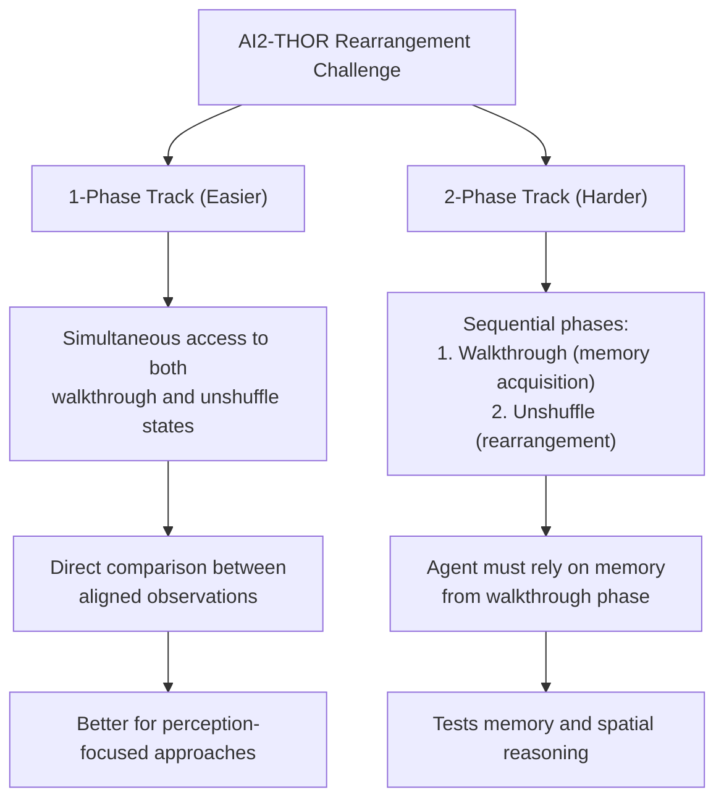
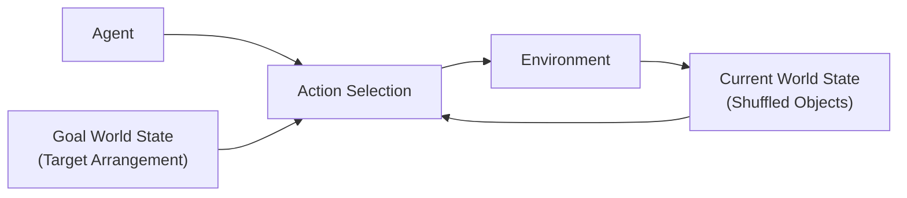
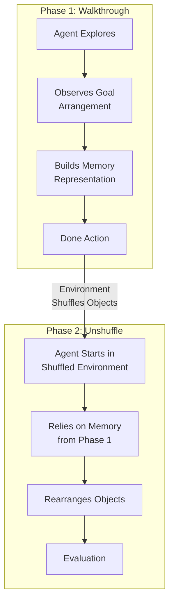
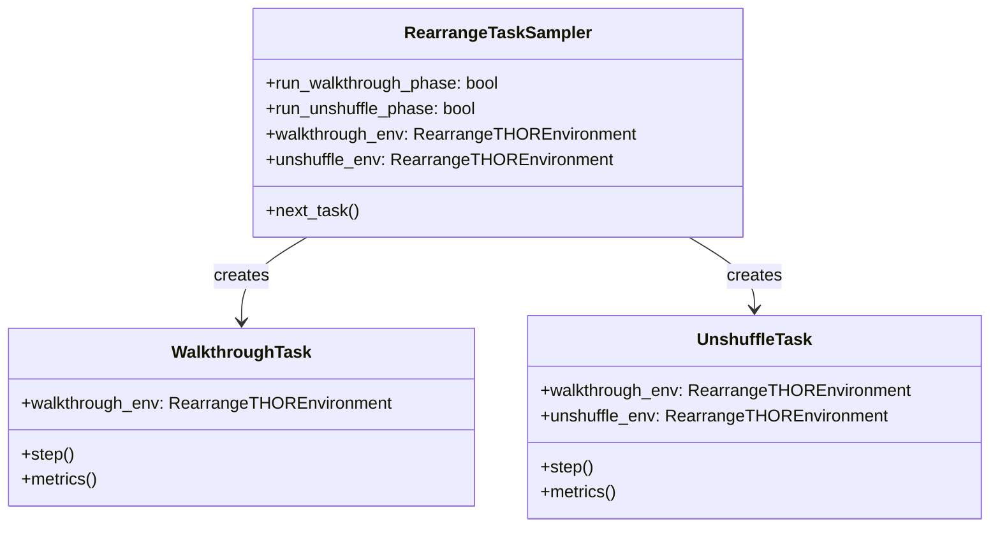
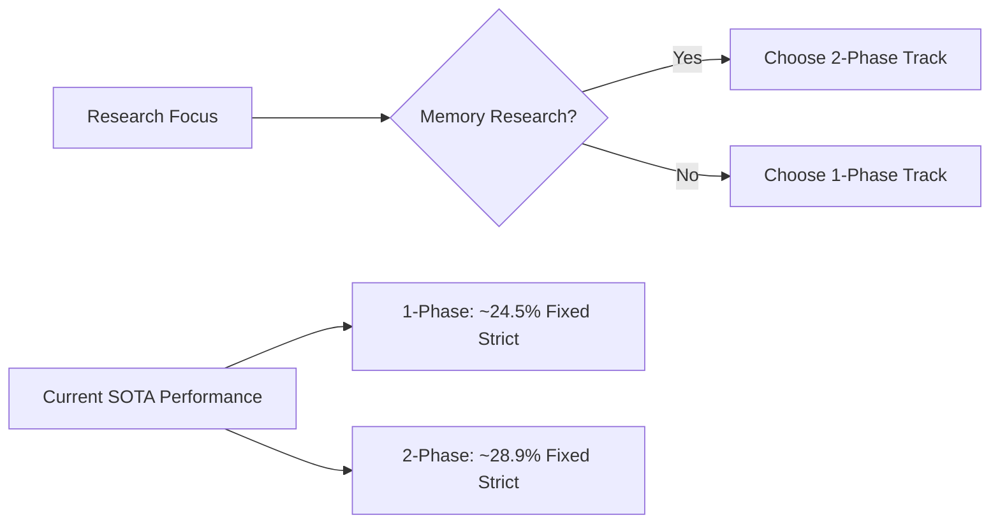

<!-- source: DeepWiki mcp.deepwiki.com · repo allenai/ai2thor-rearrangement · page 2.1 Challenge Tracks · fetched 2026-10-26 -->

# Challenge Tracks

Relevant source files

The following files were used as context for generating this wiki page:

- [README.md](README.md)
- [rearrange/tasks.py](rearrange/tasks.py)
- [rearrange_constants.py](rearrange_constants.py)

This page explains the challenge tracks in the AI2-THOR Rearrangement Challenge. The rearrangement challenge tests an embodied AI agent's ability to restore objects to their original positions after they have been moved. There are two different tracks with varying difficulty levels that researchers can participate in. For more information about the task phases within these tracks, see [Task Phases](#2.2).

## Track Overview

The AI2-THOR Rearrangement Challenge offers two primary tracks with different difficulty levels:

Sources: [README.md:315-326]()

## 1-Phase Track

In the 1-Phase Track (the easier variant), both the walkthrough and unshuffle phases are merged into a single phase. The key characteristics are:

- The agent simultaneously receives observations from both the walkthrough (goal) state and the shuffled (current) state
- This allows direct comparison between aligned images from both world states
- Makes it easier to determine if an object is in its correct position or orientation
- Less memory burden as agents don't need to remember the walkthrough state

This track is appropriate for research focused on perception and rearrangement strategies rather than memory.

Sources: [README.md:317-321]()

## 2-Phase Track

In the 2-Phase Track (the harder variant), the walkthrough and unshuffle phases occur sequentially:

1. **Walkthrough Phase**: The agent first explores the environment to observe objects in their goal state
2. **Unshuffle Phase**: After the walkthrough phase completes, objects are shuffled and the agent must restore them to their original configuration

Key characteristics:
- Once in the unshuffle phase, the agent has no direct access to the walkthrough state
- The agent must rely on its memory of the goal state
- Tests both memory and spatial reasoning capabilities
- More closely mimics real-world scenarios where a reference state isn't continuously available

Sources: [README.md:322-326](), [rearrange/tasks.py:483-701]()

## Implementation Details

The challenge tracks are implemented through the `RearrangeTaskSampler` class, which controls the task flow:

For the 1-Phase track, the `RearrangeTaskSampler` is configured with both `run_walkthrough_phase=False` and `run_unshuffle_phase=True`, and tasks are set up to provide simultaneous access to both states. In the 2-Phase track, both phases are set to `True` and executed sequentially.

The key configuration differences between the two tracks can be found in:
- Base configurations defined in `baseline_configs/rearrange_base.py`
- One-phase configurations in `baseline_configs/one_phase/`
- Two-phase configurations in `baseline_configs/two_phase/`

Sources: [rearrange/tasks.py:808-1211]()

## Dataset Allocation

Both challenge tracks use the same dataset splits, but with different training and evaluation requirements:

| Split | Floor Plans | Total Episodes | Evaluation Episodes |
|-------|-------------|----------------|---------------------|
| Train | 1-20, 200-220, 300-320, 400-420 | 4000 | 800 |
| Val | 21-25, 221-225, 321-325, 421-425 | 1000 | 1000 |
| Test | 26-30, 226-230, 326-330, 426-430 | 1000 | 1000 |

The datasets are stored as compressed pickle files in the `data/2023/` directory. For evaluation purposes, a combined dataset (`data/2023/combined.pkl.gz`) contains all the evaluation episodes from each split.

Sources: [README.md:328-348]()

## Challenge Track Selection

When developing an agent, researchers should decide which track to focus on based on:

1. **Research Goals**: 
   - 1-Phase Track: Better for perception and object manipulation research
   - 2-Phase Track: Better for memory and cognitive mapping research

2. **Evaluation Metrics**: Both tracks use the same evaluation metrics:
   - Success rate
   - % Misplaced
   - % Fixed Strict
   - % Energy Remaining

The 2-Phase track generally results in lower performance metrics due to its higher difficulty.

Sources: [README.md:105-127](), [README.md:617-638]()

## Technical Implementation

The challenge tracks are implemented through a combination of task classes and task samplers:

1. The `RearrangeTaskSampler` ([rearrange/tasks.py:808-1211]()) controls track selection with:
   - `run_walkthrough_phase`: Boolean determining if the walkthrough phase runs
   - `run_unshuffle_phase`: Boolean determining if the unshuffle phase runs
   
2. For 1-Phase Track:
   - Only the unshuffle phase is run (`run_walkthrough_phase=False`, `run_unshuffle_phase=True`)
   - Special sensors provide access to both walkthrough and current observations

3. For 2-Phase Track:
   - Both phases run sequentially (`run_walkthrough_phase=True`, `run_unshuffle_phase=True`)
   - The `next_task` method handles the transition between phases

The `RearrangeTaskSampler.next_task()` method is the core function that determines the task flow:

- It first checks if it needs to run the walkthrough phase or continue with an unshuffle phase
- For 1-Phase, it directly returns an `UnshuffleTask` with special sensors
- For 2-Phase, it first returns a `WalkthroughTask` and later returns an `UnshuffleTask` with information collected during walkthrough

Sources: [rearrange/tasks.py:1066-1211]()

## Best Practices

When working with the challenge tracks:

1. For 1-Phase Track:
   - Focus on building models that can effectively compare current and goal observations
   - Consider using techniques like image differencing or attention mechanisms

2. For 2-Phase Track:
   - Implement effective memory mechanisms (e.g., spatial maps, object databases)
   - Consider training the walkthrough phase to maximize information gathering
   - Develop strategies for recalling goal positions during the unshuffle phase

3. For both tracks:
   - The environment constants like `OPENNESS_THRESHOLD` (0.2) and `IOU_THRESHOLD` (0.5) define when objects are considered correctly arranged
   - These thresholds are used in both evaluation and reward computation

Sources: [rearrange_constants.py:1-7](), [rearrange/tasks.py:150-154]()

---

