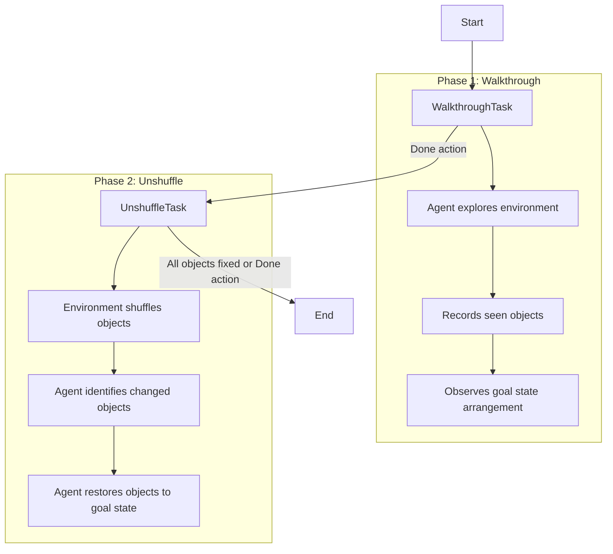
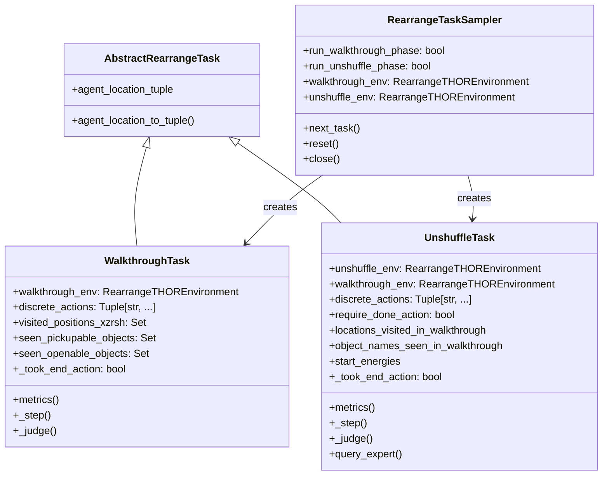
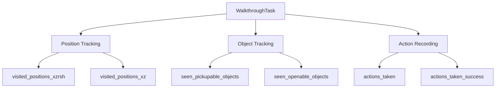
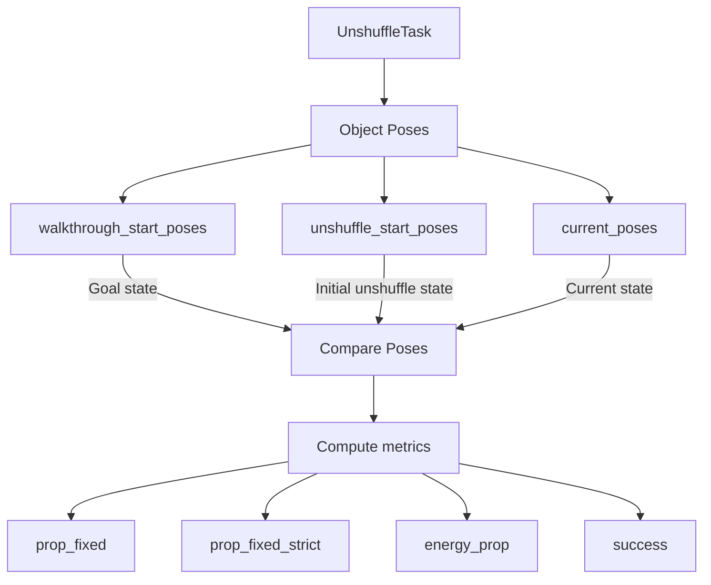
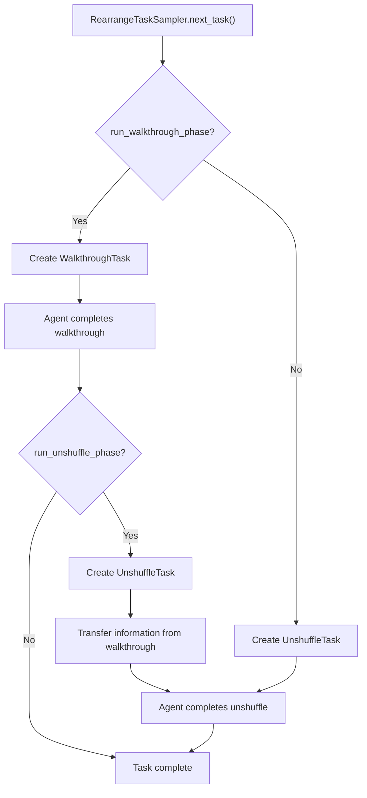
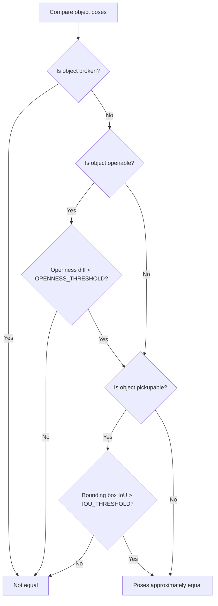

<!-- source: DeepWiki mcp.deepwiki.com · repo allenai/ai2thor-rearrangement · page 2.2 Task Phases · fetched 2026-10-26 -->

# Task Phases

<details>
<summary>Relevant source files</summary>

The following files were used as context for generating this wiki page:

- [README.md](README.md)
- [rearrange/tasks.py](rearrange/tasks.py)
- [rearrange_constants.py](rearrange_constants.py)

</details>


This page documents the task phases in the AI2-THOR Rearrangement Challenge, explaining the purpose, workflow, and implementation of the Walkthrough and Unshuffle phases. For information about the challenge tracks (One-Phase vs. Two-Phase), see [Challenge Tracks](#2.1).

## 1. Phase Overview

The AI2-THOR Rearrangement Challenge divides the object rearrangement task into two sequential phases, each with distinct objectives:



Sources: [README.md:302-313](), [rearrange/tasks.py:65-482](), [rearrange/tasks.py:483-703]()

### 1.1 Walkthrough Phase

The Walkthrough Phase is the first stage of the task, where the agent explores the environment to observe objects in their goal state. During this phase:

- The agent navigates through the environment
- The agent cannot pick up or manipulate objects
- The system records which objects the agent has seen
- The system tracks which locations the agent has visited

The phase ends when the agent takes the "done" action or reaches the maximum number of allowed steps.

### 1.2 Unshuffle Phase

The Unshuffle Phase is the second stage, where the agent must restore objects to their goal state. After the Walkthrough Phase:

- The environment "shuffles" 1-5 objects by moving them or changing their state
- The agent must identify which objects have been changed
- The agent must restore those objects to their goal state
- Success is measured by how well the agent restores objects to their original configuration

The phase ends when the agent takes the "done" action, reaches the maximum steps, or successfully restores all objects.

Sources: [README.md:302-313](), [rearrange/tasks.py:65-482](), [rearrange/tasks.py:483-703]()

## 2. Phase Implementation

The task phases are implemented through two main classes that inherit from `AbstractRearrangeTask`:



Sources: [rearrange/tasks.py:38-64](), [rearrange/tasks.py:65-482](), [rearrange/tasks.py:483-703](), [rearrange/tasks.py:808-1212]()

## 3. Walkthrough Phase Details

The `WalkthroughTask` class manages the agent's exploration during the Walkthrough Phase.

### 3.1 Objectives and Limitations

During this phase, the agent's objectives are:
- Explore the environment efficiently
- Observe as many objects as possible
- Build a mental map of object locations and states

The agent has specific limitations during this phase:
- Cannot pick up objects
- Cannot open or close objects
- Can only navigate and observe

### 3.2 Information Tracking

The `WalkthroughTask` class tracks several types of information:



This information is used to:
1. Compute exploration metrics
2. Pass information to the Unshuffle Phase
3. Guide the agent during the Unshuffle Phase

Sources: [rearrange/tasks.py:483-703]()

### 3.3 Available Actions

The agent can perform the following actions during the Walkthrough Phase:
- `move_ahead`/`move_back`/`move_left`/`move_right` - Move 0.25m in the specified direction
- `rotate_left`/`rotate_right` - Rotate 90 degrees
- `look_up`/`look_down` - Adjust camera angle by 30 degrees
- `done` - End the Walkthrough Phase

Actions related to object interaction (pickup, open, place) are disabled during this phase.

Sources: [rearrange/tasks.py:659-695](), [README.md:417-447]()

## 4. Unshuffle Phase Details

The `UnshuffleTask` class manages the agent's rearrangement efforts during the Unshuffle Phase.

### 4.1 Objects State Tracking

The `UnshuffleTask` class tracks object states in three time points:



Each pose contains information about:
- Position and rotation of the object
- Openness (for openable objects)
- Whether the object is broken
- Bounding box coordinates

Sources: [rearrange/tasks.py:104-153](), [README.md:487-553]()

### 4.2 Available Actions

During the Unshuffle Phase, the agent has access to all actions:
- Navigation actions (move, rotate, look)
- Object interaction actions:
  - `pickup_[OBJECT_TYPE]` - Pick up a visible object of the specified type
  - `open_by_type_[OBJECT_TYPE]` - Toggle the openness of a visible object of the specified type
  - `drop_held_object_with_snap` - Place the held object
- `done` - End the Unshuffle Phase

Sources: [rearrange/tasks.py:345-465](), [README.md:417-447]()

### 4.3 Success Evaluation

The system evaluates the agent's performance using several metrics:

| Metric | Description | Implementation |
|--------|-------------|----------------|
| Success rate | 1 if all objects are in goal state, 0 otherwise | `metrics["success"]` |
| % Misplaced | Number of misplaced objects at end / Number initially misplaced | `metrics["prop_misplaced"]` |
| % Fixed Strict | Proportion of initially misplaced objects that are fixed, but only if no new objects are misplaced | `metrics["prop_fixed_strict"]` |
| % Energy Remaining | Energy between goal/current poses at end / Energy at start of unshuffle | `metrics["energy_prop"]` |

The `UnshuffleTask.metrics()` method computes these metrics by comparing the current object poses with their goal poses.

Sources: [rearrange/tasks.py:209-302](), [README.md:620-637]()

## 5. Task Phase Transitions

The `RearrangeTaskSampler` class manages the transition between phases.

### 5.1 Phase Sequencing



The sampler determines which task to create based on:
- The `run_walkthrough_phase` and `run_unshuffle_phase` flags
- Whether a walkthrough task has just completed
- The `unshuffle_runs_per_walkthrough` parameter

Sources: [rearrange/tasks.py:1066-1211]()

### 5.2 Information Transfer

When transitioning from Walkthrough to Unshuffle, the `RearrangeTaskSampler` transfers:

1. Locations visited during walkthrough:
   ```python
   locations_visited_in_walkthrough=np.array(tuple(walkthrough_task.visited_positions_xzrsh))
   ```

2. Objects seen during walkthrough:
   ```python
   object_names_seen_in_walkthrough=copy.copy(
       walkthrough_task.seen_pickupable_objects | walkthrough_task.seen_openable_objects
   )
   ```

3. Metrics from the walkthrough:
   ```python
   metrics_from_walkthrough=walkthrough_task.metrics(force_return=True)
   ```

This information is passed to the `UnshuffleTask` constructor, allowing the unshuffle agent to use it for decision-making.

Sources: [rearrange/tasks.py:1193-1208]()

## 6. Pose Comparison

The system determines if an object is in its correct position by comparing its current pose with its goal pose.

### 6.1 Pose Comparison Criteria

An object is considered correctly placed if:
1. It is not broken
2. For openable objects: The difference in openness is less than `OPENNESS_THRESHOLD` (0.2)
3. For pickupable objects: The IoU (Intersection over Union) of the 3D bounding boxes is greater than `IOU_THRESHOLD` (0.5)



Sources: [rearrange_constants.py:1-7](), [README.md:561-576]()

### 6.2 Energy Calculation

The system uses an "energy" function to measure how far objects are from their goal poses. This provides a continuous measure of progress:

1. Start energy is calculated between initial unshuffle poses and goal poses.
2. End energy is calculated between final poses and goal poses.
3. The `energy_prop` metric equals `end_energy / start_energy`.

A lower energy proportion indicates better performance.

Sources: [rearrange/tasks.py:150-153](), [rearrange/tasks.py:216-218](), [rearrange/tasks.py:259-261]()

## 7. Combined vs. Separate Phase Configurations

Depending on the challenge track, the `RearrangeTaskSampler` can be configured in different ways:

### 7.1 Two-Phase Configuration

For the 2-Phase track:
- `run_walkthrough_phase=True`
- `run_unshuffle_phase=True`

This creates separate `WalkthroughTask` and `UnshuffleTask` instances sequentially.

### 7.2 One-Phase Configuration

For the 1-Phase track:
- `run_walkthrough_phase=False` 
- `run_unshuffle_phase=True`

This creates only an `UnshuffleTask` instance, but the implementation is modified to provide the agent with access to both the walkthrough environment (goal state) and unshuffle environment (current state) simultaneously.

Sources: [rearrange/tasks.py:808-846](), [README.md:315-326]()

## 8. Phase Integration with AllenAct Framework

The `WalkthroughTask` and `UnshuffleTask` classes integrate with the AllenAct reinforcement learning framework by:

1. Implementing the Task interface with methods like `step()`, `metrics()`, and `is_done()`
2. Returning observations in the format expected by AllenAct models
3. Providing reward signals through the `_judge()` method

This allows the tasks to be used with both imitation learning and reinforcement learning algorithms.

Sources: [rearrange/tasks.py:468-480](), [rearrange/tasks.py:623-702]()

---

