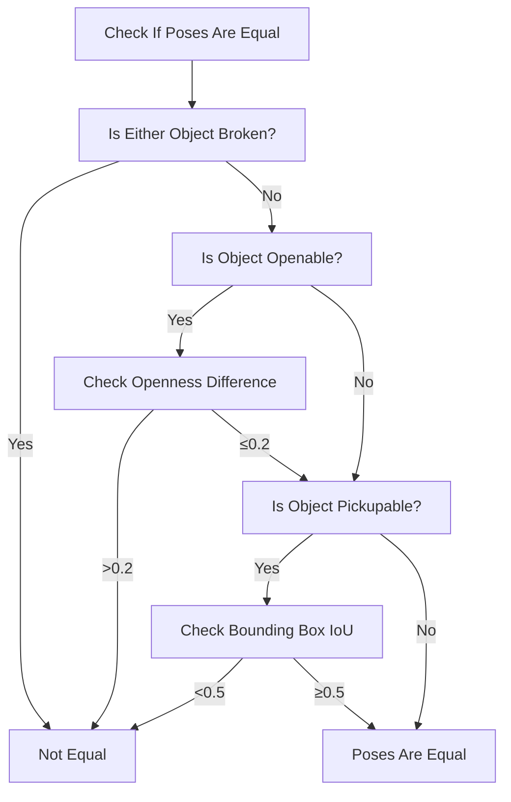
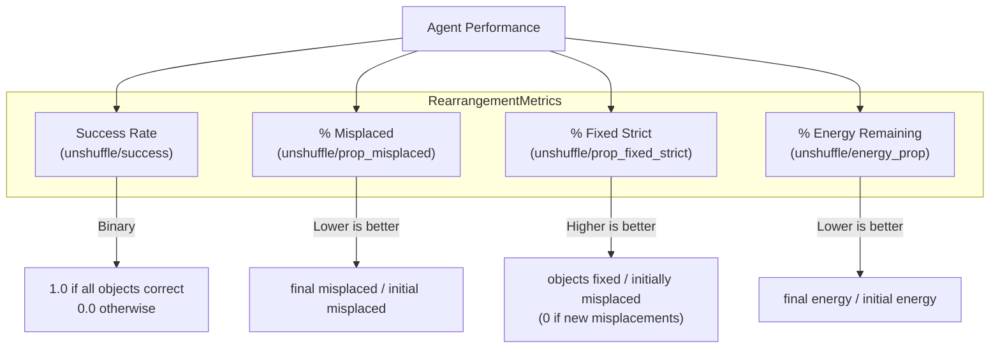
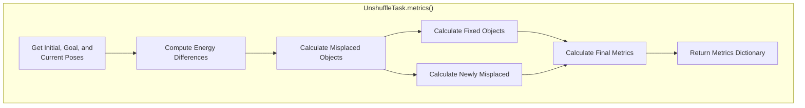
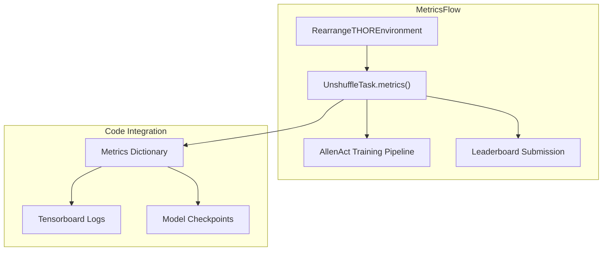
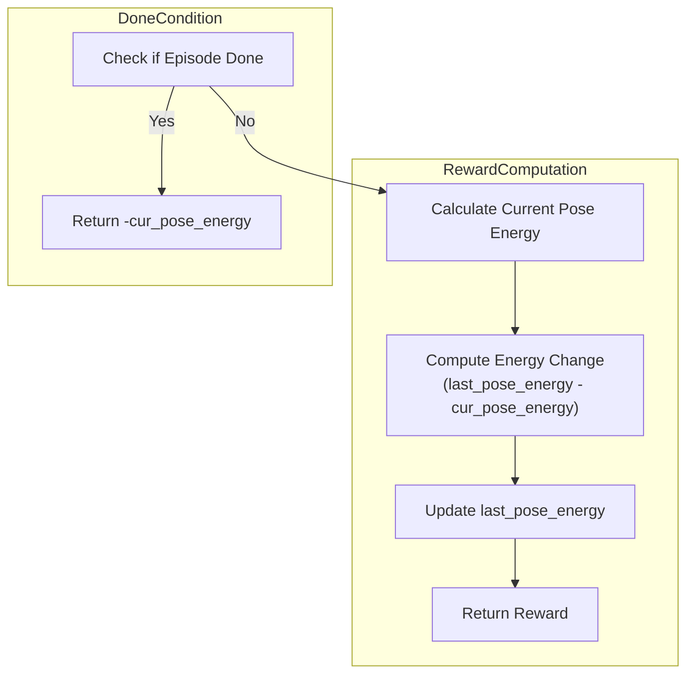

<!-- source: DeepWiki mcp.deepwiki.com · repo allenai/ai2thor-rearrangement · page 2.3 Evaluation Metrics · fetched 2026-10-26 -->

# Evaluation Metrics

<details>
<summary>Relevant source files</summary>

The following files were used as context for generating this wiki page:

- [README.md](README.md)
- [rearrange/tasks.py](rearrange/tasks.py)
- [rearrange_constants.py](rearrange_constants.py)

</details>


This page documents the evaluation metrics used in the AI2-THOR Rearrangement Challenge to assess an agent's performance when completing rearrangement tasks. These metrics quantify how well the agent restores objects to their target configurations in the unshuffle phase. For information about the tasks themselves, see [Task Phases](#2.2).

## 1. Pose Comparison

Before discussing metrics, we need to understand how the system determines whether objects are correctly arranged. The rearrangement challenge compares an object's current pose to its goal pose using specific criteria.

### 1.1 Object Poses

An object's pose consists of:

1. **Position & Rotation**: 3D position and rotation in the environment
2. **Openness**: A value between 0 and 1 for openable objects (like cabinets or drawers)
3. **Broken Status**: Whether the object is broken (broken objects are always considered incorrectly placed)

```mermaid
classDiagram
    class "ObjectPose" {
        position: Vector3
        rotation: Vector3
        openness: float
        broken: boolean
        bounding_box: float[8][3]
    }
    class "PoseComparison" {
        comparePositionAndRotation()
        compareOpenness()
        checkBroken()
        isApproximatelyEqual()
    }
    "PoseComparison" --> "ObjectPose": compares
```

Sources: [README.md:560-575]()

### 1.2 Pose Equality Criteria

Two object poses are considered approximately equal when ALL of the following criteria are met:

1. Neither object pose is broken
2. For openable objects, the difference in openness values is ≤ 0.2 (OPENNESS_THRESHOLD)
3. For pickupable objects, the 3D bounding boxes have an IoU (Intersection over Union) ≥ 0.5 (IOU_THRESHOLD)



Sources: [README.md:566-577](), [rearrange_constants.py:5-6]()

## 2. Primary Evaluation Metrics

The system uses several metrics to evaluate agent performance, each providing different insights into how well the agent completed the rearrangement task.



Sources: [README.md:617-638](), [rearrange/tasks.py:232-261]()

### 2.1 Success Rate

The most stringent metric, with value 1.0 if and only if all objects are in their correct poses at the end of the unshuffle phase, and 0.0 otherwise.

```python
"success": float(end_energy == 0)
```

Sources: [rearrange/tasks.py:237]()

### 2.2 Percentage Misplaced

Calculates the proportion of objects that are misplaced at the end of the episode compared to the number of initially misplaced objects. Can exceed 1.0 if the agent mistakenly moves objects that were already in the correct position.

```python
"prop_misplaced": end_misplaceds.sum() / num_initially_misplaced
```

Sources: [rearrange/tasks.py:258]()

### 2.3 Percentage Fixed Strict

Measures how many objects that started in incorrect positions were fixed by the agent. This metric equals 0 if the agent has misplaced any new objects (i.e., moved objects that were already in the correct position).

```python
"prop_fixed_strict": float((num_newly_misplaced == 0) * prop_fixed)
```

Sources: [rearrange/tasks.py:239]()

### 2.4 Percentage Energy Remaining

Measures the "energy" (a measure of pose difference) remaining between current and goal poses at the end of the episode, divided by the initial energy. This metric allows for partial credit when objects are moved closer to their goal positions but not precisely enough to count as "fixed."

```python
"energy_prop": end_energy / start_energy
```

Sources: [rearrange/tasks.py:261]()

## 3. Metrics Computation

The metrics are computed in the `metrics()` method of the `UnshuffleTask` class, which is called when an episode terminates. The method follows these steps:



Sources: [rearrange/tasks.py:209-302]()

### 3.1 Energy Calculation

The system uses an "energy" function to measure the difference between poses. This energy decreases as poses get closer to each other and equals zero when poses are approximately equal.

1. Start by retrieving initial, goal, and current poses:
   ```python
   ups, gps, cps = env.poses  # unshuffle_start, goal, current
   ```

2. Calculate energies between goal and current poses:
   ```python
   start_energies = self.start_energies
   end_energies = env.pose_difference_energy(gps, cps)
   ```

3. Determine which objects are misplaced:
   ```python
   start_misplaceds = start_energies > 0.0
   end_misplaceds = end_energies > 0.0
   ```

Sources: [rearrange/tasks.py:214-222]()

### 3.2 Misplaced and Fixed Objects

The system counts:

1. **Broken Objects**: Objects damaged during manipulation
   ```python
   num_broken = sum(cp["broken"] for cp in cps)
   ```

2. **Initially Misplaced**: Objects not in correct poses at start
   ```python
   num_initially_misplaced = start_misplaceds.sum()
   ```

3. **Fixed Objects**: Initially misplaced objects now in correct poses
   ```python
   num_fixed = num_initially_misplaced - (start_misplaceds & end_misplaceds).sum()
   ```

4. **Newly Misplaced**: Correctly placed objects that were moved to incorrect poses
   ```python
   num_newly_misplaced = (end_misplaceds & np.logical_not(start_misplaceds)).sum()
   ```

Sources: [rearrange/tasks.py:224-227]()

## 4. Metrics in Practice

The metrics are stored in a dictionary returned by the `metrics()` method and are prefixed with "unshuffle/" to distinguish them from walkthrough phase metrics. The full list of metrics includes:

| Metric Key | Description |
|------------|-------------|
| unshuffle/success | Binary indicator of perfect rearrangement |
| unshuffle/prop_fixed | Proportion of initially misplaced objects fixed |
| unshuffle/prop_fixed_strict | prop_fixed if no new misplacements, 0 otherwise |
| unshuffle/num_misplaced | Count of misplaced objects at episode end |
| unshuffle/num_newly_misplaced | Count of objects that were moved from correct to incorrect poses |
| unshuffle/num_initially_misplaced | Count of misplaced objects at episode start |
| unshuffle/num_fixed | Count of objects moved from incorrect to correct poses |
| unshuffle/num_broken | Count of broken objects |
| unshuffle/start_energy | Sum of pose difference energies at start |
| unshuffle/end_energy | Sum of pose difference energies at end |
| unshuffle/energy_prop | Ratio of end_energy to start_energy |

Sources: [rearrange/tasks.py:232-261](), [README.md:579-637]()

### 4.1 Metrics in Leaderboard Evaluation

For the AI2-THOR Rearrangement Challenge leaderboard, the primary metric used for ranking submissions is "% Fixed Strict" (unshuffle/prop_fixed_strict). This metric was chosen because it:

1. Rewards agents for fixing objects that were out of place
2. Penalizes agents for disturbing objects that were already correctly arranged
3. Reflects real-world scenarios where unnecessary object movement is discouraged

The winning entries from previous years achieved the following scores on this metric:

- 2022 1-Phase Challenge Winner: 24.47% Fixed Strict
- 2022 2-Phase Challenge Winner: 16.56% Fixed Strict
- Current 2-Phase State-of-the-Art: 28.94% Fixed Strict

Sources: [README.md:105-127]()

## 5. Integration with AllenAct Framework

The metrics generated by the rearrangement tasks are integrated with the AllenAct reinforcement learning framework for training and evaluation.



Sources: [README.md:372-386]()

When training with AllenAct, the metrics are logged periodically and can be visualized in Tensorboard. When submitting to the leaderboard, the metrics for each evaluation episode are saved in a JSON file that follows a specific format:

```json
{
  "UNIQUE_ID_OF_TASK_0": YOUR_AGENTS_METRICS_AND_TRAJECTORY_FOR_TASK_0,
  "UNIQUE_ID_OF_TASK_1": YOUR_AGENTS_METRICS_AND_TRAJECTORY_FOR_TASK_1,
  ...
}
```

Sources: [README.md:379-385]()

## 6. Reward Function

In addition to terminal evaluation metrics, the rearrangement challenge also defines a reward function that provides feedback to the agent during training. This reward is based on the change in pose energy between steps.



Sources: [rearrange/tasks.py:328-343]()

The reward function in `UnshuffleTask._judge()` works as follows:

1. Calculate the current total pose energy
2. If the episode is done, return the negative of the current pose energy
3. Otherwise, return the decrease in energy since the last step (a positive reward if energy decreased)

This reward encourages the agent to:
- Move objects closer to their goal positions
- Avoid disturbing correctly placed objects
- Complete the task efficiently

Sources: [rearrange/tasks.py:328-343]()

---

