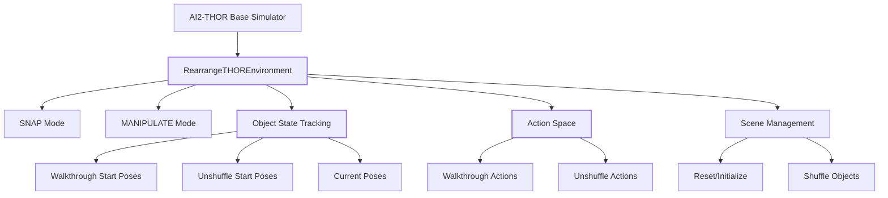
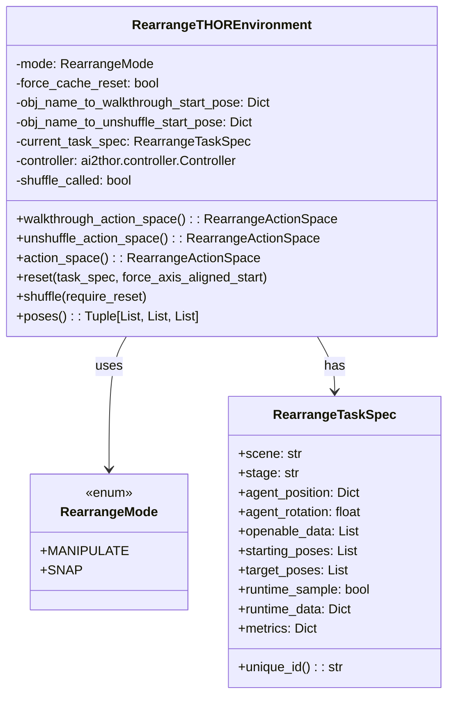
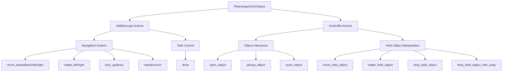
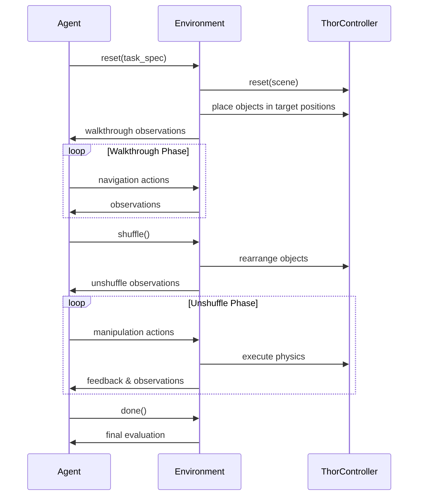

<!-- source: DeepWiki mcp.deepwiki.com · repo allenai/ai2thor-rearrangement · page 3 Environment · fetched 2026-10-26 -->

# Environment

<details>
<summary>Relevant source files</summary>

The following files were used as context for generating this wiki page:

- [rearrange/constants.py](rearrange/constants.py)
- [rearrange/environment.py](rearrange/environment.py)

</details>


The Environment module in the AI2-THOR Rearrangement Challenge provides the core simulation infrastructure for embodied AI agents to interact with virtual scenes. This document covers the main environment components, object manipulation mechanics, and action spaces available to agents. For information about specific tasks implemented on top of this environment, see [Tasks](#4).

## Environment Overview

The AI2-THOR Rearrangement environment serves as a wrapper around the AI2-THOR simulator, extending it with specialized functionality for object rearrangement tasks. The environment supports two distinct phases of interaction:

1. **Walkthrough Phase**: Agent observes the target object arrangement
2. **Unshuffle Phase**: Agent attempts to restore objects to their target positions



Sources: [rearrange/environment.py:157-162](), [rearrange/environment.py:175-253]()

## RearrangeTHOREnvironment

The `RearrangeTHOREnvironment` class is the central component that provides all functionality for interacting with the rearrangement environment. It wraps around AI2-THOR's controller and extends it with rearrangement-specific features.

### Environment Modes

The environment supports two operational modes:

1. **SNAP Mode**: Allows objects to "snap" into their target positions when they are close enough, simplifying object placement.
2. **MANIPULATE Mode**: Requires precise object manipulation without automatic snapping.



Sources: [rearrange/environment.py:46-52](), [rearrange/environment.py:157-174]()

### Task Specification

Rearrangement tasks are defined by the `RearrangeTaskSpec` class, which encapsulates all the information needed to initialize a specific rearrangement scenario:

- Scene name
- Agent starting position and rotation
- Object poses for walkthrough and unshuffle phases
- Openable object states
- Task-specific metrics

Tasks can be defined either:
1. Explicitly with predefined poses and states
2. At runtime with randomized configurations

Sources: [rearrange/environment.py:53-155]()

## Object Management

Objects in the environment are tracked through poses that capture their position, rotation, and other state information.

### Object Types and Properties

The environment operates with various object types, each with different interaction properties:

```
Object Types:
- Pickupable: Can be picked up and moved (e.g., Apple, Book, Fork)
- Openable: Can be opened/closed (e.g., Drawer, Cabinet, Microwave)
- Receptacle: Can contain other objects (e.g., CounterTop, Drawer, Bowl)
```

The environment maintains dictionaries of object properties and categorizes them accordingly.

```mermaid
graph TD
    A["Scene Objects"] --> B["Pickupable Objects"]
    A --> C["Openable Objects"]
    A --> D["Receptacle Objects"]
    
    E["Object State"] --> F["Position (x,y,z)"]
    E --> G["Rotation (x,y,z)"]
    E --> H["Openness (0-1)"]
    E --> I["Broken Status"]
    
    J["Pose Tracking"] --> K["Walkthrough Start Poses"]
    J --> L["Unshuffle Start Poses"]
    J --> M["Current Poses"]
    
    N["Pose Comparison"] --> O["Position Distance"]
    N --> P["Rotation Distance"]
    N --> Q["3D IOU"]
    N --> R["Openness Difference"]
```



Sources: [rearrange/constants.py:15-194](), [rearrange/environment.py:884-1040]()

### Pose Representation and Comparison

The environment provides mechanisms to:
1. Track object poses at different phases (walkthrough start, unshuffle start, current)
2. Compare poses to determine if objects are correctly placed
3. Calculate energy/distance metrics between different poses

A key feature is the ability to determine whether an object has been successfully rearranged to match its target position and orientation.

Sources: [rearrange/environment.py:1041-1108](), [rearrange/environment.py:1113-1219]()

## Action Space

The environment provides different sets of actions depending on the current phase of the task.

### Walkthrough Phase Actions

During the walkthrough phase, agents can only navigate and observe the environment:

```
- move_ahead
- move_right
- move_left
- move_back
- rotate_right
- rotate_left
- stand
- crouch
- look_up
- look_down
- done
```

Sources: [rearrange/environment.py:334-354](), [rearrange/environment.py:533-647]()

### Unshuffle Phase Actions

During the unshuffle phase, agents can also manipulate objects:

```
Walkthrough actions plus:
- open_object
- pickup_object
- push_object
- move_held_object
- rotate_held_object
- drop_held_object
- drop_held_object_with_snap (SNAP mode only)
```

Each action has specific parameters and constraints that determine when it can be executed successfully.



Sources: [rearrange/environment.py:357-399](), [rearrange/environment.py:401-872]()

## Environment Flow

The environment operates through a specific flow that manages the transition between walkthrough and unshuffle phases.

### Initialization and Reset

The `reset()` method initializes the environment with a specific task specification:
1. Sets up the scene
2. Places objects in their target positions
3. Positions the agent at its starting location
4. Prepares the environment for the walkthrough phase

Sources: [rearrange/environment.py:1370-1400]()

### Shuffle and Unshuffle

After the walkthrough phase, the `shuffle()` method:
1. Rearranges objects to their unshuffle starting positions
2. Resets the agent to its starting location
3. Transitions the environment to the unshuffle phase

This allows the agent to begin attempting to restore objects to their target arrangements.



Sources: [rearrange/environment.py:1527-1563](), [rearrange/environment.py:633-647]()

## Object Manipulation and Physics

The environment provides physics-based object interaction through several key mechanisms:

### Object Pickup and Placement

Agents can pick up eligible objects and then:
1. Move them in 3D space relative to the agent
2. Rotate them along multiple axes
3. Drop them either with physics or with snap-to-target functionality

### Physics Determinism

The environment includes options for enhanced physics determinism to ensure consistent behavior:
- Fixed time steps for physics simulation
- Configurable action simulation seconds
- Force cache resets for consistent object placement

This helps create a more reliable environment for training and evaluating agents.

Sources: [rearrange/environment.py:649-872](), [rearrange/environment.py:212-219]()

## Observation and Sensors

The environment provides observations to agents through:

1. RGB frames (required)
2. Depth frames (optional)
3. Agent position and orientation information

These raw observations can be processed by sensor modules to provide higher-level information to agents. For more information about sensors, see [Sensors](#5).

Sources: [rearrange/environment.py:316-332](), [rearrange/environment.py:288-313]()

## Summary

The `RearrangeTHOREnvironment` provides a comprehensive framework for object rearrangement tasks, with:

- Two operational modes (SNAP and MANIPULATE)
- Different action spaces for observation and manipulation
- Physics-based object interactions
- Robust object pose tracking and comparison
- Transitions between walkthrough and unshuffle phases

This environment serves as the foundation for the various rearrangement tasks and provides the interface through which agents interact with the simulated world.

| Environment Component | Purpose |
|----------------------|---------|
| RearrangeTHOREnvironment | Main environment wrapper around AI2-THOR |
| RearrangeMode | Defines SNAP or MANIPULATE operational modes |
| RearrangeTaskSpec | Encapsulates task definition data |
| Object Pose Tracking | Monitors object states across task phases |
| Action Space | Defines available agent actions by phase |
| Physics Interaction | Handles object manipulation and physics |

Sources: [rearrange/environment.py:157-1591]()

---

