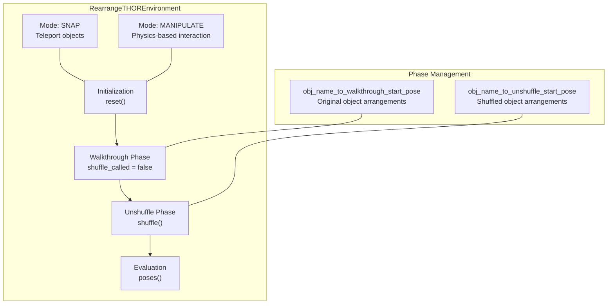
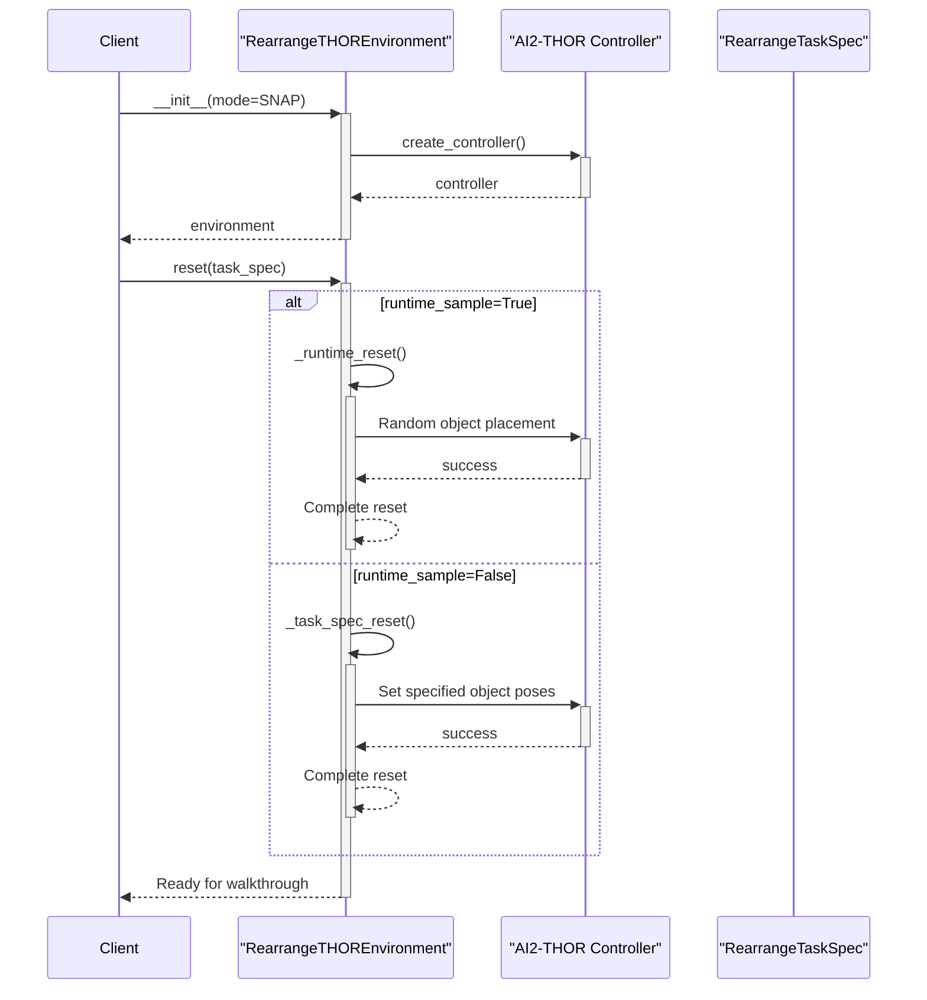
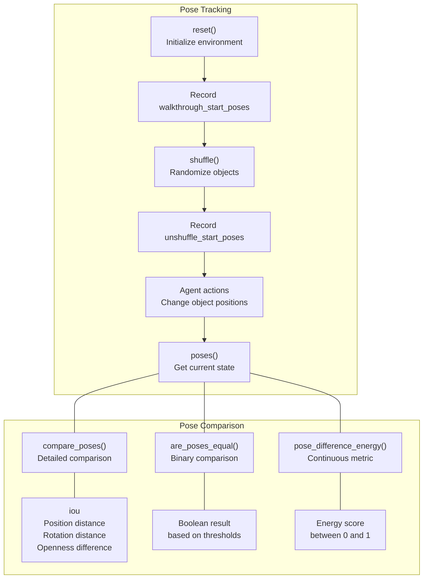
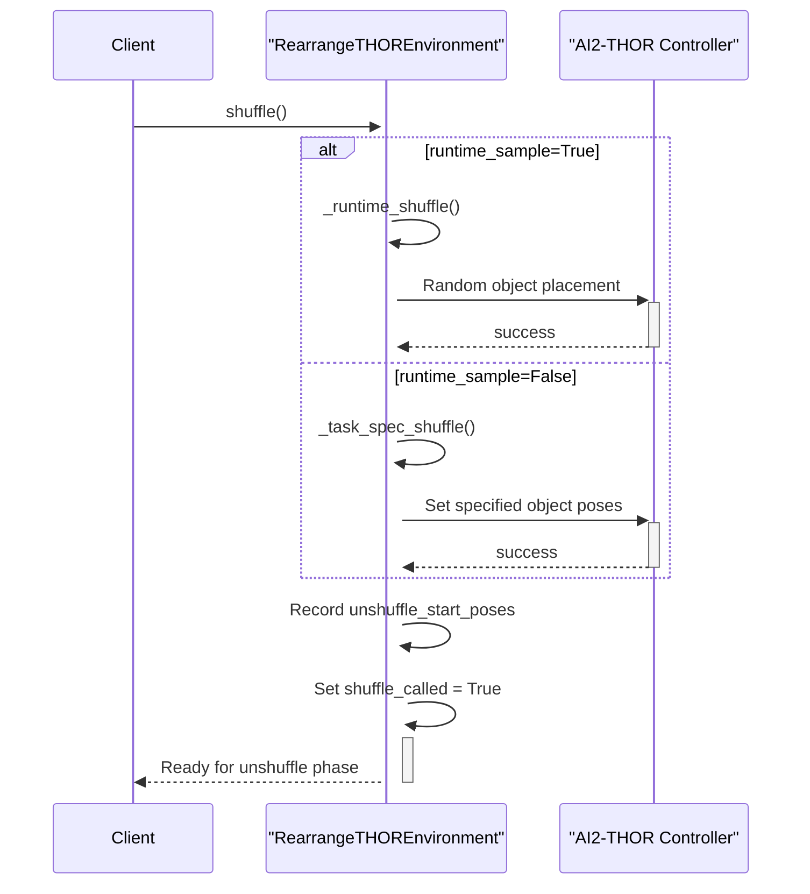

<!-- source: DeepWiki mcp.deepwiki.com · repo allenai/ai2thor-rearrangement · page 3.1 RearrangeTHOREnvironment · fetched 2026-10-26 -->

# RearrangeTHOREnvironment

<details>
<summary>Relevant source files</summary>

The following files were used as context for generating this wiki page:

- [rearrange/environment.py](rearrange/environment.py)

</details>


The `RearrangeTHOREnvironment` is a specialized wrapper around the AI2-THOR simulation environment, designed specifically for the object rearrangement task. It provides a comprehensive interface for initializing, managing, and evaluating rearrangement scenarios where agents must restore objects to their original positions.

This document details the architecture, functionality, and usage of the `RearrangeTHOREnvironment` class. For information about the specific tasks implemented on top of this environment, see [WalkthroughTask](#4.1) and [UnshuffleTask](#4.2). For details on how tasks are sampled, see [RearrangeTaskSampler](#4.3).

## Core Architecture

`RearrangeTHOREnvironment` extends the base AI2-THOR functionality with specialized features for rearrangement tasks, including object pose tracking, phase management, and enhanced physics determinism.

```mermaid
classDiagram
    class "RearrangeTHOREnvironment" {
        +controller: ai2thor.controller.Controller
        +mode: RearrangeMode
        +current_task_spec: RearrangeTaskSpec
        +obj_name_to_walkthrough_start_pose: Dict
        +obj_name_to_unshuffle_start_pose: Dict
        +shuffle_called: bool
        +create_controller()
        +reset(task_spec)
        +shuffle()
        +poses()
        +action_methods()
    }
    
    class "RearrangeMode" {
        <<enumeration>>
        MANIPULATE
        SNAP
    }
    
    class "RearrangeTaskSpec" {
        +scene: str
        +agent_position: Dict
        +agent_rotation: float
        +openable_data: Sequence
        +starting_poses: Sequence
        +target_poses: Sequence
        +runtime_sample: bool
    }
    
    class "ai2thor.controller.Controller" {
        +step()
        +reset()
        +last_event
    }
    
    "RearrangeTHOREnvironment" -- "RearrangeMode"
    "RearrangeTHOREnvironment" o-- "RearrangeTaskSpec"
    "RearrangeTHOREnvironment" *-- "ai2thor.controller.Controller"
```

Sources: [rearrange/environment.py:157-159](), [rearrange/environment.py:46-51](), [rearrange/environment.py:53-154]()

## Task Phases and Operational Modes

The environment operates in two distinct phases and can be configured with different operational modes that affect how object interactions are handled.



Sources: [rearrange/environment.py:370-397](), [rearrange/environment.py:1110-1127](), [rearrange/environment.py:1528-1563]()

### Operational Modes

1. **SNAP Mode**: Objects can be teleported to their target locations when dropped
2. **MANIPULATE Mode**: Requires precise physical manipulation of objects

These modes are defined in the `RearrangeMode` enum and specified during environment initialization.

Sources: [rearrange/environment.py:46-51](), [rearrange/environment.py:176-181]()

## Task Specification

The `RearrangeTaskSpec` class encapsulates all the data needed to define a specific rearrangement task:

| Property | Type | Description |
|----------|------|-------------|
| `scene` | str | AI2-THOR scene name |
| `agent_position` | Dict | Starting position coordinates |
| `agent_rotation` | float | Starting rotation angle (degrees) |
| `openable_data` | Sequence | Information about openable objects |
| `starting_poses` | Sequence | Object poses at unshuffle start |
| `target_poses` | Sequence | Object poses at walkthrough start |
| `runtime_sample` | bool | Whether to generate poses at runtime |

Tasks can be:
- **Predefined**: All object poses are specified in advance
- **Runtime-sampled**: Object poses are randomly generated during initialization

Sources: [rearrange/environment.py:53-154](), [rearrange/environment.py:1222-1299](), [rearrange/environment.py:1300-1367]()

## Environment Initialization

The environment is initialized with a specific mode and task specification.



Sources: [rearrange/environment.py:176-213](), [rearrange/environment.py:1370-1399](), [rearrange/environment.py:1300-1367](), [rearrange/environment.py:1222-1299]()

## Action Space

The environment provides different sets of actions depending on the current phase (walkthrough or unshuffle).

### Walkthrough Phase Actions

Navigation and observation actions available during the walkthrough phase:

```
- move_ahead()
- move_back()
- move_right()
- move_left()
- rotate_right()
- rotate_left()
- stand()
- crouch()
- look_up()
- look_down()
- done()
```

### Unshuffle Phase Actions

All walkthrough actions plus object manipulation actions:

```
- open_object(x, y, openness)
- pickup_object(x, y)
- push_object(x, y, rel_x_force, rel_y_force, rel_z_force, force_magnitude)
- move_held_object(x_meters, y_meters, z_meters)
- rotate_held_object(x, y, z)
- drop_held_object()
- drop_held_object_with_snap() [SNAP mode only]
```

The action space is dynamically accessible via the `action_space` property, which returns different actions based on the current phase.

Sources: [rearrange/environment.py:334-409](), [rearrange/environment.py:411-871]()

## Object Pose Management

A key feature of `RearrangeTHOREnvironment` is tracking and comparing object poses across different phases.



Sources: [rearrange/environment.py:1110-1127](), [rearrange/environment.py:883-1003](), [rearrange/environment.py:1042-1076]()

### Key Pose Methods

- `poses()`: Returns a tuple of (unshuffle_start, walkthrough_start, current) poses for all objects
- `compare_poses()`: Detailed comparison of two poses, including IOU, position distance, rotation angle, and openness
- `are_poses_equal()`: Binary check if two poses are equivalent within specified thresholds
- `pose_difference_energy()`: Continuous metric of pose similarity with values in [0,1]

These methods are essential for tracking progress and evaluating task completion.

Sources: [rearrange/environment.py:1110-1127](), [rearrange/environment.py:883-1003](), [rearrange/environment.py:1042-1076](), [rearrange/environment.py:966-1040]()

## Phase Transition

The transition from walkthrough to unshuffle phase is managed through the `shuffle()` method:



Sources: [rearrange/environment.py:1528-1563](), [rearrange/environment.py:1401-1465](), [rearrange/environment.py:1466-1526]()

## Integration with AI2-THOR

The `RearrangeTHOREnvironment` integrates deeply with the underlying AI2-THOR simulation:

1. Creates and manages an AI2-THOR controller instance
2. Handles physics parameters for deterministic simulation
3. Translates high-level actions into AI2-THOR API calls
4. Provides observations from the simulator (RGB, depth)

Sources: [rearrange/environment.py:254-271](), [rearrange/environment.py:214-219](), [rearrange/environment.py:316-332]()

## Example Usage Flow

Below is a typical usage flow of the `RearrangeTHOREnvironment`:

```
1. Initialize environment with desired mode
2. Load or create a RearrangeTaskSpec
3. Call reset() with the task spec to enter walkthrough phase
4. Let agent observe environment and take walkthrough actions
5. Call shuffle() to transition to unshuffle phase
6. Let agent manipulate objects to restore original arrangement
7. Use poses() and evaluation methods to assess performance
```

The environment handles all the simulation details, allowing users to focus on agent development and task evaluation.

## Performance Considerations

Several optimizations are included in the environment:

1. **Object Interactable Positions Cache**: Caches positions from which objects can be interacted with
2. **Enhanced Physics Determinism**: Provides options for more consistent physics simulation
3. **Efficient Runtime Sampling**: Special handling of runtime-sampled tasks to avoid full resets

Sources: [rearrange/environment.py:214-219](), [rearrange/environment.py:222-223](), [rearrange/environment.py:1222-1299]()

## Conclusion

The `RearrangeTHOREnvironment` provides the foundational infrastructure for implementing and evaluating rearrangement tasks. It handles the complex details of simulation, object tracking, and phase management, allowing researchers to focus on developing and testing embodied AI agents for the rearrangement challenge.

---

