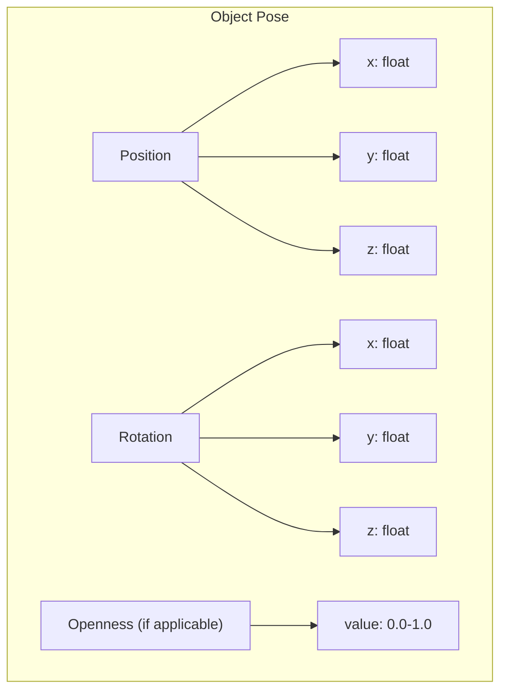
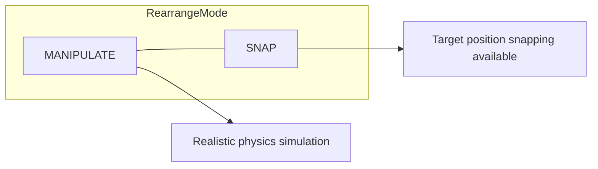
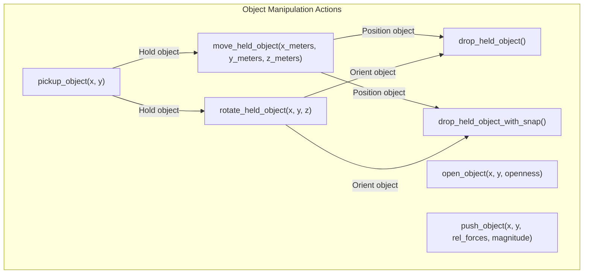
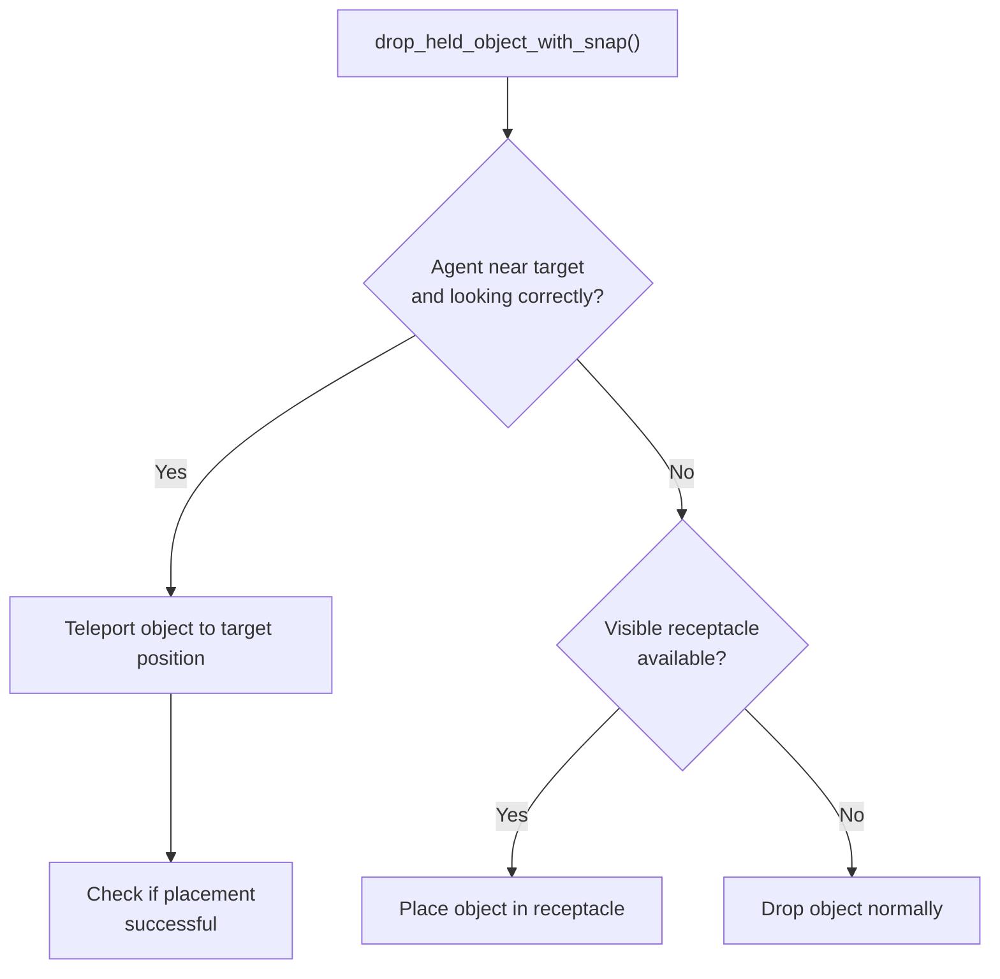
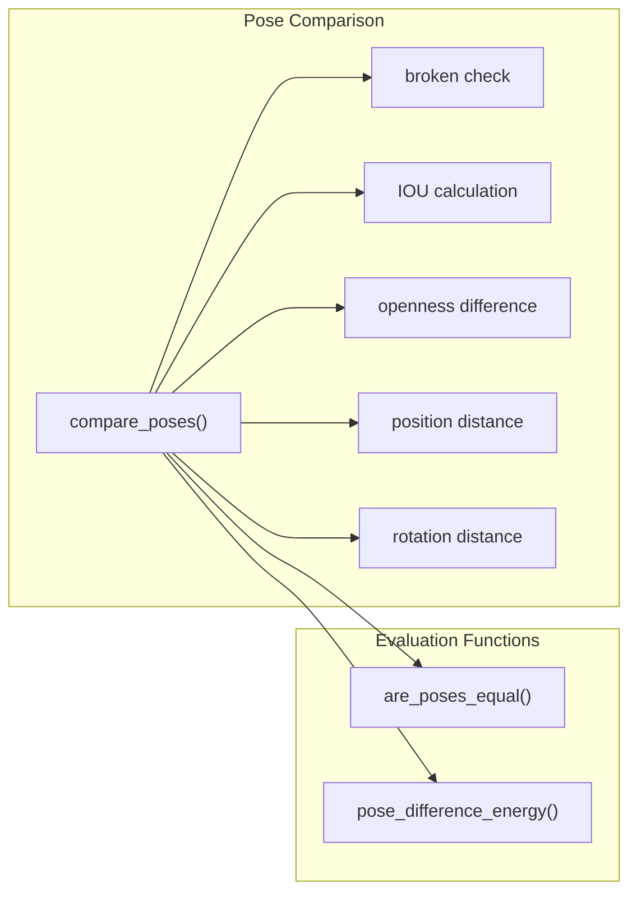
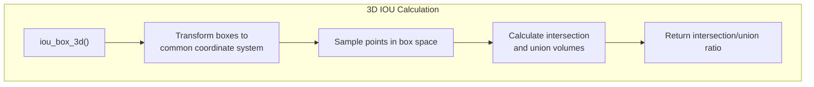
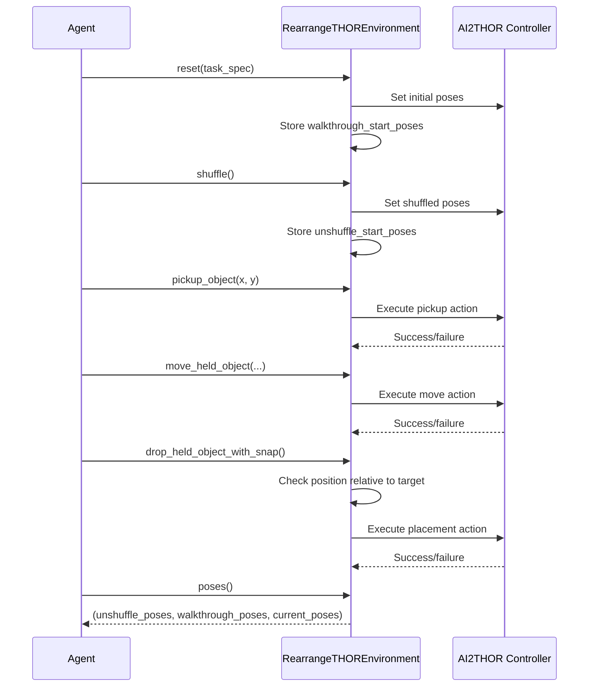
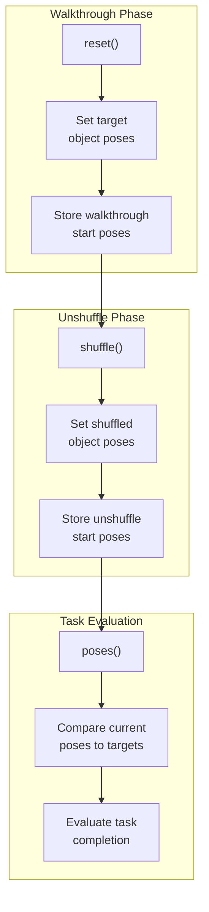

<!-- source: DeepWiki mcp.deepwiki.com · repo allenai/ai2thor-rearrangement · page 3.2 Object Poses and Manipulation · fetched 2026-10-26 -->

# Object Poses and Manipulation

<details>
<summary>Relevant source files</summary>

The following files were used as context for generating this wiki page:

- [rearrange/constants.py](rearrange/constants.py)
- [rearrange/environment.py](rearrange/environment.py)
- [rearrange/utils.py](rearrange/utils.py)

</details>


This document describes how objects are represented within the AI2-THOR Rearrangement environment and the mechanisms for manipulating them. It covers object pose data structures, manipulation actions, and methods for comparing object poses to evaluate task completion.

For information about the available actions in the environment, see [Action Space](#3.3). For details on task phases, see [Task Phases](#2.2).

## 1. Object Representation

Objects in the AI2-THOR Rearrangement Challenge are represented by their poses, which include position, rotation, and additional properties such as openness for openable objects.

### 1.1 Object Properties

The environment defines several types of objects with different properties:

```mermaid
classDiagram
    class "Object" {
        name: String
        objectId: String
        type: String
        position: Dict
        rotation: Dict
        broken: Boolean
        bounding_box: Array
    }
    
    class "PickupableObject" {
        pickupable: True
    }
    
    class "OpenableObject" {
        openable: True
        openness: Float
        receptacle: Boolean
    }
    
    class "ReceptacleObject" {
        receptacle: True
    }
    
    "Object" <|-- "PickupableObject"
    "Object" <|-- "OpenableObject"
    "Object" <|-- "ReceptacleObject"
```

Sources: [rearrange/constants.py:64-184](), [rearrange/utils.py:166-194]()

The codebase defines these object properties in `OBJECT_TYPES_WITH_PROPERTIES`, which maps object types to their attributes:

| Property | Description | Example Types |
|----------|-------------|---------------|
| pickupable | Can be picked up by the agent | Bowl, Apple, Knife |
| openable | Can be opened/closed with varying degrees | Cabinet, Drawer, Microwave |
| receptacle | Can contain other objects | Drawer, CounterTop, Sink |

The codebase also maintains filtered lists of objects with specific properties:
- `PICKUPABLE_OBJECTS`: All objects that can be picked up
- `OPENABLE_OBJECTS`: All objects that can be opened but not picked up

### 1.2 Object Poses

An object's pose is represented by its position and rotation in 3D space:



Sources: [rearrange/environment.py:92-108](), [rearrange/utils.py:197-209]()

The environment tracks object poses at different stages of the rearrangement task:

- `obj_name_to_walkthrough_start_pose`: Object poses at the start of the walkthrough phase (target poses)
- `obj_name_to_unshuffle_start_pose`: Object poses at the start of the unshuffle phase (shuffled poses)
- Current poses: The current state of objects in the environment

These poses are used to determine task progress and completion.

## 2. Object Manipulation

The AI2-THOR Rearrangement environment provides several actions for manipulating objects, with two distinct manipulation modes.

### 2.1 Manipulation Modes



Sources: [rearrange/environment.py:46-51](), [rearrange/environment.py:177-210]()

- **MANIPULATE Mode**: Realistic physics-based manipulation. Objects must be physically moved to their target locations.
- **SNAP Mode**: Allows for precise object placement using the `drop_held_object_with_snap` action, which can teleport objects to their target locations if conditions are met.

### 2.2 Object Manipulation Actions

The environment provides these key actions for object manipulation:



Sources: [rearrange/environment.py:411-871]()

#### Key Action Details:

- **pickup_object**: Takes screen coordinates (x, y) to identify the target object
- **move_held_object**: Moves held object by specified distances (max 0.5 meters per step)
- **rotate_held_object**: Rotates held object along specified axes (scaled to -90° to 90°)
- **drop_held_object**: Simply drops the currently held object
- **drop_held_object_with_snap**: In SNAP mode, attempts to place object in target position
- **open_object**: Opens/closes objects to specified openness value (0.0-1.0)
- **push_object**: Applies force to an object without picking it up

### 2.3 Snap Mode Placement Logic

When using `drop_held_object_with_snap`, the system follows this logic:



Sources: [rearrange/environment.py:734-871]()

The snapping mechanism requires:
1. The agent to be within 1.5 meters of the goal object position
2. The agent to be looking in the direction of the target location
3. The target position to be valid (not causing collisions)

## 3. Pose Comparison and Evaluation

A critical part of the rearrangement task is determining when objects are correctly placed. The system uses several methods to compare object poses.

### 3.1 Pose Comparison Methods



Sources: [rearrange/environment.py:883-1040]()

The system provides two main functions for pose evaluation:

1. **are_poses_equal**: Determines if two poses are sufficiently similar (Boolean result)
2. **pose_difference_energy**: Computes a continuous value (0-1) indicating pose dissimilarity

### 3.2 IOU Calculation for 3D Objects

To determine if objects are correctly placed, the system calculates the Intersection over Union (IOU) of their 3D bounding boxes:



Sources: [rearrange/utils.py:364-397]()

The IOU calculation:
1. Aligns the boxes to a common coordinate system
2. Finds the basis vectors for each box
3. Samples points uniformly to estimate volume overlap
4. Calculates the ratio of intersection volume to union volume

### 3.3 Pose Difference Energy

The pose difference energy function provides a continuous measure of how different two poses are:

- For pickupable objects: Combines IOU and position distance energies
- For openable objects: Based on the difference in openness values
- For broken objects: Always returns maximum energy (1.0)

This energy function is used to track progress and evaluate performance in the rearrangement task.

Sources: [rearrange/environment.py:966-1040]()

## 4. Implementation Details

### 4.1 Key Object Pose Data Structures

```mermaid
classDiagram
    class "RearrangeTHOREnvironment" {
        obj_name_to_walkthrough_start_pose
        obj_name_to_unshuffle_start_pose
        poses()
        compare_poses()
        are_poses_equal()
        pose_difference_energy()
    }
    
    class "ObjectInteractablePostionsCache" {
        _key_to_positions: LRU Cache
        get()
    }
    
    "RearrangeTHOREnvironment" --> "ObjectInteractablePostionsCache": uses
```

Sources: [rearrange/environment.py:225-229](), [rearrange/environment.py:1094-1219](), [rearrange/utils.py:404-522]()

The environment maintains several important data structures for object poses:

1. **Object pose dictionaries**: Map object names to their poses at different phases
2. **Cached poses**: Optimized structures for quickly accessing pose data
3. **Interactable positions cache**: Caches positions from which objects can be interacted with

### 4.2 Pose Access and Manipulation Workflow



Sources: [rearrange/environment.py:1370-1590](), [rearrange/environment.py:411-871]()

This diagram shows the typical workflow for accessing and manipulating object poses during a rearrangement task.

### 4.3 Object Pose Extraction

The `get_pose_info` function extracts relevant pose information from object data, including:
- Object type
- Position and rotation
- Openness (for openable objects)
- Bounding box coordinates
- Broken state

This extracted information is used for pose comparison and evaluation.

Sources: [rearrange/utils.py:197-209](), [rearrange/utils.py:166-194]()

## 5. Pose Tracking During Task Phases



Sources: [rearrange/environment.py:1370-1590](), [rearrange/environment.py:1094-1219]()

During a rearrangement task:

1. **Walkthrough Phase**: Target poses are established and stored
2. **Unshuffle Phase**: Objects are shuffled to new positions
3. **Task Progress**: Current poses are compared against target poses to track progress
4. **Evaluation**: Final poses determine task completion based on pose equality

The `all_rearranged_or_broken` property checks if every object is either correctly placed or broken, indicating that no further progress can be made.

Sources: [rearrange/environment.py:1094-1108]()

## Summary

Object poses and manipulation are central to the AI2-THOR Rearrangement Challenge. The environment provides comprehensive mechanisms for representing object states, manipulating objects, and comparing poses to evaluate task completion. The two manipulation modes (MANIPULATE and SNAP) offer different approaches to object placement, with the SNAP mode providing more precise control at the expense of realism.

The pose comparison and evaluation methods are designed to handle the complexity of 3D environments, using techniques like IOU calculation and custom energy functions to determine when objects are correctly placed. The system also provides efficient data structures and caches to optimize these operations.

---

