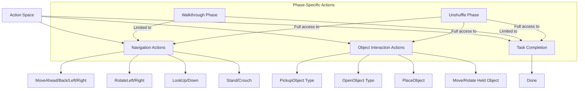
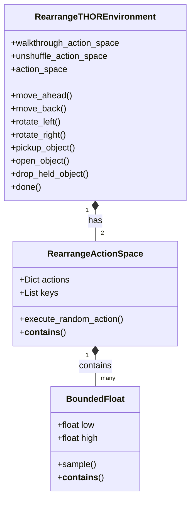
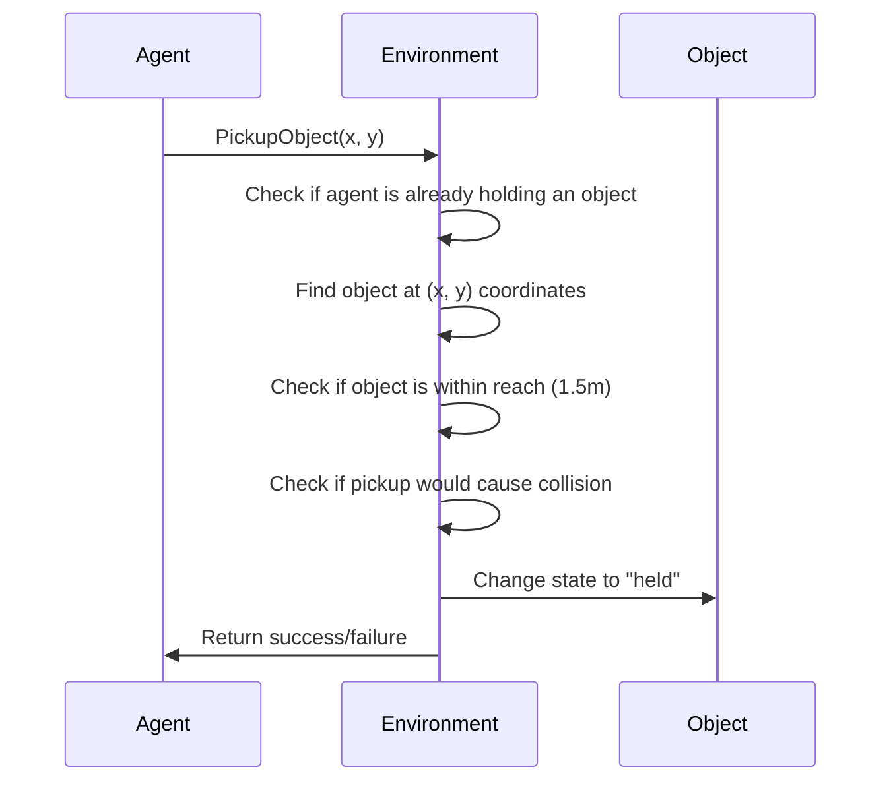
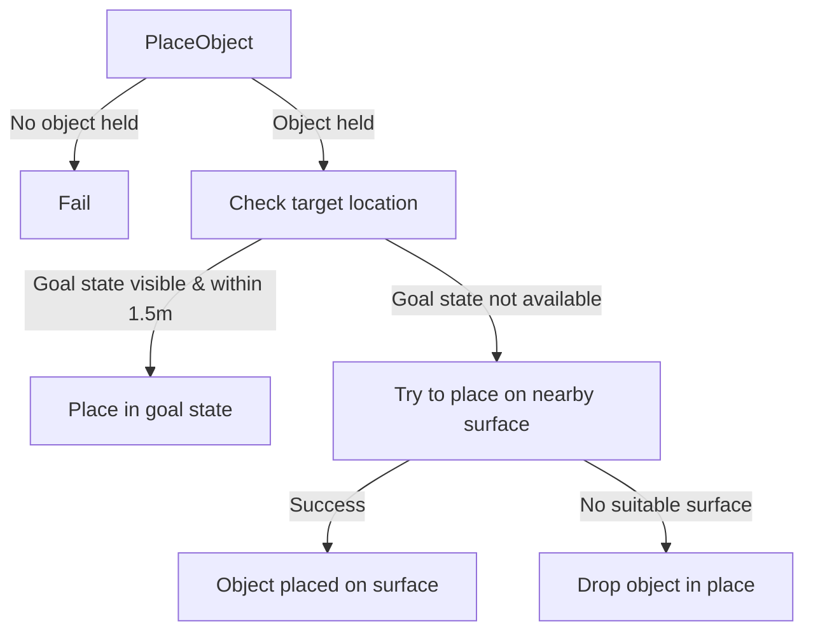
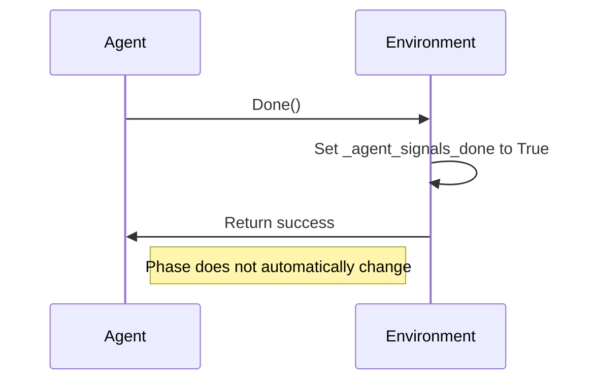
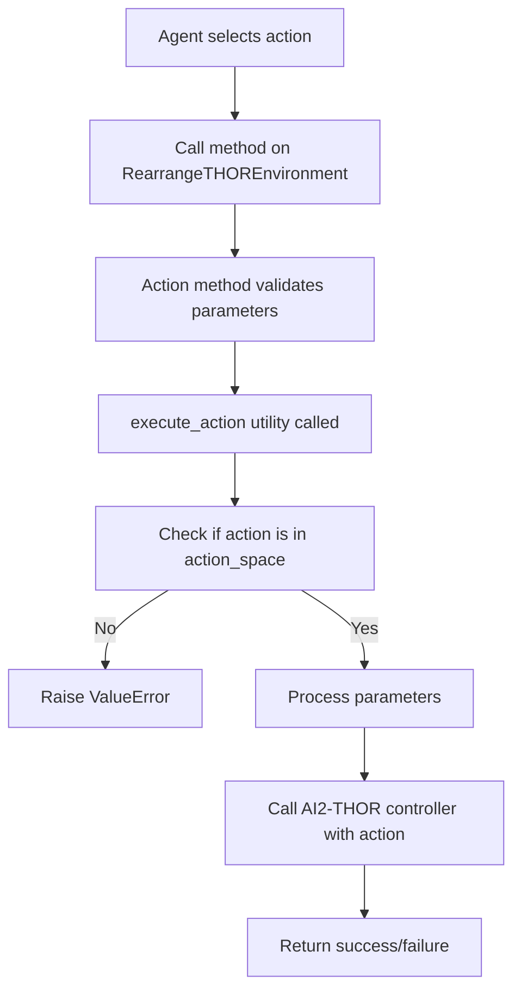

<!-- source: DeepWiki mcp.deepwiki.com · repo allenai/ai2thor-rearrangement · page 3.3 Action Space · fetched 2026-10-26 -->

# Action Space

<details>
<summary>Relevant source files</summary>

The following files were used as context for generating this wiki page:

- [README.md](README.md)
- [rearrange/environment.py](rearrange/environment.py)
- [rearrange/utils.py](rearrange/utils.py)

</details>


This page documents the available actions that agents can take within the AI2-THOR Rearrangement Challenge environment. It covers the structure of the action space, the different types of actions available, and how they are implemented and used within the system. For information about object pose representation, see [Object Poses and Manipulation](#3.2).

## Action Space Overview

The AI2-THOR Rearrangement Challenge provides agents with a rich set of actions to navigate the environment and manipulate objects. The available actions differ between the walkthrough and unshuffle phases of the challenge, with the unshuffle phase providing additional object manipulation capabilities.

In total, agents have access to 82 actions across several categories:
- Navigation (movement and camera control)
- Object interaction (pickup, placement, opening)
- Task completion (done)



Sources: [README.md:413-448](), [rearrange/environment.py:335-409]()

## Action Space Implementation

The action space is implemented using two primary classes:

1. `RearrangeActionSpace`: Defines the set of available actions and their parameters
2. `BoundedFloat`: Specifies parameter constraints for actions with continuous parameters



Sources: [rearrange/utils.py:64-163](), [rearrange/environment.py:334-409]()

The `RearrangeActionSpace` class maintains a dictionary mapping action functions to their parameters, where each parameter is defined as a `BoundedFloat` with minimum and maximum allowed values. The environment creates two action spaces:

- `walkthrough_action_space`: Contains only navigation actions and the "done" action
- `unshuffle_action_space`: Contains all navigation and object interaction actions

The currently available action space depends on the phase (walkthrough or unshuffle) and is accessed through the `action_space` property.

## Navigation Actions

Navigation actions allow the agent to move around the environment and adjust its view. These actions are available in both the walkthrough and unshuffle phases.

| Action | Description | Parameters | Constraints |
|--------|-------------|------------|------------|
| `MoveAhead` | Move forward 0.25m | None | Will not execute if it would cause a collision |
| `MoveBack` | Move backward 0.25m | None | Will not execute if it would cause a collision |
| `MoveRight` | Move right 0.25m | None | Will not execute if it would cause a collision |
| `MoveLeft` | Move left 0.25m | None | Will not execute if it would cause a collision |
| `RotateRight` | Rotate 90° clockwise | None | May fail if holding an object that would collide |
| `RotateLeft` | Rotate 90° counterclockwise | None | May fail if holding an object that would collide |
| `LookUp` | Tilt camera up 30° | None | Maximum 30° above horizontal |
| `LookDown` | Tilt camera down 30° | None | Maximum 60° below horizontal |
| `Stand` | Move to standing position | None | N/A |
| `Crouch` | Move to crouching position | None | N/A |

Sources: [rearrange/environment.py:533-631](), [README.md:417-424]()

## Object Interaction Actions

Object interaction actions allow the agent to manipulate objects during the unshuffle phase. These actions include picking up objects, opening containers, and placing objects.

### Pickup Actions

The `PickupObject` action allows the agent to pick up objects in the environment:



Parameters:
- `x` (float, range [0,1]): Horizontal position in the agent's view where the target object is located
- `y` (float, range [0,1]): Vertical position in the agent's view where the target object is located

Sources: [rearrange/environment.py:443-469](), [README.md:427-432]()

### Open Actions

The `OpenObject` action toggles the openness state of objects such as drawers, cabinets, and refrigerators:

| Parameter | Type | Range | Description |
|-----------|------|-------|-------------|
| `x` | float | [0,1] | Horizontal position in agent's view |
| `y` | float | [0,1] | Vertical position in agent's view |
| `openness` | float | [0,1] | Target openness value (0=closed, 1=fully open) |

Sources: [rearrange/environment.py:411-441](), [README.md:434-439]()

### Object Placement



Sources: [README.md:441-444](), [rearrange/environment.py:721-871]()

### Object Manipulation

Once an object is held, the agent can manipulate it with:

| Action | Description | Parameters |
|--------|-------------|------------|
| `MoveHeldObject` | Move held object relative to agent | x_meters, y_meters, z_meters (all in range [-0.5,0.5]) |
| `RotateHeldObject` | Rotate held object | x, y, z rotation values (all in range [-0.5,0.5]) |
| `DropHeldObject` | Drop the currently held object | None |
| `DropHeldObjectWithSnap` | Drop and snap to target if close enough | None (only available in SNAP mode) |

Sources: [rearrange/environment.py:649-871](), [README.md:382-392]()

## Action Space By Phase

The available actions differ between the walkthrough and unshuffle phases:

```mermaid
flowchart TB
    subgraph "Walkthrough Phase"
        WA["Navigation Actions"]
        WB["Done Action"]
    end
    
    subgraph "Unshuffle Phase"
        UA["Navigation Actions"]
        UB["Object Interaction Actions"]
        UC["Done Action"]
        
        UB --> UB1["Pickup"]
        UB --> UB2["Open"]
        UB --> UB3["Place"]
        UB --> UB4["Move/Rotate"]
    end
    
    Agent --> |"First Phase"| "Walkthrough Phase"
    Agent --> |"Second Phase"| "Unshuffle Phase"
```

Sources: [rearrange/environment.py:335-409]()

## Task Completion Action

The `Done` action signals that the agent has completed the current phase:

- In the walkthrough phase, it indicates that the agent has finished exploring the environment
- In the unshuffle phase, it indicates that the agent has finished rearranging objects



Sources: [rearrange/environment.py:633-648](), [README.md:447-448]()

## Action Execution Flow

When an agent executes an action, the following flow occurs:



The `execute_action` utility function in `rearrange/utils.py` handles parameter validation, preprocessing, and execution of all actions through the AI2-THOR controller.

Sources: [rearrange/utils.py:212-251]()

## Creating Custom Action Sequences

When developing agents for the Rearrangement Challenge, you'll typically use these actions to create higher-level behaviors. For example, to navigate to a specific position, your agent might need to execute a sequence of `MoveAhead`, `RotateLeft`, and `MoveRight` actions.

To train agents with imitation learning, the repository includes expert implementations like `GreedyUnshuffleExpert` which can generate optimal action sequences for solving rearrangement tasks. For more information on these experts, see [Expert Implementation](#9) and its subsections.

Sources: [README.md:158-171]()

---

