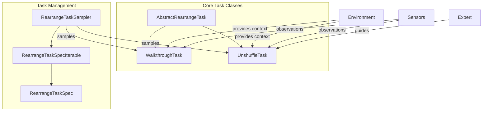
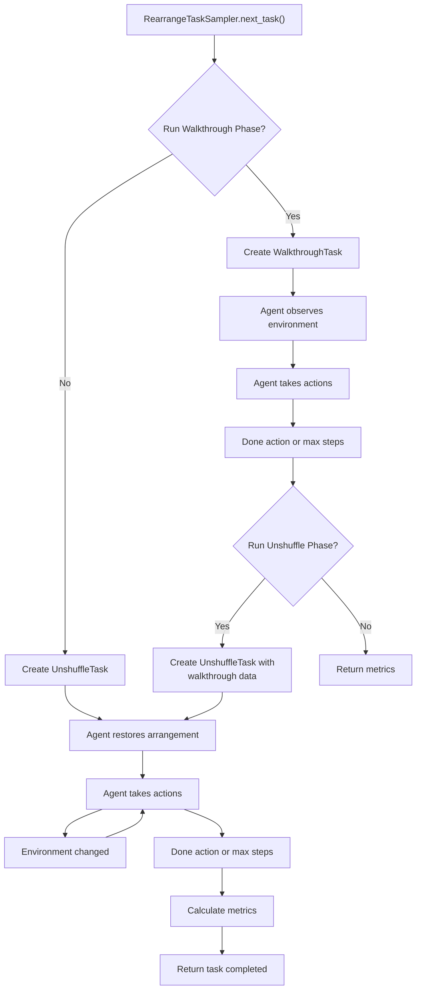
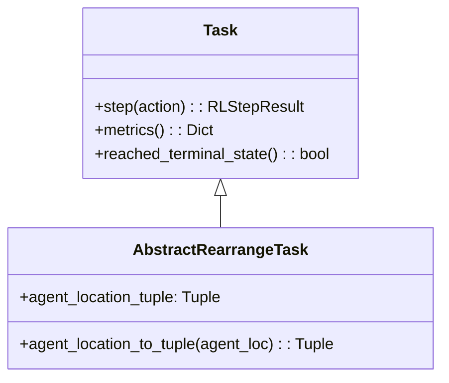
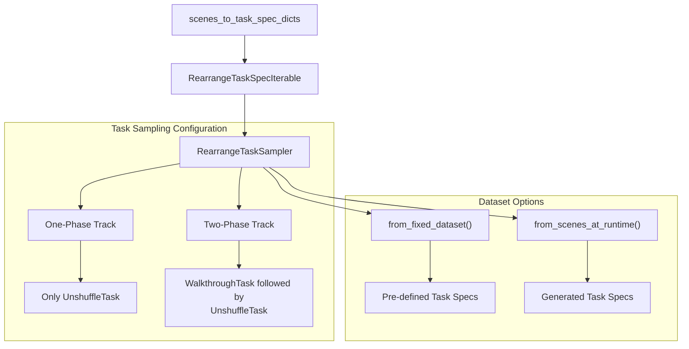
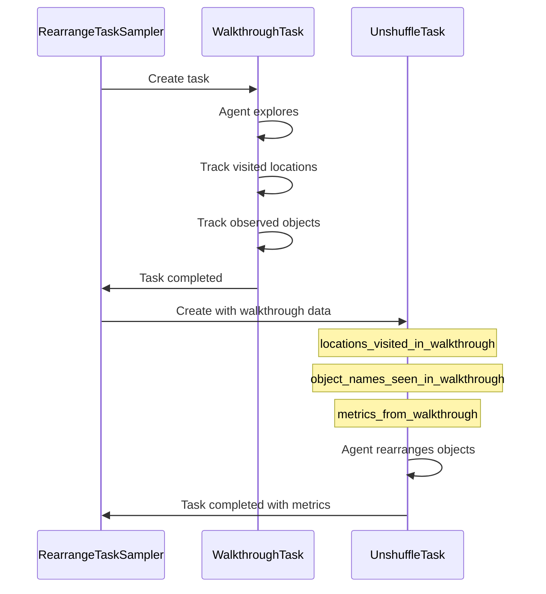

<!-- source: DeepWiki mcp.deepwiki.com · repo allenai/ai2thor-rearrangement · page 4 Tasks · fetched 2026-10-26 -->

# Tasks

<details>
<summary>Relevant source files</summary>

The following files were used as context for generating this wiki page:

- [rearrange/tasks.py](rearrange/tasks.py)
- [rearrange_constants.py](rearrange_constants.py)

</details>


This document describes the core task implementation system within the AI2-THOR Rearrangement Challenge. It covers the different task types (WalkthroughTask and UnshuffleTask), their implementation details, and how they are managed and sampled through the RearrangeTaskSampler. For information about the environment these tasks operate in, see [Environment](#3), and for details on task evaluation metrics, see [Evaluation Metrics](#2.3).

## Task System Overview

The AI2-THOR Rearrangement Challenge defines tasks as structured interactions where agents must observe and restore object arrangements in simulated environments. The task system provides:

1. Concrete task implementations for the challenge's two phases
2. Methods for sampling tasks from datasets or generating them at runtime
3. Reward computation and metrics for evaluating agent performance
4. Interfaces for agent-environment interactions



Sources: [rearrange/tasks.py:38-64](), [rearrange/tasks.py:65-480](), [rearrange/tasks.py:483-702](), [rearrange/tasks.py:705-785](), [rearrange/tasks.py:808-1211]()

## Task Lifecycle and Flow

The following diagram illustrates the typical lifecycle of tasks within the system, showing how tasks are created, executed, and evaluated:



Sources: [rearrange/tasks.py:1066-1211]()

## Task Classes

The task system is built around three main classes, each serving different roles in the rearrangement challenge:

### AbstractRearrangeTask

This abstract base class extends AllenAct's Task class and provides common functionality for rearrangement tasks, such as agent position tracking.



Sources: [rearrange/tasks.py:38-64]()

### WalkthroughTask

The WalkthroughTask implements the exploration phase of the challenge, where agents observe the environment to learn object positions and states.

Key features:
- Tracks visited positions and observed objects
- Provides rewards for exploration and object discovery
- Terminates when a "done" action is taken
- Records metrics about exploration coverage

```python
# Example WalkthroughTask reward structure
reward = 5 * (prop_seen_after - prop_seen_before)  # Reward for seeing new objects

if self._took_end_action and prop_seen_after > 0.5:
    reward += 5 * (prop_seen_after + (prop_seen_after > 0.98))  # Bonus for completion
```

Sources: [rearrange/tasks.py:483-702]()

### UnshuffleTask

The UnshuffleTask implements the rearrangement phase, where agents must restore objects to their original positions.

Key features:
- Tracks object positions and states
- Provides energy-based rewards for correct object placement
- Supports expert demonstrations via GreedyUnshuffleExpert
- Records comprehensive metrics about task performance

```python
# Example UnshuffleTask reward mechanism
energy_change = self.last_pose_energy - cur_pose_energy
# Positive reward when energy decreases (objects getting closer to correct positions)
```

Sources: [rearrange/tasks.py:65-480]()

## Task Actions and Observations

Both task types support a discrete action space, with actions including:

| Action Type | Examples | Description |
|-------------|----------|-------------|
| Navigation | move_ahead, rotate_left | Move the agent through the environment |
| Object Interaction | pickup_[object], open_by_type_[type] | Interact with objects in the scene |
| Task Control | done | Indicate task completion |

The tasks receive observations from sensors and provide rewards based on the agent's actions. The reward structures differ between the two task types:

- **WalkthroughTask**: Rewards exploration and object discovery
- **UnshuffleTask**: Rewards progress toward the correct object arrangement

Sources: [rearrange/tasks.py:304-309](), [rearrange/tasks.py:345-465](), [rearrange/tasks.py:577-590](), [rearrange/tasks.py:623-701]()

## Task Sampling

The `RearrangeTaskSampler` manages the creation and configuration of tasks, supporting both pre-defined datasets and runtime generation.



The sampler can be configured in two main ways:

1. **Fixed dataset**: Tasks are loaded from pre-defined specifications
   ```python
   RearrangeTaskSampler.from_fixed_dataset(
       run_walkthrough_phase=True,
       run_unshuffle_phase=True,
       stage="train",
       # other parameters
   )
   ```

2. **Runtime generation**: Tasks are generated at runtime based on available scenes
   ```python
   RearrangeTaskSampler.from_scenes_at_runtime(
       run_walkthrough_phase=True,
       run_unshuffle_phase=True,
       stage="train",
       allowed_scenes=["FloorPlan1", "FloorPlan2"],
       # other parameters
   )
   ```

Sources: [rearrange/tasks.py:808-1211](), [rearrange/tasks.py:896-952](), [rearrange/tasks.py:978-1000]()

## Task Specification

The `RearrangeTaskSpec` (imported from environment.py) defines the configuration for a task, including:
- Scene identifier
- Agent starting position and rotation
- Object states and positions
- Task metadata

These specifications are iterated through using the `RearrangeTaskSpecIterable` class, which manages:
- Shuffling specifications for randomized training
- Epoch-based iteration
- Scene-by-scene organization

Example task specification iteration:
```python
task_spec_iter = RearrangeTaskSpecIterable(
    scenes_to_task_spec_dicts=data,
    seed=42,
    epochs=1,
    shuffle=True
)
task_spec = next(task_spec_iter)  # Get the next task specification
```

Sources: [rearrange/tasks.py:705-785]()

## Walkthrough and Unshuffle Integration

In the two-phase track, data captured during the walkthrough phase is passed to the unshuffle phase:



Key data transferred from walkthrough to unshuffle:
- Locations visited during walkthrough
- Objects observed during walkthrough
- Performance metrics from walkthrough

This allows the unshuffle task to constrain expert demonstrations to only use information that was available to the agent during walkthrough.

Sources: [rearrange/tasks.py:1172-1208](), [rearrange/tasks.py:155-190]()

## Special Task Constants

Several constants affect task behavior, including:

| Constant | Value | Purpose |
|----------|-------|---------|
| OPENNESS_THRESHOLD | 0.2 | Determines when an object is considered open |
| STEP_SIZE | (Imported) | The grid size for navigation |

Sources: [rearrange_constants.py:1-8](), [rearrange/tasks.py:114-136]()

## Summary

The Tasks system in AI2-THOR Rearrangement Challenge provides a flexible framework for creating, sampling, and executing rearrangement tasks. Through the WalkthroughTask and UnshuffleTask implementations, along with the RearrangeTaskSampler, the system supports both one-phase and two-phase evaluation tracks with customizable configurations.

These task implementations form the core of the challenge, defining how agents interact with the environment and how their performance is evaluated. For details on specific components of the task system, see the corresponding sensor ([Sensors](#5)) and environment ([Environment](#3)) documentation.

---

