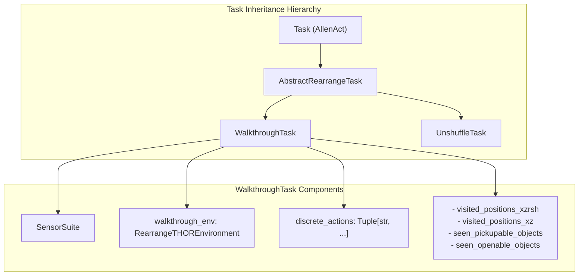
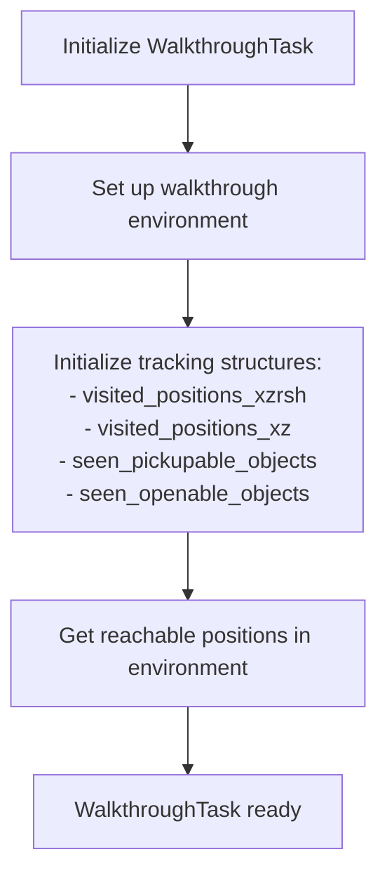
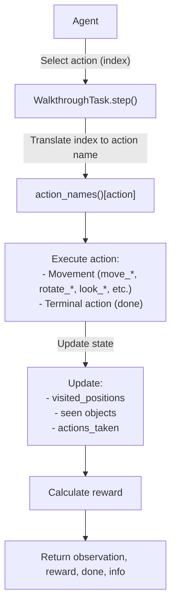
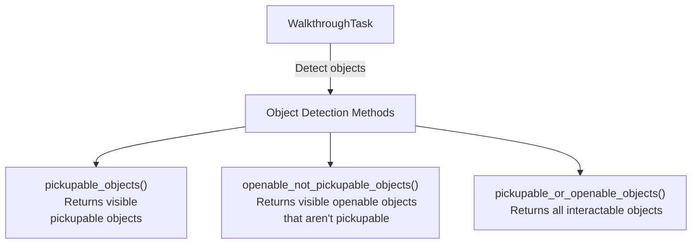
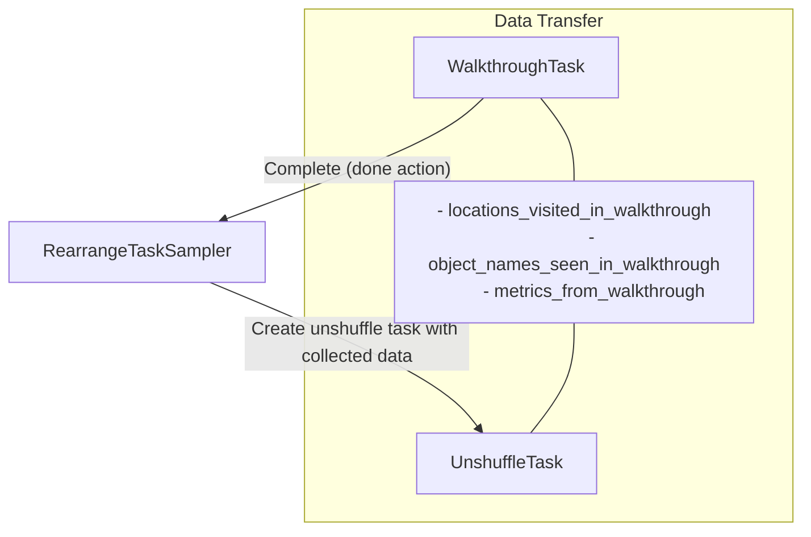

<!-- source: DeepWiki mcp.deepwiki.com · repo allenai/ai2thor-rearrangement · page 4.1 WalkthroughTask · fetched 2026-10-26 -->

# WalkthroughTask

<details>
<summary>Relevant source files</summary>

The following files were used as context for generating this wiki page:

- [rearrange/tasks.py](rearrange/tasks.py)
- [rearrange_constants.py](rearrange_constants.py)

</details>


This document provides a detailed explanation of the `WalkthroughTask` class, which implements the walkthrough phase of the AI2-THOR Rearrangement Challenge. During this phase, the agent explores the environment to observe the target arrangement of objects before objects are shuffled. For information about the subsequent unshuffle phase, see [UnshuffleTask](#4.2).

## Overview

The `WalkthroughTask` class is a fundamental component of the two-phase Rearrangement Challenge track. It manages the agent's exploration of the environment during the initial walkthrough phase, tracking visited locations and observed objects. This information is later used in the unshuffle phase when the agent must restore objects to their original positions.



Sources: [rearrange/tasks.py:483-622]()

## Class Definition and Initialization

The `WalkthroughTask` is defined in `rearrange/tasks.py` and inherits from `AbstractRearrangeTask`. It is initialized with the following parameters:

- `sensors`: A collection of sensors providing observations to the agent
- `walkthrough_env`: The Thor environment instance for the walkthrough phase 
- `max_steps`: Maximum number of steps allowed for task completion
- `discrete_actions`: Available actions for the agent
- `disable_metrics`: Option to disable metric collection

```python
def __init__(
    self,
    sensors: SensorSuite,
    walkthrough_env: RearrangeTHOREnvironment,
    max_steps: int,
    discrete_actions: Tuple[str, ...],
    disable_metrics: bool = False,
) -> None:
```

During initialization, the task sets up tracking structures for visited positions and observed objects:



Sources: [rearrange/tasks.py:484-522]()

## State Tracking

A key responsibility of the `WalkthroughTask` is tracking the agent's exploration progress. It maintains several important state variables:

| State Variable | Purpose |
|----------------|---------|
| `visited_positions_xzrsh` | Set of unique positions (x, z, rotation, standing, horizon) the agent has visited |
| `visited_positions_xz` | Set of unique (x, z) floor positions the agent has visited |
| `seen_pickupable_objects` | Set of pickupable object names the agent has observed |
| `seen_openable_objects` | Set of openable object names the agent has observed |
| `total_pickupable_or_openable_objects` | Total count of interactable objects in the scene |
| `actions_taken` | List of action names taken during the task |
| `actions_taken_success` | List of booleans indicating if each action was successful |
| `_took_end_action` | Boolean indicating if the agent has taken the "done" action |

Sources: [rearrange/tasks.py:505-522](), [rearrange/tasks.py:499-500]()

## Action Space and Execution

The `WalkthroughTask` defines a discrete action space for the agent. The available actions are determined by the `discrete_actions` parameter passed during initialization.



The task prohibits certain actions during the walkthrough phase:
- Object pickup actions return failure
- Object opening actions return failure
- Object dropping actions return failure

Only navigation actions (movement, rotation, camera control) and the terminal "done" action are allowed to succeed.

Sources: [rearrange/tasks.py:660-702](), [rearrange/tasks.py:528-530](), [rearrange/tasks.py:577-579]()

## Reward Structure

The `WalkthroughTask` implements a reward function in the `_judge` method that incentivizes exploration and object discovery:

1. The agent receives a reward proportional to the increase in the fraction of objects seen
2. When taking the "done" action after seeing more than 50% of objects, the agent receives an additional reward
3. The reward is scaled by a factor of 5 to make it more significant

```python
reward = 5 * (prop_seen_after - prop_seen_before)

if self._took_end_action and prop_seen_after > 0.5:
    reward += 5 * (prop_seen_after + (prop_seen_after > 0.98))
```

Sources: [rearrange/tasks.py:623-657]()

## Metrics Collection

The `WalkthroughTask` collects detailed metrics about the agent's exploration performance, including:

| Metric | Description |
|--------|-------------|
| `num_explored_xz` | Number of unique (x,z) positions visited |
| `num_explored_xzr` | Number of unique (x,z,rotation) configurations visited |
| `prop_visited_xz` | Proportion of reachable (x,z) positions visited |
| `prop_visited_xzr` | Proportion of reachable (x,z,rotation) configurations visited |
| `num_obj_seen` | Number of unique objects observed |
| `prop_obj_seen` | Proportion of total objects observed |

These metrics, along with the list of actions taken and their success status, are prefixed with "walkthrough/" in the final metrics dictionary, making them easy to distinguish from unshuffle phase metrics.

Sources: [rearrange/tasks.py:539-572]()

## Object Visibility Detection

The `WalkthroughTask` includes methods to detect visible objects in the environment:



These methods are used both for initializing the task's object tracking and for updating which objects have been seen during exploration.

Sources: [rearrange/tasks.py:593-621]()

## Task Completion

The `WalkthroughTask` is considered complete when the agent takes the "done" action. This is determined by the `reached_terminal_state` method:

```python
def reached_terminal_state(self) -> bool:
    """Return if end of current episode has been reached."""
    return self._took_end_action
```

When the task is complete, all collected information (visited positions, observed objects, etc.) is passed to the `UnshuffleTask` through the `RearrangeTaskSampler`, which manages the transition between phases.



Sources: [rearrange/tasks.py:589-591](), [rearrange/tasks.py:1193-1211]()

## Integration with RearrangeTaskSampler

The `RearrangeTaskSampler` is responsible for creating and managing `WalkthroughTask` instances. When configured to run the walkthrough phase, it:

1. Initializes the walkthrough environment with a task specification
2. Creates a new `WalkthroughTask` instance
3. After the walkthrough task completes, transfers collected data to the `UnshuffleTask`

This integration is crucial for the two-phase track of the Rearrangement Challenge, as it ensures that information gathered during exploration is properly utilized during the unshuffle phase.

Sources: [rearrange/tasks.py:1146-1155](), [rearrange/tasks.py:1193-1211]()

## Summary

The `WalkthroughTask` is a specialized task implementation that manages the exploration phase of the AI2-THOR Rearrangement Challenge. It tracks the agent's position and observations, computes rewards for effective exploration, and collects metrics on exploration performance. The data collected during this phase is essential for the subsequent unshuffle phase, where the agent must restore objects to their original positions.

---

