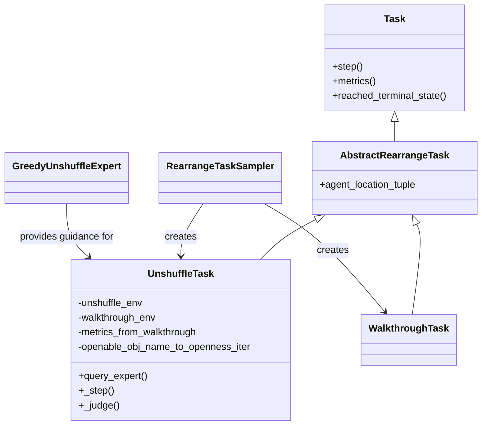
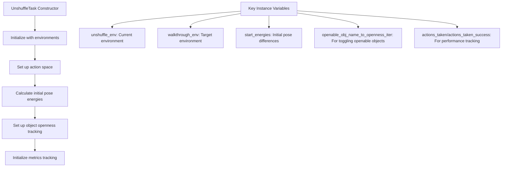
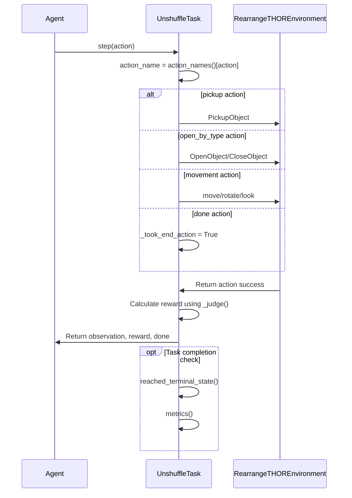
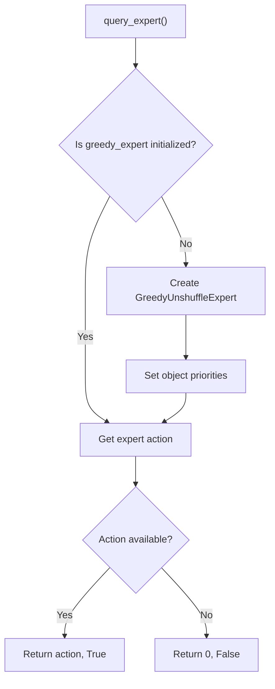
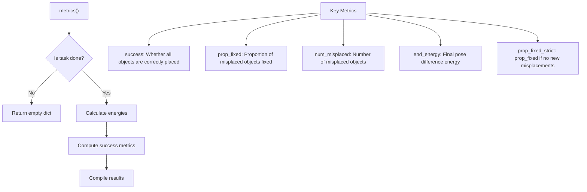
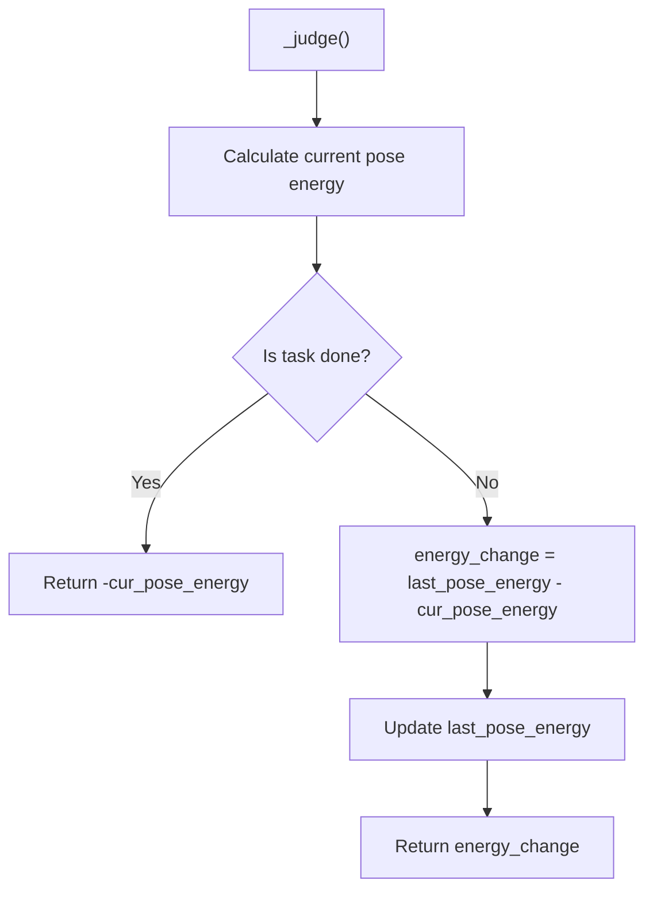
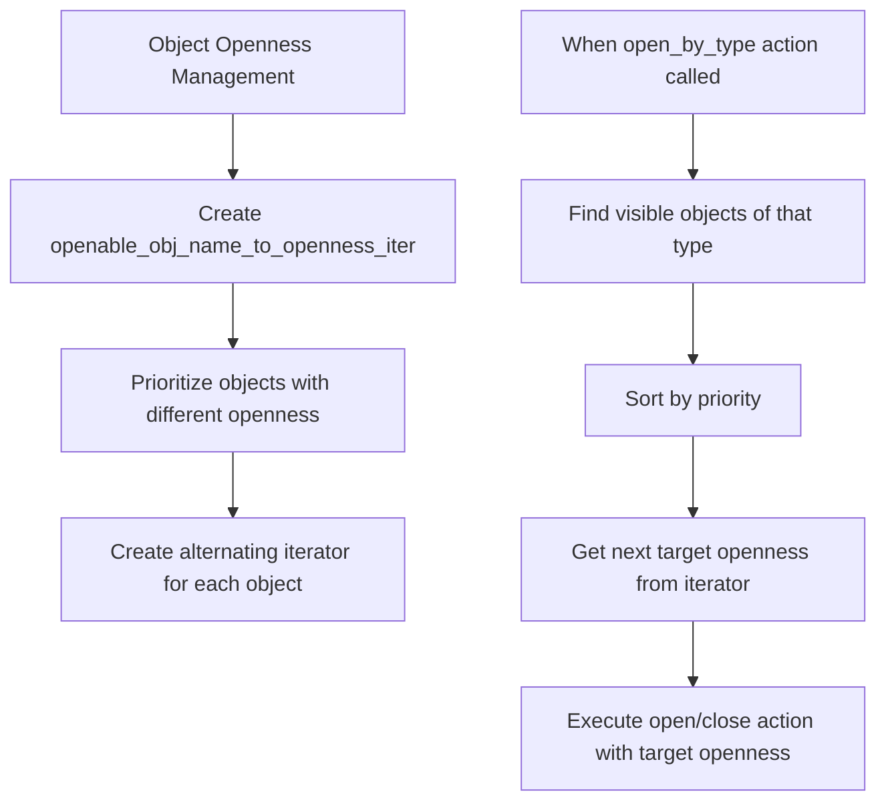
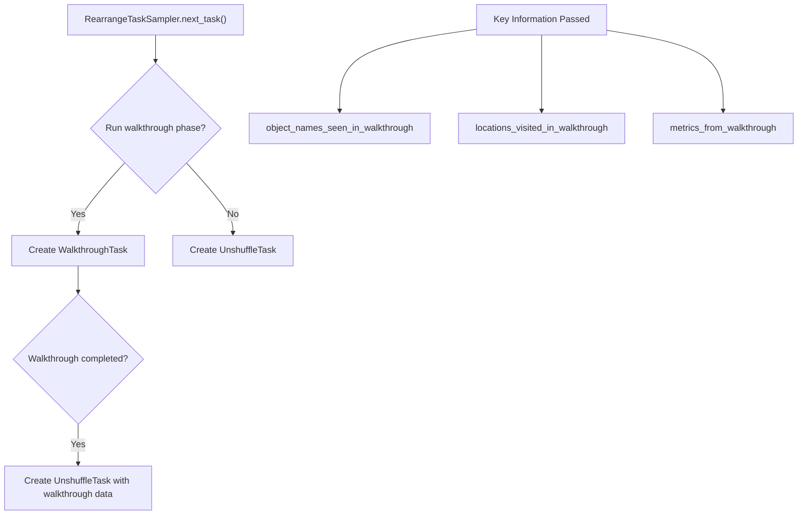

<!-- source: DeepWiki mcp.deepwiki.com · repo allenai/ai2thor-rearrangement · page 4.2 UnshuffleTask · fetched 2026-10-26 -->

# UnshuffleTask

Relevant source files

The following files were used as context for generating this wiki page:

- [rearrange/tasks.py](rearrange/tasks.py)
- [rearrange_constants.py](rearrange_constants.py)

The `UnshuffleTask` is a core component of the AI2-THOR Rearrangement Challenge that manages the "unshuffle" phase of the rearrangement task. In this phase, an agent must restore objects to their original positions after they have been shuffled from an initial "walkthrough" arrangement. 

This document covers the implementation details, functionality, and API of the `UnshuffleTask` class. For information about the walkthrough phase, see [WalkthroughTask](#4.1). For information about how tasks are sampled and managed, see [RearrangeTaskSampler](#4.3).

## Class Hierarchy and Relationship

Sources: [rearrange/tasks.py:38-64](), [rearrange/tasks.py:65-481]()

## Initialization and Key Components

The `UnshuffleTask` constructor initializes the task with references to both the unshuffle environment (current state) and walkthrough environment (target state), along with parameters that define the task behavior.

Sources: [rearrange/tasks.py:65-159]()

### Constructor Parameters

The `UnshuffleTask` constructor takes several important parameters:

| Parameter | Type | Description |
|-----------|------|-------------|
| `sensors` | `SensorSuite` | Sensors providing observations to the agent |
| `unshuffle_env` | `RearrangeTHOREnvironment` | Environment representing the current (shuffled) state |
| `walkthrough_env` | `RearrangeTHOREnvironment` | Environment representing the target state |
| `max_steps` | `int` | Maximum number of steps allowed before termination |
| `discrete_actions` | `Tuple[str, ...]` | Available actions for the agent |
| `require_done_action` | `bool` | Whether the agent must take a "done" action to finish |
| `object_names_seen_in_walkthrough` | `Set[str]` | Objects observed during walkthrough |
| `metrics_from_walkthrough` | `Dict[str, Any]` | Metrics collected during walkthrough |

Sources: [rearrange/tasks.py:66-92]()

## Task Lifecycle and Execution

The `UnshuffleTask` follows a standard reinforcement learning execution pattern:

1. The task is initialized with reference to both environments
2. The agent receives observations and takes actions
3. The environment state is updated based on those actions
4. Rewards are calculated based on the object pose differences
5. The task terminates when all objects are rearranged or the "done" action is taken

Sources: [rearrange/tasks.py:345-480](), [rearrange/tasks.py:320-343]()

## Action Space and Handling

The `UnshuffleTask` provides a discrete action space based on the `discrete_actions` parameter. The available actions typically include:

1. **Movement actions**: `move_ahead`, `move_back`, `move_left`, `move_right`, `rotate_left`, `rotate_right`, `look_up`, `look_down`
2. **Object interaction actions**: `pickup_[object_type]`, `open_by_type_[object_type]`, `drop_held_object_with_snap`
3. **Task completion action**: `done`

The action handling is implemented in the `_step` method, which:
1. Interprets the action index using `action_names()`
2. Executes the action in the unshuffle environment
3. Tracks the action success/failure
4. Returns the result as an `RLStepResult`

Sources: [rearrange/tasks.py:345-466](), [rearrange/tasks.py:192-196](), [rearrange/tasks.py:304-309]()

## Expert Agent Integration

The `UnshuffleTask` includes integration with a built-in expert agent via the `query_expert` method. This enables:

1. Imitation learning from expert demonstrations
2. Testing against expert performance
3. Guided exploration for reinforcement learning

The expert is implemented as a `GreedyUnshuffleExpert` that uses shortest path navigation to efficiently rearrange objects:

Sources: [rearrange/tasks.py:160-190]()

## Metrics and Evaluation

The `UnshuffleTask` implements a comprehensive metrics system to evaluate agent performance:

The primary evaluation metrics include:
- **Success rate**: Binary indicator if all objects are properly arranged
- **Energy difference**: How close objects are to their target positions
- **Proportion fixed**: What fraction of misplaced objects were correctly rearranged
- **Strict proportion**: How many objects were fixed without creating new misplacements

Sources: [rearrange/tasks.py:209-302]()

## Reward Function

The reward function in `_judge()` calculates rewards based on the change in pose energy between steps:

This reward system incentivizes:
1. Reducing the total pose difference between current and target states
2. Properly completing the task with minimal remaining pose differences

Sources: [rearrange/tasks.py:328-343]()

## Special Object Handling

The `UnshuffleTask` includes specialized handling for openable objects (drawers, cabinets, etc.) through an iterator mechanism:

This system allows the task to properly manage objects that can be opened/closed to different degrees, tracking the appropriate target state for each object.

Sources: [rearrange/tasks.py:111-148](), [rearrange/tasks.py:399-439]()

## Integration with RearrangeTaskSampler

The `UnshuffleTask` is typically created by the `RearrangeTaskSampler` as part of the task sampling workflow:

This integration ensures that information gathered during the walkthrough phase is properly passed to the unshuffle phase, enabling the agent to use knowledge from exploration to guide rearrangement.

Sources: [rearrange/tasks.py:808-1211]()

---

