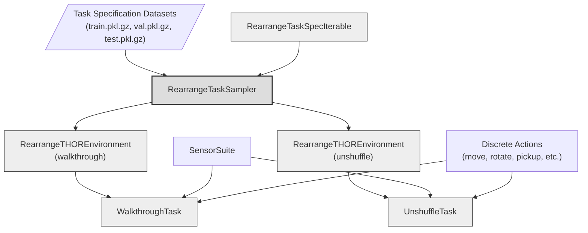
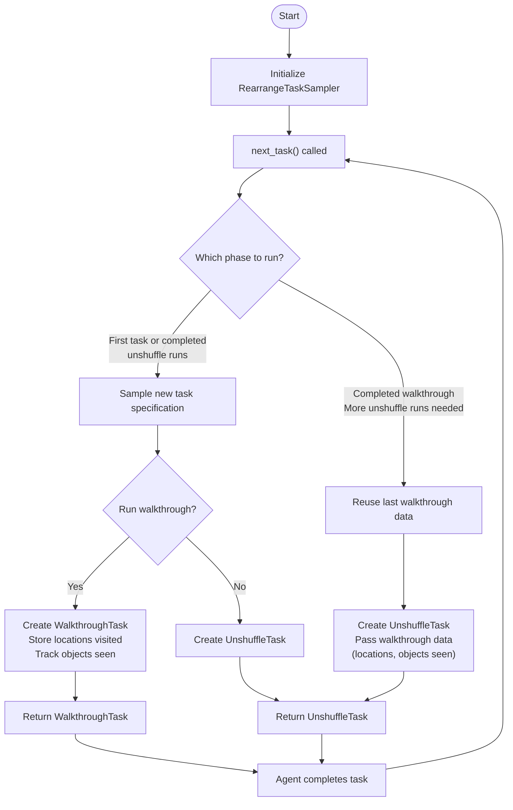
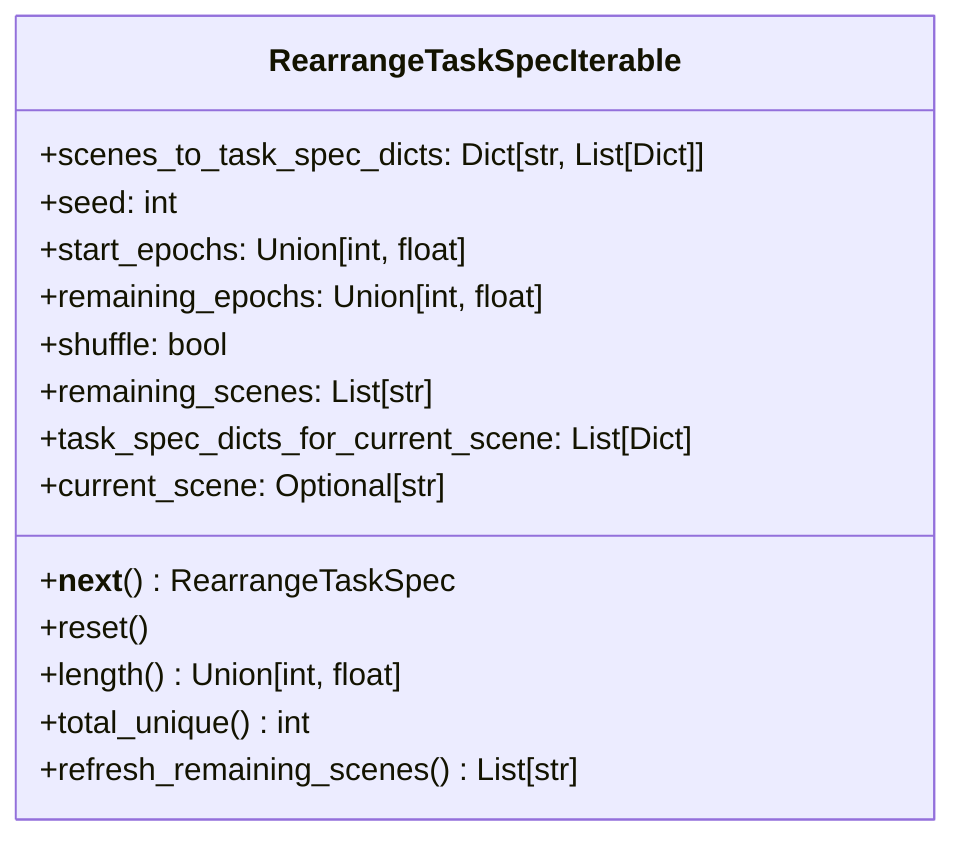

<!-- source: DeepWiki mcp.deepwiki.com · repo allenai/ai2thor-rearrangement · page 4.3 RearrangeTaskSampler · fetched 2026-10-26 -->

# RearrangeTaskSampler

<details>
<summary>Relevant source files</summary>

The following files were used as context for generating this wiki page:

- [README.md](README.md)
- [rearrange/tasks.py](rearrange/tasks.py)
- [rearrange_constants.py](rearrange_constants.py)

</details>


The `RearrangeTaskSampler` is a core component of the AI2-THOR Rearrangement Challenge that manages the sampling and creation of rearrangement tasks. It serves as the interface between datasets containing task specifications and the tasks that agents must complete. This class handles the transition between the Walkthrough and Unshuffle phases, manages environment setup, and provides a consistent API for training and evaluation.

For information about the specific task implementations, see [WalkthroughTask](#4.1) and [UnshuffleTask](#4.2).

## Overview

The `RearrangeTaskSampler` serves as a bridge between task specifications (stored in datasets) and task instances that agents interact with. It is responsible for:

1. Loading and managing task specifications from datasets
2. Creating and configuring AI2-THOR environments 
3. Creating task instances (WalkthroughTask and/or UnshuffleTask)
4. Managing the transition between walkthrough and unshuffle phases
5. Tracking metrics and progress across task phases



**Diagram: RearrangeTaskSampler component relationships**

Sources: [rearrange/tasks.py:808-1211]()

## Task Sampling Workflow

The task sampling workflow handles the creation and transition between different tasks and phases:



**Diagram: Task Sampling Decision Flow**

Sources: [rearrange/tasks.py:1066-1211]()

## Key Initialization Parameters

The `RearrangeTaskSampler` supports flexible configuration through several initialization parameters:

| Parameter | Description | Default |
|-----------|-------------|---------|
| `run_walkthrough_phase` | Whether to run the walkthrough phase | Required |
| `run_unshuffle_phase` | Whether to run the unshuffle phase | Required |
| `stage` | Dataset stage ('train', 'val', or 'test') | Required |
| `scenes_to_task_spec_dicts` | Dictionary mapping scenes to task specifications | Required |
| `rearrange_env_kwargs` | Parameters for RearrangeTHOREnvironment | Required |
| `sensors` | SensorSuite for observations | Required |
| `max_steps` | Maximum steps per phase | Required |
| `discrete_actions` | Available actions for the agent | Required |
| `require_done_action` | Whether tasks require explicit 'done' action | False |
| `force_axis_aligned_start` | Whether to force axis-aligned starting rotation | False |
| `epochs` | Number of epochs or 'default' | 'default' (∞ for train, 1 for val/test) |
| `unshuffle_runs_per_walkthrough` | Number of unshuffle tasks per walkthrough | 1 |
| `task_spec_in_metrics` | Whether to include task spec in metrics | False |

Sources: [rearrange/tasks.py:809-842](), [rearrange/tasks.py:843-862]()

## Factory Methods

The `RearrangeTaskSampler` provides two factory methods for simpler initialization:

### 1. from_fixed_dataset

Creates a task sampler that loads tasks from pre-defined datasets:

```python
@classmethod
def from_fixed_dataset(
    cls,
    run_walkthrough_phase: bool,
    run_unshuffle_phase: bool,
    stage: str,
    allowed_scenes: Optional[Sequence[str]] = None,
    scene_to_allowed_rearrange_inds: Optional[Dict[str, Sequence[int]]] = None,
    randomize_start_rotation: bool = False,
    **init_kwargs,
)
```

This method loads datasets from the STARTER_DATA_DIR and can filter scenes and task indices.

Sources: [rearrange/tasks.py:896-926]()

### 2. from_scenes_at_runtime

Creates a task sampler that generates tasks at runtime:

```python
@classmethod
def from_scenes_at_runtime(
    cls,
    run_walkthrough_phase: bool,
    run_unshuffle_phase: bool,
    stage: str,
    allowed_scenes: Sequence[str],
    repeats_before_scene_change: int,
    **init_kwargs,
)
```

This method enables task generation without pre-existing datasets.

Sources: [rearrange/tasks.py:928-952]()

## Task Specification Management

The `RearrangeTaskSampler` uses the `RearrangeTaskSpecIterable` to iterate through task specifications:



**Diagram: RearrangeTaskSpecIterable Class**

The iterable manages:
- Scene and task rotation
- Shuffling of tasks (for training)
- Progress tracking across epochs
- Creation of RearrangeTaskSpec objects

Sources: [rearrange/tasks.py:705-805]()

## Key Methods

### next_task

The `next_task` method is the core functionality of the `RearrangeTaskSampler`, determining which task to sample next:

```python
def next_task(
    self, 
    forced_task_spec: Optional[RearrangeTaskSpec] = None, 
    **kwargs
) -> Optional[Union[UnshuffleTask, WalkthroughTask]]
```

This method handles:
1. Determining if a new task spec should be sampled or if a previous walkthrough's data should be reused
2. Creating appropriate environment instances
3. Initializing and returning either a WalkthroughTask or UnshuffleTask

Sources: [rearrange/tasks.py:1066-1211]()

### length and total_unique

These methods provide information about the total number of tasks:

```python
@property
def length(self) -> float:
    """Return the total number of allowable next_task calls."""
    # ...

@property
def total_unique(self):
    return self.task_spec_iterator.total_unique
```

The `length` property returns the total number of tasks that can be sampled, considering both phases and multiple unshuffle runs, while `total_unique` returns the number of unique task specifications.

Sources: [rearrange/tasks.py:1002-1024]()

### reset and set_seed

These methods control the state of the task sampler:

```python
def reset(self) -> None:
    """Restart the unshuffle iteration setup order."""
    # ...

def set_seed(self, seed: int) -> None:
    # ...
```

The `reset` method resets the sampler to its initial state, allowing it to start over, while `set_seed` changes the randomization seed.

Sources: [rearrange/tasks.py:1048-1057]()

## Data Handling

The `RearrangeTaskSampler` handles loading task datasets through the `load_rearrange_data_from_path` class method:

```python
@classmethod
def load_rearrange_data_from_path(
    cls, stage: str, base_dir: Optional[str] = None,
) -> Dict[str, List[Dict[str, Any]]]:
    # ...
```

This method:
1. Maps dataset stage names ('train', 'val', 'test')
2. Loads compressed pickle files containing task specifications
3. Processes and augments task specifications with additional metadata
4. Returns a dictionary mapping scene names to lists of task specifications

Sources: [rearrange/tasks.py:977-1000]()

## Phase Coordination

A key responsibility of the `RearrangeTaskSampler` is coordinating between the walkthrough and unshuffle phases. When both phases are enabled, the sampler:

1. Creates a WalkthroughTask first
2. Tracks locations visited during walkthrough
3. Records objects seen during walkthrough
4. Collects metrics from the walkthrough
5. Passes this information to the UnshuffleTask
6. Creates multiple unshuffle tasks if `unshuffle_runs_per_walkthrough > 1`

This coordination enables the unshuffle task to benefit from information gathered during walkthrough.

Sources: [rearrange/tasks.py:1078-1209](), [README.md:471-473]()

## Usage Examples

Here's a simplified example of how the `RearrangeTaskSampler` is used in the training pipeline:

```python
# Create a task sampler for the two-phase challenge
task_sampler = RearrangeTaskSampler.from_fixed_dataset(
    run_walkthrough_phase=True,
    run_unshuffle_phase=True,
    stage="train",
    sensors=sensor_suite,
    max_steps={"walkthrough": 500, "unshuffle": 1000},
    discrete_actions=RearrangeActionSpace.actions,
    require_done_action=True,
    rearrange_env_kwargs={...},
)

# Get tasks and provide to agents
task = task_sampler.next_task()  # Returns WalkthroughTask first
while task is not None:
    # Agent completes the task
    # ...
    
    # Get the next task (returns UnshuffleTask after WalkthroughTask)
    task = task_sampler.next_task()
```

Sources: [README.md:456-476]()

## Summary

The `RearrangeTaskSampler` is a central component in the AI2-THOR Rearrangement Challenge that:

1. Bridges datasets and task instances
2. Manages environment creation and configuration 
3. Coordinates the walkthrough and unshuffle phases
4. Provides a flexible API for task sampling
5. Supports various configuration options for different challenge tracks

Understanding this class is essential for implementing custom training pipelines and extending the rearrangement challenge system.

---

