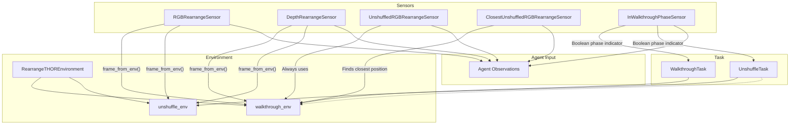
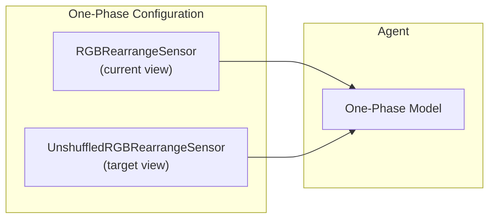
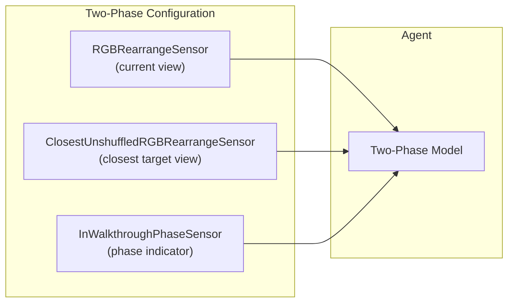

<!-- source: DeepWiki mcp.deepwiki.com · repo allenai/ai2thor-rearrangement · page 5 Sensors · fetched 2026-10-26 -->

# Sensors

<details>
<summary>Relevant source files</summary>

The following files were used as context for generating this wiki page:

- [baseline_configs/one_phase/one_phase_rgb_base.py](baseline_configs/one_phase/one_phase_rgb_base.py)
- [baseline_configs/two_phase/two_phase_rgb_base.py](baseline_configs/two_phase/two_phase_rgb_base.py)
- [rearrange/sensors.py](rearrange/sensors.py)

</details>


## Purpose and Scope

This document describes the sensor system in the AI2-THOR Rearrangement Challenge framework. Sensors provide observations to the agent, enabling it to perceive the environment and make informed decisions. These sensors capture various types of information including visual input (RGB images, depth maps) and task-specific state information.

For information about how these sensors are used in Tasks, see [Tasks](#4).

## Sensor System Overview

The AI2-THOR Rearrangement Challenge employs a modular sensor system that abstracts the process of gathering observations from the environment. Each sensor extracts specific information from the environment and presents it in a format suitable for agent processing.

```mermaid
classDiagram
    class "Sensor[Env, Task]" {
        <<Abstract>>
        +get_observation(env, task)
        +observation_space
    }
    
    class "RGBSensor" {
        <<Abstract>>
        +frame_from_env(env, task)
        +use_resnet_normalization
        +height
        +width
    }
    
    class "DepthSensorThor" {
        +frame_from_env(env, task)
        +height
        +width
    }
    
    class "RGBRearrangeSensor" {
        +frame_from_env(env, task)
    }
    
    class "DepthRearrangeSensor" {
        +frame_from_env(env, task)
    }
    
    class "UnshuffledRGBRearrangeSensor" {
        +frame_from_env(env, task)
    }
    
    class "ClosestUnshuffledRGBRearrangeSensor" {
        +frame_from_env(env, task)
        +ROT_TO_FORWARD
    }
    
    class "InWalkthroughPhaseSensor" {
        +get_observation(env, task)
    }
    
    "Sensor[Env, Task]" <|-- "RGBSensor"
    "Sensor[Env, Task]" <|-- "DepthSensorThor"
    "Sensor[Env, Task]" <|-- "InWalkthroughPhaseSensor"
    
    "RGBSensor" <|-- "RGBRearrangeSensor"
    "RGBSensor" <|-- "UnshuffledRGBRearrangeSensor"
    "RGBSensor" <|-- "ClosestUnshuffledRGBRearrangeSensor"
    
    "DepthSensorThor" <|-- "DepthRearrangeSensor"
```

**Diagram: Sensor Class Hierarchy**

Sources: [rearrange/sensors.py:1-165]()

## Core Sensor Types

The rearrangement challenge includes several specialized sensor types designed to handle the unique requirements of rearrangement tasks.

### RGB Sensors

RGB sensors capture visual observations as color images for the agent.

#### RGBRearrangeSensor

This sensor provides RGB images from the agent's current perspective. It works with both walkthrough and unshuffle phases, retrieving the appropriate frame from the relevant environment.

```python
# Gets RGB frame from either walkthrough or unshuffle environment based on task type
def frame_from_env(self, env, task):
    if isinstance(task, WalkthroughTask):
        return task.walkthrough_env.last_event.frame.copy()
    elif isinstance(task, UnshuffleTask):
        return task.unshuffle_env.last_event.frame.copy()
```

Sources: [rearrange/sensors.py:24-37]()

#### UnshuffledRGBRearrangeSensor

This sensor provides RGB images from the walkthrough environment, teleporting the walkthrough agent to match the current position in the unshuffle environment if necessary. This allows the agent to see how the environment *should* look from its current position.

Sources: [rearrange/sensors.py:54-83]()

#### ClosestUnshuffledRGBRearrangeSensor

A more sophisticated sensor that finds the closest position visited during the walkthrough phase to the agent's current position, then provides the RGB frame from that perspective. This is useful when the agent's current position wasn't exactly visited during walkthrough.

The sensor computes distances considering:
- XZ position distance
- Rotation difference
- Standing vs. crouching state
- Camera horizon angle

Sources: [rearrange/sensors.py:86-140]()

### Depth Sensor

#### DepthRearrangeSensor

Provides depth information from the agent's current perspective, working across both walkthrough and unshuffle phases.

Sources: [rearrange/sensors.py:40-51]()

### Task Phase Sensor

#### InWalkthroughPhaseSensor

A simple boolean sensor that indicates whether the agent is currently in the walkthrough phase (True) or the unshuffle phase (False). This allows phase-specific behaviors in the agent's policy.

```python
def get_observation(self, env, task, *args, **kwargs):
    if isinstance(task, WalkthroughTask):
        return np.array([True], dtype=bool)
    elif isinstance(task, UnshuffleTask):
        return np.array([False], dtype=bool)
```

Sources: [rearrange/sensors.py:142-165]()

## Sensor Data Flow

The following diagram illustrates how sensor data flows from the environment to the agent:



**Diagram: Sensor Data Flow**

Sources: [rearrange/sensors.py:1-165]()

## Sensor Usage in Experiment Configurations

The framework provides different sensor configurations for the one-phase and two-phase tracks of the challenge.

### One-Phase Configuration

One-phase models receive observations from:
- `RGBRearrangeSensor`: Current view
- `UnshuffledRGBRearrangeSensor`: Target arrangement view



**Diagram: One-Phase Sensor Configuration**

Sources: [baseline_configs/one_phase/one_phase_rgb_base.py:24-61]()

### Two-Phase Configuration

Two-phase models receive observations from:
- `RGBRearrangeSensor`: Current view
- `ClosestUnshuffledRGBRearrangeSensor`: View from closest walkthrough position
- `InWalkthroughPhaseSensor`: Boolean indicating current phase



**Diagram: Two-Phase Sensor Configuration**

Sources: [baseline_configs/two_phase/two_phase_rgb_base.py:29-43]()

## Customization and Extension

The sensor system is designed to be extensible, allowing researchers to create custom sensors by:

1. Subclassing the appropriate Sensor base class
2. Implementing the required methods (typically `frame_from_env` or `get_observation`)
3. Adding the sensor to the experiment configuration's sensor list

This modular design enables experimentation with different observation types that might improve agent performance.

## Sensor Normalization

RGB sensors can be configured to use ResNet normalization, which standardizes pixel values using mean and standard deviation values appropriate for pre-trained networks:

```python
# Example from one_phase_rgb_base.py
RGBRearrangeSensor(
    height=RearrangeBaseExperimentConfig.SCREEN_SIZE,
    width=RearrangeBaseExperimentConfig.SCREEN_SIZE,
    use_resnet_normalization=True,
    uuid=RearrangeBaseExperimentConfig.EGOCENTRIC_RGB_UUID,
    mean=mean,  # Can be CLIP or ImageNet means
    stdev=stdev,  # Can be CLIP or ImageNet stdevs
)
```

The normalization parameters can be adjusted based on the preprocessor type:
- ImageNet normalization (default)
- CLIP normalization (when using CLIP preprocessors)

Sources: [baseline_configs/one_phase/one_phase_rgb_base.py:31-60]()

## Sensor Integration with Task Sampler

The configured sensors are passed to the `RearrangeTaskSampler` which makes them available to the environment and agent:

```python
return RearrangeTaskSampler.from_fixed_dataset(
    # ... other parameters ...
    sensors=SensorSuite(sensors),
    # ... other parameters ...
)
```

This integration ensures that the appropriate sensors are used based on the experiment configuration and task requirements.

Sources: [baseline_configs/one_phase/one_phase_rgb_base.py:76-110](), [baseline_configs/two_phase/two_phase_rgb_base.py:64-102]()

---

