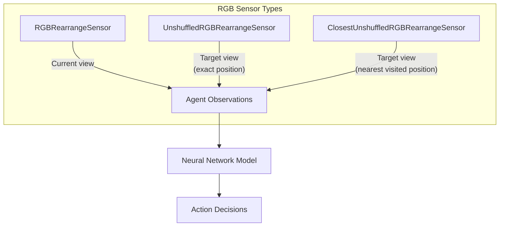
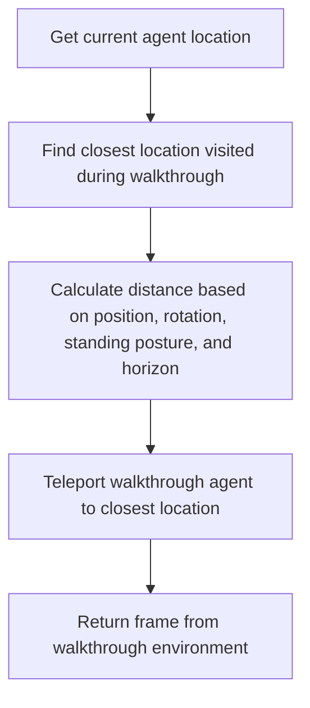
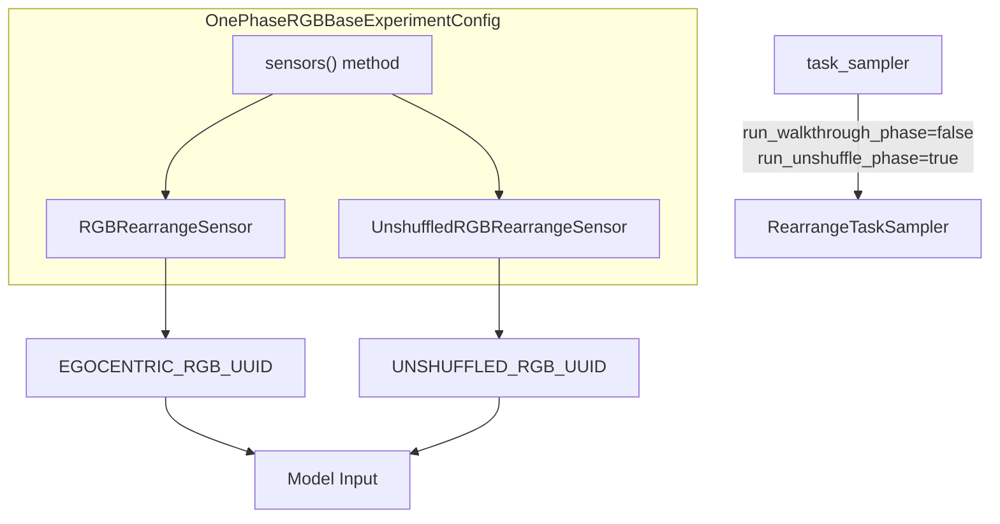
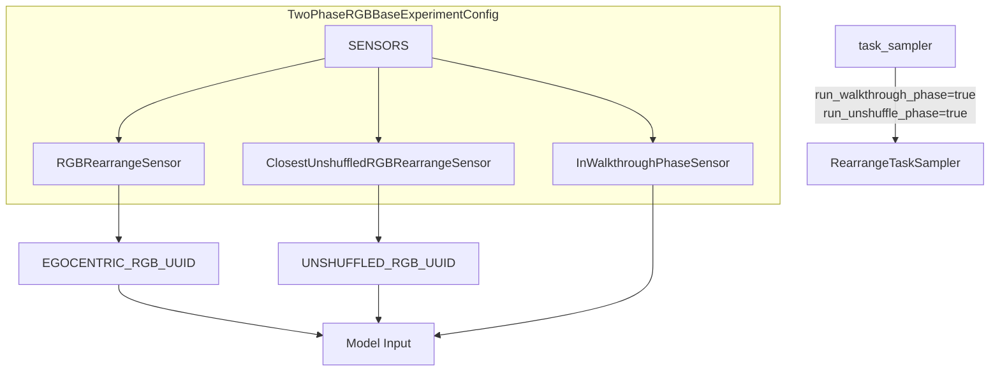
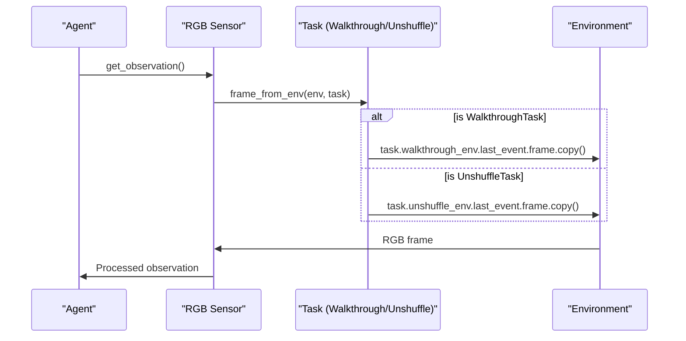

<!-- source: DeepWiki mcp.deepwiki.com · repo allenai/ai2thor-rearrangement · page 5.1 RGB Sensors · fetched 2026-10-26 -->

# RGB Sensors

<details>
<summary>Relevant source files</summary>

The following files were used as context for generating this wiki page:

- [baseline_configs/one_phase/one_phase_rgb_base.py](baseline_configs/one_phase/one_phase_rgb_base.py)
- [baseline_configs/two_phase/two_phase_rgb_base.py](baseline_configs/two_phase/two_phase_rgb_base.py)
- [rearrange/sensors.py](rearrange/sensors.py)

</details>


## Purpose and Overview

This document covers the RGB sensor implementations used in the AI2-THOR Rearrangement Challenge to provide visual observations to agents. These sensors capture RGB images from the environment in different ways to support both one-phase and two-phase rearrangement approaches. For information about other sensor types like depth sensors, see [Other Sensors](#5.2).

RGB sensors are a critical component in the rearrangement challenge as they provide the primary visual information that agents use to perceive the environment, identify objects, and determine their positions.


**Diagram: RGB Sensor Overview and Role in Agent Decision-Making**

Sources: [rearrange/sensors.py:24-139]()

## Core RGB Sensor Classes

The codebase implements three primary RGB sensor classes, each serving a specific purpose in the rearrangement challenge:

### 1. RGBRearrangeSensor

The `RGBRearrangeSensor` is the basic RGB sensor that captures the current view of the agent in either the walkthrough or unshuffle phase. It inherits from AllenAct's `RGBSensor` and adapts it to work with the rearrangement environment.

```mermaid
classDiagram
    class "RGBSensor" {
        +height: int
        +width: int
        +use_resnet_normalization: bool
        +mean: List[float]
        +stdev: List[float]
        +uuid: str
        +get_observation(): np.ndarray
    }
    
    class "RGBRearrangeSensor" {
        +frame_from_env(env, task): np.ndarray
    }
    
    "RGBSensor" <|-- "RGBRearrangeSensor"
    
    note for "RGBRearrangeSensor" "Returns the current view frame from either walkthrough_env or unshuffle_env depending on task type"
```
**Diagram: RGBRearrangeSensor Class Structure**

The sensor has the following behavior:
- During walkthrough phase: Returns frames from the walkthrough environment
- During unshuffle phase: Returns frames from the unshuffle environment

Sources: [rearrange/sensors.py:24-37]()

### 2. UnshuffledRGBRearrangeSensor

The `UnshuffledRGBRearrangeSensor` provides the agent with a view of the target arrangement (walkthrough environment) from its current position in the unshuffle phase. This helps the agent compare the current state with the goal state.

Key features:
- During walkthrough phase: Simply returns the current view
- During unshuffle phase: Teleports the agent in the walkthrough environment to match the agent's current position in the unshuffle environment, then returns the frame

This teleportation ensures that the agent can see the target arrangement from exactly the same viewpoint as its current position, enabling direct visual comparison.

Sources: [rearrange/sensors.py:54-83]()

### 3. ClosestUnshuffledRGBRearrangeSensor

The `ClosestUnshuffledRGBRearrangeSensor` provides a more sophisticated approach to obtaining target views. Rather than teleporting to the exact same location (which might not have been visited during walkthrough), it finds the closest location that was visited during the walkthrough phase.


**Diagram: ClosestUnshuffledRGBRearrangeSensor Operation**

The distance calculation combines several factors:
- XZ position distance (physical distance in the room)
- Rotation difference (with penalties for large rotational differences)
- Standing/crouching posture difference
- Camera horizon angle difference

This approach ensures that the agent receives a view of the target arrangement from a familiar perspective, which can be more useful than an exact match that might have never been observed.

Sources: [rearrange/sensors.py:86-139]()

## RGB Sensor Integration in Experiment Configurations

RGB sensors are integrated into the experiment configurations differently depending on whether the experiment uses a one-phase or two-phase approach.

### One-Phase Integration

In one-phase experiments, the agent is provided with both the current view and the target view simultaneously throughout the task.


**Diagram: RGB Sensor Integration in One-Phase Configurations**

The `OnePhaseRGBBaseExperimentConfig` class:
- Configures both `RGBRearrangeSensor` and `UnshuffledRGBRearrangeSensor`
- Sets appropriate normalization parameters based on the preprocessing type (CLIP or ImageNet)
- Creates a task sampler that skips the walkthrough phase and goes directly to the unshuffle phase

Sources: [baseline_configs/one_phase/one_phase_rgb_base.py:24-61]()

### Two-Phase Integration

In two-phase experiments, the agent first observes the environment during the walkthrough phase, then uses these observations to restore the arrangement during the unshuffle phase.


**Diagram: RGB Sensor Integration in Two-Phase Configurations**

The `TwoPhaseRGBBaseExperimentConfig` class:
- Uses `RGBRearrangeSensor` for current views
- Uses `ClosestUnshuffledRGBRearrangeSensor` for target views (from closest visited position)
- Includes an `InWalkthroughPhaseSensor` to inform the agent which phase it's in
- Creates a task sampler that runs both walkthrough and unshuffle phases

Sources: [baseline_configs/two_phase/two_phase_rgb_base.py:28-43]()

## Normalization and Preprocessing

RGB sensors support different normalization strategies based on the visual preprocessor being used:

| Preprocessor Type | Mean Values | Standard Deviation Values |
|-------------------|-------------|---------------------------|
| CLIP              | CLIP_RGB_MEANS | CLIP_RGB_STDS |
| ImageNet (default) | IMAGENET_RGB_MEANS | IMAGENET_RGB_STDS |

The normalization parameters are configured in the experiment configuration classes and passed to the RGB sensors. This ensures that the input to neural networks is properly normalized according to the preprocessing strategy being used.

```python
# Example of normalization parameters:
RGBRearrangeSensor(
    height=RearrangeBaseExperimentConfig.SCREEN_SIZE,
    width=RearrangeBaseExperimentConfig.SCREEN_SIZE,
    use_resnet_normalization=True,
    uuid=RearrangeBaseExperimentConfig.EGOCENTRIC_RGB_UUID,
    mean=mean,
    stdev=stdev,
)
```

Sources: [baseline_configs/one_phase/one_phase_rgb_base.py:32-59]()

## Technical Implementation Details

### Frame Capture from Environment

The `frame_from_env` method in each RGB sensor class is responsible for obtaining the actual RGB frame from the environment:


**Diagram: Frame Capture Process Flow**

For the `UnshuffledRGBRearrangeSensor` and `ClosestUnshuffledRGBRearrangeSensor`, additional steps are performed to ensure the viewpoint in the walkthrough environment matches (or closely matches) the agent's current position in the unshuffle environment.

Sources: [rearrange/sensors.py:24-139]()

### Teleportation Mechanism

The teleportation mechanism in `UnshuffledRGBRearrangeSensor` works as follows:

1. Get the agent's current location in the unshuffle environment
2. Get the agent's current location in the walkthrough environment
3. Convert both locations to tuples for comparison
4. If the locations differ, teleport the walkthrough agent to match the unshuffle agent's position
5. Return the frame from the walkthrough environment

This ensures that the agent sees the target arrangement from exactly the same viewpoint as its current position in the unshuffle environment.

Sources: [rearrange/sensors.py:57-83]()

### Closest Position Finding Algorithm

The `ClosestUnshuffledRGBRearrangeSensor` uses a sophisticated algorithm to find the closest position that was visited during the walkthrough phase:

1. Get all locations visited during the walkthrough phase
2. Calculate the distance between the current location and each visited location using:
   - XZ distance (euclidean distance in the XZ plane)
   - Rotation difference (with penalties for large differences)
   - Standing/crouching posture difference
   - Camera horizon angle difference
3. Select the location with the minimum combined distance
4. Teleport the walkthrough agent to this location
5. Return the frame from the walkthrough environment

This approach ensures that the agent sees the target arrangement from a familiar perspective, which can be more useful than an exact match that might have never been observed.

Sources: [rearrange/sensors.py:91-139]()

---

