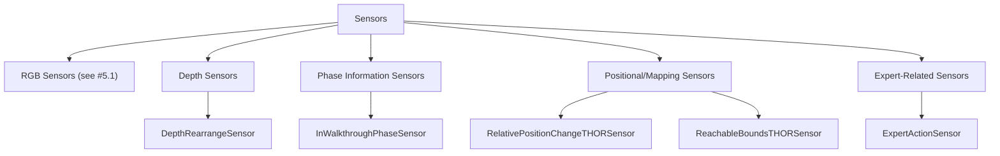
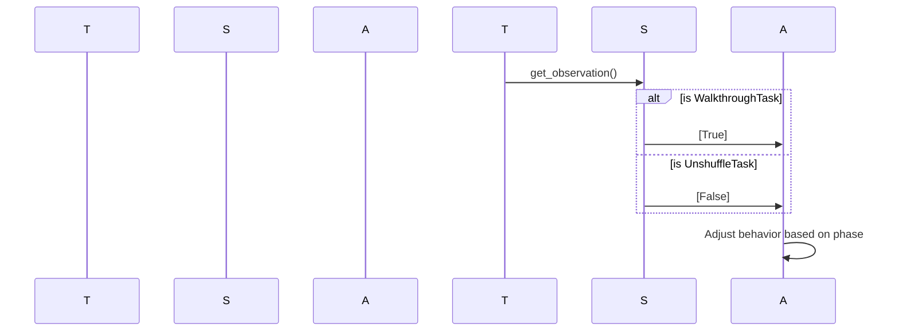
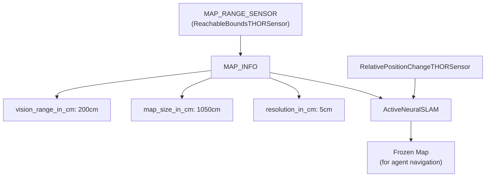
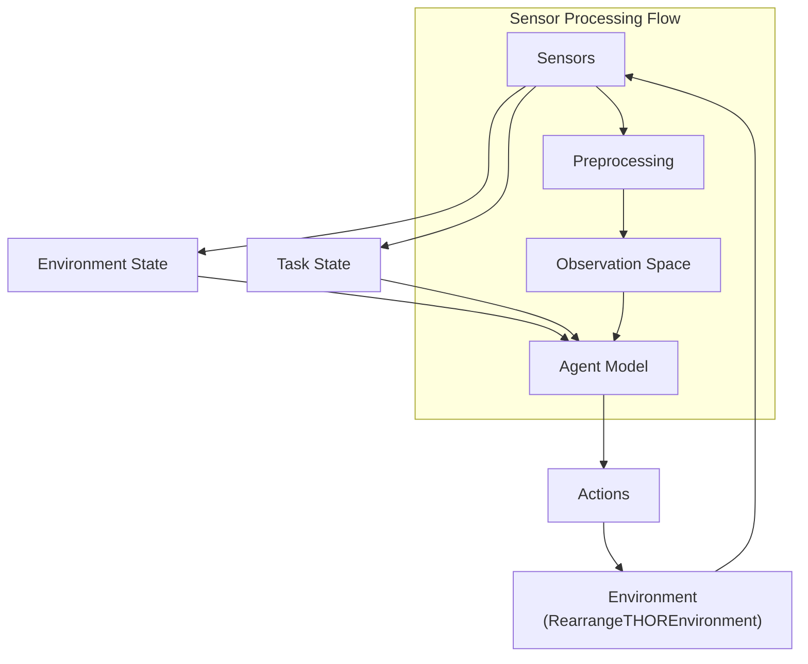
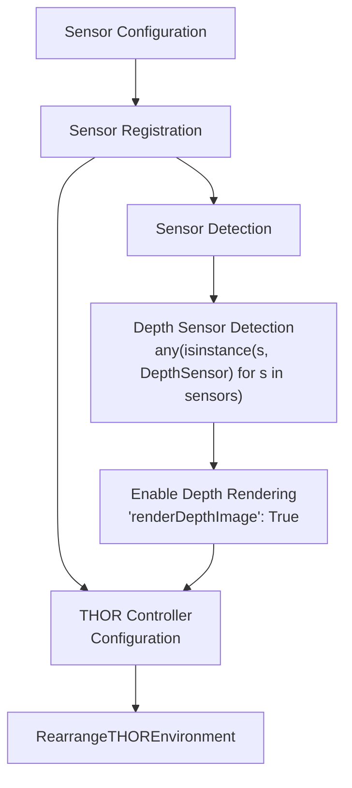
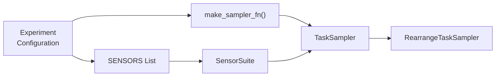

<!-- source: DeepWiki mcp.deepwiki.com · repo allenai/ai2thor-rearrangement · page 5.2 Other Sensors · fetched 2026-10-26 -->

# Other Sensors

Relevant source files

The following files were used as context for generating this wiki page:

- [baseline_configs/one_phase/one_phase_rgb_clipresnet50_dagger.py](baseline_configs/one_phase/one_phase_rgb_clipresnet50_dagger.py)
- [baseline_configs/one_phase/one_phase_rgb_resnet_frozen_map_dagger.py](baseline_configs/one_phase/one_phase_rgb_resnet_frozen_map_dagger.py)
- [baseline_configs/two_phase/two_phase_rgb_base.py](baseline_configs/two_phase/two_phase_rgb_base.py)
- [baseline_configs/two_phase/two_phase_rgb_resnet_frozen_map_ppowalkthrough_ilunshuffle.py](baseline_configs/two_phase/two_phase_rgb_resnet_frozen_map_ppowalkthrough_ilunshuffle.py)
- [rearrange/sensors.py](rearrange/sensors.py)

This page documents the non-RGB sensors used in the AI2-THOR Rearrangement Challenge. These sensors provide additional information beyond visual RGB data, such as depth perception, phase status indicators, positional/mapping data, and expert knowledge. For information about RGB-based sensors used in the challenge, see [RGB Sensors](#5.1).

## Sensor Overview

The AI2-THOR Rearrangement Challenge utilizes various sensors beyond standard RGB cameras to provide agents with different types of environmental information. These sensors play crucial roles in both the walkthrough and unshuffle phases of the challenge.

Sources: [rearrange/sensors.py](), [baseline_configs/two_phase/two_phase_rgb_base.py:28-43](), [baseline_configs/two_phase/two_phase_rgb_resnet_frozen_map_ppowalkthrough_ilunshuffle.py:55-72]()

## Depth Sensors

### DepthRearrangeSensor

The `DepthRearrangeSensor` extends the `DepthSensorThor` class to provide depth frames from either the walkthrough or unshuffle environment based on the current task phase.

**Implementation Details:**
- Inherits from `DepthSensorThor` in the AllenAct framework
- Returns depth frames from the appropriate environment context
- Handles both `WalkthroughTask` and `UnshuffleTask` task types
- The depth frame is a normalized grayscale image where pixel intensity represents distance

**Usage:**
- Provides distance information useful for navigation and obstacle avoidance
- Helps agents understand the 3D structure of the environment
- Can be detected in experiment configurations through `"renderDepthImage": any(isinstance(s, DepthSensor) for s in sensors)`

Sources: [rearrange/sensors.py:40-51](), [baseline_configs/two_phase/two_phase_rgb_base.py:10-13](), [baseline_configs/two_phase/two_phase_rgb_base.py:86-89]()

## Phase Information Sensors

### InWalkthroughPhaseSensor

The `InWalkthroughPhaseSensor` is a boolean sensor that indicates whether the agent is currently in the walkthrough phase or the unshuffle phase.

**Implementation Details:**
- Observation space is a boolean Box of shape (1,)
- Returns `True` during walkthrough phase and `False` during unshuffle phase
- Simple but critical for phase-aware agent behavior

**Usage in Configurations:**
- Included in two-phase experiment configurations like `TwoPhaseRGBBaseExperimentConfig`
- Used by models to adapt behavior based on the current phase
- Referenced in model creation via its UUID

Sources: [rearrange/sensors.py:142-165](), [baseline_configs/two_phase/two_phase_rgb_base.py:42](), [baseline_configs/two_phase/two_phase_rgb_base.py:120]()

## Positional and Mapping Sensors

### RelativePositionChangeTHORSensor

The `RelativePositionChangeTHORSensor` tracks the agent's position changes between steps, providing motion information without requiring the agent to maintain its own movement history.

**Implementation Details:**
- Imported from `allenact_plugins.ithor_plugin.ithor_sensors`
- Provides relative position change data (dx, dz, drotation)
- Works alongside mapping systems

### ReachableBoundsTHORSensor

The `ReachableBoundsTHORSensor` provides information about the navigable boundaries within the environment.

**Implementation Details:**
- Configurable with a margin parameter (typically set to 1.0)
- Helps establish the boundaries for mapping systems
- Used to define the `map_size_in_cm` based on reachable areas

**Usage in Mapping:**
Both sensors are used extensively in configurations that implement mapping functionality:

Sources: [baseline_configs/one_phase/one_phase_rgb_resnet_frozen_map_dagger.py:38-47](), [baseline_configs/two_phase/two_phase_rgb_resnet_frozen_map_ppowalkthrough_ilunshuffle.py:44-53](), [baseline_configs/two_phase/two_phase_rgb_resnet_frozen_map_ppowalkthrough_ilunshuffle.py:70-71]()

## Expert-Related Sensors

### ExpertActionSensor

The `ExpertActionSensor` provides information about expert actions, facilitating imitation learning approaches.

**Implementation Details:**
- Initialized with the number of possible actions
- Provides expert action information during training
- Used in imitation learning configurations

**Usage:**
- Included in configurations like `TwoPhaseRGBResNetFrozenMapPPOWalkthroughILUnshuffleExperimentConfig`
- Enables the agent to learn from expert demonstrations
- Critical component for DAgger (Dataset Aggregation) imitation learning

Sources: [baseline_configs/two_phase/two_phase_rgb_resnet_frozen_map_ppowalkthrough_ilunshuffle.py:56]()

## Sensor Integration in Models

Different experiment configurations utilize different combinations of sensors depending on the learning approach and model architecture. The table below shows how sensors are integrated across different experimental configurations:

| Configuration Type | Depth | InWalkthroughPhase | RelativePositionChange | ReachableBounds | ExpertAction |
|--------------------|-------|-------------------|------------------------|-----------------|--------------|
| Two-Phase Base     | Optional | ✓              | ✗                      | ✗               | ✗            |
| Two-Phase Map      | Optional | ✓              | ✓                      | ✓               | ✓            |
| One-Phase Map      | Optional | ✗              | ✓                      | ✓               | Optional     |

Sources: [baseline_configs/two_phase/two_phase_rgb_base.py:29-43](), [baseline_configs/two_phase/two_phase_rgb_resnet_frozen_map_ppowalkthrough_ilunshuffle.py:55-72](), [baseline_configs/one_phase/one_phase_rgb_resnet_frozen_map_dagger.py:38-53]()

## Sensor Detection and Rendering

The system automatically detects certain sensors to enable specific rendering modes in the AI2-THOR environment. For example, depth sensors are detected to enable depth rendering:

Sources: [baseline_configs/two_phase/two_phase_rgb_base.py:86-89]()

## Custom Sensor Configuration

Experiment configurations can customize their sensor suite by overriding the `SENSORS` class variable or using the `sensors()` method. This allows for flexibility in what information is provided to the agent during training and evaluation.

Sources: [baseline_configs/two_phase/two_phase_rgb_base.py:29-43](), [baseline_configs/two_phase/two_phase_rgb_base.py:65](), [baseline_configs/one_phase/one_phase_rgb_resnet_frozen_map_dagger.py:50-53]()

---

