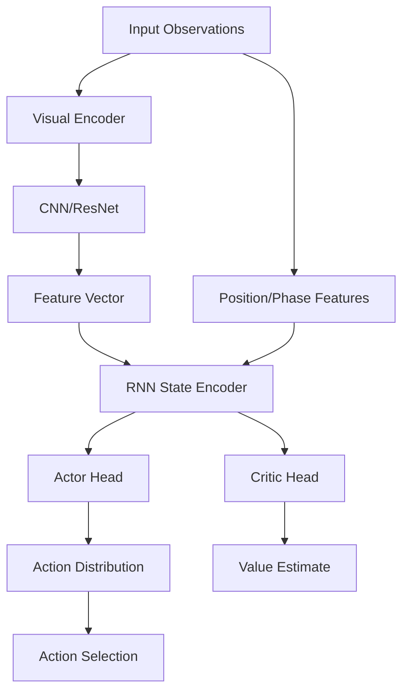
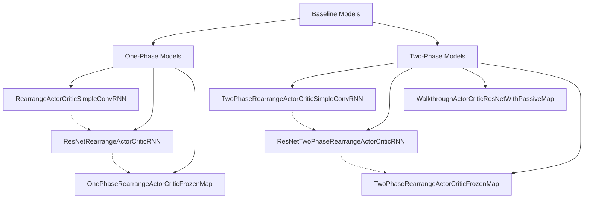
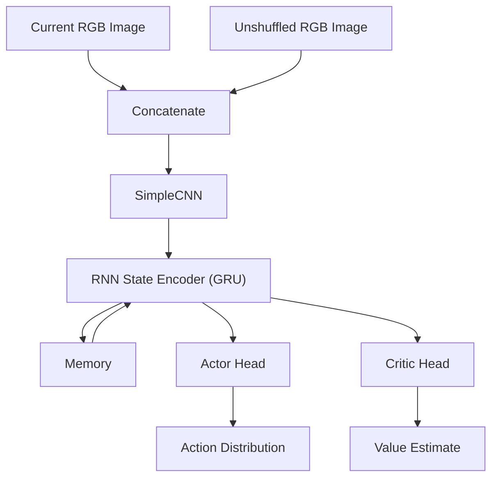
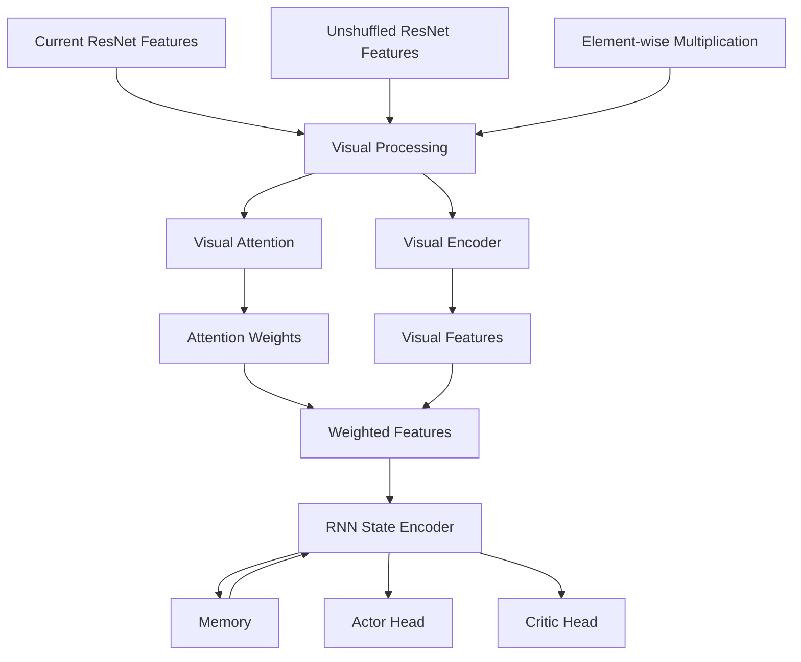
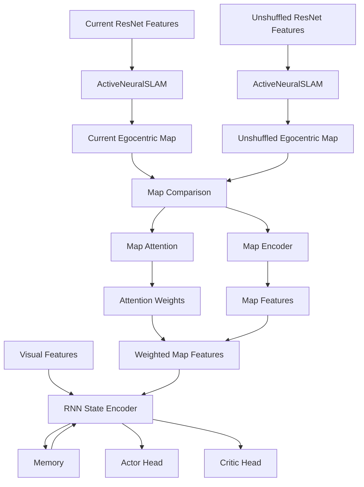
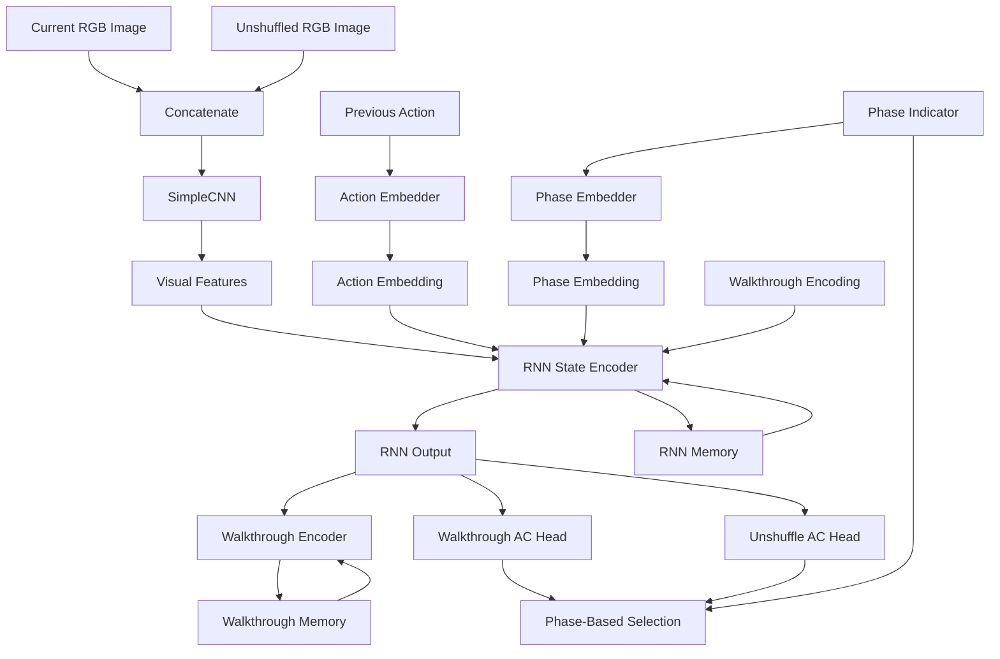
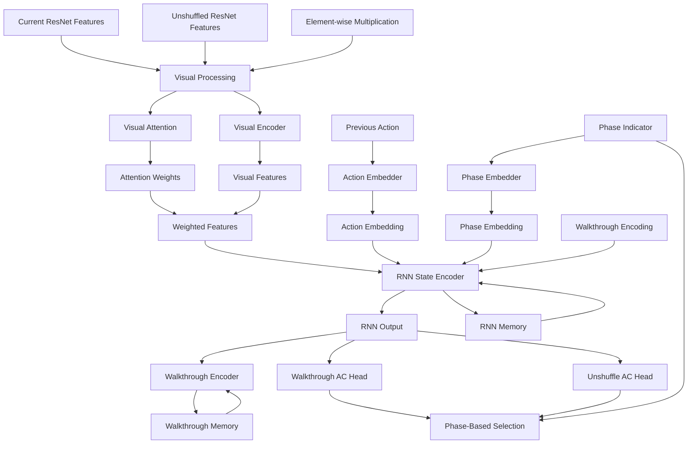

<!-- source: DeepWiki mcp.deepwiki.com · repo allenai/ai2thor-rearrangement · page 6 Baseline Models · fetched 2026-10-26 -->

# Baseline Models

<details>
<summary>Relevant source files</summary>

The following files were used as context for generating this wiki page:

- [README.md](README.md)
- [example.py](example.py)
- [rearrange/baseline_models.py](rearrange/baseline_models.py)

</details>


This document provides a detailed overview of the baseline models included in the AI2-THOR rearrangement challenge. These baseline models serve as reference implementations that researchers can build upon when developing their own approaches to solving the rearrangement task. For information about the training methods used with these models, see [Training](#7).

## Overview of Baseline Architecture

All baseline models in the AI2-THOR rearrangement challenge follow an actor-critic architecture. This architecture is a common approach in reinforcement learning that combines:

1. An **actor network** that outputs a probability distribution over possible actions
2. A **critic network** that estimates the value function (expected future reward)

### Architecture Components



**Title: General Actor-Critic Architecture for Rearrangement Models**

Sources: [rearrange/baseline_models.py:37-145](), [rearrange/baseline_models.py:148-225]()

## Model Hierarchy and Relationships

The baseline models are organized into a hierarchy based on their architecture and which challenge track they address:



**Title: Hierarchy of Baseline Model Classes**

Sources: [rearrange/baseline_models.py](), [README.md:680-688]()

## One-Phase Models

One-phase models simultaneously receive both the current state and target state observations, making it easier to identify misplaced objects. These models are designed for the 1-Phase Track of the challenge.

### RearrangeActorCriticSimpleConvRNN

This is the simplest baseline model, using a CNN to process images and an RNN to maintain state.



**Title: RearrangeActorCriticSimpleConvRNN Architecture**

Key features:
- Concatenates current and unshuffled RGB images
- Uses a simple CNN for visual feature extraction
- Maintains memory using a GRU recurrent network
- Linear actor and critic heads for action selection and value estimation

Sources: [rearrange/baseline_models.py:37-145]()

### ResNetRearrangeActorCriticRNN

This model improves upon the SimpleConvRNN model by using pretrained ResNet features instead of raw RGB images.



**Title: ResNetRearrangeActorCriticRNN Architecture**

Key features:
- Uses pretrained ResNet features with frozen weights
- Implements a visual attention mechanism to focus on important features
- Computes element-wise multiplication between current and unshuffled features to identify differences

Sources: [rearrange/baseline_models.py:148-225]()

### OnePhaseRearrangeActorCriticFrozenMap

This model incorporates a mapping module (ActiveNeuralSLAM) to build spatial representations of the environment.



**Title: OnePhaseRearrangeActorCriticFrozenMap Architecture**

Key features:
- Uses ActiveNeuralSLAM to build egocentric maps from visual observations
- Compares current and unshuffled maps to identify differences
- Combines visual features and map summaries for decision making
- Uses a frozen mapping module (parameters not updated during training)

Sources: [rearrange/baseline_models.py:738-1034]()

## Two-Phase Models

Two-phase models handle the walkthrough and unshuffle phases separately, requiring the agent to memorize the target state during the walkthrough phase. These models are designed for the 2-Phase Track of the challenge.

### TwoPhaseRearrangeActorCriticSimpleConvRNN

This model handles both phases of the task using a shared visual encoder and separate policy heads.



**Title: TwoPhaseRearrangeActorCriticSimpleConvRNN Architecture**

Key features:
- Uses phase embedding to indicate which phase the agent is in
- Maintains a walkthrough encoding to capture information from the walkthrough phase
- Has separate actor-critic heads for the walkthrough and unshuffle phases
- Preserves memory when transitioning from walkthrough to unshuffle phase

Sources: [rearrange/baseline_models.py:228-458]()

### ResNetTwoPhaseRearrangeActorCriticRNN

Similar to the TwoPhaseRearrangeActorCriticSimpleConvRNN but uses pretrained ResNet features.



**Title: ResNetTwoPhaseRearrangeActorCriticRNN Architecture**

Key features:
- Uses pretrained ResNet features with a visual attention mechanism
- Similar architecture to TwoPhaseRearrangeActorCriticSimpleConvRNN but with enhanced visual processing

Sources: [rearrange/baseline_models.py:461-623]()

### Other Two-Phase Models

The codebase also includes:

1. **WalkthroughActorCriticResNetWithPassiveMap**: A specialized model for the walkthrough phase with mapping capabilities.
2. **TwoPhaseRearrangeActorCriticFrozenMap**: Incorporates the mapping module for both phases.

These models follow the same general pattern but with additional mapping functionality similar to OnePhaseRearrangeActorCriticFrozenMap.

Sources: [rearrange/baseline_models.py:627-736](), [rearrange/baseline_models.py:1036-1379]()

## Model Performance

The baseline models have been evaluated on different versions of the dataset. The table below shows their performance on the test split using the "% Fixed Strict" metric:

| Model | % Fixed Strict (2023 dataset) | % Fixed Strict (2022 dataset) | % Fixed Strict (2021 dataset) |
|------------|:--------------------:|:----------------:|:----------------:|
| 1-Phase Embodied CLIP ResNet50 IL | **13.6%** | **19.1%** | **17.3%** |
| 1-Phase ResNet18+ANM IL | - | - | 8.9% |
| 1-Phase ResNet50 IL | - | - | 7.0% |
| 1-Phase ResNet18 IL | - | - | 6.3% |
| 1-Phase ResNet18 PPO | - | - | 5.3% |
| 1-Phase Simple IL | - | - | 4.8% |
| 1-Phase Simple PPO | - | - | 4.6% |
| 2-Phase ResNet18+ANM IL+PPO | - | 0.53% | 1.44% |
| 2-Phase ResNet18 IL+PPO | - | - | 0.66% |

Key observations:
- One-Phase models generally perform better than Two-Phase models, as they have simultaneous access to both current and target states
- Models using CLIP ResNet50 features perform best, followed by models with ActiveNeuralSLAM (ANM)
- The two-phase task is substantially more challenging, with much lower success rates

Sources: [README.md:680-688]()

## Using the Baseline Models

You can load and use pretrained baseline models as follows:

1. Download the pretrained model checkpoints from the links provided in the README
2. Place them in the `pretrained_model_ckpts` directory
3. Run inference using AllenAct with the appropriate configuration file

For example, to use the 1-Phase ResNet18 IL model:

```bash
allenact baseline_configs/one_phase/one_phase_rgb_resnet_dagger.py \
-c pretrained_model_ckpts/exp_OnePhaseRGBResNetDagger_40proc__stage_00__steps_000050058550.pt \
--eval
```

This will evaluate the model on the combined dataset including train, validation, and test splits.

Sources: [README.md:690-701]()

## Conclusion

The baseline models provide a strong foundation for developing approaches to the AI2-THOR rearrangement challenge. While the current best models achieve modest success rates (especially for the two-phase track), there is significant room for improvement. Researchers are encouraged to build upon these baselines by incorporating more advanced visual representations, better memory mechanisms, or more sophisticated exploration strategies.

Sources: [README.md:642-701]()

---

