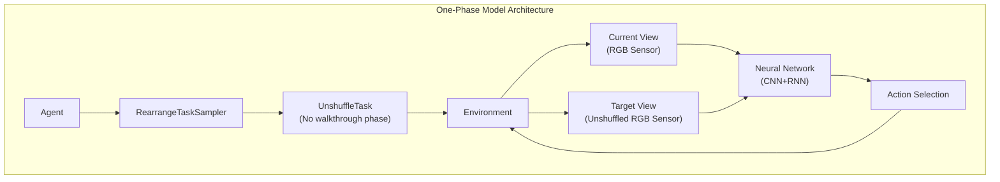
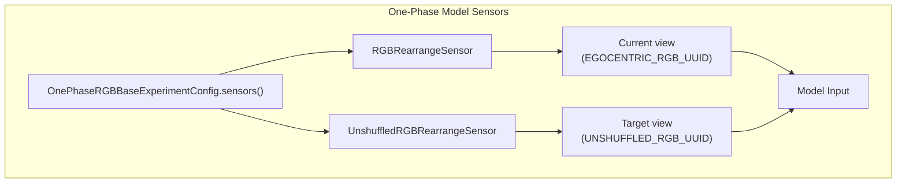
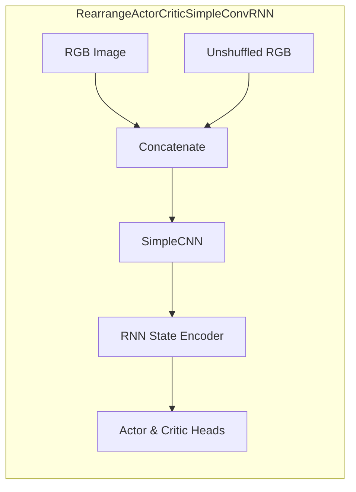
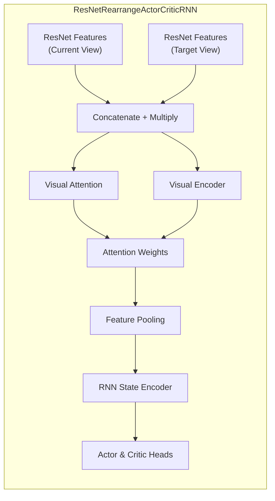
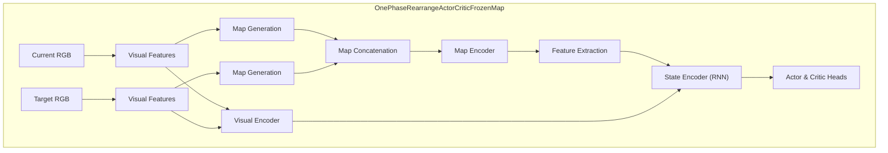
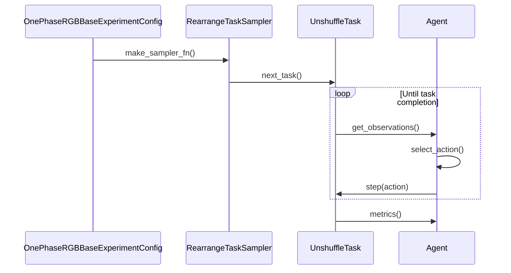

<!-- source: DeepWiki mcp.deepwiki.com · repo allenai/ai2thor-rearrangement · page 6.1 One-Phase Models · fetched 2026-10-26 -->

# One-Phase Models

<details>
<summary>Relevant source files</summary>

The following files were used as context for generating this wiki page:

- [baseline_configs/one_phase/one_phase_rgb_base.py](baseline_configs/one_phase/one_phase_rgb_base.py)
- [baseline_configs/one_phase/one_phase_rgb_resnet_dagger.py](baseline_configs/one_phase/one_phase_rgb_resnet_dagger.py)
- [example.py](example.py)
- [rearrange/baseline_models.py](rearrange/baseline_models.py)

</details>


This page documents the one-phase model architecture used in the AI2-THOR Rearrangement Challenge. One-phase models tackle object rearrangement by simultaneously receiving both current and target scene observations, without requiring a separate walkthrough phase. For information about two-phase models that use separate walkthrough and unshuffle phases, see [Two-Phase Models](#6.2).

## Purpose and Architecture

One-phase models are designed to complete the rearrangement task by having continuous access to both the current state and the target state throughout the entire episode. Unlike two-phase models, one-phase models do not have a dedicated memory-building phase (walkthrough) followed by a rearrangement phase (unshuffle).



Sources: [baseline_configs/one_phase/one_phase_rgb_base.py:24-110](), [example.py:80-124]()

## Configuration and Implementation

One-phase models are defined by the `OnePhaseRGBBaseExperimentConfig` class, which inherits from `RearrangeBaseExperimentConfig`. The key configuration difference is setting `run_walkthrough_phase=False` during task setup:

```mermaid
classDiagram
    direction LR
    
    class "RearrangeBaseExperimentConfig" {
        +sensors()
        +make_sampler_fn()
        +SCREEN_SIZE
        +MAX_STEPS
    }
    
    class "OnePhaseRGBBaseExperimentConfig" {
        +sensors()
        +make_sampler_fn()
        +CNN_PREPROCESSOR_TYPE_AND_PRETRAINING
    }
    
    class "RearrangeTaskSampler" {
        +from_fixed_dataset()
        +next_task()
    }
    
    class "UnshuffleTask" {
        +step()
        +get_observations()
        +is_done()
        +metrics()
    }
    
    "RearrangeBaseExperimentConfig" <|-- "OnePhaseRGBBaseExperimentConfig"
    "OnePhaseRGBBaseExperimentConfig" --> "RearrangeTaskSampler" : creates
    "RearrangeTaskSampler" --> "UnshuffleTask" : provides
```

Sources: [baseline_configs/one_phase/one_phase_rgb_base.py:24-62]()

### Sensor Configuration

One-phase models require two primary sensors:

1. `RGBRearrangeSensor` - Provides the current view of the environment
2. `UnshuffledRGBRearrangeSensor` - Provides the target (unshuffled) view

These sensors are configured in the `sensors()` method:



Sources: [baseline_configs/one_phase/one_phase_rgb_base.py:26-61]()

### Task Sampler Configuration

The key distinction of one-phase models is in the task sampler configuration, which is set up to run the unshuffle phase only, without a walkthrough phase:

| Parameter | Value | Purpose |
|-----------|-------|---------|
| `run_walkthrough_phase` | `False` | Disables separate walkthrough phase |
| `run_unshuffle_phase` | `True` | Enables unshuffle (rearrangement) phase |
| `require_done_action` | Config-dependent | Whether agent must signal completion |
| `max_steps` | Config-dependent | Maximum number of steps for the task |

Sources: [baseline_configs/one_phase/one_phase_rgb_base.py:64-110]()

## Model Architectures

The one-phase approach supports several neural network architectures:

### 1. RearrangeActorCriticSimpleConvRNN

This model combines current and target RGB images through a simple CNN followed by an RNN.



Sources: [rearrange/baseline_models.py:37-145]()

### 2. ResNetRearrangeActorCriticRNN

This model uses ResNet features instead of raw RGB images, with additional attention mechanisms.



Sources: [rearrange/baseline_models.py:148-225]()

### 3. OnePhaseRearrangeActorCriticFrozenMap

A more complex model that builds spatial maps of the environment:



Sources: [rearrange/baseline_models.py:738-1033]()

## Using One-Phase Models

Creating and using a one-phase model involves:

1. Creating a task sampler using the one-phase configuration
2. Obtaining tasks from the sampler
3. Running the agent on the unshuffle task



Sources: [example.py:82-123]()

## Training and Inference

One-phase models can be trained using:

1. Imitation Learning (e.g., DAgger)
   - Example: `OnePhaseRGBResNetDaggerExperimentConfig`

2. Reinforcement Learning
   - Using the PPO algorithm with the actor-critic architecture

Sources: [baseline_configs/one_phase/one_phase_rgb_resnet_dagger.py:1-12]()

## Comparison to Two-Phase Models

| Aspect | One-Phase Models | Two-Phase Models |
|--------|------------------|------------------|
| Phases | Single combined phase | Separate walkthrough and unshuffle phases |
| Observations | Always receives both current and target views | Walkthrough phase: only current view<br>Unshuffle phase: only current view |
| Memory requirement | Less reliance on memory (has target as reference) | Must remember target arrangement from walkthrough |
| Task setup | `run_walkthrough_phase=False` | `run_walkthrough_phase=True` |
| Use case | When target state is available throughout | When target state is only observable initially |

Sources: [baseline_configs/one_phase/one_phase_rgb_base.py:64-110](), [example.py:3-126]()

## Summary

One-phase models in the AI2-THOR Rearrangement Challenge allow agents to solve rearrangement tasks with continuous access to both current and target states. They use various neural network architectures including simple CNN+RNN, ResNet-based models, and map-based approaches. The key configuration difference from two-phase models is the elimination of the separate walkthrough phase, simplifying the task structure while potentially making the learning problem easier.

---

