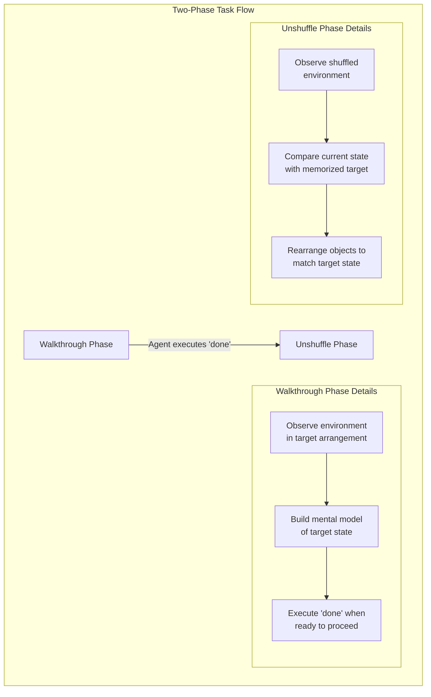
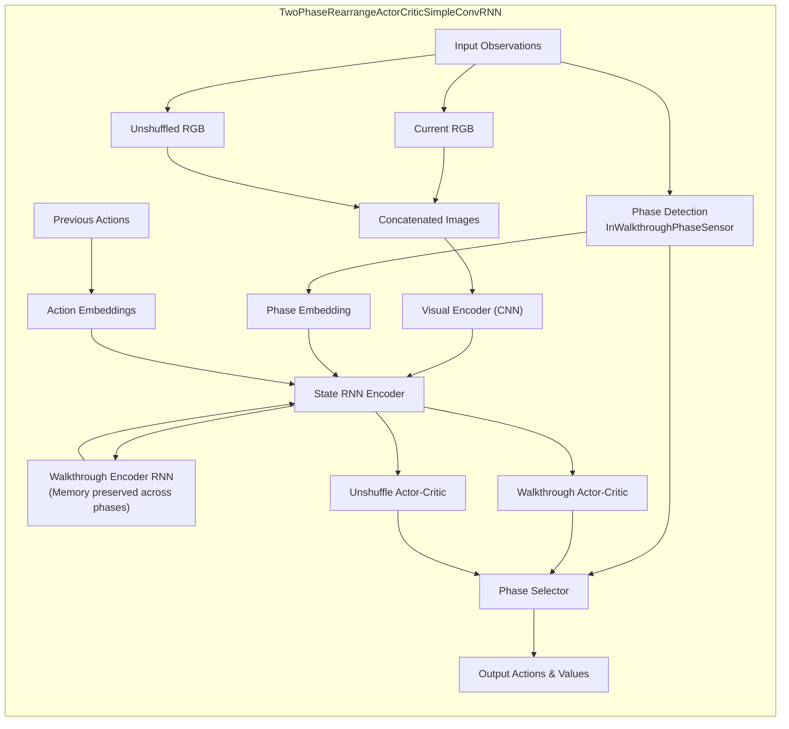
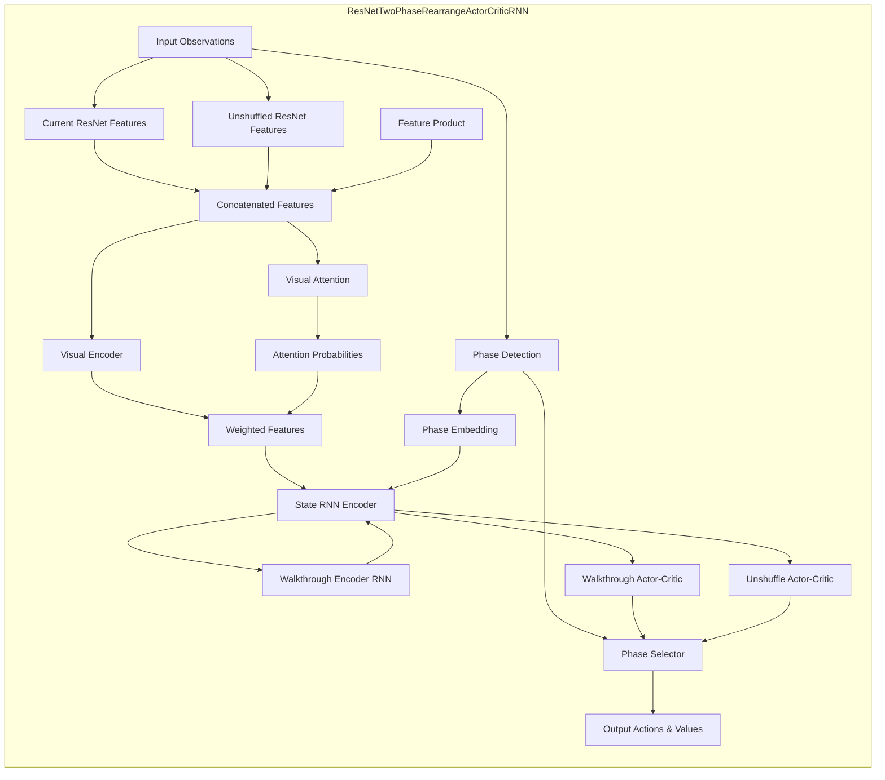
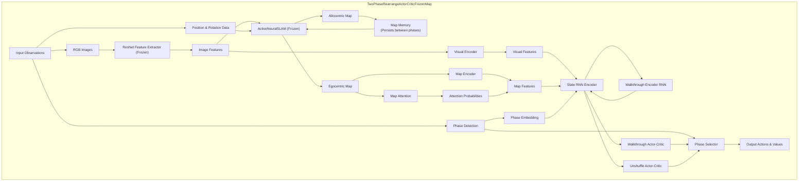
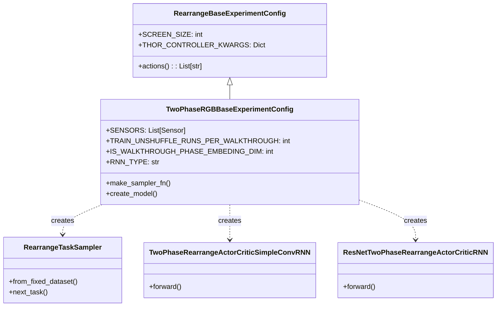

<!-- source: DeepWiki mcp.deepwiki.com · repo allenai/ai2thor-rearrangement · page 6.2 Two-Phase Models · fetched 2026-10-26 -->

# Two-Phase Models

<details>
<summary>Relevant source files</summary>

The following files were used as context for generating this wiki page:

- [baseline_configs/one_phase/one_phase_rgb_clipresnet50_dagger.py](baseline_configs/one_phase/one_phase_rgb_clipresnet50_dagger.py)
- [baseline_configs/one_phase/one_phase_rgb_resnet_frozen_map_dagger.py](baseline_configs/one_phase/one_phase_rgb_resnet_frozen_map_dagger.py)
- [baseline_configs/two_phase/two_phase_rgb_base.py](baseline_configs/two_phase/two_phase_rgb_base.py)
- [baseline_configs/two_phase/two_phase_rgb_resnet_frozen_map_ppowalkthrough_ilunshuffle.py](baseline_configs/two_phase/two_phase_rgb_resnet_frozen_map_ppowalkthrough_ilunshuffle.py)
- [example.py](example.py)
- [rearrange/baseline_models.py](rearrange/baseline_models.py)
- [rearrange/sensors.py](rearrange/sensors.py)

</details>


This page documents the two-phase models used in the AI2-THOR Rearrangement Challenge. These models are specifically designed to handle the sequential nature of the two-phase rearrangement task, consisting of a walkthrough phase followed by an unshuffle phase. Unlike one-phase models (see [One-Phase Models](#6.1)), which receive both the current and target views simultaneously, two-phase models must encode and retain information from the walkthrough phase to guide actions during the unshuffle phase.

## Two-Phase Approach Overview

In the two-phase rearrangement task, the agent completes two distinct sequential phases:

1. **Walkthrough Phase**: The agent observes the environment in its target arrangement, exploring to build a mental model of object positions.
2. **Unshuffle Phase**: After objects are shuffled, the agent must restore them to their original positions based on memory from the walkthrough phase.



Sources: [baseline_configs/two_phase/two_phase_rgb_base.py:72-76](), [example.py:36-74]()

## Base Model Architecture

The two-phase models implement specialized architectures to handle the sequential nature of the task and maintain memory between phases.



The base model `TwoPhaseRearrangeActorCriticSimpleConvRNN` has several key components:

1. **Dual Input Processing**: Processes both current and target RGB images
2. **Phase Detection**: Uses `InWalkthroughPhaseSensor` to determine the current phase
3. **Dual Actor-Critic Heads**: Separate policy networks for walkthrough and unshuffle phases
4. **Walkthrough Memory**: Special RNN encoding preserves walkthrough information through the unshuffle phase
5. **Action Masking**: Can restrict certain actions (like object manipulation) during the walkthrough phase

Sources: [rearrange/baseline_models.py:228-458](), [rearrange/sensors.py:142-165]()

## ResNet Two-Phase Model

The `ResNetTwoPhaseRearrangeActorCriticRNN` extends the base model by using ResNet features instead of raw RGB inputs, with additional visual attention mechanisms.



Key differences from the base model include:
- Uses pre-processed ResNet features instead of raw RGB
- Implements visual attention to focus on relevant image regions
- Computes element-wise product between current and target features to highlight differences

Sources: [rearrange/baseline_models.py:461-624]()

## Two-Phase Model with Neural SLAM

The `TwoPhaseRearrangeActorCriticFrozenMap` model incorporates a pre-trained spatial mapping system to build and maintain a map representation of the environment.



Key features of this model:
- Uses a frozen pre-trained ActiveNeuralSLAM model for spatial mapping
- Maintains allocentric (world-centered) map memory across phases
- Combines visual features with spatial map features
- Computes attention over the map to focus on relevant spatial areas

Sources: [rearrange/baseline_models.py:1036-1379](), [baseline_configs/two_phase/two_phase_rgb_resnet_frozen_map_ppowalkthrough_ilunshuffle.py:34-132]()

## Configuration and Training

The base configuration for two-phase models is implemented in `TwoPhaseRGBBaseExperimentConfig`. This class configures the sensors, environment parameters, and model architecture for two-phase training.

Key configuration components include:

1. **Required Sensors**:
   - `RGBRearrangeSensor`: Provides RGB images from the current environment
   - `ClosestUnshuffledRGBRearrangeSensor`: Provides RGB images from the target arrangement
   - `InWalkthroughPhaseSensor`: Indicates which phase the agent is in

2. **Task Sampler Configuration**:
   - Configured to run both walkthrough and unshuffle phases sequentially
   - Can be set to run multiple unshuffle attempts per walkthrough for more efficient training

3. **Model Creation**:
   - Configures the appropriate model architecture based on sensor availability
   - Sets up phase-specific behavior like action masking



Sources: [baseline_configs/two_phase/two_phase_rgb_base.py:28-139]()

## Mixed Training Approaches

The codebase includes configurations for mixed training approaches, such as:

- **PPO Walkthrough + IL Unshuffle**: Uses reinforcement learning (PPO) for the walkthrough phase and imitation learning (IL) for the unshuffle phase
- **Frozen Map Models**: Incorporates pre-trained spatial mapping modules that are kept frozen during training

These mixed approaches allow for specialization in each phase and can leverage different learning paradigms for the distinct challenges of exploration (walkthrough) versus manipulation (unshuffle).

Sources: [baseline_configs/two_phase/two_phase_rgb_resnet_frozen_map_ppowalkthrough_ilunshuffle.py:34-76]()

## Implementation Details

Several key implementation details make the two-phase models work effectively:

1. **Phase Transition Logic**:
   ```python
   # Don't reset hidden state at start of the unshuffle task
   masks_no_unshuffle_reset = (masks.bool() | in_unshuffle_phase_mask).float()
   ```
   This preserves memory when transitioning from walkthrough to unshuffle.

2. **Selective Action Sampling**:
   ```python
   # Mask out inappropriate actions in walkthrough phase
   if self.walkthrough_good_action_logits is not None:
       walkthrough_logits = (
           walkthrough_dist.logits
           + self.walkthrough_good_action_logits
       )
   ```
   This prevents object manipulation actions during the walkthrough phase.

3. **Phase-Specific Behavior**:
   ```python
   # Use different actor-critic heads based on phase
   actor = CategoricalDistr(
       logits=in_walkthrough_float * walkthrough_logits
       + in_unshuffle_float * unshuffle_dist.logits
   )
   ```
   Different policy networks handle each phase.

4. **Persistent Memory Mechanism**:
   ```python
   # Update walkthrough memory only in walkthrough phase
   last_walkthrough_encoding = (
       last_walkthrough_encoding * in_unshuffle_float[step:step+1]
       + walkthrough_encoding * in_walkthrough_float[step:step+1]
   )
   ```
   This updates the walkthrough memory only during the walkthrough phase and preserves it during unshuffle.

Sources: [rearrange/baseline_models.py:370-458](), [rearrange/baseline_models.py:505-624]()

## Usage Example

Here's how the two-phase model is instantiated and used in the codebase:

```python
# Create task sampler for two-phase training
task_sampler_params = TwoPhaseRGBBaseExperimentConfig.stagewise_task_sampler_args(
    stage="train", process_ind=0, total_processes=1,
)
two_phase_rgb_task_sampler = TwoPhaseRGBBaseExperimentConfig.make_sampler_fn(
    **task_sampler_params,
    force_cache_reset=True,
    only_one_unshuffle_per_walkthrough=True,
    epochs=1,
)

# First get a walkthrough task
walkthrough_task = two_phase_rgb_task_sampler.next_task()

# Complete the walkthrough phase
while not walkthrough_task.is_done():
    observations = walkthrough_task.get_observations()
    # Take actions...
    walkthrough_task.step(action=action_ind)

# Then get the corresponding unshuffle task
unshuffle_task = two_phase_rgb_task_sampler.next_task()

# Complete the unshuffle phase
while not unshuffle_task.is_done():
    observations = unshuffle_task.get_observations()
    # Take actions...
    unshuffle_task.step(action=action_ind)
```

Sources: [example.py:15-75]()

## Performance Considerations

Two-phase models have several advantages and challenges:

**Advantages:**
- More closely match human problem-solving approach (explore first, then rearrange)
- Can build specialized policies for each phase
- Allow for focused exploration during walkthrough

**Challenges:**
- Need to effectively encode and preserve memory between phases
- Two separate policies to learn increases model complexity
- Must handle the phase transition effectively

The most advanced two-phase models in the codebase use neural mapping techniques with frozen pre-trained components to address these challenges.

Sources: [baseline_configs/two_phase/two_phase_rgb_resnet_frozen_map_ppowalkthrough_ilunshuffle.py:34-132](), [rearrange/baseline_models.py:1036-1379]()

---

