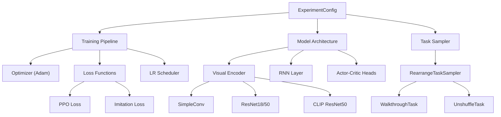
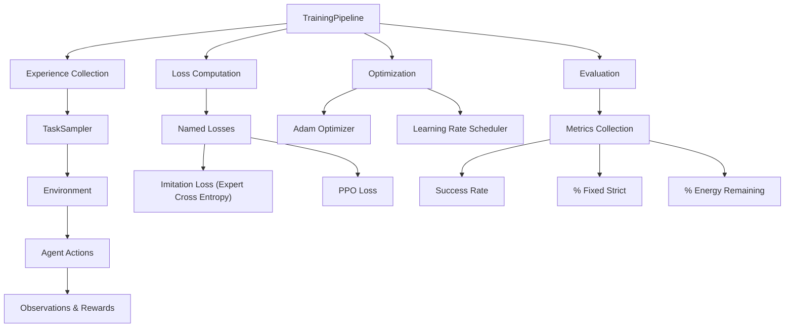
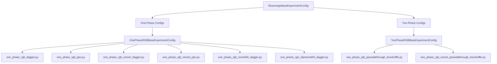
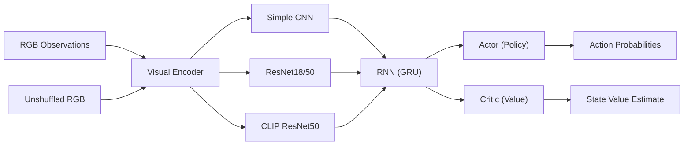

<!-- source: DeepWiki mcp.deepwiki.com · repo allenai/ai2thor-rearrangement · page 7 Training · fetched 2026-10-26 -->

# Training

<details>
<summary>Relevant source files</summary>

The following files were used as context for generating this wiki page:

- [README.md](README.md)
- [baseline_configs/rearrange_base.py](baseline_configs/rearrange_base.py)

</details>


This document provides a comprehensive overview of the training system for the AI2-THOR Rearrangement Challenge. It covers the architecture of the training pipeline, available training methods, experiment configurations, and instructions for running training. For information about the specific models available for training, see [Baseline Models](#6).

## Training System Architecture

The AI2-THOR Rearrangement Challenge uses the AllenAct framework for training rearrangement agents. This system consists of multiple components that work together to enable efficient training of models for both one-phase and two-phase tasks.



Sources: [baseline_configs/rearrange_base.py:460-485](), [README.md:641-646]()

## Training Pipeline

The training pipeline is defined in the `RearrangeBaseExperimentConfig` class and manages the complete training process, from collecting experience to optimizing the model. The `training_pipeline` method in the base configuration class creates a `TrainingPipeline` object with parameters for optimization, losses, and learning rate scheduling.



Sources: [baseline_configs/rearrange_base.py:460-485]()

The pipeline is configured with the following key parameters:

| Parameter | Description |
|-----------|-------------|
| `gamma` | Discount factor for rewards (typically 0.99) |
| `use_gae` | Whether to use Generalized Advantage Estimation |
| `num_steps` | Number of steps to collect per update |
| `num_mini_batch` | Number of mini-batches per update |
| `update_repeats` | Number of times to repeat optimization on each batch |
| `named_losses` | Dictionary of loss functions and their weights |
| `metric_accumulate_interval` | How often to accumulate metrics |
| `optimizer_builder` | Builder for the optimizer (default: Adam) |
| `lr_scheduler_builder` | Builder for learning rate scheduler |

Sources: [baseline_configs/rearrange_base.py:464-484]()

## Training Methods

The AI2-THOR Rearrangement Challenge supports two main training methods:

### Imitation Learning (DAgger)

Imitation Learning, specifically Dataset Aggregation (DAgger), trains agents by imitating expert behavior. The expert for rearrangement is the `GreedyUnshuffleExpert` class, which uses privileged information about object poses to generate optimal actions.

In the DAgger implementation:
1. The agent initially follows expert actions with high probability
2. As training progresses, the agent gradually relies more on its own predictions
3. The loss function is cross-entropy between the agent's action distribution and the expert actions

### Reinforcement Learning (PPO)

Proximal Policy Optimization (PPO) is a policy gradient method that directly optimizes the agent's policy using rewards. The PPO implementation in the codebase includes:

1. Generalized Advantage Estimation (GAE) for more stable learning
2. Policy clipping to prevent destructively large updates
3. Value function loss to improve state value estimation
4. Entropy regularization to encourage exploration

Some configurations use a hybrid approach, applying PPO for the walkthrough phase and imitation learning for the unshuffle phase.

Sources: [README.md:641-646]()

## Experiment Configurations

The experiment configuration system provides a hierarchical way to define training parameters. All configurations inherit from `RearrangeBaseExperimentConfig`.



Sources: [README.md:140-148](), [README.md:678-688]()

The base configuration class (`RearrangeBaseExperimentConfig`) defines:
- Environment parameters (screen size, controller settings)
- Action space
- Sensor preprocessing
- Task sampling logic
- Machine resource allocation
- Model creation

Each specific configuration file (e.g., `one_phase_rgb_resnet_dagger.py`) extends the base and defines:
- The specific model architecture to use
- Training method and associated parameters
- Loss functions and their weights
- Training stages

Sources: [baseline_configs/rearrange_base.py:42-504]()

## Model Components

The models used for training follow an actor-critic architecture with different visual encoders:



Sources: [baseline_configs/rearrange_base.py:486-503](), [README.md:678-688]()

The `create_model` method instantiates one of two model types:
- `RearrangeActorCriticSimpleConvRNN`: Uses a simple convolutional network
- `ResNetRearrangeActorCriticRNN`: Uses a pretrained ResNet (frozen weights)

The CNN preprocessor type and pretraining can be specified in the configuration:
- ImageNet pretrained weights for ResNet18/50
- CLIP pretrained weights for ResNet50

Sources: [baseline_configs/rearrange_base.py:123-162]()

## Running Training

### Basic Training Command

To train a model using AllenAct, the basic command is:

```bash
allenact -o OUTPUT_DIRECTORY -b BASE_DIRECTORY CONFIG_FILE.py
```

For example, to train a one-phase model with ResNet and DAgger:

```bash
allenact -o rearrange_out -b . baseline_configs/one_phase/one_phase_rgb_resnet_dagger.py
```

For a two-phase model with PPO for walkthrough and IL for unshuffle:

```bash
allenact -o rearrange_out -b . baseline_configs/two_phase/two_phase_rgb_resnet_ppowalkthrough_ilunshuffle.py
```

Sources: [README.md:647-667]()

### Training Output Structure

During training, model checkpoints and logs are saved to the specified output directory:

```
rearrange_out/
  checkpoints/
    OnePhaseRGBResNetDagger_40proc/
      2023-05-23_15-47-35/
        exp_OnePhaseRGBResNetDagger_40proc__stage_00__steps_000010010080.pt
        exp_OnePhaseRGBResNetDagger_40proc__stage_00__steps_000020020160.pt
        ...
  used_configs/
    OnePhaseRGBResNetDagger_40proc/
      2023-05-23_15-47-35/
        ...config files...
  tensorboard/
    ...tensorboard logs...
```

The frequency of checkpoint saving is controlled by the `SAVE_INTERVAL` parameter in the base configuration, which defaults to 1 million steps.

Sources: [README.md:286-293](), [baseline_configs/rearrange_base.py:66]()

### Hardware Requirements

Training typically requires:
- CUDA-capable GPU with at least 8GB VRAM
- 16GB+ system RAM
- Several hours to days of training time

The number of training processes is determined by the `num_train_processes` method in each configuration class, and processes are distributed across available GPUs.

Sources: [baseline_configs/rearrange_base.py:194-229]()

### Evaluating Trained Models

To evaluate a trained model, use the AllenAct CLI with the `--eval` flag:

```bash
allenact baseline_configs/one_phase/one_phase_rgb_resnet_dagger.py \
-c pretrained_model_ckpts/MODEL_CHECKPOINT.pt \
--extra_tag EVALUATION_TAG \
--eval
```

This evaluates the model on the combined dataset (train, val, test), which can be used for leaderboard submission.

Sources: [README.md:690-701]()

## Training Parameters and Hypertuning

The following table shows key parameters that can be adjusted for training:

| Parameter | Description | Typical Values |
|-----------|-------------|----------------|
| Learning rate | Step size for optimizer | 1e-4 to 3e-4 |
| Number of processes | Parallel environments | 40 (one-phase), 20 (two-phase) |
| Batch size | Samples per batch | 128 to 512 |
| Update repeats | Optimization iterations per batch | 3 to 5 |
| Entropy coefficient | Encourages exploration | 0.01 to 0.001 |
| Teacher forcing ratio | Expert action probability | 1.0 to 0.0 (annealed) |

For the best results, the codebase provides pretrained models that can be used as a starting point for further fine-tuning.

Sources: [README.md:678-688]()

---

