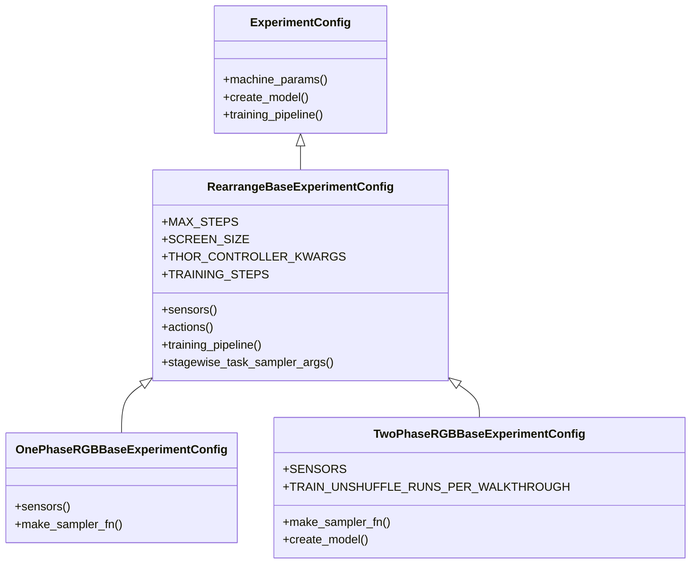
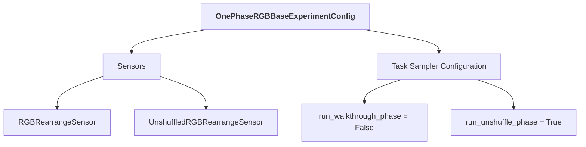
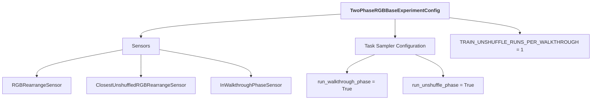
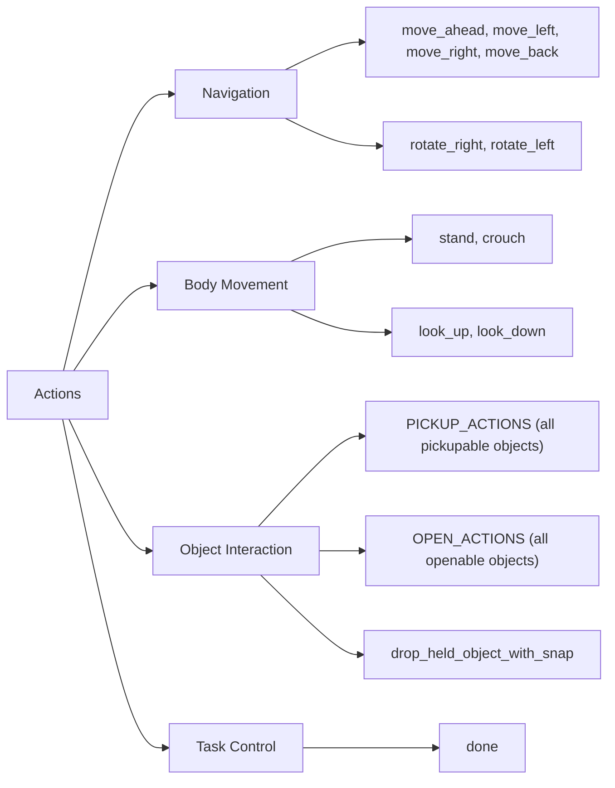

<!-- source: DeepWiki mcp.deepwiki.com · repo allenai/ai2thor-rearrangement · page 7.1 Experiment Configurations · fetched 2026-10-26 -->

# Experiment Configurations

<details>
<summary>Relevant source files</summary>

The following files were used as context for generating this wiki page:

- [baseline_configs/one_phase/one_phase_rgb_base.py](baseline_configs/one_phase/one_phase_rgb_base.py)
- [baseline_configs/rearrange_base.py](baseline_configs/rearrange_base.py)
- [baseline_configs/two_phase/two_phase_rgb_base.py](baseline_configs/two_phase/two_phase_rgb_base.py)
- [rearrange/sensors.py](rearrange/sensors.py)

</details>


This page documents the experiment configuration system used in the AI2-THOR Rearrangement Challenge. Experiment configurations define all parameters and settings needed for training and evaluating rearrangement agents, including task parameters, environment settings, model architectures, sensor configurations, and training pipelines.

## Configuration Hierarchy

The configuration system is built on AllenAct's experiment configuration framework and uses a hierarchy of classes to define different training approaches.



Sources: [baseline_configs/rearrange_base.py:42-504](), [baseline_configs/one_phase/one_phase_rgb_base.py:24-110](), [baseline_configs/two_phase/two_phase_rgb_base.py:28-139]()

## Base Configuration Class

The `RearrangeBaseExperimentConfig` class provides the foundation for all rearrangement task configurations. It defines:

1. **Task parameters** - Controls basic task behavior
2. **Environment parameters** - Configures the AI2-THOR environment
3. **Training parameters** - Sets training steps and checkpoint intervals
4. **Sensor UUIDs** - Standardizes sensor identification
5. **Action definitions** - Specifies all available actions for the agent

### Key Base Parameters

| Parameter Group | Key Parameters | Description |
|-----------------|----------------|-------------|
| Task Parameters | MAX_STEPS | Maximum steps allowed in each phase (walkthrough: 250, unshuffle: 500) |
| | REQUIRE_DONE_ACTION | Whether agent must take explicit "done" action |
| | FORCE_AXIS_ALIGNED_START | Forces agent to start with axis-aligned rotations |
| Environment | SCREEN_SIZE | Size of rendered images (224x224) |
| | THOR_CONTROLLER_KWARGS | AI2-THOR controller settings (rotation step, quality, etc.) |
| Training | TRAINING_STEPS | Total training steps (75 million) |
| | SAVE_INTERVAL | Checkpoint interval (1 million steps) |

Sources: [baseline_configs/rearrange_base.py:44-62]()

## Specialized Configurations

The system provides two main configuration types corresponding to the two challenge tracks:

### One-Phase Configuration



In one-phase training, the agent receives both current and target scene views simultaneously and must learn to transform the current state to match the target.

The one-phase configuration:
- Includes RGB sensors for current and target scenes
- Configures the task sampler to run only the unshuffle phase
- Uses CNN preprocessors (optional) for vision features

Sources: [baseline_configs/one_phase/one_phase_rgb_base.py:24-110]()

### Two-Phase Configuration



In two-phase training, the agent first observes the target arrangement in a walkthrough phase, then must restore that arrangement from memory in the unshuffle phase.

The two-phase configuration:
- Adds `InWalkthroughPhaseSensor` to inform the agent which phase it's in
- Configures the task sampler to run both walkthrough and unshuffle phases
- Specifies how many unshuffle runs to perform per walkthrough
- Uses special action masks to prevent object manipulation during walkthrough

Sources: [baseline_configs/two_phase/two_phase_rgb_base.py:28-139](), [rearrange/sensors.py:142-165]()

## Sensor Configuration

Sensors provide observations to the agent. The configuration system defines the following sensors:

| Sensor Type | Purpose | Used In |
|-------------|---------|---------|
| RGBRearrangeSensor | Provides current view | Both configurations |
| UnshuffledRGBRearrangeSensor | Provides target view from same position | One-phase |
| ClosestUnshuffledRGBRearrangeSensor | Provides target view from closest visited position | Two-phase |
| InWalkthroughPhaseSensor | Indicates current phase (walkthrough/unshuffle) | Two-phase |

The `sensors()` method defines which sensors are available to the agent.

Sources: [rearrange/sensors.py:24-165](), [baseline_configs/one_phase/one_phase_rgb_base.py:26-61](), [baseline_configs/two_phase/two_phase_rgb_base.py:29-43]()

## CNN Preprocessor Configuration

For models that use deep vision features, the configuration can specify a CNN preprocessor:

```python
CNN_PREPROCESSOR_TYPE_AND_PRETRAINING: Optional[Tuple[str, str]] = None
```

The preprocessor can be configured to use:
- ResNet models (RN18, RN50) with ImageNet pretraining
- CLIP vision models with their own pretraining

The `resnet_preprocessor_graph()` method creates the appropriate preprocessing pipeline based on this configuration.

Sources: [baseline_configs/rearrange_base.py:124-176]()

## Action Space Configuration

The actions available to the agent are defined in the base configuration:



The base class automatically generates pickup and open actions for all eligible object types in the environment.

Sources: [baseline_configs/rearrange_base.py:77-121]()

## Training Pipeline Configuration

The training pipeline is defined by the `training_pipeline()` method, which requires subclasses to implement the `_training_pipeline_info()` method:

```python
@classmethod
def _training_pipeline_info(cls) -> Dict[str, Any]:
    # Example implementation
    return {
        "lr": 3e-4,
        "num_steps": 30,
        "num_mini_batch": 1,
        "update_repeats": 4,
        "use_lr_decay": True,
        "named_losses": {"action_loss": 1.0, "value_loss": 0.5},
        "pipeline_stages": [],
    }
```

The pipeline configures:
- Reinforcement learning parameters (gamma, GAE)
- Optimization parameters (learning rate, gradient clipping)
- Loss functions and their weights
- Learning rate scheduling

Sources: [baseline_configs/rearrange_base.py:450-484]()

## Machine Configuration

The `machine_params()` method configures hardware resources:

```python
@classmethod
def machine_params(cls, mode="train", **kwargs) -> MachineParams:
    # Configures different parameters for train/valid/test modes
    # Handles GPU/CPU device allocation
    # Sets up sensor preprocessing
```

This method:
- Determines the number of processes to use
- Allocates GPU devices if available
- Sets up sensor preprocessing graphs
- Configures differently for training, validation, and testing

Sources: [baseline_configs/rearrange_base.py:194-229]()

## Task Sampler Configuration

The base configuration provides methods to configure task samplers for different stages:

```python
@classmethod
def stagewise_task_sampler_args(cls, stage: str, process_ind: int, total_processes: int, ...):
    # Configure task samplers for different stages (train, valid, test)
```

This method handles:
- Scene allocation across processes
- Dataset splitting for training/validation/testing
- GPU and X-display allocation for rendering
- Sensor configuration for each stage

Sources: [baseline_configs/rearrange_base.py:232-448]()

## Model Creation

The `create_model()` method instantiates the actor-critic model based on the configuration:

```python
@classmethod
def create_model(cls, **kwargs) -> nn.Module:
    # Creates either a simple CNN model or a ResNet-based model
    # depending on CNN_PREPROCESSOR_TYPE_AND_PRETRAINING
```

Different model architectures are used based on:
- One-phase vs. two-phase configuration
- Whether CNN preprocessing is enabled
- Which sensors are available

Sources: [baseline_configs/rearrange_base.py:486-503](), [baseline_configs/two_phase/two_phase_rgb_base.py:104-139]()

## Creating Custom Configurations

To create a custom configuration, extend one of the base classes and override methods as needed:

1. Extend `RearrangeBaseExperimentConfig`, `OnePhaseRGBBaseExperimentConfig`, or `TwoPhaseRGBBaseExperimentConfig`
2. Override parameters like `MAX_STEPS`, `SCREEN_SIZE`, etc.
3. Implement required methods like `_training_pipeline_info()` and `num_train_processes()`
4. Optionally override other methods like `sensors()`, `create_model()`, etc.

At minimum, you must implement:
- `_training_pipeline_info()`: Define training parameters
- `num_train_processes()`: Specify number of parallel training processes

For more information on specific training approaches, see [One-Phase Models](#6.1) and [Two-Phase Models](#6.2).

---

