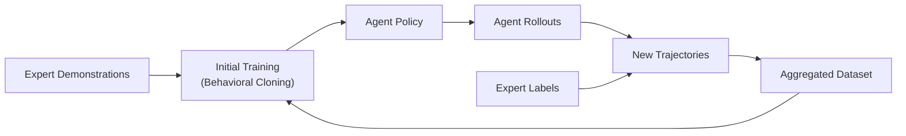
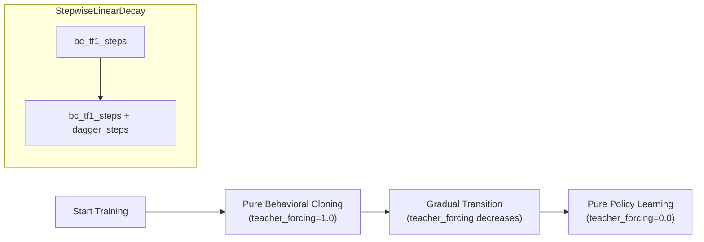
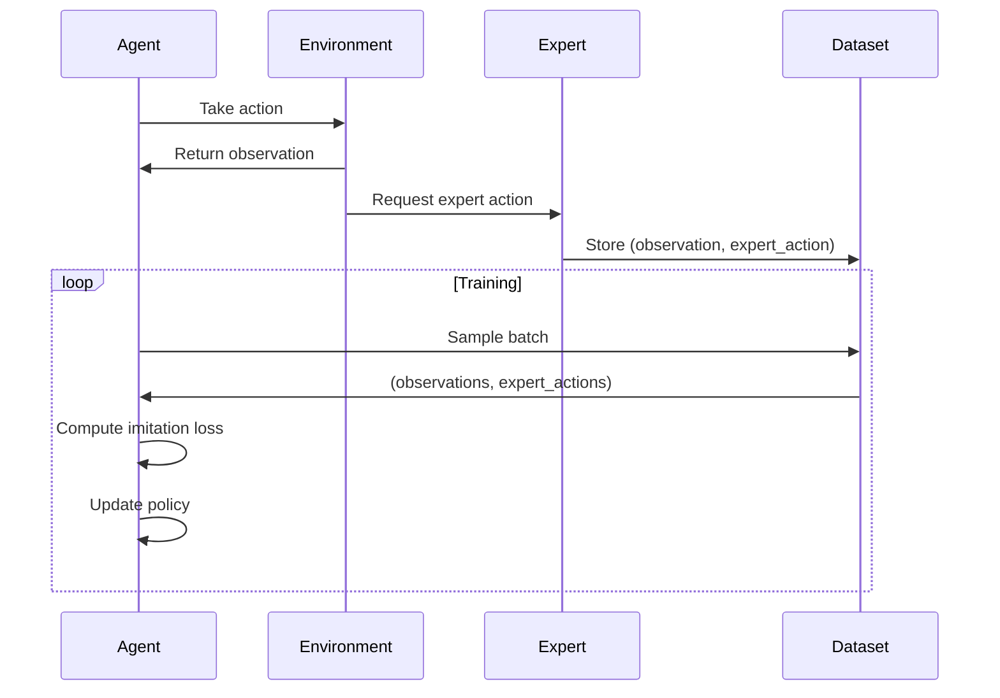
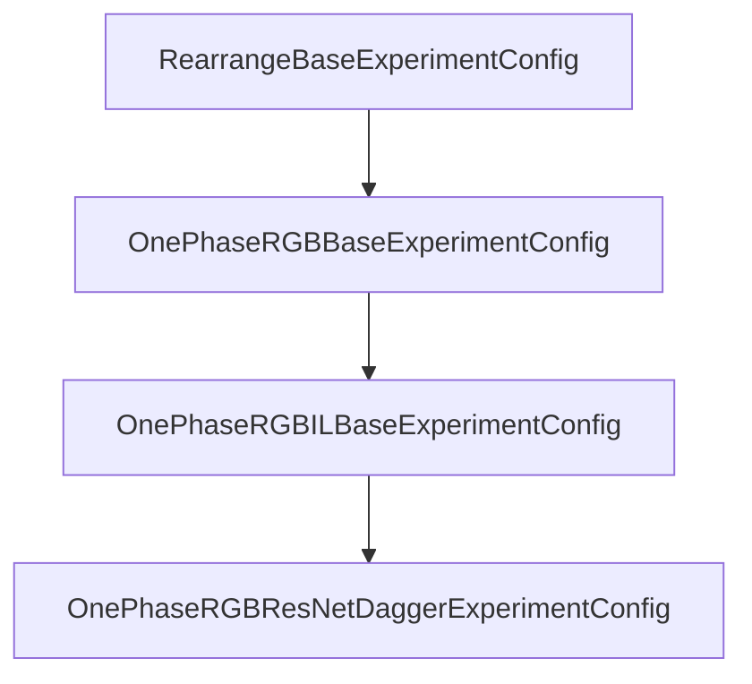

<!-- source: DeepWiki mcp.deepwiki.com · repo allenai/ai2thor-rearrangement · page 7.2 Imitation Learning · fetched 2026-10-26 -->

# Imitation Learning

<details>
<summary>Relevant source files</summary>

The following files were used as context for generating this wiki page:

- [baseline_configs/one_phase/one_phase_rgb_il_base.py](baseline_configs/one_phase/one_phase_rgb_il_base.py)
- [baseline_configs/one_phase/one_phase_rgb_resnet_dagger.py](baseline_configs/one_phase/one_phase_rgb_resnet_dagger.py)

</details>


This page documents the implementation and configuration of imitation learning techniques in the AI2-THOR Rearrangement Challenge. Specifically, it covers Dataset Aggregation (DAgger) and Behavioral Cloning approaches used to train agents through expert demonstrations. For information about reinforcement learning approaches like PPO, see [Reinforcement Learning](#7.3).

## Overview

Imitation learning in the rearrangement challenge allows agents to learn from expert demonstrations rather than through trial and error. The codebase implements Dataset Aggregation (DAgger), which begins with pure behavioral cloning and gradually transitions to the agent's own policy while still collecting expert demonstrations.



Sources: [baseline_configs/one_phase/one_phase_rgb_il_base.py:87-131]()

## Implementation Architecture

The imitation learning system consists of several key components:

```mermaid
classDef default fill:#f9f9f9,stroke:#333,stroke-width:1px;

graph TD
    A["OnePhaseRGBILBaseExperimentConfig"] --> B["ExpertActionSensor"]
    A --> C["Training Pipeline"]
    C --> D["Imitation Loss"]
    C --> E["PipelineStage"]
    E --> F["StepwiseLinearDecay\n(Teacher Forcing)"]
    G["OnePhaseRGBResNetDaggerExperimentConfig"] --> A
```

The base class `OnePhaseRGBILBaseExperimentConfig` extends the standard RGB configuration with:
- An `ExpertActionSensor` to provide expert actions during training
- A training pipeline with imitation loss
- Teacher forcing that decays linearly using `StepwiseLinearDecay`

Sources: [baseline_configs/one_phase/one_phase_rgb_il_base.py:87-131](), [baseline_configs/one_phase/one_phase_rgb_resnet_dagger.py:1-13]()

## Teacher Forcing Decay

A core component of the DAgger implementation is the teacher forcing decay mechanism, which controls the transition from pure expert policy to the agent's own policy:



The `StepwiseLinearDecay` class implements a piecewise linear function that starts at 1.0 (always use expert actions) and decreases to 0.0 (always use agent's actions) over a specified number of steps.

Sources: [baseline_configs/one_phase/one_phase_rgb_il_base.py:15-40](), [baseline_configs/one_phase/one_phase_rgb_il_base.py:112-117]()

## Training Parameters

The codebase offers different training configurations based on computational resources:

| Configuration | Processes | Learning Rate | Update Repeats | BC Duration | DAgger Duration |
|---------------|-----------|--------------|----------------|-------------|-----------------|
| 80proc        | 80        | 3e-4         | 3              | 100k steps  | 1M steps        |
| 40proc        | 40        | 3e-4         | 3              | 100k steps  | 1M steps        |
| 40proc-longtf | 40        | 3e-4         | 3              | 500k steps  | 5M steps        |

These configurations control:
- Number of parallel training processes
- Learning rate and update frequency
- Duration of pure behavioral cloning (BC) and DAgger phases

Sources: [baseline_configs/one_phase/one_phase_rgb_il_base.py:42-84]()

## Training Pipeline

The training pipeline for imitation learning consists of a single stage with an imitation loss:



The pipeline uses the `Imitation` loss from AllenAct, which is essentially a cross-entropy loss between the agent's action distribution and the expert's actions.

Sources: [baseline_configs/one_phase/one_phase_rgb_il_base.py:97-121]()

## Example Implementation

The `OnePhaseRGBResNetDaggerExperimentConfig` provides a concrete implementation using ResNet-18 as the visual backbone:

```python
class OnePhaseRGBResNetDaggerExperimentConfig(OnePhaseRGBILBaseExperimentConfig):
    CNN_PREPROCESSOR_TYPE_AND_PRETRAINING = ("RN18", "imagenet")
    IL_PIPELINE_TYPE = "40proc"

    @classmethod
    def tag(cls) -> str:
        return f"OnePhaseRGBResNetDagger_{cls.IL_PIPELINE_TYPE}"
```

This configuration:
- Uses a ResNet-18 model pretrained on ImageNet
- Employs the "40proc" training configuration
- Creates a unique tag for experiment tracking

Sources: [baseline_configs/one_phase/one_phase_rgb_resnet_dagger.py:1-13]()

## Technical Details

### Configuration Inheritance



The configuration classes form a hierarchy that adds imitation learning capabilities to the base rearrangement configurations.

Sources: [baseline_configs/one_phase/one_phase_rgb_il_base.py:87-131](), [baseline_configs/one_phase/one_phase_rgb_resnet_dagger.py:1-13]()

### Expert Action Integration

The `ExpertActionSensor` is added to the standard sensors to provide expert actions:

```python
@classmethod
def sensors(cls) -> Sequence[Sensor]:
    return [
        *super(OnePhaseRGBILBaseExperimentConfig, cls).sensors(),
        ExpertActionSensor(len(RearrangeBaseExperimentConfig.actions())),
    ]
```

This sensor interface allows the system to access expert actions during training.

Sources: [baseline_configs/one_phase/one_phase_rgb_il_base.py:90-95]()

## Usage

To train an agent using imitation learning:

1. Select or create an appropriate configuration class (e.g., `OnePhaseRGBResNetDaggerExperimentConfig`)
2. Configure the IL_PIPELINE_TYPE parameter based on available computational resources
3. Run the training using the AllenAct framework

The agent will initially mimic the expert perfectly, then gradually transition to its own policy while still receiving supervision from the expert.

Sources: [baseline_configs/one_phase/one_phase_rgb_il_base.py:42-84](), [baseline_configs/one_phase/one_phase_rgb_resnet_dagger.py:1-13]()

---

