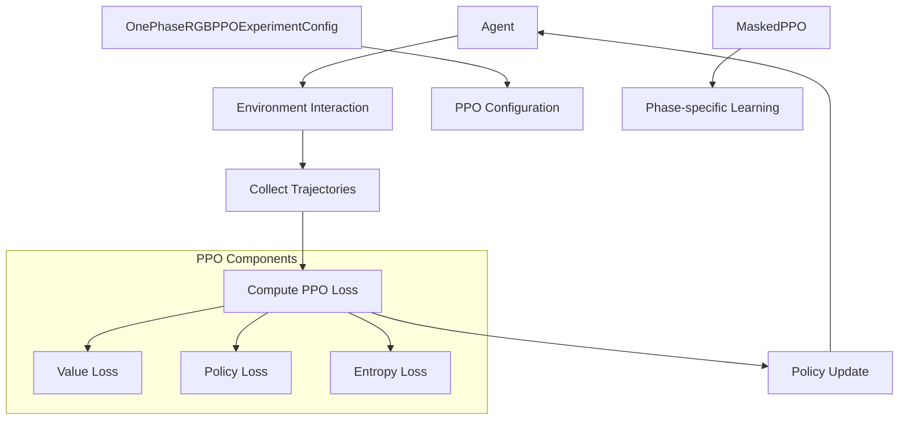
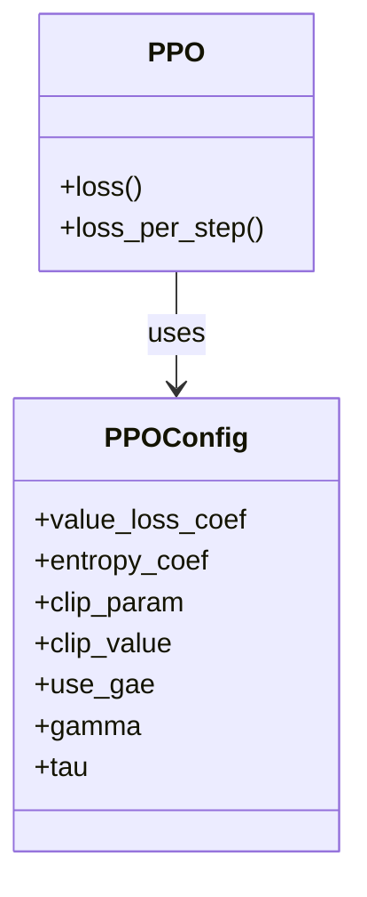
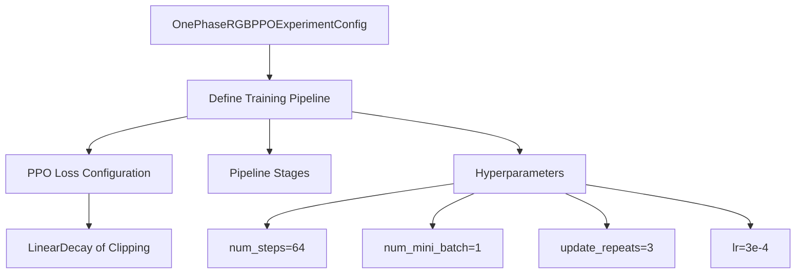
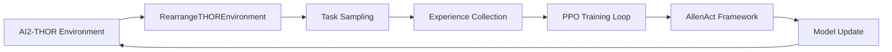

<!-- source: DeepWiki mcp.deepwiki.com · repo allenai/ai2thor-rearrangement · page 7.3 Reinforcement Learning · fetched 2026-10-26 -->

# Reinforcement Learning

<details>
<summary>Relevant source files</summary>

The following files were used as context for generating this wiki page:

- [baseline_configs/one_phase/one_phase_rgb_ppo.py](baseline_configs/one_phase/one_phase_rgb_ppo.py)
- [baseline_configs/walkthrough/walkthrough_rgb_base.py](baseline_configs/walkthrough/walkthrough_rgb_base.py)
- [rearrange/losses.py](rearrange/losses.py)

</details>


This page documents the reinforcement learning (RL) approaches implemented in the AI2-THOR Rearrangement Challenge codebase. It focuses on the Proximal Policy Optimization (PPO) algorithm and how it is configured and adapted for training agents to solve rearrangement tasks. For information about imitation learning approaches, see [Imitation Learning](#7.2).

## Overview of RL Implementation

The AI2-THOR Rearrangement Challenge primarily uses PPO for reinforcement learning. PPO is an on-policy algorithm that optimizes policies by constraining policy updates to prevent destructively large changes. The implementation leverages AllenAct's PPO implementation with specialized adaptations for the rearrangement tasks.



Sources: [baseline_configs/one_phase/one_phase_rgb_ppo.py:1-39](), [rearrange/losses.py:1-76]()

## Standard PPO Implementation

The codebase uses AllenAct's implementation of PPO (`allenact.algorithms.onpolicy_sync.losses.PPO`), which includes:

1. Actor-critic architecture with shared feature extractor
2. Value loss for learning state values
3. Policy loss with clipping for stable updates
4. Entropy bonus for exploration

The standard PPO configuration used in the codebase is defined in `PPOConfig`, which sets default hyperparameters for the algorithm.



Sources: [baseline_configs/one_phase/one_phase_rgb_ppo.py:3-5]()

## MaskedPPO Extension

The codebase implements a specialized variant called `MaskedPPO` that applies the PPO loss selectively based on a mask. This is particularly useful for multi-phase tasks where different learning strategies might be appropriate for different phases.

### MaskedPPO Implementation Details

`MaskedPPO` extends the `AbstractActorCriticLoss` class and wraps the standard PPO implementation. It applies the loss only where a specified mask equals 1, allowing for selective learning.

```python
# Key aspects of MaskedPPO
class MaskedPPO(AbstractActorCriticLoss):
    def __init__(self, mask_uuid: str, ppo_params: Dict[str, Any]):
        # mask_uuid: Sensor UUID to use for masking
        # ppo_params: Parameters for the PPO loss
        self.mask_uuid = mask_uuid
        self._ppo_loss = PPO(**ppo_params)
    
    def loss(self, step_count, batch, actor_critic_output, *args, **kwargs):
        # Apply mask to compute loss only where mask == 1
        mask = batch["observations"][self.mask_uuid].float()
        # Compute PPO loss and apply mask
        # ...
```

This approach allows the system to compute losses only during specific phases of the task, which helps tailor the learning process to different stages of the rearrangement challenge.

Sources: [rearrange/losses.py:14-76]()

## PPO Configuration for Rearrangement Tasks

The PPO algorithm is configured specifically for the rearrangement tasks through experiment configuration classes. For example, the `OnePhaseRGBPPOExperimentConfig` class defines how PPO is applied to the one-phase track.

### Training Pipeline Configuration



The training pipeline is configured with:

1. PPO loss with linear decay of the clipping parameter over training steps
2. Single pipeline stage running for the entire training duration
3. Specific hyperparameters:
   - 64 steps per rollout
   - Single mini-batch
   - 3 update repetitions per batch
   - Learning rate of 3e-4 with decay

Sources: [baseline_configs/one_phase/one_phase_rgb_ppo.py:23-39]()

## Parallelization and Scale

The reinforcement learning implementation leverages parallel environment execution to efficiently collect experiences:

```python
@classmethod
def num_train_processes(cls) -> int:
    return 40
```

This parallel approach allows the system to run 40 simultaneous training environments, significantly accelerating the collection of experiences and improving sample efficiency.

Sources: [baseline_configs/one_phase/one_phase_rgb_ppo.py:18-20]()

## Integration with AllenAct Framework

The RL components are integrated with the AllenAct framework, which provides the infrastructure for:

1. Running multiple environments in parallel
2. Collecting trajectories
3. Computing losses
4. Updating model parameters

The configuration classes define how models interact with this framework through the `_training_pipeline_info` method, which specifies losses, stages, and hyperparameters.



Sources: [baseline_configs/one_phase/one_phase_rgb_ppo.py:23-39](), [baseline_configs/walkthrough/walkthrough_rgb_base.py:15-104]()

## Action Space and Observations

The reinforcement learning agent interacts with the environment through a discrete action space defined in the base experiment configurations:

```python
@classmethod
def actions(cls):
    other_move_actions = (
        tuple()
        if not cls.INCLUDE_OTHER_MOVE_ACTIONS
        else ("move_left", "move_right", "move_back",)
    )
    return (
        ("done", "move_ahead",)
        + other_move_actions
        + (
            "rotate_right",
            "rotate_left",
            "stand",
            "crouch",
            "look_up",
            "look_down",
        )
    )
```

These actions enable the agent to navigate the environment and interact with objects. The observation space is defined by the sensors specified in the configuration, which provide the agent with visual and state information.

Sources: [baseline_configs/walkthrough/walkthrough_rgb_base.py:38-56]()

## Training Workflow

The complete RL training workflow follows this pattern:

1. Task sampling generates new rearrangement scenarios
2. The agent interacts with the environment using its current policy
3. Experiences (states, actions, rewards) are collected into trajectories
4. PPO loss is computed based on these trajectories
5. The policy and value networks are updated
6. The process repeats until training is complete

The training process can be monitored and evaluated using metrics defined in the overall challenge framework.

Sources: [baseline_configs/one_phase/one_phase_rgb_ppo.py:23-39](), [baseline_configs/walkthrough/walkthrough_rgb_base.py:58-104]()

## Summary

The reinforcement learning implementation in the AI2-THOR Rearrangement Challenge primarily uses PPO with specialized adaptations for the task. The `MaskedPPO` variant allows for selective application of the loss based on task phases, while the experiment configurations provide a structured way to define training parameters. The integration with the AllenAct framework provides a solid foundation for efficient parallel training.

---

