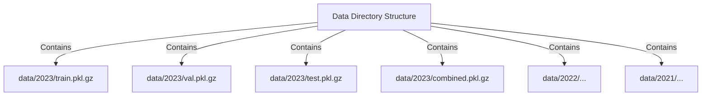
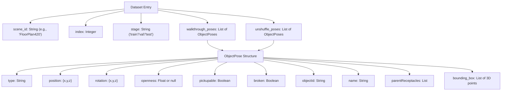
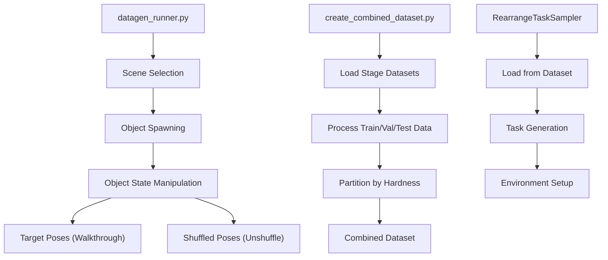
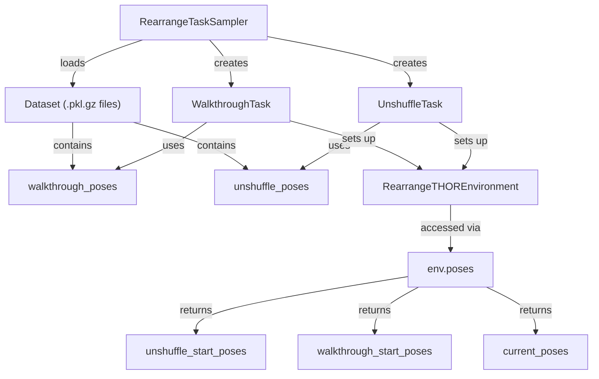
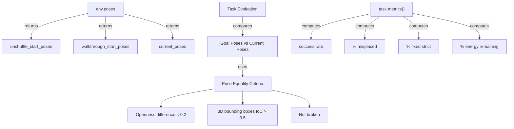

<!-- source: DeepWiki mcp.deepwiki.com · repo allenai/ai2thor-rearrangement · page 8 Data · fetched 2026-10-26 -->

# Data

<details>
<summary>Relevant source files</summary>

The following files were used as context for generating this wiki page:

- [README.md](README.md)
- [data/2021/combined.pkl.gz](data/2021/combined.pkl.gz)
- [data/2021/test.pkl.gz](data/2021/test.pkl.gz)
- [data/2021/train.pkl.gz](data/2021/train.pkl.gz)
- [data/2021/train_unseen.pkl.gz](data/2021/train_unseen.pkl.gz)
- [data/2021/val.pkl.gz](data/2021/val.pkl.gz)
- [data/2022/combined.pkl.gz](data/2022/combined.pkl.gz)
- [data/2022/test.pkl.gz](data/2022/test.pkl.gz)
- [data/2022/train.pkl.gz](data/2022/train.pkl.gz)
- [data/2022/val.pkl.gz](data/2022/val.pkl.gz)
- [data/2023/combined.pkl.gz](data/2023/combined.pkl.gz)
- [data/2023/test.pkl.gz](data/2023/test.pkl.gz)
- [data/2023/train.pkl.gz](data/2023/train.pkl.gz)
- [data/2023/val.pkl.gz](data/2023/val.pkl.gz)

</details>


This document provides a comprehensive overview of the dataset system used in the AI2-THOR Rearrangement Challenge. It covers how data is organized, generated, stored, and utilized within the challenge framework. For information on how tasks are implemented using this data, see [Tasks](#4).

## Dataset Overview

The AI2-THOR Rearrangement Challenge uses datasets of room configurations and object poses to train and evaluate agents on rearrangement tasks. Each dataset consists of episodes where objects in rooms need to be restored to their original configurations.

The datasets are stored as gzipped pickle files (`.pkl.gz`) in the `data/` directory, organized by year. The most recent challenge (2023) uses the latest dataset version.



Sources: data/2023/train.pkl.gz, data/2023/val.pkl.gz, data/2023/test.pkl.gz, data/2023/combined.pkl.gz, README.md

## Dataset Structure and Organization

The datasets follow a 3-way split based on AI2-THOR floor plans:

| Split    | Floor Plans Used                         | # Total Episodes | # Episodes for Eval | Path                     |
|----------|:----------------------------------------:|:----------------:|---------------------|--------------------------|
| train    | 1-20, 200-220, 300-320, 400-420         | 4000             | 800                 | `data/2023/train.pkl.gz` |
| val      | 21-25, 221-225, 321-325, 421-425        | 1000             | 1000                | `data/2023/val.pkl.gz`   | 
| test     | 26-30, 226-230, 326-330, 426-430        | 1000             | 1000                | `data/2023/test.pkl.gz`  |
| combined | Subset from all splits for evaluation    | 2800             | 2800                | `data/2023/combined.pkl.gz` |

The use of different floor plans for each split ensures that agents must generalize to unseen environments rather than memorizing specific room layouts.

Sources: README.md

## Dataset Content Structure

Each dataset entry encapsulates the information needed to set up a rearrangement task. This includes:



Object poses contain detailed information about each object in the scene, including:

- **Type**: The object category (e.g., "Candle")
- **Position**: 3D coordinates (x, y, z)
- **Rotation**: 3D rotation values
- **Openness**: A value in [0,1] for openable objects, null for others
- **Pickupable**: Boolean indicating if agent can pick up the object
- **Broken**: Boolean indicating if the object is broken
- **ObjectId**: Unique identifier for the object
- **Bounding Box**: 3D coordinates defining the object's bounds

The same object appears at the same index in both the `walkthrough_poses` and `unshuffle_poses` lists, making it easy to compare the goal and initial states.

Sources: README.md

## Data Generation

The dataset generation process involves several steps that create diverse room configurations with randomly placed objects:



The data generation process ensures:
1. Objects are placed in physically realistic positions
2. Between 1-5 objects are shuffled between walkthrough and unshuffle phases
3. Tasks have varying levels of difficulty
4. Object changes may include position, rotation, or openness

For the 2023 challenge, the dataset includes more uniform balance of easy/hard episodes and requires interaction with more objects compared to previous versions.

Sources: README.md

## Dataset Access and Usage

The datasets are accessed and used through the `RearrangeTaskSampler` class, which creates task instances from dataset entries:



To load and use the dataset in code:

```python
# Import necessary libraries
import gzip
import pickle

# Load a dataset
with gzip.open("data/2023/val.pkl.gz", "rb") as f:
    dataset = pickle.load(f)

# Iterate through dataset entries
for entry in dataset:
    scene = entry["scene"]
    walkthrough_poses = entry["walkthrough_poses"]
    unshuffle_poses = entry["unshuffle_poses"]
    
    # Create tasks using RearrangeTaskSampler
    # ...
```

For evaluation and submission to the challenge leaderboard, agents must be evaluated on all tasks in the combined dataset.

Sources: README.md

## Object Poses and Comparison

The dataset's core element is the object pose, which defines an object's state in the environment. The `RearrangeTHOREnvironment` provides methods to access and compare object poses:



The environment tracks three sets of poses:
- `unshuffle_start_poses`: Object poses at the beginning of the unshuffle phase
- `walkthrough_start_poses`: Object poses during the walkthrough phase (goal state)
- `current_poses`: Current object poses as the agent interacts with the environment

Two object poses are considered approximately equal when:
1. Neither pose represents a broken object
2. For openable objects, the openness values differ by less than 0.2
3. For pickupable objects, the 3D bounding boxes have an IoU greater than 0.5

These criteria are used to evaluate task success and compute performance metrics.

Sources: README.md

## Dataset Utilities

The codebase provides several utilities for working with the datasets:

1. **Loading and Accessing**:
   - `gzip` and `pickle` libraries to load the compressed dataset files
   - `RearrangeTaskSampler` to create tasks from dataset entries

2. **Pose Comparison**:
   - `RearrangeTHOREnvironment.compare_poses` to check if poses match
   - Utility functions for computing IoU between 3D bounding boxes

3. **Evaluation Metrics**:
   - `task.metrics()` returns performance metrics including:
     - Success rate (whether all objects are in their goal states)
     - Percentage of misplaced objects
     - Percentage of objects fixed
     - Energy remaining (measure of efficiency)

These utilities enable researchers to effectively work with the datasets for training, validation, and evaluation of rearrangement agents.

Sources: README.md

## Using Datasets for Submission

For challenge submissions, agents must be evaluated on all tasks in the combined dataset:

```python
# Load the combined dataset
with gzip.open("data/2023/combined.pkl.gz", "rb") as f:
    combined_dataset = pickle.load(f)

# Evaluate on all tasks and record metrics
results = {}
for entry in combined_dataset:
    task_id = entry["unique_id"]
    
    # Run your agent on this task
    metrics = run_agent_on_task(entry)
    
    # Record metrics and trajectory for submission
    results[task_id] = metrics

# Save results in the required format for submission
import json
with open("submission.json", "w") as f:
    json.dump(results, f)
```

The submission format is a JSON file mapping task IDs to performance metrics and agent trajectories.

Sources: README.md

## Changes in the 2023 Dataset

The 2023 dataset includes several improvements over previous versions:

1. Updated to match AI2-THOR version 5.0.0
2. More uniform balance of easy/hard episodes
3. Requires interaction with more objects
4. Improved object-opening logic where all openable objects have toggleable states
5. Various bug fixes and performance improvements

These changes enhance the challenge's realism and difficulty, pushing the boundaries of embodied AI research.

Sources: README.md

---

