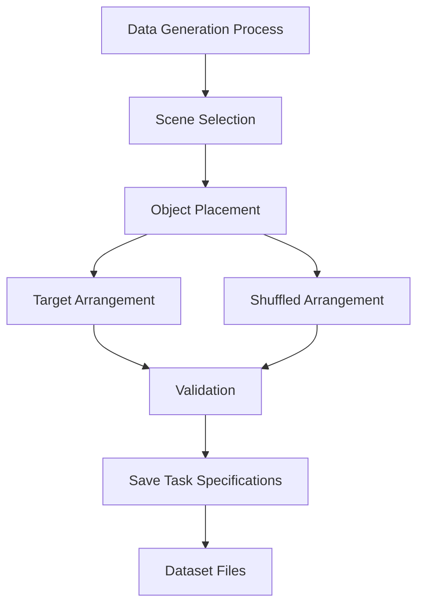
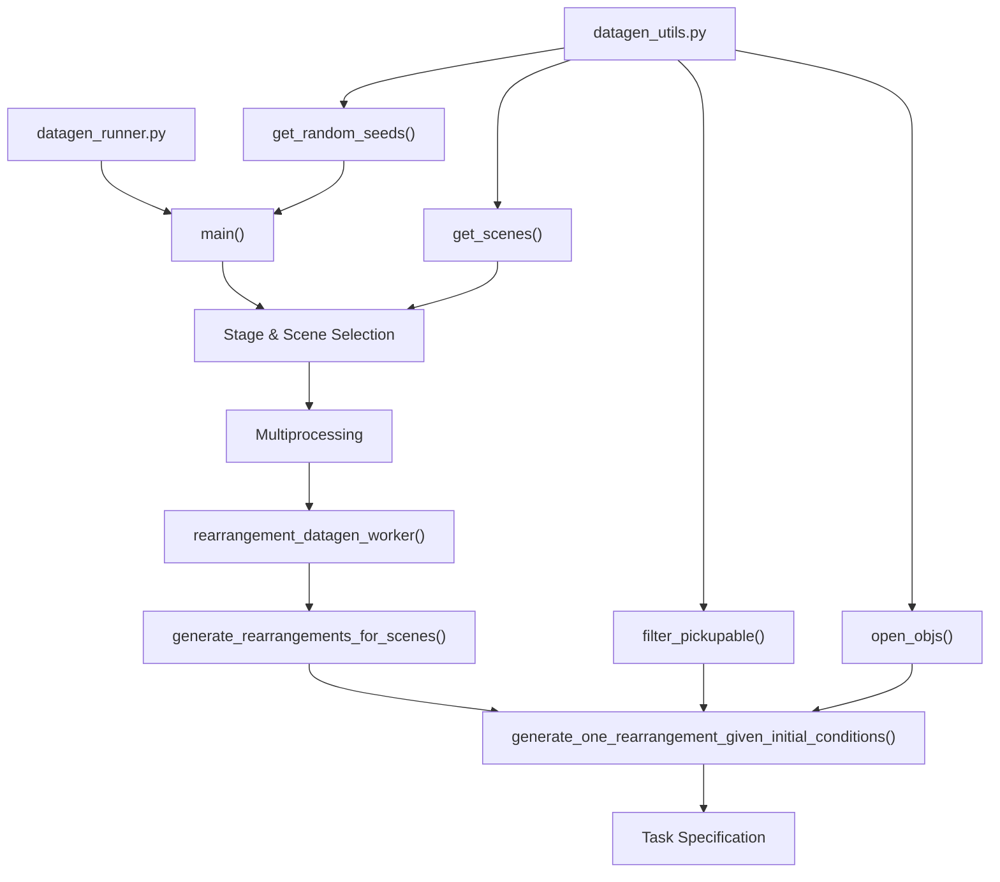
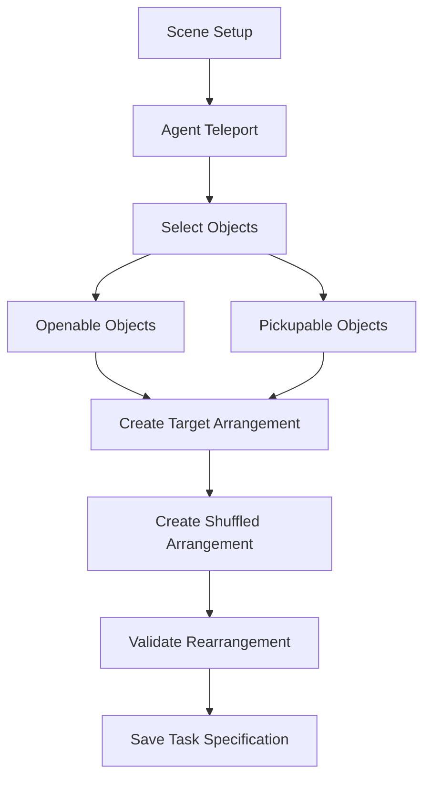
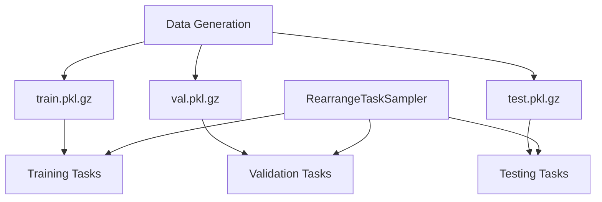

<!-- source: DeepWiki mcp.deepwiki.com · repo allenai/ai2thor-rearrangement · page 8.1 Data Generation · fetched 2026-10-26 -->

# Data Generation

<details>
<summary>Relevant source files</summary>

The following files were used as context for generating this wiki page:

- [datagen/datagen_runner.py](datagen/datagen_runner.py)
- [datagen/datagen_utils.py](datagen/datagen_utils.py)

</details>


This document explains the process and implementation of generating data for the AI2-THOR Rearrangement Challenge. The data generation system creates training, validation, and test datasets consisting of rearrangement scenarios in various scenes with objects in different positions.

For information about working with the generated datasets, see [Dataset Utilities](#8.2).

## Overview

The data generation system creates episodes where objects are placed in initial positions (target arrangement) and then shuffled (starting arrangement). These arrangements provide the foundation for the rearrangement tasks where agents must restore objects to their original positions.



Sources: [datagen/datagen_runner.py:1-7](), [datagen/datagen_runner.py:607-697]()

## Data Generation Components

The data generation system consists of several key components that work together to create valid rearrangement scenarios.



Sources: [datagen/datagen_runner.py:285-533](), [datagen/datagen_utils.py:11-34](), [datagen/datagen_utils.py:37-45](), [datagen/datagen_utils.py:48-78]()

## Scene Selection

The data generation process begins with selecting appropriate scenes for each stage of the challenge. The `get_scenes` function returns iTHOR scene names based on the specified stage.

- **Debug**: Returns only `FloorPlan1`
- **Train**: Returns `FloorPlan1-20`, `FloorPlan201-220`, `FloorPlan301-320`, `FloorPlan401-420` (80 scenes total)
- **Val**: Returns `FloorPlan21-25`, `FloorPlan221-225`, `FloorPlan321-325`, `FloorPlan421-425` (20 scenes total)
- **Test**: Returns `FloorPlan26-30`, `FloorPlan226-230`, `FloorPlan326-330`, `FloorPlan426-430` (20 scenes total)

Each set includes kitchens, living rooms, bedrooms, and bathrooms to provide diverse environments.

Sources: [datagen/datagen_utils.py:11-34]()

## Task Generation Process

### Initial Conditions Setup

Each task generation begins by setting up initial conditions in the environment:

1. Reset the controller to the specified scene
2. Teleport the agent to a random reachable position with a random rotation
3. Remove duplicate mesh objects to ensure uniqueness
4. Make all objects unbreakable to prevent physics issues
5. Randomly spawn objects using `InitialRandomSpawn`

Sources: [datagen/datagen_runner.py:44-76]()

### Object Selection

The system selects two categories of objects to interact with:

1. **Openable Objects**: Non-pickupable objects that can be opened (e.g., drawers, cupboards)
2. **Pickupable Objects**: Objects that can be picked up and moved

The number of objects to open and move is determined based on:
- The scene configuration (some scenes have no openable objects)
- The rearrangement index within each scene
- The maximum number of object rearrangements per scene

Sources: [datagen/datagen_runner.py:78-128](), [datagen/datagen_utils.py:37-45]()

### Target Arrangement Creation

The target arrangement is created first:
1. Spawn and place objects in the scene
2. Set the openness of selected openable objects
3. Record the positions, rotations, and states of all objects

Sources: [datagen/datagen_runner.py:77-130]()

### Shuffled Arrangement Creation

The shuffled arrangement is then created:
1. Keep the positions of objects that shouldn't move
2. Move the selected objects to new positions using `InitialRandomSpawn`
3. Change the openness of the selected openable objects
4. Ensure moved objects are stable by using `TeleportObject` if necessary
5. Record the new positions, rotations, and states



Sources: [datagen/datagen_runner.py:156-224]()

## Validation

The system validates each generated rearrangement to ensure it meets the requirements:

1. **Object Movement Check**: Confirms that the correct number of objects have moved
2. **Openness Change Check**: Confirms that the correct number of objects have changed openness
3. **Visibility Check**: Ensures that objects to be rearranged are visible from reachable positions
4. **Position Uniqueness**: Ensures object positions differ from previously seen positions (for train_unseen)
5. **Physics Stability**: Verifies that objects are not broken after placement
6. **Energy Difference**: Confirms that there is non-zero pose difference energy between arrangements

If any validation check fails, the system will retry with different parameters.

Sources: [datagen/datagen_runner.py:400-527]()

## Multiprocessing Implementation

To speed up data generation, the system uses multiprocessing:

1. The main process creates input and output queues
2. Worker processes are spawned, each running `rearrangement_datagen_worker`
3. Each worker takes scene-stage-seed tuples from the input queue
4. Workers generate rearrangements and put results in the output queue
5. The main process collects results and saves them

The number of processes is automatically determined based on the CPU count:

```python
nprocesses = max((3 * mp.cpu_count()) // 4, 1) if platform.system() == "Linux" else 1
```

Sources: [datagen/datagen_runner.py:536-563](), [datagen/datagen_runner.py:607-694]()

## Task Specification Structure

Each generated rearrangement produces a task specification with the following structure:

| Field | Description |
|-------|-------------|
| `agent_position` | Initial position of the agent |
| `agent_rotation` | Initial rotation of the agent (in degrees) |
| `object_rearrangement_count` | Total number of objects to be rearranged |
| `openable_data` | List of openable objects with their start and target openness values |
| `starting_poses` | List of objects with their initial positions and rotations |
| `target_poses` | List of objects with their target positions and rotations |
| `position_diff_count` | Number of objects with position differences |
| `open_diff_count` | Number of objects with openness differences |
| `pose_diff_energy` | Total energy difference between start and target poses |

Sources: [datagen/datagen_runner.py:401-513]()

## Dataset Generation and Storage

After generating rearrangements for all scenes, the system creates three types of dataset files:

1. **JSON files**: Human-readable format with all task specifications
2. **Compressed Pickle files**: Serialized Python objects for efficient loading

These files are stored in the directory specified by `STARTER_DATA_DIR` with names corresponding to the stage (`train.pkl.gz`, `val.pkl.gz`, `test.pkl.gz`).



Sources: [datagen/datagen_runner.py:674-687]()

## Special Considerations

### Object Types To Not Move

Certain object types are explicitly excluded from rearrangement. These are defined in `OBJECT_TYPES_TO_NOT_MOVE` from `datagen_constants.py` and include objects that would be unrealistic or problematic to move, such as fixed furniture or very large objects.

Sources: [datagen/datagen_runner.py:553-561]()

### Train Unseen Generation

For the `train_unseen` dataset, the system ensures that object positions differ from those in the regular training set. This provides more diverse training examples while using the same scenes.

Sources: [datagen/datagen_runner.py:564-604]()

### Debug Mode

A debug mode is available for quick testing, which only generates data for a single scene (`FloorPlan428`).

Sources: [datagen/datagen_runner.py:622-624]()

## Running Data Generation

To generate datasets, run the `datagen_runner.py` script:

```bash
# Generate standard datasets (train, val, test)
python datagen/datagen_runner.py

# Generate debug dataset
python datagen/datagen_runner.py --debug

# Generate train_unseen dataset
python datagen/datagen_runner.py --train_unseen
```

Sources: [datagen/datagen_runner.py:607-697]()

---

