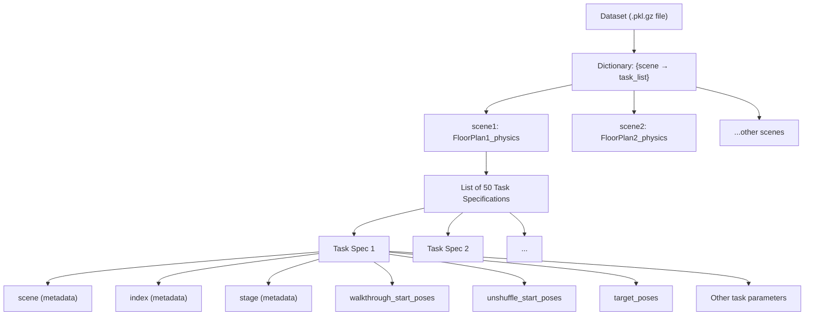
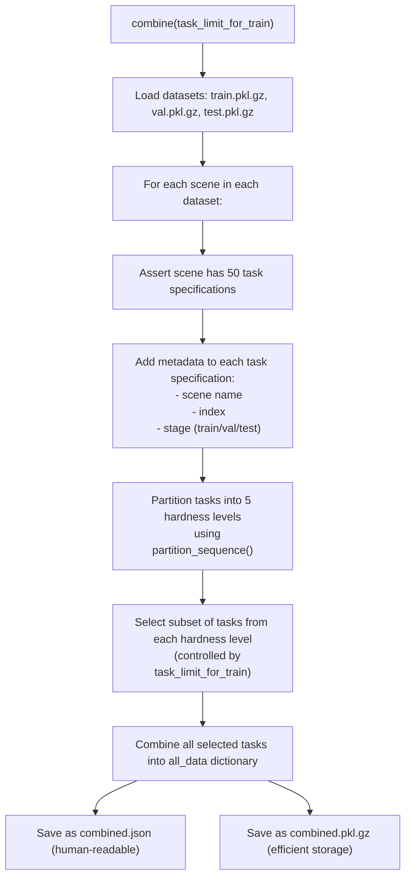

<!-- source: DeepWiki mcp.deepwiki.com · repo allenai/ai2thor-rearrangement · page 8.2 Dataset Utilities · fetched 2026-10-26 -->

# Dataset Utilities

<details>
<summary>Relevant source files</summary>

The following files were used as context for generating this wiki page:

- [datagen/create_combined_dataset.py](datagen/create_combined_dataset.py)

</details>


This document covers the utilities and tools for working with datasets in the AI2-THOR Rearrangement Challenge. These utilities focus on processing, combining, and managing task datasets used for training and evaluating rearrangement agents. For information about how these datasets are initially generated, see [Data Generation](#8.1).

## Dataset Structure

The rearrangement datasets are stored as compressed pickle files (`.pkl.gz`) in the directory specified by `STARTER_DATA_DIR` from the constants module. The repository includes separate dataset files for different purposes:

- `train.pkl.gz`: Training dataset
- `val.pkl.gz`: Validation dataset
- `test.pkl.gz`: Test dataset
- `combined.pkl.gz`: Combined dataset (created from the above)
- `combined.json`: JSON version of the combined dataset (for inspection)



Sources: [rearrange/constants.py](), [datagen/create_combined_dataset.py:17-22]()

## The `combine` Function

The primary dataset utility is the `combine` function in `create_combined_dataset.py`, which processes and merges the individual train, validation, and test datasets into a unified dataset.

### Function Signature and Parameters

```python
def combine(task_limit_for_train: int = 10000):
    # Function implementation
```

- `task_limit_for_train`: Controls the maximum number of tasks to include per scene from the training dataset. Default is 10000, but can be set lower to create smaller datasets for faster experimentation.

Sources: [datagen/create_combined_dataset.py:11-13]()

### Processing Flow

The function performs the following operations:



Sources: [datagen/create_combined_dataset.py:14-49]()

## Hardness Partitioning

An important feature of the `combine` function is that it partitions tasks by difficulty level to ensure a balanced dataset:

1. Each scene contains exactly 50 task specifications (asserted in the code)
2. The function divides these 50 tasks into 5 equal parts using `partition_sequence`
3. It then selects an equal number of tasks from each partition
4. This approach ensures the final dataset contains a balanced distribution of task difficulties

The relevant code:

```python
pieces_per_part = max_per_scene // 5  # 5 hardnesses
parts = partition_sequence(data[scene], 5)
all_together = sum([part[:pieces_per_part] for part in parts], [])
```

Sources: [datagen/create_combined_dataset.py:26-35]()

## Dataset File Formats

The rearrangement datasets are stored in two formats:

1. **Compressed Pickle (.pkl.gz)**: The primary format used for efficient storage and loading during training and evaluation. Created using the `compress_pickle` library with Python 3.6 compatibility.

2. **JSON (.json)**: A human-readable format that allows for easier inspection and debugging of the dataset structure.

The `combine` function generates both formats when creating the combined dataset.

Sources: [datagen/create_combined_dataset.py:42-49]()

## Using the Dataset Utilities

### Creating a Combined Dataset

To create a combined dataset with a specific limit on training tasks:

```python
from datagen.create_combined_dataset import combine

# Create combined dataset with at most 10 training tasks per scene
combine(task_limit_for_train=10)
```

This generates both `combined.json` and `combined.pkl.gz` files in the `STARTER_DATA_DIR`.

Sources: [datagen/create_combined_dataset.py:52-53]()

### Loading Datasets

To load a dataset for use in training or evaluation:

```python
import os
import compress_pickle
from rearrange.constants import STARTER_DATA_DIR

# Load a dataset
data_path = os.path.join(STARTER_DATA_DIR, "train.pkl.gz")
dataset = compress_pickle.load(path=data_path)

# Access tasks for a specific scene
scene_tasks = dataset["FloorPlan1_physics"]
```

Sources: [datagen/create_combined_dataset.py:17-22]()

## Dataset Metadata

When processed by the `combine` function, each task specification is enriched with metadata:

- `scene`: The scene name (e.g., "FloorPlan1_physics")
- `index`: The original index of the task within its scene's task list (0-49)
- `stage`: The dataset stage ("train", "val", or "test")

This metadata is useful for tracking the origin of tasks within the combined dataset and can be used for filtering or analysis.

Sources: [datagen/create_combined_dataset.py:28-31]()

---

