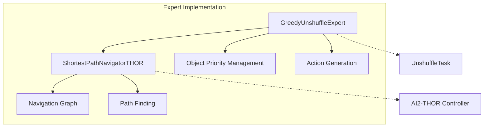
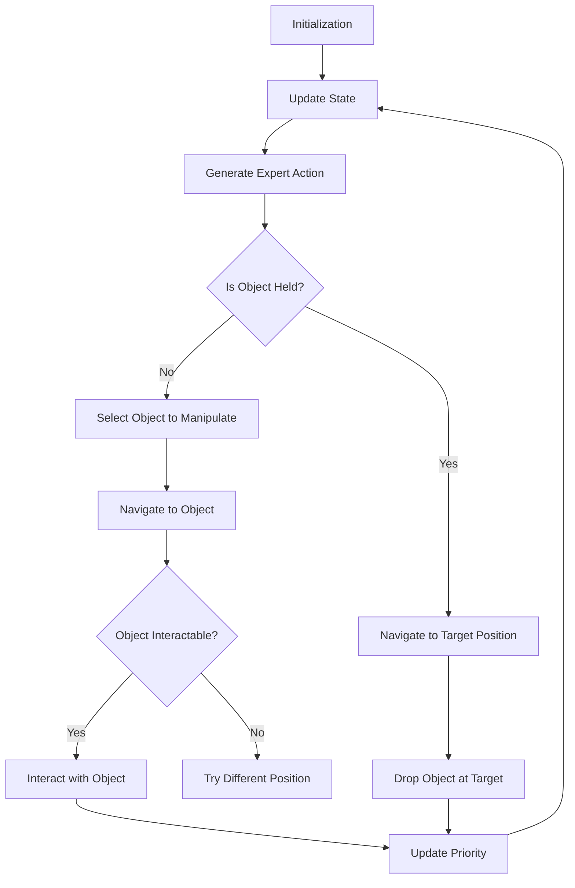
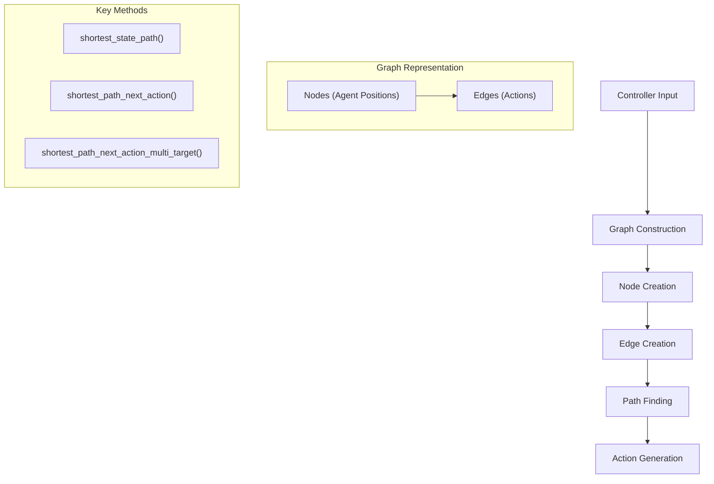
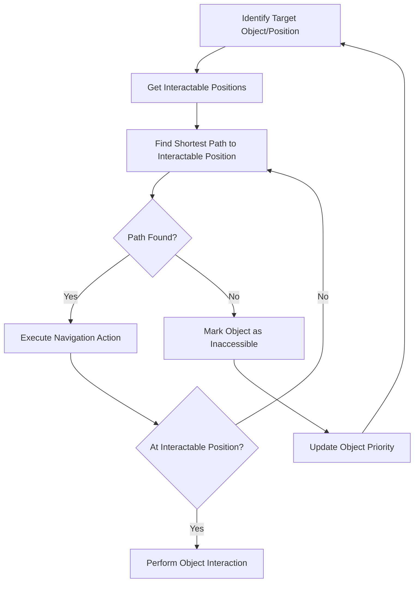
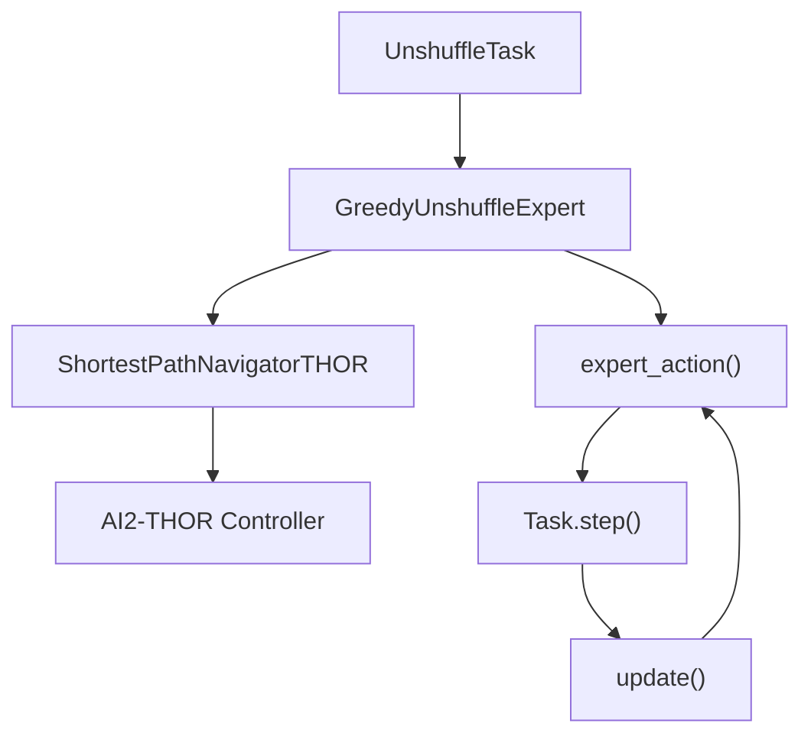

<!-- source: DeepWiki mcp.deepwiki.com · repo allenai/ai2thor-rearrangement · page 9 Expert Implementation · fetched 2026-10-26 -->

# Expert Implementation

Relevant source files

The following files were used as context for generating this wiki page:

- [rearrange/expert.py](rearrange/expert.py)

This page documents the expert agent implementation used in the AI2-THOR Rearrangement Challenge. The expert system provides a solution strategy for the unshuffle task, enabling algorithmic demonstration of task completion and generation of expert trajectories that can be used for imitation learning. For general information about the challenge tasks, see [Tasks](#4).

## Overview

The expert implementation consists of two primary components:

1. **GreedyUnshuffleExpert**: An agent that greedily attempts to solve the unshuffle task by prioritizing objects and taking the most direct actions possible.

2. **ShortestPathNavigatorTHOR**: A navigation system that computes optimal paths through the environment to reach objects of interest.

Sources: [rearrange/expert.py:411-773](), [rearrange/expert.py:41-385]()

## GreedyUnshuffleExpert

The `GreedyUnshuffleExpert` class implements a deterministic agent that follows a greedy approach to complete the unshuffle task. It systematically identifies objects that need to be rearranged and takes actions to restore them to their original positions.

Sources: [rearrange/expert.py:411-447](), [rearrange/expert.py:745-772]()

### Key Components

1. **Object Priority Management**: The expert maintains a priority counter for each object. When an object interaction fails or is completed, its priority is increased. Objects with higher priorities are deprioritized to avoid getting stuck on difficult objects.

2. **Action Generation**: The expert generates actions through a decision tree based on the current state:
   - If holding an object → navigate to and place it at the target position
   - If not holding an object → find and navigate to the next object to manipulate

3. **State Tracking**: The expert tracks objects it has attempted to interact with and their success/failure status.

Sources: [rearrange/expert.py:457-528](), [rearrange/expert.py:598-744]()

### Expert Decision Flow

The expert follows a specific strategy when deciding what action to take:

1. If holding an object:
   - Navigate to a position where the object can be placed in its target location
   - Once in position, drop the object

2. If not holding an object:
   - Compare current and goal poses to identify misplaced objects
   - Select a misplaced object with the lowest priority and nearest distance
   - Navigate to the object
   - Interact with the object (pickup for movable objects, open for openable objects)

3. If no more objects need rearrangement:
   - Execute "Done" action to complete the task

Sources: [rearrange/expert.py:598-744]()

## ShortestPathNavigatorTHOR

The `ShortestPathNavigatorTHOR` class provides navigation capabilities for the expert agent. It builds and maintains a graph representation of the environment to compute optimal paths between locations.

Sources: [rearrange/expert.py:41-385]()

### Graph Representation

The navigator constructs a directed graph where:
- **Nodes**: Represent possible agent positions in the environment (x, z, rotation, horizon)
- **Edges**: Represent navigational actions (MoveAhead, RotateLeft, etc.) that transition between positions

The graph is built on demand and cached for each scene to improve performance.

Sources: [rearrange/expert.py:104-126](), [rearrange/expert.py:128-175]()

### Path Finding

The navigator provides several methods for path finding:

1. `shortest_state_path`: Computes the shortest path between two positions
2. `shortest_path_next_action`: Determines the next action to take along the shortest path
3. `shortest_path_next_action_multi_target`: Finds the next action toward the closest of multiple goal positions

These methods use NetworkX's graph algorithms to compute optimal paths through the environment.

Sources: [rearrange/expert.py:315-384]()

### Node and Edge Management

The navigator dynamically updates the graph based on action results:
- Failed actions result in edge removal
- New positions are added to the graph with corresponding edges
- Positions are standardized to account for grid-based movement and discrete rotations

Sources: [rearrange/expert.py:277-313]()

## Expert Navigation Process

The expert's navigation process integrates with object interaction to efficiently complete the unshuffle task.

Sources: [rearrange/expert.py:530-576](), [rearrange/expert.py:598-744]()

### Interactable Positions

The expert relies on the environment's `_interactable_positions_cache` to determine positions from which objects can be interacted with. When an interaction fails, the expert updates this cache to avoid attempting the same interaction from the same position.

Sources: [rearrange/expert.py:578-596]()

### Navigation to Objects

The expert uses the `_expert_nav_action_to_obj` method to determine the next navigation action toward an object:

1. Retrieve all interactable positions for the object
2. Convert these positions to graph node keys
3. Find the shortest path to any of these positions
4. Return the next action along this path

If no path is found, the object's priority is increased to try a different object.

Sources: [rearrange/expert.py:530-576]()

## Expert Usage

The expert agent can be used for:

1. **Demonstration**: Showing how to complete the unshuffle task
2. **Data Generation**: Creating expert trajectories for imitation learning
3. **Evaluation**: Establishing a baseline performance for comparison

The file includes a test function that demonstrates how to use the expert to solve tasks and evaluate its performance.

Sources: [rearrange/expert.py:775-846]()

## Integration with Task System

The expert is designed to work with the `UnshuffleTask` and integrates with the rearrangement environment.

Sources: [rearrange/expert.py:411-447](), [rearrange/expert.py:775-846]()

### Initialization

To create an expert agent:

1. Create a `ShortestPathNavigatorTHOR` instance with the AI2-THOR controller
2. Create a `GreedyUnshuffleExpert` instance with the task and navigator
3. Call `update()` after each action to keep the expert's state current
4. Use `expert_action()` to get the next expert action

Sources: [rearrange/expert.py:414-446]()

### Expert Feedback Loop

The expert operates in a continuous feedback loop:

1. Generate an expert action based on the current state
2. Execute the action in the environment
3. Update the expert with the result (success/failure)
4. Repeat until the task is complete

This loop allows the expert to adapt to the changing environment and handle failures gracefully.

Sources: [rearrange/expert.py:457-528](), [rearrange/expert.py:775-846]()

## Performance Considerations

The expert implementation has several limitations and performance considerations:

1. **Greedy Approach**: The expert follows a greedy strategy that may not be optimal in all cases
2. **Recovery from Failures**: The expert can get stuck if interacting with an object repeatedly fails
3. **Navigation Constraints**: The expert assumes 90-degree rotations and fixed step sizes
4. **Scene Knowledge**: The expert builds a navigation graph based on the available positions, which requires scene exploration

Despite these limitations, the expert provides a solid baseline for the unshuffle task and can successfully complete most scenarios.

Sources: [rearrange/expert.py:411-447](), [rearrange/expert.py:598-744]()

---

