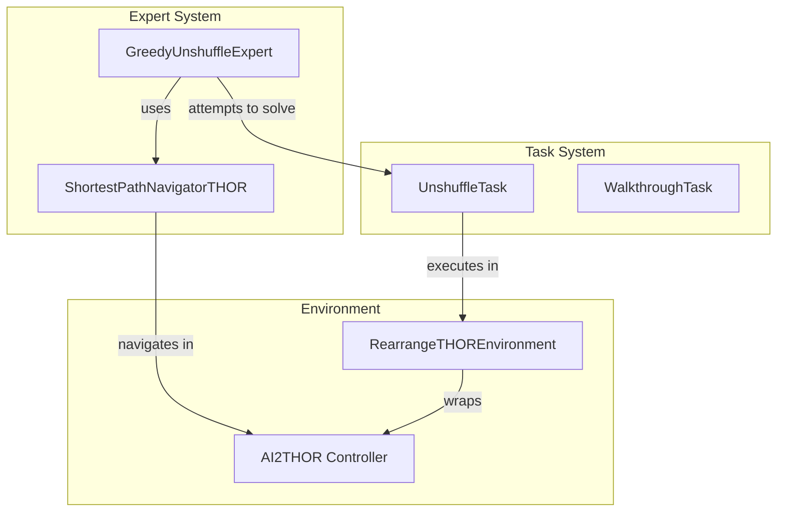
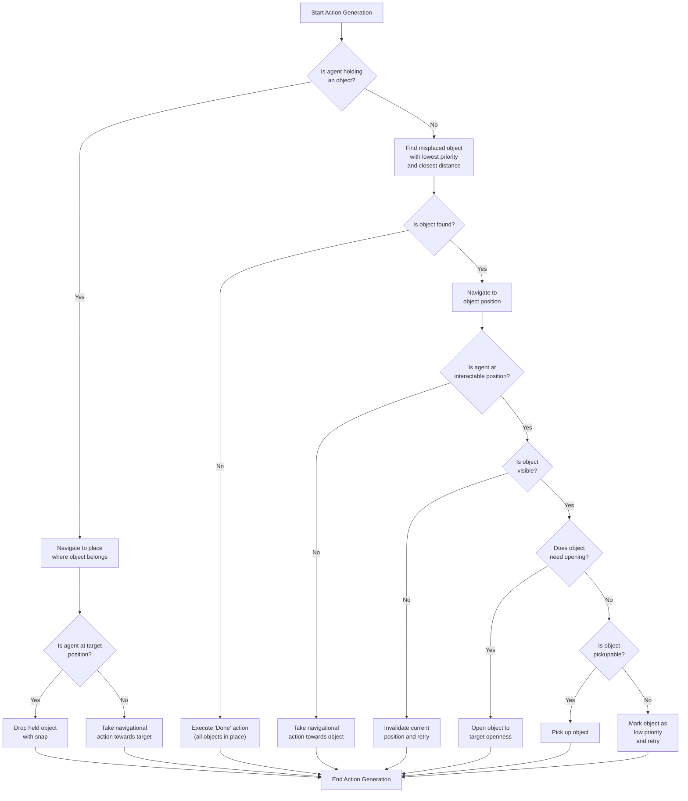
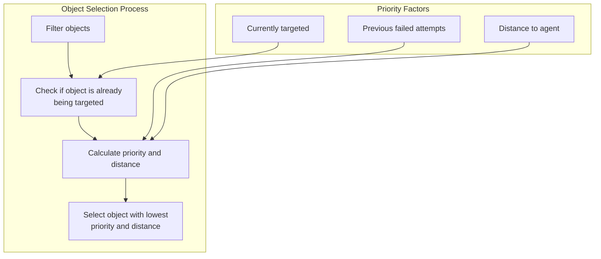
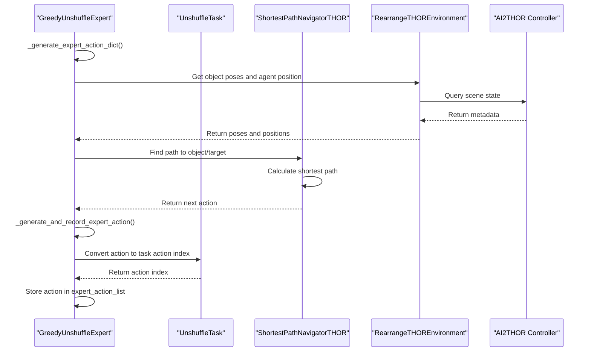

<!-- source: DeepWiki mcp.deepwiki.com · repo allenai/ai2thor-rearrangement · page 9.1 GreedyUnshuffleExpert · fetched 2026-10-26 -->

# GreedyUnshuffleExpert

<details>
<summary>Relevant source files</summary>

The following files were used as context for generating this wiki page:

- [rearrange/expert.py](rearrange/expert.py)

</details>


## Purpose and Overview

`GreedyUnshuffleExpert` is a heuristic-based agent that systematically solves the unshuffle task in the AI2-THOR Rearrangement Challenge. It implements a greedy algorithm that attempts to restore objects to their original positions one at a time by prioritizing objects based on distance and previous interaction attempts.

This document describes the implementation, workflow, and usage of the `GreedyUnshuffleExpert`. For information about the navigation component used by this expert, see [ShortestPathNavigatorTHOR](#9.2).

Sources: [rearrange/expert.py:411-412]()

## Architecture and Components

The `GreedyUnshuffleExpert` sits within the AI2-THOR Rearrangement system as shown below:



Sources: [rearrange/expert.py:411-442](), [rearrange/expert.py:41-385]()

### Class Structure

`GreedyUnshuffleExpert` has the following structure:

```mermaid
classDiagram
    class "GreedyUnshuffleExpert" {
        +UnshuffleTask task
        +ShortestPathNavigatorTHOR shortest_path_navigator
        +int max_priority_per_object
        +List expert_action_list
        +defaultdict object_name_to_priority
        +expert_action() int
        +update(action_taken, action_success)
        -_expert_nav_action_to_obj(obj) str
        -_invalidate_interactable_loc_for_pose(location, obj_pose) bool
        -_generate_expert_action_dict() dict
        -_generate_and_record_expert_action()
    }
    
    class "ShortestPathNavigatorTHOR" {
        +Controller controller
        +float grid_size
        +bool include_move_left_right
        +graph() nx.DiGraph
        +shortest_path_next_action(source, goal) str
    }
    
    "GreedyUnshuffleExpert" --> "ShortestPathNavigatorTHOR" : uses
    "GreedyUnshuffleExpert" --> "UnshuffleTask" : solves
```

Sources: [rearrange/expert.py:414-442]()

## Initialization and Key Properties

The expert is initialized with three parameters:

```python
def __init__(
    self,
    task: "UnshuffleTask",
    shortest_path_navigator: ShortestPathNavigatorTHOR,
    max_priority_per_object: int = 3,
):
```

| Parameter | Type | Description |
|-----------|------|-------------|
| `task` | UnshuffleTask | The unshuffle task instance that the expert will attempt to solve |
| `shortest_path_navigator` | ShortestPathNavigatorTHOR | Navigator that computes shortest paths in the environment |
| `max_priority_per_object` | int | Maximum number of attempts to rearrange an object before giving up (default: 3) |

The expert maintains several internal tracking variables:

- `expert_action_list`: Records all expert actions recommended so far
- `object_name_to_priority`: Maps object names to their current priority level (attempt count)
- `_last_held_object_name`: The name of the last object held by the agent
- `_last_to_interact_object_pose`: The pose of the object the agent is currently targeting
- `_name_of_object_we_wanted_to_pickup`: The name of the object the agent intended to pick up

Sources: [rearrange/expert.py:414-442]()

## Expert Action Generation Process

The core of the expert is its action generation logic. This flowchart illustrates how the expert decides what action to take next:



Sources: [rearrange/expert.py:598-743]()

## Key Methods

### `expert_action`

Property that returns the current expert action index corresponding to the action in `task.action_names()`.

Sources: [rearrange/expert.py:446-455]()

### `update`

Updates the expert's state after an action is taken. Takes two parameters:
- `action_taken`: The action index that was actually executed
- `action_success`: Whether the action succeeded

This method:
1. Updates object priorities based on action success/failure
2. Tracks held objects
3. Invalidates navigation paths if actions fail
4. Generates the next expert action

Sources: [rearrange/expert.py:457-528]()

### `_expert_nav_action_to_obj`

Finds the shortest path navigation action to reach an interactable position for a given object.

Sources: [rearrange/expert.py:530-576]()

### `_generate_expert_action_dict`

The core decision-making method that determines the next action based on current state:

1. If the agent is holding an object:
   - Navigate to where the object belongs
   - Drop the object when in position
   
2. If the agent is not holding an object:
   - Find misplaced objects (where current pose ≠ goal pose)
   - Filter objects with priority > max_priority_per_object
   - Select the object with lowest priority and closest to agent
   - Navigate to the selected object
   - Interact with it (open or pick up) once reached

Sources: [rearrange/expert.py:598-743]()

## Expert Decision Making

The expert uses several heuristics to prioritize which objects to rearrange:

1. **Priority counter**: Each object has a priority counter that increases when:
   - The agent attempts to drop the object
   - The agent attempts to open the object
   - The agent fails to navigate to or interact with the object

2. **Distance**: Objects closer to the agent are preferred over those farther away

3. **Current focus**: An object that the expert is currently targeting gets highest priority



Sources: [rearrange/expert.py:636-672]()

## Interaction with Environment

The expert agent interacts with the AI2-THOR environment through the `RearrangeTHOREnvironment` wrapper and the `UnshuffleTask`. It retrieves object poses and agent positions, computes paths using the `ShortestPathNavigatorTHOR`, and executes actions through the task interface.



Sources: [rearrange/expert.py:446-772]()

## Error Handling and Recovery

The expert implements several mechanisms to handle failures and edge cases:

1. **Navigation failures**: When navigation actions fail, the expert updates the navigation graph to avoid attempting the same failed action again.
   
2. **Interaction failures**: When object interaction (pickup, open) fails, the expert invalidates the current position as an interactable position for the object.

3. **Priority-based skipping**: Objects that consistently fail to be rearranged have their priority increased until they exceed `max_priority_per_object`, at which point they are skipped.

4. **Path unavailability**: If no path can be found to an object, the expert increases its priority and tries a different object.

Sources: [rearrange/expert.py:469-517](), [rearrange/expert.py:678-700]()

## Usage Example

Here's how the expert is typically used in a task loop:

```python
# Create a shortest path navigator
shortest_path_navigator = ShortestPathNavigatorTHOR(
    controller=task_sampler.unshuffle_env.controller, 
    grid_size=STEP_SIZE
)

# Create the expert for the current task
greedy_expert = GreedyUnshuffleExpert(
    task=task, 
    shortest_path_navigator=shortest_path_navigator
)

# Task execution loop
while not task.is_done():
    # Get expert action
    action_to_take = greedy_expert.expert_action
    
    # Execute action
    step_result = task.step(action_to_take)
    
    # Update expert
    greedy_expert.update(
        action_taken=action_to_take,
        action_success=step_result.info["action_success"]
    )
```

Sources: [rearrange/expert.py:775-846]()

## Limitations

1. The expert is designed only for the SNAP mode of the environment, which simplifies object placement.
2. It can sometimes fail to complete tasks if objects become unreachable or if all objects exceed the maximum priority.
3. The expert can't handle complex interactions like stacking objects.
4. It doesn't maintain a memory of previously successful interactions, recomputing paths and actions at each step.

Sources: [rearrange/expert.py:602-605]()

---

