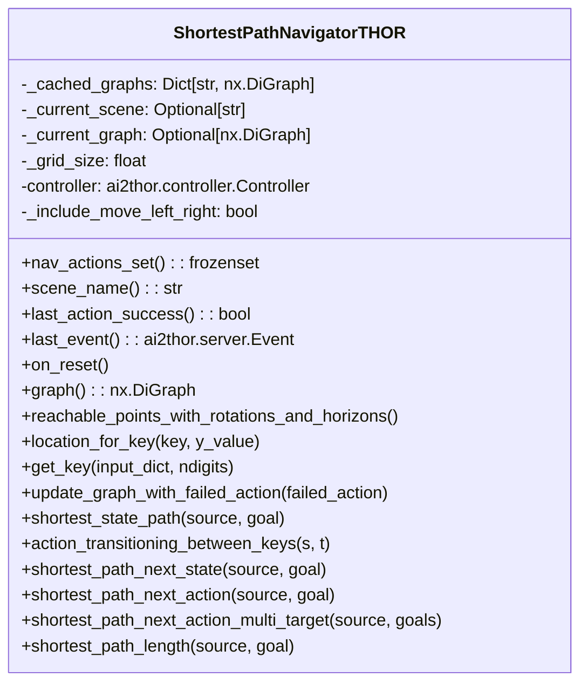
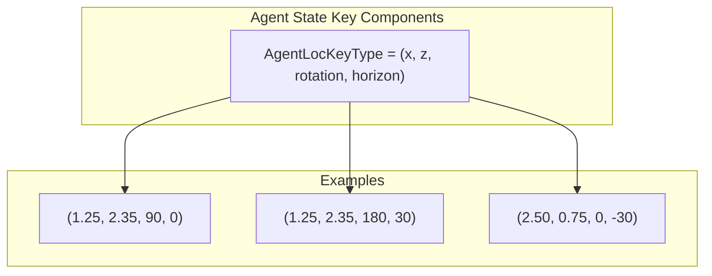
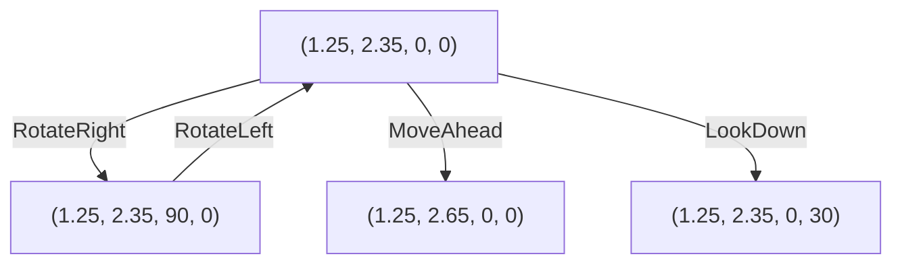
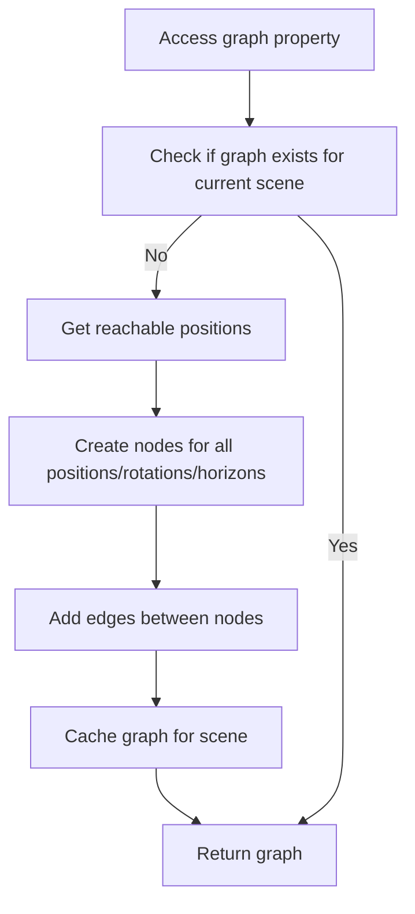
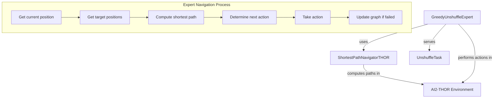
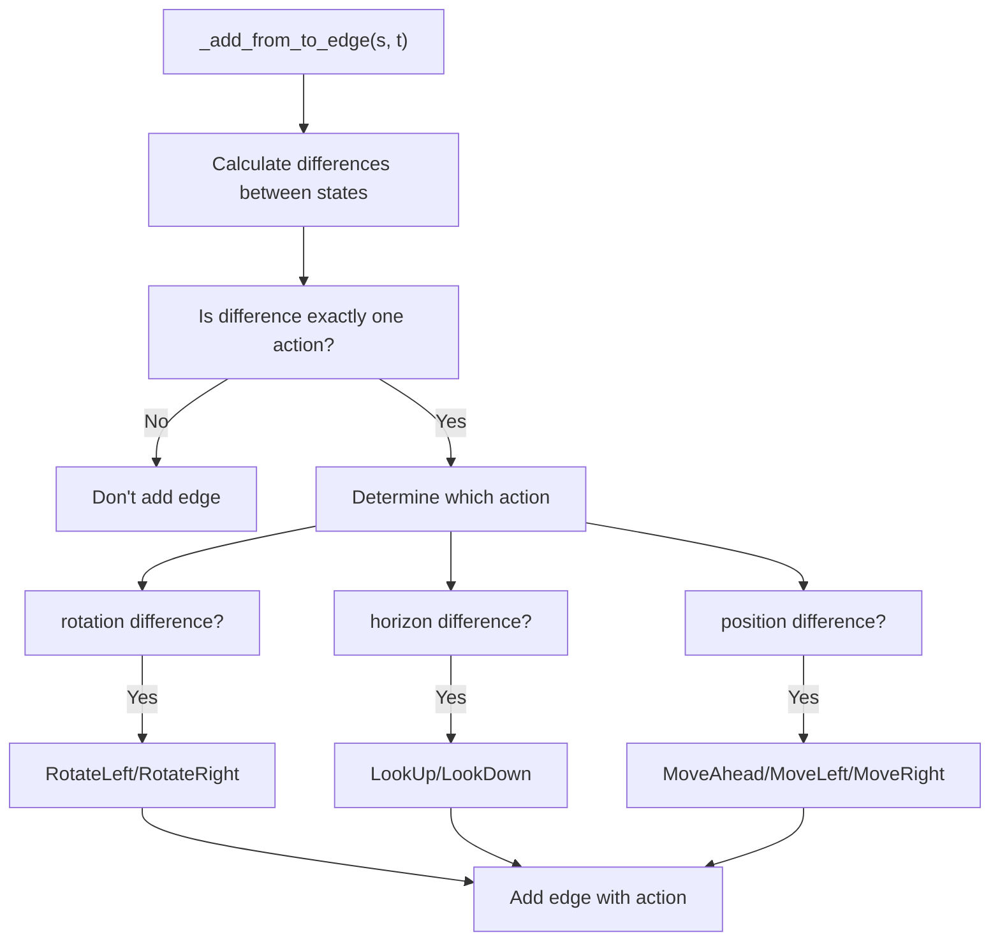

<!-- source: DeepWiki mcp.deepwiki.com · repo allenai/ai2thor-rearrangement · page 9.2 ShortestPathNavigatorTHOR · fetched 2026-10-26 -->

# ShortestPathNavigatorTHOR

<details>
<summary>Relevant source files</summary>

The following files were used as context for generating this wiki page:

- [rearrange/expert.py](rearrange/expert.py)

</details>


The `ShortestPathNavigatorTHOR` class provides efficient navigation capabilities for AI2-THOR environments through graph-based shortest path computation. It serves as the core navigation component used by the `GreedyUnshuffleExpert` for finding optimal paths to target objects in the rearrangement challenge. For information about the greedy expert itself, see [GreedyUnshuffleExpert](#9.1).

## 1. Overview

The `ShortestPathNavigatorTHOR` builds and maintains a navigation graph where nodes represent agent positions (with associated rotations and camera horizons) and edges represent valid navigational actions. It computes shortest paths between locations using this graph structure, enabling efficient navigation through the environment.



Sources: [rearrange/expert.py:41-384]()

## 2. Key Features

- Maintains navigation graphs for different scenes
- Computes optimal paths considering agent position, rotation, and camera horizon
- Supports navigation with 90-degree rotations and fixed step sizes
- Updates navigation graph dynamically based on action failures
- Provides methods for determining next actions along shortest paths
- Supports multi-target pathfinding (finding path to closest of several targets)

Sources: [rearrange/expert.py:42-48](), [rearrange/expert.py:74-87]()

## 3. Navigation Graph Structure

The navigation graph is the core data structure maintained by `ShortestPathNavigatorTHOR`. It uses the NetworkX library to create a directed graph representing possible navigation paths.

### 3.1 Node Representation

Each node in the graph represents a unique agent state defined by a 4-tuple key:
- x-coordinate (rounded to 2 decimal places)
- z-coordinate (rounded to 2 decimal places)
- rotation (0, 90, 180, or 270 degrees)
- camera horizon (-30, 0, 30, or 60 degrees)



Sources: [rearrange/expert.py:38](), [rearrange/expert.py:156-174]()

### 3.2 Edge Representation

Edges in the graph represent valid navigation actions between states:
- Rotation actions: RotateLeft, RotateRight
- Look actions: LookUp, LookDown
- Movement actions: MoveAhead (and optionally MoveLeft, MoveRight)

Each edge contains data about which action transitions between the connected nodes.



Sources: [rearrange/expert.py:197-260]()

## 4. Initialization and Configuration

The navigator is initialized with:
- An AI2-THOR controller instance
- A grid size (step distance for movement actions)
- Optional flag to include MoveLeft/MoveRight actions

```python
navigator = ShortestPathNavigatorTHOR(
    controller=env.controller,
    grid_size=STEP_SIZE,
    include_move_left_right=False
)
```

Sources: [rearrange/expert.py:50-73]()

## 5. Graph Construction and Maintenance

### 5.1 Building the Graph

The graph is constructed lazily upon first access. The process involves:
1. Getting all reachable positions in the environment
2. Adding these positions as nodes with all possible rotations and horizons
3. Adding edges between nodes that can be reached with a single action



Sources: [rearrange/expert.py:110-126](), [rearrange/expert.py:128-146]()

### 5.2 Updating the Graph

The graph is dynamically updated when navigation actions fail:

```python
navigator.update_graph_with_failed_action("MoveAhead")
```

This removes the edge corresponding to the failed action, preventing future path computations from using it.

Sources: [rearrange/expert.py:176-196]()

## 6. Path Computation Methods

The class provides several methods for computing and using shortest paths:

### 6.1 Basic Path Finding

```python
# Get full path
path = navigator.shortest_state_path(source_key, goal_key)

# Get next state along path
next_state = navigator.shortest_path_next_state(source_key, goal_key)

# Get next action along path
next_action = navigator.shortest_path_next_action(source_key, goal_key)
```

Sources: [rearrange/expert.py:315-352]()

### 6.2 Multi-Target Path Finding

For finding the shortest path to the closest of multiple targets:

```python
next_action = navigator.shortest_path_next_action_multi_target(
    source_state_key=current_position, 
    goal_state_keys=interactable_positions
)
```

This approach is particularly useful in the rearrangement challenge when navigating to objects with multiple interactable positions.

Sources: [rearrange/expert.py:354-373]()

## 7. Integration with Expert System

The `ShortestPathNavigatorTHOR` is a critical component used by the `GreedyUnshuffleExpert` to navigate efficiently in the environment. Below is a diagram illustrating this relationship:



The expert uses the navigator to:
1. Find paths to objects that need to be rearranged
2. Navigate to positions where objects can be picked up
3. Navigate to positions where objects can be placed

Sources: [rearrange/expert.py:414-432](), [rearrange/expert.py:530-576]()

## 8. Key Implementation Details

### 8.1 Node Key Generation

The navigator uses a consistent way to generate keys from agent positions:

```python
def get_key(input_dict, ndigits=2):
    # Extract position, rotation, and horizon
    x = input_dict["x"] or input_dict["position"]["x"]
    z = input_dict["z"] or input_dict["position"]["z"]
    rot = input_dict["rotation"] or input_dict["rotation"]["y"]
    hor = input_dict["horizon"] or input_dict["cameraHorizon"]
    
    # Round and normalize values
    return (
        round(x, ndigits),
        round(z, ndigits),
        round_to_factor(rot, 90) % 360,
        round_to_factor(hor, 30) % 360,
    )
```

Sources: [rearrange/expert.py:156-174]()

### 8.2 Edge Creation Logic

The navigator carefully determines which actions connect different states:



Sources: [rearrange/expert.py:197-260]()

## 9. Usage Examples

### 9.1 Typical Usage in Greedy Expert

```python
# Initialize navigator
navigator = ShortestPathNavigatorTHOR(
    controller=env.controller, grid_size=STEP_SIZE
)

# Reset when environment changes
navigator.on_reset()

# Get navigational action to object
current_pos = navigator.get_key(env.get_agent_location())
target_positions = [navigator.get_key(loc) for loc in interactable_positions]
next_action = navigator.shortest_path_next_action_multi_target(
    source_state_key=current_pos, goal_state_keys=target_positions
)

# Take action and handle failures
if not action_success:
    navigator.update_graph_with_failed_action(action)
```

Sources: [rearrange/expert.py:790-793](), [rearrange/expert.py:493-496](), [rearrange/expert.py:554-557]()

## 10. Limitations and Considerations

- Assumes 90-degree rotations and fixed step sizes
- Navigation graph can grow large in complex environments
- Interactability with objects is handled separately from pure navigation
- Graph updates are permanent within a session (failed edges remain removed)
- Only considers discrete positions aligned to the grid

Sources: [rearrange/expert.py:42-48]()