# Page: Overview

# Overview

<details>
<summary>Relevant source files</summary>

The following files were used as context for generating this wiki page:

- [README.md](README.md)

</details>


The AI2-THOR Rearrangement Challenge is a framework for training and evaluating embodied AI agents to rearrange objects in simulated environments. It provides a benchmark for object manipulation, visual memory, and scene understanding tasks within the AI2-THOR simulation platform.

This documentation covers the core components, architecture, and functionality of the rearrangement challenge framework. For installation instructions, see [Installation and Setup](#1.1), and for repository organization details, see [Repository Structure](#1.2).

## Challenge Description

The AI2-THOR Rearrangement Challenge tasks agents with restoring objects to their original configuration after they have been moved or altered. The challenge has two main phases:

1. **Walkthrough Phase**: The agent explores a room and observes objects in their goal arrangement
2. **Unshuffle Phase**: After objects have been rearranged, the agent must restore them to their original positions

The challenge offers two tracks of varying difficulty:
- **One-Phase Track**: The agent simultaneously receives observations from both goal and current states
- **Two-Phase Track**: The agent must memorize the goal state during walkthrough before attempting to restore it in the unshuffle phase

Sources: [README.md:30-36](), [README.md:302-312](), [README.md:315-325]()

## System Architecture

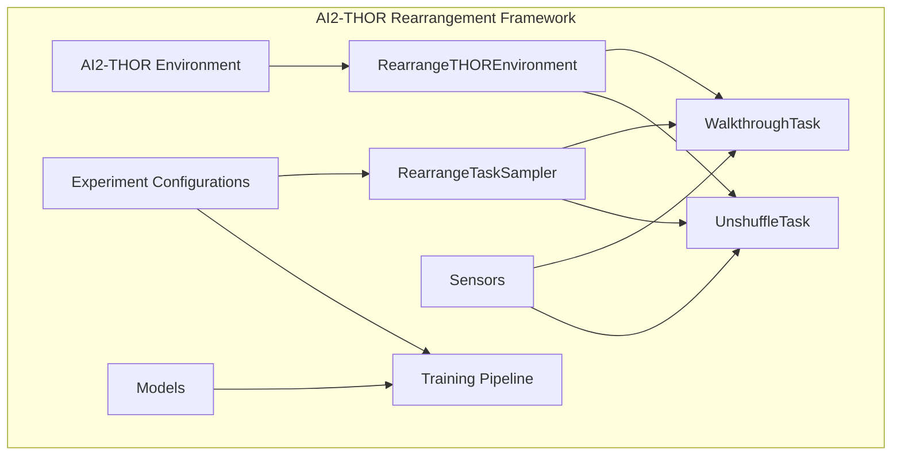

**System Architecture Diagram**

The system consists of several key components that work together to create and manage rearrangement tasks:

1. **RearrangeTHOREnvironment**: A wrapper around the AI2-THOR environment that provides methods for setting up scenes, tracking object poses, and evaluating agent performance.

2. **Task Types**:
   - **WalkthroughTask**: Handles the walkthrough phase where the agent observes the target arrangement
   - **UnshuffleTask**: Manages the unshuffle phase where the agent must restore objects

3. **RearrangeTaskSampler**: Creates task instances from datasets and manages transitions between phases

4. **Sensors**: Provide observations to the agent (RGB images, depth maps, etc.)

5. **Experiment Configurations**: Define training parameters and approaches

6. **Models**: Baseline neural network architectures for solving the tasks

Sources: [README.md:137-171](), [rearrange/environment.py](), [rearrange/tasks.py]()

## Challenge Workflow

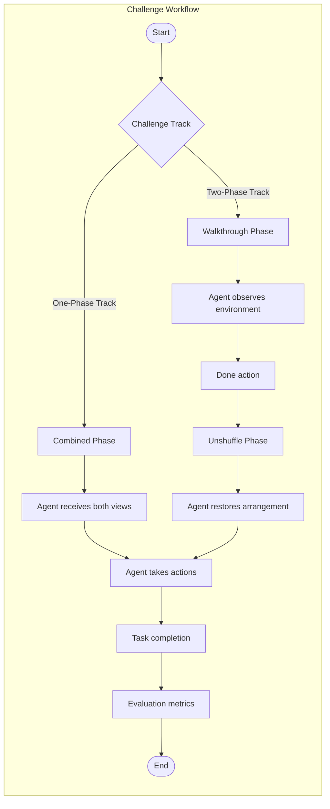

**Challenge Workflow Diagram**

The workflow differs based on the selected challenge track:

- **One-Phase Track**: The agent receives both walkthrough (goal) and current views simultaneously, making it easier to identify misplaced objects
- **Two-Phase Track**: The agent must first memorize the goal state during walkthrough, then later restore it from memory in the unshuffle phase

Both tracks evaluate the agent on its ability to identify and fix misplaced objects by navigating around the environment and manipulating objects.

Sources: [README.md:302-325](), [rearrange/tasks.py]()

## Core Components Detail

### RearrangeTHOREnvironment

The `RearrangeTHOREnvironment` class serves as the primary interface to the AI2-THOR simulator. It provides:

- Scene setup and initialization
- Object pose tracking and comparison
- Action execution
- Evaluation utilities

### Tasks

Two main task classes manage the challenge phases:

1. **WalkthroughTask**: Handles the initial exploration phase where the agent observes the goal arrangement
2. **UnshuffleTask**: Manages the rearrangement phase where the agent must restore objects to their goal positions

### RearrangeTaskSampler

The `RearrangeTaskSampler` creates task instances for training and evaluation:

- Loads tasks from datasets
- Manages transitions between phases
- Configures task parameters

### Agent Actions

The agent can perform a variety of actions to navigate and manipulate objects:

| Action Type | Examples | Description |
|-------------|----------|-------------|
| Navigation | MoveAhead, RotateRight | Move the agent around the environment |
| Object Interaction | PickupObject, PlaceObject | Manipulate objects in the environment |
| State Control | Done | Signal completion of a phase |

Sources: [README.md:415-448](), [rearrange/constants.py]()

## Object Representation

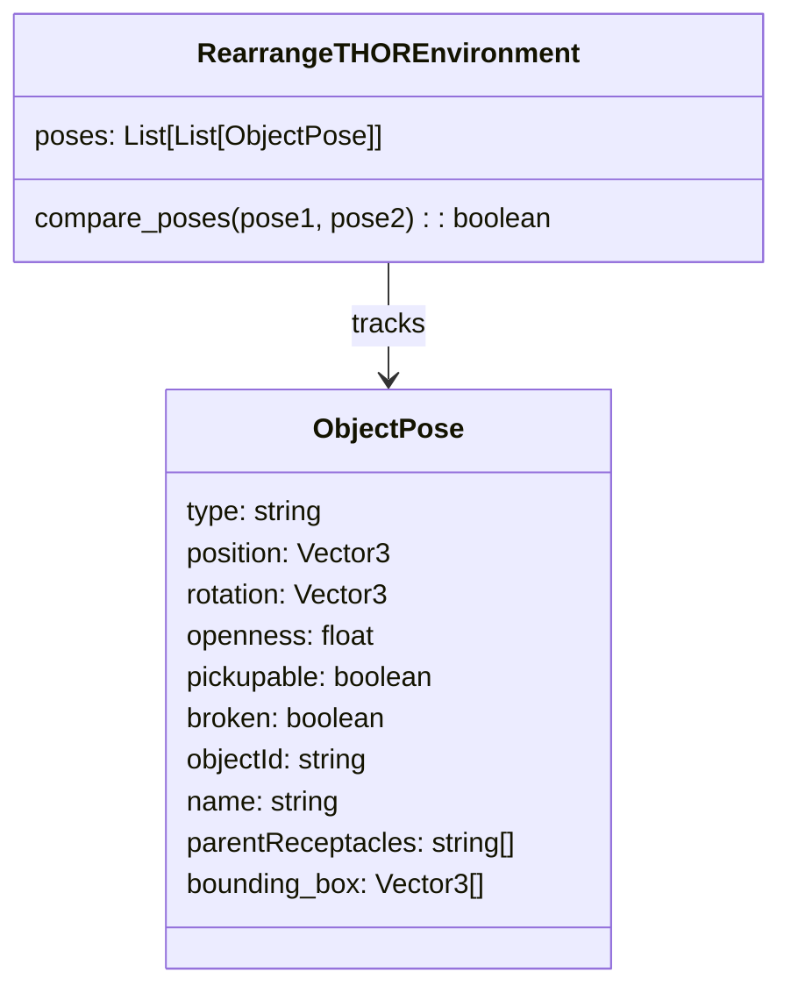

**Object Representation Diagram**

Objects in the environment are represented by their poses, which include:

- **Position and Rotation**: 3D coordinates and rotation values
- **Openness**: For openable objects (cabinets, drawers, etc.)
- **Bounding Box**: 3D coordinates defining the object's boundaries
- **Metadata**: Object type, ID, whether it's pickupable, etc.

The environment tracks three sets of poses:
- **Walkthrough Start Poses**: Goal arrangement observed during walkthrough
- **Unshuffle Start Poses**: Initial arrangement at the start of unshuffle phase
- **Current Poses**: Current state of all objects in the environment

Sources: [README.md:486-544](), [rearrange/environment.py]()

## Evaluation Metrics

The challenge uses several metrics to evaluate agent performance:

| Metric | Description |
|--------|-------------|
| Success Rate | 1 if all objects are in their goal state, 0 otherwise |
| % Misplaced | Proportion of misplaced objects at the end vs. start |
| % Fixed Strict | Proportion of initially misplaced objects that were fixed |
| % Energy Remaining | Measure of how close objects are to their goal poses |

An object is considered correctly placed when:
- Its 3D bounding box has >0.5 IoU with its goal bounding box
- Its openness value is within 0.2 of the goal openness (for openable objects)
- It is not broken

Sources: [README.md:560-638](), [rearrange/utils.py]()

## Training System

The framework uses the AllenAct reinforcement learning library to provide baseline models and training pipelines:

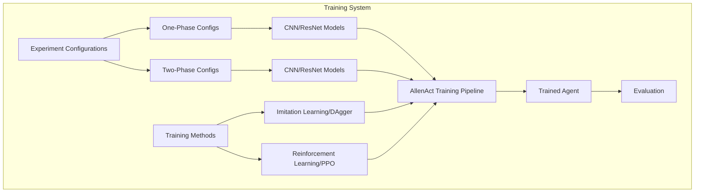

**Training System Diagram**

The training system supports:
- Different model architectures (simple CNN, ResNet, ActiveNeuralSLAM)
- Multiple training approaches (imitation learning, reinforcement learning)
- Experiment configurations for both challenge tracks

Sources: [README.md:641-686](), [baseline_configs/](), [rearrange/baseline_models.py]()

## Data Generation and Handling

The framework includes tools for dataset generation and management:

- Pre-generated datasets for training, validation, and testing
- Dataset utilities for loading and processing task data
- Task sampling mechanisms for training

Sources: [README.md:328-349](), [data/]()

---

# Page: Installation and Setup

# Installation and Setup

<details>
<summary>Relevant source files</summary>

The following files were used as context for generating this wiki page:

- [.dockerignore](.dockerignore)
- [Dockerfile](Dockerfile)
- [environment.yml](environment.yml)
- [requirements.txt](requirements.txt)

</details>


This document provides instructions for setting up the AI2-THOR Rearrangement environment. It covers system requirements, installation methods, and verification steps to ensure your environment is correctly configured. For information about the repository structure, see [Repository Structure](#1.2).

## System Requirements

Before beginning installation, ensure your system meets the following requirements:

- **Operating System**: Linux (recommended), macOS, or Windows
- **Python**: Version 3.9
- **GPU**: NVIDIA GPU with CUDA support (recommended for training)
- **Disk Space**: At least 10GB for the environment and datasets

## Installation Methods

There are three ways to set up the AI2-THOR Rearrangement environment:

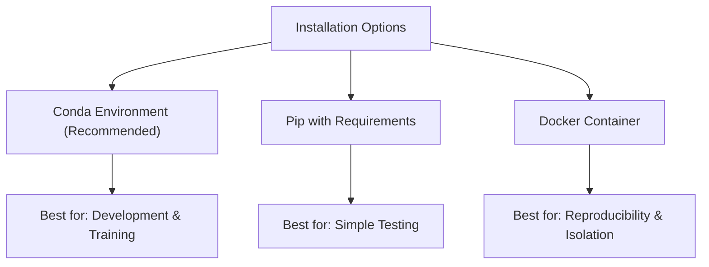

Sources: [environment.yml](), [requirements.txt](), [Dockerfile]()

### Method 1: Conda Environment (Recommended)

The recommended installation method uses Conda to manage dependencies and create an isolated environment.

1. **Install Conda** (if not already installed):
   - Download and install [Miniconda](https://docs.conda.io/en/latest/miniconda.html) or [Anaconda](https://www.anaconda.com/products/distribution)

2. **Create and activate the environment**:
   ```bash
   # Clone the repository
   git clone https://github.com/allenai/ai2thor-rearrangement.git
   cd ai2thor-rearrangement
   
   # Create conda environment from the provided file
   conda env create -f environment.yml
   
   # Activate the environment
   conda activate rearrange
   ```

Sources: [environment.yml]()

### Method 2: Python Virtual Environment with Pip

If you prefer using pip, you can create a virtual environment and install dependencies using the requirements file.

1. **Create and activate a virtual environment**:
   ```bash
   # Clone the repository
   git clone https://github.com/allenai/ai2thor-rearrangement.git
   cd ai2thor-rearrangement
   
   # Create virtual environment
   python -m venv rearrange_venv
   
   # Activate the environment
   # On Linux/macOS:
   source rearrange_venv/bin/activate
   # On Windows:
   rearrange_venv\Scripts\activate
   ```

2. **Install dependencies**:
   ```bash
   pip install -r requirements.txt
   ```

Sources: [requirements.txt]()

### Method 3: Docker Container

Using Docker ensures a consistent environment across different systems.

1. **Install Docker** (if not already installed):
   - Follow the [official Docker installation guide](https://docs.docker.com/get-docker/)

2. **Build and run the Docker container**:
   ```bash
   # Clone the repository
   git clone https://github.com/allenai/ai2thor-rearrangement.git
   cd ai2thor-rearrangement
   
   # Build the Docker image
   docker build -t ai2thor-rearrangement .
   
   # Run the container
   docker run -it --gpus all ai2thor-rearrangement
   ```

Sources: [Dockerfile](), [.dockerignore]()

## Dependency Structure

The AI2-THOR Rearrangement challenge relies on several key dependencies:

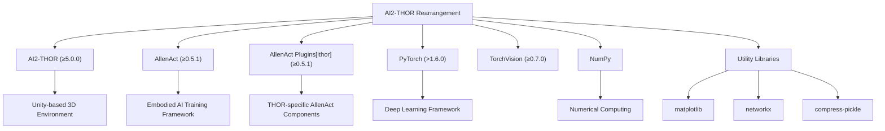

Sources: [requirements.txt](), [environment.yml]()

## Verifying Installation

After installation, verify that everything is working correctly:

1. **Verify Python environment**:
   ```bash
   # Check if AI2-THOR is installed correctly
   python -c "import ai2thor; print(ai2thor.__version__)"
   
   # Check if AllenAct is installed correctly
   python -c "import allenact; print(allenact.__version__)"
   ```

2. **Run a simple test** to verify the environment works:
   ```bash
   # Navigate to the repository directory
   cd ai2thor-rearrangement
   
   # Run a simple test (replace with appropriate test command)
   python -m tests.test_environment
   ```

## Common Installation Issues

| Issue | Possible Solution |
|-------|-------------------|
| CUDA version mismatch | Ensure your CUDA installation is compatible with the PyTorch version in requirements.txt |
| Missing system libraries | Install required system libraries (e.g., `apt-get install ffmpeg libsm6 libxext6` on Ubuntu/Debian) |
| Unity-related errors | Ensure you have the necessary graphics drivers installed |
| Memory errors during training | Reduce batch size or model complexity |
| Docker GPU access issues | Ensure NVIDIA Container Toolkit is installed correctly |

## Next Steps

Once your installation is complete, you can proceed to explore the repository structure ([Repository Structure](#1.2)) and learn about the core concepts of the challenge ([Core Concepts](#2)).

Sources: [requirements.txt](), [environment.yml](), [Dockerfile]()

---

# Page: Repository Structure

# Repository Structure

<details>
<summary>Relevant source files</summary>

The following files were used as context for generating this wiki page:

- [.gitignore](.gitignore)
- [README.md](README.md)

</details>


This page provides an overview of the AI2-THOR Rearrangement Challenge repository structure, describing the organization of code files, directories, and their relationships. For information about the conceptual aspects of the challenge itself, see [Core Concepts](#2).

## Overview

The AI2-THOR Rearrangement Challenge repository is organized to support the development, training, and evaluation of embodied AI agents for object rearrangement tasks. The codebase is structured around core environment components, task definitions, baseline models, and configuration files.

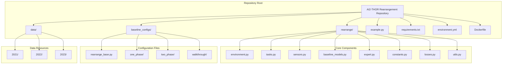

Sources: [README.md:138-171]()

## Key Directories

### rearrange/

The `rearrange/` directory contains the core implementation files for the AI2-THOR Rearrangement Challenge:

| File | Description |
|------|-------------|
| `environment.py` | Defines the `RearrangeTHOREnvironment` class that wraps the AI2-THOR environment and provides methods for setting up scenes, managing object poses, and evaluating agent performance |
| `tasks.py` | Contains the `WalkthroughTask`, `UnshuffleTask`, and `RearrangeTaskSampler` classes that define the challenge tasks and how they are sampled |
| `sensors.py` | Implements various sensors that provide observations to agents (RGB, depth, etc.) |
| `baseline_models.py` | Provides baseline model implementations for the 1-Phase and 2-Phase challenge tracks |
| `expert.py` | Defines the `GreedyUnshuffleExpert` class, a heuristic expert that uses privileged information to solve the rearrangement task |
| `constants.py` | Contains constants used throughout the codebase, such as step sizes, object types, etc. |
| `losses.py` | Defines custom loss functions used in training baseline models |
| `utils.py` | Utility functions for tasks like computing IoU between 3D bounding boxes |

Sources: [README.md:154-171]()

### baseline_configs/

The `baseline_configs/` directory contains configuration files for various experiment setups:

| Directory/File | Description |
|----------------|-------------|
| `rearrange_base.py` | Base configuration file defining challenge parameters (screen size, allowed actions, etc.) |
| `one_phase/` | Experiment configurations for the 1-Phase challenge track |
| `two_phase/` | Experiment configurations for the 2-Phase challenge track |
| `walkthrough/` | Experiment configurations for training the walkthrough phase in isolation |

Sources: [README.md:143-150]()

### data/

The `data/` directory contains dataset files for training and evaluating models:

| Directory | Description |
|-----------|-------------|
| `2021/` | Dataset files from the 2021 challenge |
| `2022/` | Dataset files from the 2022 challenge |
| `2023/` | Dataset files from the 2023 challenge, including train, val, test, and combined datasets |

Sources: [README.md:342-349]()

## Key Files

### example.py

The `example.py` file provides a demonstration of how to instantiate and use the rearrangement tasks for both the 1-Phase and 2-Phase tracks. It serves as a practical starting point for working with the codebase.

Sources: [README.md:140-142]()

### requirements.txt and environment.yml

These files define the dependencies needed to run the codebase. The `requirements.txt` file is for pip installation, while `environment.yml` is for conda environment setup.

Sources: [README.md:179-200]()

### Dockerfile

The `Dockerfile` provides a containerized environment for running the codebase with all necessary dependencies pre-installed, particularly useful for ensuring consistent behavior across different systems.

Sources: [README.md:202-293]()

## Component Relationships

The following diagram illustrates how the main components of the system interact during task execution:

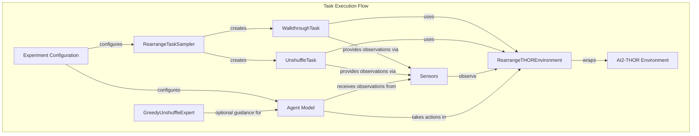

Sources: [README.md:457-463](), [README.md:467-476](), [README.md:479-484]()

## File Structure Detail

Here's a more detailed view of the repository organization:

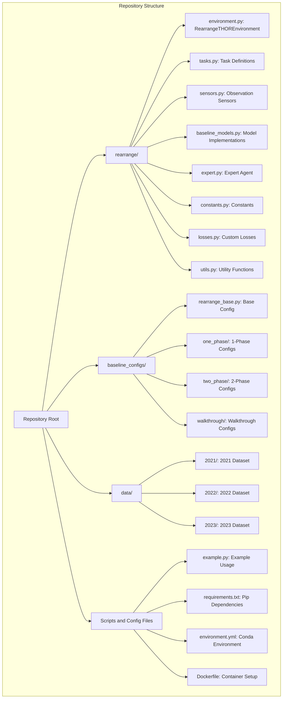

Sources: [README.md:138-171](), [.gitignore:1-164]()

## Core Code Components and Relationships

This diagram shows the relationships between the key code entities in the rearrangement system:

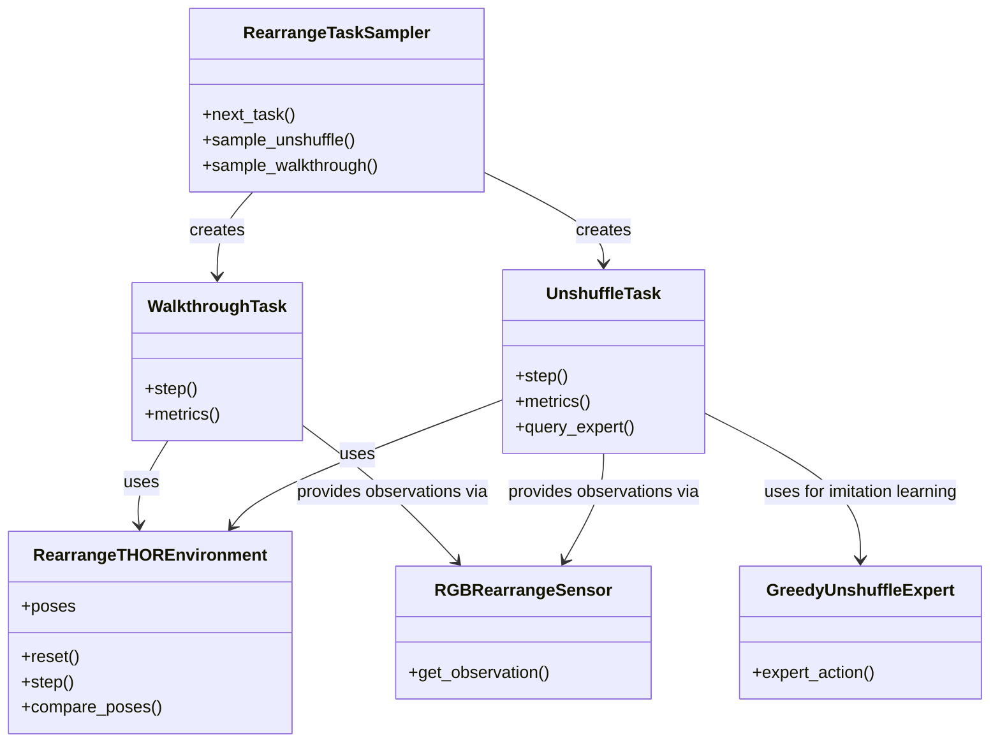

Sources: [README.md:454-486]()

## Data Flow Overview

The following diagram illustrates how data flows through the system during training and inference:

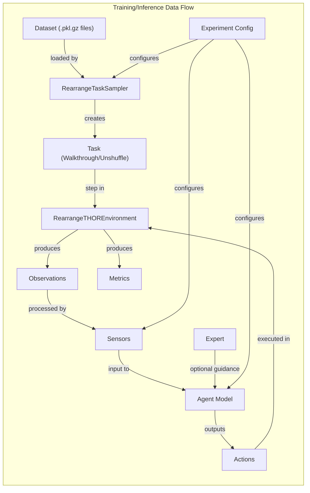

Sources: [README.md:454-486](), [README.md:578-616]()

## Development and Training Workflow

The repository supports the following typical workflow:

1. **Setup**: Install dependencies using the provided requirements.txt or environment.yml
2. **Dataset Preparation**: Use the provided datasets in data/ or generate custom ones
3. **Model Development**: Create or modify models in rearrange/baseline_models.py
4. **Configuration**: Set up experiment configurations in baseline_configs/
5. **Training**: Train models using AllenAct with the provided configurations
6. **Evaluation**: Evaluate models on test datasets
7. **Submission**: Generate submission files for the leaderboard

Sources: [README.md:642-693]()

---

# Page: Core Concepts

# Core Concepts

<details>
<summary>Relevant source files</summary>

The following files were used as context for generating this wiki page:

- [README.md](README.md)
- [rearrange/constants.py](rearrange/constants.py)

</details>


This page explains the fundamental concepts of the AI2-THOR Rearrangement Challenge. It covers the core components that form the foundation of the challenge and how they interact, providing necessary context for understanding more specific aspects of the system. For details about specific challenge tracks, see [Challenge Tracks](#2.1), for information about task phases, see [Task Phases](#2.2), and for evaluation metrics, see [Evaluation Metrics](#2.3).

## Challenge Overview

The AI2-THOR Rearrangement Challenge is a framework for embodied AI agents to learn and be evaluated on their ability to rearrange objects in simulated room environments. The goal is to train agents to restore objects to their original positions after they have been moved or altered. This task requires perception, navigation, object manipulation, and memory capabilities.

## Core Components

The rearrangement challenge consists of several interconnected components that work together to create the simulation environment, define tasks, and evaluate agent performance.

**Core System Components and Relationships**

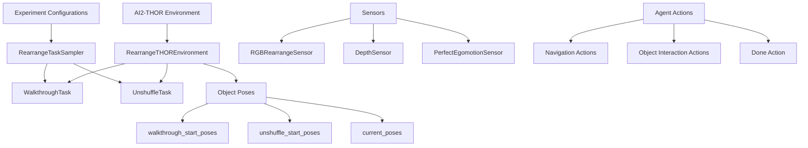

Sources: [README.md:400-406](), [rearrange/constants.py:4-10]()

## Task Structure

The rearrangement task is structured around two main phases: the walkthrough phase and the unshuffle phase. The challenge can be attempted in one of two tracks: the 1-Phase track where both phases are combined, or the 2-Phase track where they occur sequentially.

**Challenge Workflow**

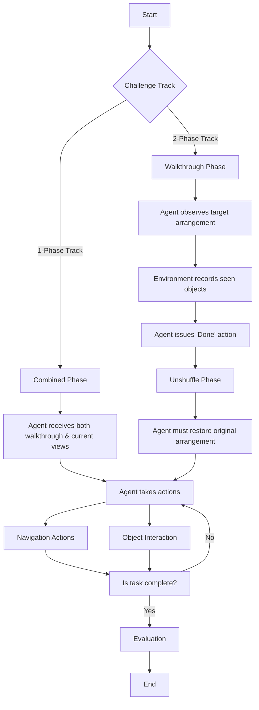

Sources: [README.md:302-325]()

## Environment and Objects

The AI2-THOR environment provides a realistic 3D simulation of indoor spaces where agents can navigate and interact with objects. In the rearrangement challenge, objects have various properties that determine how they can be manipulated.

**Object Types and Properties**

```mermaid
classDiagram
    class Object {
        type: String
        position: {x, y, z}
        rotation: {x, y, z}
        openness: Float or None
        pickupable: Boolean
        broken: Boolean
        objectId: String
        parentReceptacles: String[]
        bounding_box: Vector3[]
    }
    
    class PickupableObject {
        Can be picked up and carried
        Examples: Apple, Book, Mug
    }
    
    class OpenableObject {
        Can be opened and closed
        Has openness value between 0-1
        Examples: Cabinet, Drawer, Fridge
    }
    
    class ReceptacleObject {
        Can contain other objects
        Examples: CounterTop, Table, Sink
    }
    
    Object <|-- PickupableObject
    Object <|-- OpenableObject
    Object <|-- ReceptacleObject
```

Sources: [rearrange/constants.py:16-59](), [rearrange/constants.py:64-183](), [README.md:488-537]()

## Object Poses

A central concept in the rearrangement challenge is the "pose" of objects, which includes their position, rotation, and state (like openness). The system tracks three sets of poses:

1. **walkthrough_start_poses**: The initial state of objects that the agent observes during the walkthrough phase.
2. **unshuffle_start_poses**: The altered state of objects at the beginning of the unshuffle phase.
3. **current_poses**: The current state of objects as the agent interacts with the environment.

The goal of the agent in the unshuffle phase is to make the current_poses match the walkthrough_start_poses as closely as possible.

**Object Pose Structure**

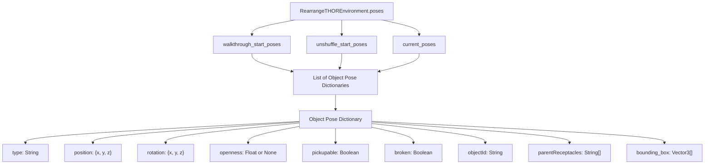

Sources: [README.md:488-537]()

## Agent Capabilities

Agents in the rearrangement challenge have a set of capabilities for perceiving the environment and interacting with it:

### Observations

Agents receive observations through sensors:

1. **RGB images** - 224x224x3 color images with a 90-degree FOV
2. **Depth maps** - 224x224 depth measurements with a 90-degree FOV
3. **Perfect egomotion** - Information about the agent's movements and rotations

### Actions

Agents can perform the following types of actions:

1. **Navigation**
   - `MoveAhead/Left/Right/Back` - Move 0.25m in the specified direction
   - `RotateRight/Left` - Rotate 90 degrees
   - `LookUp/Down` - Adjust camera angle by 30 degrees

2. **Object Interaction**
   - `Pickup[OBJECT_TYPE]` - Pick up a visible object of the specified type
   - `Open[OBJECT_TYPE]` - Toggle the openness of a visible object of the specified type
   - `PlaceObject` - Place a held object, preferably in its goal position

3. **Task Control**
   - `Done` - Signal the end of the current phase

Sources: [README.md:397-448]()

## Core Implementation Classes

The rearrangement challenge is implemented through several key classes:

1. **RearrangeTHOREnvironment**: A wrapper around the AI2-THOR environment that manages the simulation and provides methods for setting up scenes, tracking object poses, and evaluating performance.

2. **Task Classes**:
   - **WalkthroughTask**: Implements the walkthrough phase where the agent observes the target arrangement
   - **UnshuffleTask**: Implements the unshuffle phase where the agent must restore objects to their original positions

3. **RearrangeTaskSampler**: Creates and manages task instances, handles transitions between phases, and configures task parameters based on the selected dataset.

4. **Sensors**: Provide observations to the agent, with different implementations for the different challenge tracks (e.g., CombinedRGBSensor for the 1-Phase track).

**Core Class Relationships**

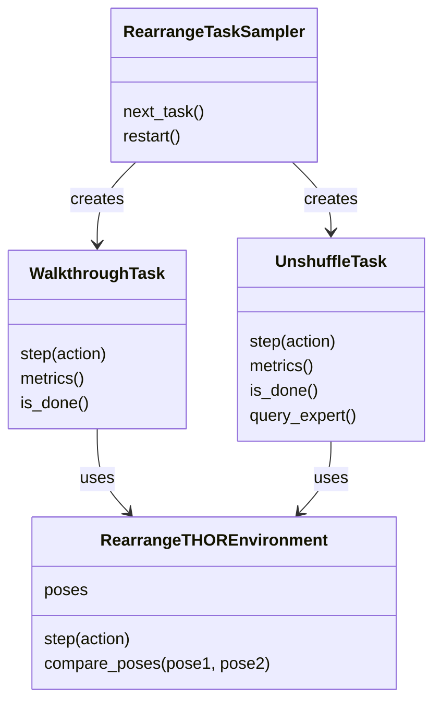

Sources: [README.md:456-484]()

## Datasets and Challenge Tracks

The challenge provides datasets split into train, validation, and test sets, each containing episodes of varying difficulty. The challenge can be attempted in two tracks:

1. **1-Phase Track (Easier)**: The agent receives observations from both the walkthrough (goal) state and the current state simultaneously, making it easier to identify misplaced objects.

2. **2-Phase Track (Harder)**: The walkthrough and unshuffle phases occur sequentially, requiring the agent to remember the goal state from the walkthrough phase.

Sources: [README.md:315-349]()

## Evaluation

Agents are evaluated on their ability to restore objects to their original positions. The main metrics include:

1. **Success rate**: Whether all objects are correctly arranged
2. **% Misplaced**: Proportion of objects that are not in their correct positions
3. **% Fixed Strict**: Proportion of initially misplaced objects that are correctly placed, only if no new objects are misplaced
4. **% Energy Remaining**: A continuous metric measuring how close objects are to their goal positions

For more detailed information about evaluation metrics, see [Evaluation Metrics](#2.3).

Sources: [README.md:562-638]()

---

# Page: Challenge Tracks

# Challenge Tracks

<details>
<summary>Relevant source files</summary>

The following files were used as context for generating this wiki page:

- [README.md](README.md)
- [rearrange/tasks.py](rearrange/tasks.py)
- [rearrange_constants.py](rearrange_constants.py)

</details>


This page explains the challenge tracks in the AI2-THOR Rearrangement Challenge. The rearrangement challenge tests an embodied AI agent's ability to restore objects to their original positions after they have been moved. There are two different tracks with varying difficulty levels that researchers can participate in. For more information about the task phases within these tracks, see [Task Phases](#2.2).

## Track Overview

The AI2-THOR Rearrangement Challenge offers two primary tracks with different difficulty levels:

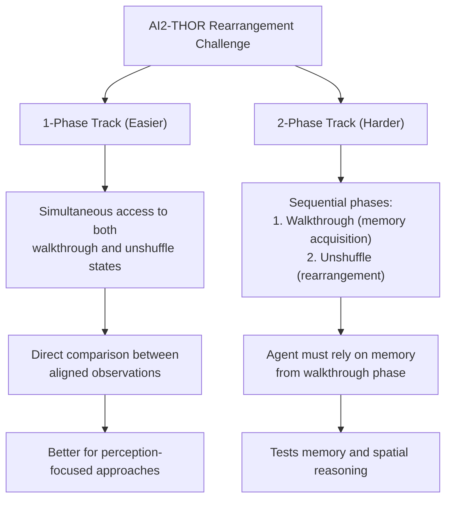

Sources: [README.md:315-326]()

## 1-Phase Track

In the 1-Phase Track (the easier variant), both the walkthrough and unshuffle phases are merged into a single phase. The key characteristics are:

- The agent simultaneously receives observations from both the walkthrough (goal) state and the shuffled (current) state
- This allows direct comparison between aligned images from both world states
- Makes it easier to determine if an object is in its correct position or orientation
- Less memory burden as agents don't need to remember the walkthrough state

This track is appropriate for research focused on perception and rearrangement strategies rather than memory.

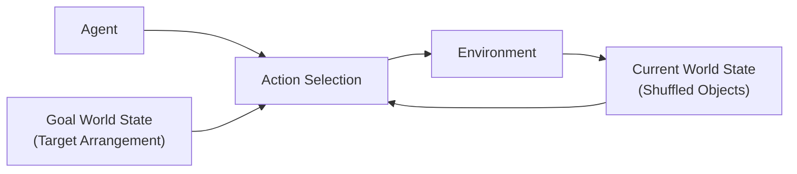

Sources: [README.md:317-321]()

## 2-Phase Track

In the 2-Phase Track (the harder variant), the walkthrough and unshuffle phases occur sequentially:

1. **Walkthrough Phase**: The agent first explores the environment to observe objects in their goal state
2. **Unshuffle Phase**: After the walkthrough phase completes, objects are shuffled and the agent must restore them to their original configuration

Key characteristics:
- Once in the unshuffle phase, the agent has no direct access to the walkthrough state
- The agent must rely on its memory of the goal state
- Tests both memory and spatial reasoning capabilities
- More closely mimics real-world scenarios where a reference state isn't continuously available

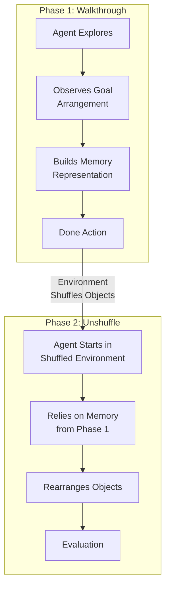

Sources: [README.md:322-326](), [rearrange/tasks.py:483-701]()

## Implementation Details

The challenge tracks are implemented through the `RearrangeTaskSampler` class, which controls the task flow:

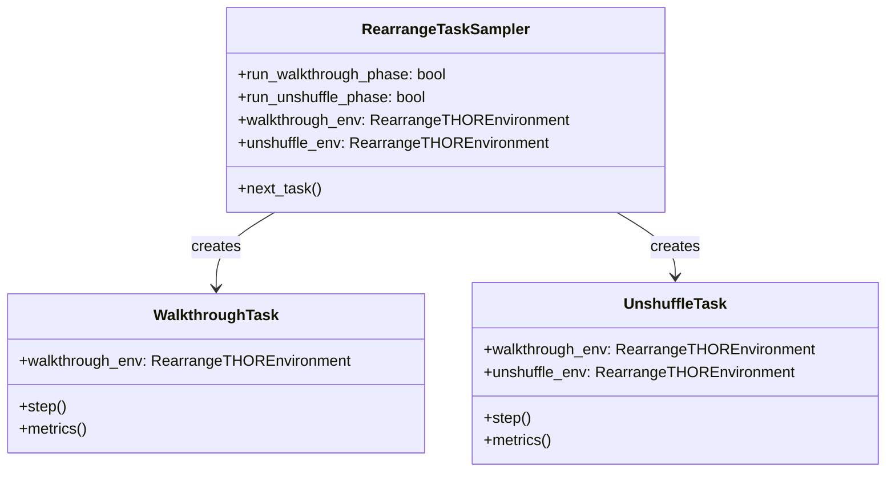

For the 1-Phase track, the `RearrangeTaskSampler` is configured with both `run_walkthrough_phase=False` and `run_unshuffle_phase=True`, and tasks are set up to provide simultaneous access to both states. In the 2-Phase track, both phases are set to `True` and executed sequentially.

The key configuration differences between the two tracks can be found in:
- Base configurations defined in `baseline_configs/rearrange_base.py`
- One-phase configurations in `baseline_configs/one_phase/`
- Two-phase configurations in `baseline_configs/two_phase/`

Sources: [rearrange/tasks.py:808-1211]()

## Dataset Allocation

Both challenge tracks use the same dataset splits, but with different training and evaluation requirements:

| Split | Floor Plans | Total Episodes | Evaluation Episodes |
|-------|-------------|----------------|---------------------|
| Train | 1-20, 200-220, 300-320, 400-420 | 4000 | 800 |
| Val | 21-25, 221-225, 321-325, 421-425 | 1000 | 1000 |
| Test | 26-30, 226-230, 326-330, 426-430 | 1000 | 1000 |

The datasets are stored as compressed pickle files in the `data/2023/` directory. For evaluation purposes, a combined dataset (`data/2023/combined.pkl.gz`) contains all the evaluation episodes from each split.

Sources: [README.md:328-348]()

## Challenge Track Selection

When developing an agent, researchers should decide which track to focus on based on:

1. **Research Goals**: 
   - 1-Phase Track: Better for perception and object manipulation research
   - 2-Phase Track: Better for memory and cognitive mapping research

2. **Evaluation Metrics**: Both tracks use the same evaluation metrics:
   - Success rate
   - % Misplaced
   - % Fixed Strict
   - % Energy Remaining

The 2-Phase track generally results in lower performance metrics due to its higher difficulty.

```mermaid
flowchart LR
    A["Research Focus"] --> B{"Memory Research?"}
    B -->|"Yes"| C["Choose 2-Phase Track"]
    B -->|"No"| D["Choose 1-Phase Track"]
    
    E["Current SOTA Performance"] --> F["1-Phase: ~24.5% Fixed Strict"]
    E --> G["2-Phase: ~28.9% Fixed Strict"]
```

Sources: [README.md:105-127](), [README.md:617-638]()

## Technical Implementation

The challenge tracks are implemented through a combination of task classes and task samplers:

1. The `RearrangeTaskSampler` ([rearrange/tasks.py:808-1211]()) controls track selection with:
   - `run_walkthrough_phase`: Boolean determining if the walkthrough phase runs
   - `run_unshuffle_phase`: Boolean determining if the unshuffle phase runs
   
2. For 1-Phase Track:
   - Only the unshuffle phase is run (`run_walkthrough_phase=False`, `run_unshuffle_phase=True`)
   - Special sensors provide access to both walkthrough and current observations

3. For 2-Phase Track:
   - Both phases run sequentially (`run_walkthrough_phase=True`, `run_unshuffle_phase=True`)
   - The `next_task` method handles the transition between phases

The `RearrangeTaskSampler.next_task()` method is the core function that determines the task flow:

- It first checks if it needs to run the walkthrough phase or continue with an unshuffle phase
- For 1-Phase, it directly returns an `UnshuffleTask` with special sensors
- For 2-Phase, it first returns a `WalkthroughTask` and later returns an `UnshuffleTask` with information collected during walkthrough

Sources: [rearrange/tasks.py:1066-1211]()

## Best Practices

When working with the challenge tracks:

1. For 1-Phase Track:
   - Focus on building models that can effectively compare current and goal observations
   - Consider using techniques like image differencing or attention mechanisms

2. For 2-Phase Track:
   - Implement effective memory mechanisms (e.g., spatial maps, object databases)
   - Consider training the walkthrough phase to maximize information gathering
   - Develop strategies for recalling goal positions during the unshuffle phase

3. For both tracks:
   - The environment constants like `OPENNESS_THRESHOLD` (0.2) and `IOU_THRESHOLD` (0.5) define when objects are considered correctly arranged
   - These thresholds are used in both evaluation and reward computation

Sources: [rearrange_constants.py:1-7](), [rearrange/tasks.py:150-154]()

---

# Page: Task Phases

# Task Phases

<details>
<summary>Relevant source files</summary>

The following files were used as context for generating this wiki page:

- [README.md](README.md)
- [rearrange/tasks.py](rearrange/tasks.py)
- [rearrange_constants.py](rearrange_constants.py)

</details>


This page documents the task phases in the AI2-THOR Rearrangement Challenge, explaining the purpose, workflow, and implementation of the Walkthrough and Unshuffle phases. For information about the challenge tracks (One-Phase vs. Two-Phase), see [Challenge Tracks](#2.1).

## 1. Phase Overview

The AI2-THOR Rearrangement Challenge divides the object rearrangement task into two sequential phases, each with distinct objectives:

```mermaid
flowchart TD
    A["Start"] --> B["WalkthroughTask"]
    B -->|"Done action"| C["UnshuffleTask"]
    C -->|"All objects fixed or Done action"| D["End"]
    
    subgraph "Phase 1: Walkthrough"
        B --> B1["Agent explores environment"]
        B1 --> B2["Records seen objects"]
        B2 --> B3["Observes goal state arrangement"]
    end
    
    subgraph "Phase 2: Unshuffle"
        C --> C1["Environment shuffles objects"]
        C1 --> C2["Agent identifies changed objects"]
        C2 --> C3["Agent restores objects to goal state"]
    end
```

Sources: [README.md:302-313](), [rearrange/tasks.py:65-482](), [rearrange/tasks.py:483-703]()

### 1.1 Walkthrough Phase

The Walkthrough Phase is the first stage of the task, where the agent explores the environment to observe objects in their goal state. During this phase:

- The agent navigates through the environment
- The agent cannot pick up or manipulate objects
- The system records which objects the agent has seen
- The system tracks which locations the agent has visited

The phase ends when the agent takes the "done" action or reaches the maximum number of allowed steps.

### 1.2 Unshuffle Phase

The Unshuffle Phase is the second stage, where the agent must restore objects to their goal state. After the Walkthrough Phase:

- The environment "shuffles" 1-5 objects by moving them or changing their state
- The agent must identify which objects have been changed
- The agent must restore those objects to their goal state
- Success is measured by how well the agent restores objects to their original configuration

The phase ends when the agent takes the "done" action, reaches the maximum steps, or successfully restores all objects.

Sources: [README.md:302-313](), [rearrange/tasks.py:65-482](), [rearrange/tasks.py:483-703]()

## 2. Phase Implementation

The task phases are implemented through two main classes that inherit from `AbstractRearrangeTask`:

```mermaid
classDiagram
    AbstractRearrangeTask <|-- WalkthroughTask
    AbstractRearrangeTask <|-- UnshuffleTask
    RearrangeTaskSampler --> WalkthroughTask: creates
    RearrangeTaskSampler --> UnshuffleTask: creates
    
    class AbstractRearrangeTask {
        +agent_location_to_tuple()
        +agent_location_tuple
    }
    
    class WalkthroughTask {
        +walkthrough_env: RearrangeTHOREnvironment
        +discrete_actions: Tuple[str, ...]
        +visited_positions_xzrsh: Set
        +seen_pickupable_objects: Set
        +seen_openable_objects: Set
        +_took_end_action: bool
        +metrics()
        +_step()
        +_judge()
    }
    
    class UnshuffleTask {
        +unshuffle_env: RearrangeTHOREnvironment
        +walkthrough_env: RearrangeTHOREnvironment
        +discrete_actions: Tuple[str, ...]
        +require_done_action: bool
        +locations_visited_in_walkthrough
        +object_names_seen_in_walkthrough
        +start_energies
        +_took_end_action: bool
        +metrics()
        +_step()
        +_judge()
        +query_expert()
    }
    
    class RearrangeTaskSampler {
        +run_walkthrough_phase: bool
        +run_unshuffle_phase: bool
        +walkthrough_env: RearrangeTHOREnvironment
        +unshuffle_env: RearrangeTHOREnvironment
        +next_task()
        +reset()
        +close()
    }
```

Sources: [rearrange/tasks.py:38-64](), [rearrange/tasks.py:65-482](), [rearrange/tasks.py:483-703](), [rearrange/tasks.py:808-1212]()

## 3. Walkthrough Phase Details

The `WalkthroughTask` class manages the agent's exploration during the Walkthrough Phase.

### 3.1 Objectives and Limitations

During this phase, the agent's objectives are:
- Explore the environment efficiently
- Observe as many objects as possible
- Build a mental map of object locations and states

The agent has specific limitations during this phase:
- Cannot pick up objects
- Cannot open or close objects
- Can only navigate and observe

### 3.2 Information Tracking

The `WalkthroughTask` class tracks several types of information:

```mermaid
flowchart TD
    A["WalkthroughTask"] --> B["Position Tracking"]
    A --> C["Object Tracking"]
    A --> D["Action Recording"]
    
    B --> B1["visited_positions_xzrsh"]
    B --> B2["visited_positions_xz"]
    
    C --> C1["seen_pickupable_objects"]
    C --> C2["seen_openable_objects"]
    
    D --> D1["actions_taken"]
    D --> D2["actions_taken_success"]
```

This information is used to:
1. Compute exploration metrics
2. Pass information to the Unshuffle Phase
3. Guide the agent during the Unshuffle Phase

Sources: [rearrange/tasks.py:483-703]()

### 3.3 Available Actions

The agent can perform the following actions during the Walkthrough Phase:
- `move_ahead`/`move_back`/`move_left`/`move_right` - Move 0.25m in the specified direction
- `rotate_left`/`rotate_right` - Rotate 90 degrees
- `look_up`/`look_down` - Adjust camera angle by 30 degrees
- `done` - End the Walkthrough Phase

Actions related to object interaction (pickup, open, place) are disabled during this phase.

Sources: [rearrange/tasks.py:659-695](), [README.md:417-447]()

## 4. Unshuffle Phase Details

The `UnshuffleTask` class manages the agent's rearrangement efforts during the Unshuffle Phase.

### 4.1 Objects State Tracking

The `UnshuffleTask` class tracks object states in three time points:

```mermaid
flowchart TD
    A["UnshuffleTask"] --> B["Object Poses"]
    B --> C["walkthrough_start_poses"]
    B --> D["unshuffle_start_poses"]
    B --> E["current_poses"]
    
    C -->|"Goal state"| F["Compare Poses"]
    D -->|"Initial unshuffle state"| F
    E -->|"Current state"| F
    
    F --> G["Compute metrics"]
    G --> H["prop_fixed"]
    G --> I["prop_fixed_strict"]
    G --> J["energy_prop"]
    G --> K["success"]
```

Each pose contains information about:
- Position and rotation of the object
- Openness (for openable objects)
- Whether the object is broken
- Bounding box coordinates

Sources: [rearrange/tasks.py:104-153](), [README.md:487-553]()

### 4.2 Available Actions

During the Unshuffle Phase, the agent has access to all actions:
- Navigation actions (move, rotate, look)
- Object interaction actions:
  - `pickup_[OBJECT_TYPE]` - Pick up a visible object of the specified type
  - `open_by_type_[OBJECT_TYPE]` - Toggle the openness of a visible object of the specified type
  - `drop_held_object_with_snap` - Place the held object
- `done` - End the Unshuffle Phase

Sources: [rearrange/tasks.py:345-465](), [README.md:417-447]()

### 4.3 Success Evaluation

The system evaluates the agent's performance using several metrics:

| Metric | Description | Implementation |
|--------|-------------|----------------|
| Success rate | 1 if all objects are in goal state, 0 otherwise | `metrics["success"]` |
| % Misplaced | Number of misplaced objects at end / Number initially misplaced | `metrics["prop_misplaced"]` |
| % Fixed Strict | Proportion of initially misplaced objects that are fixed, but only if no new objects are misplaced | `metrics["prop_fixed_strict"]` |
| % Energy Remaining | Energy between goal/current poses at end / Energy at start of unshuffle | `metrics["energy_prop"]` |

The `UnshuffleTask.metrics()` method computes these metrics by comparing the current object poses with their goal poses.

Sources: [rearrange/tasks.py:209-302](), [README.md:620-637]()

## 5. Task Phase Transitions

The `RearrangeTaskSampler` class manages the transition between phases.

### 5.1 Phase Sequencing

```mermaid
flowchart TD
    A["RearrangeTaskSampler.next_task()"] --> B{"run_walkthrough_phase?"}
    B -->|"Yes"| C["Create WalkthroughTask"]
    B -->|"No"| D["Create UnshuffleTask"]
    
    C --> E["Agent completes walkthrough"]
    E --> F{"run_unshuffle_phase?"}
    F -->|"Yes"| G["Create UnshuffleTask"]
    F -->|"No"| H["Task complete"]
    
    G --> I["Transfer information from walkthrough"]
    I --> J["Agent completes unshuffle"]
    J --> H
    
    D --> J
```

The sampler determines which task to create based on:
- The `run_walkthrough_phase` and `run_unshuffle_phase` flags
- Whether a walkthrough task has just completed
- The `unshuffle_runs_per_walkthrough` parameter

Sources: [rearrange/tasks.py:1066-1211]()

### 5.2 Information Transfer

When transitioning from Walkthrough to Unshuffle, the `RearrangeTaskSampler` transfers:

1. Locations visited during walkthrough:
   ```python
   locations_visited_in_walkthrough=np.array(tuple(walkthrough_task.visited_positions_xzrsh))
   ```

2. Objects seen during walkthrough:
   ```python
   object_names_seen_in_walkthrough=copy.copy(
       walkthrough_task.seen_pickupable_objects | walkthrough_task.seen_openable_objects
   )
   ```

3. Metrics from the walkthrough:
   ```python
   metrics_from_walkthrough=walkthrough_task.metrics(force_return=True)
   ```

This information is passed to the `UnshuffleTask` constructor, allowing the unshuffle agent to use it for decision-making.

Sources: [rearrange/tasks.py:1193-1208]()

## 6. Pose Comparison

The system determines if an object is in its correct position by comparing its current pose with its goal pose.

### 6.1 Pose Comparison Criteria

An object is considered correctly placed if:
1. It is not broken
2. For openable objects: The difference in openness is less than `OPENNESS_THRESHOLD` (0.2)
3. For pickupable objects: The IoU (Intersection over Union) of the 3D bounding boxes is greater than `IOU_THRESHOLD` (0.5)

```mermaid
flowchart TD
    A["Compare object poses"] --> B{"Is object broken?"}
    B -->|"Yes"| C["Not equal"]
    B -->|"No"| D{"Is object openable?"}
    
    D -->|"Yes"| E{"Openness diff < OPENNESS_THRESHOLD?"}
    E -->|"No"| C
    E -->|"Yes"| F{"Is object pickupable?"}
    
    D -->|"No"| F
    
    F -->|"Yes"| G{"Bounding box IoU > IOU_THRESHOLD?"}
    G -->|"No"| C
    G -->|"Yes"| H["Poses approximately equal"]
    
    F -->|"No"| H
```

Sources: [rearrange_constants.py:1-7](), [README.md:561-576]()

### 6.2 Energy Calculation

The system uses an "energy" function to measure how far objects are from their goal poses. This provides a continuous measure of progress:

1. Start energy is calculated between initial unshuffle poses and goal poses.
2. End energy is calculated between final poses and goal poses.
3. The `energy_prop` metric equals `end_energy / start_energy`.

A lower energy proportion indicates better performance.

Sources: [rearrange/tasks.py:150-153](), [rearrange/tasks.py:216-218](), [rearrange/tasks.py:259-261]()

## 7. Combined vs. Separate Phase Configurations

Depending on the challenge track, the `RearrangeTaskSampler` can be configured in different ways:

### 7.1 Two-Phase Configuration

For the 2-Phase track:
- `run_walkthrough_phase=True`
- `run_unshuffle_phase=True`

This creates separate `WalkthroughTask` and `UnshuffleTask` instances sequentially.

### 7.2 One-Phase Configuration

For the 1-Phase track:
- `run_walkthrough_phase=False` 
- `run_unshuffle_phase=True`

This creates only an `UnshuffleTask` instance, but the implementation is modified to provide the agent with access to both the walkthrough environment (goal state) and unshuffle environment (current state) simultaneously.

Sources: [rearrange/tasks.py:808-846](), [README.md:315-326]()

## 8. Phase Integration with AllenAct Framework

The `WalkthroughTask` and `UnshuffleTask` classes integrate with the AllenAct reinforcement learning framework by:

1. Implementing the Task interface with methods like `step()`, `metrics()`, and `is_done()`
2. Returning observations in the format expected by AllenAct models
3. Providing reward signals through the `_judge()` method

This allows the tasks to be used with both imitation learning and reinforcement learning algorithms.

Sources: [rearrange/tasks.py:468-480](), [rearrange/tasks.py:623-702]()

---

# Page: Evaluation Metrics

# Evaluation Metrics

<details>
<summary>Relevant source files</summary>

The following files were used as context for generating this wiki page:

- [README.md](README.md)
- [rearrange/tasks.py](rearrange/tasks.py)
- [rearrange_constants.py](rearrange_constants.py)

</details>


This page documents the evaluation metrics used in the AI2-THOR Rearrangement Challenge to assess an agent's performance when completing rearrangement tasks. These metrics quantify how well the agent restores objects to their target configurations in the unshuffle phase. For information about the tasks themselves, see [Task Phases](#2.2).

## 1. Pose Comparison

Before discussing metrics, we need to understand how the system determines whether objects are correctly arranged. The rearrangement challenge compares an object's current pose to its goal pose using specific criteria.

### 1.1 Object Poses

An object's pose consists of:

1. **Position & Rotation**: 3D position and rotation in the environment
2. **Openness**: A value between 0 and 1 for openable objects (like cabinets or drawers)
3. **Broken Status**: Whether the object is broken (broken objects are always considered incorrectly placed)

```mermaid
classDiagram
    class "ObjectPose" {
        position: Vector3
        rotation: Vector3
        openness: float
        broken: boolean
        bounding_box: float[8][3]
    }
    class "PoseComparison" {
        comparePositionAndRotation()
        compareOpenness()
        checkBroken()
        isApproximatelyEqual()
    }
    "PoseComparison" --> "ObjectPose": compares
```

Sources: [README.md:560-575]()

### 1.2 Pose Equality Criteria

Two object poses are considered approximately equal when ALL of the following criteria are met:

1. Neither object pose is broken
2. For openable objects, the difference in openness values is ≤ 0.2 (OPENNESS_THRESHOLD)
3. For pickupable objects, the 3D bounding boxes have an IoU (Intersection over Union) ≥ 0.5 (IOU_THRESHOLD)

```mermaid
flowchart TD
    start["Check If Poses Are Equal"] --> broken["Is Either Object Broken?"]
    broken -->|"Yes"| not_equal["Not Equal"]
    broken -->|"No"| openable["Is Object Openable?"]
    
    openable -->|"Yes"| openness["Check Openness Difference"]
    openness -->|">0.2"| not_equal
    openness -->|"≤0.2"| pickupable
    
    openable -->|"No"| pickupable["Is Object Pickupable?"]
    
    pickupable -->|"Yes"| iou["Check Bounding Box IoU"]
    iou -->|"<0.5"| not_equal
    iou -->|"≥0.5"| equal["Poses Are Equal"]
    
    pickupable -->|"No"| equal
```

Sources: [README.md:566-577](), [rearrange_constants.py:5-6]()

## 2. Primary Evaluation Metrics

The system uses several metrics to evaluate agent performance, each providing different insights into how well the agent completed the rearrangement task.

```mermaid
graph TD
    subgraph "RearrangementMetrics"
        SuccessRate["Success Rate\n(unshuffle/success)"]
        PropMisplaced["% Misplaced\n(unshuffle/prop_misplaced)"]
        PropFixedStrict["% Fixed Strict\n(unshuffle/prop_fixed_strict)"]
        EnergyProp["% Energy Remaining\n(unshuffle/energy_prop)"]
    end
    
    Agent["Agent Performance"] --> SuccessRate
    Agent --> PropMisplaced
    Agent --> PropFixedStrict
    Agent --> EnergyProp
    
    SuccessRate -->|"Binary"| PerfectSuccess["1.0 if all objects correct\n0.0 otherwise"]
    PropMisplaced -->|"Lower is better"| MisplacedRatio["final misplaced / initial misplaced"]
    PropFixedStrict -->|"Higher is better"| FixedRatio["objects fixed / initially misplaced\n(0 if new misplacements)"]
    EnergyProp -->|"Lower is better"| EnergyRatio["final energy / initial energy"]
```

Sources: [README.md:617-638](), [rearrange/tasks.py:232-261]()

### 2.1 Success Rate

The most stringent metric, with value 1.0 if and only if all objects are in their correct poses at the end of the unshuffle phase, and 0.0 otherwise.

```python
"success": float(end_energy == 0)
```

Sources: [rearrange/tasks.py:237]()

### 2.2 Percentage Misplaced

Calculates the proportion of objects that are misplaced at the end of the episode compared to the number of initially misplaced objects. Can exceed 1.0 if the agent mistakenly moves objects that were already in the correct position.

```python
"prop_misplaced": end_misplaceds.sum() / num_initially_misplaced
```

Sources: [rearrange/tasks.py:258]()

### 2.3 Percentage Fixed Strict

Measures how many objects that started in incorrect positions were fixed by the agent. This metric equals 0 if the agent has misplaced any new objects (i.e., moved objects that were already in the correct position).

```python
"prop_fixed_strict": float((num_newly_misplaced == 0) * prop_fixed)
```

Sources: [rearrange/tasks.py:239]()

### 2.4 Percentage Energy Remaining

Measures the "energy" (a measure of pose difference) remaining between current and goal poses at the end of the episode, divided by the initial energy. This metric allows for partial credit when objects are moved closer to their goal positions but not precisely enough to count as "fixed."

```python
"energy_prop": end_energy / start_energy
```

Sources: [rearrange/tasks.py:261]()

## 3. Metrics Computation

The metrics are computed in the `metrics()` method of the `UnshuffleTask` class, which is called when an episode terminates. The method follows these steps:

```mermaid
flowchart TD
    subgraph "UnshuffleTask.metrics()"
        getPoses["Get Initial, Goal, and\nCurrent Poses"]
        computeEnergies["Compute Energy Differences"]
        calculateMisplaced["Calculate Misplaced Objects"]
        calculateFixed["Calculate Fixed Objects"]
        calculateNewlyMisplaced["Calculate Newly Misplaced"]
        calculateMetrics["Calculate Final Metrics"]
        returnMetrics["Return Metrics Dictionary"]
    end
    
    getPoses --> computeEnergies
    computeEnergies --> calculateMisplaced
    calculateMisplaced --> calculateFixed
    calculateMisplaced --> calculateNewlyMisplaced
    calculateFixed --> calculateMetrics
    calculateNewlyMisplaced --> calculateMetrics
    calculateMetrics --> returnMetrics
```

Sources: [rearrange/tasks.py:209-302]()

### 3.1 Energy Calculation

The system uses an "energy" function to measure the difference between poses. This energy decreases as poses get closer to each other and equals zero when poses are approximately equal.

1. Start by retrieving initial, goal, and current poses:
   ```python
   ups, gps, cps = env.poses  # unshuffle_start, goal, current
   ```

2. Calculate energies between goal and current poses:
   ```python
   start_energies = self.start_energies
   end_energies = env.pose_difference_energy(gps, cps)
   ```

3. Determine which objects are misplaced:
   ```python
   start_misplaceds = start_energies > 0.0
   end_misplaceds = end_energies > 0.0
   ```

Sources: [rearrange/tasks.py:214-222]()

### 3.2 Misplaced and Fixed Objects

The system counts:

1. **Broken Objects**: Objects damaged during manipulation
   ```python
   num_broken = sum(cp["broken"] for cp in cps)
   ```

2. **Initially Misplaced**: Objects not in correct poses at start
   ```python
   num_initially_misplaced = start_misplaceds.sum()
   ```

3. **Fixed Objects**: Initially misplaced objects now in correct poses
   ```python
   num_fixed = num_initially_misplaced - (start_misplaceds & end_misplaceds).sum()
   ```

4. **Newly Misplaced**: Correctly placed objects that were moved to incorrect poses
   ```python
   num_newly_misplaced = (end_misplaceds & np.logical_not(start_misplaceds)).sum()
   ```

Sources: [rearrange/tasks.py:224-227]()

## 4. Metrics in Practice

The metrics are stored in a dictionary returned by the `metrics()` method and are prefixed with "unshuffle/" to distinguish them from walkthrough phase metrics. The full list of metrics includes:

| Metric Key | Description |
|------------|-------------|
| unshuffle/success | Binary indicator of perfect rearrangement |
| unshuffle/prop_fixed | Proportion of initially misplaced objects fixed |
| unshuffle/prop_fixed_strict | prop_fixed if no new misplacements, 0 otherwise |
| unshuffle/num_misplaced | Count of misplaced objects at episode end |
| unshuffle/num_newly_misplaced | Count of objects that were moved from correct to incorrect poses |
| unshuffle/num_initially_misplaced | Count of misplaced objects at episode start |
| unshuffle/num_fixed | Count of objects moved from incorrect to correct poses |
| unshuffle/num_broken | Count of broken objects |
| unshuffle/start_energy | Sum of pose difference energies at start |
| unshuffle/end_energy | Sum of pose difference energies at end |
| unshuffle/energy_prop | Ratio of end_energy to start_energy |

Sources: [rearrange/tasks.py:232-261](), [README.md:579-637]()

### 4.1 Metrics in Leaderboard Evaluation

For the AI2-THOR Rearrangement Challenge leaderboard, the primary metric used for ranking submissions is "% Fixed Strict" (unshuffle/prop_fixed_strict). This metric was chosen because it:

1. Rewards agents for fixing objects that were out of place
2. Penalizes agents for disturbing objects that were already correctly arranged
3. Reflects real-world scenarios where unnecessary object movement is discouraged

The winning entries from previous years achieved the following scores on this metric:

- 2022 1-Phase Challenge Winner: 24.47% Fixed Strict
- 2022 2-Phase Challenge Winner: 16.56% Fixed Strict
- Current 2-Phase State-of-the-Art: 28.94% Fixed Strict

Sources: [README.md:105-127]()

## 5. Integration with AllenAct Framework

The metrics generated by the rearrangement tasks are integrated with the AllenAct reinforcement learning framework for training and evaluation.

```mermaid
flowchart TD
    subgraph "MetricsFlow"
        TaskEnv["RearrangeTHOREnvironment"]
        TaskMetrics["UnshuffleTask.metrics()"]
        TrainingPipeline["AllenAct Training Pipeline"]
        LeaderboardSubmission["Leaderboard Submission"]
    end
    
    TaskEnv --> TaskMetrics
    TaskMetrics --> TrainingPipeline
    TaskMetrics --> LeaderboardSubmission
    
    subgraph "Code Integration"
        MetricsDict["Metrics Dictionary"]
        TensorboardLogs["Tensorboard Logs"]
        CheckpointSaving["Model Checkpoints"]
    end
    
    TaskMetrics --> MetricsDict
    MetricsDict --> TensorboardLogs
    MetricsDict --> CheckpointSaving
```

Sources: [README.md:372-386]()

When training with AllenAct, the metrics are logged periodically and can be visualized in Tensorboard. When submitting to the leaderboard, the metrics for each evaluation episode are saved in a JSON file that follows a specific format:

```json
{
  "UNIQUE_ID_OF_TASK_0": YOUR_AGENTS_METRICS_AND_TRAJECTORY_FOR_TASK_0,
  "UNIQUE_ID_OF_TASK_1": YOUR_AGENTS_METRICS_AND_TRAJECTORY_FOR_TASK_1,
  ...
}
```

Sources: [README.md:379-385]()

## 6. Reward Function

In addition to terminal evaluation metrics, the rearrangement challenge also defines a reward function that provides feedback to the agent during training. This reward is based on the change in pose energy between steps.

```mermaid
flowchart TD
    subgraph "RewardComputation"
        CheckEnergy["Calculate Current Pose Energy"]
        ComputeDiff["Compute Energy Change\n(last_pose_energy - cur_pose_energy)"]
        UpdateLast["Update last_pose_energy"]
        ReturnReward["Return Reward"]
    end
    
    CheckEnergy --> ComputeDiff
    ComputeDiff --> UpdateLast
    UpdateLast --> ReturnReward
    
    subgraph "DoneCondition"
        CheckTerminal["Check if Episode Done"]
        ReturnFinalReward["Return -cur_pose_energy"]
    end
    
    CheckTerminal -->|"Yes"| ReturnFinalReward
    CheckTerminal -->|"No"| CheckEnergy
```

Sources: [rearrange/tasks.py:328-343]()

The reward function in `UnshuffleTask._judge()` works as follows:

1. Calculate the current total pose energy
2. If the episode is done, return the negative of the current pose energy
3. Otherwise, return the decrease in energy since the last step (a positive reward if energy decreased)

This reward encourages the agent to:
- Move objects closer to their goal positions
- Avoid disturbing correctly placed objects
- Complete the task efficiently

Sources: [rearrange/tasks.py:328-343]()

---

# Page: Environment

# Environment

<details>
<summary>Relevant source files</summary>

The following files were used as context for generating this wiki page:

- [rearrange/constants.py](rearrange/constants.py)
- [rearrange/environment.py](rearrange/environment.py)

</details>


The Environment module in the AI2-THOR Rearrangement Challenge provides the core simulation infrastructure for embodied AI agents to interact with virtual scenes. This document covers the main environment components, object manipulation mechanics, and action spaces available to agents. For information about specific tasks implemented on top of this environment, see [Tasks](#4).

## Environment Overview

The AI2-THOR Rearrangement environment serves as a wrapper around the AI2-THOR simulator, extending it with specialized functionality for object rearrangement tasks. The environment supports two distinct phases of interaction:

1. **Walkthrough Phase**: Agent observes the target object arrangement
2. **Unshuffle Phase**: Agent attempts to restore objects to their target positions

```mermaid
graph TD
    A["AI2-THOR Base Simulator"] --> B["RearrangeTHOREnvironment"]
    B --> C["SNAP Mode"]
    B --> D["MANIPULATE Mode"]
    B --> E["Object State Tracking"]
    E --> F["Walkthrough Start Poses"]
    E --> G["Unshuffle Start Poses"]
    E --> H["Current Poses"]
    B --> I["Action Space"]
    I --> J["Walkthrough Actions"]
    I --> K["Unshuffle Actions"]
    B --> L["Scene Management"]
    L --> M["Reset/Initialize"]
    L --> N["Shuffle Objects"]
    
    style B stroke-width:2px
    style E stroke-width:2px
    style I stroke-width:2px
```

Sources: [rearrange/environment.py:157-162](), [rearrange/environment.py:175-253]()

## RearrangeTHOREnvironment

The `RearrangeTHOREnvironment` class is the central component that provides all functionality for interacting with the rearrangement environment. It wraps around AI2-THOR's controller and extends it with rearrangement-specific features.

### Environment Modes

The environment supports two operational modes:

1. **SNAP Mode**: Allows objects to "snap" into their target positions when they are close enough, simplifying object placement.
2. **MANIPULATE Mode**: Requires precise object manipulation without automatic snapping.

```mermaid
classDiagram
    class RearrangeMode {
        <<enum>>
        +MANIPULATE
        +SNAP
    }

    class RearrangeTHOREnvironment {
        -mode: RearrangeMode
        -force_cache_reset: bool
        -obj_name_to_walkthrough_start_pose: Dict
        -obj_name_to_unshuffle_start_pose: Dict
        -current_task_spec: RearrangeTaskSpec
        -controller: ai2thor.controller.Controller
        -shuffle_called: bool
        +walkthrough_action_space(): RearrangeActionSpace
        +unshuffle_action_space(): RearrangeActionSpace
        +action_space(): RearrangeActionSpace
        +reset(task_spec, force_axis_aligned_start)
        +shuffle(require_reset)
        +poses(): Tuple[List, List, List]
    }

    class RearrangeTaskSpec {
        +scene: str
        +stage: str
        +agent_position: Dict
        +agent_rotation: float
        +openable_data: List
        +starting_poses: List
        +target_poses: List
        +runtime_sample: bool
        +runtime_data: Dict
        +metrics: Dict
        +unique_id(): str
    }

    RearrangeTHOREnvironment --> RearrangeMode : uses
    RearrangeTHOREnvironment --> RearrangeTaskSpec : has
```

Sources: [rearrange/environment.py:46-52](), [rearrange/environment.py:157-174]()

### Task Specification

Rearrangement tasks are defined by the `RearrangeTaskSpec` class, which encapsulates all the information needed to initialize a specific rearrangement scenario:

- Scene name
- Agent starting position and rotation
- Object poses for walkthrough and unshuffle phases
- Openable object states
- Task-specific metrics

Tasks can be defined either:
1. Explicitly with predefined poses and states
2. At runtime with randomized configurations

Sources: [rearrange/environment.py:53-155]()

## Object Management

Objects in the environment are tracked through poses that capture their position, rotation, and other state information.

### Object Types and Properties

The environment operates with various object types, each with different interaction properties:

```
Object Types:
- Pickupable: Can be picked up and moved (e.g., Apple, Book, Fork)
- Openable: Can be opened/closed (e.g., Drawer, Cabinet, Microwave)
- Receptacle: Can contain other objects (e.g., CounterTop, Drawer, Bowl)
```

The environment maintains dictionaries of object properties and categorizes them accordingly.

```mermaid
graph TD
    A["Scene Objects"] --> B["Pickupable Objects"]
    A --> C["Openable Objects"]
    A --> D["Receptacle Objects"]
    
    E["Object State"] --> F["Position (x,y,z)"]
    E --> G["Rotation (x,y,z)"]
    E --> H["Openness (0-1)"]
    E --> I["Broken Status"]
    
    J["Pose Tracking"] --> K["Walkthrough Start Poses"]
    J --> L["Unshuffle Start Poses"]
    J --> M["Current Poses"]
    
    N["Pose Comparison"] --> O["Position Distance"]
    N --> P["Rotation Distance"]
    N --> Q["3D IOU"]
    N --> R["Openness Difference"]
```

Sources: [rearrange/constants.py:15-194](), [rearrange/environment.py:884-1040]()

### Pose Representation and Comparison

The environment provides mechanisms to:
1. Track object poses at different phases (walkthrough start, unshuffle start, current)
2. Compare poses to determine if objects are correctly placed
3. Calculate energy/distance metrics between different poses

A key feature is the ability to determine whether an object has been successfully rearranged to match its target position and orientation.

Sources: [rearrange/environment.py:1041-1108](), [rearrange/environment.py:1113-1219]()

## Action Space

The environment provides different sets of actions depending on the current phase of the task.

### Walkthrough Phase Actions

During the walkthrough phase, agents can only navigate and observe the environment:

```
- move_ahead
- move_right
- move_left
- move_back
- rotate_right
- rotate_left
- stand
- crouch
- look_up
- look_down
- done
```

Sources: [rearrange/environment.py:334-354](), [rearrange/environment.py:533-647]()

### Unshuffle Phase Actions

During the unshuffle phase, agents can also manipulate objects:

```
Walkthrough actions plus:
- open_object
- pickup_object
- push_object
- move_held_object
- rotate_held_object
- drop_held_object
- drop_held_object_with_snap (SNAP mode only)
```

Each action has specific parameters and constraints that determine when it can be executed successfully.

```mermaid
graph TD
    A["RearrangeActionSpace"] --> B["Walkthrough Actions"]
    A --> C["Unshuffle Actions"]
    
    B --> D["Navigation Actions"]
    D --> D1["move_ahead/back/left/right"]
    D --> D2["rotate_left/right"]
    D --> D3["look_up/down"]
    D --> D4["stand/crouch"]
    B --> E["Task Control"]
    E --> E1["done"]
    
    C --> F["Object Interaction"]
    F --> F1["open_object"]
    F --> F2["pickup_object"]
    F --> F3["push_object"]
    C --> G["Held Object Manipulation"]
    G --> G1["move_held_object"]
    G --> G2["rotate_held_object"]
    G --> G3["drop_held_object"]
    G --> G4["drop_held_object_with_snap"]
```

Sources: [rearrange/environment.py:357-399](), [rearrange/environment.py:401-872]()

## Environment Flow

The environment operates through a specific flow that manages the transition between walkthrough and unshuffle phases.

### Initialization and Reset

The `reset()` method initializes the environment with a specific task specification:
1. Sets up the scene
2. Places objects in their target positions
3. Positions the agent at its starting location
4. Prepares the environment for the walkthrough phase

Sources: [rearrange/environment.py:1370-1400]()

### Shuffle and Unshuffle

After the walkthrough phase, the `shuffle()` method:
1. Rearranges objects to their unshuffle starting positions
2. Resets the agent to its starting location
3. Transitions the environment to the unshuffle phase

This allows the agent to begin attempting to restore objects to their target arrangements.

```mermaid
sequenceDiagram
    participant Agent
    participant Environment
    participant ThorController
    
    Agent->>Environment: reset(task_spec)
    Environment->>ThorController: reset(scene)
    Environment->>ThorController: place objects in target positions
    Environment->>Agent: walkthrough observations
    
    loop Walkthrough Phase
        Agent->>Environment: navigation actions
        Environment->>Agent: observations
    end
    
    Agent->>Environment: shuffle()
    Environment->>ThorController: rearrange objects
    Environment->>Agent: unshuffle observations
    
    loop Unshuffle Phase
        Agent->>Environment: manipulation actions
        Environment->>ThorController: execute physics
        Environment->>Agent: feedback & observations
    end
    
    Agent->>Environment: done()
    Environment->>Agent: final evaluation
```

Sources: [rearrange/environment.py:1527-1563](), [rearrange/environment.py:633-647]()

## Object Manipulation and Physics

The environment provides physics-based object interaction through several key mechanisms:

### Object Pickup and Placement

Agents can pick up eligible objects and then:
1. Move them in 3D space relative to the agent
2. Rotate them along multiple axes
3. Drop them either with physics or with snap-to-target functionality

### Physics Determinism

The environment includes options for enhanced physics determinism to ensure consistent behavior:
- Fixed time steps for physics simulation
- Configurable action simulation seconds
- Force cache resets for consistent object placement

This helps create a more reliable environment for training and evaluating agents.

Sources: [rearrange/environment.py:649-872](), [rearrange/environment.py:212-219]()

## Observation and Sensors

The environment provides observations to agents through:

1. RGB frames (required)
2. Depth frames (optional)
3. Agent position and orientation information

These raw observations can be processed by sensor modules to provide higher-level information to agents. For more information about sensors, see [Sensors](#5).

Sources: [rearrange/environment.py:316-332](), [rearrange/environment.py:288-313]()

## Summary

The `RearrangeTHOREnvironment` provides a comprehensive framework for object rearrangement tasks, with:

- Two operational modes (SNAP and MANIPULATE)
- Different action spaces for observation and manipulation
- Physics-based object interactions
- Robust object pose tracking and comparison
- Transitions between walkthrough and unshuffle phases

This environment serves as the foundation for the various rearrangement tasks and provides the interface through which agents interact with the simulated world.

| Environment Component | Purpose |
|----------------------|---------|
| RearrangeTHOREnvironment | Main environment wrapper around AI2-THOR |
| RearrangeMode | Defines SNAP or MANIPULATE operational modes |
| RearrangeTaskSpec | Encapsulates task definition data |
| Object Pose Tracking | Monitors object states across task phases |
| Action Space | Defines available agent actions by phase |
| Physics Interaction | Handles object manipulation and physics |

Sources: [rearrange/environment.py:157-1591]()

---

# Page: RearrangeTHOREnvironment

# RearrangeTHOREnvironment

<details>
<summary>Relevant source files</summary>

The following files were used as context for generating this wiki page:

- [rearrange/environment.py](rearrange/environment.py)

</details>


The `RearrangeTHOREnvironment` is a specialized wrapper around the AI2-THOR simulation environment, designed specifically for the object rearrangement task. It provides a comprehensive interface for initializing, managing, and evaluating rearrangement scenarios where agents must restore objects to their original positions.

This document details the architecture, functionality, and usage of the `RearrangeTHOREnvironment` class. For information about the specific tasks implemented on top of this environment, see [WalkthroughTask](#4.1) and [UnshuffleTask](#4.2). For details on how tasks are sampled, see [RearrangeTaskSampler](#4.3).

## Core Architecture

`RearrangeTHOREnvironment` extends the base AI2-THOR functionality with specialized features for rearrangement tasks, including object pose tracking, phase management, and enhanced physics determinism.

```mermaid
classDiagram
    class "RearrangeTHOREnvironment" {
        +controller: ai2thor.controller.Controller
        +mode: RearrangeMode
        +current_task_spec: RearrangeTaskSpec
        +obj_name_to_walkthrough_start_pose: Dict
        +obj_name_to_unshuffle_start_pose: Dict
        +shuffle_called: bool
        +create_controller()
        +reset(task_spec)
        +shuffle()
        +poses()
        +action_methods()
    }
    
    class "RearrangeMode" {
        <<enumeration>>
        MANIPULATE
        SNAP
    }
    
    class "RearrangeTaskSpec" {
        +scene: str
        +agent_position: Dict
        +agent_rotation: float
        +openable_data: Sequence
        +starting_poses: Sequence
        +target_poses: Sequence
        +runtime_sample: bool
    }
    
    class "ai2thor.controller.Controller" {
        +step()
        +reset()
        +last_event
    }
    
    "RearrangeTHOREnvironment" -- "RearrangeMode"
    "RearrangeTHOREnvironment" o-- "RearrangeTaskSpec"
    "RearrangeTHOREnvironment" *-- "ai2thor.controller.Controller"
```

Sources: [rearrange/environment.py:157-159](), [rearrange/environment.py:46-51](), [rearrange/environment.py:53-154]()

## Task Phases and Operational Modes

The environment operates in two distinct phases and can be configured with different operational modes that affect how object interactions are handled.

```mermaid
flowchart TD
    subgraph "RearrangeTHOREnvironment"
        A["Initialization\nreset()"] --> B["Walkthrough Phase\nshuffle_called = false"]
        B --> C["Unshuffle Phase\nshuffle()"]
        C --> D["Evaluation\nposes()"]
        
        E["Mode: SNAP\nTeleport objects"] --- A
        F["Mode: MANIPULATE\nPhysics-based interaction"] --- A
    end
    
    subgraph "Phase Management"
        G["obj_name_to_walkthrough_start_pose\nOriginal object arrangements"] --- B
        H["obj_name_to_unshuffle_start_pose\nShuffled object arrangements"] --- C
    end
```

Sources: [rearrange/environment.py:370-397](), [rearrange/environment.py:1110-1127](), [rearrange/environment.py:1528-1563]()

### Operational Modes

1. **SNAP Mode**: Objects can be teleported to their target locations when dropped
2. **MANIPULATE Mode**: Requires precise physical manipulation of objects

These modes are defined in the `RearrangeMode` enum and specified during environment initialization.

Sources: [rearrange/environment.py:46-51](), [rearrange/environment.py:176-181]()

## Task Specification

The `RearrangeTaskSpec` class encapsulates all the data needed to define a specific rearrangement task:

| Property | Type | Description |
|----------|------|-------------|
| `scene` | str | AI2-THOR scene name |
| `agent_position` | Dict | Starting position coordinates |
| `agent_rotation` | float | Starting rotation angle (degrees) |
| `openable_data` | Sequence | Information about openable objects |
| `starting_poses` | Sequence | Object poses at unshuffle start |
| `target_poses` | Sequence | Object poses at walkthrough start |
| `runtime_sample` | bool | Whether to generate poses at runtime |

Tasks can be:
- **Predefined**: All object poses are specified in advance
- **Runtime-sampled**: Object poses are randomly generated during initialization

Sources: [rearrange/environment.py:53-154](), [rearrange/environment.py:1222-1299](), [rearrange/environment.py:1300-1367]()

## Environment Initialization

The environment is initialized with a specific mode and task specification.

```mermaid
sequenceDiagram
    participant Client
    participant "RearrangeTHOREnvironment"
    participant "AI2-THOR Controller"
    participant "RearrangeTaskSpec"
    
    Client->>+"RearrangeTHOREnvironment": __init__(mode=SNAP)
    "RearrangeTHOREnvironment"->>+"AI2-THOR Controller": create_controller()
    "AI2-THOR Controller"-->>-"RearrangeTHOREnvironment": controller
    "RearrangeTHOREnvironment"-->>-Client: environment
    
    Client->>+"RearrangeTHOREnvironment": reset(task_spec)
    alt runtime_sample=True
        "RearrangeTHOREnvironment"->>+"RearrangeTHOREnvironment": _runtime_reset()
        "RearrangeTHOREnvironment"->>+"AI2-THOR Controller": Random object placement
        "AI2-THOR Controller"-->>-"RearrangeTHOREnvironment": success
        "RearrangeTHOREnvironment"-->>-"RearrangeTHOREnvironment": Complete reset
    else runtime_sample=False
        "RearrangeTHOREnvironment"->>+"RearrangeTHOREnvironment": _task_spec_reset()
        "RearrangeTHOREnvironment"->>+"AI2-THOR Controller": Set specified object poses
        "AI2-THOR Controller"-->>-"RearrangeTHOREnvironment": success
        "RearrangeTHOREnvironment"-->>-"RearrangeTHOREnvironment": Complete reset
    end
    "RearrangeTHOREnvironment"-->>-Client: Ready for walkthrough
```

Sources: [rearrange/environment.py:176-213](), [rearrange/environment.py:1370-1399](), [rearrange/environment.py:1300-1367](), [rearrange/environment.py:1222-1299]()

## Action Space

The environment provides different sets of actions depending on the current phase (walkthrough or unshuffle).

### Walkthrough Phase Actions

Navigation and observation actions available during the walkthrough phase:

```
- move_ahead()
- move_back()
- move_right()
- move_left()
- rotate_right()
- rotate_left()
- stand()
- crouch()
- look_up()
- look_down()
- done()
```

### Unshuffle Phase Actions

All walkthrough actions plus object manipulation actions:

```
- open_object(x, y, openness)
- pickup_object(x, y)
- push_object(x, y, rel_x_force, rel_y_force, rel_z_force, force_magnitude)
- move_held_object(x_meters, y_meters, z_meters)
- rotate_held_object(x, y, z)
- drop_held_object()
- drop_held_object_with_snap() [SNAP mode only]
```

The action space is dynamically accessible via the `action_space` property, which returns different actions based on the current phase.

Sources: [rearrange/environment.py:334-409](), [rearrange/environment.py:411-871]()

## Object Pose Management

A key feature of `RearrangeTHOREnvironment` is tracking and comparing object poses across different phases.

```mermaid
flowchart TD
    subgraph "Pose Tracking"
        A["reset()\nInitialize environment"] --> B["Record walkthrough_start_poses"]
        B --> C["shuffle()\nRandomize objects"]
        C --> D["Record unshuffle_start_poses"]
        D --> E["Agent actions\nChange object positions"]
        E --> F["poses()\nGet current state"]
    end
    
    subgraph "Pose Comparison"
        G["compare_poses()\nDetailed comparison"] --- H["iou\nPosition distance\nRotation distance\nOpenness difference"]
        I["are_poses_equal()\nBinary comparison"] --- J["Boolean result\nbased on thresholds"]
        K["pose_difference_energy()\nContinuous metric"] --- L["Energy score\nbetween 0 and 1"]
    end
    
    F --- G
    F --- I
    F --- K
```

Sources: [rearrange/environment.py:1110-1127](), [rearrange/environment.py:883-1003](), [rearrange/environment.py:1042-1076]()

### Key Pose Methods

- `poses()`: Returns a tuple of (unshuffle_start, walkthrough_start, current) poses for all objects
- `compare_poses()`: Detailed comparison of two poses, including IOU, position distance, rotation angle, and openness
- `are_poses_equal()`: Binary check if two poses are equivalent within specified thresholds
- `pose_difference_energy()`: Continuous metric of pose similarity with values in [0,1]

These methods are essential for tracking progress and evaluating task completion.

Sources: [rearrange/environment.py:1110-1127](), [rearrange/environment.py:883-1003](), [rearrange/environment.py:1042-1076](), [rearrange/environment.py:966-1040]()

## Phase Transition

The transition from walkthrough to unshuffle phase is managed through the `shuffle()` method:

```mermaid
sequenceDiagram
    participant Client
    participant "RearrangeTHOREnvironment"
    participant "AI2-THOR Controller"
    
    Client->>+"RearrangeTHOREnvironment": shuffle()
    alt runtime_sample=True
        "RearrangeTHOREnvironment"->>+"RearrangeTHOREnvironment": _runtime_shuffle()
        "RearrangeTHOREnvironment"->>+"AI2-THOR Controller": Random object placement
        "AI2-THOR Controller"-->>-"RearrangeTHOREnvironment": success
    else runtime_sample=False
        "RearrangeTHOREnvironment"->>+"RearrangeTHOREnvironment": _task_spec_shuffle()
        "RearrangeTHOREnvironment"->>+"AI2-THOR Controller": Set specified object poses
        "AI2-THOR Controller"-->>-"RearrangeTHOREnvironment": success
    end
    "RearrangeTHOREnvironment"->>+"RearrangeTHOREnvironment": Record unshuffle_start_poses
    "RearrangeTHOREnvironment"->>+"RearrangeTHOREnvironment": Set shuffle_called = True
    "RearrangeTHOREnvironment"-->>-Client: Ready for unshuffle phase
```

Sources: [rearrange/environment.py:1528-1563](), [rearrange/environment.py:1401-1465](), [rearrange/environment.py:1466-1526]()

## Integration with AI2-THOR

The `RearrangeTHOREnvironment` integrates deeply with the underlying AI2-THOR simulation:

1. Creates and manages an AI2-THOR controller instance
2. Handles physics parameters for deterministic simulation
3. Translates high-level actions into AI2-THOR API calls
4. Provides observations from the simulator (RGB, depth)

Sources: [rearrange/environment.py:254-271](), [rearrange/environment.py:214-219](), [rearrange/environment.py:316-332]()

## Example Usage Flow

Below is a typical usage flow of the `RearrangeTHOREnvironment`:

```
1. Initialize environment with desired mode
2. Load or create a RearrangeTaskSpec
3. Call reset() with the task spec to enter walkthrough phase
4. Let agent observe environment and take walkthrough actions
5. Call shuffle() to transition to unshuffle phase
6. Let agent manipulate objects to restore original arrangement
7. Use poses() and evaluation methods to assess performance
```

The environment handles all the simulation details, allowing users to focus on agent development and task evaluation.

## Performance Considerations

Several optimizations are included in the environment:

1. **Object Interactable Positions Cache**: Caches positions from which objects can be interacted with
2. **Enhanced Physics Determinism**: Provides options for more consistent physics simulation
3. **Efficient Runtime Sampling**: Special handling of runtime-sampled tasks to avoid full resets

Sources: [rearrange/environment.py:214-219](), [rearrange/environment.py:222-223](), [rearrange/environment.py:1222-1299]()

## Conclusion

The `RearrangeTHOREnvironment` provides the foundational infrastructure for implementing and evaluating rearrangement tasks. It handles the complex details of simulation, object tracking, and phase management, allowing researchers to focus on developing and testing embodied AI agents for the rearrangement challenge.

---

# Page: Object Poses and Manipulation

# Object Poses and Manipulation

<details>
<summary>Relevant source files</summary>

The following files were used as context for generating this wiki page:

- [rearrange/constants.py](rearrange/constants.py)
- [rearrange/environment.py](rearrange/environment.py)
- [rearrange/utils.py](rearrange/utils.py)

</details>


This document describes how objects are represented within the AI2-THOR Rearrangement environment and the mechanisms for manipulating them. It covers object pose data structures, manipulation actions, and methods for comparing object poses to evaluate task completion.

For information about the available actions in the environment, see [Action Space](#3.3). For details on task phases, see [Task Phases](#2.2).

## 1. Object Representation

Objects in the AI2-THOR Rearrangement Challenge are represented by their poses, which include position, rotation, and additional properties such as openness for openable objects.

### 1.1 Object Properties

The environment defines several types of objects with different properties:

```mermaid
classDiagram
    class "Object" {
        name: String
        objectId: String
        type: String
        position: Dict
        rotation: Dict
        broken: Boolean
        bounding_box: Array
    }
    
    class "PickupableObject" {
        pickupable: True
    }
    
    class "OpenableObject" {
        openable: True
        openness: Float
        receptacle: Boolean
    }
    
    class "ReceptacleObject" {
        receptacle: True
    }
    
    "Object" <|-- "PickupableObject"
    "Object" <|-- "OpenableObject"
    "Object" <|-- "ReceptacleObject"
```

Sources: [rearrange/constants.py:64-184](), [rearrange/utils.py:166-194]()

The codebase defines these object properties in `OBJECT_TYPES_WITH_PROPERTIES`, which maps object types to their attributes:

| Property | Description | Example Types |
|----------|-------------|---------------|
| pickupable | Can be picked up by the agent | Bowl, Apple, Knife |
| openable | Can be opened/closed with varying degrees | Cabinet, Drawer, Microwave |
| receptacle | Can contain other objects | Drawer, CounterTop, Sink |

The codebase also maintains filtered lists of objects with specific properties:
- `PICKUPABLE_OBJECTS`: All objects that can be picked up
- `OPENABLE_OBJECTS`: All objects that can be opened but not picked up

### 1.2 Object Poses

An object's pose is represented by its position and rotation in 3D space:

```mermaid
flowchart TD
    subgraph "Object Pose"
        P["Position"] --> PX["x: float"]
        P --> PY["y: float"]
        P --> PZ["z: float"]
        
        R["Rotation"] --> RX["x: float"]
        R --> RY["y: float"]
        R --> RZ["z: float"]
        
        O["Openness (if applicable)"] --> OV["value: 0.0-1.0"]
    end
```

Sources: [rearrange/environment.py:92-108](), [rearrange/utils.py:197-209]()

The environment tracks object poses at different stages of the rearrangement task:

- `obj_name_to_walkthrough_start_pose`: Object poses at the start of the walkthrough phase (target poses)
- `obj_name_to_unshuffle_start_pose`: Object poses at the start of the unshuffle phase (shuffled poses)
- Current poses: The current state of objects in the environment

These poses are used to determine task progress and completion.

## 2. Object Manipulation

The AI2-THOR Rearrangement environment provides several actions for manipulating objects, with two distinct manipulation modes.

### 2.1 Manipulation Modes

```mermaid
flowchart LR
    subgraph "RearrangeMode"
        M["MANIPULATE"] --- S["SNAP"]
    end
    
    M --> MD["Realistic physics simulation"]
    S --> SD["Target position snapping available"]
```

Sources: [rearrange/environment.py:46-51](), [rearrange/environment.py:177-210]()

- **MANIPULATE Mode**: Realistic physics-based manipulation. Objects must be physically moved to their target locations.
- **SNAP Mode**: Allows for precise object placement using the `drop_held_object_with_snap` action, which can teleport objects to their target locations if conditions are met.

### 2.2 Object Manipulation Actions

The environment provides these key actions for object manipulation:

```mermaid
flowchart TB
    subgraph "Object Manipulation Actions"
        P["pickup_object(x, y)"] 
        MO["move_held_object(x_meters, y_meters, z_meters)"]
        RO["rotate_held_object(x, y, z)"]
        D["drop_held_object()"]
        DS["drop_held_object_with_snap()"]
        O["open_object(x, y, openness)"]
        PS["push_object(x, y, rel_forces, magnitude)"]
    end
    
    P --> |"Hold object"| MO
    P --> |"Hold object"| RO
    MO --> |"Position object"| D
    MO --> |"Position object"| DS
    RO --> |"Orient object"| D
    RO --> |"Orient object"| DS
```

Sources: [rearrange/environment.py:411-871]()

#### Key Action Details:

- **pickup_object**: Takes screen coordinates (x, y) to identify the target object
- **move_held_object**: Moves held object by specified distances (max 0.5 meters per step)
- **rotate_held_object**: Rotates held object along specified axes (scaled to -90° to 90°)
- **drop_held_object**: Simply drops the currently held object
- **drop_held_object_with_snap**: In SNAP mode, attempts to place object in target position
- **open_object**: Opens/closes objects to specified openness value (0.0-1.0)
- **push_object**: Applies force to an object without picking it up

### 2.3 Snap Mode Placement Logic

When using `drop_held_object_with_snap`, the system follows this logic:

```mermaid
flowchart TD
    S["drop_held_object_with_snap()"] --> C1{"Agent near target\nand looking correctly?"}
    C1 -->|"Yes"| T1["Teleport object to target position"]
    C1 -->|"No"| C2{"Visible receptacle\navailable?"}
    C2 -->|"Yes"| T2["Place object in receptacle"]
    C2 -->|"No"| T3["Drop object normally"]
    T1 --> E["Check if placement\nsuccessful"]
```

Sources: [rearrange/environment.py:734-871]()

The snapping mechanism requires:
1. The agent to be within 1.5 meters of the goal object position
2. The agent to be looking in the direction of the target location
3. The target position to be valid (not causing collisions)

## 3. Pose Comparison and Evaluation

A critical part of the rearrangement task is determining when objects are correctly placed. The system uses several methods to compare object poses.

### 3.1 Pose Comparison Methods

```mermaid
flowchart LR
    subgraph "Pose Comparison"
        C["compare_poses()"] --> B["broken check"]
        C --> I["IOU calculation"]
        C --> O["openness difference"]
        C --> P["position distance"]
        C --> R["rotation distance"]
    end
    
    subgraph "Evaluation Functions"
        AE["are_poses_equal()"] 
        PE["pose_difference_energy()"]
    end
    
    C --> AE
    C --> PE
```

Sources: [rearrange/environment.py:883-1040]()

The system provides two main functions for pose evaluation:

1. **are_poses_equal**: Determines if two poses are sufficiently similar (Boolean result)
2. **pose_difference_energy**: Computes a continuous value (0-1) indicating pose dissimilarity

### 3.2 IOU Calculation for 3D Objects

To determine if objects are correctly placed, the system calculates the Intersection over Union (IOU) of their 3D bounding boxes:

```mermaid
flowchart TD
    subgraph "3D IOU Calculation"
        I["iou_box_3d()"] --> B["Transform boxes to\ncommon coordinate system"]
        B --> S["Sample points in box space"]
        S --> C["Calculate intersection\nand union volumes"]
        C --> R["Return intersection/union ratio"]
    end
```

Sources: [rearrange/utils.py:364-397]()

The IOU calculation:
1. Aligns the boxes to a common coordinate system
2. Finds the basis vectors for each box
3. Samples points uniformly to estimate volume overlap
4. Calculates the ratio of intersection volume to union volume

### 3.3 Pose Difference Energy

The pose difference energy function provides a continuous measure of how different two poses are:

- For pickupable objects: Combines IOU and position distance energies
- For openable objects: Based on the difference in openness values
- For broken objects: Always returns maximum energy (1.0)

This energy function is used to track progress and evaluate performance in the rearrangement task.

Sources: [rearrange/environment.py:966-1040]()

## 4. Implementation Details

### 4.1 Key Object Pose Data Structures

```mermaid
classDiagram
    class "RearrangeTHOREnvironment" {
        obj_name_to_walkthrough_start_pose
        obj_name_to_unshuffle_start_pose
        poses()
        compare_poses()
        are_poses_equal()
        pose_difference_energy()
    }
    
    class "ObjectInteractablePostionsCache" {
        _key_to_positions: LRU Cache
        get()
    }
    
    "RearrangeTHOREnvironment" --> "ObjectInteractablePostionsCache": uses
```

Sources: [rearrange/environment.py:225-229](), [rearrange/environment.py:1094-1219](), [rearrange/utils.py:404-522]()

The environment maintains several important data structures for object poses:

1. **Object pose dictionaries**: Map object names to their poses at different phases
2. **Cached poses**: Optimized structures for quickly accessing pose data
3. **Interactable positions cache**: Caches positions from which objects can be interacted with

### 4.2 Pose Access and Manipulation Workflow

```mermaid
sequenceDiagram
    participant Agent
    participant Environment as RearrangeTHOREnvironment
    participant Controller as AI2THOR Controller
    
    Agent->>Environment: reset(task_spec)
    Environment->>Controller: Set initial poses
    Environment->>Environment: Store walkthrough_start_poses
    
    Agent->>Environment: shuffle()
    Environment->>Controller: Set shuffled poses
    Environment->>Environment: Store unshuffle_start_poses
    
    Agent->>Environment: pickup_object(x, y)
    Environment->>Controller: Execute pickup action
    Controller-->>Environment: Success/failure
    
    Agent->>Environment: move_held_object(...)
    Environment->>Controller: Execute move action
    Controller-->>Environment: Success/failure
    
    Agent->>Environment: drop_held_object_with_snap()
    Environment->>Environment: Check position relative to target
    Environment->>Controller: Execute placement action
    Controller-->>Environment: Success/failure
    
    Agent->>Environment: poses()
    Environment-->>Agent: (unshuffle_poses, walkthrough_poses, current_poses)
```

Sources: [rearrange/environment.py:1370-1590](), [rearrange/environment.py:411-871]()

This diagram shows the typical workflow for accessing and manipulating object poses during a rearrangement task.

### 4.3 Object Pose Extraction

The `get_pose_info` function extracts relevant pose information from object data, including:
- Object type
- Position and rotation
- Openness (for openable objects)
- Bounding box coordinates
- Broken state

This extracted information is used for pose comparison and evaluation.

Sources: [rearrange/utils.py:197-209](), [rearrange/utils.py:166-194]()

## 5. Pose Tracking During Task Phases

```mermaid
flowchart TB
    subgraph "Walkthrough Phase"
        WR["reset()"] --> WT["Set target\nobject poses"]
        WT --> WS["Store walkthrough\nstart poses"]
    end
    
    subgraph "Unshuffle Phase"
        US["shuffle()"] --> USS["Set shuffled\nobject poses"]
        USS --> UST["Store unshuffle\nstart poses"]
    end
    
    subgraph "Task Evaluation"
        P["poses()"] --> CP["Compare current\nposes to targets"]
        CP --> E["Evaluate task\ncompletion"]
    end
    
    WS --> US
    UST --> P
```

Sources: [rearrange/environment.py:1370-1590](), [rearrange/environment.py:1094-1219]()

During a rearrangement task:

1. **Walkthrough Phase**: Target poses are established and stored
2. **Unshuffle Phase**: Objects are shuffled to new positions
3. **Task Progress**: Current poses are compared against target poses to track progress
4. **Evaluation**: Final poses determine task completion based on pose equality

The `all_rearranged_or_broken` property checks if every object is either correctly placed or broken, indicating that no further progress can be made.

Sources: [rearrange/environment.py:1094-1108]()

## Summary

Object poses and manipulation are central to the AI2-THOR Rearrangement Challenge. The environment provides comprehensive mechanisms for representing object states, manipulating objects, and comparing poses to evaluate task completion. The two manipulation modes (MANIPULATE and SNAP) offer different approaches to object placement, with the SNAP mode providing more precise control at the expense of realism.

The pose comparison and evaluation methods are designed to handle the complexity of 3D environments, using techniques like IOU calculation and custom energy functions to determine when objects are correctly placed. The system also provides efficient data structures and caches to optimize these operations.

---

# Page: Action Space

# Action Space

<details>
<summary>Relevant source files</summary>

The following files were used as context for generating this wiki page:

- [README.md](README.md)
- [rearrange/environment.py](rearrange/environment.py)
- [rearrange/utils.py](rearrange/utils.py)

</details>


This page documents the available actions that agents can take within the AI2-THOR Rearrangement Challenge environment. It covers the structure of the action space, the different types of actions available, and how they are implemented and used within the system. For information about object pose representation, see [Object Poses and Manipulation](#3.2).

## Action Space Overview

The AI2-THOR Rearrangement Challenge provides agents with a rich set of actions to navigate the environment and manipulate objects. The available actions differ between the walkthrough and unshuffle phases of the challenge, with the unshuffle phase providing additional object manipulation capabilities.

In total, agents have access to 82 actions across several categories:
- Navigation (movement and camera control)
- Object interaction (pickup, placement, opening)
- Task completion (done)

```mermaid
graph TD
    classDef default stroke-width:1px
    
    A["Action Space"] --> B["Navigation Actions"]
    A --> C["Object Interaction Actions"]
    A --> D["Task Completion"]
    
    B --> B1["MoveAhead/Back/Left/Right"]
    B --> B2["RotateLeft/Right"]
    B --> B3["LookUp/Down"]
    B --> B4["Stand/Crouch"]
    
    C --> C1["PickupObject Type"]
    C --> C2["OpenObject Type"]
    C --> C3["PlaceObject"]
    C --> C4["Move/Rotate Held Object"]
    
    D --> D1["Done"]
    
    subgraph "Phase-Specific Actions"
        E["Walkthrough Phase"] --> |"Limited to"| B
        E --> |"Limited to"| D
        F["Unshuffle Phase"] --> |"Full access to"| B
        F --> |"Full access to"| C
        F --> |"Full access to"| D
    end
```

Sources: [README.md:413-448](), [rearrange/environment.py:335-409]()

## Action Space Implementation

The action space is implemented using two primary classes:

1. `RearrangeActionSpace`: Defines the set of available actions and their parameters
2. `BoundedFloat`: Specifies parameter constraints for actions with continuous parameters

```mermaid
classDiagram
    class RearrangeActionSpace {
        +Dict actions
        +List keys
        +execute_random_action()
        +__contains__()
    }
    
    class BoundedFloat {
        +float low
        +float high
        +sample()
        +__contains__()
    }
    
    class RearrangeTHOREnvironment {
        +walkthrough_action_space
        +unshuffle_action_space
        +action_space
        +move_ahead()
        +move_back()
        +rotate_left()
        +rotate_right()
        +pickup_object()
        +open_object()
        +drop_held_object()
        +done()
    }
    
    RearrangeActionSpace "1" *-- "many" BoundedFloat : contains
    RearrangeTHOREnvironment "1" *-- "2" RearrangeActionSpace : has
```

Sources: [rearrange/utils.py:64-163](), [rearrange/environment.py:334-409]()

The `RearrangeActionSpace` class maintains a dictionary mapping action functions to their parameters, where each parameter is defined as a `BoundedFloat` with minimum and maximum allowed values. The environment creates two action spaces:

- `walkthrough_action_space`: Contains only navigation actions and the "done" action
- `unshuffle_action_space`: Contains all navigation and object interaction actions

The currently available action space depends on the phase (walkthrough or unshuffle) and is accessed through the `action_space` property.

## Navigation Actions

Navigation actions allow the agent to move around the environment and adjust its view. These actions are available in both the walkthrough and unshuffle phases.

| Action | Description | Parameters | Constraints |
|--------|-------------|------------|------------|
| `MoveAhead` | Move forward 0.25m | None | Will not execute if it would cause a collision |
| `MoveBack` | Move backward 0.25m | None | Will not execute if it would cause a collision |
| `MoveRight` | Move right 0.25m | None | Will not execute if it would cause a collision |
| `MoveLeft` | Move left 0.25m | None | Will not execute if it would cause a collision |
| `RotateRight` | Rotate 90° clockwise | None | May fail if holding an object that would collide |
| `RotateLeft` | Rotate 90° counterclockwise | None | May fail if holding an object that would collide |
| `LookUp` | Tilt camera up 30° | None | Maximum 30° above horizontal |
| `LookDown` | Tilt camera down 30° | None | Maximum 60° below horizontal |
| `Stand` | Move to standing position | None | N/A |
| `Crouch` | Move to crouching position | None | N/A |

Sources: [rearrange/environment.py:533-631](), [README.md:417-424]()

## Object Interaction Actions

Object interaction actions allow the agent to manipulate objects during the unshuffle phase. These actions include picking up objects, opening containers, and placing objects.

### Pickup Actions

The `PickupObject` action allows the agent to pick up objects in the environment:

```mermaid
sequenceDiagram
    participant Agent
    participant Environment
    participant Object
    
    Agent->>Environment: PickupObject(x, y)
    Environment->>Environment: Check if agent is already holding an object
    Environment->>Environment: Find object at (x, y) coordinates
    Environment->>Environment: Check if object is within reach (1.5m)
    Environment->>Environment: Check if pickup would cause collision
    Environment->>Object: Change state to "held"
    Environment->>Agent: Return success/failure
```

Parameters:
- `x` (float, range [0,1]): Horizontal position in the agent's view where the target object is located
- `y` (float, range [0,1]): Vertical position in the agent's view where the target object is located

Sources: [rearrange/environment.py:443-469](), [README.md:427-432]()

### Open Actions

The `OpenObject` action toggles the openness state of objects such as drawers, cabinets, and refrigerators:

| Parameter | Type | Range | Description |
|-----------|------|-------|-------------|
| `x` | float | [0,1] | Horizontal position in agent's view |
| `y` | float | [0,1] | Vertical position in agent's view |
| `openness` | float | [0,1] | Target openness value (0=closed, 1=fully open) |

Sources: [rearrange/environment.py:411-441](), [README.md:434-439]()

### Object Placement

```mermaid
graph TD
    A["PlaceObject"] -->|"No object held"| B["Fail"]
    A -->|"Object held"| C["Check target location"]
    C -->|"Goal state visible & within 1.5m"| D["Place in goal state"]
    C -->|"Goal state not available"| E["Try to place on nearby surface"]
    E -->|"Success"| F["Object placed on surface"]
    E -->|"No suitable surface"| G["Drop object in place"]
```

Sources: [README.md:441-444](), [rearrange/environment.py:721-871]()

### Object Manipulation

Once an object is held, the agent can manipulate it with:

| Action | Description | Parameters |
|--------|-------------|------------|
| `MoveHeldObject` | Move held object relative to agent | x_meters, y_meters, z_meters (all in range [-0.5,0.5]) |
| `RotateHeldObject` | Rotate held object | x, y, z rotation values (all in range [-0.5,0.5]) |
| `DropHeldObject` | Drop the currently held object | None |
| `DropHeldObjectWithSnap` | Drop and snap to target if close enough | None (only available in SNAP mode) |

Sources: [rearrange/environment.py:649-871](), [README.md:382-392]()

## Action Space By Phase

The available actions differ between the walkthrough and unshuffle phases:

```mermaid
flowchart TB
    subgraph "Walkthrough Phase"
        WA["Navigation Actions"]
        WB["Done Action"]
    end
    
    subgraph "Unshuffle Phase"
        UA["Navigation Actions"]
        UB["Object Interaction Actions"]
        UC["Done Action"]
        
        UB --> UB1["Pickup"]
        UB --> UB2["Open"]
        UB --> UB3["Place"]
        UB --> UB4["Move/Rotate"]
    end
    
    Agent --> |"First Phase"| "Walkthrough Phase"
    Agent --> |"Second Phase"| "Unshuffle Phase"
```

Sources: [rearrange/environment.py:335-409]()

## Task Completion Action

The `Done` action signals that the agent has completed the current phase:

- In the walkthrough phase, it indicates that the agent has finished exploring the environment
- In the unshuffle phase, it indicates that the agent has finished rearranging objects

```mermaid
sequenceDiagram
    participant Agent
    participant Environment
    
    Agent->>Environment: Done()
    Environment->>Environment: Set _agent_signals_done to True
    Environment->>Agent: Return success
    Note right of Agent: Phase does not automatically change
```

Sources: [rearrange/environment.py:633-648](), [README.md:447-448]()

## Action Execution Flow

When an agent executes an action, the following flow occurs:

```mermaid
flowchart TD
    A["Agent selects action"] --> B["Call method on RearrangeTHOREnvironment"]
    B --> C["Action method validates parameters"]
    C --> D["execute_action utility called"]
    D --> E["Check if action is in action_space"]
    E -->|"No"| F["Raise ValueError"]
    E -->|"Yes"| G["Process parameters"]
    G --> H["Call AI2-THOR controller with action"]
    H --> I["Return success/failure"]
```

The `execute_action` utility function in `rearrange/utils.py` handles parameter validation, preprocessing, and execution of all actions through the AI2-THOR controller.

Sources: [rearrange/utils.py:212-251]()

## Creating Custom Action Sequences

When developing agents for the Rearrangement Challenge, you'll typically use these actions to create higher-level behaviors. For example, to navigate to a specific position, your agent might need to execute a sequence of `MoveAhead`, `RotateLeft`, and `MoveRight` actions.

To train agents with imitation learning, the repository includes expert implementations like `GreedyUnshuffleExpert` which can generate optimal action sequences for solving rearrangement tasks. For more information on these experts, see [Expert Implementation](#9) and its subsections.

Sources: [README.md:158-171]()

---

# Page: Tasks

# Tasks

<details>
<summary>Relevant source files</summary>

The following files were used as context for generating this wiki page:

- [rearrange/tasks.py](rearrange/tasks.py)
- [rearrange_constants.py](rearrange_constants.py)

</details>


This document describes the core task implementation system within the AI2-THOR Rearrangement Challenge. It covers the different task types (WalkthroughTask and UnshuffleTask), their implementation details, and how they are managed and sampled through the RearrangeTaskSampler. For information about the environment these tasks operate in, see [Environment](#3), and for details on task evaluation metrics, see [Evaluation Metrics](#2.3).

## Task System Overview

The AI2-THOR Rearrangement Challenge defines tasks as structured interactions where agents must observe and restore object arrangements in simulated environments. The task system provides:

1. Concrete task implementations for the challenge's two phases
2. Methods for sampling tasks from datasets or generating them at runtime
3. Reward computation and metrics for evaluating agent performance
4. Interfaces for agent-environment interactions

```mermaid
graph TD
    subgraph "Core Task Classes"
        A["AbstractRearrangeTask"] --> B["WalkthroughTask"]
        A --> C["UnshuffleTask"]
    end

    subgraph "Task Management"
        D["RearrangeTaskSampler"] --> E["RearrangeTaskSpecIterable"]
        E --> F["RearrangeTaskSpec"]
    end

    D --> |"samples"| B
    D --> |"samples"| C
    
    G["Environment"] --> |"provides context"| B
    G["Environment"] --> |"provides context"| C
    
    H["Sensors"] --> |"observations"| B
    H["Sensors"] --> |"observations"| C
    
    I["Expert"] --> |"guides"| C
```

Sources: [rearrange/tasks.py:38-64](), [rearrange/tasks.py:65-480](), [rearrange/tasks.py:483-702](), [rearrange/tasks.py:705-785](), [rearrange/tasks.py:808-1211]()

## Task Lifecycle and Flow

The following diagram illustrates the typical lifecycle of tasks within the system, showing how tasks are created, executed, and evaluated:

```mermaid
flowchart TD
    A["RearrangeTaskSampler.next_task()"] --> B{"Run Walkthrough Phase?"}
    
    B -->|"Yes"| C["Create WalkthroughTask"]
    B -->|"No"| D["Create UnshuffleTask"]
    
    C --> E["Agent observes environment"]
    E --> F["Agent takes actions"]
    F --> G["Done action or max steps"]
    
    G --> H{"Run Unshuffle Phase?"}
    H -->|"Yes"| I["Create UnshuffleTask with\nwalkthrough data"]
    H -->|"No"| J["Return metrics"]
    
    D --> K["Agent restores arrangement"]
    I --> K
    
    K --> L["Agent takes actions"]
    L --> M["Environment changed"]
    M --> L
    
    L --> N["Done action or max steps"]
    N --> O["Calculate metrics"]
    O --> P["Return task completed"]
```

Sources: [rearrange/tasks.py:1066-1211]()

## Task Classes

The task system is built around three main classes, each serving different roles in the rearrangement challenge:

### AbstractRearrangeTask

This abstract base class extends AllenAct's Task class and provides common functionality for rearrangement tasks, such as agent position tracking.

```mermaid
classDiagram
    class AbstractRearrangeTask {
        +agent_location_to_tuple(agent_loc): Tuple
        +agent_location_tuple: Tuple
    }
    class Task {
        +step(action): RLStepResult
        +metrics(): Dict
        +reached_terminal_state(): bool
    }
    Task <|-- AbstractRearrangeTask
```

Sources: [rearrange/tasks.py:38-64]()

### WalkthroughTask

The WalkthroughTask implements the exploration phase of the challenge, where agents observe the environment to learn object positions and states.

Key features:
- Tracks visited positions and observed objects
- Provides rewards for exploration and object discovery
- Terminates when a "done" action is taken
- Records metrics about exploration coverage

```python
# Example WalkthroughTask reward structure
reward = 5 * (prop_seen_after - prop_seen_before)  # Reward for seeing new objects

if self._took_end_action and prop_seen_after > 0.5:
    reward += 5 * (prop_seen_after + (prop_seen_after > 0.98))  # Bonus for completion
```

Sources: [rearrange/tasks.py:483-702]()

### UnshuffleTask

The UnshuffleTask implements the rearrangement phase, where agents must restore objects to their original positions.

Key features:
- Tracks object positions and states
- Provides energy-based rewards for correct object placement
- Supports expert demonstrations via GreedyUnshuffleExpert
- Records comprehensive metrics about task performance

```python
# Example UnshuffleTask reward mechanism
energy_change = self.last_pose_energy - cur_pose_energy
# Positive reward when energy decreases (objects getting closer to correct positions)
```

Sources: [rearrange/tasks.py:65-480]()

## Task Actions and Observations

Both task types support a discrete action space, with actions including:

| Action Type | Examples | Description |
|-------------|----------|-------------|
| Navigation | move_ahead, rotate_left | Move the agent through the environment |
| Object Interaction | pickup_[object], open_by_type_[type] | Interact with objects in the scene |
| Task Control | done | Indicate task completion |

The tasks receive observations from sensors and provide rewards based on the agent's actions. The reward structures differ between the two task types:

- **WalkthroughTask**: Rewards exploration and object discovery
- **UnshuffleTask**: Rewards progress toward the correct object arrangement

Sources: [rearrange/tasks.py:304-309](), [rearrange/tasks.py:345-465](), [rearrange/tasks.py:577-590](), [rearrange/tasks.py:623-701]()

## Task Sampling

The `RearrangeTaskSampler` manages the creation and configuration of tasks, supporting both pre-defined datasets and runtime generation.

```mermaid
flowchart TD
    subgraph "Task Sampling Configuration"
        A["RearrangeTaskSampler"]
        B["One-Phase Track"] 
        C["Two-Phase Track"]
        
        A --> B
        A --> C
        
        B --> D["Only UnshuffleTask"]
        C --> E["WalkthroughTask followed by\nUnshuffleTask"]
    end
    
    subgraph "Dataset Options"
        F["from_fixed_dataset()"]
        G["from_scenes_at_runtime()"]
        
        F --> H["Pre-defined Task Specs"]
        G --> I["Generated Task Specs"]
    end
    
    A --> F
    A --> G
    
    J["scenes_to_task_spec_dicts"] --> K["RearrangeTaskSpecIterable"]
    K --> A
```

The sampler can be configured in two main ways:

1. **Fixed dataset**: Tasks are loaded from pre-defined specifications
   ```python
   RearrangeTaskSampler.from_fixed_dataset(
       run_walkthrough_phase=True,
       run_unshuffle_phase=True,
       stage="train",
       # other parameters
   )
   ```

2. **Runtime generation**: Tasks are generated at runtime based on available scenes
   ```python
   RearrangeTaskSampler.from_scenes_at_runtime(
       run_walkthrough_phase=True,
       run_unshuffle_phase=True,
       stage="train",
       allowed_scenes=["FloorPlan1", "FloorPlan2"],
       # other parameters
   )
   ```

Sources: [rearrange/tasks.py:808-1211](), [rearrange/tasks.py:896-952](), [rearrange/tasks.py:978-1000]()

## Task Specification

The `RearrangeTaskSpec` (imported from environment.py) defines the configuration for a task, including:
- Scene identifier
- Agent starting position and rotation
- Object states and positions
- Task metadata

These specifications are iterated through using the `RearrangeTaskSpecIterable` class, which manages:
- Shuffling specifications for randomized training
- Epoch-based iteration
- Scene-by-scene organization

Example task specification iteration:
```python
task_spec_iter = RearrangeTaskSpecIterable(
    scenes_to_task_spec_dicts=data,
    seed=42,
    epochs=1,
    shuffle=True
)
task_spec = next(task_spec_iter)  # Get the next task specification
```

Sources: [rearrange/tasks.py:705-785]()

## Walkthrough and Unshuffle Integration

In the two-phase track, data captured during the walkthrough phase is passed to the unshuffle phase:

```mermaid
sequenceDiagram
    participant TS as RearrangeTaskSampler
    participant WT as WalkthroughTask
    participant UT as UnshuffleTask
    
    TS->>WT: Create task
    WT->>WT: Agent explores
    WT->>WT: Track visited locations
    WT->>WT: Track observed objects
    
    WT->>TS: Task completed
    
    TS->>UT: Create with walkthrough data
    Note over UT: locations_visited_in_walkthrough
    Note over UT: object_names_seen_in_walkthrough
    Note over UT: metrics_from_walkthrough
    
    UT->>UT: Agent rearranges objects
    UT->>TS: Task completed with metrics
```

Key data transferred from walkthrough to unshuffle:
- Locations visited during walkthrough
- Objects observed during walkthrough
- Performance metrics from walkthrough

This allows the unshuffle task to constrain expert demonstrations to only use information that was available to the agent during walkthrough.

Sources: [rearrange/tasks.py:1172-1208](), [rearrange/tasks.py:155-190]()

## Special Task Constants

Several constants affect task behavior, including:

| Constant | Value | Purpose |
|----------|-------|---------|
| OPENNESS_THRESHOLD | 0.2 | Determines when an object is considered open |
| STEP_SIZE | (Imported) | The grid size for navigation |

Sources: [rearrange_constants.py:1-8](), [rearrange/tasks.py:114-136]()

## Summary

The Tasks system in AI2-THOR Rearrangement Challenge provides a flexible framework for creating, sampling, and executing rearrangement tasks. Through the WalkthroughTask and UnshuffleTask implementations, along with the RearrangeTaskSampler, the system supports both one-phase and two-phase evaluation tracks with customizable configurations.

These task implementations form the core of the challenge, defining how agents interact with the environment and how their performance is evaluated. For details on specific components of the task system, see the corresponding sensor ([Sensors](#5)) and environment ([Environment](#3)) documentation.

---

# Page: WalkthroughTask

# WalkthroughTask

<details>
<summary>Relevant source files</summary>

The following files were used as context for generating this wiki page:

- [rearrange/tasks.py](rearrange/tasks.py)
- [rearrange_constants.py](rearrange_constants.py)

</details>


This document provides a detailed explanation of the `WalkthroughTask` class, which implements the walkthrough phase of the AI2-THOR Rearrangement Challenge. During this phase, the agent explores the environment to observe the target arrangement of objects before objects are shuffled. For information about the subsequent unshuffle phase, see [UnshuffleTask](#4.2).

## Overview

The `WalkthroughTask` class is a fundamental component of the two-phase Rearrangement Challenge track. It manages the agent's exploration of the environment during the initial walkthrough phase, tracking visited locations and observed objects. This information is later used in the unshuffle phase when the agent must restore objects to their original positions.

```mermaid
flowchart TD
    subgraph "Task Inheritance Hierarchy"
        Task["Task (AllenAct)"] --> AbstractRearrangeTask
        AbstractRearrangeTask --> WalkthroughTask
        AbstractRearrangeTask --> UnshuffleTask
    end

    subgraph "WalkthroughTask Components"
        WalkthroughTask --> Sensors["SensorSuite"]
        WalkthroughTask --> Environment["walkthrough_env: RearrangeTHOREnvironment"]
        WalkthroughTask --> ActionSpace["discrete_actions: Tuple[str, ...]"]
        WalkthroughTask --> TaskTracking["- visited_positions_xzrsh
        - visited_positions_xz
        - seen_pickupable_objects
        - seen_openable_objects"]
    end
```

Sources: [rearrange/tasks.py:483-622]()

## Class Definition and Initialization

The `WalkthroughTask` is defined in `rearrange/tasks.py` and inherits from `AbstractRearrangeTask`. It is initialized with the following parameters:

- `sensors`: A collection of sensors providing observations to the agent
- `walkthrough_env`: The Thor environment instance for the walkthrough phase 
- `max_steps`: Maximum number of steps allowed for task completion
- `discrete_actions`: Available actions for the agent
- `disable_metrics`: Option to disable metric collection

```python
def __init__(
    self,
    sensors: SensorSuite,
    walkthrough_env: RearrangeTHOREnvironment,
    max_steps: int,
    discrete_actions: Tuple[str, ...],
    disable_metrics: bool = False,
) -> None:
```

During initialization, the task sets up tracking structures for visited positions and observed objects:

```mermaid
flowchart TD
    Start["Initialize WalkthroughTask"] --> SetupEnv["Set up walkthrough environment"]
    SetupEnv --> InitializeTracking["Initialize tracking structures:
    - visited_positions_xzrsh
    - visited_positions_xz
    - seen_pickupable_objects
    - seen_openable_objects"]
    InitializeTracking --> GetReachable["Get reachable positions in environment"]
    GetReachable --> Ready["WalkthroughTask ready"]
```

Sources: [rearrange/tasks.py:484-522]()

## State Tracking

A key responsibility of the `WalkthroughTask` is tracking the agent's exploration progress. It maintains several important state variables:

| State Variable | Purpose |
|----------------|---------|
| `visited_positions_xzrsh` | Set of unique positions (x, z, rotation, standing, horizon) the agent has visited |
| `visited_positions_xz` | Set of unique (x, z) floor positions the agent has visited |
| `seen_pickupable_objects` | Set of pickupable object names the agent has observed |
| `seen_openable_objects` | Set of openable object names the agent has observed |
| `total_pickupable_or_openable_objects` | Total count of interactable objects in the scene |
| `actions_taken` | List of action names taken during the task |
| `actions_taken_success` | List of booleans indicating if each action was successful |
| `_took_end_action` | Boolean indicating if the agent has taken the "done" action |

Sources: [rearrange/tasks.py:505-522](), [rearrange/tasks.py:499-500]()

## Action Space and Execution

The `WalkthroughTask` defines a discrete action space for the agent. The available actions are determined by the `discrete_actions` parameter passed during initialization.

```mermaid
flowchart TD
    Agent["Agent"] -->|"Select action (index)"| Task["WalkthroughTask.step()"]
    Task -->|"Translate index to action name"| ActionLookup["action_names()[action]"]
    
    ActionLookup --> ActionExecution["Execute action:
    - Movement (move_*, rotate_*, look_*, etc.)
    - Terminal action (done)"]
    
    ActionExecution -->|"Update state"| StateUpdate["Update:
    - visited_positions
    - seen objects
    - actions_taken"]
    
    StateUpdate --> Reward["Calculate reward"]
    
    Reward --> Return["Return observation, reward, done, info"]
```

The task prohibits certain actions during the walkthrough phase:
- Object pickup actions return failure
- Object opening actions return failure
- Object dropping actions return failure

Only navigation actions (movement, rotation, camera control) and the terminal "done" action are allowed to succeed.

Sources: [rearrange/tasks.py:660-702](), [rearrange/tasks.py:528-530](), [rearrange/tasks.py:577-579]()

## Reward Structure

The `WalkthroughTask` implements a reward function in the `_judge` method that incentivizes exploration and object discovery:

1. The agent receives a reward proportional to the increase in the fraction of objects seen
2. When taking the "done" action after seeing more than 50% of objects, the agent receives an additional reward
3. The reward is scaled by a factor of 5 to make it more significant

```python
reward = 5 * (prop_seen_after - prop_seen_before)

if self._took_end_action and prop_seen_after > 0.5:
    reward += 5 * (prop_seen_after + (prop_seen_after > 0.98))
```

Sources: [rearrange/tasks.py:623-657]()

## Metrics Collection

The `WalkthroughTask` collects detailed metrics about the agent's exploration performance, including:

| Metric | Description |
|--------|-------------|
| `num_explored_xz` | Number of unique (x,z) positions visited |
| `num_explored_xzr` | Number of unique (x,z,rotation) configurations visited |
| `prop_visited_xz` | Proportion of reachable (x,z) positions visited |
| `prop_visited_xzr` | Proportion of reachable (x,z,rotation) configurations visited |
| `num_obj_seen` | Number of unique objects observed |
| `prop_obj_seen` | Proportion of total objects observed |

These metrics, along with the list of actions taken and their success status, are prefixed with "walkthrough/" in the final metrics dictionary, making them easy to distinguish from unshuffle phase metrics.

Sources: [rearrange/tasks.py:539-572]()

## Object Visibility Detection

The `WalkthroughTask` includes methods to detect visible objects in the environment:

```mermaid
flowchart TD
    WalkthroughTask -->|"Detect objects"| ObjectMethods["Object Detection Methods"]
    
    ObjectMethods --> Pickupable["pickupable_objects()
    Returns visible pickupable objects"]
    
    ObjectMethods --> Openable["openable_not_pickupable_objects()
    Returns visible openable objects
    that aren't pickupable"]
    
    ObjectMethods --> Combined["pickupable_or_openable_objects()
    Returns all interactable objects"]
```

These methods are used both for initializing the task's object tracking and for updating which objects have been seen during exploration.

Sources: [rearrange/tasks.py:593-621]()

## Task Completion

The `WalkthroughTask` is considered complete when the agent takes the "done" action. This is determined by the `reached_terminal_state` method:

```python
def reached_terminal_state(self) -> bool:
    """Return if end of current episode has been reached."""
    return self._took_end_action
```

When the task is complete, all collected information (visited positions, observed objects, etc.) is passed to the `UnshuffleTask` through the `RearrangeTaskSampler`, which manages the transition between phases.

```mermaid
flowchart TD
    WalkthroughTask -->|"Complete (done action)"| TaskSampler["RearrangeTaskSampler"]
    
    TaskSampler -->|"Create unshuffle task with collected data"| UnshuffleTask
    
    subgraph "Data Transfer"
        WalkthroughTask --- Data["- locations_visited_in_walkthrough
        - object_names_seen_in_walkthrough
        - metrics_from_walkthrough"]
        Data --- UnshuffleTask
    end
```

Sources: [rearrange/tasks.py:589-591](), [rearrange/tasks.py:1193-1211]()

## Integration with RearrangeTaskSampler

The `RearrangeTaskSampler` is responsible for creating and managing `WalkthroughTask` instances. When configured to run the walkthrough phase, it:

1. Initializes the walkthrough environment with a task specification
2. Creates a new `WalkthroughTask` instance
3. After the walkthrough task completes, transfers collected data to the `UnshuffleTask`

This integration is crucial for the two-phase track of the Rearrangement Challenge, as it ensures that information gathered during exploration is properly utilized during the unshuffle phase.

Sources: [rearrange/tasks.py:1146-1155](), [rearrange/tasks.py:1193-1211]()

## Summary

The `WalkthroughTask` is a specialized task implementation that manages the exploration phase of the AI2-THOR Rearrangement Challenge. It tracks the agent's position and observations, computes rewards for effective exploration, and collects metrics on exploration performance. The data collected during this phase is essential for the subsequent unshuffle phase, where the agent must restore objects to their original positions.

---

# Page: UnshuffleTask

# UnshuffleTask

<details>
<summary>Relevant source files</summary>

The following files were used as context for generating this wiki page:

- [rearrange/tasks.py](rearrange/tasks.py)
- [rearrange_constants.py](rearrange_constants.py)

</details>


The `UnshuffleTask` is a core component of the AI2-THOR Rearrangement Challenge that manages the "unshuffle" phase of the rearrangement task. In this phase, an agent must restore objects to their original positions after they have been shuffled from an initial "walkthrough" arrangement. 

This document covers the implementation details, functionality, and API of the `UnshuffleTask` class. For information about the walkthrough phase, see [WalkthroughTask](#4.1). For information about how tasks are sampled and managed, see [RearrangeTaskSampler](#4.3).

## Class Hierarchy and Relationship

```mermaid
classDiagram
    Task <|-- AbstractRearrangeTask
    AbstractRearrangeTask <|-- UnshuffleTask
    AbstractRearrangeTask <|-- WalkthroughTask
    Task: +step()
    Task: +metrics()
    Task: +reached_terminal_state()
    AbstractRearrangeTask: +agent_location_tuple
    UnshuffleTask: -unshuffle_env
    UnshuffleTask: -walkthrough_env
    UnshuffleTask: -metrics_from_walkthrough
    UnshuffleTask: -openable_obj_name_to_openness_iter
    UnshuffleTask: +query_expert()
    UnshuffleTask: +_step()
    UnshuffleTask: +_judge()
    RearrangeTaskSampler --> UnshuffleTask: creates
    RearrangeTaskSampler --> WalkthroughTask: creates
    GreedyUnshuffleExpert --> UnshuffleTask: provides guidance for
```

Sources: [rearrange/tasks.py:38-64](), [rearrange/tasks.py:65-481]()

## Initialization and Key Components

The `UnshuffleTask` constructor initializes the task with references to both the unshuffle environment (current state) and walkthrough environment (target state), along with parameters that define the task behavior.

```mermaid
flowchart TD
    A["UnshuffleTask Constructor"] --> B["Initialize with environments"]
    B --> C["Set up action space"]
    C --> D["Calculate initial pose energies"]
    D --> E["Set up object openness tracking"]
    E --> F["Initialize metrics tracking"]
    
    G["Key Instance Variables"] --> H["unshuffle_env: Current environment"]
    G --> I["walkthrough_env: Target environment"] 
    G --> J["start_energies: Initial pose differences"]
    G --> K["openable_obj_name_to_openness_iter: For toggling openable objects"]
    G --> L["actions_taken/actions_taken_success: For performance tracking"]
```

Sources: [rearrange/tasks.py:65-159]()

### Constructor Parameters

The `UnshuffleTask` constructor takes several important parameters:

| Parameter | Type | Description |
|-----------|------|-------------|
| `sensors` | `SensorSuite` | Sensors providing observations to the agent |
| `unshuffle_env` | `RearrangeTHOREnvironment` | Environment representing the current (shuffled) state |
| `walkthrough_env` | `RearrangeTHOREnvironment` | Environment representing the target state |
| `max_steps` | `int` | Maximum number of steps allowed before termination |
| `discrete_actions` | `Tuple[str, ...]` | Available actions for the agent |
| `require_done_action` | `bool` | Whether the agent must take a "done" action to finish |
| `object_names_seen_in_walkthrough` | `Set[str]` | Objects observed during walkthrough |
| `metrics_from_walkthrough` | `Dict[str, Any]` | Metrics collected during walkthrough |

Sources: [rearrange/tasks.py:66-92]()

## Task Lifecycle and Execution

The `UnshuffleTask` follows a standard reinforcement learning execution pattern:

1. The task is initialized with reference to both environments
2. The agent receives observations and takes actions
3. The environment state is updated based on those actions
4. Rewards are calculated based on the object pose differences
5. The task terminates when all objects are rearranged or the "done" action is taken

```mermaid
sequenceDiagram
    participant Agent
    participant UnshuffleTask
    participant Environment as RearrangeTHOREnvironment
    
    Agent->>UnshuffleTask: step(action)
    UnshuffleTask->>UnshuffleTask: action_name = action_names()[action]
    
    alt pickup action
        UnshuffleTask->>Environment: PickupObject
    else open_by_type action
        UnshuffleTask->>Environment: OpenObject/CloseObject
    else movement action
        UnshuffleTask->>Environment: move/rotate/look
    else done action
        UnshuffleTask->>UnshuffleTask: _took_end_action = True
    end
    
    Environment->>UnshuffleTask: Return action success
    UnshuffleTask->>UnshuffleTask: Calculate reward using _judge()
    UnshuffleTask->>Agent: Return observation, reward, done
    
    opt Task completion check
        UnshuffleTask->>UnshuffleTask: reached_terminal_state()
        UnshuffleTask->>UnshuffleTask: metrics()
    end
```

Sources: [rearrange/tasks.py:345-480](), [rearrange/tasks.py:320-343]()

## Action Space and Handling

The `UnshuffleTask` provides a discrete action space based on the `discrete_actions` parameter. The available actions typically include:

1. **Movement actions**: `move_ahead`, `move_back`, `move_left`, `move_right`, `rotate_left`, `rotate_right`, `look_up`, `look_down`
2. **Object interaction actions**: `pickup_[object_type]`, `open_by_type_[object_type]`, `drop_held_object_with_snap`
3. **Task completion action**: `done`

The action handling is implemented in the `_step` method, which:
1. Interprets the action index using `action_names()`
2. Executes the action in the unshuffle environment
3. Tracks the action success/failure
4. Returns the result as an `RLStepResult`

Sources: [rearrange/tasks.py:345-466](), [rearrange/tasks.py:192-196](), [rearrange/tasks.py:304-309]()

## Expert Agent Integration

The `UnshuffleTask` includes integration with a built-in expert agent via the `query_expert` method. This enables:

1. Imitation learning from expert demonstrations
2. Testing against expert performance
3. Guided exploration for reinforcement learning

The expert is implemented as a `GreedyUnshuffleExpert` that uses shortest path navigation to efficiently rearrange objects:

```mermaid
flowchart TD
    A["query_expert()"] --> B{"Is greedy_expert initialized?"}
    B -- No --> C["Create GreedyUnshuffleExpert"]
    C --> D["Set object priorities"]
    B -- Yes --> E["Get expert action"]
    D --> E
    E --> F{"Action available?"}
    F -- Yes --> G["Return action, True"]
    F -- No --> H["Return 0, False"]
```

Sources: [rearrange/tasks.py:160-190]()

## Metrics and Evaluation

The `UnshuffleTask` implements a comprehensive metrics system to evaluate agent performance:

```mermaid
flowchart TD
    A["metrics()"] --> B{"Is task done?"}
    B -- No --> C["Return empty dict"]
    B -- Yes --> D["Calculate energies"]
    D --> E["Compute success metrics"]
    E --> F["Compile results"]
    
    G["Key Metrics"] --> H["success: Whether all objects are correctly placed"]
    G --> I["prop_fixed: Proportion of misplaced objects fixed"]
    G --> J["num_misplaced: Number of misplaced objects"]
    G --> K["end_energy: Final pose difference energy"]
    G --> L["prop_fixed_strict: prop_fixed if no new misplacements"]
```

The primary evaluation metrics include:
- **Success rate**: Binary indicator if all objects are properly arranged
- **Energy difference**: How close objects are to their target positions
- **Proportion fixed**: What fraction of misplaced objects were correctly rearranged
- **Strict proportion**: How many objects were fixed without creating new misplacements

Sources: [rearrange/tasks.py:209-302]()

## Reward Function

The reward function in `_judge()` calculates rewards based on the change in pose energy between steps:

```mermaid
flowchart TD
    A["_judge()"] --> B["Calculate current pose energy"]
    B --> C{"Is task done?"}
    C -- Yes --> D["Return -cur_pose_energy"]
    C -- No --> E["energy_change = last_pose_energy - cur_pose_energy"]
    E --> F["Update last_pose_energy"]
    F --> G["Return energy_change"]
```

This reward system incentivizes:
1. Reducing the total pose difference between current and target states
2. Properly completing the task with minimal remaining pose differences

Sources: [rearrange/tasks.py:328-343]()

## Special Object Handling

The `UnshuffleTask` includes specialized handling for openable objects (drawers, cabinets, etc.) through an iterator mechanism:

```mermaid
flowchart TD
    A["Object Openness Management"] --> B["Create openable_obj_name_to_openness_iter"]
    B --> C["Prioritize objects with different openness"]
    C --> D["Create alternating iterator for each object"]
    
    E["When open_by_type action called"] --> F["Find visible objects of that type"]
    F --> G["Sort by priority"]
    G --> H["Get next target openness from iterator"]
    H --> I["Execute open/close action with target openness"]
```

This system allows the task to properly manage objects that can be opened/closed to different degrees, tracking the appropriate target state for each object.

Sources: [rearrange/tasks.py:111-148](), [rearrange/tasks.py:399-439]()

## Integration with RearrangeTaskSampler

The `UnshuffleTask` is typically created by the `RearrangeTaskSampler` as part of the task sampling workflow:

```mermaid
flowchart TD
    A["RearrangeTaskSampler.next_task()"] --> B{"Run walkthrough phase?"}
    B -- Yes --> C["Create WalkthroughTask"]
    B -- No --> D["Create UnshuffleTask"]
    C --> E{"Walkthrough completed?"}
    E -- Yes --> F["Create UnshuffleTask with walkthrough data"]
    
    G["Key Information Passed"] --> H["object_names_seen_in_walkthrough"]
    G --> I["locations_visited_in_walkthrough"]
    G --> J["metrics_from_walkthrough"]
```

This integration ensures that information gathered during the walkthrough phase is properly passed to the unshuffle phase, enabling the agent to use knowledge from exploration to guide rearrangement.

Sources: [rearrange/tasks.py:808-1211]()

---

# Page: RearrangeTaskSampler

# RearrangeTaskSampler

<details>
<summary>Relevant source files</summary>

The following files were used as context for generating this wiki page:

- [README.md](README.md)
- [rearrange/tasks.py](rearrange/tasks.py)
- [rearrange_constants.py](rearrange_constants.py)

</details>


The `RearrangeTaskSampler` is a core component of the AI2-THOR Rearrangement Challenge that manages the sampling and creation of rearrangement tasks. It serves as the interface between datasets containing task specifications and the tasks that agents must complete. This class handles the transition between the Walkthrough and Unshuffle phases, manages environment setup, and provides a consistent API for training and evaluation.

For information about the specific task implementations, see [WalkthroughTask](#4.1) and [UnshuffleTask](#4.2).

## Overview

The `RearrangeTaskSampler` serves as a bridge between task specifications (stored in datasets) and task instances that agents interact with. It is responsible for:

1. Loading and managing task specifications from datasets
2. Creating and configuring AI2-THOR environments 
3. Creating task instances (WalkthroughTask and/or UnshuffleTask)
4. Managing the transition between walkthrough and unshuffle phases
5. Tracking metrics and progress across task phases

```mermaid
graph TD
    classDef mainComponent fill:#ddd,stroke:#333,stroke-width:2px;
    classDef subComponent fill:#eee,stroke:#333,stroke-width:1px;

    Datasets[/"Task Specification Datasets
    (train.pkl.gz, val.pkl.gz, test.pkl.gz)"/] --> RTS["RearrangeTaskSampler"]
    RTS --> RT1["RearrangeTHOREnvironment
    (walkthrough)"]
    RTS --> RT2["RearrangeTHOREnvironment
    (unshuffle)"]
    RT1 --> WT["WalkthroughTask"]
    RT2 --> UT["UnshuffleTask"]
    RTSI["RearrangeTaskSpecIterable"] --> RTS
    
    SensorSuite["SensorSuite"] --> WT
    SensorSuite --> UT
    
    DiscreteActions["Discrete Actions
    (move, rotate, pickup, etc.)"] --> WT
    DiscreteActions --> UT
    
    class RTS mainComponent;
    class RT1,RT2,WT,UT,RTSI subComponent;
```

**Diagram: RearrangeTaskSampler component relationships**

Sources: [rearrange/tasks.py:808-1211]()

## Task Sampling Workflow

The task sampling workflow handles the creation and transition between different tasks and phases:

```mermaid
flowchart TD
    Start(["Start"]) --> Init["Initialize RearrangeTaskSampler"]
    Init --> NextTask["next_task() called"]
    
    NextTask --> CheckPhase{"Which phase to run?"}
    
    CheckPhase -->|"First task or completed
    unshuffle runs"| SampleSpec["Sample new task specification"]
    
    CheckPhase -->|"Completed walkthrough
    More unshuffle runs needed"| ReuseSpec["Reuse last walkthrough data"]
    
    SampleSpec --> RunWalkthrough{"Run walkthrough?"}
    RunWalkthrough -->|"Yes"| CreateWalkthrough["Create WalkthroughTask
    Store locations visited
    Track objects seen"]
    
    RunWalkthrough -->|"No"| CreateUnshuffle1["Create UnshuffleTask"]
    
    CreateWalkthrough --> ReturnWalkthrough["Return WalkthroughTask"]
    ReturnWalkthrough --> AgentComplete["Agent completes task"]
    AgentComplete --> NextTask
    
    ReuseSpec --> CreateUnshuffle2["Create UnshuffleTask
    Pass walkthrough data
    (locations, objects seen)"]
    
    CreateUnshuffle1 --> ReturnUnshuffle["Return UnshuffleTask"]
    CreateUnshuffle2 --> ReturnUnshuffle
    ReturnUnshuffle --> AgentComplete
```

**Diagram: Task Sampling Decision Flow**

Sources: [rearrange/tasks.py:1066-1211]()

## Key Initialization Parameters

The `RearrangeTaskSampler` supports flexible configuration through several initialization parameters:

| Parameter | Description | Default |
|-----------|-------------|---------|
| `run_walkthrough_phase` | Whether to run the walkthrough phase | Required |
| `run_unshuffle_phase` | Whether to run the unshuffle phase | Required |
| `stage` | Dataset stage ('train', 'val', or 'test') | Required |
| `scenes_to_task_spec_dicts` | Dictionary mapping scenes to task specifications | Required |
| `rearrange_env_kwargs` | Parameters for RearrangeTHOREnvironment | Required |
| `sensors` | SensorSuite for observations | Required |
| `max_steps` | Maximum steps per phase | Required |
| `discrete_actions` | Available actions for the agent | Required |
| `require_done_action` | Whether tasks require explicit 'done' action | False |
| `force_axis_aligned_start` | Whether to force axis-aligned starting rotation | False |
| `epochs` | Number of epochs or 'default' | 'default' (∞ for train, 1 for val/test) |
| `unshuffle_runs_per_walkthrough` | Number of unshuffle tasks per walkthrough | 1 |
| `task_spec_in_metrics` | Whether to include task spec in metrics | False |

Sources: [rearrange/tasks.py:809-842](), [rearrange/tasks.py:843-862]()

## Factory Methods

The `RearrangeTaskSampler` provides two factory methods for simpler initialization:

### 1. from_fixed_dataset

Creates a task sampler that loads tasks from pre-defined datasets:

```python
@classmethod
def from_fixed_dataset(
    cls,
    run_walkthrough_phase: bool,
    run_unshuffle_phase: bool,
    stage: str,
    allowed_scenes: Optional[Sequence[str]] = None,
    scene_to_allowed_rearrange_inds: Optional[Dict[str, Sequence[int]]] = None,
    randomize_start_rotation: bool = False,
    **init_kwargs,
)
```

This method loads datasets from the STARTER_DATA_DIR and can filter scenes and task indices.

Sources: [rearrange/tasks.py:896-926]()

### 2. from_scenes_at_runtime

Creates a task sampler that generates tasks at runtime:

```python
@classmethod
def from_scenes_at_runtime(
    cls,
    run_walkthrough_phase: bool,
    run_unshuffle_phase: bool,
    stage: str,
    allowed_scenes: Sequence[str],
    repeats_before_scene_change: int,
    **init_kwargs,
)
```

This method enables task generation without pre-existing datasets.

Sources: [rearrange/tasks.py:928-952]()

## Task Specification Management

The `RearrangeTaskSampler` uses the `RearrangeTaskSpecIterable` to iterate through task specifications:

```mermaid
classDiagram
    class RearrangeTaskSpecIterable {
        +scenes_to_task_spec_dicts: Dict[str, List[Dict]]
        +seed: int
        +start_epochs: Union[int, float]
        +remaining_epochs: Union[int, float]
        +shuffle: bool
        +remaining_scenes: List[str]
        +task_spec_dicts_for_current_scene: List[Dict]
        +current_scene: Optional[str]
        +__next__() RearrangeTaskSpec
        +reset()
        +length() Union[int, float]
        +total_unique() int
        +refresh_remaining_scenes() List[str]
    }
```

**Diagram: RearrangeTaskSpecIterable Class**

The iterable manages:
- Scene and task rotation
- Shuffling of tasks (for training)
- Progress tracking across epochs
- Creation of RearrangeTaskSpec objects

Sources: [rearrange/tasks.py:705-805]()

## Key Methods

### next_task

The `next_task` method is the core functionality of the `RearrangeTaskSampler`, determining which task to sample next:

```python
def next_task(
    self, 
    forced_task_spec: Optional[RearrangeTaskSpec] = None, 
    **kwargs
) -> Optional[Union[UnshuffleTask, WalkthroughTask]]
```

This method handles:
1. Determining if a new task spec should be sampled or if a previous walkthrough's data should be reused
2. Creating appropriate environment instances
3. Initializing and returning either a WalkthroughTask or UnshuffleTask

Sources: [rearrange/tasks.py:1066-1211]()

### length and total_unique

These methods provide information about the total number of tasks:

```python
@property
def length(self) -> float:
    """Return the total number of allowable next_task calls."""
    # ...

@property
def total_unique(self):
    return self.task_spec_iterator.total_unique
```

The `length` property returns the total number of tasks that can be sampled, considering both phases and multiple unshuffle runs, while `total_unique` returns the number of unique task specifications.

Sources: [rearrange/tasks.py:1002-1024]()

### reset and set_seed

These methods control the state of the task sampler:

```python
def reset(self) -> None:
    """Restart the unshuffle iteration setup order."""
    # ...

def set_seed(self, seed: int) -> None:
    # ...
```

The `reset` method resets the sampler to its initial state, allowing it to start over, while `set_seed` changes the randomization seed.

Sources: [rearrange/tasks.py:1048-1057]()

## Data Handling

The `RearrangeTaskSampler` handles loading task datasets through the `load_rearrange_data_from_path` class method:

```python
@classmethod
def load_rearrange_data_from_path(
    cls, stage: str, base_dir: Optional[str] = None,
) -> Dict[str, List[Dict[str, Any]]]:
    # ...
```

This method:
1. Maps dataset stage names ('train', 'val', 'test')
2. Loads compressed pickle files containing task specifications
3. Processes and augments task specifications with additional metadata
4. Returns a dictionary mapping scene names to lists of task specifications

Sources: [rearrange/tasks.py:977-1000]()

## Phase Coordination

A key responsibility of the `RearrangeTaskSampler` is coordinating between the walkthrough and unshuffle phases. When both phases are enabled, the sampler:

1. Creates a WalkthroughTask first
2. Tracks locations visited during walkthrough
3. Records objects seen during walkthrough
4. Collects metrics from the walkthrough
5. Passes this information to the UnshuffleTask
6. Creates multiple unshuffle tasks if `unshuffle_runs_per_walkthrough > 1`

This coordination enables the unshuffle task to benefit from information gathered during walkthrough.

Sources: [rearrange/tasks.py:1078-1209](), [README.md:471-473]()

## Usage Examples

Here's a simplified example of how the `RearrangeTaskSampler` is used in the training pipeline:

```python
# Create a task sampler for the two-phase challenge
task_sampler = RearrangeTaskSampler.from_fixed_dataset(
    run_walkthrough_phase=True,
    run_unshuffle_phase=True,
    stage="train",
    sensors=sensor_suite,
    max_steps={"walkthrough": 500, "unshuffle": 1000},
    discrete_actions=RearrangeActionSpace.actions,
    require_done_action=True,
    rearrange_env_kwargs={...},
)

# Get tasks and provide to agents
task = task_sampler.next_task()  # Returns WalkthroughTask first
while task is not None:
    # Agent completes the task
    # ...
    
    # Get the next task (returns UnshuffleTask after WalkthroughTask)
    task = task_sampler.next_task()
```

Sources: [README.md:456-476]()

## Summary

The `RearrangeTaskSampler` is a central component in the AI2-THOR Rearrangement Challenge that:

1. Bridges datasets and task instances
2. Manages environment creation and configuration 
3. Coordinates the walkthrough and unshuffle phases
4. Provides a flexible API for task sampling
5. Supports various configuration options for different challenge tracks

Understanding this class is essential for implementing custom training pipelines and extending the rearrangement challenge system.

---

# Page: Sensors

# Sensors

<details>
<summary>Relevant source files</summary>

The following files were used as context for generating this wiki page:

- [baseline_configs/one_phase/one_phase_rgb_base.py](baseline_configs/one_phase/one_phase_rgb_base.py)
- [baseline_configs/two_phase/two_phase_rgb_base.py](baseline_configs/two_phase/two_phase_rgb_base.py)
- [rearrange/sensors.py](rearrange/sensors.py)

</details>


## Purpose and Scope

This document describes the sensor system in the AI2-THOR Rearrangement Challenge framework. Sensors provide observations to the agent, enabling it to perceive the environment and make informed decisions. These sensors capture various types of information including visual input (RGB images, depth maps) and task-specific state information.

For information about how these sensors are used in Tasks, see [Tasks](#4).

## Sensor System Overview

The AI2-THOR Rearrangement Challenge employs a modular sensor system that abstracts the process of gathering observations from the environment. Each sensor extracts specific information from the environment and presents it in a format suitable for agent processing.

```mermaid
classDiagram
    class "Sensor[Env, Task]" {
        <<Abstract>>
        +get_observation(env, task)
        +observation_space
    }
    
    class "RGBSensor" {
        <<Abstract>>
        +frame_from_env(env, task)
        +use_resnet_normalization
        +height
        +width
    }
    
    class "DepthSensorThor" {
        +frame_from_env(env, task)
        +height
        +width
    }
    
    class "RGBRearrangeSensor" {
        +frame_from_env(env, task)
    }
    
    class "DepthRearrangeSensor" {
        +frame_from_env(env, task)
    }
    
    class "UnshuffledRGBRearrangeSensor" {
        +frame_from_env(env, task)
    }
    
    class "ClosestUnshuffledRGBRearrangeSensor" {
        +frame_from_env(env, task)
        +ROT_TO_FORWARD
    }
    
    class "InWalkthroughPhaseSensor" {
        +get_observation(env, task)
    }
    
    "Sensor[Env, Task]" <|-- "RGBSensor"
    "Sensor[Env, Task]" <|-- "DepthSensorThor"
    "Sensor[Env, Task]" <|-- "InWalkthroughPhaseSensor"
    
    "RGBSensor" <|-- "RGBRearrangeSensor"
    "RGBSensor" <|-- "UnshuffledRGBRearrangeSensor"
    "RGBSensor" <|-- "ClosestUnshuffledRGBRearrangeSensor"
    
    "DepthSensorThor" <|-- "DepthRearrangeSensor"
```

**Diagram: Sensor Class Hierarchy**

Sources: [rearrange/sensors.py:1-165]()

## Core Sensor Types

The rearrangement challenge includes several specialized sensor types designed to handle the unique requirements of rearrangement tasks.

### RGB Sensors

RGB sensors capture visual observations as color images for the agent.

#### RGBRearrangeSensor

This sensor provides RGB images from the agent's current perspective. It works with both walkthrough and unshuffle phases, retrieving the appropriate frame from the relevant environment.

```python
# Gets RGB frame from either walkthrough or unshuffle environment based on task type
def frame_from_env(self, env, task):
    if isinstance(task, WalkthroughTask):
        return task.walkthrough_env.last_event.frame.copy()
    elif isinstance(task, UnshuffleTask):
        return task.unshuffle_env.last_event.frame.copy()
```

Sources: [rearrange/sensors.py:24-37]()

#### UnshuffledRGBRearrangeSensor

This sensor provides RGB images from the walkthrough environment, teleporting the walkthrough agent to match the current position in the unshuffle environment if necessary. This allows the agent to see how the environment *should* look from its current position.

Sources: [rearrange/sensors.py:54-83]()

#### ClosestUnshuffledRGBRearrangeSensor

A more sophisticated sensor that finds the closest position visited during the walkthrough phase to the agent's current position, then provides the RGB frame from that perspective. This is useful when the agent's current position wasn't exactly visited during walkthrough.

The sensor computes distances considering:
- XZ position distance
- Rotation difference
- Standing vs. crouching state
- Camera horizon angle

Sources: [rearrange/sensors.py:86-140]()

### Depth Sensor

#### DepthRearrangeSensor

Provides depth information from the agent's current perspective, working across both walkthrough and unshuffle phases.

Sources: [rearrange/sensors.py:40-51]()

### Task Phase Sensor

#### InWalkthroughPhaseSensor

A simple boolean sensor that indicates whether the agent is currently in the walkthrough phase (True) or the unshuffle phase (False). This allows phase-specific behaviors in the agent's policy.

```python
def get_observation(self, env, task, *args, **kwargs):
    if isinstance(task, WalkthroughTask):
        return np.array([True], dtype=bool)
    elif isinstance(task, UnshuffleTask):
        return np.array([False], dtype=bool)
```

Sources: [rearrange/sensors.py:142-165]()

## Sensor Data Flow

The following diagram illustrates how sensor data flows from the environment to the agent:

```mermaid
flowchart TD
    subgraph "Environment"
        e1["RearrangeTHOREnvironment"]
        e2["walkthrough_env"]
        e3["unshuffle_env"]
    end

    subgraph "Sensors"
        s1["RGBRearrangeSensor"]
        s2["DepthRearrangeSensor"]
        s3["UnshuffledRGBRearrangeSensor"]
        s4["ClosestUnshuffledRGBRearrangeSensor"]
        s5["InWalkthroughPhaseSensor"]
    end

    subgraph "Task"
        t1["WalkthroughTask"]
        t2["UnshuffleTask"]
    end

    subgraph "Agent Input"
        a1["Agent Observations"]
    end

    e1 --> e2
    e1 --> e3
    
    t1 --> e2
    t2 --> e3
    t2 -.-> e2
    
    s1 --> |"frame_from_env()"| e2
    s1 --> |"frame_from_env()"| e3
    s2 --> |"frame_from_env()"| e2
    s2 --> |"frame_from_env()"| e3
    s3 --> |"Always uses"| e2
    s4 --> |"Finds closest position"| e2
    s5 --> |"Boolean phase indicator"| t1
    s5 --> |"Boolean phase indicator"| t2
    
    s1 --> a1
    s2 --> a1
    s3 --> a1
    s4 --> a1
    s5 --> a1
```

**Diagram: Sensor Data Flow**

Sources: [rearrange/sensors.py:1-165]()

## Sensor Usage in Experiment Configurations

The framework provides different sensor configurations for the one-phase and two-phase tracks of the challenge.

### One-Phase Configuration

One-phase models receive observations from:
- `RGBRearrangeSensor`: Current view
- `UnshuffledRGBRearrangeSensor`: Target arrangement view

```mermaid
flowchart LR
    subgraph "One-Phase Configuration"
        rgb["RGBRearrangeSensor\n(current view)"]
        ushuf["UnshuffledRGBRearrangeSensor\n(target view)"]
    end
    
    subgraph "Agent"
        model["One-Phase Model"]
    end
    
    rgb --> model
    ushuf --> model
```

**Diagram: One-Phase Sensor Configuration**

Sources: [baseline_configs/one_phase/one_phase_rgb_base.py:24-61]()

### Two-Phase Configuration

Two-phase models receive observations from:
- `RGBRearrangeSensor`: Current view
- `ClosestUnshuffledRGBRearrangeSensor`: View from closest walkthrough position
- `InWalkthroughPhaseSensor`: Boolean indicating current phase

```mermaid
flowchart LR
    subgraph "Two-Phase Configuration"
        rgb["RGBRearrangeSensor\n(current view)"]
        closest["ClosestUnshuffledRGBRearrangeSensor\n(closest target view)"]
        phase["InWalkthroughPhaseSensor\n(phase indicator)"]
    end
    
    subgraph "Agent"
        model["Two-Phase Model"]
    end
    
    rgb --> model
    closest --> model
    phase --> model
```

**Diagram: Two-Phase Sensor Configuration**

Sources: [baseline_configs/two_phase/two_phase_rgb_base.py:29-43]()

## Customization and Extension

The sensor system is designed to be extensible, allowing researchers to create custom sensors by:

1. Subclassing the appropriate Sensor base class
2. Implementing the required methods (typically `frame_from_env` or `get_observation`)
3. Adding the sensor to the experiment configuration's sensor list

This modular design enables experimentation with different observation types that might improve agent performance.

## Sensor Normalization

RGB sensors can be configured to use ResNet normalization, which standardizes pixel values using mean and standard deviation values appropriate for pre-trained networks:

```python
# Example from one_phase_rgb_base.py
RGBRearrangeSensor(
    height=RearrangeBaseExperimentConfig.SCREEN_SIZE,
    width=RearrangeBaseExperimentConfig.SCREEN_SIZE,
    use_resnet_normalization=True,
    uuid=RearrangeBaseExperimentConfig.EGOCENTRIC_RGB_UUID,
    mean=mean,  # Can be CLIP or ImageNet means
    stdev=stdev,  # Can be CLIP or ImageNet stdevs
)
```

The normalization parameters can be adjusted based on the preprocessor type:
- ImageNet normalization (default)
- CLIP normalization (when using CLIP preprocessors)

Sources: [baseline_configs/one_phase/one_phase_rgb_base.py:31-60]()

## Sensor Integration with Task Sampler

The configured sensors are passed to the `RearrangeTaskSampler` which makes them available to the environment and agent:

```python
return RearrangeTaskSampler.from_fixed_dataset(
    # ... other parameters ...
    sensors=SensorSuite(sensors),
    # ... other parameters ...
)
```

This integration ensures that the appropriate sensors are used based on the experiment configuration and task requirements.

Sources: [baseline_configs/one_phase/one_phase_rgb_base.py:76-110](), [baseline_configs/two_phase/two_phase_rgb_base.py:64-102]()

---

# Page: RGB Sensors

# RGB Sensors

<details>
<summary>Relevant source files</summary>

The following files were used as context for generating this wiki page:

- [baseline_configs/one_phase/one_phase_rgb_base.py](baseline_configs/one_phase/one_phase_rgb_base.py)
- [baseline_configs/two_phase/two_phase_rgb_base.py](baseline_configs/two_phase/two_phase_rgb_base.py)
- [rearrange/sensors.py](rearrange/sensors.py)

</details>


## Purpose and Overview

This document covers the RGB sensor implementations used in the AI2-THOR Rearrangement Challenge to provide visual observations to agents. These sensors capture RGB images from the environment in different ways to support both one-phase and two-phase rearrangement approaches. For information about other sensor types like depth sensors, see [Other Sensors](#5.2).

RGB sensors are a critical component in the rearrangement challenge as they provide the primary visual information that agents use to perceive the environment, identify objects, and determine their positions.

```mermaid
graph TD
    subgraph "RGB Sensor Types"
        A["RGBRearrangeSensor"] --> |"Current view"| D["Agent Observations"]
        B["UnshuffledRGBRearrangeSensor"] --> |"Target view<br>(exact position)"| D
        C["ClosestUnshuffledRGBRearrangeSensor"] --> |"Target view<br>(nearest visited position)"| D
    end
    
    D --> E["Neural Network Model"]
    E --> F["Action Decisions"]
```
**Diagram: RGB Sensor Overview and Role in Agent Decision-Making**

Sources: [rearrange/sensors.py:24-139]()

## Core RGB Sensor Classes

The codebase implements three primary RGB sensor classes, each serving a specific purpose in the rearrangement challenge:

### 1. RGBRearrangeSensor

The `RGBRearrangeSensor` is the basic RGB sensor that captures the current view of the agent in either the walkthrough or unshuffle phase. It inherits from AllenAct's `RGBSensor` and adapts it to work with the rearrangement environment.

```mermaid
classDiagram
    class "RGBSensor" {
        +height: int
        +width: int
        +use_resnet_normalization: bool
        +mean: List[float]
        +stdev: List[float]
        +uuid: str
        +get_observation(): np.ndarray
    }
    
    class "RGBRearrangeSensor" {
        +frame_from_env(env, task): np.ndarray
    }
    
    "RGBSensor" <|-- "RGBRearrangeSensor"
    
    note for "RGBRearrangeSensor" "Returns the current view frame from either walkthrough_env or unshuffle_env depending on task type"
```
**Diagram: RGBRearrangeSensor Class Structure**

The sensor has the following behavior:
- During walkthrough phase: Returns frames from the walkthrough environment
- During unshuffle phase: Returns frames from the unshuffle environment

Sources: [rearrange/sensors.py:24-37]()

### 2. UnshuffledRGBRearrangeSensor

The `UnshuffledRGBRearrangeSensor` provides the agent with a view of the target arrangement (walkthrough environment) from its current position in the unshuffle phase. This helps the agent compare the current state with the goal state.

Key features:
- During walkthrough phase: Simply returns the current view
- During unshuffle phase: Teleports the agent in the walkthrough environment to match the agent's current position in the unshuffle environment, then returns the frame

This teleportation ensures that the agent can see the target arrangement from exactly the same viewpoint as its current position, enabling direct visual comparison.

Sources: [rearrange/sensors.py:54-83]()

### 3. ClosestUnshuffledRGBRearrangeSensor

The `ClosestUnshuffledRGBRearrangeSensor` provides a more sophisticated approach to obtaining target views. Rather than teleporting to the exact same location (which might not have been visited during walkthrough), it finds the closest location that was visited during the walkthrough phase.

```mermaid
flowchart TD
    A["Get current agent location"] --> B["Find closest location visited during walkthrough"]
    B --> C["Calculate distance based on position, rotation, standing posture, and horizon"]
    C --> D["Teleport walkthrough agent to closest location"]
    D --> E["Return frame from walkthrough environment"]
```
**Diagram: ClosestUnshuffledRGBRearrangeSensor Operation**

The distance calculation combines several factors:
- XZ position distance (physical distance in the room)
- Rotation difference (with penalties for large rotational differences)
- Standing/crouching posture difference
- Camera horizon angle difference

This approach ensures that the agent receives a view of the target arrangement from a familiar perspective, which can be more useful than an exact match that might have never been observed.

Sources: [rearrange/sensors.py:86-139]()

## RGB Sensor Integration in Experiment Configurations

RGB sensors are integrated into the experiment configurations differently depending on whether the experiment uses a one-phase or two-phase approach.

### One-Phase Integration

In one-phase experiments, the agent is provided with both the current view and the target view simultaneously throughout the task.

```mermaid
graph TD
    subgraph "OnePhaseRGBBaseExperimentConfig"
        A["sensors() method"] --> B["RGBRearrangeSensor"]
        A --> C["UnshuffledRGBRearrangeSensor"]
    end
    
    B --> D["EGOCENTRIC_RGB_UUID"]
    C --> E["UNSHUFFLED_RGB_UUID"]
    
    F["task_sampler"] --> |"run_walkthrough_phase=false<br>run_unshuffle_phase=true"| G["RearrangeTaskSampler"]
    
    D --> H["Model Input"]
    E --> H
```
**Diagram: RGB Sensor Integration in One-Phase Configurations**

The `OnePhaseRGBBaseExperimentConfig` class:
- Configures both `RGBRearrangeSensor` and `UnshuffledRGBRearrangeSensor`
- Sets appropriate normalization parameters based on the preprocessing type (CLIP or ImageNet)
- Creates a task sampler that skips the walkthrough phase and goes directly to the unshuffle phase

Sources: [baseline_configs/one_phase/one_phase_rgb_base.py:24-61]()

### Two-Phase Integration

In two-phase experiments, the agent first observes the environment during the walkthrough phase, then uses these observations to restore the arrangement during the unshuffle phase.

```mermaid
graph TD
    subgraph "TwoPhaseRGBBaseExperimentConfig"
        A["SENSORS"] --> B["RGBRearrangeSensor"]
        A --> C["ClosestUnshuffledRGBRearrangeSensor"]
        A --> D["InWalkthroughPhaseSensor"]
    end
    
    B --> E["EGOCENTRIC_RGB_UUID"]
    C --> F["UNSHUFFLED_RGB_UUID"]
    
    G["task_sampler"] --> |"run_walkthrough_phase=true<br>run_unshuffle_phase=true"| H["RearrangeTaskSampler"]
    
    E --> I["Model Input"]
    F --> I
    D --> I
```
**Diagram: RGB Sensor Integration in Two-Phase Configurations**

The `TwoPhaseRGBBaseExperimentConfig` class:
- Uses `RGBRearrangeSensor` for current views
- Uses `ClosestUnshuffledRGBRearrangeSensor` for target views (from closest visited position)
- Includes an `InWalkthroughPhaseSensor` to inform the agent which phase it's in
- Creates a task sampler that runs both walkthrough and unshuffle phases

Sources: [baseline_configs/two_phase/two_phase_rgb_base.py:28-43]()

## Normalization and Preprocessing

RGB sensors support different normalization strategies based on the visual preprocessor being used:

| Preprocessor Type | Mean Values | Standard Deviation Values |
|-------------------|-------------|---------------------------|
| CLIP              | CLIP_RGB_MEANS | CLIP_RGB_STDS |
| ImageNet (default) | IMAGENET_RGB_MEANS | IMAGENET_RGB_STDS |

The normalization parameters are configured in the experiment configuration classes and passed to the RGB sensors. This ensures that the input to neural networks is properly normalized according to the preprocessing strategy being used.

```python
# Example of normalization parameters:
RGBRearrangeSensor(
    height=RearrangeBaseExperimentConfig.SCREEN_SIZE,
    width=RearrangeBaseExperimentConfig.SCREEN_SIZE,
    use_resnet_normalization=True,
    uuid=RearrangeBaseExperimentConfig.EGOCENTRIC_RGB_UUID,
    mean=mean,
    stdev=stdev,
)
```

Sources: [baseline_configs/one_phase/one_phase_rgb_base.py:32-59]()

## Technical Implementation Details

### Frame Capture from Environment

The `frame_from_env` method in each RGB sensor class is responsible for obtaining the actual RGB frame from the environment:

```mermaid
sequenceDiagram
    participant A as "Agent"
    participant S as "RGB Sensor"
    participant T as "Task (Walkthrough/Unshuffle)"
    participant E as "Environment"
    
    A->>S: get_observation()
    S->>T: frame_from_env(env, task)
    
    alt is WalkthroughTask
        T->>E: task.walkthrough_env.last_event.frame.copy()
    else is UnshuffleTask
        T->>E: task.unshuffle_env.last_event.frame.copy()
    end
    
    E->>S: RGB frame
    S->>A: Processed observation
```
**Diagram: Frame Capture Process Flow**

For the `UnshuffledRGBRearrangeSensor` and `ClosestUnshuffledRGBRearrangeSensor`, additional steps are performed to ensure the viewpoint in the walkthrough environment matches (or closely matches) the agent's current position in the unshuffle environment.

Sources: [rearrange/sensors.py:24-139]()

### Teleportation Mechanism

The teleportation mechanism in `UnshuffledRGBRearrangeSensor` works as follows:

1. Get the agent's current location in the unshuffle environment
2. Get the agent's current location in the walkthrough environment
3. Convert both locations to tuples for comparison
4. If the locations differ, teleport the walkthrough agent to match the unshuffle agent's position
5. Return the frame from the walkthrough environment

This ensures that the agent sees the target arrangement from exactly the same viewpoint as its current position in the unshuffle environment.

Sources: [rearrange/sensors.py:57-83]()

### Closest Position Finding Algorithm

The `ClosestUnshuffledRGBRearrangeSensor` uses a sophisticated algorithm to find the closest position that was visited during the walkthrough phase:

1. Get all locations visited during the walkthrough phase
2. Calculate the distance between the current location and each visited location using:
   - XZ distance (euclidean distance in the XZ plane)
   - Rotation difference (with penalties for large differences)
   - Standing/crouching posture difference
   - Camera horizon angle difference
3. Select the location with the minimum combined distance
4. Teleport the walkthrough agent to this location
5. Return the frame from the walkthrough environment

This approach ensures that the agent sees the target arrangement from a familiar perspective, which can be more useful than an exact match that might have never been observed.

Sources: [rearrange/sensors.py:91-139]()

---

# Page: Other Sensors

# Other Sensors

<details>
<summary>Relevant source files</summary>

The following files were used as context for generating this wiki page:

- [baseline_configs/one_phase/one_phase_rgb_clipresnet50_dagger.py](baseline_configs/one_phase/one_phase_rgb_clipresnet50_dagger.py)
- [baseline_configs/one_phase/one_phase_rgb_resnet_frozen_map_dagger.py](baseline_configs/one_phase/one_phase_rgb_resnet_frozen_map_dagger.py)
- [baseline_configs/two_phase/two_phase_rgb_base.py](baseline_configs/two_phase/two_phase_rgb_base.py)
- [baseline_configs/two_phase/two_phase_rgb_resnet_frozen_map_ppowalkthrough_ilunshuffle.py](baseline_configs/two_phase/two_phase_rgb_resnet_frozen_map_ppowalkthrough_ilunshuffle.py)
- [rearrange/sensors.py](rearrange/sensors.py)

</details>


This page documents the non-RGB sensors used in the AI2-THOR Rearrangement Challenge. These sensors provide additional information beyond visual RGB data, such as depth perception, phase status indicators, positional/mapping data, and expert knowledge. For information about RGB-based sensors used in the challenge, see [RGB Sensors](#5.1).

## Sensor Overview

The AI2-THOR Rearrangement Challenge utilizes various sensors beyond standard RGB cameras to provide agents with different types of environmental information. These sensors play crucial roles in both the walkthrough and unshuffle phases of the challenge.

```mermaid
graph TD
    S["Sensors"] --> RGB["RGB Sensors (see #5.1)"]
    S --> D["Depth Sensors"]
    S --> P["Phase Information Sensors"]
    S --> M["Positional/Mapping Sensors"]
    S --> E["Expert-Related Sensors"]
    
    D --> DS["DepthRearrangeSensor"]
    
    P --> IWP["InWalkthroughPhaseSensor"]
    
    M --> RPC["RelativePositionChangeTHORSensor"]
    M --> RB["ReachableBoundsTHORSensor"]
    
    E --> EAS["ExpertActionSensor"]
```

Sources: [rearrange/sensors.py](), [baseline_configs/two_phase/two_phase_rgb_base.py:28-43](), [baseline_configs/two_phase/two_phase_rgb_resnet_frozen_map_ppowalkthrough_ilunshuffle.py:55-72]()

## Depth Sensors

### DepthRearrangeSensor

The `DepthRearrangeSensor` extends the `DepthSensorThor` class to provide depth frames from either the walkthrough or unshuffle environment based on the current task phase.

**Implementation Details:**
- Inherits from `DepthSensorThor` in the AllenAct framework
- Returns depth frames from the appropriate environment context
- Handles both `WalkthroughTask` and `UnshuffleTask` task types
- The depth frame is a normalized grayscale image where pixel intensity represents distance

**Usage:**
- Provides distance information useful for navigation and obstacle avoidance
- Helps agents understand the 3D structure of the environment
- Can be detected in experiment configurations through `"renderDepthImage": any(isinstance(s, DepthSensor) for s in sensors)`

Sources: [rearrange/sensors.py:40-51](), [baseline_configs/two_phase/two_phase_rgb_base.py:10-13](), [baseline_configs/two_phase/two_phase_rgb_base.py:86-89]()

## Phase Information Sensors

### InWalkthroughPhaseSensor

The `InWalkthroughPhaseSensor` is a boolean sensor that indicates whether the agent is currently in the walkthrough phase or the unshuffle phase.

**Implementation Details:**
- Observation space is a boolean Box of shape (1,)
- Returns `True` during walkthrough phase and `False` during unshuffle phase
- Simple but critical for phase-aware agent behavior

**Usage in Configurations:**
- Included in two-phase experiment configurations like `TwoPhaseRGBBaseExperimentConfig`
- Used by models to adapt behavior based on the current phase
- Referenced in model creation via its UUID

```mermaid
sequenceDiagram
    participant "Task" as T
    participant "InWalkthroughPhaseSensor" as S
    participant "Agent" as A
    
    T->>S: get_observation()
    alt is WalkthroughTask
        S->>A: [True]
    else is UnshuffleTask
        S->>A: [False]
    end
    A->>A: Adjust behavior based on phase
```

Sources: [rearrange/sensors.py:142-165](), [baseline_configs/two_phase/two_phase_rgb_base.py:42](), [baseline_configs/two_phase/two_phase_rgb_base.py:120]()

## Positional and Mapping Sensors

### RelativePositionChangeTHORSensor

The `RelativePositionChangeTHORSensor` tracks the agent's position changes between steps, providing motion information without requiring the agent to maintain its own movement history.

**Implementation Details:**
- Imported from `allenact_plugins.ithor_plugin.ithor_sensors`
- Provides relative position change data (dx, dz, drotation)
- Works alongside mapping systems

### ReachableBoundsTHORSensor

The `ReachableBoundsTHORSensor` provides information about the navigable boundaries within the environment.

**Implementation Details:**
- Configurable with a margin parameter (typically set to 1.0)
- Helps establish the boundaries for mapping systems
- Used to define the `map_size_in_cm` based on reachable areas

**Usage in Mapping:**
Both sensors are used extensively in configurations that implement mapping functionality:

```mermaid
graph TD
    MRS["MAP_RANGE_SENSOR<br>(ReachableBoundsTHORSensor)"] --> MI["MAP_INFO"]
    MI --> VRIC["vision_range_in_cm: 200cm"]
    MI --> MSIC["map_size_in_cm: 1050cm"]
    MI --> RIC["resolution_in_cm: 5cm"]
    
    MI --> ANS["ActiveNeuralSLAM"]
    RPC["RelativePositionChangeTHORSensor"] --> ANS
    
    ANS --> FM["Frozen Map<br>(for agent navigation)"]
```

Sources: [baseline_configs/one_phase/one_phase_rgb_resnet_frozen_map_dagger.py:38-47](), [baseline_configs/two_phase/two_phase_rgb_resnet_frozen_map_ppowalkthrough_ilunshuffle.py:44-53](), [baseline_configs/two_phase/two_phase_rgb_resnet_frozen_map_ppowalkthrough_ilunshuffle.py:70-71]()

## Expert-Related Sensors

### ExpertActionSensor

The `ExpertActionSensor` provides information about expert actions, facilitating imitation learning approaches.

**Implementation Details:**
- Initialized with the number of possible actions
- Provides expert action information during training
- Used in imitation learning configurations

**Usage:**
- Included in configurations like `TwoPhaseRGBResNetFrozenMapPPOWalkthroughILUnshuffleExperimentConfig`
- Enables the agent to learn from expert demonstrations
- Critical component for DAgger (Dataset Aggregation) imitation learning

Sources: [baseline_configs/two_phase/two_phase_rgb_resnet_frozen_map_ppowalkthrough_ilunshuffle.py:56]()

## Sensor Integration in Models

Different experiment configurations utilize different combinations of sensors depending on the learning approach and model architecture. The table below shows how sensors are integrated across different experimental configurations:

| Configuration Type | Depth | InWalkthroughPhase | RelativePositionChange | ReachableBounds | ExpertAction |
|--------------------|-------|-------------------|------------------------|-----------------|--------------|
| Two-Phase Base     | Optional | ✓              | ✗                      | ✗               | ✗            |
| Two-Phase Map      | Optional | ✓              | ✓                      | ✓               | ✓            |
| One-Phase Map      | Optional | ✗              | ✓                      | ✓               | Optional     |

```mermaid
graph TD
    S["Sensors"] --> ES["Environment State"]
    S --> TS["Task State"]
    
    ES --> AM["Agent Model"]
    TS --> AM
    
    AM --> A["Actions"]
    A --> E["Environment<br>(RearrangeTHOREnvironment)"]
    E --> S
    
    subgraph "Sensor Processing Flow"
        S --> P["Preprocessing"]
        P --> O["Observation Space"]
        O --> AM
    end
```

Sources: [baseline_configs/two_phase/two_phase_rgb_base.py:29-43](), [baseline_configs/two_phase/two_phase_rgb_resnet_frozen_map_ppowalkthrough_ilunshuffle.py:55-72](), [baseline_configs/one_phase/one_phase_rgb_resnet_frozen_map_dagger.py:38-53]()

## Sensor Detection and Rendering

The system automatically detects certain sensors to enable specific rendering modes in the AI2-THOR environment. For example, depth sensors are detected to enable depth rendering:

```mermaid
graph TD
    SC["Sensor Configuration"] --> SR["Sensor Registration"]
    SR --> SD["Sensor Detection"]
    
    SD --> DSD["Depth Sensor Detection<br>any(isinstance(s, DepthSensor) for s in sensors)"]
    DSD --> DRE["Enable Depth Rendering<br>'renderDepthImage': True"]
    
    SR --> TC["THOR Controller<br>Configuration"]
    DRE --> TC
    
    TC --> RTENV["RearrangeTHOREnvironment"]
```

Sources: [baseline_configs/two_phase/two_phase_rgb_base.py:86-89]()

## Custom Sensor Configuration

Experiment configurations can customize their sensor suite by overriding the `SENSORS` class variable or using the `sensors()` method. This allows for flexibility in what information is provided to the agent during training and evaluation.

```mermaid
graph LR
    EC["Experiment<br>Configuration"] --> SL["SENSORS List"]
    EC --> SM["make_sampler_fn()"]
    
    SL --> SS["SensorSuite"]
    SM --> TS["TaskSampler"]
    
    SS --> TS
    TS --> RS["RearrangeTaskSampler"]
```

Sources: [baseline_configs/two_phase/two_phase_rgb_base.py:29-43](), [baseline_configs/two_phase/two_phase_rgb_base.py:65](), [baseline_configs/one_phase/one_phase_rgb_resnet_frozen_map_dagger.py:50-53]()

---

# Page: Baseline Models

# Baseline Models

<details>
<summary>Relevant source files</summary>

The following files were used as context for generating this wiki page:

- [README.md](README.md)
- [example.py](example.py)
- [rearrange/baseline_models.py](rearrange/baseline_models.py)

</details>


This document provides a detailed overview of the baseline models included in the AI2-THOR rearrangement challenge. These baseline models serve as reference implementations that researchers can build upon when developing their own approaches to solving the rearrangement task. For information about the training methods used with these models, see [Training](#7).

## Overview of Baseline Architecture

All baseline models in the AI2-THOR rearrangement challenge follow an actor-critic architecture. This architecture is a common approach in reinforcement learning that combines:

1. An **actor network** that outputs a probability distribution over possible actions
2. A **critic network** that estimates the value function (expected future reward)

### Architecture Components

```mermaid
graph TD
    A["Input Observations"] --> B["Visual Encoder"]
    A --> C["Position/Phase Features"]
    
    B --> D["CNN/ResNet"]
    D --> E["Feature Vector"]
    
    E --> F["RNN State Encoder"]
    C --> F
    
    F --> G["Actor Head"]
    F --> H["Critic Head"]
    
    G --> I["Action Distribution"]
    H --> J["Value Estimate"]
    
    I --> K["Action Selection"]
```

**Title: General Actor-Critic Architecture for Rearrangement Models**

Sources: [rearrange/baseline_models.py:37-145](), [rearrange/baseline_models.py:148-225]()

## Model Hierarchy and Relationships

The baseline models are organized into a hierarchy based on their architecture and which challenge track they address:

```mermaid
graph TD
    A["Baseline Models"] --> B["One-Phase Models"]
    A --> C["Two-Phase Models"]
    
    B --> D["RearrangeActorCriticSimpleConvRNN"]
    B --> E["ResNetRearrangeActorCriticRNN"]
    B --> F["OnePhaseRearrangeActorCriticFrozenMap"]
    
    C --> G["TwoPhaseRearrangeActorCriticSimpleConvRNN"]
    C --> H["ResNetTwoPhaseRearrangeActorCriticRNN"]
    C --> I["WalkthroughActorCriticResNetWithPassiveMap"]
    C --> J["TwoPhaseRearrangeActorCriticFrozenMap"]
    
    D -.-> E
    G -.-> H
    E -.-> F
    H -.-> J
```

**Title: Hierarchy of Baseline Model Classes**

Sources: [rearrange/baseline_models.py](), [README.md:680-688]()

## One-Phase Models

One-phase models simultaneously receive both the current state and target state observations, making it easier to identify misplaced objects. These models are designed for the 1-Phase Track of the challenge.

### RearrangeActorCriticSimpleConvRNN

This is the simplest baseline model, using a CNN to process images and an RNN to maintain state.

```mermaid
graph TD
    A["Current RGB Image"] --> C["Concatenate"]
    B["Unshuffled RGB Image"] --> C
    
    C --> D["SimpleCNN"]
    D --> E["RNN State Encoder (GRU)"]
    
    E --> F["Memory"]
    F --> E
    
    E --> G["Actor Head"]
    E --> H["Critic Head"]
    
    G --> I["Action Distribution"]
    H --> J["Value Estimate"]
```

**Title: RearrangeActorCriticSimpleConvRNN Architecture**

Key features:
- Concatenates current and unshuffled RGB images
- Uses a simple CNN for visual feature extraction
- Maintains memory using a GRU recurrent network
- Linear actor and critic heads for action selection and value estimation

Sources: [rearrange/baseline_models.py:37-145]()

### ResNetRearrangeActorCriticRNN

This model improves upon the SimpleConvRNN model by using pretrained ResNet features instead of raw RGB images.

```mermaid
graph TD
    A["Current ResNet Features"] --> D["Visual Processing"]
    B["Unshuffled ResNet Features"] --> D
    C["Element-wise Multiplication"] --> D
    
    D --> E["Visual Attention"]
    D --> F["Visual Encoder"]
    
    E --> G["Attention Weights"]
    F --> H["Visual Features"]
    
    G --> I["Weighted Features"]
    H --> I
    
    I --> J["RNN State Encoder"]
    J --> K["Memory"]
    K --> J
    
    J --> L["Actor Head"]
    J --> M["Critic Head"]
```

**Title: ResNetRearrangeActorCriticRNN Architecture**

Key features:
- Uses pretrained ResNet features with frozen weights
- Implements a visual attention mechanism to focus on important features
- Computes element-wise multiplication between current and unshuffled features to identify differences

Sources: [rearrange/baseline_models.py:148-225]()

### OnePhaseRearrangeActorCriticFrozenMap

This model incorporates a mapping module (ActiveNeuralSLAM) to build spatial representations of the environment.

```mermaid
graph TD
    A["Current ResNet Features"] --> B["ActiveNeuralSLAM"]
    C["Unshuffled ResNet Features"] --> D["ActiveNeuralSLAM"]
    
    B --> E["Current Egocentric Map"]
    D --> F["Unshuffled Egocentric Map"]
    
    E --> G["Map Comparison"]
    F --> G
    G --> H["Map Attention"]
    G --> I["Map Encoder"]
    
    H --> J["Attention Weights"]
    I --> K["Map Features"]
    
    J --> L["Weighted Map Features"]
    K --> L
    
    M["Visual Features"] --> N["RNN State Encoder"]
    L --> N
    
    N --> O["Memory"]
    O --> N
    
    N --> P["Actor Head"]
    N --> Q["Critic Head"]
```

**Title: OnePhaseRearrangeActorCriticFrozenMap Architecture**

Key features:
- Uses ActiveNeuralSLAM to build egocentric maps from visual observations
- Compares current and unshuffled maps to identify differences
- Combines visual features and map summaries for decision making
- Uses a frozen mapping module (parameters not updated during training)

Sources: [rearrange/baseline_models.py:738-1034]()

## Two-Phase Models

Two-phase models handle the walkthrough and unshuffle phases separately, requiring the agent to memorize the target state during the walkthrough phase. These models are designed for the 2-Phase Track of the challenge.

### TwoPhaseRearrangeActorCriticSimpleConvRNN

This model handles both phases of the task using a shared visual encoder and separate policy heads.

```mermaid
graph TD
    A["Current RGB Image"] --> C["Concatenate"]
    B["Unshuffled RGB Image"] --> C
    
    C --> D["SimpleCNN"]
    D --> E["Visual Features"]
    
    F["Previous Action"] --> G["Action Embedder"]
    G --> H["Action Embedding"]
    
    I["Phase Indicator"] --> J["Phase Embedder"]
    J --> K["Phase Embedding"]
    
    E --> L["RNN State Encoder"]
    H --> L
    K --> L
    M["Walkthrough Encoding"] --> L
    
    L --> N["RNN Output"]
    L --> O["RNN Memory"]
    O --> L
    
    N --> P["Walkthrough Encoder"]
    P --> Q["Walkthrough Memory"]
    Q --> P
    
    N --> R["Walkthrough AC Head"]
    N --> S["Unshuffle AC Head"]
    
    I --> T["Phase-Based Selection"]
    R --> T
    S --> T
```

**Title: TwoPhaseRearrangeActorCriticSimpleConvRNN Architecture**

Key features:
- Uses phase embedding to indicate which phase the agent is in
- Maintains a walkthrough encoding to capture information from the walkthrough phase
- Has separate actor-critic heads for the walkthrough and unshuffle phases
- Preserves memory when transitioning from walkthrough to unshuffle phase

Sources: [rearrange/baseline_models.py:228-458]()

### ResNetTwoPhaseRearrangeActorCriticRNN

Similar to the TwoPhaseRearrangeActorCriticSimpleConvRNN but uses pretrained ResNet features.

```mermaid
graph TD
    A["Current ResNet Features"] --> B["Visual Processing"]
    C["Unshuffled ResNet Features"] --> B
    D["Element-wise Multiplication"] --> B
    
    B --> E["Visual Attention"]
    B --> F["Visual Encoder"]
    
    E --> G["Attention Weights"]
    F --> H["Visual Features"]
    
    G --> I["Weighted Features"]
    H --> I
    
    J["Previous Action"] --> K["Action Embedder"]
    K --> L["Action Embedding"]
    
    M["Phase Indicator"] --> N["Phase Embedder"]
    N --> O["Phase Embedding"]
    
    I --> P["RNN State Encoder"]
    L --> P
    O --> P
    Q["Walkthrough Encoding"] --> P
    
    P --> R["RNN Output"]
    P --> S["RNN Memory"]
    S --> P
    
    R --> T["Walkthrough Encoder"]
    T --> U["Walkthrough Memory"]
    U --> T
    
    R --> V["Walkthrough AC Head"]
    R --> W["Unshuffle AC Head"]
    
    M --> X["Phase-Based Selection"]
    V --> X
    W --> X
```

**Title: ResNetTwoPhaseRearrangeActorCriticRNN Architecture**

Key features:
- Uses pretrained ResNet features with a visual attention mechanism
- Similar architecture to TwoPhaseRearrangeActorCriticSimpleConvRNN but with enhanced visual processing

Sources: [rearrange/baseline_models.py:461-623]()

### Other Two-Phase Models

The codebase also includes:

1. **WalkthroughActorCriticResNetWithPassiveMap**: A specialized model for the walkthrough phase with mapping capabilities.
2. **TwoPhaseRearrangeActorCriticFrozenMap**: Incorporates the mapping module for both phases.

These models follow the same general pattern but with additional mapping functionality similar to OnePhaseRearrangeActorCriticFrozenMap.

Sources: [rearrange/baseline_models.py:627-736](), [rearrange/baseline_models.py:1036-1379]()

## Model Performance

The baseline models have been evaluated on different versions of the dataset. The table below shows their performance on the test split using the "% Fixed Strict" metric:

| Model | % Fixed Strict (2023 dataset) | % Fixed Strict (2022 dataset) | % Fixed Strict (2021 dataset) |
|------------|:--------------------:|:----------------:|:----------------:|
| 1-Phase Embodied CLIP ResNet50 IL | **13.6%** | **19.1%** | **17.3%** |
| 1-Phase ResNet18+ANM IL | - | - | 8.9% |
| 1-Phase ResNet50 IL | - | - | 7.0% |
| 1-Phase ResNet18 IL | - | - | 6.3% |
| 1-Phase ResNet18 PPO | - | - | 5.3% |
| 1-Phase Simple IL | - | - | 4.8% |
| 1-Phase Simple PPO | - | - | 4.6% |
| 2-Phase ResNet18+ANM IL+PPO | - | 0.53% | 1.44% |
| 2-Phase ResNet18 IL+PPO | - | - | 0.66% |

Key observations:
- One-Phase models generally perform better than Two-Phase models, as they have simultaneous access to both current and target states
- Models using CLIP ResNet50 features perform best, followed by models with ActiveNeuralSLAM (ANM)
- The two-phase task is substantially more challenging, with much lower success rates

Sources: [README.md:680-688]()

## Using the Baseline Models

You can load and use pretrained baseline models as follows:

1. Download the pretrained model checkpoints from the links provided in the README
2. Place them in the `pretrained_model_ckpts` directory
3. Run inference using AllenAct with the appropriate configuration file

For example, to use the 1-Phase ResNet18 IL model:

```bash
allenact baseline_configs/one_phase/one_phase_rgb_resnet_dagger.py \
-c pretrained_model_ckpts/exp_OnePhaseRGBResNetDagger_40proc__stage_00__steps_000050058550.pt \
--eval
```

This will evaluate the model on the combined dataset including train, validation, and test splits.

Sources: [README.md:690-701]()

## Conclusion

The baseline models provide a strong foundation for developing approaches to the AI2-THOR rearrangement challenge. While the current best models achieve modest success rates (especially for the two-phase track), there is significant room for improvement. Researchers are encouraged to build upon these baselines by incorporating more advanced visual representations, better memory mechanisms, or more sophisticated exploration strategies.

Sources: [README.md:642-701]()

---

# Page: One-Phase Models

# One-Phase Models

<details>
<summary>Relevant source files</summary>

The following files were used as context for generating this wiki page:

- [baseline_configs/one_phase/one_phase_rgb_base.py](baseline_configs/one_phase/one_phase_rgb_base.py)
- [baseline_configs/one_phase/one_phase_rgb_resnet_dagger.py](baseline_configs/one_phase/one_phase_rgb_resnet_dagger.py)
- [example.py](example.py)
- [rearrange/baseline_models.py](rearrange/baseline_models.py)

</details>


This page documents the one-phase model architecture used in the AI2-THOR Rearrangement Challenge. One-phase models tackle object rearrangement by simultaneously receiving both current and target scene observations, without requiring a separate walkthrough phase. For information about two-phase models that use separate walkthrough and unshuffle phases, see [Two-Phase Models](#6.2).

## Purpose and Architecture

One-phase models are designed to complete the rearrangement task by having continuous access to both the current state and the target state throughout the entire episode. Unlike two-phase models, one-phase models do not have a dedicated memory-building phase (walkthrough) followed by a rearrangement phase (unshuffle).

```mermaid
flowchart TD
    subgraph "One-Phase Model Architecture"
        A["Agent"] --> B["RearrangeTaskSampler"]
        B --> C["UnshuffleTask\n(No walkthrough phase)"]
        
        C --> D["Environment"]
        D --> E["Current View\n(RGB Sensor)"]
        D --> F["Target View\n(Unshuffled RGB Sensor)"]
        
        E --> G["Neural Network\n(CNN+RNN)"]
        F --> G
        
        G --> H["Action Selection"]
        H --> D
    end
```

Sources: [baseline_configs/one_phase/one_phase_rgb_base.py:24-110](), [example.py:80-124]()

## Configuration and Implementation

One-phase models are defined by the `OnePhaseRGBBaseExperimentConfig` class, which inherits from `RearrangeBaseExperimentConfig`. The key configuration difference is setting `run_walkthrough_phase=False` during task setup:

```mermaid
classDiagram
    direction LR
    
    class "RearrangeBaseExperimentConfig" {
        +sensors()
        +make_sampler_fn()
        +SCREEN_SIZE
        +MAX_STEPS
    }
    
    class "OnePhaseRGBBaseExperimentConfig" {
        +sensors()
        +make_sampler_fn()
        +CNN_PREPROCESSOR_TYPE_AND_PRETRAINING
    }
    
    class "RearrangeTaskSampler" {
        +from_fixed_dataset()
        +next_task()
    }
    
    class "UnshuffleTask" {
        +step()
        +get_observations()
        +is_done()
        +metrics()
    }
    
    "RearrangeBaseExperimentConfig" <|-- "OnePhaseRGBBaseExperimentConfig"
    "OnePhaseRGBBaseExperimentConfig" --> "RearrangeTaskSampler" : creates
    "RearrangeTaskSampler" --> "UnshuffleTask" : provides
```

Sources: [baseline_configs/one_phase/one_phase_rgb_base.py:24-62]()

### Sensor Configuration

One-phase models require two primary sensors:

1. `RGBRearrangeSensor` - Provides the current view of the environment
2. `UnshuffledRGBRearrangeSensor` - Provides the target (unshuffled) view

These sensors are configured in the `sensors()` method:

```mermaid
flowchart TD
    subgraph "One-Phase Model Sensors"
        A["OnePhaseRGBBaseExperimentConfig.sensors()"] --> B["RGBRearrangeSensor"]
        A --> C["UnshuffledRGBRearrangeSensor"]
        
        B --> D["Current view\n(EGOCENTRIC_RGB_UUID)"]
        C --> E["Target view\n(UNSHUFFLED_RGB_UUID)"]
        
        D --> F["Model Input"]
        E --> F
    end
```

Sources: [baseline_configs/one_phase/one_phase_rgb_base.py:26-61]()

### Task Sampler Configuration

The key distinction of one-phase models is in the task sampler configuration, which is set up to run the unshuffle phase only, without a walkthrough phase:

| Parameter | Value | Purpose |
|-----------|-------|---------|
| `run_walkthrough_phase` | `False` | Disables separate walkthrough phase |
| `run_unshuffle_phase` | `True` | Enables unshuffle (rearrangement) phase |
| `require_done_action` | Config-dependent | Whether agent must signal completion |
| `max_steps` | Config-dependent | Maximum number of steps for the task |

Sources: [baseline_configs/one_phase/one_phase_rgb_base.py:64-110]()

## Model Architectures

The one-phase approach supports several neural network architectures:

### 1. RearrangeActorCriticSimpleConvRNN

This model combines current and target RGB images through a simple CNN followed by an RNN.

```mermaid
flowchart LR
    subgraph "RearrangeActorCriticSimpleConvRNN"
        A1["RGB Image"] --> B1["Concatenate"]
        A2["Unshuffled RGB"] --> B1
        
        B1 --> C1["SimpleCNN"]
        C1 --> D1["RNN State Encoder"]
        D1 --> E1["Actor & Critic Heads"]
    end
```

Sources: [rearrange/baseline_models.py:37-145]()

### 2. ResNetRearrangeActorCriticRNN

This model uses ResNet features instead of raw RGB images, with additional attention mechanisms.

```mermaid
flowchart LR
    subgraph "ResNetRearrangeActorCriticRNN"
        A1["ResNet Features\n(Current View)"] --> B1["Concatenate + Multiply"]
        A2["ResNet Features\n(Target View)"] --> B1
        
        B1 --> C1["Visual Attention"]
        B1 --> D1["Visual Encoder"]
        
        C1 --> E1["Attention Weights"]
        D1 --> E1
        
        E1 --> F1["Feature Pooling"]
        F1 --> G1["RNN State Encoder"]
        G1 --> H1["Actor & Critic Heads"]
    end
```

Sources: [rearrange/baseline_models.py:148-225]()

### 3. OnePhaseRearrangeActorCriticFrozenMap

A more complex model that builds spatial maps of the environment:

```mermaid
flowchart TD
    subgraph "OnePhaseRearrangeActorCriticFrozenMap"
        A1["Current RGB"] --> B1["Visual Features"]
        A2["Target RGB"] --> B2["Visual Features"]
        
        B1 --> C1["Map Generation"]
        B2 --> C2["Map Generation"]
        
        C1 --> D["Map Concatenation"]
        C2 --> D
        
        D --> E["Map Encoder"]
        E --> F["Feature Extraction"]
        
        B1 --> G["Visual Encoder"]
        B2 --> G
        
        F --> H["State Encoder (RNN)"]
        G --> H
        
        H --> I["Actor & Critic Heads"]
    end
```

Sources: [rearrange/baseline_models.py:738-1033]()

## Using One-Phase Models

Creating and using a one-phase model involves:

1. Creating a task sampler using the one-phase configuration
2. Obtaining tasks from the sampler
3. Running the agent on the unshuffle task

```mermaid
sequenceDiagram
    participant Config as OnePhaseRGBBaseExperimentConfig
    participant Sampler as RearrangeTaskSampler
    participant Task as UnshuffleTask
    participant Agent as Agent
    
    Config->>Sampler: make_sampler_fn()
    Sampler->>Task: next_task()
    
    loop Until task completion
        Task->>Agent: get_observations()
        Agent->>Agent: select_action()
        Agent->>Task: step(action)
    end
    
    Task->>Agent: metrics()
```

Sources: [example.py:82-123]()

## Training and Inference

One-phase models can be trained using:

1. Imitation Learning (e.g., DAgger)
   - Example: `OnePhaseRGBResNetDaggerExperimentConfig`

2. Reinforcement Learning
   - Using the PPO algorithm with the actor-critic architecture

Sources: [baseline_configs/one_phase/one_phase_rgb_resnet_dagger.py:1-12]()

## Comparison to Two-Phase Models

| Aspect | One-Phase Models | Two-Phase Models |
|--------|------------------|------------------|
| Phases | Single combined phase | Separate walkthrough and unshuffle phases |
| Observations | Always receives both current and target views | Walkthrough phase: only current view<br>Unshuffle phase: only current view |
| Memory requirement | Less reliance on memory (has target as reference) | Must remember target arrangement from walkthrough |
| Task setup | `run_walkthrough_phase=False` | `run_walkthrough_phase=True` |
| Use case | When target state is available throughout | When target state is only observable initially |

Sources: [baseline_configs/one_phase/one_phase_rgb_base.py:64-110](), [example.py:3-126]()

## Summary

One-phase models in the AI2-THOR Rearrangement Challenge allow agents to solve rearrangement tasks with continuous access to both current and target states. They use various neural network architectures including simple CNN+RNN, ResNet-based models, and map-based approaches. The key configuration difference from two-phase models is the elimination of the separate walkthrough phase, simplifying the task structure while potentially making the learning problem easier.

---

# Page: Two-Phase Models

# Two-Phase Models

<details>
<summary>Relevant source files</summary>

The following files were used as context for generating this wiki page:

- [baseline_configs/one_phase/one_phase_rgb_clipresnet50_dagger.py](baseline_configs/one_phase/one_phase_rgb_clipresnet50_dagger.py)
- [baseline_configs/one_phase/one_phase_rgb_resnet_frozen_map_dagger.py](baseline_configs/one_phase/one_phase_rgb_resnet_frozen_map_dagger.py)
- [baseline_configs/two_phase/two_phase_rgb_base.py](baseline_configs/two_phase/two_phase_rgb_base.py)
- [baseline_configs/two_phase/two_phase_rgb_resnet_frozen_map_ppowalkthrough_ilunshuffle.py](baseline_configs/two_phase/two_phase_rgb_resnet_frozen_map_ppowalkthrough_ilunshuffle.py)
- [example.py](example.py)
- [rearrange/baseline_models.py](rearrange/baseline_models.py)
- [rearrange/sensors.py](rearrange/sensors.py)

</details>


This page documents the two-phase models used in the AI2-THOR Rearrangement Challenge. These models are specifically designed to handle the sequential nature of the two-phase rearrangement task, consisting of a walkthrough phase followed by an unshuffle phase. Unlike one-phase models (see [One-Phase Models](#6.1)), which receive both the current and target views simultaneously, two-phase models must encode and retain information from the walkthrough phase to guide actions during the unshuffle phase.

## Two-Phase Approach Overview

In the two-phase rearrangement task, the agent completes two distinct sequential phases:

1. **Walkthrough Phase**: The agent observes the environment in its target arrangement, exploring to build a mental model of object positions.
2. **Unshuffle Phase**: After objects are shuffled, the agent must restore them to their original positions based on memory from the walkthrough phase.

```mermaid
flowchart LR
    subgraph "Two-Phase Task Flow"
        direction LR
        WP["Walkthrough Phase"] -->|"Agent executes 'done'"| UP["Unshuffle Phase"]
        
        subgraph "Walkthrough Phase Details"
            direction TB
            WO["Observe environment<br>in target arrangement"] --> 
            WM["Build mental model<br>of target state"] -->
            WE["Execute 'done' when<br>ready to proceed"]
        end
        
        subgraph "Unshuffle Phase Details"
            direction TB
            UO["Observe shuffled<br>environment"] -->
            UM["Compare current state<br>with memorized target"] -->
            UR["Rearrange objects to<br>match target state"]
        end
    end
```

Sources: [baseline_configs/two_phase/two_phase_rgb_base.py:72-76](), [example.py:36-74]()

## Base Model Architecture

The two-phase models implement specialized architectures to handle the sequential nature of the task and maintain memory between phases.

```mermaid
flowchart TD
    subgraph "TwoPhaseRearrangeActorCriticSimpleConvRNN"
        direction TB
        I["Input Observations"] --> PD["Phase Detection<br>InWalkthroughPhaseSensor"]
        I --> CUR["Current RGB"] & UNSH["Unshuffled RGB"]
        
        CUR & UNSH --> CONCAT["Concatenated Images"]
        CONCAT --> VE["Visual Encoder (CNN)"]
        
        PD --> EMB["Phase Embedding"]
        PA["Previous Actions"] --> PAEMB["Action Embeddings"]
        
        VE & EMB & PAEMB --> RNN["State RNN Encoder"]
        
        RNN --> WE["Walkthrough Encoder RNN<br>(Memory preserved across phases)"]
        WE --> RNN
        
        RNN --> WAC["Walkthrough Actor-Critic"]
        RNN --> UAC["Unshuffle Actor-Critic"]
        
        PD --> SEL["Phase Selector"]
        WAC & UAC --> SEL
        
        SEL --> OUT["Output Actions & Values"]
    end
```

The base model `TwoPhaseRearrangeActorCriticSimpleConvRNN` has several key components:

1. **Dual Input Processing**: Processes both current and target RGB images
2. **Phase Detection**: Uses `InWalkthroughPhaseSensor` to determine the current phase
3. **Dual Actor-Critic Heads**: Separate policy networks for walkthrough and unshuffle phases
4. **Walkthrough Memory**: Special RNN encoding preserves walkthrough information through the unshuffle phase
5. **Action Masking**: Can restrict certain actions (like object manipulation) during the walkthrough phase

Sources: [rearrange/baseline_models.py:228-458](), [rearrange/sensors.py:142-165]()

## ResNet Two-Phase Model

The `ResNetTwoPhaseRearrangeActorCriticRNN` extends the base model by using ResNet features instead of raw RGB inputs, with additional visual attention mechanisms.

```mermaid
flowchart TD
    subgraph "ResNetTwoPhaseRearrangeActorCriticRNN"
        direction TB
        I["Input Observations"] --> PD["Phase Detection"]
        I --> CUR["Current ResNet Features"] & UNSH["Unshuffled ResNet Features"]
        
        CUR & UNSH & PROD["Feature Product"] --> CONCAT["Concatenated Features"]
        CONCAT --> ATTN["Visual Attention"]
        CONCAT --> VE["Visual Encoder"]
        
        ATTN --> WPROB["Attention Probabilities"]
        VE & WPROB --> WFEAT["Weighted Features"]
        
        PD --> EMB["Phase Embedding"]
        
        WFEAT & EMB --> RNN["State RNN Encoder"]
        
        RNN --> WE["Walkthrough Encoder RNN"]
        WE --> RNN
        
        RNN --> WAC["Walkthrough Actor-Critic"]
        RNN --> UAC["Unshuffle Actor-Critic"]
        
        PD --> SEL["Phase Selector"]
        WAC & UAC --> SEL
        
        SEL --> OUT["Output Actions & Values"]
    end
```

Key differences from the base model include:
- Uses pre-processed ResNet features instead of raw RGB
- Implements visual attention to focus on relevant image regions
- Computes element-wise product between current and target features to highlight differences

Sources: [rearrange/baseline_models.py:461-624]()

## Two-Phase Model with Neural SLAM

The `TwoPhaseRearrangeActorCriticFrozenMap` model incorporates a pre-trained spatial mapping system to build and maintain a map representation of the environment.

```mermaid
flowchart TD
    subgraph "TwoPhaseRearrangeActorCriticFrozenMap"
        I["Input Observations"] --> PD["Phase Detection"]
        I --> IMG["RGB Images"]
        I --> POS["Position & Rotation Data"]
        
        IMG --> RESNET["ResNet Feature Extractor (Frozen)"]
        RESNET --> IMGFEAT["Image Features"]
        
        IMGFEAT & POS --> MAP["ActiveNeuralSLAM (Frozen)"]
        MAP --> ALLO["Allocentric Map"]
        MAP --> EGO["Egocentric Map"]
        
        ALLO --> MEM["Map Memory<br>(Persists between phases)"]
        MEM --> MAP
        
        EGO --> ATTN["Map Attention"]
        EGO --> MENC["Map Encoder"]
        
        ATTN --> APROB["Attention Probabilities"]
        MENC & APROB --> MFEAT["Map Features"]
        
        IMGFEAT --> VENC["Visual Encoder"]
        VENC --> VFEAT["Visual Features"]
        
        PD --> EMB["Phase Embedding"]
        
        VFEAT & MFEAT & EMB --> RNN["State RNN Encoder"]
        
        RNN --> WE["Walkthrough Encoder RNN"]
        WE --> RNN
        
        RNN --> WAC["Walkthrough Actor-Critic"]
        RNN --> UAC["Unshuffle Actor-Critic"]
        
        PD --> SEL["Phase Selector"]
        WAC & UAC --> SEL
        
        SEL --> OUT["Output Actions & Values"]
    end
```

Key features of this model:
- Uses a frozen pre-trained ActiveNeuralSLAM model for spatial mapping
- Maintains allocentric (world-centered) map memory across phases
- Combines visual features with spatial map features
- Computes attention over the map to focus on relevant spatial areas

Sources: [rearrange/baseline_models.py:1036-1379](), [baseline_configs/two_phase/two_phase_rgb_resnet_frozen_map_ppowalkthrough_ilunshuffle.py:34-132]()

## Configuration and Training

The base configuration for two-phase models is implemented in `TwoPhaseRGBBaseExperimentConfig`. This class configures the sensors, environment parameters, and model architecture for two-phase training.

Key configuration components include:

1. **Required Sensors**:
   - `RGBRearrangeSensor`: Provides RGB images from the current environment
   - `ClosestUnshuffledRGBRearrangeSensor`: Provides RGB images from the target arrangement
   - `InWalkthroughPhaseSensor`: Indicates which phase the agent is in

2. **Task Sampler Configuration**:
   - Configured to run both walkthrough and unshuffle phases sequentially
   - Can be set to run multiple unshuffle attempts per walkthrough for more efficient training

3. **Model Creation**:
   - Configures the appropriate model architecture based on sensor availability
   - Sets up phase-specific behavior like action masking

```mermaid
classDiagram
    class TwoPhaseRGBBaseExperimentConfig {
        +SENSORS: List[Sensor]
        +TRAIN_UNSHUFFLE_RUNS_PER_WALKTHROUGH: int
        +IS_WALKTHROUGH_PHASE_EMBEDING_DIM: int
        +RNN_TYPE: str
        +make_sampler_fn()
        +create_model()
    }
    
    class RearrangeBaseExperimentConfig {
        +SCREEN_SIZE: int
        +THOR_CONTROLLER_KWARGS: Dict
        +actions(): List[str]
    }
    
    class RearrangeTaskSampler {
        +from_fixed_dataset()
        +next_task()
    }
    
    class TwoPhaseRearrangeActorCriticSimpleConvRNN {
        +forward()
    }
    
    class ResNetTwoPhaseRearrangeActorCriticRNN {
        +forward()
    }
    
    RearrangeBaseExperimentConfig <|-- TwoPhaseRGBBaseExperimentConfig
    TwoPhaseRGBBaseExperimentConfig ..> RearrangeTaskSampler: creates
    TwoPhaseRGBBaseExperimentConfig ..> TwoPhaseRearrangeActorCriticSimpleConvRNN: creates
    TwoPhaseRGBBaseExperimentConfig ..> ResNetTwoPhaseRearrangeActorCriticRNN: creates
```

Sources: [baseline_configs/two_phase/two_phase_rgb_base.py:28-139]()

## Mixed Training Approaches

The codebase includes configurations for mixed training approaches, such as:

- **PPO Walkthrough + IL Unshuffle**: Uses reinforcement learning (PPO) for the walkthrough phase and imitation learning (IL) for the unshuffle phase
- **Frozen Map Models**: Incorporates pre-trained spatial mapping modules that are kept frozen during training

These mixed approaches allow for specialization in each phase and can leverage different learning paradigms for the distinct challenges of exploration (walkthrough) versus manipulation (unshuffle).

Sources: [baseline_configs/two_phase/two_phase_rgb_resnet_frozen_map_ppowalkthrough_ilunshuffle.py:34-76]()

## Implementation Details

Several key implementation details make the two-phase models work effectively:

1. **Phase Transition Logic**:
   ```python
   # Don't reset hidden state at start of the unshuffle task
   masks_no_unshuffle_reset = (masks.bool() | in_unshuffle_phase_mask).float()
   ```
   This preserves memory when transitioning from walkthrough to unshuffle.

2. **Selective Action Sampling**:
   ```python
   # Mask out inappropriate actions in walkthrough phase
   if self.walkthrough_good_action_logits is not None:
       walkthrough_logits = (
           walkthrough_dist.logits
           + self.walkthrough_good_action_logits
       )
   ```
   This prevents object manipulation actions during the walkthrough phase.

3. **Phase-Specific Behavior**:
   ```python
   # Use different actor-critic heads based on phase
   actor = CategoricalDistr(
       logits=in_walkthrough_float * walkthrough_logits
       + in_unshuffle_float * unshuffle_dist.logits
   )
   ```
   Different policy networks handle each phase.

4. **Persistent Memory Mechanism**:
   ```python
   # Update walkthrough memory only in walkthrough phase
   last_walkthrough_encoding = (
       last_walkthrough_encoding * in_unshuffle_float[step:step+1]
       + walkthrough_encoding * in_walkthrough_float[step:step+1]
   )
   ```
   This updates the walkthrough memory only during the walkthrough phase and preserves it during unshuffle.

Sources: [rearrange/baseline_models.py:370-458](), [rearrange/baseline_models.py:505-624]()

## Usage Example

Here's how the two-phase model is instantiated and used in the codebase:

```python
# Create task sampler for two-phase training
task_sampler_params = TwoPhaseRGBBaseExperimentConfig.stagewise_task_sampler_args(
    stage="train", process_ind=0, total_processes=1,
)
two_phase_rgb_task_sampler = TwoPhaseRGBBaseExperimentConfig.make_sampler_fn(
    **task_sampler_params,
    force_cache_reset=True,
    only_one_unshuffle_per_walkthrough=True,
    epochs=1,
)

# First get a walkthrough task
walkthrough_task = two_phase_rgb_task_sampler.next_task()

# Complete the walkthrough phase
while not walkthrough_task.is_done():
    observations = walkthrough_task.get_observations()
    # Take actions...
    walkthrough_task.step(action=action_ind)

# Then get the corresponding unshuffle task
unshuffle_task = two_phase_rgb_task_sampler.next_task()

# Complete the unshuffle phase
while not unshuffle_task.is_done():
    observations = unshuffle_task.get_observations()
    # Take actions...
    unshuffle_task.step(action=action_ind)
```

Sources: [example.py:15-75]()

## Performance Considerations

Two-phase models have several advantages and challenges:

**Advantages:**
- More closely match human problem-solving approach (explore first, then rearrange)
- Can build specialized policies for each phase
- Allow for focused exploration during walkthrough

**Challenges:**
- Need to effectively encode and preserve memory between phases
- Two separate policies to learn increases model complexity
- Must handle the phase transition effectively

The most advanced two-phase models in the codebase use neural mapping techniques with frozen pre-trained components to address these challenges.

Sources: [baseline_configs/two_phase/two_phase_rgb_resnet_frozen_map_ppowalkthrough_ilunshuffle.py:34-132](), [rearrange/baseline_models.py:1036-1379]()

---

# Page: Training

# Training

<details>
<summary>Relevant source files</summary>

The following files were used as context for generating this wiki page:

- [README.md](README.md)
- [baseline_configs/rearrange_base.py](baseline_configs/rearrange_base.py)

</details>


This document provides a comprehensive overview of the training system for the AI2-THOR Rearrangement Challenge. It covers the architecture of the training pipeline, available training methods, experiment configurations, and instructions for running training. For information about the specific models available for training, see [Baseline Models](#6).

## Training System Architecture

The AI2-THOR Rearrangement Challenge uses the AllenAct framework for training rearrangement agents. This system consists of multiple components that work together to enable efficient training of models for both one-phase and two-phase tasks.

```mermaid
graph TD
    A["ExperimentConfig"] --> B["Training Pipeline"]
    A --> C["Model Architecture"]
    A --> D["Task Sampler"]
    
    B --> E["Optimizer (Adam)"]
    B --> F["Loss Functions"]
    B --> G["LR Scheduler"]
    
    F --> H["PPO Loss"]
    F --> I["Imitation Loss"]
    
    C --> J["Visual Encoder"]
    C --> K["RNN Layer"]
    C --> L["Actor-Critic Heads"]
    
    J --> M["SimpleConv"]
    J --> N["ResNet18/50"]
    J --> O["CLIP ResNet50"]
    
    D --> P["RearrangeTaskSampler"]
    P --> Q["WalkthroughTask"]
    P --> R["UnshuffleTask"]
```

Sources: [baseline_configs/rearrange_base.py:460-485](), [README.md:641-646]()

## Training Pipeline

The training pipeline is defined in the `RearrangeBaseExperimentConfig` class and manages the complete training process, from collecting experience to optimizing the model. The `training_pipeline` method in the base configuration class creates a `TrainingPipeline` object with parameters for optimization, losses, and learning rate scheduling.

```mermaid
flowchart TD
    A["TrainingPipeline"] --> B["Experience Collection"]
    A --> C["Loss Computation"]
    A --> D["Optimization"]
    A --> E["Evaluation"]
    
    B --> F["TaskSampler"]
    F --> G["Environment"]
    G --> H["Agent Actions"]
    H --> I["Observations & Rewards"]
    
    C --> J["Named Losses"]
    J --> K["Imitation Loss (Expert Cross Entropy)"]
    J --> L["PPO Loss"]
    
    D --> M["Adam Optimizer"]
    D --> N["Learning Rate Scheduler"]
    
    E --> O["Metrics Collection"]
    O --> P["Success Rate"]
    O --> Q["% Fixed Strict"]
    O --> R["% Energy Remaining"]
```

Sources: [baseline_configs/rearrange_base.py:460-485]()

The pipeline is configured with the following key parameters:

| Parameter | Description |
|-----------|-------------|
| `gamma` | Discount factor for rewards (typically 0.99) |
| `use_gae` | Whether to use Generalized Advantage Estimation |
| `num_steps` | Number of steps to collect per update |
| `num_mini_batch` | Number of mini-batches per update |
| `update_repeats` | Number of times to repeat optimization on each batch |
| `named_losses` | Dictionary of loss functions and their weights |
| `metric_accumulate_interval` | How often to accumulate metrics |
| `optimizer_builder` | Builder for the optimizer (default: Adam) |
| `lr_scheduler_builder` | Builder for learning rate scheduler |

Sources: [baseline_configs/rearrange_base.py:464-484]()

## Training Methods

The AI2-THOR Rearrangement Challenge supports two main training methods:

### Imitation Learning (DAgger)

Imitation Learning, specifically Dataset Aggregation (DAgger), trains agents by imitating expert behavior. The expert for rearrangement is the `GreedyUnshuffleExpert` class, which uses privileged information about object poses to generate optimal actions.

In the DAgger implementation:
1. The agent initially follows expert actions with high probability
2. As training progresses, the agent gradually relies more on its own predictions
3. The loss function is cross-entropy between the agent's action distribution and the expert actions

### Reinforcement Learning (PPO)

Proximal Policy Optimization (PPO) is a policy gradient method that directly optimizes the agent's policy using rewards. The PPO implementation in the codebase includes:

1. Generalized Advantage Estimation (GAE) for more stable learning
2. Policy clipping to prevent destructively large updates
3. Value function loss to improve state value estimation
4. Entropy regularization to encourage exploration

Some configurations use a hybrid approach, applying PPO for the walkthrough phase and imitation learning for the unshuffle phase.

Sources: [README.md:641-646]()

## Experiment Configurations

The experiment configuration system provides a hierarchical way to define training parameters. All configurations inherit from `RearrangeBaseExperimentConfig`.

```mermaid
graph TD
    A["RearrangeBaseExperimentConfig"] --> B["One-Phase Configs"]
    A --> C["Two-Phase Configs"]
    
    B --> D["OnePhaseRGBBaseExperimentConfig"]
    D --> E["one_phase_rgb_dagger.py"]
    D --> F["one_phase_rgb_ppo.py"]
    D --> G["one_phase_rgb_resnet_dagger.py"]
    D --> H["one_phase_rgb_resnet_ppo.py"]
    D --> I["one_phase_rgb_resnet50_dagger.py"]
    D --> J["one_phase_rgb_clipresnet50_dagger.py"]
    
    C --> K["TwoPhaseRGBBaseExperimentConfig"]
    K --> L["two_phase_rgb_ppowalkthrough_ilunshuffle.py"]
    K --> M["two_phase_rgb_resnet_ppowalkthrough_ilunshuffle.py"]
```

Sources: [README.md:140-148](), [README.md:678-688]()

The base configuration class (`RearrangeBaseExperimentConfig`) defines:
- Environment parameters (screen size, controller settings)
- Action space
- Sensor preprocessing
- Task sampling logic
- Machine resource allocation
- Model creation

Each specific configuration file (e.g., `one_phase_rgb_resnet_dagger.py`) extends the base and defines:
- The specific model architecture to use
- Training method and associated parameters
- Loss functions and their weights
- Training stages

Sources: [baseline_configs/rearrange_base.py:42-504]()

## Model Components

The models used for training follow an actor-critic architecture with different visual encoders:

```mermaid
flowchart LR
    A["RGB Observations"] --> B["Visual Encoder"]
    C["Unshuffled RGB"] --> B
    
    B --> D["Simple CNN"]
    B --> E["ResNet18/50"]
    B --> F["CLIP ResNet50"]
    
    D --> G["RNN (GRU)"]
    E --> G
    F --> G
    
    G --> H["Actor (Policy)"]
    G --> I["Critic (Value)"]
    
    H --> J["Action Probabilities"]
    I --> K["State Value Estimate"]
```

Sources: [baseline_configs/rearrange_base.py:486-503](), [README.md:678-688]()

The `create_model` method instantiates one of two model types:
- `RearrangeActorCriticSimpleConvRNN`: Uses a simple convolutional network
- `ResNetRearrangeActorCriticRNN`: Uses a pretrained ResNet (frozen weights)

The CNN preprocessor type and pretraining can be specified in the configuration:
- ImageNet pretrained weights for ResNet18/50
- CLIP pretrained weights for ResNet50

Sources: [baseline_configs/rearrange_base.py:123-162]()

## Running Training

### Basic Training Command

To train a model using AllenAct, the basic command is:

```bash
allenact -o OUTPUT_DIRECTORY -b BASE_DIRECTORY CONFIG_FILE.py
```

For example, to train a one-phase model with ResNet and DAgger:

```bash
allenact -o rearrange_out -b . baseline_configs/one_phase/one_phase_rgb_resnet_dagger.py
```

For a two-phase model with PPO for walkthrough and IL for unshuffle:

```bash
allenact -o rearrange_out -b . baseline_configs/two_phase/two_phase_rgb_resnet_ppowalkthrough_ilunshuffle.py
```

Sources: [README.md:647-667]()

### Training Output Structure

During training, model checkpoints and logs are saved to the specified output directory:

```
rearrange_out/
  checkpoints/
    OnePhaseRGBResNetDagger_40proc/
      2023-05-23_15-47-35/
        exp_OnePhaseRGBResNetDagger_40proc__stage_00__steps_000010010080.pt
        exp_OnePhaseRGBResNetDagger_40proc__stage_00__steps_000020020160.pt
        ...
  used_configs/
    OnePhaseRGBResNetDagger_40proc/
      2023-05-23_15-47-35/
        ...config files...
  tensorboard/
    ...tensorboard logs...
```

The frequency of checkpoint saving is controlled by the `SAVE_INTERVAL` parameter in the base configuration, which defaults to 1 million steps.

Sources: [README.md:286-293](), [baseline_configs/rearrange_base.py:66]()

### Hardware Requirements

Training typically requires:
- CUDA-capable GPU with at least 8GB VRAM
- 16GB+ system RAM
- Several hours to days of training time

The number of training processes is determined by the `num_train_processes` method in each configuration class, and processes are distributed across available GPUs.

Sources: [baseline_configs/rearrange_base.py:194-229]()

### Evaluating Trained Models

To evaluate a trained model, use the AllenAct CLI with the `--eval` flag:

```bash
allenact baseline_configs/one_phase/one_phase_rgb_resnet_dagger.py \
-c pretrained_model_ckpts/MODEL_CHECKPOINT.pt \
--extra_tag EVALUATION_TAG \
--eval
```

This evaluates the model on the combined dataset (train, val, test), which can be used for leaderboard submission.

Sources: [README.md:690-701]()

## Training Parameters and Hypertuning

The following table shows key parameters that can be adjusted for training:

| Parameter | Description | Typical Values |
|-----------|-------------|----------------|
| Learning rate | Step size for optimizer | 1e-4 to 3e-4 |
| Number of processes | Parallel environments | 40 (one-phase), 20 (two-phase) |
| Batch size | Samples per batch | 128 to 512 |
| Update repeats | Optimization iterations per batch | 3 to 5 |
| Entropy coefficient | Encourages exploration | 0.01 to 0.001 |
| Teacher forcing ratio | Expert action probability | 1.0 to 0.0 (annealed) |

For the best results, the codebase provides pretrained models that can be used as a starting point for further fine-tuning.

Sources: [README.md:678-688]()

---

# Page: Experiment Configurations

# Experiment Configurations

<details>
<summary>Relevant source files</summary>

The following files were used as context for generating this wiki page:

- [baseline_configs/one_phase/one_phase_rgb_base.py](baseline_configs/one_phase/one_phase_rgb_base.py)
- [baseline_configs/rearrange_base.py](baseline_configs/rearrange_base.py)
- [baseline_configs/two_phase/two_phase_rgb_base.py](baseline_configs/two_phase/two_phase_rgb_base.py)
- [rearrange/sensors.py](rearrange/sensors.py)

</details>


This page documents the experiment configuration system used in the AI2-THOR Rearrangement Challenge. Experiment configurations define all parameters and settings needed for training and evaluating rearrangement agents, including task parameters, environment settings, model architectures, sensor configurations, and training pipelines.

## Configuration Hierarchy

The configuration system is built on AllenAct's experiment configuration framework and uses a hierarchy of classes to define different training approaches.

```mermaid
classDiagram
    ExperimentConfig <|-- RearrangeBaseExperimentConfig
    RearrangeBaseExperimentConfig <|-- OnePhaseRGBBaseExperimentConfig
    RearrangeBaseExperimentConfig <|-- TwoPhaseRGBBaseExperimentConfig
    
    class ExperimentConfig {
        +machine_params()
        +create_model()
        +training_pipeline()
    }
    
    class RearrangeBaseExperimentConfig {
        +MAX_STEPS
        +SCREEN_SIZE
        +THOR_CONTROLLER_KWARGS
        +TRAINING_STEPS
        +sensors()
        +actions()
        +training_pipeline()
        +stagewise_task_sampler_args()
    }
    
    class OnePhaseRGBBaseExperimentConfig {
        +sensors()
        +make_sampler_fn()
    }
    
    class TwoPhaseRGBBaseExperimentConfig {
        +SENSORS
        +TRAIN_UNSHUFFLE_RUNS_PER_WALKTHROUGH
        +make_sampler_fn()
        +create_model()
    }
```

Sources: [baseline_configs/rearrange_base.py:42-504](), [baseline_configs/one_phase/one_phase_rgb_base.py:24-110](), [baseline_configs/two_phase/two_phase_rgb_base.py:28-139]()

## Base Configuration Class

The `RearrangeBaseExperimentConfig` class provides the foundation for all rearrangement task configurations. It defines:

1. **Task parameters** - Controls basic task behavior
2. **Environment parameters** - Configures the AI2-THOR environment
3. **Training parameters** - Sets training steps and checkpoint intervals
4. **Sensor UUIDs** - Standardizes sensor identification
5. **Action definitions** - Specifies all available actions for the agent

### Key Base Parameters

| Parameter Group | Key Parameters | Description |
|-----------------|----------------|-------------|
| Task Parameters | MAX_STEPS | Maximum steps allowed in each phase (walkthrough: 250, unshuffle: 500) |
| | REQUIRE_DONE_ACTION | Whether agent must take explicit "done" action |
| | FORCE_AXIS_ALIGNED_START | Forces agent to start with axis-aligned rotations |
| Environment | SCREEN_SIZE | Size of rendered images (224x224) |
| | THOR_CONTROLLER_KWARGS | AI2-THOR controller settings (rotation step, quality, etc.) |
| Training | TRAINING_STEPS | Total training steps (75 million) |
| | SAVE_INTERVAL | Checkpoint interval (1 million steps) |

Sources: [baseline_configs/rearrange_base.py:44-62]()

## Specialized Configurations

The system provides two main configuration types corresponding to the two challenge tracks:

### One-Phase Configuration

```mermaid
flowchart TD
    A["OnePhaseRGBBaseExperimentConfig"] --> B["Sensors"]
    B --> C["RGBRearrangeSensor"]
    B --> D["UnshuffledRGBRearrangeSensor"]
    
    A --> E["Task Sampler Configuration"]
    E --> F["run_walkthrough_phase = False"]
    E --> G["run_unshuffle_phase = True"]
    
    style A font-weight:bold
```

In one-phase training, the agent receives both current and target scene views simultaneously and must learn to transform the current state to match the target.

The one-phase configuration:
- Includes RGB sensors for current and target scenes
- Configures the task sampler to run only the unshuffle phase
- Uses CNN preprocessors (optional) for vision features

Sources: [baseline_configs/one_phase/one_phase_rgb_base.py:24-110]()

### Two-Phase Configuration

```mermaid
flowchart TD
    A["TwoPhaseRGBBaseExperimentConfig"] --> B["Sensors"]
    B --> C["RGBRearrangeSensor"]
    B --> D["ClosestUnshuffledRGBRearrangeSensor"]
    B --> E["InWalkthroughPhaseSensor"]
    
    A --> F["Task Sampler Configuration"]
    F --> G["run_walkthrough_phase = True"]
    F --> H["run_unshuffle_phase = True"]
    
    A --> I["TRAIN_UNSHUFFLE_RUNS_PER_WALKTHROUGH = 1"]
    
    style A font-weight:bold
```

In two-phase training, the agent first observes the target arrangement in a walkthrough phase, then must restore that arrangement from memory in the unshuffle phase.

The two-phase configuration:
- Adds `InWalkthroughPhaseSensor` to inform the agent which phase it's in
- Configures the task sampler to run both walkthrough and unshuffle phases
- Specifies how many unshuffle runs to perform per walkthrough
- Uses special action masks to prevent object manipulation during walkthrough

Sources: [baseline_configs/two_phase/two_phase_rgb_base.py:28-139](), [rearrange/sensors.py:142-165]()

## Sensor Configuration

Sensors provide observations to the agent. The configuration system defines the following sensors:

| Sensor Type | Purpose | Used In |
|-------------|---------|---------|
| RGBRearrangeSensor | Provides current view | Both configurations |
| UnshuffledRGBRearrangeSensor | Provides target view from same position | One-phase |
| ClosestUnshuffledRGBRearrangeSensor | Provides target view from closest visited position | Two-phase |
| InWalkthroughPhaseSensor | Indicates current phase (walkthrough/unshuffle) | Two-phase |

The `sensors()` method defines which sensors are available to the agent.

Sources: [rearrange/sensors.py:24-165](), [baseline_configs/one_phase/one_phase_rgb_base.py:26-61](), [baseline_configs/two_phase/two_phase_rgb_base.py:29-43]()

## CNN Preprocessor Configuration

For models that use deep vision features, the configuration can specify a CNN preprocessor:

```python
CNN_PREPROCESSOR_TYPE_AND_PRETRAINING: Optional[Tuple[str, str]] = None
```

The preprocessor can be configured to use:
- ResNet models (RN18, RN50) with ImageNet pretraining
- CLIP vision models with their own pretraining

The `resnet_preprocessor_graph()` method creates the appropriate preprocessing pipeline based on this configuration.

Sources: [baseline_configs/rearrange_base.py:124-176]()

## Action Space Configuration

The actions available to the agent are defined in the base configuration:

```mermaid
flowchart LR
    A["Actions"] --> B["Navigation"]
    A --> C["Body Movement"]
    A --> D["Object Interaction"]
    
    B --> B1["move_ahead, move_left, move_right, move_back"]
    B --> B2["rotate_right, rotate_left"]
    
    C --> C1["stand, crouch"]
    C --> C2["look_up, look_down"]
    
    D --> D1["PICKUP_ACTIONS (all pickupable objects)"]
    D --> D2["OPEN_ACTIONS (all openable objects)"]
    D --> D3["drop_held_object_with_snap"]
    
    A --> E["Task Control"]
    E --> E1["done"]
```

The base class automatically generates pickup and open actions for all eligible object types in the environment.

Sources: [baseline_configs/rearrange_base.py:77-121]()

## Training Pipeline Configuration

The training pipeline is defined by the `training_pipeline()` method, which requires subclasses to implement the `_training_pipeline_info()` method:

```python
@classmethod
def _training_pipeline_info(cls) -> Dict[str, Any]:
    # Example implementation
    return {
        "lr": 3e-4,
        "num_steps": 30,
        "num_mini_batch": 1,
        "update_repeats": 4,
        "use_lr_decay": True,
        "named_losses": {"action_loss": 1.0, "value_loss": 0.5},
        "pipeline_stages": [],
    }
```

The pipeline configures:
- Reinforcement learning parameters (gamma, GAE)
- Optimization parameters (learning rate, gradient clipping)
- Loss functions and their weights
- Learning rate scheduling

Sources: [baseline_configs/rearrange_base.py:450-484]()

## Machine Configuration

The `machine_params()` method configures hardware resources:

```python
@classmethod
def machine_params(cls, mode="train", **kwargs) -> MachineParams:
    # Configures different parameters for train/valid/test modes
    # Handles GPU/CPU device allocation
    # Sets up sensor preprocessing
```

This method:
- Determines the number of processes to use
- Allocates GPU devices if available
- Sets up sensor preprocessing graphs
- Configures differently for training, validation, and testing

Sources: [baseline_configs/rearrange_base.py:194-229]()

## Task Sampler Configuration

The base configuration provides methods to configure task samplers for different stages:

```python
@classmethod
def stagewise_task_sampler_args(cls, stage: str, process_ind: int, total_processes: int, ...):
    # Configure task samplers for different stages (train, valid, test)
```

This method handles:
- Scene allocation across processes
- Dataset splitting for training/validation/testing
- GPU and X-display allocation for rendering
- Sensor configuration for each stage

Sources: [baseline_configs/rearrange_base.py:232-448]()

## Model Creation

The `create_model()` method instantiates the actor-critic model based on the configuration:

```python
@classmethod
def create_model(cls, **kwargs) -> nn.Module:
    # Creates either a simple CNN model or a ResNet-based model
    # depending on CNN_PREPROCESSOR_TYPE_AND_PRETRAINING
```

Different model architectures are used based on:
- One-phase vs. two-phase configuration
- Whether CNN preprocessing is enabled
- Which sensors are available

Sources: [baseline_configs/rearrange_base.py:486-503](), [baseline_configs/two_phase/two_phase_rgb_base.py:104-139]()

## Creating Custom Configurations

To create a custom configuration, extend one of the base classes and override methods as needed:

1. Extend `RearrangeBaseExperimentConfig`, `OnePhaseRGBBaseExperimentConfig`, or `TwoPhaseRGBBaseExperimentConfig`
2. Override parameters like `MAX_STEPS`, `SCREEN_SIZE`, etc.
3. Implement required methods like `_training_pipeline_info()` and `num_train_processes()`
4. Optionally override other methods like `sensors()`, `create_model()`, etc.

At minimum, you must implement:
- `_training_pipeline_info()`: Define training parameters
- `num_train_processes()`: Specify number of parallel training processes

For more information on specific training approaches, see [One-Phase Models](#6.1) and [Two-Phase Models](#6.2).

---

# Page: Imitation Learning

# Imitation Learning

<details>
<summary>Relevant source files</summary>

The following files were used as context for generating this wiki page:

- [baseline_configs/one_phase/one_phase_rgb_il_base.py](baseline_configs/one_phase/one_phase_rgb_il_base.py)
- [baseline_configs/one_phase/one_phase_rgb_resnet_dagger.py](baseline_configs/one_phase/one_phase_rgb_resnet_dagger.py)

</details>


This page documents the implementation and configuration of imitation learning techniques in the AI2-THOR Rearrangement Challenge. Specifically, it covers Dataset Aggregation (DAgger) and Behavioral Cloning approaches used to train agents through expert demonstrations. For information about reinforcement learning approaches like PPO, see [Reinforcement Learning](#7.3).

## Overview

Imitation learning in the rearrangement challenge allows agents to learn from expert demonstrations rather than through trial and error. The codebase implements Dataset Aggregation (DAgger), which begins with pure behavioral cloning and gradually transitions to the agent's own policy while still collecting expert demonstrations.

```mermaid
flowchart LR
    A["Expert Demonstrations"] --> B["Initial Training\n(Behavioral Cloning)"]
    B --> C["Agent Policy"]
    C --> D["Agent Rollouts"]
    D --> E["New Trajectories"]
    F["Expert Labels"] --> E
    E --> G["Aggregated Dataset"]
    G --> B
```

Sources: [baseline_configs/one_phase/one_phase_rgb_il_base.py:87-131]()

## Implementation Architecture

The imitation learning system consists of several key components:

```mermaid
classDef default fill:#f9f9f9,stroke:#333,stroke-width:1px;

graph TD
    A["OnePhaseRGBILBaseExperimentConfig"] --> B["ExpertActionSensor"]
    A --> C["Training Pipeline"]
    C --> D["Imitation Loss"]
    C --> E["PipelineStage"]
    E --> F["StepwiseLinearDecay\n(Teacher Forcing)"]
    G["OnePhaseRGBResNetDaggerExperimentConfig"] --> A
```

The base class `OnePhaseRGBILBaseExperimentConfig` extends the standard RGB configuration with:
- An `ExpertActionSensor` to provide expert actions during training
- A training pipeline with imitation loss
- Teacher forcing that decays linearly using `StepwiseLinearDecay`

Sources: [baseline_configs/one_phase/one_phase_rgb_il_base.py:87-131](), [baseline_configs/one_phase/one_phase_rgb_resnet_dagger.py:1-13]()

## Teacher Forcing Decay

A core component of the DAgger implementation is the teacher forcing decay mechanism, which controls the transition from pure expert policy to the agent's own policy:

```mermaid
graph LR
    A["Start Training"] --> B["Pure Behavioral Cloning\n(teacher_forcing=1.0)"]
    B --> C["Gradual Transition\n(teacher_forcing decreases)"]
    C --> D["Pure Policy Learning\n(teacher_forcing=0.0)"]
    
    subgraph "StepwiseLinearDecay"
    E["bc_tf1_steps"] --> F["bc_tf1_steps + dagger_steps"]
    end
```

The `StepwiseLinearDecay` class implements a piecewise linear function that starts at 1.0 (always use expert actions) and decreases to 0.0 (always use agent's actions) over a specified number of steps.

Sources: [baseline_configs/one_phase/one_phase_rgb_il_base.py:15-40](), [baseline_configs/one_phase/one_phase_rgb_il_base.py:112-117]()

## Training Parameters

The codebase offers different training configurations based on computational resources:

| Configuration | Processes | Learning Rate | Update Repeats | BC Duration | DAgger Duration |
|---------------|-----------|--------------|----------------|-------------|-----------------|
| 80proc        | 80        | 3e-4         | 3              | 100k steps  | 1M steps        |
| 40proc        | 40        | 3e-4         | 3              | 100k steps  | 1M steps        |
| 40proc-longtf | 40        | 3e-4         | 3              | 500k steps  | 5M steps        |

These configurations control:
- Number of parallel training processes
- Learning rate and update frequency
- Duration of pure behavioral cloning (BC) and DAgger phases

Sources: [baseline_configs/one_phase/one_phase_rgb_il_base.py:42-84]()

## Training Pipeline

The training pipeline for imitation learning consists of a single stage with an imitation loss:

```mermaid
sequenceDiagram
    participant Agent
    participant Environment
    participant Expert
    participant Dataset

    Agent->>Environment: Take action
    Environment->>Agent: Return observation
    Environment->>Expert: Request expert action
    Expert->>Dataset: Store (observation, expert_action)
    
    loop Training
        Agent->>Dataset: Sample batch
        Dataset->>Agent: (observations, expert_actions)
        Agent->>Agent: Compute imitation loss
        Agent->>Agent: Update policy
    end
```

The pipeline uses the `Imitation` loss from AllenAct, which is essentially a cross-entropy loss between the agent's action distribution and the expert's actions.

Sources: [baseline_configs/one_phase/one_phase_rgb_il_base.py:97-121]()

## Example Implementation

The `OnePhaseRGBResNetDaggerExperimentConfig` provides a concrete implementation using ResNet-18 as the visual backbone:

```python
class OnePhaseRGBResNetDaggerExperimentConfig(OnePhaseRGBILBaseExperimentConfig):
    CNN_PREPROCESSOR_TYPE_AND_PRETRAINING = ("RN18", "imagenet")
    IL_PIPELINE_TYPE = "40proc"

    @classmethod
    def tag(cls) -> str:
        return f"OnePhaseRGBResNetDagger_{cls.IL_PIPELINE_TYPE}"
```

This configuration:
- Uses a ResNet-18 model pretrained on ImageNet
- Employs the "40proc" training configuration
- Creates a unique tag for experiment tracking

Sources: [baseline_configs/one_phase/one_phase_rgb_resnet_dagger.py:1-13]()

## Technical Details

### Configuration Inheritance

```mermaid
graph TD
    A["RearrangeBaseExperimentConfig"] --> B["OnePhaseRGBBaseExperimentConfig"]
    B --> C["OnePhaseRGBILBaseExperimentConfig"]
    C --> D["OnePhaseRGBResNetDaggerExperimentConfig"]
```

The configuration classes form a hierarchy that adds imitation learning capabilities to the base rearrangement configurations.

Sources: [baseline_configs/one_phase/one_phase_rgb_il_base.py:87-131](), [baseline_configs/one_phase/one_phase_rgb_resnet_dagger.py:1-13]()

### Expert Action Integration

The `ExpertActionSensor` is added to the standard sensors to provide expert actions:

```python
@classmethod
def sensors(cls) -> Sequence[Sensor]:
    return [
        *super(OnePhaseRGBILBaseExperimentConfig, cls).sensors(),
        ExpertActionSensor(len(RearrangeBaseExperimentConfig.actions())),
    ]
```

This sensor interface allows the system to access expert actions during training.

Sources: [baseline_configs/one_phase/one_phase_rgb_il_base.py:90-95]()

## Usage

To train an agent using imitation learning:

1. Select or create an appropriate configuration class (e.g., `OnePhaseRGBResNetDaggerExperimentConfig`)
2. Configure the IL_PIPELINE_TYPE parameter based on available computational resources
3. Run the training using the AllenAct framework

The agent will initially mimic the expert perfectly, then gradually transition to its own policy while still receiving supervision from the expert.

Sources: [baseline_configs/one_phase/one_phase_rgb_il_base.py:42-84](), [baseline_configs/one_phase/one_phase_rgb_resnet_dagger.py:1-13]()

---

# Page: Reinforcement Learning

# Reinforcement Learning

<details>
<summary>Relevant source files</summary>

The following files were used as context for generating this wiki page:

- [baseline_configs/one_phase/one_phase_rgb_ppo.py](baseline_configs/one_phase/one_phase_rgb_ppo.py)
- [baseline_configs/walkthrough/walkthrough_rgb_base.py](baseline_configs/walkthrough/walkthrough_rgb_base.py)
- [rearrange/losses.py](rearrange/losses.py)

</details>


This page documents the reinforcement learning (RL) approaches implemented in the AI2-THOR Rearrangement Challenge codebase. It focuses on the Proximal Policy Optimization (PPO) algorithm and how it is configured and adapted for training agents to solve rearrangement tasks. For information about imitation learning approaches, see [Imitation Learning](#7.2).

## Overview of RL Implementation

The AI2-THOR Rearrangement Challenge primarily uses PPO for reinforcement learning. PPO is an on-policy algorithm that optimizes policies by constraining policy updates to prevent destructively large changes. The implementation leverages AllenAct's PPO implementation with specialized adaptations for the rearrangement tasks.

```mermaid
flowchart TD
    A["Agent"] --> B["Environment Interaction"]
    B --> C["Collect Trajectories"]
    C --> D["Compute PPO Loss"]
    D --> E["Policy Update"]
    E --> A
    
    subgraph "PPO Components"
    D --> F["Value Loss"]
    D --> G["Policy Loss"]
    D --> H["Entropy Loss"]
    end
    
    I["OnePhaseRGBPPOExperimentConfig"] --> J["PPO Configuration"]
    K["MaskedPPO"] --> L["Phase-specific Learning"]
```

Sources: [baseline_configs/one_phase/one_phase_rgb_ppo.py:1-39](), [rearrange/losses.py:1-76]()

## Standard PPO Implementation

The codebase uses AllenAct's implementation of PPO (`allenact.algorithms.onpolicy_sync.losses.PPO`), which includes:

1. Actor-critic architecture with shared feature extractor
2. Value loss for learning state values
3. Policy loss with clipping for stable updates
4. Entropy bonus for exploration

The standard PPO configuration used in the codebase is defined in `PPOConfig`, which sets default hyperparameters for the algorithm.

```mermaid
classDiagram
    class PPO {
        +loss()
        +loss_per_step()
    }
    
    class PPOConfig {
        +value_loss_coef
        +entropy_coef
        +clip_param
        +clip_value
        +use_gae
        +gamma
        +tau
    }
    
    PPO --> PPOConfig : uses
```

Sources: [baseline_configs/one_phase/one_phase_rgb_ppo.py:3-5]()

## MaskedPPO Extension

The codebase implements a specialized variant called `MaskedPPO` that applies the PPO loss selectively based on a mask. This is particularly useful for multi-phase tasks where different learning strategies might be appropriate for different phases.

### MaskedPPO Implementation Details

`MaskedPPO` extends the `AbstractActorCriticLoss` class and wraps the standard PPO implementation. It applies the loss only where a specified mask equals 1, allowing for selective learning.

```python
# Key aspects of MaskedPPO
class MaskedPPO(AbstractActorCriticLoss):
    def __init__(self, mask_uuid: str, ppo_params: Dict[str, Any]):
        # mask_uuid: Sensor UUID to use for masking
        # ppo_params: Parameters for the PPO loss
        self.mask_uuid = mask_uuid
        self._ppo_loss = PPO(**ppo_params)
    
    def loss(self, step_count, batch, actor_critic_output, *args, **kwargs):
        # Apply mask to compute loss only where mask == 1
        mask = batch["observations"][self.mask_uuid].float()
        # Compute PPO loss and apply mask
        # ...
```

This approach allows the system to compute losses only during specific phases of the task, which helps tailor the learning process to different stages of the rearrangement challenge.

Sources: [rearrange/losses.py:14-76]()

## PPO Configuration for Rearrangement Tasks

The PPO algorithm is configured specifically for the rearrangement tasks through experiment configuration classes. For example, the `OnePhaseRGBPPOExperimentConfig` class defines how PPO is applied to the one-phase track.

### Training Pipeline Configuration

```mermaid
flowchart TD
    A["OnePhaseRGBPPOExperimentConfig"] --> B["Define Training Pipeline"]
    B --> C["PPO Loss Configuration"]
    C --> D["LinearDecay of Clipping"]
    B --> E["Pipeline Stages"]
    B --> F["Hyperparameters"]
    F --> G["num_steps=64"]
    F --> H["num_mini_batch=1"]
    F --> I["update_repeats=3"]
    F --> J["lr=3e-4"]
```

The training pipeline is configured with:

1. PPO loss with linear decay of the clipping parameter over training steps
2. Single pipeline stage running for the entire training duration
3. Specific hyperparameters:
   - 64 steps per rollout
   - Single mini-batch
   - 3 update repetitions per batch
   - Learning rate of 3e-4 with decay

Sources: [baseline_configs/one_phase/one_phase_rgb_ppo.py:23-39]()

## Parallelization and Scale

The reinforcement learning implementation leverages parallel environment execution to efficiently collect experiences:

```python
@classmethod
def num_train_processes(cls) -> int:
    return 40
```

This parallel approach allows the system to run 40 simultaneous training environments, significantly accelerating the collection of experiences and improving sample efficiency.

Sources: [baseline_configs/one_phase/one_phase_rgb_ppo.py:18-20]()

## Integration with AllenAct Framework

The RL components are integrated with the AllenAct framework, which provides the infrastructure for:

1. Running multiple environments in parallel
2. Collecting trajectories
3. Computing losses
4. Updating model parameters

The configuration classes define how models interact with this framework through the `_training_pipeline_info` method, which specifies losses, stages, and hyperparameters.

```mermaid
flowchart LR
    A["AI2-THOR Environment"] --> B["RearrangeTHOREnvironment"]
    B --> C["Task Sampling"]
    C --> D["Experience Collection"]
    D --> E["PPO Training Loop"]
    E --> F["AllenAct Framework"]
    F --> G["Model Update"]
    G --> A
```

Sources: [baseline_configs/one_phase/one_phase_rgb_ppo.py:23-39](), [baseline_configs/walkthrough/walkthrough_rgb_base.py:15-104]()

## Action Space and Observations

The reinforcement learning agent interacts with the environment through a discrete action space defined in the base experiment configurations:

```python
@classmethod
def actions(cls):
    other_move_actions = (
        tuple()
        if not cls.INCLUDE_OTHER_MOVE_ACTIONS
        else ("move_left", "move_right", "move_back",)
    )
    return (
        ("done", "move_ahead",)
        + other_move_actions
        + (
            "rotate_right",
            "rotate_left",
            "stand",
            "crouch",
            "look_up",
            "look_down",
        )
    )
```

These actions enable the agent to navigate the environment and interact with objects. The observation space is defined by the sensors specified in the configuration, which provide the agent with visual and state information.

Sources: [baseline_configs/walkthrough/walkthrough_rgb_base.py:38-56]()

## Training Workflow

The complete RL training workflow follows this pattern:

1. Task sampling generates new rearrangement scenarios
2. The agent interacts with the environment using its current policy
3. Experiences (states, actions, rewards) are collected into trajectories
4. PPO loss is computed based on these trajectories
5. The policy and value networks are updated
6. The process repeats until training is complete

The training process can be monitored and evaluated using metrics defined in the overall challenge framework.

Sources: [baseline_configs/one_phase/one_phase_rgb_ppo.py:23-39](), [baseline_configs/walkthrough/walkthrough_rgb_base.py:58-104]()

## Summary

The reinforcement learning implementation in the AI2-THOR Rearrangement Challenge primarily uses PPO with specialized adaptations for the task. The `MaskedPPO` variant allows for selective application of the loss based on task phases, while the experiment configurations provide a structured way to define training parameters. The integration with the AllenAct framework provides a solid foundation for efficient parallel training.

---

# Page: Data

# Data

<details>
<summary>Relevant source files</summary>

The following files were used as context for generating this wiki page:

- [README.md](README.md)
- [data/2021/combined.pkl.gz](data/2021/combined.pkl.gz)
- [data/2021/test.pkl.gz](data/2021/test.pkl.gz)
- [data/2021/train.pkl.gz](data/2021/train.pkl.gz)
- [data/2021/train_unseen.pkl.gz](data/2021/train_unseen.pkl.gz)
- [data/2021/val.pkl.gz](data/2021/val.pkl.gz)
- [data/2022/combined.pkl.gz](data/2022/combined.pkl.gz)
- [data/2022/test.pkl.gz](data/2022/test.pkl.gz)
- [data/2022/train.pkl.gz](data/2022/train.pkl.gz)
- [data/2022/val.pkl.gz](data/2022/val.pkl.gz)
- [data/2023/combined.pkl.gz](data/2023/combined.pkl.gz)
- [data/2023/test.pkl.gz](data/2023/test.pkl.gz)
- [data/2023/train.pkl.gz](data/2023/train.pkl.gz)
- [data/2023/val.pkl.gz](data/2023/val.pkl.gz)

</details>


This document provides a comprehensive overview of the dataset system used in the AI2-THOR Rearrangement Challenge. It covers how data is organized, generated, stored, and utilized within the challenge framework. For information on how tasks are implemented using this data, see [Tasks](#4).

## Dataset Overview

The AI2-THOR Rearrangement Challenge uses datasets of room configurations and object poses to train and evaluate agents on rearrangement tasks. Each dataset consists of episodes where objects in rooms need to be restored to their original configurations.

The datasets are stored as gzipped pickle files (`.pkl.gz`) in the `data/` directory, organized by year. The most recent challenge (2023) uses the latest dataset version.

```mermaid
graph TD
    A["Data Directory Structure"] -->|"Contains"| B["data/2023/train.pkl.gz"]
    A -->|"Contains"| C["data/2023/val.pkl.gz"]
    A -->|"Contains"| D["data/2023/test.pkl.gz"]
    A -->|"Contains"| E["data/2023/combined.pkl.gz"]
    A -->|"Contains"| F["data/2022/..."]
    A -->|"Contains"| G["data/2021/..."]
```

Sources: data/2023/train.pkl.gz, data/2023/val.pkl.gz, data/2023/test.pkl.gz, data/2023/combined.pkl.gz, README.md

## Dataset Structure and Organization

The datasets follow a 3-way split based on AI2-THOR floor plans:

| Split    | Floor Plans Used                         | # Total Episodes | # Episodes for Eval | Path                     |
|----------|:----------------------------------------:|:----------------:|---------------------|--------------------------|
| train    | 1-20, 200-220, 300-320, 400-420         | 4000             | 800                 | `data/2023/train.pkl.gz` |
| val      | 21-25, 221-225, 321-325, 421-425        | 1000             | 1000                | `data/2023/val.pkl.gz`   | 
| test     | 26-30, 226-230, 326-330, 426-430        | 1000             | 1000                | `data/2023/test.pkl.gz`  |
| combined | Subset from all splits for evaluation    | 2800             | 2800                | `data/2023/combined.pkl.gz` |

The use of different floor plans for each split ensures that agents must generalize to unseen environments rather than memorizing specific room layouts.

Sources: README.md

## Dataset Content Structure

Each dataset entry encapsulates the information needed to set up a rearrangement task. This includes:

```mermaid
graph TD
    A["Dataset Entry"] --> B["scene_id: String (e.g., 'FloorPlan420')"]
    A --> C["index: Integer"]
    A --> D["stage: String ('train'/'val'/'test')"]
    A --> E["walkthrough_poses: List of ObjectPoses"]
    A --> F["unshuffle_poses: List of ObjectPoses"]
    
    E --> G["ObjectPose Structure"]
    F --> G
    
    G --> H1["type: String"]
    G --> H2["position: {x,y,z}"]
    G --> H3["rotation: {x,y,z}"]
    G --> H4["openness: Float or null"]
    G --> H5["pickupable: Boolean"]
    G --> H6["broken: Boolean"]
    G --> H7["objectId: String"]
    G --> H8["name: String"]
    G --> H9["parentReceptacles: List"]
    G --> H10["bounding_box: List of 3D points"]
```

Object poses contain detailed information about each object in the scene, including:

- **Type**: The object category (e.g., "Candle")
- **Position**: 3D coordinates (x, y, z)
- **Rotation**: 3D rotation values
- **Openness**: A value in [0,1] for openable objects, null for others
- **Pickupable**: Boolean indicating if agent can pick up the object
- **Broken**: Boolean indicating if the object is broken
- **ObjectId**: Unique identifier for the object
- **Bounding Box**: 3D coordinates defining the object's bounds

The same object appears at the same index in both the `walkthrough_poses` and `unshuffle_poses` lists, making it easy to compare the goal and initial states.

Sources: README.md

## Data Generation

The dataset generation process involves several steps that create diverse room configurations with randomly placed objects:

```mermaid
flowchart TD
    A["datagen_runner.py"] --> B["Scene Selection"]
    B --> C["Object Spawning"]
    C --> D["Object State Manipulation"]
    D --> E1["Target Poses (Walkthrough)"]
    D --> E2["Shuffled Poses (Unshuffle)"]
    
    F["create_combined_dataset.py"] --> G["Load Stage Datasets"]
    G --> H["Process Train/Val/Test Data"]
    H --> I["Partition by Hardness"]
    I --> J["Combined Dataset"]
    
    K["RearrangeTaskSampler"] --> L["Load from Dataset"]
    L --> M["Task Generation"]
    M --> N["Environment Setup"]
```

The data generation process ensures:
1. Objects are placed in physically realistic positions
2. Between 1-5 objects are shuffled between walkthrough and unshuffle phases
3. Tasks have varying levels of difficulty
4. Object changes may include position, rotation, or openness

For the 2023 challenge, the dataset includes more uniform balance of easy/hard episodes and requires interaction with more objects compared to previous versions.

Sources: README.md

## Dataset Access and Usage

The datasets are accessed and used through the `RearrangeTaskSampler` class, which creates task instances from dataset entries:

```mermaid
graph TD
    A["RearrangeTaskSampler"] -->|"loads"| B["Dataset (.pkl.gz files)"]
    A -->|"creates"| C1["WalkthroughTask"]
    A -->|"creates"| C2["UnshuffleTask"]
    
    B -->|"contains"| D1["walkthrough_poses"]
    B -->|"contains"| D2["unshuffle_poses"]
    
    C1 -->|"uses"| D1
    C2 -->|"uses"| D2
    
    C1 -->|"sets up"| E["RearrangeTHOREnvironment"]
    C2 -->|"sets up"| E
    
    E -->|"accessed via"| F["env.poses"]
    F -->|"returns"| G1["unshuffle_start_poses"]
    F -->|"returns"| G2["walkthrough_start_poses"] 
    F -->|"returns"| G3["current_poses"]
```

To load and use the dataset in code:

```python
# Import necessary libraries
import gzip
import pickle

# Load a dataset
with gzip.open("data/2023/val.pkl.gz", "rb") as f:
    dataset = pickle.load(f)

# Iterate through dataset entries
for entry in dataset:
    scene = entry["scene"]
    walkthrough_poses = entry["walkthrough_poses"]
    unshuffle_poses = entry["unshuffle_poses"]
    
    # Create tasks using RearrangeTaskSampler
    # ...
```

For evaluation and submission to the challenge leaderboard, agents must be evaluated on all tasks in the combined dataset.

Sources: README.md

## Object Poses and Comparison

The dataset's core element is the object pose, which defines an object's state in the environment. The `RearrangeTHOREnvironment` provides methods to access and compare object poses:

```mermaid
graph TD
    A["env.poses"] -->|"returns"| B1["unshuffle_start_poses"]
    A -->|"returns"| B2["walkthrough_start_poses"]
    A -->|"returns"| B3["current_poses"]
    
    C["Task Evaluation"] -->|"compares"| D["Goal Poses vs Current Poses"]
    D -->|"uses"| E["Pose Equality Criteria"]
    
    E --> F1["Openness difference < 0.2"]
    E --> F2["3D bounding boxes IoU > 0.5"]
    E --> F3["Not broken"]
    
    G["task.metrics()"] -->|"computes"| H1["success rate"]
    G -->|"computes"| H2["% misplaced"]
    G -->|"computes"| H3["% fixed strict"]
    G -->|"computes"| H4["% energy remaining"]
```

The environment tracks three sets of poses:
- `unshuffle_start_poses`: Object poses at the beginning of the unshuffle phase
- `walkthrough_start_poses`: Object poses during the walkthrough phase (goal state)
- `current_poses`: Current object poses as the agent interacts with the environment

Two object poses are considered approximately equal when:
1. Neither pose represents a broken object
2. For openable objects, the openness values differ by less than 0.2
3. For pickupable objects, the 3D bounding boxes have an IoU greater than 0.5

These criteria are used to evaluate task success and compute performance metrics.

Sources: README.md

## Dataset Utilities

The codebase provides several utilities for working with the datasets:

1. **Loading and Accessing**:
   - `gzip` and `pickle` libraries to load the compressed dataset files
   - `RearrangeTaskSampler` to create tasks from dataset entries

2. **Pose Comparison**:
   - `RearrangeTHOREnvironment.compare_poses` to check if poses match
   - Utility functions for computing IoU between 3D bounding boxes

3. **Evaluation Metrics**:
   - `task.metrics()` returns performance metrics including:
     - Success rate (whether all objects are in their goal states)
     - Percentage of misplaced objects
     - Percentage of objects fixed
     - Energy remaining (measure of efficiency)

These utilities enable researchers to effectively work with the datasets for training, validation, and evaluation of rearrangement agents.

Sources: README.md

## Using Datasets for Submission

For challenge submissions, agents must be evaluated on all tasks in the combined dataset:

```python
# Load the combined dataset
with gzip.open("data/2023/combined.pkl.gz", "rb") as f:
    combined_dataset = pickle.load(f)

# Evaluate on all tasks and record metrics
results = {}
for entry in combined_dataset:
    task_id = entry["unique_id"]
    
    # Run your agent on this task
    metrics = run_agent_on_task(entry)
    
    # Record metrics and trajectory for submission
    results[task_id] = metrics

# Save results in the required format for submission
import json
with open("submission.json", "w") as f:
    json.dump(results, f)
```

The submission format is a JSON file mapping task IDs to performance metrics and agent trajectories.

Sources: README.md

## Changes in the 2023 Dataset

The 2023 dataset includes several improvements over previous versions:

1. Updated to match AI2-THOR version 5.0.0
2. More uniform balance of easy/hard episodes
3. Requires interaction with more objects
4. Improved object-opening logic where all openable objects have toggleable states
5. Various bug fixes and performance improvements

These changes enhance the challenge's realism and difficulty, pushing the boundaries of embodied AI research.

Sources: README.md

---

# Page: Data Generation

# Data Generation

<details>
<summary>Relevant source files</summary>

The following files were used as context for generating this wiki page:

- [datagen/datagen_runner.py](datagen/datagen_runner.py)
- [datagen/datagen_utils.py](datagen/datagen_utils.py)

</details>


This document explains the process and implementation of generating data for the AI2-THOR Rearrangement Challenge. The data generation system creates training, validation, and test datasets consisting of rearrangement scenarios in various scenes with objects in different positions.

For information about working with the generated datasets, see [Dataset Utilities](#8.2).

## Overview

The data generation system creates episodes where objects are placed in initial positions (target arrangement) and then shuffled (starting arrangement). These arrangements provide the foundation for the rearrangement tasks where agents must restore objects to their original positions.

```mermaid
flowchart TD
    A["Data Generation Process"] --> B["Scene Selection"]
    B --> C["Object Placement"]
    C --> D["Target Arrangement"]
    C --> E["Shuffled Arrangement"]
    D --> F["Validation"]
    E --> F
    F --> G["Save Task Specifications"]
    G --> H["Dataset Files"]
```

Sources: [datagen/datagen_runner.py:1-7](), [datagen/datagen_runner.py:607-697]()

## Data Generation Components

The data generation system consists of several key components that work together to create valid rearrangement scenarios.

```mermaid
graph TB
    A["datagen_runner.py"] --> B["main()"]
    B --> C["Stage & Scene Selection"]
    C --> D["Multiprocessing"]
    D --> E["rearrangement_datagen_worker()"]
    E --> F["generate_rearrangements_for_scenes()"]
    F --> G["generate_one_rearrangement_given_initial_conditions()"]
    G --> H["Task Specification"]
    
    I["datagen_utils.py"] --> J["get_scenes()"]
    I --> K["filter_pickupable()"]
    I --> L["open_objs()"]
    I --> M["get_random_seeds()"]
    
    J --> C
    K --> G
    L --> G
    M --> B
```

Sources: [datagen/datagen_runner.py:285-533](), [datagen/datagen_utils.py:11-34](), [datagen/datagen_utils.py:37-45](), [datagen/datagen_utils.py:48-78]()

## Scene Selection

The data generation process begins with selecting appropriate scenes for each stage of the challenge. The `get_scenes` function returns iTHOR scene names based on the specified stage.

- **Debug**: Returns only `FloorPlan1`
- **Train**: Returns `FloorPlan1-20`, `FloorPlan201-220`, `FloorPlan301-320`, `FloorPlan401-420` (80 scenes total)
- **Val**: Returns `FloorPlan21-25`, `FloorPlan221-225`, `FloorPlan321-325`, `FloorPlan421-425` (20 scenes total)
- **Test**: Returns `FloorPlan26-30`, `FloorPlan226-230`, `FloorPlan326-330`, `FloorPlan426-430` (20 scenes total)

Each set includes kitchens, living rooms, bedrooms, and bathrooms to provide diverse environments.

Sources: [datagen/datagen_utils.py:11-34]()

## Task Generation Process

### Initial Conditions Setup

Each task generation begins by setting up initial conditions in the environment:

1. Reset the controller to the specified scene
2. Teleport the agent to a random reachable position with a random rotation
3. Remove duplicate mesh objects to ensure uniqueness
4. Make all objects unbreakable to prevent physics issues
5. Randomly spawn objects using `InitialRandomSpawn`

Sources: [datagen/datagen_runner.py:44-76]()

### Object Selection

The system selects two categories of objects to interact with:

1. **Openable Objects**: Non-pickupable objects that can be opened (e.g., drawers, cupboards)
2. **Pickupable Objects**: Objects that can be picked up and moved

The number of objects to open and move is determined based on:
- The scene configuration (some scenes have no openable objects)
- The rearrangement index within each scene
- The maximum number of object rearrangements per scene

Sources: [datagen/datagen_runner.py:78-128](), [datagen/datagen_utils.py:37-45]()

### Target Arrangement Creation

The target arrangement is created first:
1. Spawn and place objects in the scene
2. Set the openness of selected openable objects
3. Record the positions, rotations, and states of all objects

Sources: [datagen/datagen_runner.py:77-130]()

### Shuffled Arrangement Creation

The shuffled arrangement is then created:
1. Keep the positions of objects that shouldn't move
2. Move the selected objects to new positions using `InitialRandomSpawn`
3. Change the openness of the selected openable objects
4. Ensure moved objects are stable by using `TeleportObject` if necessary
5. Record the new positions, rotations, and states

```mermaid
flowchart TD
    A["Scene Setup"] --> B["Agent Teleport"]
    B --> C["Select Objects"]
    C --> D1["Openable Objects"]
    C --> D2["Pickupable Objects"]
    D1 --> E["Create Target Arrangement"]
    D2 --> E
    E --> F["Create Shuffled Arrangement"]
    F --> G["Validate Rearrangement"]
    G --> H["Save Task Specification"]
```

Sources: [datagen/datagen_runner.py:156-224]()

## Validation

The system validates each generated rearrangement to ensure it meets the requirements:

1. **Object Movement Check**: Confirms that the correct number of objects have moved
2. **Openness Change Check**: Confirms that the correct number of objects have changed openness
3. **Visibility Check**: Ensures that objects to be rearranged are visible from reachable positions
4. **Position Uniqueness**: Ensures object positions differ from previously seen positions (for train_unseen)
5. **Physics Stability**: Verifies that objects are not broken after placement
6. **Energy Difference**: Confirms that there is non-zero pose difference energy between arrangements

If any validation check fails, the system will retry with different parameters.

Sources: [datagen/datagen_runner.py:400-527]()

## Multiprocessing Implementation

To speed up data generation, the system uses multiprocessing:

1. The main process creates input and output queues
2. Worker processes are spawned, each running `rearrangement_datagen_worker`
3. Each worker takes scene-stage-seed tuples from the input queue
4. Workers generate rearrangements and put results in the output queue
5. The main process collects results and saves them

The number of processes is automatically determined based on the CPU count:

```python
nprocesses = max((3 * mp.cpu_count()) // 4, 1) if platform.system() == "Linux" else 1
```

Sources: [datagen/datagen_runner.py:536-563](), [datagen/datagen_runner.py:607-694]()

## Task Specification Structure

Each generated rearrangement produces a task specification with the following structure:

| Field | Description |
|-------|-------------|
| `agent_position` | Initial position of the agent |
| `agent_rotation` | Initial rotation of the agent (in degrees) |
| `object_rearrangement_count` | Total number of objects to be rearranged |
| `openable_data` | List of openable objects with their start and target openness values |
| `starting_poses` | List of objects with their initial positions and rotations |
| `target_poses` | List of objects with their target positions and rotations |
| `position_diff_count` | Number of objects with position differences |
| `open_diff_count` | Number of objects with openness differences |
| `pose_diff_energy` | Total energy difference between start and target poses |

Sources: [datagen/datagen_runner.py:401-513]()

## Dataset Generation and Storage

After generating rearrangements for all scenes, the system creates three types of dataset files:

1. **JSON files**: Human-readable format with all task specifications
2. **Compressed Pickle files**: Serialized Python objects for efficient loading

These files are stored in the directory specified by `STARTER_DATA_DIR` with names corresponding to the stage (`train.pkl.gz`, `val.pkl.gz`, `test.pkl.gz`).

```mermaid
flowchart TB
    A["Data Generation"] --> B["train.pkl.gz"]
    A --> C["val.pkl.gz"]
    A --> D["test.pkl.gz"]
    
    B --> E["Training Tasks"]
    C --> F["Validation Tasks"]
    D --> G["Testing Tasks"]
    
    H["RearrangeTaskSampler"] --> E
    H --> F
    H --> G
```

Sources: [datagen/datagen_runner.py:674-687]()

## Special Considerations

### Object Types To Not Move

Certain object types are explicitly excluded from rearrangement. These are defined in `OBJECT_TYPES_TO_NOT_MOVE` from `datagen_constants.py` and include objects that would be unrealistic or problematic to move, such as fixed furniture or very large objects.

Sources: [datagen/datagen_runner.py:553-561]()

### Train Unseen Generation

For the `train_unseen` dataset, the system ensures that object positions differ from those in the regular training set. This provides more diverse training examples while using the same scenes.

Sources: [datagen/datagen_runner.py:564-604]()

### Debug Mode

A debug mode is available for quick testing, which only generates data for a single scene (`FloorPlan428`).

Sources: [datagen/datagen_runner.py:622-624]()

## Running Data Generation

To generate datasets, run the `datagen_runner.py` script:

```bash
# Generate standard datasets (train, val, test)
python datagen/datagen_runner.py

# Generate debug dataset
python datagen/datagen_runner.py --debug

# Generate train_unseen dataset
python datagen/datagen_runner.py --train_unseen
```

Sources: [datagen/datagen_runner.py:607-697]()

---

# Page: Dataset Utilities

# Dataset Utilities

<details>
<summary>Relevant source files</summary>

The following files were used as context for generating this wiki page:

- [datagen/create_combined_dataset.py](datagen/create_combined_dataset.py)

</details>


This document covers the utilities and tools for working with datasets in the AI2-THOR Rearrangement Challenge. These utilities focus on processing, combining, and managing task datasets used for training and evaluating rearrangement agents. For information about how these datasets are initially generated, see [Data Generation](#8.1).

## Dataset Structure

The rearrangement datasets are stored as compressed pickle files (`.pkl.gz`) in the directory specified by `STARTER_DATA_DIR` from the constants module. The repository includes separate dataset files for different purposes:

- `train.pkl.gz`: Training dataset
- `val.pkl.gz`: Validation dataset
- `test.pkl.gz`: Test dataset
- `combined.pkl.gz`: Combined dataset (created from the above)
- `combined.json`: JSON version of the combined dataset (for inspection)

```mermaid
graph TD
    A["Dataset (.pkl.gz file)"] --> B["Dictionary: {scene → task_list}"]
    B --> C["scene1: FloorPlan1_physics"]
    B --> D["scene2: FloorPlan2_physics"]
    B --> E["...other scenes"]
    
    C --> F["List of 50 Task Specifications"]
    F --> G["Task Spec 1"]
    F --> H["Task Spec 2"]
    F --> I["..."]
    
    G --> J["scene (metadata)"]
    G --> K["index (metadata)"]
    G --> L["stage (metadata)"]
    G --> M["walkthrough_start_poses"]
    G --> N["unshuffle_start_poses"]
    G --> O["target_poses"]
    G --> P["Other task parameters"]
```

Sources: [rearrange/constants.py](), [datagen/create_combined_dataset.py:17-22]()

## The `combine` Function

The primary dataset utility is the `combine` function in `create_combined_dataset.py`, which processes and merges the individual train, validation, and test datasets into a unified dataset.

### Function Signature and Parameters

```python
def combine(task_limit_for_train: int = 10000):
    # Function implementation
```

- `task_limit_for_train`: Controls the maximum number of tasks to include per scene from the training dataset. Default is 10000, but can be set lower to create smaller datasets for faster experimentation.

Sources: [datagen/create_combined_dataset.py:11-13]()

### Processing Flow

The function performs the following operations:

```mermaid
flowchart TD
    A["combine(task_limit_for_train)"] --> B["Load datasets: train.pkl.gz, val.pkl.gz, test.pkl.gz"]
    
    B --> C["For each scene in each dataset:"]
    C --> D["Assert scene has 50 task specifications"]
    
    D --> E["Add metadata to each task specification:
    - scene name
    - index
    - stage (train/val/test)"]
    
    E --> F["Partition tasks into 5 hardness levels
    using partition_sequence()"]
    
    F --> G["Select subset of tasks from each hardness level
    (controlled by task_limit_for_train)"]
    
    G --> H["Combine all selected tasks into all_data dictionary"]
    
    H --> I["Save as combined.json (human-readable)"]
    H --> J["Save as combined.pkl.gz (efficient storage)"]
```

Sources: [datagen/create_combined_dataset.py:14-49]()

## Hardness Partitioning

An important feature of the `combine` function is that it partitions tasks by difficulty level to ensure a balanced dataset:

1. Each scene contains exactly 50 task specifications (asserted in the code)
2. The function divides these 50 tasks into 5 equal parts using `partition_sequence`
3. It then selects an equal number of tasks from each partition
4. This approach ensures the final dataset contains a balanced distribution of task difficulties

The relevant code:

```python
pieces_per_part = max_per_scene // 5  # 5 hardnesses
parts = partition_sequence(data[scene], 5)
all_together = sum([part[:pieces_per_part] for part in parts], [])
```

Sources: [datagen/create_combined_dataset.py:26-35]()

## Dataset File Formats

The rearrangement datasets are stored in two formats:

1. **Compressed Pickle (.pkl.gz)**: The primary format used for efficient storage and loading during training and evaluation. Created using the `compress_pickle` library with Python 3.6 compatibility.

2. **JSON (.json)**: A human-readable format that allows for easier inspection and debugging of the dataset structure.

The `combine` function generates both formats when creating the combined dataset.

Sources: [datagen/create_combined_dataset.py:42-49]()

## Using the Dataset Utilities

### Creating a Combined Dataset

To create a combined dataset with a specific limit on training tasks:

```python
from datagen.create_combined_dataset import combine

# Create combined dataset with at most 10 training tasks per scene
combine(task_limit_for_train=10)
```

This generates both `combined.json` and `combined.pkl.gz` files in the `STARTER_DATA_DIR`.

Sources: [datagen/create_combined_dataset.py:52-53]()

### Loading Datasets

To load a dataset for use in training or evaluation:

```python
import os
import compress_pickle
from rearrange.constants import STARTER_DATA_DIR

# Load a dataset
data_path = os.path.join(STARTER_DATA_DIR, "train.pkl.gz")
dataset = compress_pickle.load(path=data_path)

# Access tasks for a specific scene
scene_tasks = dataset["FloorPlan1_physics"]
```

Sources: [datagen/create_combined_dataset.py:17-22]()

## Dataset Metadata

When processed by the `combine` function, each task specification is enriched with metadata:

- `scene`: The scene name (e.g., "FloorPlan1_physics")
- `index`: The original index of the task within its scene's task list (0-49)
- `stage`: The dataset stage ("train", "val", or "test")

This metadata is useful for tracking the origin of tasks within the combined dataset and can be used for filtering or analysis.

Sources: [datagen/create_combined_dataset.py:28-31]()

---

# Page: Expert Implementation

# Expert Implementation

<details>
<summary>Relevant source files</summary>

The following files were used as context for generating this wiki page:

- [rearrange/expert.py](rearrange/expert.py)

</details>


This page documents the expert agent implementation used in the AI2-THOR Rearrangement Challenge. The expert system provides a solution strategy for the unshuffle task, enabling algorithmic demonstration of task completion and generation of expert trajectories that can be used for imitation learning. For general information about the challenge tasks, see [Tasks](#4).

## Overview

The expert implementation consists of two primary components:

1. **GreedyUnshuffleExpert**: An agent that greedily attempts to solve the unshuffle task by prioritizing objects and taking the most direct actions possible.

2. **ShortestPathNavigatorTHOR**: A navigation system that computes optimal paths through the environment to reach objects of interest.

```mermaid
graph TD
    subgraph "Expert Implementation"
        A["GreedyUnshuffleExpert"] --> B["ShortestPathNavigatorTHOR"]
        A --> C["Object Priority Management"]
        A --> D["Action Generation"]
        B --> E["Navigation Graph"]
        B --> F["Path Finding"]
    end
    
    A -.-> G["UnshuffleTask"]
    B -.-> H["AI2-THOR Controller"]
```

Sources: [rearrange/expert.py:411-773](), [rearrange/expert.py:41-385]()

## GreedyUnshuffleExpert

The `GreedyUnshuffleExpert` class implements a deterministic agent that follows a greedy approach to complete the unshuffle task. It systematically identifies objects that need to be rearranged and takes actions to restore them to their original positions.

```mermaid
flowchart TD
    A["Initialization"] --> B["Update State"]
    B --> C["Generate Expert Action"]
    C --> D{"Is Object Held?"}
    D -->|"Yes"| E["Navigate to Target Position"]
    D -->|"No"| F["Select Object to Manipulate"]
    F --> G["Navigate to Object"]
    G --> H{"Object Interactable?"}
    H -->|"Yes"| I["Interact with Object"]
    H -->|"No"| J["Try Different Position"]
    E --> K["Drop Object at Target"]
    I --> L["Update Priority"]
    K --> L
    L --> B
```

Sources: [rearrange/expert.py:411-447](), [rearrange/expert.py:745-772]()

### Key Components

1. **Object Priority Management**: The expert maintains a priority counter for each object. When an object interaction fails or is completed, its priority is increased. Objects with higher priorities are deprioritized to avoid getting stuck on difficult objects.

2. **Action Generation**: The expert generates actions through a decision tree based on the current state:
   - If holding an object → navigate to and place it at the target position
   - If not holding an object → find and navigate to the next object to manipulate

3. **State Tracking**: The expert tracks objects it has attempted to interact with and their success/failure status.

Sources: [rearrange/expert.py:457-528](), [rearrange/expert.py:598-744]()

### Expert Decision Flow

The expert follows a specific strategy when deciding what action to take:

1. If holding an object:
   - Navigate to a position where the object can be placed in its target location
   - Once in position, drop the object

2. If not holding an object:
   - Compare current and goal poses to identify misplaced objects
   - Select a misplaced object with the lowest priority and nearest distance
   - Navigate to the object
   - Interact with the object (pickup for movable objects, open for openable objects)

3. If no more objects need rearrangement:
   - Execute "Done" action to complete the task

Sources: [rearrange/expert.py:598-744]()

## ShortestPathNavigatorTHOR

The `ShortestPathNavigatorTHOR` class provides navigation capabilities for the expert agent. It builds and maintains a graph representation of the environment to compute optimal paths between locations.

```mermaid
graph TD
    A["Controller Input"] --> B["Graph Construction"]
    B --> C["Node Creation"]
    C --> D["Edge Creation"]
    D --> E["Path Finding"]
    E --> F["Action Generation"]
    
    subgraph "Graph Representation"
        G["Nodes (Agent Positions)"] --> H["Edges (Actions)"]
    end
    
    subgraph "Key Methods"
        I["shortest_state_path()"]
        J["shortest_path_next_action()"]
        K["shortest_path_next_action_multi_target()"]
    end
```

Sources: [rearrange/expert.py:41-385]()

### Graph Representation

The navigator constructs a directed graph where:
- **Nodes**: Represent possible agent positions in the environment (x, z, rotation, horizon)
- **Edges**: Represent navigational actions (MoveAhead, RotateLeft, etc.) that transition between positions

The graph is built on demand and cached for each scene to improve performance.

Sources: [rearrange/expert.py:104-126](), [rearrange/expert.py:128-175]()

### Path Finding

The navigator provides several methods for path finding:

1. `shortest_state_path`: Computes the shortest path between two positions
2. `shortest_path_next_action`: Determines the next action to take along the shortest path
3. `shortest_path_next_action_multi_target`: Finds the next action toward the closest of multiple goal positions

These methods use NetworkX's graph algorithms to compute optimal paths through the environment.

Sources: [rearrange/expert.py:315-384]()

### Node and Edge Management

The navigator dynamically updates the graph based on action results:
- Failed actions result in edge removal
- New positions are added to the graph with corresponding edges
- Positions are standardized to account for grid-based movement and discrete rotations

Sources: [rearrange/expert.py:277-313]()

## Expert Navigation Process

The expert's navigation process integrates with object interaction to efficiently complete the unshuffle task.

```mermaid
flowchart TD
    A["Identify Target Object/Position"] --> B["Get Interactable Positions"]
    B --> C["Find Shortest Path to Interactable Position"]
    C --> D{"Path Found?"}
    D -->|"Yes"| E["Execute Navigation Action"]
    D -->|"No"| F["Mark Object as Inaccessible"]
    F --> G["Update Object Priority"]
    G --> A
    E --> H{"At Interactable Position?"}
    H -->|"Yes"| I["Perform Object Interaction"]
    H -->|"No"| C
```

Sources: [rearrange/expert.py:530-576](), [rearrange/expert.py:598-744]()

### Interactable Positions

The expert relies on the environment's `_interactable_positions_cache` to determine positions from which objects can be interacted with. When an interaction fails, the expert updates this cache to avoid attempting the same interaction from the same position.

Sources: [rearrange/expert.py:578-596]()

### Navigation to Objects

The expert uses the `_expert_nav_action_to_obj` method to determine the next navigation action toward an object:

1. Retrieve all interactable positions for the object
2. Convert these positions to graph node keys
3. Find the shortest path to any of these positions
4. Return the next action along this path

If no path is found, the object's priority is increased to try a different object.

Sources: [rearrange/expert.py:530-576]()

## Expert Usage

The expert agent can be used for:

1. **Demonstration**: Showing how to complete the unshuffle task
2. **Data Generation**: Creating expert trajectories for imitation learning
3. **Evaluation**: Establishing a baseline performance for comparison

The file includes a test function that demonstrates how to use the expert to solve tasks and evaluate its performance.

Sources: [rearrange/expert.py:775-846]()

## Integration with Task System

The expert is designed to work with the `UnshuffleTask` and integrates with the rearrangement environment.

```mermaid
flowchart TD
    A["UnshuffleTask"] --> B["GreedyUnshuffleExpert"]
    B --> C["ShortestPathNavigatorTHOR"]
    C --> D["AI2-THOR Controller"]
    B --> E["expert_action()"]
    E --> F["Task.step()"]
    F --> G["update()"]
    G --> E
```

Sources: [rearrange/expert.py:411-447](), [rearrange/expert.py:775-846]()

### Initialization

To create an expert agent:

1. Create a `ShortestPathNavigatorTHOR` instance with the AI2-THOR controller
2. Create a `GreedyUnshuffleExpert` instance with the task and navigator
3. Call `update()` after each action to keep the expert's state current
4. Use `expert_action()` to get the next expert action

Sources: [rearrange/expert.py:414-446]()

### Expert Feedback Loop

The expert operates in a continuous feedback loop:

1. Generate an expert action based on the current state
2. Execute the action in the environment
3. Update the expert with the result (success/failure)
4. Repeat until the task is complete

This loop allows the expert to adapt to the changing environment and handle failures gracefully.

Sources: [rearrange/expert.py:457-528](), [rearrange/expert.py:775-846]()

## Performance Considerations

The expert implementation has several limitations and performance considerations:

1. **Greedy Approach**: The expert follows a greedy strategy that may not be optimal in all cases
2. **Recovery from Failures**: The expert can get stuck if interacting with an object repeatedly fails
3. **Navigation Constraints**: The expert assumes 90-degree rotations and fixed step sizes
4. **Scene Knowledge**: The expert builds a navigation graph based on the available positions, which requires scene exploration

Despite these limitations, the expert provides a solid baseline for the unshuffle task and can successfully complete most scenarios.

Sources: [rearrange/expert.py:411-447](), [rearrange/expert.py:598-744]()

---

# Page: GreedyUnshuffleExpert

# GreedyUnshuffleExpert

<details>
<summary>Relevant source files</summary>

The following files were used as context for generating this wiki page:

- [rearrange/expert.py](rearrange/expert.py)

</details>


## Purpose and Overview

`GreedyUnshuffleExpert` is a heuristic-based agent that systematically solves the unshuffle task in the AI2-THOR Rearrangement Challenge. It implements a greedy algorithm that attempts to restore objects to their original positions one at a time by prioritizing objects based on distance and previous interaction attempts.

This document describes the implementation, workflow, and usage of the `GreedyUnshuffleExpert`. For information about the navigation component used by this expert, see [ShortestPathNavigatorTHOR](#9.2).

Sources: [rearrange/expert.py:411-412]()

## Architecture and Components

The `GreedyUnshuffleExpert` sits within the AI2-THOR Rearrangement system as shown below:

```mermaid
graph TD
    subgraph "Expert System"
        E["GreedyUnshuffleExpert"]
        N["ShortestPathNavigatorTHOR"]
    end
    
    subgraph "Task System"
        T["UnshuffleTask"]
        W["WalkthroughTask"]
    end
    
    subgraph "Environment"
        R["RearrangeTHOREnvironment"]
        C["AI2THOR Controller"]
    end
    
    E -->|"uses"| N
    E -->|"attempts to solve"| T
    N -->|"navigates in"| C
    T -->|"executes in"| R
    R -->|"wraps"| C
```

Sources: [rearrange/expert.py:411-442](), [rearrange/expert.py:41-385]()

### Class Structure

`GreedyUnshuffleExpert` has the following structure:

```mermaid
classDiagram
    class "GreedyUnshuffleExpert" {
        +UnshuffleTask task
        +ShortestPathNavigatorTHOR shortest_path_navigator
        +int max_priority_per_object
        +List expert_action_list
        +defaultdict object_name_to_priority
        +expert_action() int
        +update(action_taken, action_success)
        -_expert_nav_action_to_obj(obj) str
        -_invalidate_interactable_loc_for_pose(location, obj_pose) bool
        -_generate_expert_action_dict() dict
        -_generate_and_record_expert_action()
    }
    
    class "ShortestPathNavigatorTHOR" {
        +Controller controller
        +float grid_size
        +bool include_move_left_right
        +graph() nx.DiGraph
        +shortest_path_next_action(source, goal) str
    }
    
    "GreedyUnshuffleExpert" --> "ShortestPathNavigatorTHOR" : uses
    "GreedyUnshuffleExpert" --> "UnshuffleTask" : solves
```

Sources: [rearrange/expert.py:414-442]()

## Initialization and Key Properties

The expert is initialized with three parameters:

```python
def __init__(
    self,
    task: "UnshuffleTask",
    shortest_path_navigator: ShortestPathNavigatorTHOR,
    max_priority_per_object: int = 3,
):
```

| Parameter | Type | Description |
|-----------|------|-------------|
| `task` | UnshuffleTask | The unshuffle task instance that the expert will attempt to solve |
| `shortest_path_navigator` | ShortestPathNavigatorTHOR | Navigator that computes shortest paths in the environment |
| `max_priority_per_object` | int | Maximum number of attempts to rearrange an object before giving up (default: 3) |

The expert maintains several internal tracking variables:

- `expert_action_list`: Records all expert actions recommended so far
- `object_name_to_priority`: Maps object names to their current priority level (attempt count)
- `_last_held_object_name`: The name of the last object held by the agent
- `_last_to_interact_object_pose`: The pose of the object the agent is currently targeting
- `_name_of_object_we_wanted_to_pickup`: The name of the object the agent intended to pick up

Sources: [rearrange/expert.py:414-442]()

## Expert Action Generation Process

The core of the expert is its action generation logic. This flowchart illustrates how the expert decides what action to take next:

```mermaid
flowchart TD
    Start["Start Action Generation"] --> A{"Is agent holding\nan object?"}
    
    A -->|"Yes"| B["Navigate to place\nwhere object belongs"]
    A -->|"No"| C["Find misplaced object\nwith lowest priority\nand closest distance"]
    
    B --> D{"Is agent at target\nposition?"}
    D -->|"Yes"| E["Drop held object\nwith snap"]
    D -->|"No"| F["Take navigational\naction towards target"]
    
    C --> G{"Is object found?"}
    G -->|"No"| H["Execute 'Done' action\n(all objects in place)"]
    G -->|"Yes"| I["Navigate to\nobject position"]
    
    I --> J{"Is agent at\ninteractable position?"}
    J -->|"No"| K["Take navigational\naction towards object"]
    J -->|"Yes"| L{"Is object\nvisible?"}
    
    L -->|"No"| M["Invalidate current\nposition and retry"]
    L -->|"Yes"| N{"Does object\nneed opening?"}
    
    N -->|"Yes"| O["Open object to\ntarget openness"]
    N -->|"No"| P{"Is object\npickupable?"}
    
    P -->|"Yes"| Q["Pick up object"]
    P -->|"No"| R["Mark object as\nlow priority\nand retry"]
    
    E --> End["End Action Generation"]
    F --> End
    H --> End
    K --> End
    M --> End
    O --> End
    Q --> End
    R --> End
```

Sources: [rearrange/expert.py:598-743]()

## Key Methods

### `expert_action`

Property that returns the current expert action index corresponding to the action in `task.action_names()`.

Sources: [rearrange/expert.py:446-455]()

### `update`

Updates the expert's state after an action is taken. Takes two parameters:
- `action_taken`: The action index that was actually executed
- `action_success`: Whether the action succeeded

This method:
1. Updates object priorities based on action success/failure
2. Tracks held objects
3. Invalidates navigation paths if actions fail
4. Generates the next expert action

Sources: [rearrange/expert.py:457-528]()

### `_expert_nav_action_to_obj`

Finds the shortest path navigation action to reach an interactable position for a given object.

Sources: [rearrange/expert.py:530-576]()

### `_generate_expert_action_dict`

The core decision-making method that determines the next action based on current state:

1. If the agent is holding an object:
   - Navigate to where the object belongs
   - Drop the object when in position
   
2. If the agent is not holding an object:
   - Find misplaced objects (where current pose ≠ goal pose)
   - Filter objects with priority > max_priority_per_object
   - Select the object with lowest priority and closest to agent
   - Navigate to the selected object
   - Interact with it (open or pick up) once reached

Sources: [rearrange/expert.py:598-743]()

## Expert Decision Making

The expert uses several heuristics to prioritize which objects to rearrange:

1. **Priority counter**: Each object has a priority counter that increases when:
   - The agent attempts to drop the object
   - The agent attempts to open the object
   - The agent fails to navigate to or interact with the object

2. **Distance**: Objects closer to the agent are preferred over those farther away

3. **Current focus**: An object that the expert is currently targeting gets highest priority

```mermaid
graph TD
    subgraph "Object Selection Process"
        A["Filter objects"]
        B["Check if object is already\nbeing targeted"]
        C["Calculate priority and distance"]
        D["Select object with lowest\npriority and distance"]
    end
    
    subgraph "Priority Factors"
        E["Previous failed attempts"]
        F["Distance to agent"]
        G["Currently targeted"]
    end
    
    A --> B
    B --> C
    C --> D
    E --> C
    F --> C
    G --> B
```

Sources: [rearrange/expert.py:636-672]()

## Interaction with Environment

The expert agent interacts with the AI2-THOR environment through the `RearrangeTHOREnvironment` wrapper and the `UnshuffleTask`. It retrieves object poses and agent positions, computes paths using the `ShortestPathNavigatorTHOR`, and executes actions through the task interface.

```mermaid
sequenceDiagram
    participant Expert as "GreedyUnshuffleExpert"
    participant Task as "UnshuffleTask"
    participant Navigator as "ShortestPathNavigatorTHOR"
    participant Env as "RearrangeTHOREnvironment"
    participant Controller as "AI2THOR Controller"
    
    Expert->>Expert: _generate_expert_action_dict()
    Expert->>Env: Get object poses and agent position
    Env->>Controller: Query scene state
    Controller-->>Env: Return metadata
    Env-->>Expert: Return poses and positions
    
    Expert->>Navigator: Find path to object/target
    Navigator->>Navigator: Calculate shortest path
    Navigator-->>Expert: Return next action
    
    Expert->>Expert: _generate_and_record_expert_action()
    Expert->>Task: Convert action to task action index
    Task-->>Expert: Return action index
    Expert->>Expert: Store action in expert_action_list
```

Sources: [rearrange/expert.py:446-772]()

## Error Handling and Recovery

The expert implements several mechanisms to handle failures and edge cases:

1. **Navigation failures**: When navigation actions fail, the expert updates the navigation graph to avoid attempting the same failed action again.
   
2. **Interaction failures**: When object interaction (pickup, open) fails, the expert invalidates the current position as an interactable position for the object.

3. **Priority-based skipping**: Objects that consistently fail to be rearranged have their priority increased until they exceed `max_priority_per_object`, at which point they are skipped.

4. **Path unavailability**: If no path can be found to an object, the expert increases its priority and tries a different object.

Sources: [rearrange/expert.py:469-517](), [rearrange/expert.py:678-700]()

## Usage Example

Here's how the expert is typically used in a task loop:

```python
# Create a shortest path navigator
shortest_path_navigator = ShortestPathNavigatorTHOR(
    controller=task_sampler.unshuffle_env.controller, 
    grid_size=STEP_SIZE
)

# Create the expert for the current task
greedy_expert = GreedyUnshuffleExpert(
    task=task, 
    shortest_path_navigator=shortest_path_navigator
)

# Task execution loop
while not task.is_done():
    # Get expert action
    action_to_take = greedy_expert.expert_action
    
    # Execute action
    step_result = task.step(action_to_take)
    
    # Update expert
    greedy_expert.update(
        action_taken=action_to_take,
        action_success=step_result.info["action_success"]
    )
```

Sources: [rearrange/expert.py:775-846]()

## Limitations

1. The expert is designed only for the SNAP mode of the environment, which simplifies object placement.
2. It can sometimes fail to complete tasks if objects become unreachable or if all objects exceed the maximum priority.
3. The expert can't handle complex interactions like stacking objects.
4. It doesn't maintain a memory of previously successful interactions, recomputing paths and actions at each step.

Sources: [rearrange/expert.py:602-605]()

---

# Page: ShortestPathNavigatorTHOR

# ShortestPathNavigatorTHOR

<details>
<summary>Relevant source files</summary>

The following files were used as context for generating this wiki page:

- [rearrange/expert.py](rearrange/expert.py)

</details>


The `ShortestPathNavigatorTHOR` class provides efficient navigation capabilities for AI2-THOR environments through graph-based shortest path computation. It serves as the core navigation component used by the `GreedyUnshuffleExpert` for finding optimal paths to target objects in the rearrangement challenge. For information about the greedy expert itself, see [GreedyUnshuffleExpert](#9.1).

## 1. Overview

The `ShortestPathNavigatorTHOR` builds and maintains a navigation graph where nodes represent agent positions (with associated rotations and camera horizons) and edges represent valid navigational actions. It computes shortest paths between locations using this graph structure, enabling efficient navigation through the environment.

```mermaid
classDiagram
    class ShortestPathNavigatorTHOR {
        -_cached_graphs: Dict[str, nx.DiGraph]
        -_current_scene: Optional[str]
        -_current_graph: Optional[nx.DiGraph]
        -_grid_size: float
        -controller: ai2thor.controller.Controller
        -_include_move_left_right: bool
        +nav_actions_set(): frozenset
        +scene_name(): str
        +last_action_success(): bool
        +last_event(): ai2thor.server.Event
        +on_reset()
        +graph(): nx.DiGraph
        +reachable_points_with_rotations_and_horizons()
        +location_for_key(key, y_value)
        +get_key(input_dict, ndigits)
        +update_graph_with_failed_action(failed_action)
        +shortest_state_path(source, goal)
        +action_transitioning_between_keys(s, t)
        +shortest_path_next_state(source, goal)
        +shortest_path_next_action(source, goal)
        +shortest_path_next_action_multi_target(source, goals)
        +shortest_path_length(source, goal)
    }
```

Sources: [rearrange/expert.py:41-384]()

## 2. Key Features

- Maintains navigation graphs for different scenes
- Computes optimal paths considering agent position, rotation, and camera horizon
- Supports navigation with 90-degree rotations and fixed step sizes
- Updates navigation graph dynamically based on action failures
- Provides methods for determining next actions along shortest paths
- Supports multi-target pathfinding (finding path to closest of several targets)

Sources: [rearrange/expert.py:42-48](), [rearrange/expert.py:74-87]()

## 3. Navigation Graph Structure

The navigation graph is the core data structure maintained by `ShortestPathNavigatorTHOR`. It uses the NetworkX library to create a directed graph representing possible navigation paths.

### 3.1 Node Representation

Each node in the graph represents a unique agent state defined by a 4-tuple key:
- x-coordinate (rounded to 2 decimal places)
- z-coordinate (rounded to 2 decimal places)
- rotation (0, 90, 180, or 270 degrees)
- camera horizon (-30, 0, 30, or 60 degrees)

```mermaid
graph TD
    subgraph "Agent State Key Components"
        K["AgentLocKeyType = (x, z, rotation, horizon)"]
    end
    
    subgraph "Examples"
        E1["(1.25, 2.35, 90, 0)"]
        E2["(1.25, 2.35, 180, 30)"]
        E3["(2.50, 0.75, 0, -30)"]
    end
    
    K --> E1
    K --> E2
    K --> E3
```

Sources: [rearrange/expert.py:38](), [rearrange/expert.py:156-174]()

### 3.2 Edge Representation

Edges in the graph represent valid navigation actions between states:
- Rotation actions: RotateLeft, RotateRight
- Look actions: LookUp, LookDown
- Movement actions: MoveAhead (and optionally MoveLeft, MoveRight)

Each edge contains data about which action transitions between the connected nodes.

```mermaid
graph TD
    A["(1.25, 2.35, 0, 0)"] --> |"RotateRight"| B["(1.25, 2.35, 90, 0)"]
    A --> |"MoveAhead"| C["(1.25, 2.65, 0, 0)"]
    A --> |"LookDown"| D["(1.25, 2.35, 0, 30)"]
    B --> |"RotateLeft"| A
```

Sources: [rearrange/expert.py:197-260]()

## 4. Initialization and Configuration

The navigator is initialized with:
- An AI2-THOR controller instance
- A grid size (step distance for movement actions)
- Optional flag to include MoveLeft/MoveRight actions

```python
navigator = ShortestPathNavigatorTHOR(
    controller=env.controller,
    grid_size=STEP_SIZE,
    include_move_left_right=False
)
```

Sources: [rearrange/expert.py:50-73]()

## 5. Graph Construction and Maintenance

### 5.1 Building the Graph

The graph is constructed lazily upon first access. The process involves:
1. Getting all reachable positions in the environment
2. Adding these positions as nodes with all possible rotations and horizons
3. Adding edges between nodes that can be reached with a single action

```mermaid
flowchart TD
    A["Access graph property"] --> B["Check if graph exists for current scene"]
    B --> |"No"| C["Get reachable positions"]
    C --> D["Create nodes for all positions/rotations/horizons"]
    D --> E["Add edges between nodes"]
    E --> F["Cache graph for scene"]
    F --> G["Return graph"]
    B --> |"Yes"| G
```

Sources: [rearrange/expert.py:110-126](), [rearrange/expert.py:128-146]()

### 5.2 Updating the Graph

The graph is dynamically updated when navigation actions fail:

```python
navigator.update_graph_with_failed_action("MoveAhead")
```

This removes the edge corresponding to the failed action, preventing future path computations from using it.

Sources: [rearrange/expert.py:176-196]()

## 6. Path Computation Methods

The class provides several methods for computing and using shortest paths:

### 6.1 Basic Path Finding

```python
# Get full path
path = navigator.shortest_state_path(source_key, goal_key)

# Get next state along path
next_state = navigator.shortest_path_next_state(source_key, goal_key)

# Get next action along path
next_action = navigator.shortest_path_next_action(source_key, goal_key)
```

Sources: [rearrange/expert.py:315-352]()

### 6.2 Multi-Target Path Finding

For finding the shortest path to the closest of multiple targets:

```python
next_action = navigator.shortest_path_next_action_multi_target(
    source_state_key=current_position, 
    goal_state_keys=interactable_positions
)
```

This approach is particularly useful in the rearrangement challenge when navigating to objects with multiple interactable positions.

Sources: [rearrange/expert.py:354-373]()

## 7. Integration with Expert System

The `ShortestPathNavigatorTHOR` is a critical component used by the `GreedyUnshuffleExpert` to navigate efficiently in the environment. Below is a diagram illustrating this relationship:

```mermaid
graph TD
    G["GreedyUnshuffleExpert"] --> |"uses"| S["ShortestPathNavigatorTHOR"]
    S --> |"computes paths in"| E["AI2-THOR Environment"]
    G --> |"performs actions in"| E
    G --> |"serves"| U["UnshuffleTask"]
    
    subgraph "Expert Navigation Process"
        S1["Get current position"] --> S2["Get target positions"]
        S2 --> S3["Compute shortest path"]
        S3 --> S4["Determine next action"]
        S4 --> S5["Take action"]
        S5 --> S6["Update graph if failed"]
    end
```

The expert uses the navigator to:
1. Find paths to objects that need to be rearranged
2. Navigate to positions where objects can be picked up
3. Navigate to positions where objects can be placed

Sources: [rearrange/expert.py:414-432](), [rearrange/expert.py:530-576]()

## 8. Key Implementation Details

### 8.1 Node Key Generation

The navigator uses a consistent way to generate keys from agent positions:

```python
def get_key(input_dict, ndigits=2):
    # Extract position, rotation, and horizon
    x = input_dict["x"] or input_dict["position"]["x"]
    z = input_dict["z"] or input_dict["position"]["z"]
    rot = input_dict["rotation"] or input_dict["rotation"]["y"]
    hor = input_dict["horizon"] or input_dict["cameraHorizon"]
    
    # Round and normalize values
    return (
        round(x, ndigits),
        round(z, ndigits),
        round_to_factor(rot, 90) % 360,
        round_to_factor(hor, 30) % 360,
    )
```

Sources: [rearrange/expert.py:156-174]()

### 8.2 Edge Creation Logic

The navigator carefully determines which actions connect different states:

```mermaid
flowchart TD
    A["_add_from_to_edge(s, t)"] --> B["Calculate differences between states"]
    B --> C["Is difference exactly one action?"]
    C --> |"No"| D["Don't add edge"]
    C --> |"Yes"| E["Determine which action"]
    E --> F["rotation difference?"] 
    F --> |"Yes"| G["RotateLeft/RotateRight"]
    E --> H["horizon difference?"]
    H --> |"Yes"| I["LookUp/LookDown"]
    E --> J["position difference?"]
    J --> |"Yes"| K["MoveAhead/MoveLeft/MoveRight"]
    G --> L["Add edge with action"]
    I --> L
    K --> L
```

Sources: [rearrange/expert.py:197-260]()

## 9. Usage Examples

### 9.1 Typical Usage in Greedy Expert

```python
# Initialize navigator
navigator = ShortestPathNavigatorTHOR(
    controller=env.controller, grid_size=STEP_SIZE
)

# Reset when environment changes
navigator.on_reset()

# Get navigational action to object
current_pos = navigator.get_key(env.get_agent_location())
target_positions = [navigator.get_key(loc) for loc in interactable_positions]
next_action = navigator.shortest_path_next_action_multi_target(
    source_state_key=current_pos, goal_state_keys=target_positions
)

# Take action and handle failures
if not action_success:
    navigator.update_graph_with_failed_action(action)
```

Sources: [rearrange/expert.py:790-793](), [rearrange/expert.py:493-496](), [rearrange/expert.py:554-557]()

## 10. Limitations and Considerations

- Assumes 90-degree rotations and fixed step sizes
- Navigation graph can grow large in complex environments
- Interactability with objects is handled separately from pure navigation
- Graph updates are permanent within a session (failed edges remain removed)
- Only considers discrete positions aligned to the grid

Sources: [rearrange/expert.py:42-48]()