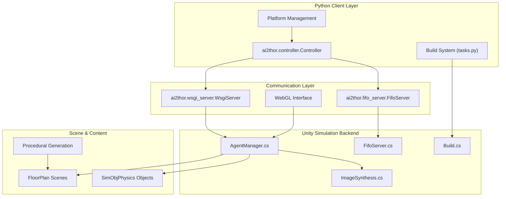
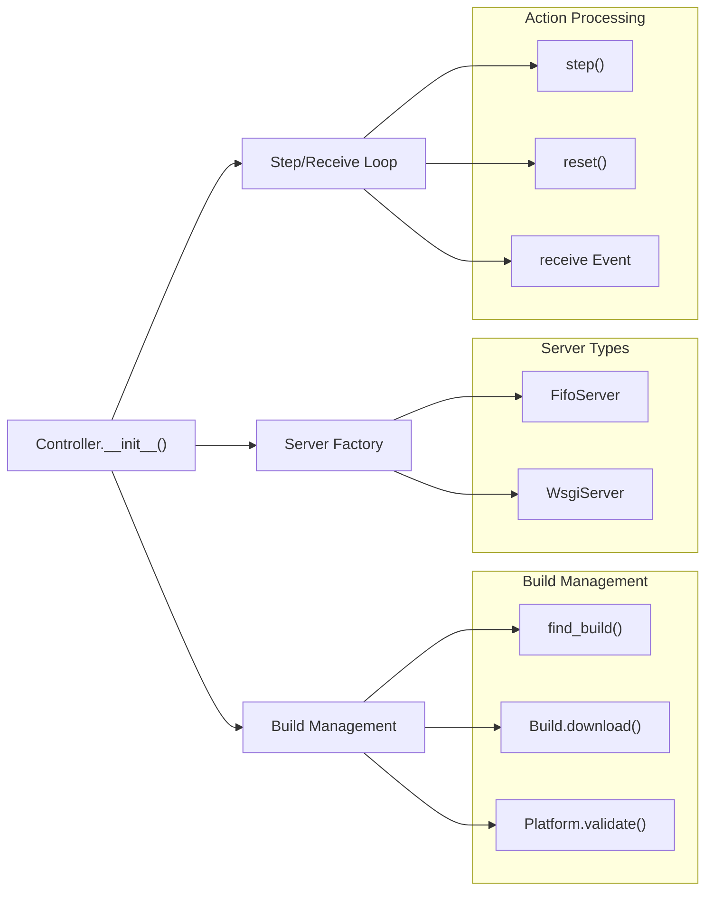
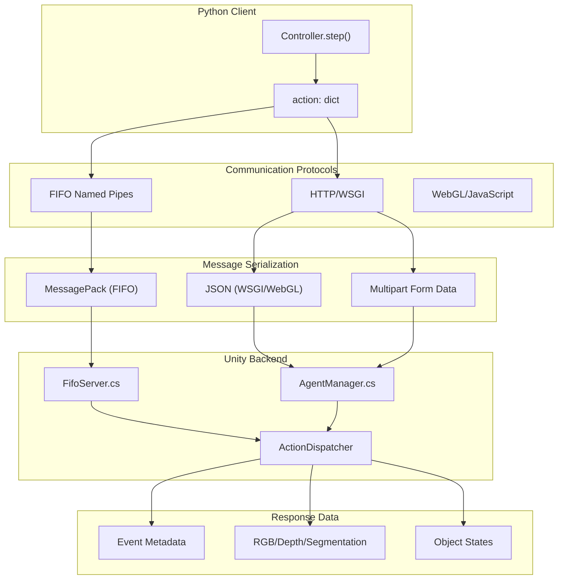
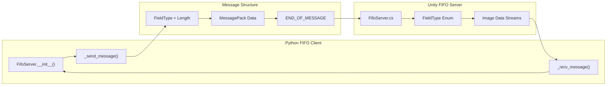
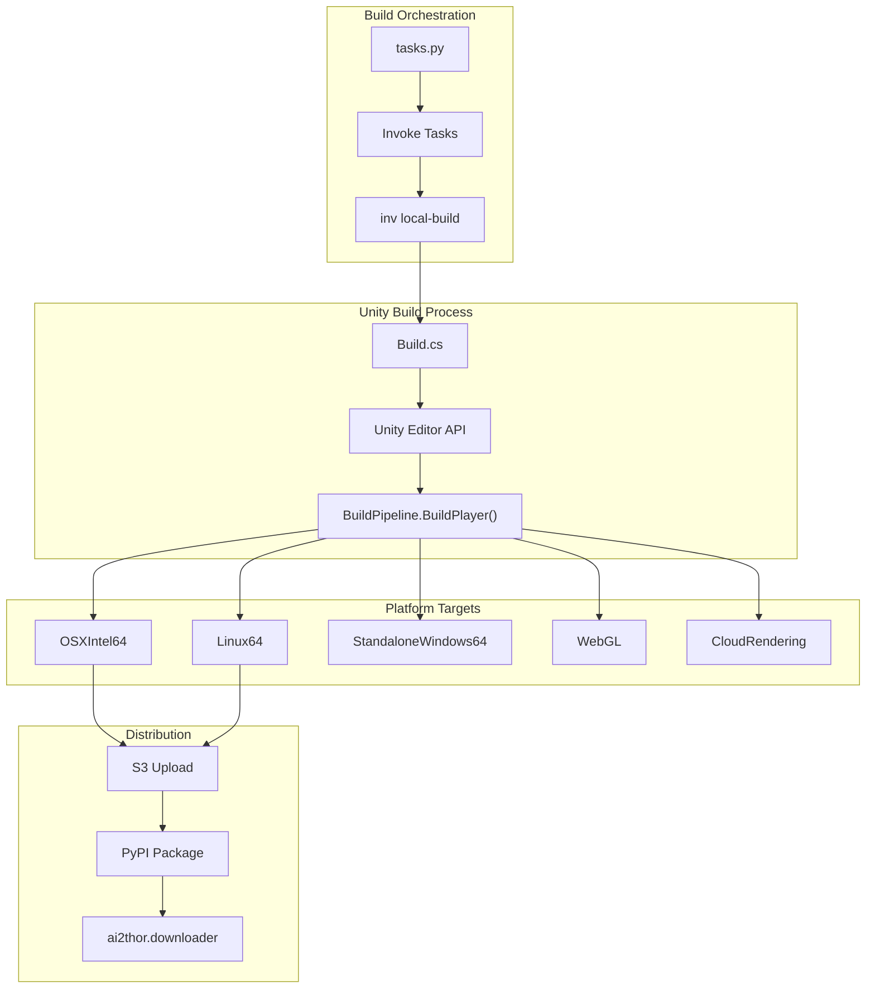
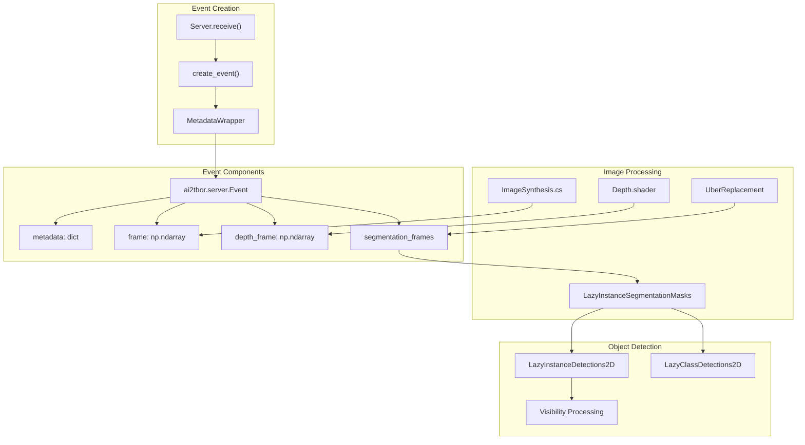
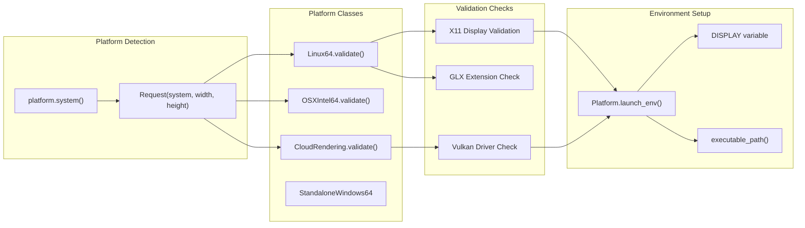

<!-- source: DeepWiki mcp.deepwiki.com · repo allenai/ai2thor · page 1 AI2-THOR Overview · fetched 2026-10-30 -->

# AI2-THOR Overview

Relevant source files

The following files were used as context for generating this wiki page:

- [.dockerignore](.dockerignore)
- [Dockerfile](Dockerfile)
- [README.md](README.md)
- [WEBGL.md](WEBGL.md)
- [ai2thor/__init__.py](ai2thor/__init__.py)
- [ai2thor/build.py](ai2thor/build.py)
- [ai2thor/controller.py](ai2thor/controller.py)
- [ai2thor/docker.py](ai2thor/docker.py)
- [ai2thor/downloader.py](ai2thor/downloader.py)
- [ai2thor/fifo_server.py](ai2thor/fifo_server.py)
- [ai2thor/platform.py](ai2thor/platform.py)
- [ai2thor/server.py](ai2thor/server.py)
- [ai2thor/tests/build_controller.py](ai2thor/tests/build_controller.py)
- [ai2thor/tests/constants.py](ai2thor/tests/constants.py)
- [ai2thor/tests/data/arm/new/pickup_object.json](ai2thor/tests/data/arm/new/pickup_object.json)
- [ai2thor/tests/data/image-depth-data256.raw](ai2thor/tests/data/image-depth-data256.raw)
- [ai2thor/tests/data/image-depth-datafloat32.raw](ai2thor/tests/data/image-depth-datafloat32.raw)
- [ai2thor/tests/fifo_client.py](ai2thor/tests/fifo_client.py)
- [ai2thor/tests/test_controller.py](ai2thor/tests/test_controller.py)
- [ai2thor/tests/test_event.py](ai2thor/tests/test_event.py)
- [ai2thor/tests/test_fifo_server.py](ai2thor/tests/test_fifo_server.py)
- [ai2thor/tests/test_server.py](ai2thor/tests/test_server.py)
- [ai2thor/tests/test_unity.py](ai2thor/tests/test_unity.py)
- [ai2thor/wsgi_server.py](ai2thor/wsgi_server.py)
- [doc/static/ReleaseNotes/Cook.png](doc/static/ReleaseNotes/Cook.png)
- [doc/static/ReleaseNotes/Dirty.png](doc/static/ReleaseNotes/Dirty.png)
- [doc/static/ReleaseNotes/Fill.png](doc/static/ReleaseNotes/Fill.png)
- [doc/static/ReleaseNotes/Moveable.png](doc/static/ReleaseNotes/Moveable.png)
- [doc/static/ReleaseNotes/ReleaseNotes_2.4.md](doc/static/ReleaseNotes/ReleaseNotes_2.4.md)
- [doc/static/ReleaseNotes/Slice.png](doc/static/ReleaseNotes/Slice.png)
- [doc/static/ReleaseNotes/UseUp.png](doc/static/ReleaseNotes/UseUp.png)
- [start.sh](start.sh)
- [tasks.py](tasks.py)
- [unity/Assets/Editor/Build.cs](unity/Assets/Editor/Build.cs)
- [unity/Assets/Physics/SimObjsPhysics/RoboTHOR Objects/RoboTHOR_Assets_SmallObjects/Target_SmallObjects/SprayBottle/Materials.meta](unity/Assets/Physics/SimObjsPhysics/RoboTHOR Objects/RoboTHOR_Assets_SmallObjects/Target_SmallObjects/SprayBottle/Materials.meta)
- [unity/Assets/Resources/MagicMirror/Prefab/MirrorMaterial.mat](unity/Assets/Resources/MagicMirror/Prefab/MirrorMaterial.mat)
- [unity/Assets/Scripts/FifoServer.cs](unity/Assets/Scripts/FifoServer.cs)
- [unity/Assets/Scripts/ImageSynthesis/ImageSynthesis.cs](unity/Assets/Scripts/ImageSynthesis/ImageSynthesis.cs)
- [unity/Assets/Scripts/ImageSynthesis/Shaders/Depth.shader](unity/Assets/Scripts/ImageSynthesis/Shaders/Depth.shader)
- [unity/ProjectSettings/GraphicsSettings.asset](unity/ProjectSettings/GraphicsSettings.asset)

## Purpose and Scope

AI2-THOR is a near photo-realistic interactable framework for embodied AI agents. This document provides an overview of the core system architecture, communication protocols, and key components that enable researchers to create and control AI agents in 3D simulated environments. 

For detailed information about specific agent types and their capabilities, see [Specialized Agent Types](#5). For scene management and procedural generation, see [Scenes and Environments](#6). For object interaction systems, see [Object Interaction System](#7).

## High-Level System Architecture

AI2-THOR operates as a client-server architecture where Python clients communicate with a Unity simulation backend through multiple communication protocols.

**Sources:** [ai2thor/controller.py:1-50](), [tasks.py:1-100](), [unity/Assets/Scripts/AgentManager.cs](), [unity/Assets/Scripts/ImageSynthesis/ImageSynthesis.cs:1-50]()

## Core Python Controller

The `Controller` class serves as the primary entry point for interacting with AI2-THOR simulations. It manages the lifecycle of Unity processes, handles build downloads, and provides the main API for sending actions and receiving observations.

The controller initialization process involves several key phases:

| Phase | Components | Key Classes |
|-------|------------|-------------|
| Platform Detection | `ai2thor.platform` | `Linux64`, `OSXIntel64`, `CloudRendering` |
| Build Management | `ai2thor.build` | `Build`, `EditorBuild`, `ExternalBuild` |
| Server Selection | Communication protocols | `FifoServer`, `WsgiServer` |
| Unity Process | Process management | `subprocess.Popen` |

**Sources:** [ai2thor/controller.py:372-627](), [ai2thor/build.py:110-248](), [ai2thor/platform.py:1-236]()

## Communication Architecture

AI2-THOR supports multiple communication protocols between the Python client and Unity backend, each optimized for different use cases.

### FIFO Server Communication

The FIFO server uses named pipes for high-performance local communication:

**Sources:** [ai2thor/fifo_server.py:56-318](), [unity/Assets/Scripts/FifoServer.cs:1-50](), [ai2thor/fifo_server.py:26-46]()

## Build and Deployment System

The build system manages Unity compilation, asset bundling, and distribution across multiple platforms.

The build system supports environment-driven configuration:

| Environment Variable | Purpose | Code Reference |
|---------------------|---------|----------------|
| `BUILD_SCENES` | Scene selection | [unity/Assets/Editor/Build.cs:190-204]() |
| `INCLUDE_PRIVATE_SCENES` | Private content | [unity/Assets/Editor/Build.cs:224-227]() |
| `BUILD_SCRIPTS_ONLY` | Development builds | [unity/Assets/Editor/Build.cs:219-222]() |
| `UNITY_BUILD_NAME` | Output naming | [unity/Assets/Editor/Build.cs:43-46]() |

**Sources:** [tasks.py:193-250](), [unity/Assets/Editor/Build.cs:83-128](), [ai2thor/build.py:110-248]()

## Event and Observation System

AI2-THOR's observation system provides rich sensory data through the `Event` class, which encapsulates all simulation state and sensor outputs.

**Sources:** [ai2thor/server.py:427-522](), [unity/Assets/Scripts/ImageSynthesis/ImageSynthesis.cs:20-143](), [ai2thor/server.py:59-331]()

## Platform and Dependencies

AI2-THOR adapts to different operating systems and hardware configurations through its platform abstraction layer.

**Sources:** [ai2thor/platform.py:214-227](), [ai2thor/platform.py:150-160](), [ai2thor/platform.py:185-202]()

## Summary

AI2-THOR provides a comprehensive framework for embodied AI research through:

- **Unified Python API**: The `Controller` class abstracts platform differences and communication protocols
- **Multi-protocol Communication**: FIFO pipes for performance, WSGI for compatibility, WebGL for web deployment  
- **Automated Build System**: Cross-platform Unity builds with automated distribution
- **Rich Observation Space**: RGB, depth, segmentation, and structured metadata
- **Platform Flexibility**: Support for Linux, macOS, Windows, and cloud rendering

The system is designed for both local development and large-scale distributed training, with extensive testing and validation frameworks to ensure reliability across different hardware configurations.

**Sources:** [README.md:1-312](), [ai2thor/__init__.py:1-8](), [ai2thor/controller.py:1-100]()

---

