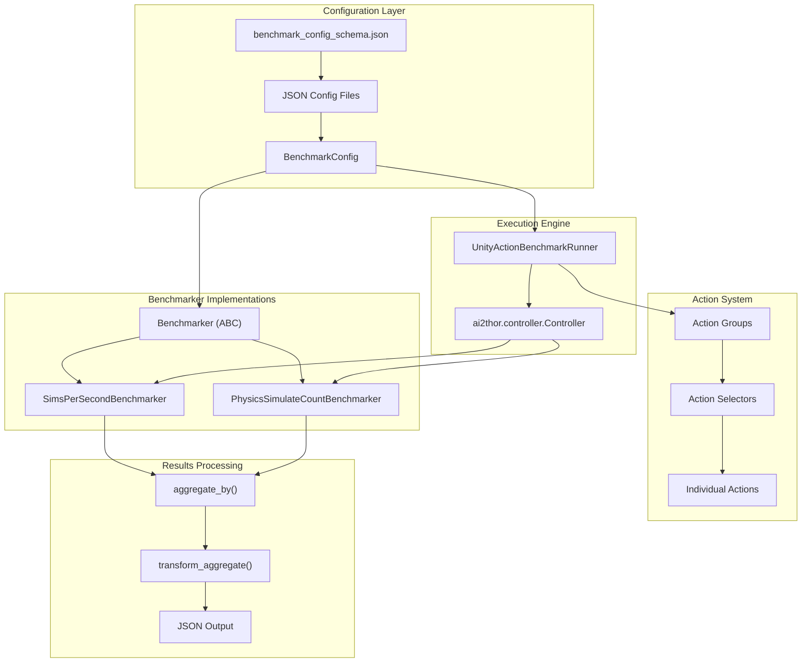
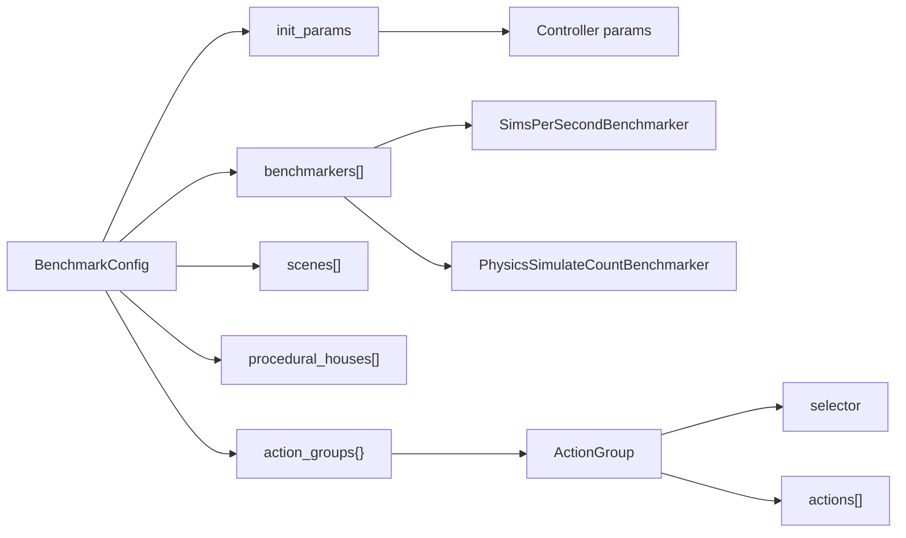
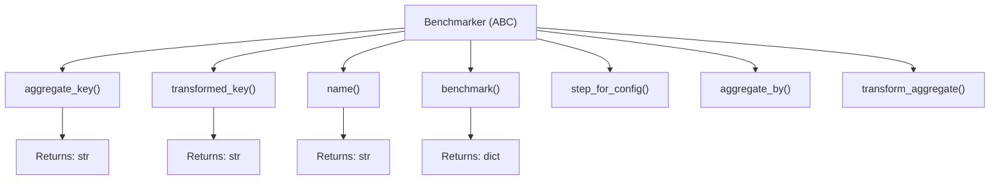
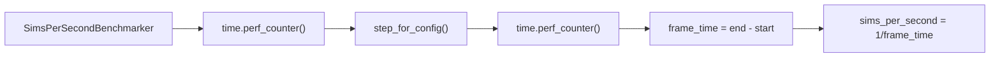
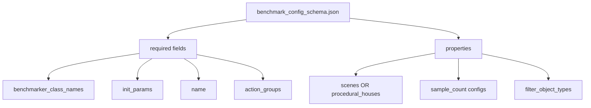
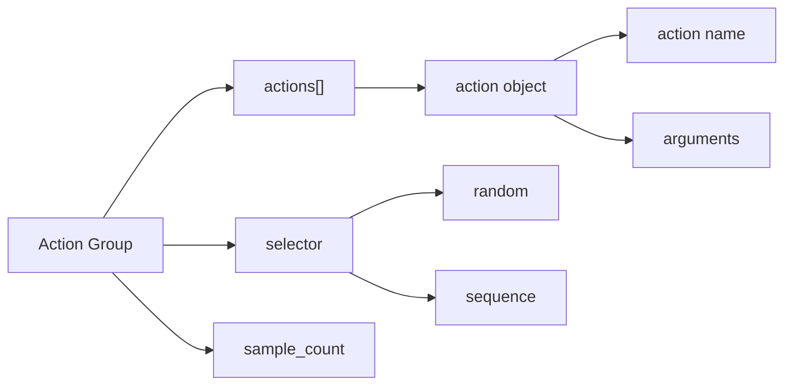
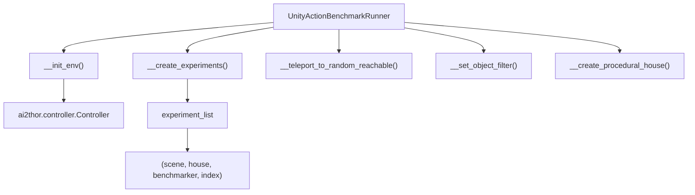
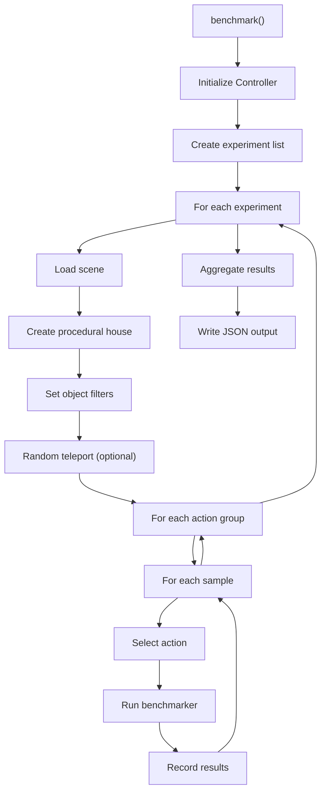
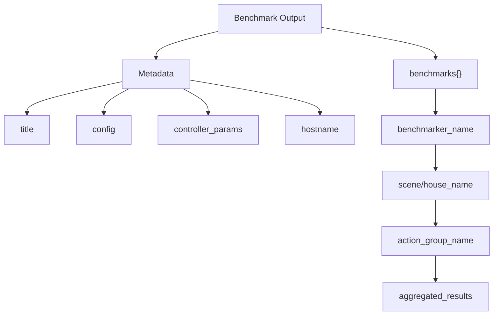

<!-- source: DeepWiki mcp.deepwiki.com · repo allenai/ai2thor · page 10 Performance and Benchmarking · fetched 2026-10-30 -->

# Performance and Benchmarking

Relevant source files

The following files were used as context for generating this wiki page:

- [ai2thor/benchmarking.py](ai2thor/benchmarking.py)
- [ai2thor/benchmarking/benchmark_ab_arm.json](ai2thor/benchmarking/benchmark_ab_arm.json)
- [ai2thor/benchmarking/benchmark_arm.json](ai2thor/benchmarking/benchmark_arm.json)
- [ai2thor/benchmarking/benchmark_config_schema.json](ai2thor/benchmarking/benchmark_config_schema.json)
- [ai2thor/benchmarking/benchmark_stretch_arm.json](ai2thor/benchmarking/benchmark_stretch_arm.json)
- [ai2thor/benchmarking/benchmark_test.json](ai2thor/benchmarking/benchmark_test.json)
- [unity/Assets/Resources/rooms/train_4.json](unity/Assets/Resources/rooms/train_4.json)
- [unity/ProjectSettings/EditorBuildSettings.asset](unity/ProjectSettings/EditorBuildSettings.asset)

This document covers AI2-THOR's performance benchmarking framework, which provides systematic measurement and analysis of simulation performance across different scenarios, agent types, and environments. The framework enables automated testing of frame rates, physics simulation counts, and action execution times.

For information about build system performance optimization, see [Build System and Deployment](#4.2). For specialized agent performance analysis, see [Specialized Agent Types](#5).

## Architecture Overview

The benchmarking system consists of a configurable framework that can execute different types of performance measurements across various scenes and action sequences.

**Sources:** [ai2thor/benchmarking.py:1-685]()

## Core Components

### BenchmarkConfig Class

The `BenchmarkConfig` class serves as the central configuration manager for benchmark runs. It validates benchmarker class names, manages initialization parameters, and configures execution settings.

Key configuration parameters include:
- `benchmarker_class_names`: List of benchmarker implementations to execute
- `init_params`: Controller initialization parameters (width, height, server_type, etc.)
- `action_group_sample_count`: Number of times to sample actions from each group
- `experiment_sample_count`: Number of times to repeat entire experiments
- `filter_object_types`: Object filtering for metadata reduction

**Sources:** [ai2thor/benchmarking.py:28-90]()

### Benchmarker Base Class

The abstract `Benchmarker` class defines the interface for all performance measurement implementations:

**Sources:** [ai2thor/benchmarking.py:92-180]()

## Benchmarker Implementations

### SimsPerSecondBenchmarker

Measures simulation frame rate by timing action execution and converting to simulations per second.

| Method | Purpose | Implementation |
|--------|---------|----------------|
| `aggregate_key()` | Returns `"average_frametime"` | Raw timing measurement |
| `transformed_key()` | Returns `"average_sims_per_second"` | Converts 1/frametime |
| `benchmark()` | Times action execution | Uses `time.perf_counter()` |

**Sources:** [ai2thor/benchmarking.py:182-217]()

### PhysicsSimulateCountBenchmarker

Measures physics simulation overhead by querying the `GetPhysicsSimulateCount` action after each benchmark operation.

| Method | Return Value | Purpose |
|--------|--------------|---------|
| `aggregate_key()` | `"physics_simulate_count"` | Raw simulation count |
| `transformed_key()` | `"average_physics_simulate_count"` | Same as aggregate |
| `benchmark()` | Physics simulation count | Queries Unity physics system |

**Sources:** [ai2thor/benchmarking.py:219-257]()

## Configuration System

### JSON Configuration Files

The framework supports multiple benchmark configurations through JSON files:

- `benchmark_test.json`: Basic movement and rotation actions
- `benchmark_stretch_arm.json`: Stretch robot arm manipulation tests  
- `benchmark_ab_arm.json`: ArticulatedBody arm tests
- `benchmark_arm.json`: Complex arm pickup/drop sequences

**Sources:** [ai2thor/benchmarking/benchmark_test.json:1-72](), [ai2thor/benchmarking/benchmark_stretch_arm.json:1-206]()

### Configuration Schema

The `benchmark_config_schema.json` defines the structure and validation rules for benchmark configurations:

**Sources:** [ai2thor/benchmarking/benchmark_config_schema.json:1-552]()

## Action Groups and Selectors

### Action Group Structure

Action groups organize related actions for systematic testing:

### Selector Types

| Selector | Behavior | Use Case |
|----------|----------|----------|
| `"random"` | Random selection from actions array | Performance variability testing |
| `"sequence"` | Sequential execution of all actions | Deterministic test sequences |

**Sources:** [ai2thor/benchmarking.py:283-295]()

## Execution Engine

### UnityActionBenchmarkRunner

The main execution engine orchestrates benchmark runs across different scenarios:

### Experiment Execution Flow

**Sources:** [ai2thor/benchmarking.py:453-541]()

## Results Aggregation and Output

### Aggregation Dimensions

The framework supports multi-dimensional result aggregation:

| Dimension | Description | Keys |
|-----------|-------------|------|
| By Benchmarker | Overall performance per benchmarker | `"benchmarker"` |
| By Scene | Performance per scene/house | `["scene", "house", "benchmarker"]` |
| By Action Group | Performance per action group | `["scene", "house", "benchmarker", "action_group"]` |
| By Individual Action | Detailed per-action breakdown | `["scene", "house", "benchmarker", "action_group", "action"]` |

### Output Structure

**Sources:** [ai2thor/benchmarking.py:543-684]()

### Transform Functions

Each benchmarker can apply transformations to raw aggregate data:
- `SimsPerSecondBenchmarker`: Converts average frame time to simulations per second
- `PhysicsSimulateCountBenchmarker`: Passes through simulation count unchanged
- Custom benchmarkers can implement domain-specific transformations

**Sources:** [ai2thor/benchmarking.py:212-216](), [ai2thor/benchmarking.py:252-256]()

---

