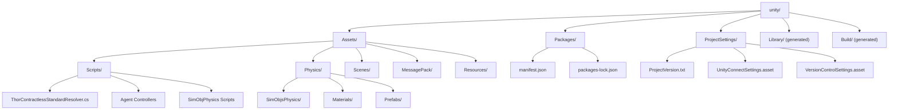
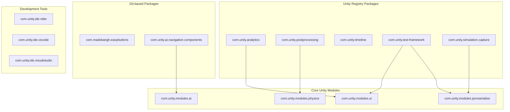
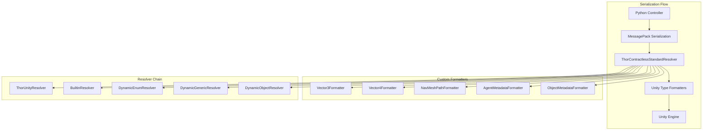
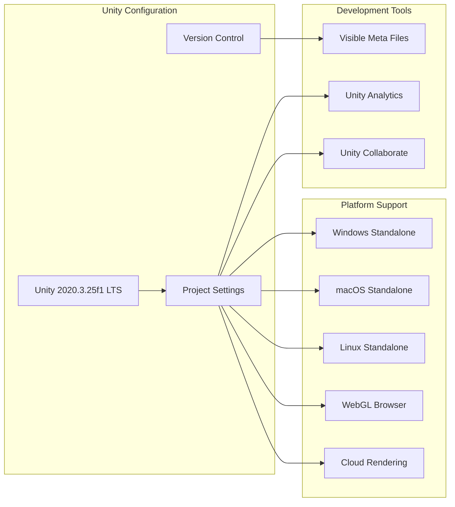

<!-- source: DeepWiki mcp.deepwiki.com · repo allenai/ai2thor · page 11 Unity Project Configuration · fetched 2026-10-30 -->

# Unity Project Configuration

<details>
<summary>Relevant source files</summary>

The following files were used as context for generating this wiki page:

- [.gitignore](.gitignore)
- [unity/Assets/MagicMirror/Prefab/MirrorCameraScript.cs](unity/Assets/MagicMirror/Prefab/MirrorCameraScript.cs)
- [unity/Assets/MessagePack/MessagePackSerializer.NonGeneric.cs](unity/Assets/MessagePack/MessagePackSerializer.NonGeneric.cs)
- [unity/Assets/MessagePack/Resolvers/StandardResolver.cs](unity/Assets/MessagePack/Resolvers/StandardResolver.cs)
- [unity/Assets/MessagePack/Resolvers/TypelessContractlessStandardResolver.cs](unity/Assets/MessagePack/Resolvers/TypelessContractlessStandardResolver.cs)
- [unity/Assets/Physics/SimObjsPhysics/Custom Project Objects/FurnMove.meta](unity/Assets/Physics/SimObjsPhysics/Custom Project Objects/FurnMove.meta)
- [unity/Assets/Scripts/ThorContractlessStandardResolver.cs](unity/Assets/Scripts/ThorContractlessStandardResolver.cs)
- [unity/Packages/manifest.json](unity/Packages/manifest.json)
- [unity/Packages/packages-lock.json](unity/Packages/packages-lock.json)
- [unity/ProjectSettings/ProjectVersion.txt](unity/ProjectSettings/ProjectVersion.txt)
- [unity/ProjectSettings/UnityConnectSettings.asset](unity/ProjectSettings/UnityConnectSettings.asset)
- [unity/ProjectSettings/VersionControlSettings.asset](unity/ProjectSettings/VersionControlSettings.asset)

</details>


This document covers the Unity project setup, dependencies, serialization configuration, and development environment for AI2-THOR. This includes Unity package management, MessagePack serialization customization, and project settings that enable the simulation to run across multiple platforms.

For information about the build system and deployment pipeline, see [Build System and Deployment](#4.2). For details about the Python API that communicates with this Unity project, see [Controller Class](#4.1).

## Unity Project Structure

The AI2-THOR Unity project follows a standard Unity layout with specialized directories for physics simulation, assets, and communication systems. The project structure supports both development and automated build processes.



The project uses Unity 2020.3.25f1 LTS, ensuring stability for the complex physics simulation requirements. Key directories include specialized physics objects, custom MessagePack serialization, and scene management.

**Sources:** [.gitignore:1-133](), [unity/ProjectSettings/ProjectVersion.txt:1-3]()

## Package Dependencies

AI2-THOR relies on several Unity packages to provide core functionality including navigation, testing, analytics, and custom UI components. The package configuration uses both Unity Registry packages and Git-based packages.



The package manifest specifies exact versions to ensure reproducible builds across development environments. Critical packages include:

| Package | Version | Purpose |
|---------|---------|---------|
| `com.unity.ai.navigation.components` | Git package | NavMesh generation for agent navigation |
| `com.unity.postprocessing` | 3.1.1 | Visual rendering enhancements |
| `com.unity.simulation.capture` | 0.0.10-preview.25 | Screenshot and video capture |
| `com.madsbangh.easybuttons` | Git package | Editor UI development tools |
| `com.unity.analytics` | 3.6.12 | Usage analytics and telemetry |

**Sources:** [unity/Packages/manifest.json:1-58](), [unity/Packages/packages-lock.json:1-426]()

## MessagePack Serialization Configuration

AI2-THOR uses a custom MessagePack serialization system to efficiently communicate between the Python API and Unity simulation. The `ThorContractlessStandardResolver` provides specialized formatters for Unity types and maintains compatibility with JSON output formats.



### Custom Type Formatters

The serialization system includes specialized formatters for Unity and AI2-THOR specific types:

- **Vector3Formatter**: Serializes Unity `Vector3` as `{x, y, z}` map format for JSON compatibility
- **Vector4Formatter**: Handles `Vector4` with `{x, y, z, w}` structure 
- **NavMeshPathFormatter**: Serializes `NavMeshPath` including corners array and status
- **AgentMetadataFormatter**: Handles polymorphic agent metadata including `DroneAgentMetadata`
- **ObjectMetadataFormatter**: Manages arrays of `ObjectMetadata` with drone-specific handling

The resolver uses conditional compilation to handle differences between IL2CPP and Mono runtime environments, ensuring compatibility across all target platforms.

**Sources:** [unity/Assets/Scripts/ThorContractlessStandardResolver.cs:1-318](), [unity/Assets/MessagePack/Resolvers/StandardResolver.cs:1-309]()

## Unity Version and Project Settings

The project targets Unity 2020.3.25f1 LTS, providing long-term stability for the simulation environment. Project settings are configured to support multi-platform deployment including WebGL, Windows, macOS, and Linux builds.



### Key Project Settings

| Setting | Value | Purpose |
|---------|--------|---------|
| Unity Version | 2020.3.25f1 | LTS stability for production use |
| Version Control Mode | Visible Meta Files | Git-compatible asset management |
| Unity Analytics | Enabled | Usage tracking and performance metrics |
| Unity Connect | Enabled | Cloud services integration |
| Scripting Backend | IL2CPP/Mono | Platform-specific compilation |

The version control is configured for Git with visible meta files, enabling proper tracking of Unity assets and settings across the development team.

**Sources:** [unity/ProjectSettings/ProjectVersion.txt:1-3](), [unity/ProjectSettings/VersionControlSettings.asset:1-9](), [unity/ProjectSettings/UnityConnectSettings.asset:1-36]()

## Development Environment Setup

The project includes configuration for multiple development environments and IDE integrations. The `.gitignore` file defines comprehensive exclusion patterns for generated Unity files and build artifacts.

### Ignored Files and Directories

The project excludes the following categories of files from version control:

- **Unity Generated**: `Library/`, `Temp/`, `Obj/`, `Build/`, `Logs/`, `UserSettings/`
- **IDE Files**: `.vs/`, `.vscode/`, `.idea/`, `*.csproj`, `*.sln`
- **Build Artifacts**: `*.apk`, `*.unitypackage`, build logs
- **Python Environment**: `venv/`, `.eggs/`, `dist/`, `.pytest_cache`
- **Asset Store**: `AssetStoreTools`, temporary assets
- **Test Files**: `InitTestScene*`, `utf_testResults-*`

### Platform-Specific Configuration

The MessagePack serialization includes platform-specific compilation directives:

```csharp
#if PLATFORM_CLOUD_RENDERING
#undef ENABLE_IL2CPP
#endif
```

This ensures proper serialization behavior when running on cloud rendering platforms where IL2CPP compilation characteristics differ from standard deployments.

**Sources:** [.gitignore:1-133](), [unity/Assets/Scripts/ThorContractlessStandardResolver.cs:1-4]()