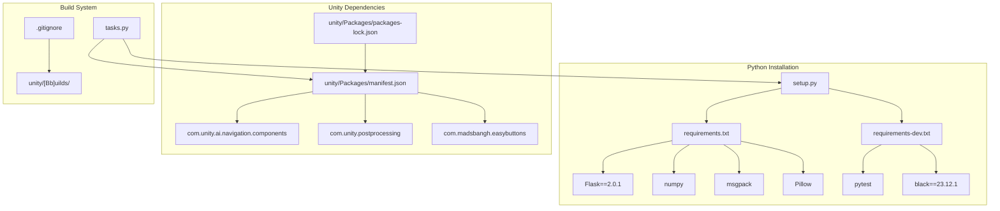
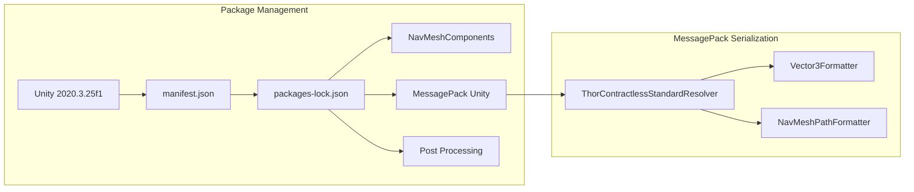
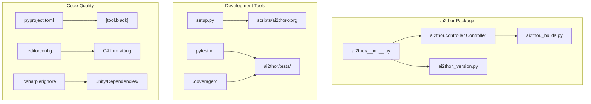
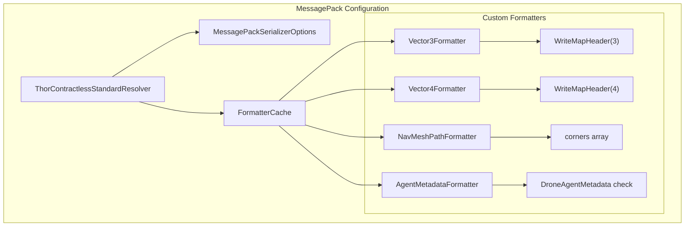
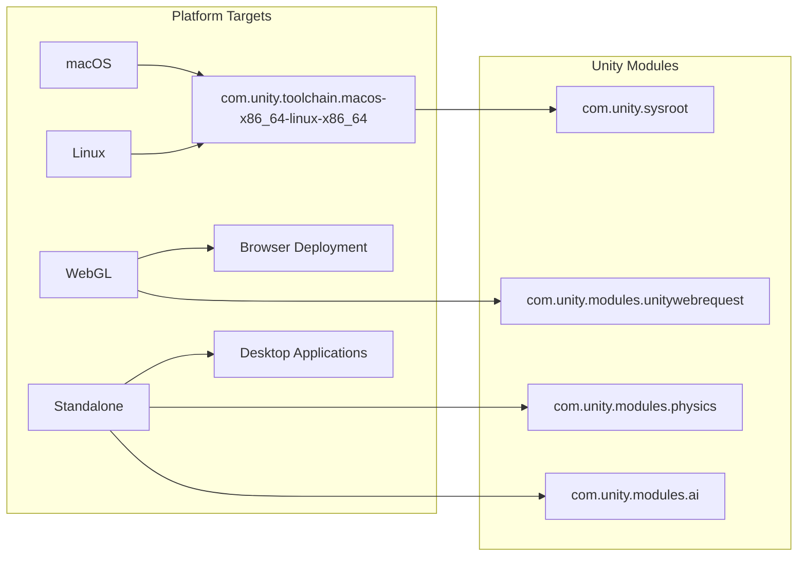
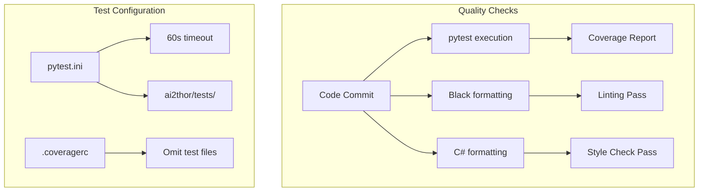

<!-- source: DeepWiki mcp.deepwiki.com · repo allenai/ai2thor · page 2 Installation and Setup · fetched 2026-10-30 -->

# Installation and Setup

<details>
<summary>Relevant source files</summary>

The following files were used as context for generating this wiki page:

- [.coveragerc](.coveragerc)
- [.csharpierignore](.csharpierignore)
- [.editorconfig](.editorconfig)
- [.github/workflows/black.yaml](.github/workflows/black.yaml)
- [.gitignore](.gitignore)
- [CONTRIBUTING.md](CONTRIBUTING.md)
- [ai2thor/tests/__init__.py](ai2thor/tests/__init__.py)
- [pyproject.toml](pyproject.toml)
- [pytest.ini](pytest.ini)
- [requirements-dev.txt](requirements-dev.txt)
- [requirements.txt](requirements.txt)
- [setup.py](setup.py)
- [unity/Assets/MagicMirror/Prefab/MirrorCameraScript.cs](unity/Assets/MagicMirror/Prefab/MirrorCameraScript.cs)
- [unity/Assets/MessagePack/MessagePackSerializer.NonGeneric.cs](unity/Assets/MessagePack/MessagePackSerializer.NonGeneric.cs)
- [unity/Assets/MessagePack/Resolvers/StandardResolver.cs](unity/Assets/MessagePack/Resolvers/StandardResolver.cs)
- [unity/Assets/MessagePack/Resolvers/TypelessContractlessStandardResolver.cs](unity/Assets/MessagePack/Resolvers/TypelessContractlessStandardResolver.cs)
- [unity/Assets/Physics/SimObjsPhysics/Custom Project Objects/FurnMove.meta](unity/Assets/Physics/SimObjsPhysics/Custom Project Objects/FurnMove.meta)
- [unity/Assets/Scripts/ThorContractlessStandardResolver.cs](unity/Assets/Scripts/ThorContractlessStandardResolver.cs)
- [unity/Packages/manifest.json](unity/Packages/manifest.json)
- [unity/Packages/packages-lock.json](unity/Packages/packages-lock.json)
- [unity/ProjectSettings/ProjectVersion.txt](unity/ProjectSettings/ProjectVersion.txt)
- [unity/ProjectSettings/UnityConnectSettings.asset](unity/ProjectSettings/UnityConnectSettings.asset)
- [unity/ProjectSettings/VersionControlSettings.asset](unity/ProjectSettings/VersionControlSettings.asset)

</details>


This document covers the installation and configuration of AI2-THOR, including Python package setup, Unity dependencies, and build system configuration. AI2-THOR is a near photo-realistic interactive framework for embodied AI agents that consists of both Python API components and Unity simulation environments.

For information about using the Python Controller API after installation, see [Controller Class](#4.1). For details about the build system and deployment pipeline, see [Build System and Deployment](#4.2).

## System Requirements and Dependencies

AI2-THOR requires both Python and Unity components to function properly. The framework supports multiple platforms and deployment targets.

### Python Environment Requirements

The Python package supports Python 3.5 through 3.8 as specified in [setup.py:38-43](). The core Python dependencies are managed through requirements files:

| Dependency Category | File | Key Components |
|-------------------|------|----------------|
| Core Runtime | `requirements.txt` | Flask 2.0.1, numpy, PyYAML, requests |
| Communication | `requirements.txt` | msgpack, Werkzeug 2.0.1, compress_pickle |
| Development | `requirements-dev.txt` | pytest, black, jsonschema |

**Installation Flow Diagram**



Sources: [setup.py:1-59](), [requirements.txt:1-16](), [requirements-dev.txt:1-9](), [unity/Packages/manifest.json:1-58]()

### Unity Environment Requirements

The Unity project requires Unity Editor 2020.3.25f1 as specified in [unity/ProjectSettings/ProjectVersion.txt:1-2](). The project uses the Unity Package Manager for dependency management.

**Unity Dependency Resolution**



Sources: [unity/ProjectSettings/ProjectVersion.txt:1-3](), [unity/Packages/manifest.json:11-26](), [unity/Assets/Scripts/ThorContractlessStandardResolver.cs:226-277]()

## Python Package Installation

### Standard Installation

Install the AI2-THOR Python package using pip:

```bash
pip install ai2thor
```

The package is configured through [setup.py:25-59]() with the following key metadata:
- Package name: `ai2thor`
- License: Apache License 2.0
- Platforms: macOS, Unix
- Scripts: `ai2thor-xorg` for X server configuration

### Development Installation

For development work, clone the repository and install in development mode:

```bash
git clone https://github.com/allenai/ai2thor.git
cd ai2thor
pip install -e .
pip install -r requirements-dev.txt
```

**Package Structure and Entry Points**



Sources: [setup.py:53-57](), [pytest.ini:1-6](), [pyproject.toml:1-22](), [.editorconfig:10-25]()

## Unity Development Setup

### Unity Editor Configuration

For Unity development, install Unity 2020.3.25f1 and open the project located in the `unity/` directory. The project configuration includes:

- **Package Dependencies**: Managed through [unity/Packages/manifest.json:11-57]()
- **Project Settings**: Version control, analytics, and editor configurations
- **Build Targets**: Multiple platform support including standalone and WebGL

### MessagePack Serialization Setup

AI2-THOR uses a custom MessagePack serialization system for Unity-Python communication. The key components are:

| Component | File | Purpose |
|-----------|------|---------|
| `ThorContractlessStandardResolver` | [unity/Assets/Scripts/ThorContractlessStandardResolver.cs:226-277]() | Main serialization resolver |
| `Vector3Formatter` | [unity/Assets/Scripts/ThorContractlessStandardResolver.cs:174-224]() | Unity Vector3 serialization |
| `NavMeshPathFormatter` | [unity/Assets/Scripts/ThorContractlessStandardResolver.cs:21-45]() | Navigation mesh path serialization |



Sources: [unity/Assets/Scripts/ThorContractlessStandardResolver.cs:1-318]()

## Build System Configuration

### Environment Setup

The build system uses Python's `invoke` task runner and requires specific environment configurations:

**Gitignore Configuration**: The [.gitignore:1-133]() file excludes build artifacts, temporary files, and platform-specific directories:
- Unity build directories: `unity/[Bb]uilds/`
- Python artifacts: `ai2thor.egg-info/`, `dist/`, `.pytest_cache`
- Generated files: `ai2thor/_builds.py`, `ai2thor/_version.py`

**Code Formatting**: The project enforces consistent code formatting:
- **Python**: Black formatter configured in [pyproject.toml:1-3]() with 100-character line length
- **C#**: EditorConfig rules in [.editorconfig:13-25]() with specific brace and newline preferences

### Platform Support

AI2-THOR supports multiple deployment targets and platforms as configured in the Unity package dependencies:



Sources: [unity/Packages/manifest.json:25](), [unity/Packages/packages-lock.json:145-154](), [setup.py:46-47]()

## Verification and Testing

### Test Configuration

The testing framework is configured through [pytest.ini:1-6]() with the following settings:
- **Test Discovery**: `testpaths = ai2thor/tests/`
- **Logging**: DEBUG level with timestamp formatting
- **Timeout**: 60 seconds per test
- **Coverage**: Configured in [.coveragerc:1-3]() to omit test files

### Development Workflow Verification

After installation, verify the setup by running the test suite:

```bash
# Run tests
pytest

# Run with coverage
pytest --cov=ai2thor

# Format code
invoke format  # Runs black and C# formatting
```

The continuous integration system enforces code formatting through GitHub Actions as configured in [.github/workflows/black.yaml:1-10]().

**Testing and Quality Assurance Flow**



Sources: [pytest.ini:1-6](), [.coveragerc:1-3](), [.github/workflows/black.yaml:1-10](), [CONTRIBUTING.md:16-22]()

---

