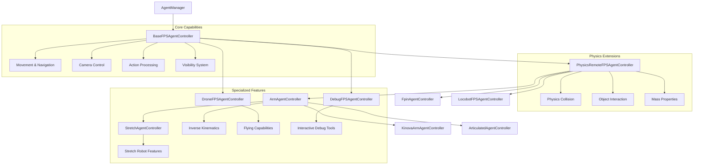
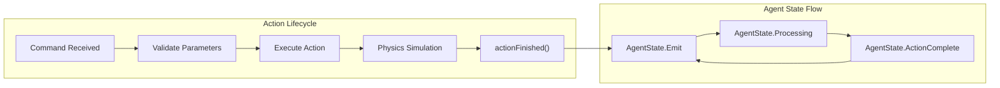
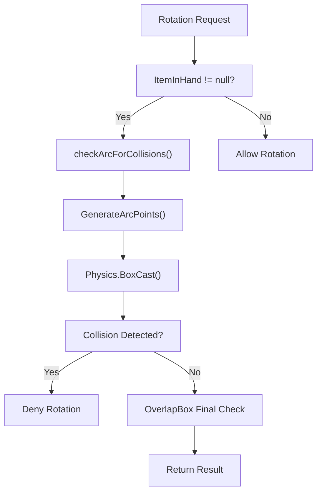
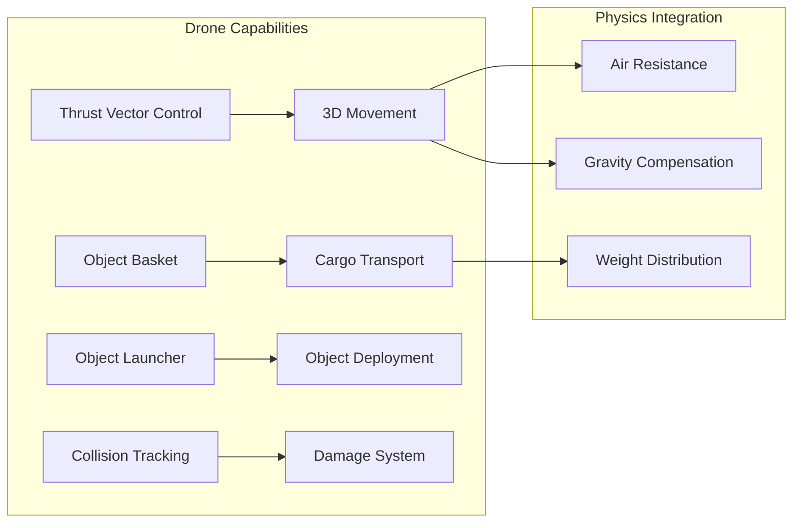
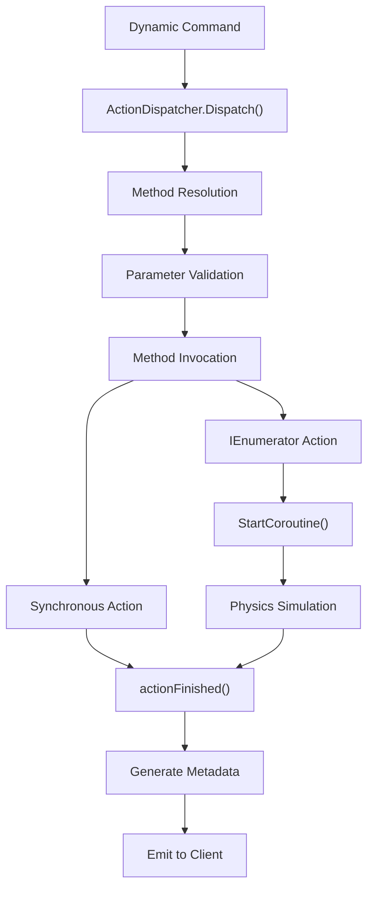

<!-- source: DeepWiki mcp.deepwiki.com · repo allenai/ai2thor · page 3 Core Agent System · fetched 2026-10-30 -->

# Core Agent System

Relevant source files

The following files were used as context for generating this wiki page:

- [ai2thor/hooks/metadata_hook.py](ai2thor/hooks/metadata_hook.py)
- [ai2thor/util/metrics.py](ai2thor/util/metrics.py)
- [ai2thor/util/trials.py](ai2thor/util/trials.py)
- [fpin_tutorial.py](fpin_tutorial.py)
- [unity/Assets/Scenes/FloorPlan_Train2_3/NavMesh.asset](unity/Assets/Scenes/FloorPlan_Train2_3/NavMesh.asset)
- [unity/Assets/Scripts/ActionDispatcher.cs](unity/Assets/Scripts/ActionDispatcher.cs)
- [unity/Assets/Scripts/AgentManager.cs](unity/Assets/Scripts/AgentManager.cs)
- [unity/Assets/Scripts/ArmAgentController.cs](unity/Assets/Scripts/ArmAgentController.cs)
- [unity/Assets/Scripts/ArmController.cs](unity/Assets/Scripts/ArmController.cs)
- [unity/Assets/Scripts/BaseAgentComponent.cs](unity/Assets/Scripts/BaseAgentComponent.cs)
- [unity/Assets/Scripts/BaseFPSAgentController.cs](unity/Assets/Scripts/BaseFPSAgentController.cs)
- [unity/Assets/Scripts/Contains.cs](unity/Assets/Scripts/Contains.cs)
- [unity/Assets/Scripts/ContinuousMovement.cs](unity/Assets/Scripts/ContinuousMovement.cs)
- [unity/Assets/Scripts/DebugDiscreteAgentController.cs](unity/Assets/Scripts/DebugDiscreteAgentController.cs)
- [unity/Assets/Scripts/DebugInputField.cs](unity/Assets/Scripts/DebugInputField.cs)
- [unity/Assets/Scripts/DiscreteHidenSeekAgentController.cs](unity/Assets/Scripts/DiscreteHidenSeekAgentController.cs)
- [unity/Assets/Scripts/DiscretePointClickAgentController.cs](unity/Assets/Scripts/DiscretePointClickAgentController.cs)
- [unity/Assets/Scripts/DroneFPSAgentController.cs](unity/Assets/Scripts/DroneFPSAgentController.cs)
- [unity/Assets/Scripts/FpinAgentController.cs](unity/Assets/Scripts/FpinAgentController.cs)
- [unity/Assets/Scripts/IK_Robot_Arm_Controller.cs](unity/Assets/Scripts/IK_Robot_Arm_Controller.cs)
- [unity/Assets/Scripts/InstantiatePrefabTest.cs](unity/Assets/Scripts/InstantiatePrefabTest.cs)
- [unity/Assets/Scripts/LocobotFPSAgentController.cs](unity/Assets/Scripts/LocobotFPSAgentController.cs)
- [unity/Assets/Scripts/ObjectHighlightController.cs](unity/Assets/Scripts/ObjectHighlightController.cs)
- [unity/Assets/Scripts/PhysicsRemoteFPSAgentController.cs](unity/Assets/Scripts/PhysicsRemoteFPSAgentController.cs)
- [unity/Assets/Scripts/PhysicsSceneManager.cs](unity/Assets/Scripts/PhysicsSceneManager.cs)
- [unity/Assets/Scripts/PlayerControllers.cs](unity/Assets/Scripts/PlayerControllers.cs)
- [unity/Assets/Scripts/RobotArmTest/Stretch_Arm_Solver.cs](unity/Assets/Scripts/RobotArmTest/Stretch_Arm_Solver.cs)
- [unity/Assets/Scripts/RobotArmTest/robot_arm_rig_gripper.prefab](unity/Assets/Scripts/RobotArmTest/robot_arm_rig_gripper.prefab)
- [unity/Assets/Scripts/RobotArmTest/stretch_arm_rig_gripper.prefab](unity/Assets/Scripts/RobotArmTest/stretch_arm_rig_gripper.prefab)
- [unity/Assets/Scripts/SimObjPhysics.cs](unity/Assets/Scripts/SimObjPhysics.cs)
- [unity/Assets/Scripts/SimObjType.cs](unity/Assets/Scripts/SimObjType.cs)
- [unity/Assets/Scripts/StretchAgentController.cs](unity/Assets/Scripts/StretchAgentController.cs)
- [unity/Assets/Scripts/Stretch_Robot_Arm_Controller.cs](unity/Assets/Scripts/Stretch_Robot_Arm_Controller.cs)
- [unity/Assets/Scripts/UtilityFunctions.cs](unity/Assets/Scripts/UtilityFunctions.cs)
- [unity/Assets/Standard Assets/Characters/FirstPersonCharacter/Models/stretch_robot_grp.fbx](unity/Assets/Standard Assets/Characters/FirstPersonCharacter/Models/stretch_robot_grp.fbx)
- [unity/Assets/Standard Assets/Characters/FirstPersonCharacter/Prefabs/FPSController.prefab](unity/Assets/Standard Assets/Characters/FirstPersonCharacter/Prefabs/FPSController.prefab)
- [unity/Assets/UnitTests/TestDispatcher.cs](unity/Assets/UnitTests/TestDispatcher.cs)
- [unity/Assets/UnitTests/TestThirdPartyCameraAndMainCamera.cs](unity/Assets/UnitTests/TestThirdPartyCameraAndMainCamera.cs)
- [unity/ProjectSettings/ProjectSettings.asset](unity/ProjectSettings/ProjectSettings.asset)

## Purpose and Scope

The Core Agent System forms the foundation of AI2-THOR's embodied AI simulation framework, providing a hierarchical architecture for different types of virtual agents that can perceive and interact with 3D environments. This system manages agent initialization, movement, action execution, and physics simulation across multiple specialized agent types including standard first-person controllers, robotic arms, drones, and mobile robots.

For information about scene management and object interaction, see [Object Interaction System](#7). For details about communication protocols and Python API integration, see [Python API and Communication](#4).

## Agent Controller Hierarchy

The agent system is built around an inheritance hierarchy with `BaseFPSAgentController` as the abstract foundation:

**Sources:** [unity/Assets/Scripts/BaseFPSAgentController.cs:28-29](), [unity/Assets/Scripts/PhysicsRemoteFPSAgentController.cs:28](), [unity/Assets/Scripts/AgentManager.cs:33](), [unity/Assets/Scripts/ArmAgentController.cs:11]()

## BaseFPSAgentController Foundation

The `BaseFPSAgentController` class provides core functionality shared by all agent types:

### Core Components and Properties

| Component | Purpose | Key Properties |
|-----------|---------|----------------|
| `BaseAgentComponent` | Unity MonoBehaviour wrapper | Camera, hand transforms, visibility capsules |
| `CharacterController` | Unity physics movement | Collision detection, ground constraints |
| `AgentManager` | Scene-level coordination | Multi-agent management, bounds tracking |
| `PhysicsSceneManager` | Physics simulation control | Object spawning, scene setup |

### Essential Agent State Management

The agent system maintains several critical state variables:

**Sources:** [unity/Assets/Scripts/BaseFPSAgentController.cs:196](), [unity/Assets/Scripts/BaseFPSAgentController.cs:294-312](), [unity/Assets/Scripts/BaseFPSAgentController.cs:445-479]()

### Movement and Navigation System

The base controller implements grid-based and continuous movement through several key methods:

- `getReachablePositions()` - Computes valid agent positions using capsule casting
- `CastBodyTrayectory()` - Physics-based collision detection for movement validation  
- `handObjectCanFitInPosition()` - Validates positions considering held objects

**Sources:** [unity/Assets/Scripts/BaseFPSAgentController.cs:526-711](), [unity/Assets/Scripts/BaseFPSAgentController.cs:1459-1515]()

## PhysicsRemoteFPSAgentController Extensions

The `PhysicsRemoteFPSAgentController` extends the base class with physics-based capabilities:

### Physics Integration Features

| Feature | Implementation | Purpose |
|---------|---------------|---------|
| Object Pickup/Drop | `PickupObject()`, `DropHandObject()` | Manipulate scene objects |
| Temperature System | `SetTemperatureDecayTime()` | Object state management |
| Mass Properties | `SetMassProperties()` | Dynamic physics tuning |
| Collision Handling | `CheckIfAgentCanRotate()` | Movement validation |

### Rotation and Look Controls

The physics controller implements sophisticated rotation checking to prevent object collisions:

**Sources:** [unity/Assets/Scripts/PhysicsRemoteFPSAgentController.cs:687-734](), [unity/Assets/Scripts/PhysicsRemoteFPSAgentController.cs:513-625]()

## Specialized Agent Types

### ArmAgentController for Robotic Manipulation

The `ArmAgentController` provides a foundation for robotic arm simulation with several concrete implementations:

| Controller Type | Use Case | Key Features |
|----------------|----------|--------------|
| `StretchAgentController` | Stretch Research Robot | Telescoping arm, dual cameras |
| `KinovaArmAgentController` | Kinova robotic arm | 6-DOF manipulation |
| `ArticulatedAgentController` | General articulated robots | Multi-joint coordination |

**Sources:** [unity/Assets/Scripts/ArmAgentController.cs:11-13](), [unity/Assets/Scripts/StretchAgentController.cs:12]()

### DroneFPSAgentController for Aerial Agents

The drone controller implements 3D movement with physics constraints:

**Sources:** [unity/Assets/Scripts/DroneFPSAgentController.cs:12](), [unity/Assets/Scripts/DroneFPSAgentController.cs:16-22]()

## Agent Lifecycle and Coordination

### Initialization Process

Agent initialization follows a structured sequence managed by `AgentManager`:

1. **Controller Selection** - `SetUpPhysicsController()`, `SetUpArmController()`, etc.
2. **Body Initialization** - `InitializeBody()` sets physical parameters
3. **Camera Setup** - Field of view, clipping planes, render targets
4. **Physics Configuration** - Collision detection, mass properties
5. **Multi-agent Coordination** - Position validation for additional agents

**Sources:** [unity/Assets/Scripts/AgentManager.cs:219-372](), [unity/Assets/Scripts/BaseFPSAgentController.cs:745-912]()

### Action Execution Framework

The system uses `ActionDispatcher` to route commands to appropriate agent methods:

**Sources:** [unity/Assets/Scripts/ActionDispatcher.cs:73-92](), [unity/Assets/Scripts/BaseFPSAgentController.cs:445-512]()

## Communication and Control Interface

### Multi-Modal Communication

The agent system supports multiple communication protocols through `AgentManager`:

| Protocol | Implementation | Use Case |
|----------|---------------|----------|
| WSGI Server | `WsgiServer` | HTTP-based communication |
| FIFO Pipes | `FifoServer.Client` | Named pipe communication |
| WebGL Interface | `JavaScriptInterface` | Browser-based control |

### Debug and Development Tools

The `DebugInputField` provides interactive development capabilities:

- Text-based command input with auto-completion
- Real-time agent state visualization  
- Multi-agent switching and control
- Physics parameter tuning

**Sources:** [unity/Assets/Scripts/AgentManager.cs:72-77](), [unity/Assets/Scripts/AgentManager.cs:143-158](), [unity/Assets/Scripts/DebugInputField.cs:16-17]()

### Metadata and State Reporting

Each agent generates comprehensive metadata through `generateMetadataWrapper()`:

- Agent position, rotation, and camera parameters
- Visible object inventories with distance and visibility data
- Physics state including velocity and collision status
- Specialized data for arm positions, drone status, etc.

**Sources:** [unity/Assets/Scripts/BaseFPSAgentController.cs:3023-3122](), [unity/Assets/Scripts/PhysicsRemoteFPSAgentController.cs:203-207]()

---

