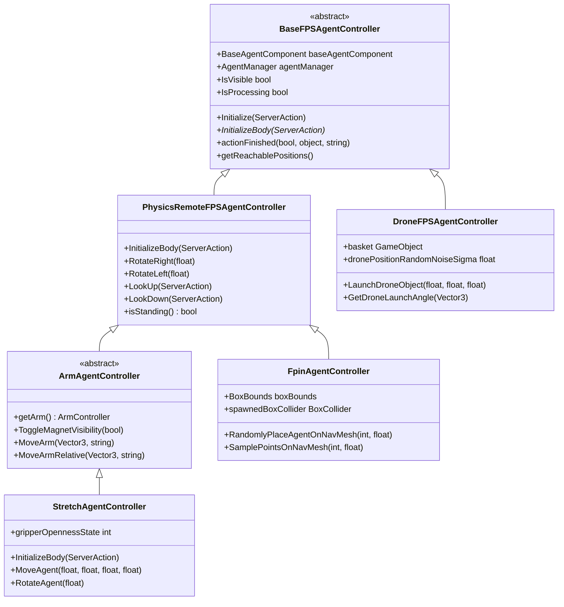
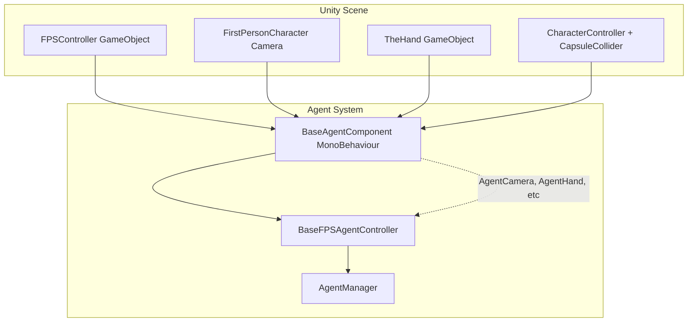
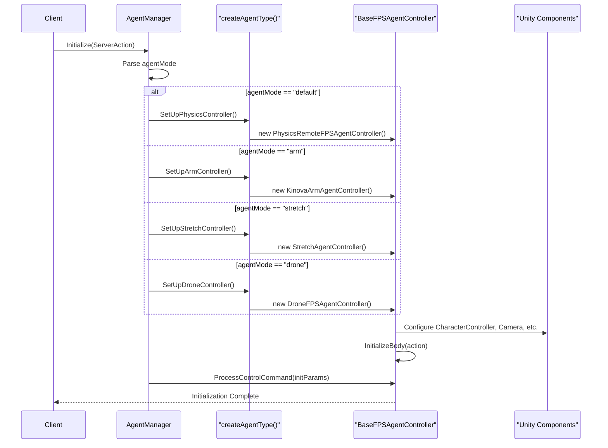
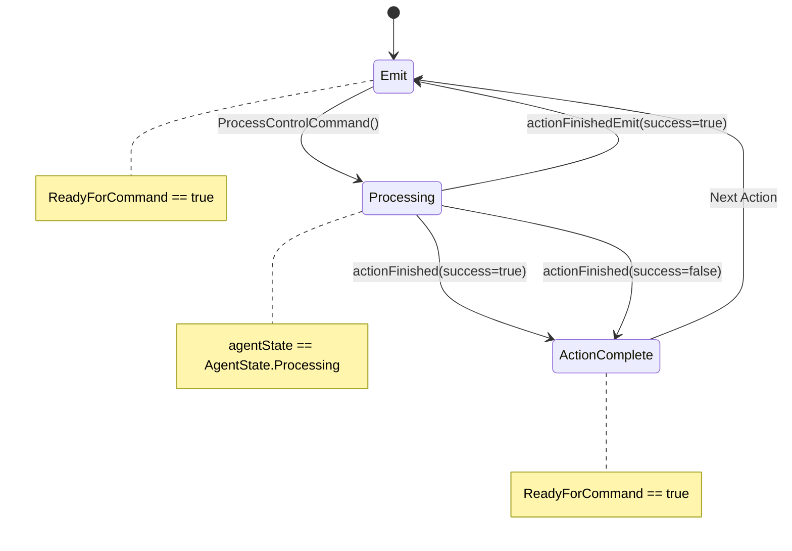
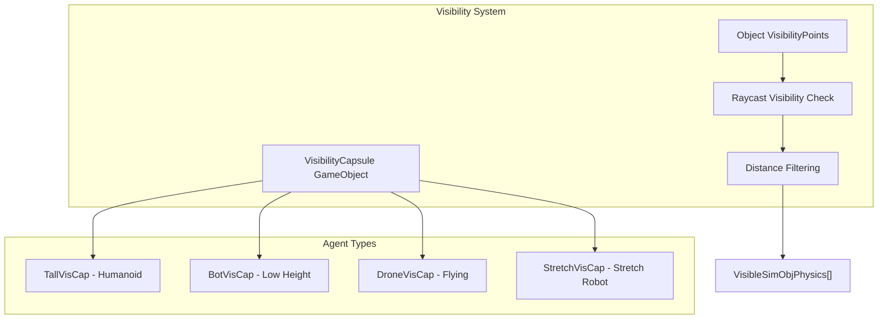
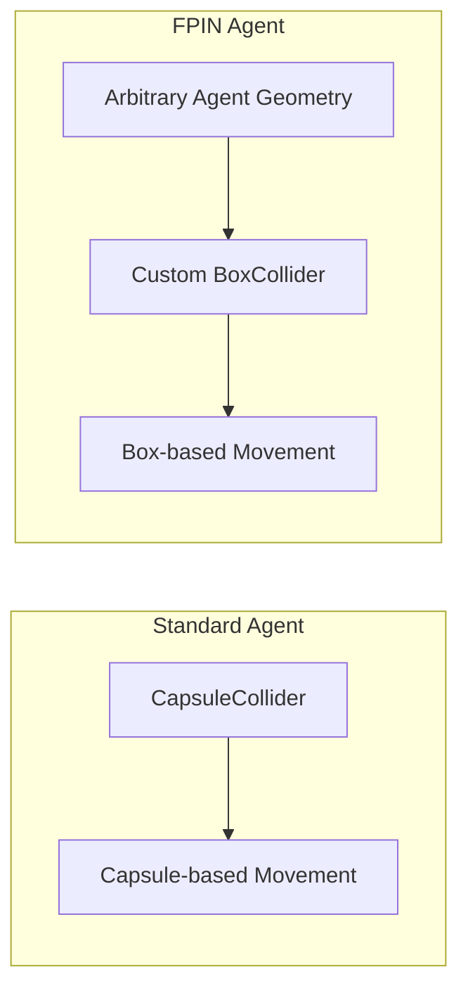

<!-- source: DeepWiki mcp.deepwiki.com · repo allenai/ai2thor · page 3.1 Agent Controllers · fetched 2026-10-30 -->

# Agent Controllers

Relevant source files

The following files were used as context for generating this wiki page:

- [ai2thor/hooks/metadata_hook.py](ai2thor/hooks/metadata_hook.py)
- [ai2thor/util/metrics.py](ai2thor/util/metrics.py)
- [ai2thor/util/trials.py](ai2thor/util/trials.py)
- [fpin_tutorial.py](fpin_tutorial.py)
- [unity/Assets/Scenes/FloorPlan_Train2_3/NavMesh.asset](unity/Assets/Scenes/FloorPlan_Train2_3/NavMesh.asset)
- [unity/Assets/Scripts/ActionDispatcher.cs](unity/Assets/Scripts/ActionDispatcher.cs)
- [unity/Assets/Scripts/AgentManager.cs](unity/Assets/Scripts/AgentManager.cs)
- [unity/Assets/Scripts/ArmAgentController.cs](unity/Assets/Scripts/ArmAgentController.cs)
- [unity/Assets/Scripts/ArmController.cs](unity/Assets/Scripts/ArmController.cs)
- [unity/Assets/Scripts/BaseAgentComponent.cs](unity/Assets/Scripts/BaseAgentComponent.cs)
- [unity/Assets/Scripts/BaseFPSAgentController.cs](unity/Assets/Scripts/BaseFPSAgentController.cs)
- [unity/Assets/Scripts/Contains.cs](unity/Assets/Scripts/Contains.cs)
- [unity/Assets/Scripts/ContinuousMovement.cs](unity/Assets/Scripts/ContinuousMovement.cs)
- [unity/Assets/Scripts/DebugDiscreteAgentController.cs](unity/Assets/Scripts/DebugDiscreteAgentController.cs)
- [unity/Assets/Scripts/DebugInputField.cs](unity/Assets/Scripts/DebugInputField.cs)
- [unity/Assets/Scripts/DiscreteHidenSeekAgentController.cs](unity/Assets/Scripts/DiscreteHidenSeekAgentController.cs)
- [unity/Assets/Scripts/DiscretePointClickAgentController.cs](unity/Assets/Scripts/DiscretePointClickAgentController.cs)
- [unity/Assets/Scripts/DroneFPSAgentController.cs](unity/Assets/Scripts/DroneFPSAgentController.cs)
- [unity/Assets/Scripts/FpinAgentController.cs](unity/Assets/Scripts/FpinAgentController.cs)
- [unity/Assets/Scripts/IK_Robot_Arm_Controller.cs](unity/Assets/Scripts/IK_Robot_Arm_Controller.cs)
- [unity/Assets/Scripts/InstantiatePrefabTest.cs](unity/Assets/Scripts/InstantiatePrefabTest.cs)
- [unity/Assets/Scripts/LocobotFPSAgentController.cs](unity/Assets/Scripts/LocobotFPSAgentController.cs)
- [unity/Assets/Scripts/ObjectHighlightController.cs](unity/Assets/Scripts/ObjectHighlightController.cs)
- [unity/Assets/Scripts/PhysicsRemoteFPSAgentController.cs](unity/Assets/Scripts/PhysicsRemoteFPSAgentController.cs)
- [unity/Assets/Scripts/PhysicsSceneManager.cs](unity/Assets/Scripts/PhysicsSceneManager.cs)
- [unity/Assets/Scripts/PlayerControllers.cs](unity/Assets/Scripts/PlayerControllers.cs)
- [unity/Assets/Scripts/RobotArmTest/Stretch_Arm_Solver.cs](unity/Assets/Scripts/RobotArmTest/Stretch_Arm_Solver.cs)
- [unity/Assets/Scripts/RobotArmTest/robot_arm_rig_gripper.prefab](unity/Assets/Scripts/RobotArmTest/robot_arm_rig_gripper.prefab)
- [unity/Assets/Scripts/RobotArmTest/stretch_arm_rig_gripper.prefab](unity/Assets/Scripts/RobotArmTest/stretch_arm_rig_gripper.prefab)
- [unity/Assets/Scripts/SimObjPhysics.cs](unity/Assets/Scripts/SimObjPhysics.cs)
- [unity/Assets/Scripts/SimObjType.cs](unity/Assets/Scripts/SimObjType.cs)
- [unity/Assets/Scripts/StretchAgentController.cs](unity/Assets/Scripts/StretchAgentController.cs)
- [unity/Assets/Scripts/Stretch_Robot_Arm_Controller.cs](unity/Assets/Scripts/Stretch_Robot_Arm_Controller.cs)
- [unity/Assets/Scripts/UtilityFunctions.cs](unity/Assets/Scripts/UtilityFunctions.cs)
- [unity/Assets/Standard Assets/Characters/FirstPersonCharacter/Models/stretch_robot_grp.fbx](unity/Assets/Standard Assets/Characters/FirstPersonCharacter/Models/stretch_robot_grp.fbx)
- [unity/Assets/Standard Assets/Characters/FirstPersonCharacter/Prefabs/FPSController.prefab](unity/Assets/Standard Assets/Characters/FirstPersonCharacter/Prefabs/FPSController.prefab)
- [unity/Assets/UnitTests/TestDispatcher.cs](unity/Assets/UnitTests/TestDispatcher.cs)
- [unity/Assets/UnitTests/TestThirdPartyCameraAndMainCamera.cs](unity/Assets/UnitTests/TestThirdPartyCameraAndMainCamera.cs)
- [unity/ProjectSettings/ProjectSettings.asset](unity/ProjectSettings/ProjectSettings.asset)

## Purpose and Scope

This page documents the agent controller system in AI2-THOR, which provides the core abstraction for embodied AI agents that can perceive and interact with simulated environments. Agent controllers handle movement, vision, object interaction, and action processing for different types of agents including humanoid agents, robotic arms, drones, and specialized research platforms.

For information about agent coordination and multi-agent scenarios, see [Agent Manager and Coordination](#3.2). For details about specific robotic arm implementations, see [Articulated Agents](#5.1).

## Core Architecture

The agent controller system is built around a hierarchical class structure with `BaseFPSAgentController` as the abstract base class that defines the core interface and functionality for all agents.

### Agent Controller Class Hierarchy

**Sources:** [unity/Assets/Scripts/BaseFPSAgentController.cs:29-431](), [unity/Assets/Scripts/PhysicsRemoteFPSAgentController.cs:28-41](), [unity/Assets/Scripts/ArmAgentController.cs:11-15](), [unity/Assets/Scripts/StretchAgentController.cs:12-37](), [unity/Assets/Scripts/FpinAgentController.cs:67-107](), [unity/Assets/Scripts/DroneFPSAgentController.cs:12-23]()

### Unity Component Integration

Agent controllers integrate with Unity's component system through `BaseAgentComponent`, which holds references to Unity GameObjects and provides the bridge between the agent logic and the Unity scene.

**Sources:** [unity/Assets/Scripts/BaseAgentComponent.cs:6-18](), [unity/Assets/Scripts/BaseFPSAgentController.cs:34-81](), [unity/Assets/Standard Assets/Characters/FirstPersonCharacter/Prefabs/FPSController.prefab:114-206]()

## Agent Initialization Process

The agent initialization process is coordinated by `AgentManager` and involves several distinct phases: agent type selection, controller instantiation, body initialization, and parameter configuration.

### Agent Manager Initialization Flow

**Sources:** [unity/Assets/Scripts/AgentManager.cs:219-300](), [unity/Assets/Scripts/AgentManager.cs:409-441](), [unity/Assets/Scripts/AgentManager.cs:422-431]()

### Agent Type Factory Methods

The `AgentManager` uses dedicated factory methods to create different types of agents:

| Factory Method | Agent Type | Controller Class | Key Features |
|---|---|---|---|
| `SetUpPhysicsController()` | Default | PhysicsRemoteFPSAgentController | Basic physics-based movement |
| `SetUpLocobotController()` | Locobot | LocobotFPSAgentController | Continuous movement mode |
| `SetUpArmController()` | Arm | KinovaArmAgentController | Robotic arm manipulation |
| `SetUpStretchController()` | Stretch | StretchAgentController | Stretch robot platform |
| `SetUpDroneController()` | Drone | DroneFPSAgentController | Flying agent capabilities |
| `SetUpFpinController()` | FPIN | FpinAgentController | Custom geometry agents |

**Sources:** [unity/Assets/Scripts/AgentManager.cs:374-441]()

## Core Agent Functionality

### Action Processing and State Management

All agents inherit core action processing capabilities from `BaseFPSAgentController`. The system uses a state machine to manage action execution:

**Sources:** [unity/Assets/Scripts/BaseFPSAgentController.cs:196-512](), [unity/Assets/Scripts/BaseFPSAgentController.cs:294-312](), [unity/Assets/Scripts/BaseFPSAgentController.cs:434-512]()

### Movement and Navigation

The base controller provides fundamental movement capabilities that are extended by specialized agents:

- **Grid-based Movement**: Discrete movement on a configurable grid system
- **Continuous Movement**: Smooth interpolated movement for specialized agents  
- **Collision Detection**: Physics-based collision checking using Unity's CharacterController
- **Reachable Positions**: Algorithmic calculation of valid agent positions

**Sources:** [unity/Assets/Scripts/BaseFPSAgentController.cs:526-733](), [unity/Assets/Scripts/PhysicsRemoteFPSAgentController.cs:445-511]()

### Visibility and Perception System

Agents use a sophisticated visibility system to determine which objects can be perceived:

**Sources:** [unity/Assets/Scripts/BaseFPSAgentController.cs:83-101](), [unity/Assets/Scripts/BaseFPSAgentController.cs:279-292](), [unity/Assets/Scripts/BaseFPSAgentController.cs:48]()

## Specialized Agent Implementations

### Physics Remote Agent Controller

`PhysicsRemoteFPSAgentController` serves as the standard implementation for most embodied AI research scenarios. It provides physics-based movement with collision detection and supports both discrete and continuous actions.

Key capabilities include:
- **Rotation Actions**: `RotateRight()`, `RotateLeft()` with collision checking for held objects
- **Look Actions**: `LookUp()`, `LookDown()` with configurable angle limits  
- **Standing State**: `isStanding()` detection for tall humanoid agents
- **Object Interaction**: Physics-based pickup and manipulation

**Sources:** [unity/Assets/Scripts/PhysicsRemoteFPSAgentController.cs:43-68](), [unity/Assets/Scripts/PhysicsRemoteFPSAgentController.cs:445-511](), [unity/Assets/Scripts/PhysicsRemoteFPSAgentController.cs:176-201]()

### FPIN Agent Controller

`FpinAgentController` enables research with agents of arbitrary geometries by replacing the standard capsule collider with custom box colliders:

**Sources:** [unity/Assets/Scripts/FpinAgentController.cs:67-102](), [unity/Assets/Scripts/FpinAgentController.cs:113-134](), [unity/Assets/Scripts/FpinAgentController.cs:268-307]()

### Drone Agent Controller

`DroneFPSAgentController` provides flying agent capabilities with unique physics and interaction models:

- **3D Movement**: Full 6-DOF movement including vertical thrust
- **Object Launching**: `LaunchDroneObject()` for projectile interactions
- **Basket Collection**: Object collection and transport capabilities
- **Noise Simulation**: Configurable position noise for realistic flight dynamics

**Sources:** [unity/Assets/Scripts/DroneFPSAgentController.cs:12-23](), [unity/Assets/Scripts/DroneFPSAgentController.cs:16-22]()

This agent controller system provides the foundation for all embodied AI research in AI2-THOR, with each controller type optimized for specific research domains while maintaining a consistent interface and integration with the broader simulation framework.

---

